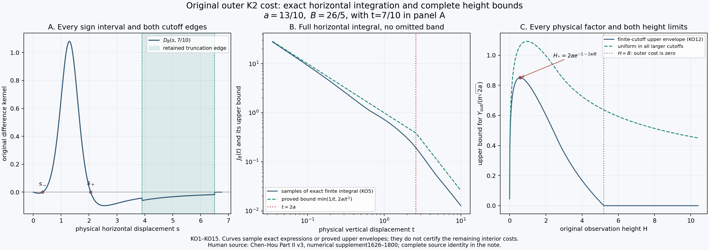
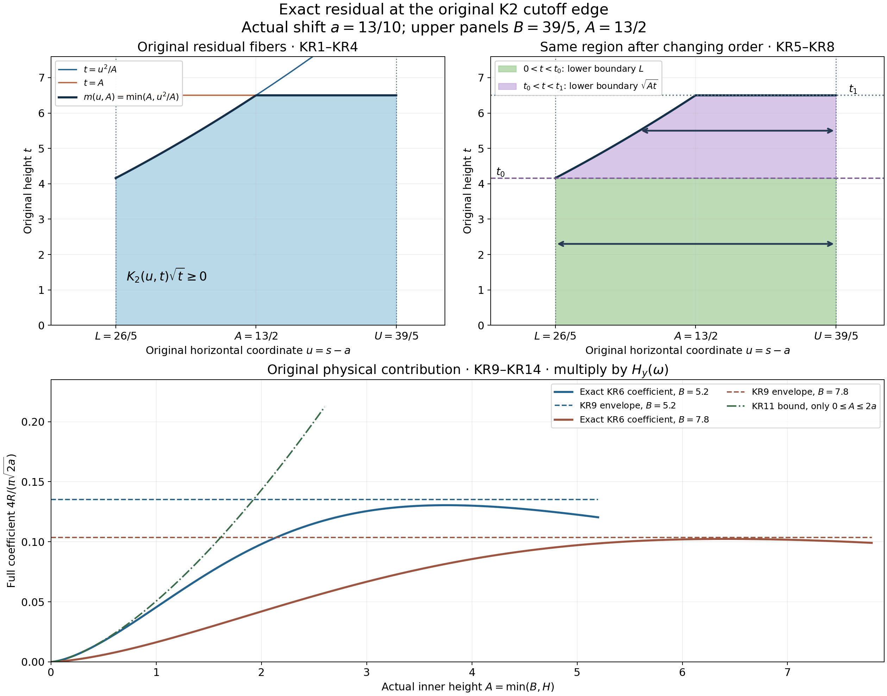
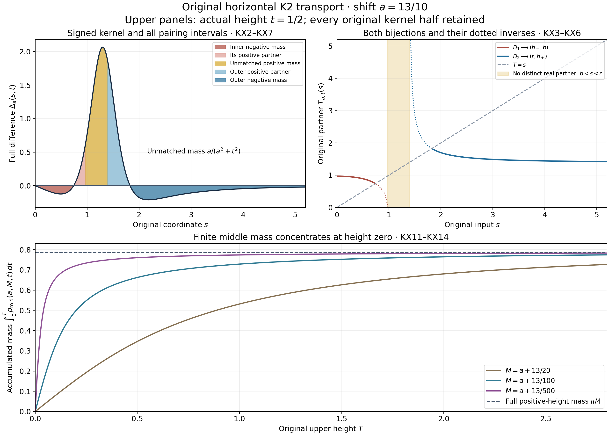
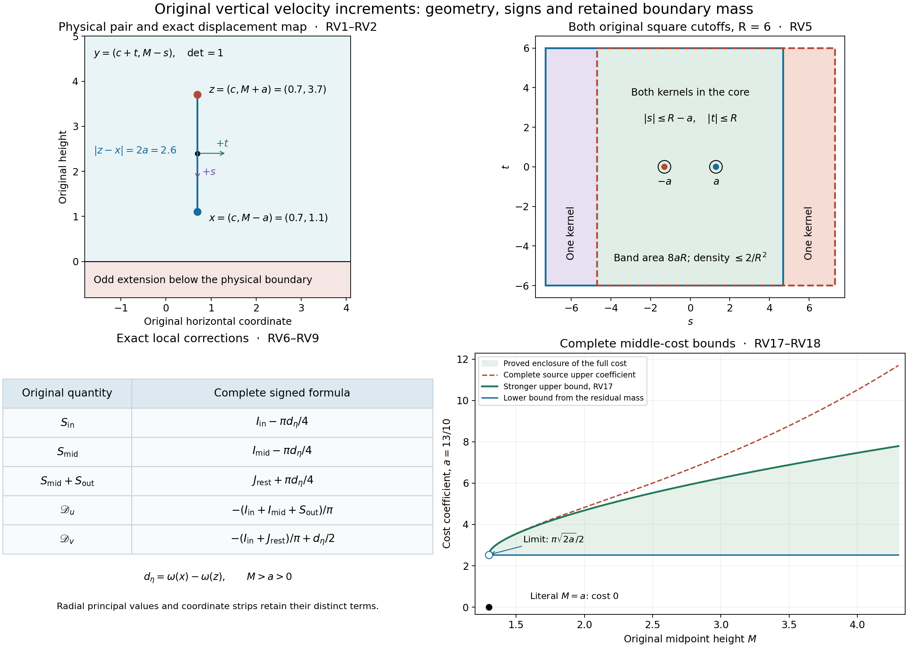
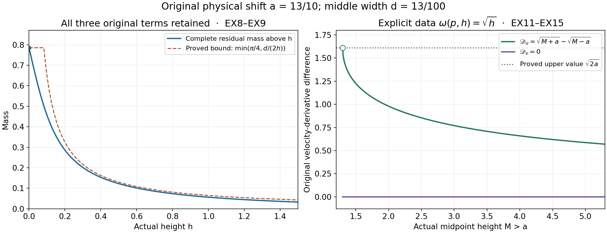

# Original K2 bounds and vertical velocity increments

This lesson continues the physical transport estimates from lesson52.
It evaluates the outer and residual-edge contributions, constructs every
horizontal partner and unmatched measure, and proves the original vertical
velocity increments with all cutoff bands and local terms.

Part 1 retains the complete finite outer-height bound. Part 2 evaluates
the residual edge at every original endpoint and proves parameter-cell
bounds. Part 3 repairs the source primitive sign and proves both exact
partner maps and the concentrating middle measure. Part 4 carries these
results into the actual physical velocity differences and proves a
stronger middle estimate, valid at every positive middle width.

The five solved exercises maximize the finite outer envelope, strengthen
a complete residual-edge cell, quantify the full measure concentration,
test both local cancellations on explicit vorticity data, and carry the
improved middle bound through an entire physical cell.

The human sources are Jiajie Chen and Thomas Y. Hou. Source statements,
their precise corrections and the consequences are identified beside
the complete proofs. The source partner lemma and final middle bound
survive the corrected intermediate formulas. Remaining directional arrays
and the complete computational stability theorem remain under audit.

## Part 1. Original outer K2 cost: exact horizontal integration and full height bounds
This calculation continues PV25–PV29 at the original physical pair. Human source: Jiajie Chen and Thomas Y. Hou, [Part II v3](https://arxiv.org/abs/2305.05660v3), original `euler_supp_Part2.tex`, SHA-256 `91fbe8b67384412903f851ccaeaa541cfe1f9658122e0f438d3ba064054dfc1b`, lines 1626–1800; the truncation comparison is Lemma `lem:comp_trunc`, lines 1248–1255. The complete physical operator and source versions are in the linked PV proof. The results below concern the outer cost alone. The paired and residual interior costs remain in the full estimate.

### KO1. Retain the physical kernel and every cutoff

Let \(a>0\), \(H>0\), \(c\in\mathbb R\) and \(B\ge4a\). For the receiving estimates take finite \(H_y(\omega)\) on the original data rectangle from PV5, with the directional seminorm defined in AN3. Keep the physical points \(x=(c+a,H)\), \(z=(c-a,H)\), their distance \(2a\), and the original kernel

\[
\begin{aligned}
K_2(u,t)&=\frac{u^2-t^2}{2(u^2+t^2)^2},\qquad t>0,\\
D_B(s,t)&=K_2(s+a,t)\mathbf1_{|s+a|\le B}
 -K_2(s-a,t)\mathbf1_{|s-a|\le B},\\
J_B(t)&=\int_0^\infty |D_B(s,t)|\,ds,\\
Y_{\mathrm{out}}(a,H,B)&=
 \begin{cases}2\sqrt{2H}\displaystyle\int_H^B J_B(t)\,dt,&H<B,\\0,&H\ge B.\end{cases}
\end{aligned}\tag{KO1}
\]

The horizontal kernel \(D_B\) has no vertical indicator. On the actual outer integration interval \(H\le t\le B\) it is exactly the physical difference kernel from PV6. The two horizontal signs contribute the factor two in KO1: evenness of \(K_2\) gives \(D_B(-s,t)=-D_B(s,t)\). The factor \(\sqrt{2H}\) comes from comparing the two original data heights \(H+t\) and \(t-H\), whose difference is \(2H\). Thus KO1 is exactly PV26, including its empty case.

### KO2. Exact finite horizontal integration

For \(t>0\) define the two original primitives

\[
\begin{aligned}
P_t(u)&=\frac{u}{2(u^2+t^2)},\qquad -P_t'(u)=K_2(u,t),\\
F_{a,t}(s)&=\frac{s-a}{2((s-a)^2+t^2)}
 -\frac{s+a}{2((s+a)^2+t^2)},\\
F_{a,t}'(s)&=K_2(s+a,t)-K_2(s-a,t),\\
F_{a,t}(0)&=-\frac{a}{a^2+t^2},\qquad
\lim_{s\to\infty}F_{a,t}(s)=0.
\end{aligned}\tag{KO2}
\]

Both half factors remain. Differentiating the rational functions proves the identities directly. For \(s>0\) the full difference is

\[
F_{a,t}'(s)=
\frac{2as\{3t^4+2t^2(s^2+a^2)-(s^2-a^2)^2\}}
 {((s+a)^2+t^2)^2((s-a)^2+t^2)^2}.
\tag{KO3}
\]

Put \(r=\sqrt{a^2+t^2}\). The expression in braces, as a polynomial in \(q=s^2\), has the exact factorization

\[
\begin{aligned}
3t^4+2t^2(q+a^2)-(q-a^2)^2
 &=-(q-r^2-2tr)(q-r^2+2tr),\\
s_+(a,t)&=\sqrt{r^2+2tr},\\
s_-(a,t)&=\sqrt{r^2-2tr}\quad\text{when }0<t<a/\sqrt3.
\end{aligned}\tag{KO4}
\]

The lower radical is positive exactly when \(r>2t\), equivalently \(a^2>3t^2\). At equality it is zero; above that height there is no positive lower root. The denominator in KO3 is positive. Consequently \(F_{a,t}'\) has signs minus, plus, minus across the two positive roots when they exist, and plus, minus across \(s_+\) otherwise. At \(t=a/\sqrt3\), the zero at \(s=0\) does not create an additional positive interval.

Let \(0=s_0<\cdots<s_m=B-a\) be the increasing list consisting of those two endpoints and whichever positive roots in KO4 lie strictly between them. Repeated endpoints are included only once. Let \(B-2a=u_0<\cdots<u_n=B\) similarly include \(t\) if it lies strictly between its endpoints. Then the exact finite integral is

\[
J_B(t)=\sum_{j=1}^{m}|F_{a,t}(s_j)-F_{a,t}(s_{j-1})|
 +\sum_{j=1}^{n}|P_t(u_j)-P_t(u_{j-1})|.
\tag{KO5}
\]

To prove this, on \(0<s<B-a\) both horizontal indicators are one, so the difference is \(F_{a,t}'\). On \(B-a<s<B+a\) only the second kernel remains; the exact substitution \(u=s-a\) gives the interval \([B-2a,B]\) with Jacobian one and integrand \(|K_2(u,t)|=|P_t'(u)|\). Beyond \(B+a\) both kernels vanish. The derivatives \(F_{a,t}'\) and \(P_t'\) have fixed signs between their listed roots; the fundamental theorem of calculus therefore gives each absolute primitive increment in KO5. Isolated endpoints do not affect these continuous, absolutely integrable functions for fixed \(t>0\). This computes the entire horizontal outer integral from a finite list of exact endpoint values in the original coordinates.

### KO3. Complete cutoff comparison

For \(a\le B\le C\), shifting endpoints gives the exact identity

\[
\begin{aligned}
&\int_{B-2a}^{B}|K_2(u,t)|\,du
 -\int_{C-2a}^{C}|K_2(u,t)|\,du\\
&\qquad=\int_{B-2a}^{C-2a}
 (|K_2(u,t)|-|K_2(u+2a,t)|)\,du\\
&\qquad\le\int_{B-a}^{C-a}
 |K_2(s-a,t)-K_2(s+a,t)|\,ds.
\end{aligned}\tag{KO6}
\]

The equality follows by writing each integral using one common antiderivative; it also holds when the displayed intervals overlap. The inequality is the triangle inequality at every original \(u\). Adding the unchanged bulk integral on \([0,B-a]\) proves \(J_B(t)\le J_C(t)\). The edge integral tends to zero as \(C\) tends to infinity because \(|K_2(u,t)|\le1/(2(u^2+t^2))\). The bulk absolute integral increases to its full value. Hence

\[
J_B(t)\le J_\infty(t):=
\int_0^\infty |K_2(s+a,t)-K_2(s-a,t)|\,ds.
\tag{KO7}
\]

This is an integral comparison with the complete boundary band retained, not a pointwise domination of the truncated kernel.

### KO4. Two bounds with all original factors

The primitive \(P_t\) increases from zero to \(1/(4t)\) on \([0,t]\) and then decreases to zero. Evenness therefore gives

\[
\begin{aligned}
\int_{\mathbb R}|K_2(u,t)|\,du&=\frac1t,\\
\int_0^\infty (|K_2(s+a,t)|+|K_2(s-a,t)|)\,ds
 &=\int_{\mathbb R}|K_2(u,t)|\,du,\\
J_\infty(t)&\le\frac1t.
\end{aligned}\tag{KO8}
\]

For the middle equality, the first shifted integral is over \([a,\infty)\), the second over \([-a,\infty)\). Splitting at zero and at \(a\) and using evenness retains every interval exactly.

The cancellation bound uses the original derivative and its exact polynomial square identity:

\[
\begin{aligned}
\partial_uK_2(u,t)&=\frac{u(3t^2-u^2)}{(u^2+t^2)^3},\\
u^2(3t^2-u^2)^2+t^2(3u^2-t^2)^2&=(u^2+t^2)^3,\\
|\partial_uK_2(u,t)|&\le(u^2+t^2)^{-3/2}.
\end{aligned}\tag{KO9}
\]

The fundamental theorem of calculus and Tonelli's theorem now give, without changing the physical half-separation,

\[
\begin{aligned}
J_\infty(t)
&\le\int_{-a}^{a}\int_0^\infty
 ((s+v)^2+t^2)^{-3/2}\,ds\,dv\\
&=\frac1{t^2}\int_{-a}^{a}
 \left(1-\frac{v}{\sqrt{v^2+t^2}}\right)\,dv
=\frac{2a}{t^2}.
\end{aligned}\tag{KO10}
\]

Indeed the full primitive in \(s\) is \((s+v)/(t^2\sqrt{(s+v)^2+t^2})\); its endpoint at infinity is \(1/t^2\). The second summand is odd in \(v\) and integrates to zero over the original symmetric interval. These integrals are finite for each \(t>0\), justifying every comparison.

### KO5. Retain both height endpoints in the physical estimate

For the actual \(B\ge4a\) and \(0<H<B\), integrate \(\min(1/t,2a/t^2)\), splitting at the exact crossing height \(2a\). Define

\[
L(a,H,B)=
\begin{cases}
\log(2a/H)+1-2a/B,&0<H\le2a,\\
2a(1/H-1/B),&2a\le H<B.
\end{cases}
\tag{KO11}
\]

Both formulas agree at \(H=2a\). They are respectively the complete integrals from \(H\) to \(2a\) of \(1/t\) and from \(2a\) to \(B\) of \(2a/t^2\), and the integral from \(H\) to \(B\) of \(2a/t^2\). The upper endpoint contribution \(-2a/B\) is retained. KO1, KO7, KO8 and KO10 give

\[
\begin{aligned}
Y_{\mathrm{out}}(a,H,B)&\le2\sqrt{2H}\,L(a,H,B),\\
\frac{Y_{\mathrm{out}}(a,H,B)}{\pi\sqrt{2a}}H_y(\omega)
&\le\frac2\pi\sqrt{\frac Ha}\,L(a,H,B)H_y(\omega).
\end{aligned}\tag{KO12}
\]

For \(H\ge B\) the original outer cost is exactly zero and KO12 is replaced by that equality. The quotient in KO12 is exactly the outer term in each receiving estimate PV29; no additional factor two or four is required. All other terms in those estimates remain unchanged.

### KO6. An explicit uniform bound and both height limits

For fixed \(a>0\) and \(B\ge4a\), the first branch of \(\sqrt H L(a,H,B)\) has derivative

\[
\frac{d}{dH}\left[\sqrt H\{\log(2a/H)+1-2a/B\}\right]
=\frac{\log(2a/H)-1-2a/B}{2\sqrt H}.
\tag{KO13}
\]

It changes from positive to negative exactly at \(H_*=2a\exp(-1-2a/B)\), which lies strictly between zero and \(2a\). On \(2a\le H<B\), the derivative of \(2a(H^{-1/2}-\sqrt H/B)\) is \(-aH^{-3/2}-a/(B\sqrt H)<0\). The branches meet continuously, and the second reaches zero at \(B\). Thus the exact maximum of this proved envelope gives

\[
\frac{Y_{\mathrm{out}}(a,H,B)}{\pi\sqrt{2a}}
\le\frac4\pi\sqrt{2\exp(-1-2a/B)}
\le\frac4\pi\sqrt{\frac2e},\qquad H>0,
\quad B\ge4a.
\tag{KO14}
\]

The equality calculation concerns the envelope; it is not a sharpness claim for the original operator or its outer cost. The original parameters and the finite cutoff correction remain in the first bound. For a cell \(B\le B_u\) with finite \(B_u\), replace \(B\) by \(B_u\) there, since \(\exp(-a/B)\) increases with \(B\). For an unbounded cutoff cell the second bound is uniform.

The estimate also preserves both height limits. At \(H\) approaching zero, set \(H=2a\exp(-v)\), with \(v\ge0\), and retain the complete expression:

\[
\begin{aligned}
\frac2\pi\sqrt{\frac Ha}L(a,H,B)
 &=\frac{2\sqrt2}{\pi}e^{-v/2}(v+1-2a/B)\\
 &\le\frac{2\sqrt2}{\pi}(v+1)e^{-v/2}\longrightarrow0.
\end{aligned}\tag{KO15}
\]

For \(v>0\), the exponential series gives \(e^{v/2}\ge v^3/48\), so \((v+1)e^{-v/2}\le48(v+1)/v^3\), whose limit is zero. This bound is uniform over \(B\ge4a\). For \(H\ge2a\) the full finite bound is at most \((4/\pi)\sqrt{a/H}\), tending to zero as \(H\) tends to infinity, uniformly over \(B>H\). For \(B\le H\) the cost is already zero. No operator at height zero has been defined or substituted.

The next step is to use KO5 with interval endpoint values in the actual source parameter cells and combine it with the still-needed interior paired and residual bounds. The uniform estimate above already gives a complete separate outer bound, but it alone does not establish the source's combined directional constants or stability theorem.

The figure keeps \(a=13/10\) and \(B=26/5\). Panel A uses \(t=7/10\) and includes both positive critical points and the full truncation band. Panel B samples the exact endpoint formula KO5 and plots its proved bound from KO8–KO10. Panel C plots the finite-cutoff bound KO12 and its uniform-cutoff envelope, with the exact maximum location KO13. These are approximated renderings of exact formulas and proved bounds; no curve is used as a numerical certificate or a bound for the remaining interior costs.

## Part 2. Exact original K2 residual at the cutoff edge
Human sources: Jiajie Chen and Thomas Y. Hou, [Part II v3](https://arxiv.org/abs/2305.05660v3), original `euler_supp_Part2.tex`, SHA-256 `91fbe8b67384412903f851ccaeaa541cfe1f9658122e0f438d3ba064054dfc1b`, lines 1443–1465 and 1493–1501; [author code](https://jiajiechen94.github.io/codes), `Holder_vx_const_itl.m`, SHA-256 `be589bde73cf996b51a210a5514402fbc0c8b39e5e4e7039e177a46a4d80235d`, lines 529–557. Those passages retain a residual edge cost in addition to the paired cost. This note evaluates that residual exactly, keeping its original kernel, support and every endpoint.

The receiving operator, original data domain and all local terms are proved in PV1–PV43. The complete prerequisite is included with this note. The integral calculation below holds for \(B\ge2a\), including its endpoint. The operator application uses the already proved physical scope \(B\ge4a\). No assertion about the full directional array or the complete stability theorem follows from this one contribution.

### KR1. Preserve the original edge and its residual support

Let \(a>0\), \(B\ge2a\) and \(0<A\le B\). Retain the actual physical shift \(a\) and the original kernel

\[
\begin{aligned}
K_2(u,t)&=\frac{u^2-t^2}{2(u^2+t^2)^2},\\
L&=B-2a,\qquad U=\min(B,8a),\\
m(u,A)&=\min(A,u^2/A),\\
R(a,A,B)&=
\begin{cases}
\displaystyle\int_L^U\int_0^{m(u,A)}K_2(u,t)\sqrt t\,dt\,du,&L<U,\\
0,&L\ge U.
\end{cases}
\end{aligned}\tag{KR1}
\]

At the single point \((u,t)=(0,0)\) assign the integrand any finite value; it has no effect on this ordinary integral. This convention does not alter the principal-value local terms of the physical operator.

For \(B>2a\), the positive edge is \(B-a<s<B+a\). There the kernel difference is \(-K_2(s-a,t)\), the partner height is \((s-a)^2/t\), and the residual remains only where \(s\le9a\). Substitute \(u=s-a\), with Jacobian one. The horizontal support becomes \(L<u<U\) and the height support becomes \(0<t<m(u,A)\). The two cases \(u\le A\) and \(u\ge A\) give, respectively, \(m=u^2/A\le u\) and \(m=A\le u\). Thus \(K_2\ge0\) throughout that support, and its absolute value is exactly the kernel in KR1. Since \(t\le A\le B\), the original vertical cutoff also remains satisfied.

At \(B=2a\) the same substitution holds for every \(u>0\); the lower endpoint is the exceptional zero-area fiber. Integrability there is proved below. At \(B=10a\), \(L=U=8a\); for larger \(B\), \(L>U\). Hence

\[
R(a,A,B)=0\quad(B\ge10a),\qquad
R(a,A,B)>0\quad(2a\le B<10a).
\tag{KR2}
\]

In the second case the interval has positive length and, on a smaller open subset with \(u>0\) and \(0<t<m(u,A)\), the kernel is strictly positive. This proves strict positivity once finiteness has been established. No reversed integral is used for an empty support.

### KR2. The complete fiber integral and its real primitive

For \(b\ge0\), retain the source function and its full real formula:

\[
\begin{aligned}
f_s(b)&=\int_0^b\frac{v^2}{1+v^4}\,dv\\
&=\frac1{4\sqrt2}\bigl[-2\arctan(1-\sqrt2b)
 +2\arctan(1+\sqrt2b)\\
&\hspace{30mm}+\log(1-\sqrt2b+b^2)
 -\log(1+\sqrt2b+b^2)\bigr],\\
f_s(1)&=\frac{\pi-2\log(1+\sqrt2)}{4\sqrt2}.
\end{aligned}\tag{KR3}
\]

The logarithm arguments are \((b\mp1/\sqrt2)^2+1/2>0\). Differentiating the displayed expression gives \(b^2/(1+b^4)\), and it vanishes at zero. All arctangents are principal real arctangents. At one their arguments are \(1-\sqrt2\) and \(1+\sqrt2\), with values \(-\pi/8\) and \(3\pi/8\). The logarithm difference is \(-2\log(1+\sqrt2)\). These facts prove the formula and endpoint without a branch ambiguity.

For \(u>0\) and \(0\le m\le u\), define the actual weighted fiber integral. Its exact evaluation is

\[
\begin{aligned}
\Phi(u,m)&=\int_0^m K_2(u,t)\sqrt t\,dt\\
&=\frac{m^{3/2}}{2(u^2+m^2)}
 -\frac1{2\sqrt u}f_s\!\left(\sqrt{m/u}\right),\\
\Phi(u,u)&=\frac1{\sqrt u}\left(\frac14-\frac12f_s(1)\right).
\end{aligned}\tag{KR4}
\]

Indeed \(\partial_t[t/(2(u^2+t^2))]=K_2(u,t)\). Integration by parts against \(\sqrt t\) gives the first endpoint term in KR4 and the complete remainder \(-\frac14\int_0^m\sqrt t/(u^2+t^2)\,dt\). The endpoint at zero is zero. In that remainder set \(t=uv^2\), so \(dt=2uv\,dv\); its density becomes \(-v^2/[2\sqrt u(1+v^4)]\,dv\), with upper endpoint \(\sqrt{m/u}\). This proves both terms of KR4 with the original half factor.

Because the integrand is nonnegative on this fiber, \(0\le\Phi(u,m)\le\Phi(u,u)\). Moreover \(0<f_s(1)<1/2\): on \(0<v<1\), the inequality \(2v^2<1+v^4\) follows from \((1-v^2)^2>0\). Thus \(u^{-1/2}(1/4-f_s(1)/2)\) is a positive integrable bound down to \(u=0\). This proves the finiteness needed in KR1–KR2, including \(B=2a\).

### KR3. Evaluate the entire residual integral at its actual boundaries

Assume \(2a\le B<10a\), so \(0\le L<U\). Define

\[
t_0=\min(A,L^2/A),\qquad
t_1=\min(A,U^2/A),\qquad
0\le t_0<t_1\le A\ \text{or}\ t_0=t_1=A.
\tag{KR5}
\]

The original domain is equivalently \(0<t<t_1\) with \(\max(L,\sqrt{At})<u<U\). To prove this, its original inequalities are \(L<u<U\), \(t<A\) and \(At<u^2\). Since \(u,t\ge0\), the last is exactly \(\sqrt{At}<u\). It permits a point below \(U\) exactly when \(t<U^2/A\). The lower boundary is \(L\) for \(0<t<t_0\), and \(\sqrt{At}\) for \(t_0<t<t_1\). Equality boundaries have zero area. Nonnegativity and the established finite bound justify the change of integration order.

The primitive in the original horizontal coordinate is \(-u/[2(u^2+t^2)]\). Therefore the complete double integral is

\[
\begin{aligned}
R(a,A,B)
&=\frac12\int_0^{t_0}
 \left(\frac{L}{L^2+t^2}-\frac{U}{U^2+t^2}\right)\sqrt t\,dt\\
&\quad+\frac12\int_{t_0}^{t_1}
 \left(\frac{\sqrt{At}}{At+t^2}-\frac{U}{U^2+t^2}\right)\sqrt t\,dt\\
&=\sqrt L\,f_s\!\left(\sqrt{t_0/L}\right)
 -\sqrt U\,f_s\!\left(\sqrt{t_1/U}\right)\\
&\quad+\frac{\sqrt A}{2}\log\!\left(\frac{A+t_1}{A+t_0}\right).
\end{aligned}\tag{KR6}
\]

When \(L=0\), the first integral has zero length and the entire \(\sqrt L f_s(\sqrt{t_0/L})\) term is defined to be zero. No quotient by zero is evaluated. For a positive constant \(q\), the substitution \(t=qv^2\) proves

\[
\int_0^T\frac{q\sqrt t}{2(q^2+t^2)}\,dt
 =\sqrt q\,f_s\!\left(\sqrt{T/q}\right),\qquad
\frac{\sqrt{At}\sqrt t}{2(At+t^2)}
 =\frac{\sqrt A}{2(A+t)}\quad(t>0).
\tag{KR7}
\]

The first equality evaluates both constant-boundary contributions in KR6; the two upper-boundary pieces combine into the single term at \(t_1\). The second equality integrates to the full logarithm ratio between \(t_0\) and \(t_1\). These are all original boundary contributions.

The three regimes are explicit. For \(A\le L\), \(t_0=t_1=A\) and the logarithm vanishes. For \(L<A<U\), \(t_0=L^2/A\) and \(t_1=A\). For \(A\ge U\), \(t_0=L^2/A\) and \(t_1=U^2/A\). These formulas agree at \(A=L\) and \(A=U\). At \(L=0\), KR6 reads

\[
R(a,A,2a)
=-\sqrt{2a}\,f_s\!\left(\sqrt{t_1/(2a)}\right)
 +\frac{\sqrt A}{2}\log\!\left(1+\frac{t_1}{A}\right),
\quad t_1=\min(A,4a^2/A).
\tag{KR8}
\]

This also is the limit of KR6 as \(L\downarrow0\) with \(A>0\) fixed: eventually \(t_0=L^2/A\), and \(f_s(b)\le b^3/3\) gives \(\sqrt L f_s(\sqrt{L/A})\le L^2/(3A^{3/2})\to0\). At \(A=2a\), KR8 is exactly \(\sqrt{2a}(\frac12\log2-f_s(1))\), the complete original lower-square constant from PV34 at side \(2a\). This identifies the endpoint integral rather than treating it as an unrelated exceptional value.

### KR4. Uniform bounds and both parameter tails

For \(2a\le B<10a\), integrating the fiber bound KR4 gives

\[
\begin{aligned}
0<R(a,A,B)
&\le \left(\frac12-f_s(1)\right)
       \bigl(\sqrt{\min(B,8a)}-\sqrt{B-2a}\bigr),\\
R(a,A,B)&\le\left(\frac12-f_s(1)\right)\sqrt{2a}
 &&(B\ge2a),\\
R(a,A,B)&\le\left(\frac12-f_s(1)\right)(2-\sqrt2)\sqrt a
 &&(B\ge4a).
\end{aligned}\tag{KR9}
\]

The last two lines include the zero case \(B\ge10a\). To verify the maxima, for \(2a<B<8a\) the derivative of the width is \(1/(2\sqrt B)-1/(2\sqrt{B-2a})<0\). For \(8a<B<10a\) it is \(-1/(2\sqrt{B-2a})<0\). The width is continuous at \(8a\), tends to \(\sqrt{2a}\) at \(2a\), equals \((2-\sqrt2)\sqrt a\) at \(4a\), and vanishes at \(10a\). Extending it as zero for \(B\ge10a\) proves the stated bounds. These are upper bounds; equality or a sharp operator norm is not claimed.

The actual kernel also obeys \(0\le K_2(u,t)\le1/(2u^2)\) when \(0\le t\le u\), because \(u^2(u^2-t^2)\le(u^2+t^2)^2\). Consequently

\[
\Phi(u,m)\le\frac{m^{3/2}}{3u^2},\qquad
R(a,A,B)\le
\begin{cases}
\displaystyle\frac{A^{3/2}}3\left(\frac1L-\frac1U\right),&0<A\le L,\\[1mm]
\displaystyle\frac{A^2-L^2}{6A^{3/2}}
 +\frac{A^{3/2}}3\left(\frac1A-\frac1U\right),&L<A<U,\\[1mm]
\displaystyle\frac{U^2-L^2}{6A^{3/2}},&A\ge U.
\end{cases}\tag{KR10}
\]

This piecewise expression is used only for \(L<U\). The first case has \(L>0\); the other cases also allow \(L=0\). For \(u\le A\), insert \(m=u^2/A\) and integrate \(u/(3A^{3/2})\). For \(u\ge A\), insert \(m=A\) and integrate \(A^{3/2}/(3u^2)\). Splitting at the actual value \(u=A\), if it lies inside the interval, proves all three lines. Their common endpoint values agree.

When \(B\ge4a\) and \(0<A\le2a\), the first case applies whenever the residual is nonzero. On \([4a,8a]\),
\(1/L-1/U=2a/[B(B-2a)]\) decreases. On \([8a,10a]\), it equals \(1/(B-2a)-1/(8a)\), again decreasing. At \(4a\) its value is \(1/(4a)\). Thus

\[
0\le R(a,A,B)\le\frac{A^{3/2}}{12a}
\quad(B\ge4a,\ 0<A\le\min(2a,B)).
\tag{KR11}
\]

This proves uniform disappearance at small height. For fixed \(a>0\), the large-cutoff tail is exactly zero once \(B\ge10a\), by KR2. Since the actual domain has \(A\le B\), there is no remaining independent limit \(A\to\infty\) with nonzero residual and bounded \(B\). For the integral outside the physical \(B\ge4a\) scope, the endpoint \(B=2a\) retains the exact expression KR8; KR11 is not asserted there.

### KR5. Carry the result into the original physical estimate

Now take \(a>0\), \(H>0\), \(c\in\mathbb R\), \(B\ge4a\), \(A=\min(B,H)\), and the actual points \(x=(c+a,H)\), \(z=(c-a,H)\). On the original data rectangle from PV5, define

\[
H_y(\omega)=\sup_{\substack{(p,h),(p,k)\text{ in that rectangle}\\h\ne k}}
 \frac{|\omega(p,h)-\omega(p,k)|}{\sqrt{|h-k|}}<\infty.
\tag{KR12}
\]

The edge part of \(Y_{vx}^{\mathrm{res}}\) in PV28 is exactly \(4R\). Two signs of the horizontal displacement and two signs of the inner vertical displacement give that factor four. The physical kernel multiplier and division by the actual point distance give the following contribution to the right side of the \(v_x\) estimate PV29:

\[
\begin{aligned}
\mathcal C_{\mathrm{res,edge}}
&=\frac{4R(a,\min(B,H),B)}{\pi\sqrt{2a}}H_y(\omega),\\
\mathcal C_{\mathrm{res,edge}}
&\le\frac4{\pi\sqrt2}
 \left(\frac12-\frac{\pi-2\log(1+\sqrt2)}{4\sqrt2}\right)
 (2-\sqrt2)H_y(\omega),\\
\mathcal C_{\mathrm{res,edge}}
&\le\frac1{3\pi\sqrt2}\left(\frac A a\right)^{3/2}H_y(\omega)
 \quad(0<A\le2a).
\end{aligned}\tag{KR13}
\]

Every other cost in PV29 is retained: the paired interior and edge terms, the interior residual, the horizontal residual and local term, and the outer reflection. The \(u_y\) formula there has no vertical residual term, so KR13 is not added to that formula. To pass to the original anisotropic norm, use the proved inequality \(H_y\le\tau N_\tau\) from AN3; the right sides acquire the complete factor \(\tau\). Spatial weights still require the additional reciprocal-weight contribution proved in AN17.

For a parameter cell \(A\in[A^l,A^u]\), \(B\in[B^l,B^u]\), with \(A>0\), \(A\le B\), and \(B^l\ge4a\), put \(L_l=B^l-2a\) and \(U_l=\min(B^l,8a)\). If \(B^l\ge10a\), every residual is zero. Otherwise the width monotonicity already proved gives

\[
\begin{aligned}
R(a,A,B)&\le\left(\frac12-f_s(1)\right)(\sqrt{U_l}-\sqrt{L_l}),\\
R(a,A,B)&\le\frac{(A^u)^{3/2}}3
                 \left(\frac1{L_l}-\frac1{U_l}\right)
\quad\text{if }A^u\le L_l.
\end{aligned}\tag{KR14}
\]

For the second line, every nonzero residual has \(A\le L=B-2a\), so KR10 applies. The function \(1/L-1/U\) decreases on both intervals used in proving KR11. Its value at \(B^l\) is therefore a bound for the full cell. If both lines apply, their minimum is valid. Multiply by the full \(4/(\pi\sqrt{2a})\) and, if used, by \(\tau\); no cell-corner monotonicity of the exact residual itself is assumed.

### KR6. Exact comparison with the source computation

The source edge formula has auxiliary shift one, its height \(A_{\mathrm{src}}\), cutoff \(B_{\mathrm{src}}\), and horizontal restriction \(y_1\le9\). Define \(R_{\mathrm{src}}\) by precisely its second edge integrand in `eq:int_holx_vx_in`, lines 1460–1465. The change of variables is only a comparison with that source object; the physical object KR1 remains the working integral. Keep every factor:

\[
\begin{aligned}
s&=ay_1,\quad t=ay_2,\quad
A_{\mathrm{src}}=A/a,\quad B_{\mathrm{src}}=B/a,\\
ds\,dt&=a^2\,dy_1\,dy_2,\qquad
K_2(a(y_1-1),ay_2)=a^{-2}K_2(y_1-1,y_2),\\
\sqrt t&=\sqrt a\sqrt{y_2},\qquad
R(a,A,B)=\sqrt a\,R_{\mathrm{src}}(A/a,B/a),\\
\frac{4R(a,A,B)}{\pi\sqrt{2a}}
&=\frac{2\sqrt2}{\pi}R_{\mathrm{src}}(A/a,B/a).
\end{aligned}\tag{KR15}
\]

The original support becomes \(B_{\mathrm{src}}-1<y_1<B_{\mathrm{src}}+1\), \(y_1\le9\), and \(0<y_2<\min(A_{\mathrm{src}},(y_1-1)^2/A_{\mathrm{src}})\). The negative difference kernel has absolute value equal to the positive \(K_2\) on precisely this residual support. This proves the comparison, including its Jacobian and physical multiplier. The integral result covers the source endpoint \(B_{\mathrm{src}}=2\); its current physical operator application retains \(B_{\mathrm{src}}\ge4\).

The inspected code constructs `bulk_low` at lines 529–531, limits heights with `min(au,(xu-1).^2./al)` at line 549, forms `extr_low` by sums at lines 550–554, and adds it to the paired edge bound at line 557. KR6 supplies an exact alternative evaluation of the continuous residual integral that those operations aim to bound. It does not identify their saved interval endpoints with exact values, certify their rounding, or execute their original runtime. KR14 supplies rigorous whole-cell alternatives; actual directional arrays must still be compared using their original parameters and all other contributions.

The first two panels retain \(a=13/10\), \(B=39/5\), \(L=26/5\), \(U=39/5\), and height \(A=13/2\). They display the same integration region in \((u,t)\), first with its fiber cap \(\min(A,u^2/A)\), then with its exact lower boundary \(\max(L,\sqrt{At})\). The third panel varies the actual height with \(B=26/5\) and \(B=39/5\), plotting the full physical coefficient \(4R/(\pi\sqrt{2a})\) from KR6 and the proved KR9 envelopes; the small-height bound KR11 is shown on its stated domain. Curves are numerical renderings of proved expressions, not interval certificates. Source locators and complete proofs appear above; reproducible figure sources are retained. No novelty or independent-verification claim is made.

## Part 3. Original horizontal K2 partner and the unmatched positive interval
Human source: Chen and Hou, [Part II v3](https://arxiv.org/abs/2305.05660v3), original `euler_supp_Part2.tex`, SHA-256 `91fbe8b67384412903f851ccaeaa541cfe1f9658122e0f438d3ba064054dfc1b`, lines 2071–2140, especially Lemma `lem:map_vx_cy`. The original physical difference and all its sign roots were derived in KO2–KO4. This calculation keeps that physical shift and describes a horizontal fiber of the untruncated difference. It does not replace either finite-cutoff operator in PV29 or claim that the rotation into the remaining vertical estimates has been checked.

The actual source partner formula is Part II numerical supplement 2581–2597 and [Part I v4](https://arxiv.org/abs/2210.07191v4), original `arXiv_Euler_P1_v2026.tex`, SHA-256 `3655d7105db85493f5be82b070afa06801a5d2efc4038ec738b5e99df9f144ad`, lines 15119–15132. The finite receiving regions are in that main source at 14563–14610 and 14671–14785. These are original author TeX sources; their original statements remain identifiable.

### KX1. Full anchored primitive and the corrected source sign

Let \(a>0\), \(t>0\), and \(s\ge0\). Put \(r=\sqrt{a^2+t^2}\). Keep the complete original expressions

\[
\begin{aligned}
\Delta_a(s,t)&=\frac{(s+a)^2-t^2}{2((s+a)^2+t^2)^2}
 -\frac{(s-a)^2-t^2}{2((s-a)^2+t^2)^2},\\
F_a(s,t)&=\frac{s-a}{2((s-a)^2+t^2)}
 -\frac{s+a}{2((s+a)^2+t^2)},\\
G_a(s,t)&=\int_0^s\Delta_a(v,t)\,dv
 =F_a(s,t)+\frac a{a^2+t^2},\\
G_a(s,t)&=\frac{a s^2(s^2-a^2+3t^2)}
 {(a^2+t^2)((s-a)^2+t^2)((s+a)^2+t^2)},\\
G_a(a,t)&=\frac a{a^2+t^2}-\frac a{4a^2+t^2}
 =\frac{3a^3}{(a^2+t^2)(4a^2+t^2)}>0.
\end{aligned}\tag{KX1}
\]

Differentiating the two rational primitive terms gives exactly \(\Delta_a\). Their value at zero is \(-a/(a^2+t^2)\); retaining this endpoint proves the first formula for \(G_a\). Multiplying by the displayed positive denominator and collecting every term gives its second formula. Substituting \(s=a\) proves the last line. At the source shift \(a=1\), its anchored primitive therefore has \(F(1)=3/((1+t^2)(4+t^2))>0\). The sentence asserting \(F(1)<0\) in that proof has its sign reversed. The primitive in the source explicitly subtracts its value at zero, so one cannot repair that sentence by treating it as an unanchored primitive.

### KX2. Exact roots, domains and partner

The complete numerator identity is

\[
\begin{aligned}
\Delta_a(s,t)&=\frac{2as\{3t^4+2t^2(s^2+a^2)-(s^2-a^2)^2\}}
 {((s+a)^2+t^2)^2((s-a)^2+t^2)^2},\\
3t^4+2t^2(q+a^2)-(q-a^2)^2
 &=-(q-r^2-2tr)(q-r^2+2tr),\\
h_+&=\sqrt{r^2+2tr},\qquad
h_- =\sqrt{r^2-2tr}\quad(0<t<a/\sqrt3).
\end{aligned}\tag{KX2}
\]

These identities follow by multiplying the original two kernels by their common denominator and expanding; they retain both half factors. For \(0<t<a/\sqrt3\), the signs on the positive axis are negative on \((0,h_-)\), positive on \((h_-,h_+)\), and negative on \((h_+,\infty)\). For \(t\ge a/\sqrt3\), they are positive on \((0,h_+)\) and negative on \((h_+,\infty)\); the vanishing lower root at equality is the endpoint zero. All denominators remain strictly positive.

For fixed \(t\), define the two original negative-mass domains and their partner:

\[
\begin{aligned}
D_1(t)&=(0,h_-)\quad(0<t<a/\sqrt3),
 &D_1(t)&=\varnothing\quad(t\ge a/\sqrt3),\\
D_2(t)&=(h_+,\infty),\\
T_{a,t}(s)^2&=r^2+\frac{4t^2r^2}{s^2-r^2}
 =\frac{(a^2+t^2)(s^2-a^2+3t^2)}{s^2-a^2-t^2}.
\end{aligned}\tag{KX3}
\]

Take the positive square root on these domains. Its radicand is positive there, as the exact ranges proved below show. To derive and prove uniqueness of the distinct partner, put \(q=s^2\), \(p=v^2\). The unanchored primitive is

\[
\begin{aligned}
F_a(s,t)&=\frac{a(q-r^2)}{(q-r^2)^2+4t^2q},\\
F_a(v,t)&=F_a(s,t)\\
&\Longleftrightarrow\
(p-q)\bigl((p-r^2)(q-r^2)-4t^2r^2\bigr)=0.
\end{aligned}
\tag{KX4}
\]

The equivalence follows by cross multiplication by the strictly positive original denominators. It has the self partner \(p=q\). For a distinct partner, \(q\ne r^2\), and the second factor gives precisely KX3. The positive square root is unique. Its positive fixed points are exactly \(h_-\), when present, and \(h_+\). At \(t=a/\sqrt3\) the lower algebraic fixed point is zero and belongs to neither open negative domain. Thus the nontrivial partner differs from \(s\) on the stated open negative domains, and its primitive equality proves \(\int_{T_{a,t}(s)}^s\Delta_a(v,t)\,dv=0\).

### KX3. Prove the entire range, monotonicity and mass map

When \(0<t<a/\sqrt3\), put \(b=\sqrt{a^2-3t^2}\). The first map below is a decreasing bijection for those heights; the second is a decreasing bijection for every \(t>0\):

\[
T_{a,t}:D_1(t)\longrightarrow(h_-,b),\qquad
T_{a,t}:D_2(t)\longrightarrow(r,h_+).
\tag{KX5}
\]

For the first, \(q\) runs from zero to \(r^2-2tr\). Formula KX3 is continuous, has derivative \(-4t^2r^2/(q-r^2)^2<0\) in \(q\), and its endpoint values are \(a^2-3t^2=b^2\) and \(h_-^2\). Also \(b^2-h_-^2=2t(r-2t)>0\), since \(t<a/\sqrt3\) implies \(r>2t\). This proves the first bijection and strict positivity. For the second, \(q\) runs from \(r^2+2tr\) to infinity. Its partner square decreases from \(h_+^2\) to \(r^2\), proving the second bijection. In both cases the same rational transformation applied twice returns \(q\), by the product identity in KX4. Thus its positive square root is the inverse on the image interval. Both partner ranges are stronger than the source's broader intervals ending at the unit shift.

For clarity retain the full derivative expressions. Set \(P=(a^2+t^2)(s^2-a^2+3t^2)\), \(Q=s^2-a^2-t^2\), and \(T=T_{a,t}(s)\). Then

\[
\begin{aligned}
\partial_sT&=-\frac{4st^2(a^2+t^2)}{TQ^2}<0,\\
\partial_tT&=\frac{t\{(s^2+2a^2+6t^2)Q+P\}}{TQ^2},\\
\Delta_a(T,t)\partial_sT&=\Delta_a(s,t).
\end{aligned}\tag{KX6}
\]

Differentiate KX3 for the first two identities. On \(D_1\), \(P<0\) and \(Q<0\), whereas \(s^2+2a^2+6t^2>0\); therefore \(\partial_tT<0\). On \(D_2\), both \(P,Q>0\), so \(\partial_tT>0\). These are local derivatives within the domains, with \(a,s\) fixed for the height derivative. Differentiating the primitive equality gives the third identity. The partner image has positive kernel while the source interval has negative kernel; hence \(|\Delta_a(T,t)||\partial_sT|=|\Delta_a(s,t)|\). Ordinary change of variables therefore identifies the two positive measures exactly, with reversed orientation. The maps extend to the finite sign-root endpoints with \(T=s\) and \(\partial_sT=-1\); no singular Jacobian is hidden at those endpoints.

### KX4. The exact unmatched object and the repaired existence proof

Define the remaining positive interval by

\[
E_t=
\begin{cases}
[\sqrt{a^2-3t^2},\sqrt{a^2+t^2}],&0<t<a/\sqrt3,\\
[0,\sqrt{a^2+t^2}],&t\ge a/\sqrt3.
\end{cases}
\qquad
\int_{E_t}\Delta_a(s,t)\,ds=\frac a{a^2+t^2}.
\tag{KX7}
\]

The sign intervals KX2 and bijections KX5 leave exactly this interval after pairing both negative portions with their positive images. Its kernel is nonnegative. At its right endpoint \(r\), \(F_a(r,t)=0\). When the left endpoint is \(b>0\), KX1 gives \(G_a(b,t)=0\), so \(F_a(b,t)=-a/(a^2+t^2)\). Otherwise the left endpoint is zero and that same value follows directly from KX1. Subtracting the two endpoint primitives proves the integral, including the equality height \(t=a/\sqrt3\).

All fiber integrals here are absolutely convergent. On finite intervals \(t>0\) keeps the denominators positive; at infinity each original kernel is bounded in absolute value by \(1/(2((s\pm a)^2+t^2))\), whose tail is integrable. The total signed mass is also \(a/(a^2+t^2)\), because \(F_a(s,t)\to0\) at infinity. Thus KX7 retains all unmatched mass. The obstruction to pairing the entire positive axis by a distinct nonnegative real partner is precisely this positive interval and its measure: for its interior, KX3 has a negative radicand, and the mass equality excludes an onto pairing of all positive and negative measures. The exact partial bijections and their residual measure have been constructed, rather than merely asserting that no total pairing exists.

Finally, the source existence statement on \(D_1\) is recovered directly from the corrected anchored primitive. For \(0<s<h_-\), \(G_a(s,t)<0\) by KX1. It lies strictly above the minimum \(G_a(h_-,t)\). On \([h_-,a]\), KX2 gives strict increase, and KX1 gives \(G_a(a,t)>0\). Therefore the intermediate value theorem supplies exactly one partner between \(h_-\) and \(a\). The explicit calculation strengthens its range to \((h_-,b)\) and proves all claimed monotonicities. The reversed source sign is an error in the explanation; the corrected computation proves the stated partner existence. This does not certify the remaining rotated physical estimates or their numerical constants.

### KX5. Exact finite intervals and the receiving fiber

For every \(t>0\) define \(b(t)=\sqrt{\max(a^2-3t^2,0)}\), and take an actual finite boundary \(M\ge a\). Put

\[
\begin{aligned}
D_2^M(t)&=
\begin{cases}(h_+,M),&M>h_+,\\\varnothing,&M\le h_+,\end{cases}\\
z_M(t)&=
\begin{cases}T_{a,t}(M),&M>h_+,\\M,&M\le h_+.
\end{cases}
\qquad a\le z_M(t)\le M.
\end{aligned}\tag{KX8}
\]

At \(M=h_+\), the partner equals \(M\), so the two formulas join. On the nonempty domain, KX5 gives the exact decreasing bijection from \((h_+,M)\) onto \((z_M,h_+)\), and \(a<r<z_M<h_+<M\). The first bijection remains entirely inside \((0,a)\). For any bounded measurable function \(g\) on \((0,M)\), its complete decomposition is

\[
\begin{aligned}
\int_0^a\Delta_a(s,t)g(s)\,ds
&=\int_{D_1(t)}\Delta_a(s,t)
       \bigl(g(s)-g(T_{a,t}(s))\bigr)\,ds
 +\int_{b(t)}^a\Delta_a(s,t)g(s)\,ds,\\
\int_a^M\Delta_a(s,t)g(s)\,ds
&=\int_{D_2^M(t)}\Delta_a(s,t)
       \bigl(g(s)-g(T_{a,t}(s))\bigr)\,ds
 +\int_a^{z_M(t)}\Delta_a(s,t)g(s)\,ds.
\end{aligned}\tag{KX9}
\]

Empty integrals are zero. To prove either line, split the interval into its negative domain, its positive partner image and its remaining positive interval. In the image term change variables to \(v=T_{a,t}(s)\). Its Jacobian is negative and KX6 gives \(\Delta_a(T,t)|\partial_sT|=-\Delta_a(s,t)\); this is precisely the subtracted partner value in KX9. The remaining intervals contain only nonnegative kernel. Since \(t>0\), all these finite integrals are absolutely convergent. This proves the formulas for bounded measurable data, including data with discontinuities outside the intervals used.

Here is the exact application to a physical vertical fiber. Fix \(c\in\mathbb R\), \(M>a\), and a horizontal coordinate \(c+t\). Suppose the actual data \(\omega(c+t,h)\) on \(0<h<2M\) have finite vertical half-Hölder seminorm \(H_y\), namely the supremum of \(|\omega(c+t,h)-\omega(c+t,k)|/\sqrt{|h-k|}\) there. Define \(f(s)=\omega(c+t,M-s)\) for \(-M<s<M\), and \(g(s)=f(s)-f(-s)\). Finite seminorm on this bounded interval implies bounded data, by comparison with the value at \(h=M\). Every partner in KX9 stays in the same original height interval. Oddness of \(\Delta_a\) and both Hölder differences give

\[
\begin{aligned}
\int_{-M}^{M}\Delta_a(s,t)f(s)\,ds
 &=\int_0^M\Delta_a(s,t)g(s)\,ds,\\
|g(s)-g(T_{a,t}(s))|&\le2\sqrt{|s-T_{a,t}(s)|}\,H_y,\\
|g(s)|&\le\sqrt{2s}\,H_y,\\
\left|\int_{-M}^{M}\Delta_a(s,t)f(s)\,ds\right|
&\le\Bigl[
2\int_{D_1(t)\cup D_2^M(t)}|\Delta_a(s,t)|
 \sqrt{|s-T_{a,t}(s)|}\,ds\\
&\qquad+\int_{b(t)}^{z_M(t)}\Delta_a(s,t)\sqrt{2s}\,ds
\Bigr]H_y.
\end{aligned}\tag{KX10}
\]

For the first identity substitute \(s\mapsto-s\) in the negative interval and retain its reversed orientation. For the second, write the two differences between \(f(s),f(T)\) and between \(f(-T),f(-s)\); their original physical height distances are both \(|s-T|\). The third uses the exact distance \(2s\) between \(M-s\) and \(M+s\). Apply these bounds separately to KX9 and add. This establishes a receiving map on the actual physical data interval, without requiring continuity across either boundary height. Its extension to the full velocity formula still requires both horizontal signs, the original rotated kernel sign, and the principal-value local terms.

### KX6. Exact residual masses and their full height integrals

Both nonnegative residual measures have explicit fiber masses:

\[
\begin{aligned}
\rho_{\mathrm{in}}(a,t)
&=\int_{b(t)}^a\Delta_a(s,t)\,ds
 =\frac a{a^2+t^2}-\frac a{4a^2+t^2},\\
\rho_{\mathrm{mid}}(a,M,t)
&=\int_a^{z_M(t)}\Delta_a(s,t)\,ds\\
&=\frac{M-a}{2((M-a)^2+t^2)}
 -\frac{M+a}{2((M+a)^2+t^2)}
 +\frac a{4a^2+t^2}\qquad(M\ge a).
\end{aligned}\tag{KX11}
\]

For the first use \(F_a(b,t)=-a/(a^2+t^2)\) and \(F_a(a,t)=-a/(4a^2+t^2)\). For the second, the identity \(F_a(z_M,t)=F_a(M,t)\) follows either from KX4 or from \(z_M=M\); subtract \(F_a(a,t)\) and retain all three rational terms. At \(M=a\) the expression is zero for every \(t>0\), in agreement with its zero-length residual interval. For \(M>a\) its nonnegative integral representation fixes its sign, regardless of the minus sign in its middle term.

For any \(d>0\), the primitive of \(d/(2(d^2+t^2))\) is \(\frac12\arctan(t/d)\), whose endpoints give \(\pi/4\) on \((0,\infty)\). Applying it to each original term gives

\[
\begin{aligned}
\int_0^\infty\rho_{\mathrm{in}}(a,t)\,dt
 &=\frac\pi2-\frac\pi4=\frac\pi4,\\
\int_0^\infty\rho_{\mathrm{mid}}(a,M,t)\,dt
 &=\frac\pi4-\frac\pi4+\frac\pi4=\frac\pi4\qquad(M>a),\\
\int_0^\infty\rho_{\mathrm{mid}}(a,a,t)\,dt&=0.
\end{aligned}\tag{KX12}
\]

Each individual rational term is absolutely integrable. Nonnegativity then also proves finiteness of the original two-dimensional residual measures. In particular the middle mass does not tend to zero when \(M\downarrow a\), even though its density tends to zero at each fixed \(t>0\). No interchange of that limit and the integral is justified by pointwise convergence.

### KX7. The complete limiting measure at the middle endpoint

The positive measure \(\rho_{\mathrm{mid}}(a,M,t)\,dt\), on the closed half-line \([0,\infty)\), converges as \(M\downarrow a\) to \((\pi/4)\delta_0\). Here \(\delta_0\) is unit point mass at zero; convergence means equality of limits after integration against every bounded continuous function on the half-line.

To prove this with the original constants, write \(d=M-a>0\). For any bounded continuous \(\varphi\), substitution \(t=dv\), with \(dt=d\,dv\), gives

\[
\int_0^\infty\frac{d\,\varphi(t)}{2(d^2+t^2)}\,dt
 =\frac12\int_0^\infty\frac{\varphi(dv)}{1+v^2}\,dv
 \longrightarrow\frac\pi4\varphi(0).
\tag{KX13}
\]

The fixed integrable majorant is \(\|\varphi\|_\infty/(2(1+v^2))\), so dominated convergence proves the limit. For \(0<d\le a\), the second rational kernel in KX11 is bounded in absolute value by \(3a/[2(4a^2+t^2)]\). It tends to \(a/(4a^2+t^2)\), exactly cancelling the retained third term after integration against \(\varphi\), again by dominated convergence. This proves the stated weak limit with all three contributions.

The full two-dimensional residual measure also has the exact limit

\[
\mathbf1_{\{t>0,\ a<s<z_M(t)\}}
 \Delta_a(s,t)\,ds\,dt
 \ \longrightarrow\ \frac\pi4\delta_{(a,0)}
 \quad\text{on }[a,\infty)\times[0,\infty),
 \qquad M\downarrow a.
\tag{KX14}
\]

Indeed its projection onto the height coordinate is exactly KX11, by its definition and nonnegativity, while its horizontal support stays inside \([a,M]\). To verify convergence directly, take a bounded continuous function \(\psi(s,t)\) and any \(\varepsilon>0\). Continuity at \((a,0)\) gives a rectangle on which \(|\psi(s,t)-\psi(a,0)|<\varepsilon\). For \(M\) sufficiently close to \(a\), all horizontal support is inside this rectangle's horizontal interval. The remaining part has \(t\ge\delta\) for some \(\delta>0\). Its mass tends to zero: the first term of KX11 has integral \(\pi/4-\frac12\arctan(\delta/d)\to0\) there, and the last two cancel in the limit by the preceding dominated-convergence argument restricted to \([\delta,\infty)\). The error in the test integral is therefore at most \(\varepsilon\pi/4\) plus a term tending to zero. Let \(\varepsilon\downarrow0\) and use the exact total mass \(\pi/4\) from KX12. This proves KX14.

The singular atom belongs to this explicitly defined positive residual measure. Establishing its precise place in the source velocity principal-value formula requires the full local-term and rotation comparison; the measure limit alone does not set those signs. It supplies the exact endpoint contribution for that comparison and shows why deleting the shrinking middle region before integration would lose finite mass.

### KX8. Full source-to-physical comparison

Let \(T_{\mathrm{src}}\) denote the source's distinct positive partner, whose auxiliary shift is one. Retain the exact dimensioned comparison

\[
\begin{aligned}
T_{\mathrm{src}}(y_1,y_2)^2
 &=\frac{y_1^2+2y_2^2+y_1^2y_2^2+3y_2^4-1}
 {y_1^2-y_2^2-1},\\
s&=ay_1,\quad t=ay_2,\quad
T_{a,t}(s)=aT_{\mathrm{src}}(s/a,t/a),\\
\Delta_a(ay_1,ay_2)&=a^{-2}\Delta_1(y_1,y_2),
\qquad ds\,dt=a^2\,dy_1\,dy_2,\\
\sqrt{|s-T_{a,t}(s)|}&=\sqrt a\sqrt{|y_1-T_{\mathrm{src}}(y_1,y_2)|},
\quad \sqrt{2s}=\sqrt a\sqrt{2y_1}.
\end{aligned}\tag{KX15}
\]

To verify the partner equality, substitute \(s=ay_1\), \(t=ay_2\) into KX3. Its numerator has the full factor \(a^4\), its denominator has \(a^2\), and expanding \((1+y_2^2)(y_1^2-1+3y_2^2)\) gives exactly the five source summands displayed. The positive root preserves the factor \(a\) and maps each domain and image from KX3–KX5 to its source counterpart. The kernel comparison follows by direct substitution into both original terms, including their half factors. Thus the physical mass integrals retain both Jacobian factors and each weighted cost retains its explicit \(\sqrt a\). The working physical formulas and data domain are those in KX1–KX14.

The figure uses the actual shift \(a=13/10\). The first two panels have fixed height \(t=1/2\); they display the full signed kernel, both matched branches and the positive unmatched interval \([\sqrt{a^2-3t^2},\sqrt{a^2+t^2}]\). The third panel plots the exact height mass accumulated up to the original height \(T\) for middle endpoints \(M=a+13/20\), \(a+13/100\) and \(a+13/500\), using every term of the primitive of KX11. All three total masses are \(\pi/4\), and the increasing concentration at height zero illustrates the proved measure limit KX13–KX14. Curves are numerical renderings of exact formulas, not interval proofs. Original-coordinate figure sources are retained; no novelty claim is made.

## Part 4. Original vertical velocity increments and the complete middle-region bound
Human sources: Chen and Hou, [Part I v4](https://arxiv.org/abs/2210.07191v4), original `arXiv_Euler_P1_v2026.tex`, SHA-256 `3655d7105db85493f5be82b070afa06801a5d2efc4038ec738b5e99df9f144ad`, lines 3232–3269 and 14563–14955; [Part II v3](https://arxiv.org/abs/2305.05660v3), original `euler_supp_Part2.tex`, SHA-256 `91fbe8b67384412903f851ccaeaa541cfe1f9658122e0f438d3ba064054dfc1b`, lines 2008–2065 and 2201–2328. Original author sources are retained unchanged.

Complete prerequisites: PV1–PV43, quadrant corrections, vertical partner and exact square constant, KO9, the original kernel derivative bound, and KX1–KX15, horizontal partners and residual measures.

### RV1. Actual physical data and the original expanding cutoffs

Let \(a>0\), \(M>a\), \(c\in\mathbb R\), \(x=(c,M-a)\), and \(z=(c,M+a)\). Their actual distance is \(2a\). On \(\mathbb R\times[0,\infty)\), let \(\omega\) have finite horizontal and vertical half-Hölder seminorms \(H_x,H_y\). Thus differences at fixed height are bounded by \(H_x\sqrt{|p-q|}\), and differences at fixed horizontal coordinate by \(H_y\sqrt{|h-k|}\). These are the original unweighted data seminorms. Retain the odd extension \(W(p,h)=\omega(p,h)\) for \(h\ge0\), and \(W(p,h)=-\omega(p,-h)\) for \(h<0\). Its possible jump at height zero is retained.

Write the original kernel, reflected data and finite-cutoff difference:

\[
\begin{aligned}
K_2(u,t)&=\frac{u^2-t^2}{2(u^2+t^2)^2},\\
\eta(s,t)&=W(c+t,M-s),\qquad
d_\eta=\eta(a,0)-\eta(-a,0)=\omega(x)-\omega(z),\\
\Delta_a(s,t)&=K_2(s+a,t)-K_2(s-a,t),\\
\Delta_{a,R}(s,t)
&=K_2(s+a,t)\mathbf1_{|s+a|\le R,\ |t|\le R}
 -K_2(s-a,t)\mathbf1_{|s-a|\le R,\ |t|\le R}.
\end{aligned}\tag{RV1}
\]

The original localized operators \(u_y(p,R),v_x(p,R)\) are PV10, with square radius \(R\) and local terms \(+\omega(p)/2\) and \(-\omega(p)/2\). The exact coordinate map is \(y=(c+t,M-s)\). Its determinant is one, and it preserves distances and removed disks. At the actual points,

\[
\begin{aligned}
K_2(z-y)&=K_2(-t,s+a)=-K_2(s+a,t),\\
K_2(x-y)&=-K_2(s-a,t).
\end{aligned}
\]

Both original square indicators give exactly RV1. Consequently

\[
\begin{aligned}
v_x(z,R)-v_x(x,R)
 &=-\frac1\pi\operatorname{PV}\int_{\mathbb R^2}
       \Delta_{a,R}(s,t)\eta(s,t)\,ds\,dt+\frac12d_\eta,\\
u_y(z,R)-u_y(x,R)
 &=-\frac1\pi\operatorname{PV}\int_{\mathbb R^2}
       \Delta_{a,R}(s,t)\eta(s,t)\,ds\,dt-\frac12d_\eta.
\end{aligned}\tag{RV2}
\]

The coordinate interchange changes the kernel sign; it does not change either original local term. The singularities \((a,0),(-a,0)\) map to the interior data points \(x,z\). Separate directional seminorms imply a joint half-Hölder estimate there, so PV1–PV3 applies. Both disks may be removed in both original integrals: the additionally removed smooth-kernel term is bounded on its shrinking disk, and its integral tends to zero. Thus the common two-disk principal value in RV2 is the exact difference of the original two principal values.

### RV2. The infinite-cutoff increment with every boundary band

Put \(w_0=|\omega(c,M)|\). Comparison with that actual data value gives

\[
|\eta(s,t)|\le w_0+H_x\sqrt{|t|}+H_y\sqrt{|s|}.
\tag{RV3}
\]

Indeed \(\bigl||M-s|-M\bigr|\le|s|\), and the odd extension preserves absolute values. Let \(\rho=\sqrt{s^2+t^2}\) and \(H=H_x+H_y\). For \(\rho\ge2a\), every intermediate first coordinate between \(s-a\) and \(s+a\) has distance at least \(\rho-a\ge\rho/2\) from the origin. KO9 and the fundamental theorem of calculus imply

\[
|\Delta_a(s,t)|\le\frac{16a}{\rho^3},\qquad
\int_{\rho\ge L}|\Delta_a\eta|\,ds\,dt
\le32\pi a\left(\frac{w_0}{L}+\frac{2H}{\sqrt L}\right)
\quad(L\ge2a).
\tag{RV4}
\]

The second formula integrates \(16a\rho^{-3}(w_0+H\sqrt\rho)\), retaining area element \(\rho\,d\rho\,d\theta\). Thus the full difference is absolutely integrable at infinity against the actual data growth.

For \(R\ge4a\), inside \(|s|\le R-a,\ |t|\le R\) both indicators equal one. Outside this core, the truncated kernel survives only in
\(R-a<|s|\le R+a,\ |t|\le R\), of area \(8aR\). At almost every band point exactly one shifted kernel survives, with shifted horizontal coordinate of magnitude at least \(R-2a\ge R/2\). Its magnitude is at most \(2/R^2\). The complete cutoff error obeys

\[
\begin{aligned}
\int_{\mathbb R^2}|(\Delta_{a,R}-\Delta_a)\eta|\,ds\,dt
&\le32\pi a\left(\frac{w_0}{R-a}
                 +\frac{2H}{\sqrt{R-a}}\right)\\
&\quad+\frac{16a}{R}
       \left(w_0+H_x\sqrt R+H_y\sqrt{R+a}\right)
\longrightarrow0.
\end{aligned}\tag{RV5}
\]

The first term bounds the untruncated difference outside the core, where \(\rho\ge R-a\). The second retains the full surviving boundary band. Both singular neighborhoods are inside the core, so no local principal-value term changes. The original differences in RV2 therefore have limits. Denote them by \(\mathscr D_v,\mathscr D_u\), and put \(S=\operatorname{PV}\int\Delta_a\eta\). Then

\[
\mathscr D_v=-\frac S\pi+\frac12d_\eta,\qquad
\mathscr D_u=-\frac S\pi-\frac12d_\eta.
\tag{RV6}
\]

These are limits of the original expanding-square differences. When individual unlocalized operator limits exist, subtraction of their defining limits identifies RV6 with their difference. The difference construction itself has been proved under the stated seminorm hypotheses without assuming separate operator limits or extra decay.

### RV3. Every signed quadrant correction

Partition the original displacement plane into
\(\Omega_{\mathrm{in}}=\{|s|<a\}\),
\(\Omega_{\mathrm{mid}}=\{a<|s|<M\}\),
and \(\Omega_{\mathrm{out}}=\{|s|>M\}\).
Define \(S_{\mathrm{in}},S_{\mathrm{mid}}\) by removing disks at their boundary singularities, and \(S_{\mathrm{out}}\) by its ordinary absolutely convergent integral. All retain the full height line. Set

\[
\begin{aligned}
I_{\mathrm{in}}
 &=\lim_{\epsilon\downarrow0}\int_{\Omega_{\mathrm{in}}\cap\{|t|>\epsilon\}}\Delta_a\eta,\\
I_{\mathrm{mid}}
 &=\lim_{\epsilon\downarrow0}\int_{\Omega_{\mathrm{mid}}\cap\{|t|>\epsilon\}}\Delta_a\eta,\\
J_{\mathrm{rest}}
 &=\lim_{\epsilon\downarrow0}\int_{\{|s|>a+\epsilon\}}\Delta_a\eta.
\end{aligned}\tag{RV7}
\]

Existence also follows from the finite costs below. At \(s=a\) the singular coefficient is \(-K_2(s-a,t)\); at \(s=-a\) it is \(+K_2(s+a,t)\). Each inner or middle region contains two quadrants at each point. The second-coordinate correction PV3 is \(+\pi/8\) per quadrant for \(+K_2\). Its sum in either region is

\[
-2(\pi/8)\eta(a,0)+2(\pi/8)\eta(-a,0)=-(\pi/4)d_\eta.
\]

For the exterior of \(|s|\le a\), the first-coordinate correction is \(-\pi/8\) per quadrant, giving \(+(\pi/4)d_\eta\). Smooth kernel terms have no shrinking-strip mass. Hence

\[
\begin{aligned}
S_{\mathrm{in}}&=I_{\mathrm{in}}-\frac\pi4d_\eta,\\
S_{\mathrm{mid}}&=I_{\mathrm{mid}}-\frac\pi4d_\eta,\\
S_{\mathrm{mid}}+S_{\mathrm{out}}
 &=J_{\mathrm{rest}}+\frac\pi4d_\eta.
\end{aligned}\tag{RV8}
\]

The local data heights are positive because \(M>a\). The jump at \(s=M\) lies away from both singularities. Combining RV6 and RV8 gives

\[
\begin{aligned}
\mathscr D_u&=-\frac{I_{\mathrm{in}}+I_{\mathrm{mid}}+S_{\mathrm{out}}}{\pi},\\
\mathscr D_v&=-\frac{I_{\mathrm{in}}+J_{\mathrm{rest}}}{\pi}
                +\frac12d_\eta.
\end{aligned}\tag{RV9}
\]

This proves both different local cancellations. The positive measure limit KX14 is retained separately from this signed quadrant computation.

### RV4. Full horizontal and vertical costs

Use the horizontal partner \(\mathcal T_{a,t}(s)\), roots \(h_\pm(a,t)\), \(b(t)=\sqrt{\max(a^2-3t^2,0)}\), and \(z_M(t)\) from KX3–KX8. Define the original costs

\[
\begin{aligned}
C_{\mathrm{in}}(a)
 &=4\int_0^{a/\sqrt3}\int_0^{h_-(a,t)}
      |\Delta_a(s,t)|\sqrt{\mathcal T_{a,t}(s)-s}\,ds\,dt\\
 &\quad+2\int_0^\infty\int_{b(t)}^a
      \Delta_a(s,t)\sqrt{2s}\,ds\,dt,\\
C_{\mathrm{mid}}(a,M)
 &=4\int_0^\infty\int_{D_2^M(t)}
      |\Delta_a(s,t)|\sqrt{s-\mathcal T_{a,t}(s)}\,ds\,dt\\
 &\quad+2\int_0^\infty\int_a^{z_M(t)}
      \Delta_a(s,t)\sqrt{2s}\,ds\,dt.
\end{aligned}\tag{RV10}
\]

Empty domains give zero. The first middle integral is supported where \(M>h_+(a,t)\). For each sign of \(t\), KX9–KX10 applies to \(\eta(s,t)=\omega(c+t,M-s)\) on \(-M<s<M\). The kernel is even in \(t\); the data at \(c+t,c-t\) need not agree. Their seminorm estimates give the factor two from these signs, and reflected partner differences give the other factor two. Therefore

\[
|I_{\mathrm{in}}|\le C_{\mathrm{in}}(a)H_y,\qquad
|I_{\mathrm{mid}}|\le C_{\mathrm{mid}}(a,M)H_y.
\tag{RV11}
\]

The vertical partner is a different map. For \(s>a\), retain the threshold and full positive-root equation

\[
\begin{aligned}
&\sigma_a(s)^2
=\frac{-(s^2+a^2)+2\sqrt{s^4-a^2s^2+a^4}}3,\\
&tV_{a,s}(t)\bigl(V_{a,s}(t)^2+tV_{a,s}(t)
                   +t^2+2s^2+2a^2\bigr)
 =(s^2-a^2)^2,\\
&C_{\mathrm{vert}}(a,L)
=4\int_L^\infty\int_{\sigma_a(s)}^\infty
       \Delta_a(s,t)\sqrt{t-V_{a,s}(t)}\,dt\,ds
 \qquad(L\ge a).
\end{aligned}\tag{RV12}
\]

The isolated fiber \(s=a\) is omitted from this ordinary integral. PV14–PV19 proves the positive root, decreasing involution, threshold and mass identity. On the upper branch \(0<V\le t\), \(\Delta_a\ge0\). Integration of the original primitive gives \(\int_0^\infty\Delta_a(s,t)\,dt=0\) for \(s>a\). Use the decreasing mass map separately for positive and negative height displacements. For fixed \(s\ne M\), the odd-extension sign stays fixed as \(t\) varies, and
\(|\eta(s,t)-\eta(s,V)|\le H_x\sqrt{|t-V|}\).
The same holds at negative arguments. Both horizontal displacement signs have the same cost. Thus

\[
|S_{\mathrm{out}}|\le C_{\mathrm{vert}}(a,M)H_x,\qquad
|J_{\mathrm{rest}}|\le C_{\mathrm{vert}}(a,a)H_x.
\tag{RV13}
\]

For the second inequality first keep \(|s|>a+\epsilon\), then pass to the limit in the transported expression using the finite bound below. The single discontinuity fiber \(s=M\) has zero area; no continuity across the physical boundary is imposed.

### RV5. Convergence and the full far tail

Near \((a,0)\) in the inner paired domain, \(\mathcal T_{a,t}(s)\le a\), so the distance factor is at most \(\sqrt{a-s}\). The singular kernel is bounded by \(1/(2((s-a)^2+t^2))\). Their product is bounded by one-half the distance to \((a,0)\) raised to \(-3/2\), whose planar polar integral is finite. The other shifted kernel is bounded there, and this domain is bounded. KX11–KX12 bounds the entire inner residual by \(2\sqrt{2a}(\pi/4)\). Hence \(C_{\mathrm{in}}(a)<\infty\).

The middle paired cost has the same argument with \(\sqrt{s-a}\), since \(\mathcal T_{a,t}(s)>a\). Its support has \(s<M,t<M\), because \(h_+(a,t)>t\). Its entire residual is bounded by \(2\sqrt{2M}(\pi/4)\). Therefore \(C_{\mathrm{mid}}(a,M)<\infty\).

For the vertical cost, \(\sqrt{t-V}\le\sqrt t\). In \(a<s<2a,0<t<a\), the preceding polar bound handles the singular kernel. For \(a<s<2a,t\ge a\), the sum of the two kernel magnitudes is at most \(1/t^2\), giving an integrable \(t^{-3/2}\) on a finite horizontal interval. For \(s\ge L\ge2a\), the original derivative comparison gives

\[
\begin{aligned}
|\Delta_a(s,t)|
 &\le \frac{2a}{((s-a)^2+t^2)^{3/2}},\\
\int_0^\infty\frac{\sqrt t}{(w^2+t^2)^{3/2}}\,dt
 &\le \int_0^w\frac{\sqrt t}{w^3}\,dt
       +\int_w^\infty t^{-5/2}\,dt
 =\frac4{3w^{3/2}}\quad(w>0),\\
C_{\mathrm{vert}}(a,L)
 &\le\frac{64a}{3\sqrt{L-a}}\quad(L\ge2a).
\end{aligned}\tag{RV14}
\]

The last line keeps the factor four, the derivative factor \(2a\), and
\(\int_L^\infty(s-a)^{-3/2}\,ds=2/\sqrt{L-a}\).
These bounds prove finiteness of all costs and justify the strip limits through their exact transport identities. No numerical source constant is assumed.

### RV6. A sharper middle bound from the original partner

On the negative middle branch write \(s=a+u\), \(u>0\), and \(T=\mathcal T_{a,t}(a+u)\). Since \(h_+(a,t)>a+t\), its branch condition implies \(0<t<u\). The complete partner formula gives

\[
T^2-\left(a+\frac{t^2}{u}\right)^2
=\frac{t^2(t^2+u^2)^2}
 {u^2(2au+u^2-t^2)}>0.
\tag{RV15}
\]

The denominator is positive, since \(s^2-a^2-t^2>0\). Both compared quantities are positive. Thus \(T>a+t^2/u\) and \(0<s-T\le u-t^2/u\). Both original kernels are positive for \(0<t<u\), so the negative difference gives

\[
|\Delta_a(a+u,t)|=K_2(u,t)-K_2(u+2a,t)\le K_2(u,t).
\]

Consequently

\[
\begin{aligned}
|\Delta_a(a+u,t)|\sqrt{a+u-T}
 &\le K_2(u,t)\sqrt{u-t^2/u},\\
4\int_0^\infty\int_{D_2^M(t)}
 |\Delta_a|\sqrt{s-\mathcal T_{a,t}(s)}\,ds\,dt
 &\le4\int_0^{M-a}\int_0^u
 K_2(u,t)\sqrt{u-t^2/u}\,dt\,du\\
 &=4C_{\mathrm{up}}(M-a)\\
 &=4\sqrt{M-a}\left(\frac\pi2-\frac\pi{2\sqrt2}\right).
\end{aligned}\tag{RV16}
\]

Extending to the full triangle adds a nonnegative integrand. Swapping its two integration coordinates reverses the sign of \(K_2\); the negative kernel on the swapped triangle has absolute value exactly equal to the displayed positive one. This is the entire original upper-square integral PV30 at side length \(M-a\), with its half factor and full square-root weight retained. PV31–PV33 gives the exact evaluation.

The middle residual is supported in \(a\le s\le M\) and has exact positive-height mass \(\pi/4\). Its weight is between \(\sqrt{2a}\) and \(\sqrt{2M}\). Hence

\[
\begin{aligned}
\frac\pi2\sqrt{2a}
 &\le C_{\mathrm{mid}}(a,M)\\
 &\le\frac\pi2\sqrt{2M}
      +4\sqrt{M-a}\left(\frac\pi2-\frac\pi{2\sqrt2}\right),\\
\lim_{M\downarrow a}C_{\mathrm{mid}}(a,M)
 &=\frac\pi2\sqrt{2a}.
\end{aligned}\tag{RV17}
\]

For the lower bound retain the residual and omit only the nonnegative paired cost from that inequality. For the upper bound use RV16. These bounds prove the limit. At the literal endpoint \(M=a\), the zero-length middle cost is zero; the displayed limit does not assert that endpoint value. It retains the singular mass from KX13–KX14.

The complete source comparison keeps physical scale. The source \(C_{\mathrm{mid},3}\), Part I lines 14919–14922 and Part II's small-width estimate, becomes

\[
\begin{aligned}
&C_{\mathrm{mid},3}^{\mathrm{src}}(a,M)
=\frac\pi4\sqrt{2M}
   +\frac{(M-a)^2}{4a^2}\sqrt{2M}\\
 &\quad+2\left(\sqrt{2M}\frac\pi8
       +2\sqrt{M-a}\left(\frac\pi2-\frac\pi{2\sqrt2}\right)\right),\\
&C_{\mathrm{mid},3}^{\mathrm{src}}(a,M)
 -\left[\frac\pi2\sqrt{2M}
    +4\sqrt{M-a}\left(\frac\pi2-\frac\pi{2\sqrt2}\right)\right]\\
&\qquad=\frac{(M-a)^2}{4a^2}\sqrt{2M}>0\qquad(M>a).
\end{aligned}\tag{RV18}
\]

KX15 multiplies the unit-shift source cost by \(\sqrt a\) and uses its midpoint \(M/a\). In particular the full quadratic source term is

\[
\sqrt a\,((M/a)-1)^2\sqrt{2M/a}/4=(M-a)^2\sqrt{2M}/(4a^2).
\]

Every source term is displayed before comparison. RV17 proves the smaller bound for all \(M>a\), without restricting it to small width. This is an exact strengthening without a novelty claim.

### RV7. Complete physical receiving coefficients

Insert RV11 and RV13 into the signed formulas RV9, and use
\(|d_\eta|\le\sqrt{2a}H_y\). All original multipliers remain:

\[
\begin{aligned}
\frac{|\mathscr D_u|}{\sqrt{2a}}
 &\le\frac{
       (C_{\mathrm{in}}(a)+C_{\mathrm{mid}}(a,M))H_y
       +C_{\mathrm{vert}}(a,M)H_x}
       {\pi\sqrt{2a}},\\
\frac{|\mathscr D_v|}{\sqrt{2a}}
 &\le\frac{
       C_{\mathrm{in}}(a)H_y+C_{\mathrm{vert}}(a,a)H_x
       +(\pi/2)\sqrt{2a}H_y}
       {\pi\sqrt{2a}}.
\end{aligned}\tag{RV19}
\]

RV17 supplies the stronger complete middle coefficient in the first line. For the original anisotropic seminorm \(N_\tau=\max(H_x,\tau^{-1}H_y)\), insert \(H_x\le N_\tau\) and \(H_y\le\tau N_\tau\) separately. This retains \(\tau\) on every vertical-data cost and the local term. Spatial weights still require the reciprocal-weight contribution from AN17.

At unit shift these are the unmodified inner, middle and exterior costs in the source, with their original local cancellation. Its later finite singular-strip choices are used for the numerical constants. This reconstruction proves the physical receiving map, the complete tail bound and the stronger middle estimate. It does not certify all saved numerical arrays, the quoted 2.60 and 2.61 constants, or the complete stability theorem; those require the remaining original integrals and receiving computations.

### RV8. Two source errors and their exact correction

The source's small-width calculation contains two identifiable errors. Part II numerical supplement line 2252 uses a plus sign for the lower shifted kernel in a decomposition of their difference. Line 2262 puts the square of the width in one numerator of the height primitive. The original statements remain in the unchanged author TeX. The corrections follow directly in the original physical coordinates.

Put \(\delta=M-a>0\) and \(g(s,t)=\eta(s,t)-\eta(-s,t)\). For \(a<s<M\), both data heights are positive, and \(|g(s,t)|\le\sqrt{2s}H_y\le\sqrt{2M}H_y\). For \(0<\epsilon<\delta\), define

\[
\begin{aligned}
P_1&=\int_{|t|\ge\delta}\int_a^M\Delta_a(s,t)g(s,t)\,ds\,dt,\\
P_2(\epsilon)&=\int_{\epsilon<|t|<\delta}\int_a^M
                   K_2(s+a,t)g(s,t)\,ds\,dt,\\
P_3(\epsilon)&=\int_{\epsilon<|t|<\delta}\int_a^M
                   K_2(s-a,t)g(s,t)\,ds\,dt,\\
\int_{\Omega_{\mathrm{mid}}\cap\{|t|>\epsilon\}}\Delta_a\eta
 &=P_1+P_2(\epsilon)-P_3(\epsilon).
\end{aligned}\tag{RV20}
\]

The last identity uses oddness in \(s\) before splitting the height line. Every finite-strip integral is absolutely convergent. The limit of \(P_2(\epsilon)\) exists since its kernel is smooth on this bounded rectangle. RV11 proves the limit of the left side, so RV20 also proves the limit of \(P_3(\epsilon)\) with precisely the displayed minus sign. Denote these two limits by \(P_2,P_3\).

Writing \(s=a+u\), \(0\le u\le\delta\), the actual height primitive is

\[
\begin{aligned}
\int_\delta^\infty\Delta_a(a+u,t)\,dt
 &=\frac{\delta}{2(u^2+\delta^2)}
   -\frac{\delta}{2((u+2a)^2+\delta^2)},\\
|P_1|
 &\le\sqrt{2M}H_y\int_0^\delta
   \left(\frac{\delta}{u^2+\delta^2}
          -\frac{\delta}{(u+2a)^2+\delta^2}\right)\,du\\
 &\le\frac{\pi}{4}\sqrt{2M}H_y,\\
|P_2|&\le\frac{\delta^2}{4a^2}\sqrt{2M}H_y.
\end{aligned}\tag{RV21}
\]

For the first equality the primitive of each original kernel in \(t\) is \(t/[2(b^2+t^2)]\); its infinite endpoint is zero. Both remaining numerators are \(\delta\). On \(t\ge\delta\ge u\), the original difference is nonnegative: its sole positive sign threshold \(\sigma_a(a+u)\) is smaller than \(u\), since at \(t=u>0\) the lower kernel is zero and the upper kernel is positive. The threshold and sign are proved in PV14–PV15. The value at \(u=0\) follows directly. Evenness of the kernel and the bound on each of the two values of \(g\) then give the second line, with the full factor two from the height signs. The first rational term integrates to \(\pi/4\); discarding only the positive subtracted integral gives its upper bound. Finally \(|K_2(s+a,t)|\le1/(8a^2)\), and the rectangle for \(P_2\) has area \(2\delta^2\), proving the last line.

Thus the corrected source decomposition is \(I_{\mathrm{mid}}=P_1+P_2-P_3\), and its first estimate has a first power of the width. More strongly, the complete transport argument already proves

\[
|I_{\mathrm{mid}}|
\le\left[
 \frac{\pi}{2}\sqrt{2M}
 +4\sqrt{M-a}\left(\frac{\pi}{2}-\frac{\pi}{2\sqrt2}\right)
\right]H_y
\le C_{\mathrm{mid},3}^{\mathrm{src}}(a,M)H_y .
\tag{RV22}
\]

RV22 uses RV11, RV17 and the exact positive difference RV18. It supplies a complete proof of the source's final bound, with a stronger coefficient, despite these two intermediate errors. It does not certify every numerical use of the bound or the remaining main theorem.

The first panel keeps the original physical points \(a=13/10\), \(c=7/10\), \(M=12/5\). The second shows both distinct cutoff squares for \(R=6\), their common core, and every remaining band in RV5. The third records all signed local terms in RV6–RV9 with \(d_\eta=\omega(x)-\omega(z)\). The fourth shows the lower and upper bounds in RV17 and the complete older upper coefficient in RV18 at the actual scale \(a=13/10\). Its curves are sampled bound formulas, not computed values of the middle integral. The endpoint marker records the proved limit; the literal zero-width cost remains zero. Human sources and exact proof locators appear above. Reproducible figure sources are retained.

## Five solved exercises

These exercises use the complete proofs KO1–KO15, KR1–KR15, KX1–KX15 and RV1–RV22. The original human sources and precise comparison locators are given in those parts. Every physical parameter and receiving coefficient below belongs to the same original kernels.

### Exercise 1. Maximize the outer envelope at a finite physical cutoff

Keep \(a=13/10\), \(B=6a=39/5\), and the actual observation height \(H>0\). Determine the exact maximum of the proved outer envelope. Identify its height, both endpoint limits, and the contribution it bounds in the physical velocity estimate.

**Solution.**
For \(0<H<B\), KO11–KO12 gives the full coefficient

\[
\begin{aligned}
E(H)&=\frac2\pi\sqrt{\frac Ha}
\begin{cases}
\log(2a/H)+1-\frac13,&0<H\le2a,\\
2a(1/H-1/(6a)),&2a\le H<6a,
\end{cases}\\
\frac{Y_{\mathrm{out}}(a,H,6a)}{\pi\sqrt{2a}}H_y
 &\le E(H)H_y.
\end{aligned}\tag{EX1}
\]

For \(H\ge6a\), the original outer region is empty and its cost is zero. The subtraction \(1/3\) in EX1 is the actual upper-height contribution, not an adjustable error.

Differentiation on the two nonempty branches gives

\[
\begin{aligned}
E'(H)&=\frac{\log(2a/H)-4/3}{\pi\sqrt{aH}}
       &&(0<H<2a),\\
E'(H)&=-\frac{2\sqrt a}{\pi}
        \left(H^{-3/2}+\frac{H^{-1/2}}{6a}\right)
       &&(2a<H<6a),\\
H_*&=\frac{13}{5}e^{-4/3},\\
\max_{H>0}E(H)&=\frac4\pi\sqrt{2e^{-4/3}},
\end{aligned}\tag{EX2}
\]

where \(E\) is defined to be zero on \(H\ge6a\). The first branch derivative changes sign only at the displayed positive height, which is below \(2a\). The derivative on the second branch is strictly negative, and both original branches agree at \(2a\). The continuous envelope vanishes at \(H=6a\).

At the lower endpoint, putting \(H=2ae^{-v}\) retains

\[
E(H)=\frac{2\sqrt2}{\pi}e^{-v/2}(v+2/3)\longrightarrow0
\quad(v\longrightarrow\infty).
\tag{EX3}
\]

The exponential series gives \(e^{v/2}\ge v^3/48\) for \(v>0\), proving this limit directly. EX2 therefore bounds precisely the full outer contribution in each of PV29's estimates. The horizontal residual and all interior paired and residual costs still appear separately there. This maximum is a maximum of the proved envelope, not an assertion that the original operator attains it.

### Exercise 2. Bound every residual edge in an actual parameter cell

Fix \(a=13/10\), keep the physical height \(H=A\), and consider the complete cell
\(a\le A\le3a/2\), \(11a/2\le B\le13a/2\).
Evaluate the residual at \(A=3a/2,B=6a\), and prove a uniform physical coefficient throughout the cell. Preserve the original support and every primitive contribution.

**Solution.**
Throughout this cell \(B<8a\), so the original endpoints are \(L=B-2a\) and \(U=B\). In particular \(L\ge7a/2>A\), while \(A=H<B\) is exactly the original cutoff-height choice \(A=\min(B,H)\). The residual support is the entire rectangle \(L<u<U,\ 0<t<A\). Thus both clipped height endpoints are \(t_0=t_1=A\), and KR6 becomes

\[
\begin{aligned}
R(a,A,B)
 &=\sqrt{B-2a}\,
       f_s\!\left(\sqrt{\frac{A}{B-2a}}\right)
   -\sqrt B\,f_s\!\left(\sqrt{\frac AB}\right)
   +\frac{\sqrt A}{2}\log\frac{A+A}{A+A},\\
R(a,3a/2,6a)
 &=2\sqrt a\,f_s(\sqrt{3/8})
   -\sqrt{6a}\,f_s(1/2).
\end{aligned}\tag{EX4}
\]

The logarithm is displayed before evaluating its equal endpoints. Both remaining terms are necessary; their difference equals the positive original double integral.

For each \(u\ge L> A\), \(0<t<A\), the original kernel obeys
\(0<K_2(u,t)\le1/(2u^2)\). Integrating that inequality over the original rectangle gives

\[
\begin{aligned}
0<R(a,A,B)
 &\le\frac{A^{3/2}}{3}
       \left(\frac1{B-2a}-\frac1B\right)\\
 &=\frac{2aA^{3/2}}{3B(B-2a)}
 \le\frac{A^{3/2}}{12a}
 \le\frac{(3a/2)^{3/2}}{12a},\\
\frac{4R(a,A,B)}{\pi\sqrt{2a}}H_y
 &\le\frac{\sqrt3}{4\pi}H_y.
\end{aligned}\tag{EX5}
\]

The penultimate comparison uses \(B(B-2a)\ge8a^2\), which follows from \(B\ge4a\); our whole cell satisfies the stronger \(B\ge11a/2\). The full factor four accounts for the physical reflected contributions, and the denominator remains \(\pi\sqrt{2a}\). The horizontal costs, paired edge, other residuals and outer term are not bounded by this one summand.

The same calculation retains a better whole-cell number using the actual lower cutoff:

\[
B(B-2a)\ge\frac{77}{4}a^2,\qquad
\frac{4R(a,A,B)}{\pi\sqrt{2a}}H_y
\le\frac{8\sqrt3}{77\pi}H_y.
\tag{EX6}
\]

Indeed \(B(B-2a)\) has derivative \(2B-2a>0\) on this interval. Substitute its value at \(11a/2\) into the first line of EX5 and then use \(A\le3a/2\). Since \(32<77\), EX6 improves EX5 strictly without changing the original cell.

### Exercise 3. Quantify concentration of the full middle residual measure

Let \(a>0\), \(d=M-a>0\), and retain the complete positive residual measure

\[
d\mu_d(s,t)=
\mathbf1_{\{t>0,\ a<s<z_{a+d}(t)\}}\Delta_a(s,t)\,ds\,dt.
\tag{EX7}
\]

Suppose \(\psi\) is bounded by \(Q\ge0\) and is Lipschitz with constant \(\Lambda\ge0\) on \([a,\infty)\times[0,\infty)\) for the actual distance
\(|s-s'|+|t-t'|\). Derive an explicit error for replacing its integral against \(\mu_d\) by the proved limiting point mass. Do not replace \(\mu_d\) by its first rational summand.

**Solution.**
KX11–KX12 retains all three terms in the exact height projection:

\[
\begin{aligned}
\rho_d(t)
 &=\frac{d}{2(d^2+t^2)}
   -\frac{2a+d}{2((2a+d)^2+t^2)}
   +\frac{a}{4a^2+t^2},\\
\mu_d(\mathbb R^2)&=\frac\pi4,\qquad
\operatorname{supp}\mu_d\subset[a,a+d]\times[0,\infty).
\end{aligned}\tag{EX8}
\]

For any \(h>0\), integrate each of the three original terms separately. The full tail is

\[
\begin{aligned}
\mu_d\{t\ge h\}
 &=\frac\pi4-\frac12\arctan(h/d)
   +\frac12\arctan\frac{h}{2a+d}
   -\frac12\arctan\frac{h}{2a}\\
 &=\frac12\arctan(d/h)
   -\frac12\left(\arctan\frac{h}{2a}
                -\arctan\frac{h}{2a+d}\right),\\
0\le\mu_d\{t\ge h\}
 &\le\frac12\arctan(d/h)\le\frac{d}{2h}.
\end{aligned}\tag{EX9}
\]

The first line uses the full mass from EX8. The two acute arctangents with reciprocal positive arguments sum to \(\pi/2\). The parenthesis is positive because \(2a+d>2a\); nonnegativity of the tail follows from its original positive measure. Finally \(\arctan r\le r\) follows by integrating \(1/(1+r^2)\le1\) from zero.

On \(t<h\), the actual support and the Lipschitz bound give
\(|\psi(s,t)-\psi(a,0)|\le\Lambda(d+h)\). On the complement its absolute value is at most \(2Q\). Since the complete measure has mass \(\pi/4\),

\[
\begin{aligned}
\left|\int\psi\,d\mu_d-\frac\pi4\psi(a,0)\right|
 &\le\frac\pi4\Lambda(d+h)+\frac{Qd}{h},\\
h_*&=\sqrt{\frac{4Qd}{\pi\Lambda}}
       \qquad(Q>0,\ \Lambda>0),\\
\left|\int\psi\,d\mu_d-\frac\pi4\psi(a,0)\right|
 &\le\frac\pi4\Lambda d+\sqrt{\pi\Lambda Qd}.
\end{aligned}\tag{EX10}
\]

The choice \(h_*\) follows either by differentiating the positive expression \((\pi\Lambda/4)h+Qd/h\), or by expanding the square of the difference of its two square roots. If \(Q=0\), the test function is zero; if \(\Lambda=0\), it is constant on the whole domain and the exact mass identity makes the error zero. These cases do not require division by zero.

EX10 quantifies the full two-dimensional concentration with the original horizontal support, the full quarter-\(\pi\) mass and every rational boundary term retained. It strengthens KX14 for the stated bounded Lipschitz test functions; no rate for arbitrary bounded continuous functions is asserted.

### Exercise 4. Test both local cancellations on an explicit vorticity

On the original upper half-plane take \(\omega(p,h)=\sqrt h\), with its original odd extension. Let \(x=(c,M-a)\), \(z=(c,M+a)\), where \(M>a>0\). Compute the expanding-square differences \(\mathscr D_u,\mathscr D_v\) from RV6–RV9, including every strip term. No individual unlocalized velocity derivative is assumed to exist.

**Solution.**
The horizontal seminorm is zero. For \(h\ge k\ge0\),
\((\sqrt h-\sqrt k)^2=h+k-2\sqrt{hk}\le h-k\), since \(k\le\sqrt{hk}\). Equality holds when \(k=0\); hence \(H_y=1\). On the relevant original interior interval,

\[
\eta(s,t)=\sqrt{M-s}\quad(s<M),\qquad
d_\eta=\sqrt{M-a}-\sqrt{M+a}.
\tag{EX11}
\]

The data are independent of \(t\). At every fixed \(s\ne\pm a\), the primitive \(t/[2(b^2+t^2)]\) gives
\(\int_{\mathbb R}\Delta_a(s,t)\,dt=0\).
RV4 supplies integrability at infinity, and the regions defining \(S_{\mathrm{out}}\) and each truncated \(J_{\mathrm{rest}}\) stay away from the two singularities. Fubini's theorem therefore gives

\[
S_{\mathrm{out}}=0,\qquad J_{\mathrm{rest}}=0.
\tag{EX12}
\]

For the other coordinate strips, the complete height integration is

\[
\int_{|t|>\epsilon}\Delta_a(s,t)\,dt
=\frac{\epsilon}{(s-a)^2+\epsilon^2}
 -\frac{\epsilon}{(s+a)^2+\epsilon^2}.
\tag{EX13}
\]

Both terms are retained before taking either boundary limit. On a one-sided interval adjoining \(s=a\), the first rational kernel has limiting mass \(\pi/2\); adjoining \(s=-a\), the second has the same limiting mass with its displayed minus sign. To verify the weighted limits, substitute \(s=a+\epsilon r\) or \(s=a-\epsilon r\). The resulting density is \(1/(1+r^2)\); a fixed bounded continuous data value tends to its endpoint value. Its integrable majorant is the data supremum times that density, with the interval indicator retained. Dominated convergence proves the factor \(\pi/2\). Parts of either rational kernel bounded away from its center tend to zero by their direct bound by a constant times \(\epsilon\).

The inner and middle intervals each adjoin both centers on exactly one side. Their data are bounded and continuous there because \(M>a\). Consequently

\[
\begin{aligned}
I_{\mathrm{in}}&=\frac\pi2d_\eta,\qquad
I_{\mathrm{mid}}=\frac\pi2d_\eta,\\
S_{\mathrm{in}}&=\frac\pi4d_\eta,\qquad
S_{\mathrm{mid}}=\frac\pi4d_\eta,\qquad
S=\frac\pi2d_\eta,\\
\mathscr D_v&=0,\qquad
\mathscr D_u=\sqrt{M+a}-\sqrt{M-a}.
\end{aligned}\tag{EX14}
\]

The second line uses RV8, and the last uses RV6 or RV9 with all terms present. In particular the remaining \(d_\eta/2\) in the \(v_x\) formula is essential to its exact cancellation.

The actual physical quotient satisfies

\[
0<
\frac{|\mathscr D_u|}{\sqrt{2a}}<1,\qquad
\lim_{M\downarrow a}
\frac{|\mathscr D_u|}{\sqrt{2a}}=1.
\tag{EX15}
\]

For the strict upper bound the square of the original numerator is
\(2M-2\sqrt{M^2-a^2}\). Since
\((M^2-a^2)-(M-a)^2=2a(M-a)>0\), it is strictly less than \(2a\). The right limit follows by continuity of each original square root. This gives an exact receiving example with unbounded vorticity and finite directional seminorms under precisely the difference construction proved in RV2.

### Exercise 5. Carry the stronger middle estimate through a whole physical cell

Let \(a>0\), \(\tau=291/500\), and \(9a/8\le M\le5a/4\). Keep the actual vorticity and its seminorm
\(N_\tau=\max(H_x,\tau^{-1}H_y)\).
Derive a uniform bound for the original vertical \(u_y\) increment, retaining the full inner and exterior costs. Quantify the improvement in the middle coefficient at the upper midpoint.

**Solution.**
Write the complete stronger middle bound as

\[
\begin{aligned}
U(a,M)&=\frac\pi2\sqrt{2M}
  +4\sqrt{M-a}\left(\frac\pi2-\frac\pi{2\sqrt2}\right),\\
\partial_M U(a,M)
 &=\frac{\pi}{2\sqrt{2M}}
  +\frac{2}{\sqrt{M-a}}
       \left(\frac\pi2-\frac\pi{2\sqrt2}\right)>0.
\end{aligned}\tag{EX16}
\]

RV17 gives \(C_{\mathrm{mid}}(a,M)\le U(a,M)\le U(a,5a/4)\). Retaining all factors at that physical endpoint yields

\[
\begin{aligned}
\frac{U(a,5a/4)}{\pi\sqrt{2a}}
 &=\frac{
      (\pi/2)\sqrt{5a/2}
      +4\sqrt{a/4}\left(\pi/2-\pi/(2\sqrt2)\right)}
      {\pi\sqrt{2a}}\\
 &=\frac{\sqrt5}{4}+\frac{\sqrt2-1}{2}.
\end{aligned}\tag{EX17}
\]

The exterior integrand in RV12 is nonnegative and independent of \(M\); \(M\) enters only as its lower horizontal endpoint. Thus
\(C_{\mathrm{vert}}(a,M)\le C_{\mathrm{vert}}(a,9a/8)\).
Using these two comparisons in the original RV19 estimate gives the full cell bound

\[
\frac{|\mathscr D_u|}{\sqrt{2a}}
\le
\left[
\frac{\tau C_{\mathrm{in}}(a)}{\pi\sqrt{2a}}
+\tau\left(\frac{\sqrt5}{4}+\frac{\sqrt2-1}{2}\right)
+\frac{C_{\mathrm{vert}}(a,9a/8)}{\pi\sqrt{2a}}
\right]N_\tau.
\tag{EX18}
\]

Both remaining costs are the finite, completely defined original integrals from RV10 and RV12. The far-tail shortcut RV14 requires lower endpoint at least \(2a\) and therefore is not applied at \(9a/8\).

The exact difference between the source's and the stronger middle coefficients at the upper midpoint is

\[
\begin{aligned}
\frac{\tau}{\pi\sqrt{2a}}\,
 \frac{(5a/4-a)^2}{4a^2}\sqrt{2(5a/4)}
 &=\frac{\tau\sqrt5}{128\pi}
 =\frac{291\sqrt5}{64000\pi}>0.
\end{aligned}\tag{EX19}
\]

This reduces the proved coefficient by the stated amount. If \(N_\tau=0\), both resulting bounds are zero; no strict inequality between those zero data bounds is asserted. Spatially weighted data still require the AN17 reciprocal-weight contribution. EX18 is a complete receiving inequality for this cell, not a certification of the source's global numerical constants.

The figure keeps the original physical shift a = 13/10 and, in the left panel, the middle width d = 13/100. That panel samples all three terms of EX9 and its proved upper bound. The right panel samples the exact differences in EX14 on M > a, with the open marker denoting the right limit. Both local terms are included. These are illustrations of exact formulas, not numerical integral certificates. Human sources and full proof locators are given in the preceding parts.

## Continue with the remaining directional and stability estimates

The four supporting collections retain complete proofs, original-coordinate
figures, exact checks and all prerequisites in both course downloads.
The five exercises use actual physical coefficients. They add a
quantitative residual-measure limit and a complete velocity example
without assuming separate infinite-cutoff operator limits.

The remaining calculations concern the interior numerical integrals,
original directional arrays, finite-strip and far-field estimates,
coefficient differences, commutators, finite-rank contraction, semigroup
and nonlinear bounds. These local estimates do not certify the full
source stability theorem. The series also continues through the remaining
human constructions, Alpöge–Buckmaster, OpenAI and retained workbench work.
