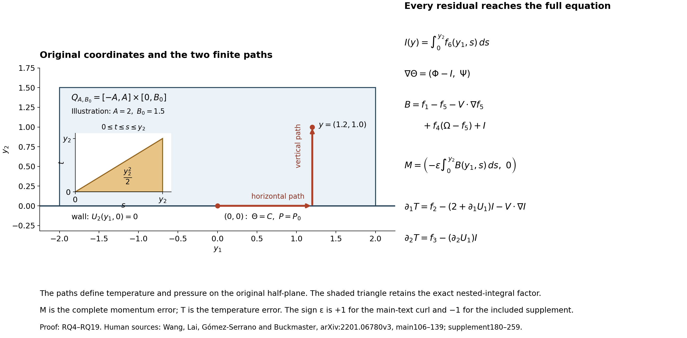
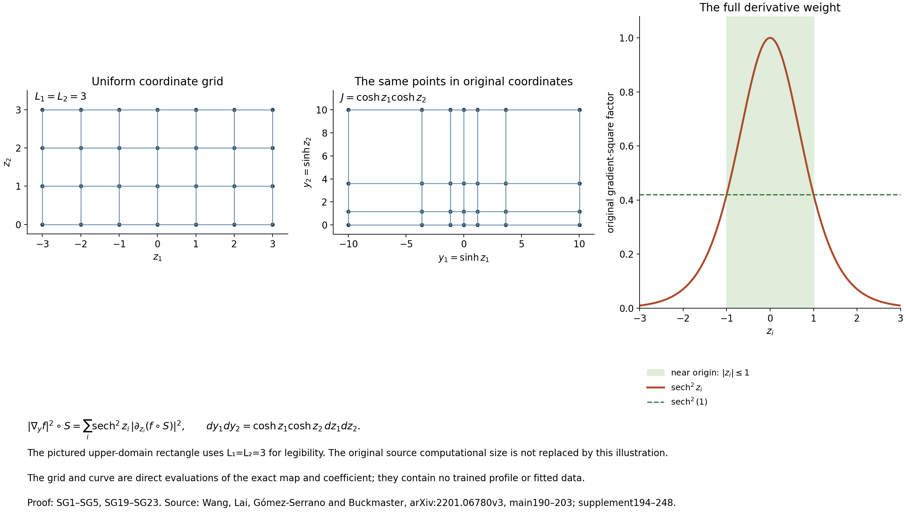
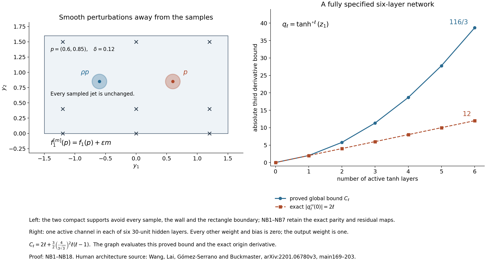
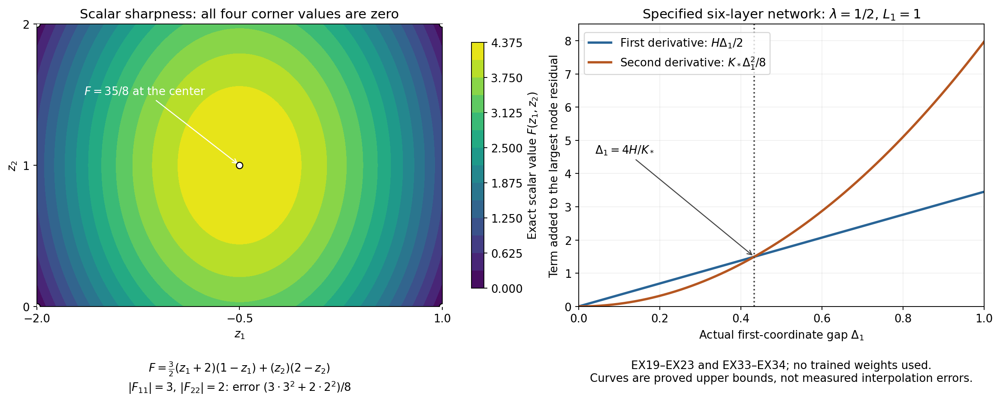

# Original profile residuals, coordinates and network error bounds

A numerical profile gives predicted fields and their equation errors.
To use those errors, we need exact maps back to the original temperature,
pressure, velocity, domain and derivatives. This lesson constructs those
maps and then proves continuous error bounds for a specified finite network.

Part 1 retains all six original residuals, both curl signs, both integration
constants and the exceptional exponent. Part 2 carries the entire system
through the sinh coordinates, keeping its metric, Jacobian, gradient factors
and sampling measures. Part 3 proves what finite observations can and cannot
determine, then calculates explicit derivatives of every network layer and
uses the actual grid to bound the errors between samples.

Five solved exercises test the maps on complete fields. They include the
original physical pressure and time, two incompatible predictions, exact
measure comparisons, and an explicitly specified six-layer network. The
last exercise derives every pure second derivative of all six residuals
and proves a stronger grid estimate with both coordinate contributions.

The human source is Wang, Lai, Gómez-Serrano and Buckmaster; the original
author-source files and passage locators are identified in each part.
These calculations are tools for the remaining profile and stability
arguments. They do not certify missing trained parameters or a source
blowup theorem.

## Part 1. The original six profile residuals and complete temperature and pressure reconstruction
This editorial derivation compares the original author sources of Yongji Wang,
Ching-Yao Lai, Javier Gómez-Serrano and Tristan Buckmaster,
[arXiv:2201.06780v3](https://arxiv.org/abs/2201.06780v3):
`BoussinesqPRL_v5.tex`, lines 106–139 and 169–203, and
`BoussinesqSupp_v5.tex`, lines 180–259. The intact source archive and
file hashes are recorded in the private source-use ledger. The main text
uses positive oriented curl; the included supplement writes negative curl.
Both print the same numerical origin condition. The exact change of sign
below changes that condition too. No convention used by unavailable trained
weights is inferred here.

The original physical/profile dictionary, including the dynamic clock,
pressure and both original cylindrical domains, is proved in
lesson 46, CP1–CP20 and DR1–DR42.
That link is in the existing private course repository. This note proves the
full stationary residual map on the original upper half-plane. It does not
construct or certify the numerical profile or its nonlinear stability.

The diagram shows the actual horizontal and vertical paths of RQ4 and
RQ12, with the illustrative rectangle \(A=2\), \(B_0=1.5\) and
point \(y=(1.2,1.0)\). The triangle is the exact integration region
\(0\le t\le s\le y_2\), whose area gives the retained factor
\(y_2^2/2\) in RQ18–RQ19. It depicts the proved maps, not a
computed profile. Its reproducible Python and SVG sources accompany it.

## RQ1. Both original signs and all six errors

Let \(H=\{(y_1,y_2):y_2\geq0\}\), and fix the original exponent
\(\lambda>-1\). Write \(\partial_i=\partial_{y_i}\).
Take smooth real functions \(U_1,U_2,\Omega,\Phi,\Psi\) on \(H\),
smooth to its boundary. Let \(\varepsilon\in\{1,-1\}\) indicate
the original sign: \(+1\) for the main text and \(-1\) for the
included supplement. Put
\[
 V=(1+\lambda)y+U,\qquad
 \omega=\partial_1U_2-\partial_2U_1,
 \tag{RQ1}
\]
and retain the six residuals
\[
 \begin{aligned}
 f_1&=\Omega+V\cdot\nabla\Omega-\Phi,\\
 f_2&=(2+\partial_1U_1)\Phi+V\cdot\nabla\Phi
                      +(\partial_1U_2)\Psi,\\
 f_3&=(2+\partial_2U_2)\Psi+V\cdot\nabla\Psi
                      +(\partial_2U_1)\Phi,\\
 f_4&=\partial_1U_1+\partial_2U_2,\\
 f_5&=\Omega-\varepsilon(\partial_1U_2-\partial_2U_1),\\
 f_6&=\partial_2\Phi-\partial_1\Psi.
 \end{aligned}
 \tag{RQ2}
\]
No residual in this definition is assumed zero. The supplement's six
equations are exactly the case \(\varepsilon=-1\), before changing
spatial coordinates. The fields \(\Phi,\Psi\) are initially independent
data; their being a temperature gradient is a conclusion only when its
precise compatibility condition holds.

The corresponding complete stationary physical-profile equations, including
the original force sign and pressure, have errors
\[
 \begin{aligned}
 M&=-\lambda U+V\cdot\nabla U+\nabla P
                                    -\varepsilon\Theta e_2,\\
 T&=(1-\lambda)\Theta+V\cdot\nabla\Theta,
 \qquad D=\operatorname{div}U.
 \end{aligned}
 \tag{RQ3}
\]
Thus the main source force is \((0,\Theta)\); the negative-curl
presentation with the unchanged right side \(f_1\) requires force
\((0,-\Theta)\). This follows from the curl calculation below, not
from a change in the name of the temperature.

## RQ2. Reconstruct the scalar and retain its compatibility error

For a real constant \(C\), define the actual finite-path integrals
\[
 \begin{aligned}
 I(y_1,y_2)&=\int_0^{y_2} f_6(y_1,s)\,ds,\\
 \Theta_C(y_1,y_2)&=C+\int_0^{y_1}\Phi(s,0)\,ds
                         +\int_0^{y_2}\Psi(y_1,s)\,ds.
 \end{aligned}
 \tag{RQ4}
\]
The horizontal integral is oriented when \(y_1<0\). All these
integrals are on finite compact segments, so no condition at infinity is
needed. Differentiation and the fundamental theorem of calculus give
\[
 \partial_2\Theta_C=\Psi,\qquad
 \partial_1\Theta_C=\Phi-I,\qquad
 \partial_2 I=f_6.
 \tag{RQ5}
\]
Indeed \(\partial_1\Psi=\partial_2\Phi-f_6\); its integral from
zero to \(y_2\) is \(\Phi(y_1,y_2)-\Phi(y_1,0)-I\), giving
the second identity. Therefore \(f_6=0\) gives the prescribed
gradient everywhere. Conversely any smooth scalar with gradient
\((\Phi,\Psi)\) has \(f_6=0\) by equality of mixed derivatives.
Any two such scalars differ by a constant: integrate their zero gradient
on the same two segments. Thus (RQ4) proves both existence and the complete
constant freedom for the compatible data, without an unproved global
integration step.

Compute \(T\) in (RQ3) using \(\Theta_C\). Differentiating a
scalar along \(V\) adds its full derivative
\(\partial_iV_j=(1+\lambda)\delta_{ij}+\partial_iU_j\).
The two terms \(1-\lambda\) and \(1+\lambda\) sum to two.
Using (RQ5) in each component gives the exact identities
\[
 \begin{aligned}
 \partial_1T&=f_2-(2+\partial_1U_1)I-V\cdot\nabla I,\\
 \partial_2T&=f_3-(\partial_2U_1)I,\\
 T(0,0)&=(1-\lambda)C+U_1(0,0)\Phi(0,0)
                                  +U_2(0,0)\Psi(0,0).
 \end{aligned}
 \tag{RQ6}
\]
For example, the first differentiated equation is
\[
(2+\partial_1U_1)(\Phi-I)+(\partial_1U_2)\Psi
+V\cdot\nabla(\Phi-I)
\]
which is exactly the first line. The second is
\[
(2+\partial_2U_2)\Psi+(\partial_2U_1)(\Phi-I)
+V\cdot\nabla\Psi
\]
as in the second line.
These calculations retain the effect of incompatible gradient data.

Integration of the actual derivatives in (RQ6) gives a particularly direct
scalar error formula:
\[
 \begin{aligned}
 T(y_1,y_2)=T(0,0)
 &+\int_0^{y_1}
       [f_2-(2+\partial_1U_1)I-V\cdot\nabla I](s,0)\,ds\\
 &+\int_0^{y_2}
       [f_3-(\partial_2U_1)I](y_1,s)\,ds.
 \end{aligned}
 \tag{RQ7}
\]
There is no choice of contour hidden in this expression: it is the stated
horizontal segment followed by the stated vertical segment. In particular,
when the wall value \(U_2(y_1,0)=0\) holds, both \(I\) and
\(\partial_1I\) vanish on that wall, while
\(V_2(y_1,0)=0\). The first integrand in (RQ7) then reduces
exactly to \(f_2(s,0)\), even if \(f_6\ne0\).

## RQ3. Reconstruct the full pressure and its vector error

Set
\[
 K=\lambda U-V\cdot\nabla U+\varepsilon\Theta_C e_2,
 \qquad
 B=f_1-f_5-V\cdot\nabla f_5+f_4(\Omega-f_5)+I.
 \tag{RQ8}
\]
We now prove, with no residual set to zero,
\[
 \partial_1K_2-\partial_2K_1=-\varepsilon B.
 \tag{RQ9}
\]
Expand the curl of the advective term. Its terms containing second
derivatives of \(U\) are \(V\cdot\nabla\omega\). The remaining
first-derivative products are
\[
 \begin{aligned}
 &(\partial_1V_1)\partial_1U_2
 +(\partial_1V_2)\partial_2U_2
 -(\partial_2V_1)\partial_1U_1
 -(\partial_2V_2)\partial_2U_1\\
 &\hspace{2em}=(1+\lambda)\omega
             +(\partial_1U_1+\partial_2U_2)\omega.
 \end{aligned}
 \tag{RQ10}
\]
Subtracting the curl of \(\lambda U\) leaves
\(\omega+V\cdot\nabla\omega+f_4\omega\).
By (RQ2), \(\varepsilon\omega=\Omega-f_5\); by (RQ5),
\(\partial_1\Theta_C=\Phi-I\). Consequently
\[
 \begin{aligned}
 \varepsilon\operatorname{curl}
   [-\lambda U+V\cdot\nabla U-\varepsilon\Theta_Ce_2]
 &=\Omega-f_5+V\cdot\nabla(\Omega-f_5)
                 +f_4(\Omega-f_5)-\Phi+I\\
 &=B,
 \end{aligned}
 \tag{RQ11}
\]
which is (RQ9). Both the divergence error and the derivative of the
curl-reconstruction error are indispensable in this exact formula.

For any constant \(P_0\), reconstruct
\[
 P(y_1,y_2)=P_0+\int_0^{y_1}K_1(s,0)\,ds
                         +\int_0^{y_2}K_2(y_1,s)\,ds.
 \tag{RQ12}
\]
Then \(P_2=K_2\), and
\[
 \begin{aligned}
 P_1-K_1
 &=\int_0^{y_2}(\partial_1K_2-\partial_2K_1)(y_1,s)\,ds,\\
 M(y_1,y_2)
 &=\left(-\varepsilon\int_0^{y_2}B(y_1,s)\,ds,\ 0\right),
 \qquad D=f_4.
 \end{aligned}
 \tag{RQ13}
\]
The first equality follows by adding and subtracting the vertical integral
of \(\partial_2K_1\) and using the fundamental theorem of calculus.
This proves the pressure formula, not merely a necessary curl condition.
It also specifies the complete momentum error for arbitrary initial data.
Any other pressure solving \(\nabla P=K\) differs by a constant,
by the same finite-segment argument used for the temperature.

## RQ4. Exact solution correspondence and the exceptional exponent

Now take exactly compatible stationary data, meaning that all six functions
in (RQ2) vanish on \(H\). This is a statement about the correspondence
of two equation systems, not an assumption that a computed profile solves
either of them. Equations (RQ4)–(RQ13) construct the full fields and prove
\[
 M=0,\qquad D=0,\qquad
 T(y)= (1-\lambda)C+U(0,0)\cdot(\Phi(0,0),\Psi(0,0)).
 \tag{RQ14}
\]
For \(\lambda\ne1\), the unique constant giving \(T=0\) is
\[
 C=-\frac{U(0,0)\cdot(\Phi(0,0),\Psi(0,0))}{1-\lambda}.
 \tag{RQ15}
\]
For \(\lambda=1\), that value of \(T\) is independent of \(C\).
It vanishes if and only if the displayed scalar product is zero; when it
does vanish, every \(C\) is allowed. This includes the exceptional
exponent without dividing by zero or dropping a scalar equation.

In the source class, \(U_1,\Omega,\Phi\) are odd in \(y_1\),
\(U_2,\Psi\) are even, and \(U_2(y_1,0)=0\). Thus
\(U(0,0)=0\) and \(\Phi(0,0)=0\). The scalar product is
zero. The source reconstruction uses \(C=0\) if \(\lambda\ne1\),
and allows all constants if \(\lambda=1\). The constructed
\(\Theta_C\) is even in \(y_1\): the integral of the odd
\(\Phi(s,0)\) from zero is even, and the vertical integral of
the even \(\Psi\) is even. The vector \(K\) has odd first
component and even second component, so (RQ12) gives an even pressure.

When \(C\) is increased by \(c\), the full change of the fields
and equations is
\[
 \Theta\longmapsto\Theta+c,\qquad
 P\longmapsto P+\varepsilon c y_2,\qquad
 T\longmapsto T+(1-\lambda)c,
 \qquad M\longmapsto M.
 \tag{RQ16}
\]
The pressure increment follows from the actual vertical term in (RQ12).
At \(\lambda=1\) it gives the complete additional solution freedom.
It does not change \(\Phi\) or \(\Psi\), so those variables
alone cannot encode it.

Conversely a smooth full solution of (RQ3) with \(M=T=D=0\)
gives six zero residuals on setting
\(\Omega=\varepsilon\operatorname{curl}U\),
\(\Phi=\Theta_1\), \(\Psi=\Theta_2\). The fourth, fifth
and sixth vanish from their definitions. Formula (RQ11) with \(I=0\)
gives \(f_1=0\). Differentiating \(T=0\) by (RQ6) gives
\(f_2=f_3=0\). The reconstruction returns the original
\(\Theta\) by choosing \(C=\Theta(0,0)\), and the original
\(P\) by choosing \(P_0=P(0,0)\). We have proved the exact
correspondence in both directions, including both constant freedoms and
the exceptional exponent.

## RQ5. Finite-domain error bounds with every contributing residual

For \(A,B_0>0\), let
\(Q_{A,B_0}=[-A,A]\times[0,B_0]\), and take suprema on this
closed rectangle. Let \(\|\cdot\|_\infty\) mean the scalar
absolute supremum, or the Euclidean vector supremum as appropriate.
From the actual integrals and \(\partial_2I=f_6\),
\[
 \begin{aligned}
 \|I\|_\infty&\le B_0\|f_6\|_\infty,\\
 \|\partial_1I\|_\infty&\le B_0\|\partial_1f_6\|_\infty,\\
 \|V\cdot\nabla I\|_\infty
 &\le \|V_1\|_\infty B_0\|\partial_1f_6\|_\infty
                         +\|V_2\|_\infty\|f_6\|_\infty.
 \end{aligned}
 \tag{RQ17}
\]
The complete pressure error obeys
\[
 \begin{aligned}
 \|M\|_\infty\le B_0\bigl(&\|f_1\|_\infty+\|f_5\|_\infty
  +\|V_1\|_\infty\|\partial_1f_5\|_\infty
  +\|V_2\|_\infty\|\partial_2f_5\|_\infty\\
 &+\|f_4\|_\infty(\|\Omega\|_\infty+\|f_5\|_\infty)
  +\frac{B_0}{2}\|f_6\|_\infty\bigr).
 \end{aligned}
 \tag{RQ18}
\]
This is the triangle inequality applied to (RQ8) and (RQ13), retaining
\(\int_0^{y_2}\int_0^s dt\,ds=y_2^2/2\) for the contribution
of \(I\). It includes the nonlinear product and both curl-error derivatives. The
rectangle is convex along every integration segment used above.
Under the exact source wall condition, (RQ7) gives the sharper scalar bound
\[
 \|T\|_\infty\le |T(0,0)|+A\|f_2(\cdot,0)\|_\infty
      +B_0\|f_3\|_\infty
      +\frac{B_0^2}{2}\|\partial_2U_1\|_\infty\|f_6\|_\infty.
 \tag{RQ19}
\]
The last term again retains the nested integral \(y_2^2/2\).
Each factor is the length of its actual segment, not a rescaled unit
domain. These are estimates in terms of continuous suprema of the stated
fields. They are not supplied by a finite collection of sampled residual
values. The next numerical comparison must control those quantities on
the original domain and retain the coordinate multipliers used to do so.

## RQ6. Coupled sign and full spatial scale maps

Keep \(U,P,\lambda,y\) fixed and change
\[
 (\varepsilon,\Theta,\Omega,\Phi,\Psi)
 \longmapsto(-\varepsilon,-\Theta,-\Omega,-\Phi,-\Psi).
 \tag{RQ20}
\]
Then \(M,D\) are unchanged, \(T\) changes sign,
\(f_1,f_2,f_3,f_5,f_6\) change sign and \(f_4\) is unchanged.
Every assertion follows by substitution into (RQ2)–(RQ3), including the
product \(\varepsilon\Theta\). Also \(I,B,C\) change sign,
while \(K\) and the reconstructed \(P\) remain the same.
The origin derivative transforms as
\[
 \partial_1\Omega(0,0)\longmapsto-\partial_1\Omega(0,0).
 \tag{RQ21}
\]
Thus the printed value \(-1\) in one sign convention becomes
\(+1\) in the other under this exact same-velocity correspondence.
Keeping \(-1\) in both conventions selects different constrained
data; a sign change of the curl variable alone is not the full map.

Finally let \(\kappa\ne0\), put \(H_\kappa=\kappa H\),
and define every field on its actual image domain by
\[
 \begin{aligned}
 U^\kappa(y)&=\kappa U(y/\kappa),&
 P^\kappa(y)&=\kappa^2P(y/\kappa),&
 \Theta^\kappa(y)&=\kappa\Theta(y/\kappa),\\
 \Omega^\kappa(y)&=\Omega(y/\kappa),&
 \Phi^\kappa(y)&=\Phi(y/\kappa),&
 \Psi^\kappa(y)&=\Psi(y/\kappa).
 \end{aligned}
 \tag{RQ22}
\]
Here \(V^\kappa(y)=\kappa V(y/\kappa)\). Chain rule, retaining
the factor \(1/\kappa\) in each derivative, gives
\[
 \begin{gathered}
 M^\kappa(y)=\kappa M(y/\kappa),\quad
 T^\kappa(y)=\kappa T(y/\kappa),\quad
 D^\kappa(y)=D(y/\kappa),\\
 f_j^\kappa(y)=f_j(y/\kappa)\quad(1\le j\le5),\qquad
 f_6^\kappa(y)=\kappa^{-1}f_6(y/\kappa),\\
 \partial_1\Omega^\kappa(0,0)=\kappa^{-1}\partial_1\Omega(0,0).
 \end{gathered}
 \tag{RQ23}
\]
For example, each term of \(f_2\) contains either one derivative
of \(U^\kappa\), whose factors cancel, or \(V^\kappa\)
times one derivative of \(\Phi^\kappa\), whose factors also
cancel. The compatibility error has no velocity factor and retains
\(\kappa^{-1}\). The original pressure gradient has exactly the
factor \(\kappa\) required in the full momentum equation.
The inverse is the same map with \(1/\kappa\). If
\(\kappa>0\), the image is the original upper half-plane. If
\(\kappa<0\), it is the lower half-plane, with its boundary still
mapped to the same line. No negative scalar scale is a self-map of the
original upper half-plane. The supplement's scalar-variable scaling
therefore has the full meaning (RQ22)–(RQ23), including velocity,
temperature, pressure, anchor and actual image domain.

These proofs establish exact maps and error bounds for the original
profile equations. They do not supply a profile, an error bound for given
trained weights, a tail estimate on an infinite domain, or the remaining
source stability argument. The next calculation is the complete
hyperbolic-sine coordinate and metric map for all six residuals and the
continuous quantities in (RQ17)–(RQ19).

## Part 2. The complete hyperbolic-sine profile map and its original loss measures
This editorial calculation uses the original author files of Yongji Wang,
Ching-Yao Lai, Javier Gómez-Serrano and Tristan Buckmaster,
[arXiv:2201.06780v3](https://arxiv.org/abs/2201.06780v3),
`BoussinesqPRL_v5.tex` lines 106–139 and 169–203 and
`BoussinesqSupp_v5.tex` lines 180–259. It continues the complete
six-residual reconstruction, RQ1–RQ23.
The original author archive is retained intact. The comparison below is
an exact change of coordinates and measures; it is not a certificate for
the computed profile or its nonlinear stability.

The two grids show the same points before and after \(S\), using
\(L_1=L_2=3\) solely for this illustration. The curve is the exact
factor \(\operatorname{sech}^2 z_i\). SG19–SG23 prove the gradient
and area relations shown; no computed profile is plotted. Reproducible
Python and SVG sources accompany the figure.

## SG1. Original domain, inverse, metric and all scalar derivatives

The original domain is \(H_y=\{y_2\geq0\}\). Define
\[
 \begin{gathered}
 S(z_1,z_2)=(\sinh z_1,\sinh z_2),\qquad
 S^{-1}(y)=(\operatorname{arsinh}y_1,\operatorname{arsinh}y_2),\\
 H_z=\{z_2\geq0\},\quad
 s_i=\sinh z_i,\quad c_i=\cosh z_i,\quad a_i=c_i^{-1},\quad
 J=c_1c_2,\qquad \widehat q=q\circ S.
 \end{gathered}
 \tag{SG1}
\]
Since \(c_i>0\), each coordinate is strictly increasing with range
the whole real line, and the displayed inverse is smooth. In particular,
\(S\) is a smooth bijection of these closed half-planes, including
their boundary. Its full differential, metric and oriented area are
\[
 DS=\begin{pmatrix}c_1&0\\0&c_2\end{pmatrix},\qquad
 g=\begin{pmatrix}c_1^2&0\\0&c_2^2\end{pmatrix},\qquad
 dy_1\,dy_2=J\,dz_1\,dz_2.
 \tag{SG2}
\]
The metric follows by expanding \(|DS\,\xi|^2\) for an arbitrary
coordinate tangent vector \(\xi\); the Jacobian is its positive
determinant. Every original scalar derivative is represented by
\[
 D_i=a_i\partial_{z_i},\qquad
 \widehat{\partial_{y_i}q}=D_i\widehat q,\qquad
 |\nabla_y q|^2\circ S=\sum_{i=1}^2a_i^2
                                      |\partial_{z_i}\widehat q|^2.
 \tag{SG3}
\]
Here and below the derivative of a residual means the derivative of the
fully evaluated residual, including every dependence of its predicted
fields and their derivatives on the input. It is not a partial derivative
holding the network output fixed.

A second differentiation retains the derivative of \(a_i\):
\[
 \begin{aligned}
 \widehat{\partial_{y_i}^2q}
 &=a_i^2\left(\partial_{z_i}^2\widehat q
                    -\tanh z_i\,\partial_{z_i}\widehat q\right),\\
 \widehat{\partial_{y_1}\partial_{y_2}q}
 &=a_1a_2\partial_{z_1}\partial_{z_2}\widehat q,\\
 \widehat{\Delta_y q}
 &=\sum_{i=1}^2a_i^2\left(\partial_{z_i}^2\widehat q
                    -\tanh z_i\,\partial_{z_i}\widehat q\right)
  =\frac1J\sum_{i=1}^2\partial_{z_i}
           \left(Ja_i^2\partial_{z_i}\widehat q\right).
 \end{aligned}
 \tag{SG4}
\]
Indeed \(\partial_{z_i}a_i=-a_i\tanh z_i\), and
\(Ja_i^2=c_j/c_i\) for \(j\ne i\); differentiating the latter
gives the same first-order term. The off-diagonal derivatives commute
because \(a_1\) and \(a_2\) depend on different coordinates.

For positive lengths \(L_1,L_2\), the exact finite domain map is
\[
 \begin{aligned}
 Z_L&=[-L_1,L_1]\times[0,L_2],\\
 Y_L&=[-\sinh L_1,\sinh L_1]\times[0,\sinh L_2],\\
 |Z_L|&=2L_1L_2,\qquad
 |Y_L|=2\sinh L_1\sinh L_2.
 \end{aligned}
 \tag{SG5}
\]
The original upper wall maps to \(z_2=0\). The source's reported
full numerical square instead maps
\([-L_1,L_1]\times[-L_2,L_2]\) to
\([-\sinh L_1,\sinh L_1]\times[-\sinh L_2,\sinh L_2]\).
Its two areas are \(4L_1L_2\) and
\(4\sinh L_1\sinh L_2\). Its negative second-coordinate part
is not part of the original upper half-plane; a field defined there is
additional data or an explicitly chosen extension. The stated parity in
the first coordinate alone supplies no such extension in the second.

## SG2. Cartesian components, coordinate components and full momentum

Keep the original exponent \(\lambda>-1\) and the sign
\(\varepsilon\in\{1,-1\}\) of RQ1–RQ3. Let
\(V=(1+\lambda)y+U\). The composed Cartesian components are
\(\widehat U_i=U_i\circ S\). The components with respect to the
coordinate tangent vectors \(\partial_{z_i}S=c_i e_i\) are
different, with the exact invertible map
\[
 u^i=a_i\widehat U_i,\qquad
 v^i=a_i\widehat V_i=(1+\lambda)\tanh z_i+u^i,\qquad
 U\circ S=\sum_{i=1}^2u^i\partial_{z_i}S.
 \tag{SG6}
\]
Thus \(|U|^2\circ S=\sum_i c_i^2(u^i)^2\), and for every scalar
\(q\),
\[
 \widehat{V\cdot\nabla_y q}
 =\sum_{i=1}^2\widehat V_i D_i\widehat q
 =\sum_{i=1}^2 v^i\partial_{z_i}\widehat q.
 \tag{SG7}
\]
This proves why the Cartesian components in the author's equations may
be composed without being called coordinate velocity components.

For the full stationary momentum error \(M\), temperature error \(T\)
and divergence error \(D\) defined in RQ3, the exact formulas in
composed Cartesian components are
\[
 \begin{aligned}
 \widehat M_i
  &=-\lambda\widehat U_i+
        \sum_{j=1}^2v^j\partial_{z_j}\widehat U_i
        +a_i\partial_{z_i}\widehat P
        -\varepsilon\widehat\Theta\,\delta_{i2},\\
 \widehat T
  &=(1-\lambda)\widehat\Theta+
                         \sum_{j=1}^2v^j\partial_{z_j}\widehat\Theta,\\
 \widehat D&=\sum_{i=1}^2a_i\partial_{z_i}\widehat U_i
                   =\frac1J\sum_{i=1}^2\partial_{z_i}(Ju^i).
 \end{aligned}
 \tag{SG8}
\]
For the last equality \(Ju^i=c_j\widehat U_i\), where
\(j\ne i\); its prefactor has zero \(z_i\)-derivative.
If instead momentum is written in the coordinate basis, every original
component is divided by \(c_i\), and differentiation of
\(\widehat U_i=c_i u^i\) gives
\[
 m^i:=a_i\widehat M_i
 =-\lambda u^i+\sum_{j=1}^2v^j\partial_{z_j}u^i
   +\tanh z_i\,v^i u^i
   +a_i^2\partial_{z_i}\widehat P
   -\varepsilon a_i\widehat\Theta\,\delta_{i2}.
 \tag{SG9}
\]
The term \(\tanh z_i\,v^iu^i\) comes exactly from
\(a_i v^i(\partial_{z_i}c_i)u^i\); it cannot be removed in
that basis. Likewise the pressure coefficient is \(a_i^2\), and
the force coefficient is \(a_i\). These bases have the exact
residual-norm relation \(|\widehat M|^2=\sum_i c_i^2(m^i)^2\).

The original oriented curl also has both equivalent full expressions:
\[
 \widehat\omega=D_1\widehat U_2-D_2\widehat U_1
 =\frac1J\left[\partial_{z_1}(c_2^2u^2)
                         -\partial_{z_2}(c_1^2u^1)\right].
 \tag{SG10}
\]
The second follows because \(c_2\) is constant in the first
derivative and \(c_1\) in the second. It retains the original
orientation; the sign \(\varepsilon\) enters the definition of
\(\Omega\), not this oriented curl.

## SG3. All six equation residuals, compatibility and boundary data

Let \(F_j=f_j\circ S\), where all six original \(f_j\) are
defined in RQ2. Every term is
\[
 \begin{aligned}
 F_1&=\widehat\Omega+\sum_{i=1}^2v^i\partial_{z_i}\widehat\Omega
                                                   -\widehat\Phi,\\
 F_2&=(2+D_1\widehat U_1)\widehat\Phi
       +\sum_{i=1}^2v^i\partial_{z_i}\widehat\Phi
       +(D_1\widehat U_2)\widehat\Psi,\\
 F_3&=(2+D_2\widehat U_2)\widehat\Psi
       +\sum_{i=1}^2v^i\partial_{z_i}\widehat\Psi
       +(D_2\widehat U_1)\widehat\Phi,\\
 F_4&=D_1\widehat U_1+D_2\widehat U_2,\\
 F_5&=\widehat\Omega-\varepsilon
                          (D_1\widehat U_2-D_2\widehat U_1),\\
 F_6&=D_2\widehat\Phi-D_1\widehat\Psi.
 \end{aligned}
 \tag{SG11}
\]
Substitution of SG3 and SG7 in each of the six source expressions proves
these identities, term by term, without setting any residual to zero.
In particular the original gradient one-form and its compatibility error
become
\[
 \alpha=c_1\widehat\Phi\,dz_1+c_2\widehat\Psi\,dz_2,
 \qquad
 d\alpha=-J F_6\,dz_1\wedge dz_2.
 \tag{SG12}
\]
Indeed the coefficient of its exterior derivative is
\(c_2\partial_{z_1}\widehat\Psi
-c_1\partial_{z_2}\widehat\Phi=-JF_6\).
Thus testing \(\partial_{z_2}\widehat\Phi
=\partial_{z_1}\widehat\Psi\) would test a different one-form.

The wall and origin data map exactly to
\[
 \widehat U_2(z_1,0)=0,\qquad
 \partial_{y_1}\Omega(0,0)=\partial_{z_1}\widehat\Omega(0,0),
 \qquad
 |\nabla_yU|^2\circ S
     =\sum_{i,j=1}^2a_j^2|\partial_{z_j}\widehat U_i|^2.
 \tag{SG13}
\]
The origin equality uses \(c_1(0)=1\). At a general point the
factor \(a_1\) remains. The source side \(y_1=\pm d\) maps to
\(z_1=\pm\operatorname{arsinh}d\); the upper side \(y_2=d\)
maps to \(z_2=\operatorname{arsinh}d\). Derivative conditions on
these sides keep all the factors in SG13. Values of \(\Phi\) and
\(\Psi\) are simply composed, not multiplied by \(c_i\).

## SG4. The complete reconstructed fields and error integrals in these coordinates

The finite-path maps RQ4 and RQ12 retain their full integration factors:
\[
 \begin{aligned}
 \widehat I(z)&=\int_0^{z_2}\cosh t\,F_6(z_1,t)\,dt,\\
 \widehat\Theta_C(z)&=C+
       \int_0^{z_1}\cosh t\,\widehat\Phi(t,0)\,dt
       +\int_0^{z_2}\cosh t\,\widehat\Psi(z_1,t)\,dt,\\
 \widehat P(z)&=P_0+
       \int_0^{z_1}\cosh t\,\widehat K_1(t,0)\,dt
       +\int_0^{z_2}\cosh t\,\widehat K_2(z_1,t)\,dt.
 \end{aligned}
 \tag{SG14}
\]
Here \(K=\lambda U-V\cdot\nabla U+\varepsilon\Theta_C e_2\)
is the original Cartesian vector of RQ8. The changes of variables
\(s=\sinh t\) in each finite original integral give SG14, including
the orientation for negative first endpoints. For example,
\(D_1\widehat\Theta_C=\widehat\Phi-\widehat I\) and
\(D_2\widehat\Theta_C=\widehat\Psi\); no gradient component
has been discarded.

The full curl-error integrand and momentum error are
\[
 \begin{aligned}
 \widehat B&=F_1-F_5-\sum_{i=1}^2v^i\partial_{z_i}F_5
                   +F_4(\widehat\Omega-F_5)+\widehat I,\\
 \widehat M(z)&=\left(-\varepsilon\int_0^{z_2}
                             \cosh t\,\widehat B(z_1,t)\,dt,\ 0\right).
 \end{aligned}
 \tag{SG15}
\]
The scalar error, under the exact source wall condition, is
\[
 \begin{aligned}
 \widehat T(z)=T(0,0)
  &+\int_0^{z_1}\cosh t\,F_2(t,0)\,dt\\
  &+\int_0^{z_2}\cosh t
       [F_3-(D_2\widehat U_1)\widehat I](z_1,t)\,dt.
 \end{aligned}
 \tag{SG16}
\]
This is RQ7 with the wall cancellation already proved there, followed by
the same change of variables. The exact nested integral now has value
\[
 \int_0^{z_2}\cosh s\int_0^s\cosh t\,dt\,ds
       =\int_0^{z_2}\cosh s\sinh s\,ds
       =\frac{\sinh^2 z_2}{2}.
 \tag{SG17}
\]
Consequently the original rectangle bounds RQ18–RQ19 have
\(A=\sinh L_1\), \(B_0=\sinh L_2\), not \(L_1,L_2\).
Every derivative \(\partial_{y_i}f_5\) in them is exactly
\(a_i\partial_{z_i}F_5\). Suprema of a composed scalar have the
same values on the two corresponding compact domains because \(S\)
is bijective. This proves the complete use of the earlier residual bounds
in the source's computational coordinates.

## SG5. Sampled gradient losses and their actual comparison constants

Take corresponding sample points \(y^{(m)}=S(z^{(m)})\), with
the same number \(N\) and the same weights \(1/N\).
For a fixed original residual \(f_k\), its value loss is unchanged:
\[
 \frac1N\sum_{m=1}^N|f_k(y^{(m)})|^2
        =\frac1N\sum_{m=1}^N|F_k(z^{(m)})|^2.
 \tag{SG18}
\]
Its original-coordinate gradient loss, however, is
\[
 \begin{aligned}
 L_y&=\frac1N\sum_{m=1}^N\sum_{i=1}^2
       \operatorname{sech}^2z_i^{(m)}
                         |\partial_{z_i}F_k(z^{(m)})|^2,\\
 L_z&=\frac1N\sum_{m=1}^N\sum_{i=1}^2
                         |\partial_{z_i}F_k(z^{(m)})|^2.
 \end{aligned}
 \tag{SG19}
\]
Thus the main text's gradient in its \(y\)-formula and a Euclidean
\(z\)-gradient in the supplement are related by these exact factors.
Writing the sample location as \(z\) does not by itself specify which
gradient a program uses. SG19 states both meanings explicitly.

If every sample satisfies \(|z_i^{(m)}|\le L_i\), then
\[
 \min_{i=1,2}\operatorname{sech}^2L_i\ L_z\le L_y\le L_z.
 \tag{SG20}
\]
This follows term by term from
\(\operatorname{sech}^2 L_i\le\operatorname{sech}^2 z_i\le1\)
and the nonnegative squared derivatives. In particular, on the source
neighborhood \(|z|<1\),
\[
 \operatorname{sech}^2(1)L_z\le L_y\le L_z.
 \tag{SG21}
\]
These positive finite comparison constants do not make the two losses
equal. They prove exactly what the bounded near-origin region permits.
There is no positive uniform lower constant on the whole coordinate
half-plane: at \(z=(M,0)\) take the scalar \(F(z)=z_1\).
Then \(|\nabla_zF|^2=1\) and its original-coordinate gradient
square is \(\operatorname{sech}^2 M\), which tends to zero as
\(M\to\infty\). This is a counterexample for comparison of
general scalar derivative norms, not a claimed computed equation residual.
All these comparisons require matched points and weights; different
sample sets or different counts cannot silently be substituted.

## SG6. Full area, boundary and average measures

For every nonnegative measurable function, or every integrable function,
the original change of variables gives
\[
 \begin{aligned}
 \int_{Y_L}|f_k(y)|^2\,dy&=\int_{Z_L}|F_k(z)|^2J(z)\,dz,\\
 \int_{Y_L}|\nabla_yf_k(y)|^2\,dy
  &=\int_{Z_L}\sum_{i=1}^2 a_i^2
                      |\partial_{z_i}F_k|^2J\,dz,\\
 \frac1{|Z_L|}\int_{Z_L}|F_k|^2\,dz
  &=\frac1{2L_1L_2}\int_{Y_L}
       \frac{|f_k(y)|^2}{\sqrt{1+y_1^2}\sqrt{1+y_2^2}}\,dy,\\
 \frac1{|Y_L|}\int_{Y_L}|f_k|^2\,dy
  &=\frac1{2\sinh L_1\sinh L_2}\int_{Z_L}|F_k|^2c_1c_2\,dz.
 \end{aligned}
 \tag{SG22}
\]
The square roots are exactly \(\cosh(\operatorname{arsinh}y_i)\),
positive on the whole original domain. In particular uniform area in
\(z\) corresponds to the explicit nonuniform density in the third
line, and uniform original area corresponds to the fourth line. These
formulas keep both original area denominators.

On the horizontal and vertical sides respectively, the exact boundary
line measures are
\[
 \begin{aligned}
 \int_{-\sinh L_1}^{\sinh L_1}|q(y_1,b)|^2\,dy_1
 &=\int_{-L_1}^{L_1}|\widehat q(z_1,\operatorname{arsinh}b)|^2
                                               \cosh z_1\,dz_1,\\
 \int_0^{\sinh L_2}|q(a,y_2)|^2\,dy_2
 &=\int_0^{L_2}|\widehat q(\operatorname{arsinh}a,z_2)|^2
                                               \cosh z_2\,dz_2.
 \end{aligned}
 \tag{SG23}
\]
Here \(b\) is the fixed original height of the chosen horizontal
side and \(a\) the fixed original first coordinate of the vertical
side. The use of these letters in this display does not replace the
coordinate factors \(a_i\). The formulas follow from the one-dimensional
derivatives of \(\sinh\) and include the wall case \(b=0\).

SG1–SG23 give the complete coordinate, component, residual and measure
maps needed to interpret the source losses. Nothing in a small finite
sample average supplies the continuous suprema used in RQ18–RQ19.
The next calculation constructs the exact fibers of that finite
observation map, then derives explicit derivative bounds for finite
hyperbolic-tangent networks to turn sample information into continuous
finite-domain bounds when their actual parameters are supplied.

## Part 3. Finite profile observations and complete network derivative bounds
The original profile equations and all six residuals are defined and
reconstructed in RQ1–RQ23.
Their complete computational-coordinate map is proved in
SG1–SG23.
The human source is Yongji Wang, Ching-Yao Lai, Javier Gómez-Serrano and
Tristan Buckmaster, [arXiv:2201.06780v3](https://arxiv.org/abs/2201.06780v3),
original `BoussinesqPRL_v5.tex` lines 169–203 and included
`BoussinesqSupp_v5.tex` lines 206–259. The source describes five separate
networks with six hidden layers of thirty units and hyperbolic-tangent
activation. It also describes parity projection and finite value and
residual-gradient losses. This note retains those distinctions.

We first construct the exact family of smooth fields invisible to any
given finite collection of sampled derivatives. That family is not
asserted to belong to a fixed finite network architecture. We then prove
explicit bounds for the stated type of finite architecture, including
all layers and all original coordinate factors. No actual trained
parameter file is supplied or certified by these formulas.

The left panel gives explicit disjoint supports at
\(p=(0.6,0.85)\) and \(\rho p=(-0.6,0.85)\), radius \(0.12\),
inside \([-1.5,1.5]\times[0,1.6]\). The sample coordinates are
\(\{-1.2,0,1.2\}\times\{0,0.4,1.5\}\). The right panel
evaluates the exact derivative formulas NB17–NB18 for the fully specified
network NB16. These illustrate the two respective function classes;
neither is identified with the source-trained profile. Reproducible
Python and SVG sources accompany the figure.

## NB1. The smooth finite-observation fiber

Fix a finite set \(\Sigma\subset H_y\), containing every location
used by all value, derivative, boundary and origin samples under
consideration. If different residuals use different sets, take their
finite union. Fix any smooth original quintuple
\((U_1,U_2,\Omega,\Phi,\Psi)\) and its exponent \(\lambda>-1\).
For the parity conclusion, take the source class: \(U_1,\Omega,\Phi\)
odd in \(y_1\), \(U_2,\Psi\) even, with \(U_2(y_1,0)=0\).

Choose \(p=(p_1,p_2)\) with \(p_1,p_2>0\), outside
\(\Sigma\) and its reflection in the first coordinate. Such a
point exists since an open rectangle in this quadrant contains infinitely
many points and the excluded set is finite. If a finite source rectangle
\([-A,A]\times[0,B]\), with \(A,B>0\), is specified, choose
\(0<p_1<A\), \(0<p_2<B\). Choose \(\delta>0\) smaller
than one quarter of the positive minimum of
\(p_1,p_2,A-p_1,B-p_2\) and the distances from \(p\) to every
point in \(\Sigma\cup\rho\Sigma\), omitting the last minimum
if that set is empty. Here \(\rho(y_1,y_2)=(-y_1,y_2)\).
If no rectangle was initially specified, choose one containing \(p\)
in its interior first. The two closed balls of radius \(\delta\)
at \(p\) and \(\rho p\) are disjoint, strictly above the wall,
inside this rectangle, and disjoint from \(\Sigma\).

Define the complete cutoff
\[
 \eta(t)=
 \begin{cases}e^{-1/t},&t>0,\\0,&t\le0,\end{cases}
 \qquad
 \chi(s)=\frac{\eta(1-s)}{\eta(1-s)+\eta(s-1/4)}.
 \tag{NB1}
\]
The denominator is positive for every real \(s\): simultaneous zeros
would require \(s\ge1\) and \(s\le1/4\). The function \(\eta\)
is smooth at zero because each of its derivatives for \(t>0\) is
\(e^{-1/t}\) times a polynomial in \(1/t\), and all such products
tend to zero there. To see the last assertion without a growth assumption,
put \(x=1/t\); for an integer \(m\ge0\),
\(e^x\ge x^{m+1}/(m+1)!\) implies
\(x^me^{-x}\le(m+1)!/x\to0\). Repeated differentiation and
the zero one-sided derivatives therefore prove the smooth extension.
Consequently \(\chi\) is smooth, equals one for \(s\le1/4\)
and zero for \(s\ge1\).

Put
\[
 \begin{aligned}
 b_p(y)&=\frac{|y-p|^2}{4}\,
              \chi\!\left(\frac{|y-p|^2}{\delta^2}\right),\\
 h(y)&=b_p(y)-b_p(\rho y),\\
 W_h&=(-\partial_2h,\partial_1h),\qquad
 Z_h=\varepsilon\Delta h.
 \end{aligned}
 \tag{NB2}
\]
These are smooth and supported in the two specified balls. The function
\(h\) is odd in \(y_1\), so the first component of \(W_h\)
and \(Z_h\) are odd, and the second component of \(W_h\) is even.
Direct mixed differentiation gives
\[
 \operatorname{div}W_h=0,\qquad
 \varepsilon\operatorname{curl}W_h=Z_h.
 \tag{NB3}
\]
For any real amplitude \(m\), define the actual perturbed fields
\[
 U^{[m]}=U+mW_h,\qquad
 \Omega^{[m]}=\Omega+mZ_h,\qquad
 \Phi^{[m]}=\Phi,\qquad \Psi^{[m]}=\Psi.
 \tag{NB4}
\]
They preserve the original parity, the wall condition, every boundary
value outside the two balls and the original far-field behavior. They
also preserve every derivative of every field at every point in
\(\Sigma\): each perturbation vanishes on an open neighborhood
of that point. As a result every sampled derivative of every local
residual is exactly unchanged, not merely small. In particular all the
source finite value and residual-gradient losses are unchanged.
Equations (NB3) show the stronger global facts
\[
 f_4^{[m]}=f_4,\qquad f_5^{[m]}=f_5,\qquad f_6^{[m]}=f_6
 \quad\hbox{on }H_y.
 \tag{NB5}
\]

Near \(p\), the first cutoff is one and the reflected term is zero,
so \(h(y)=|y-p|^2/4\) on an open neighborhood. Since the
dimension is two, at the exact center
\[
 W_h(p)=0,\qquad Z_h(p)=\varepsilon,
 \qquad \nabla Z_h(p)=0.
 \tag{NB6}
\]
Therefore the full first residual, including its nonlinear advection,
obeys the exact formula
\[
 f_1^{[m]}(p)=f_1(p)+\varepsilon m.
 \tag{NB7}
\]
Indeed its velocity perturbation and its vorticity-gradient perturbation
both vanish at \(p\), whereas the undifferentiated vorticity changes
by \(\varepsilon m\); the right-side field \(\Phi\) is unchanged.
Thus the continuous supremum of \(|f_1^{[m]}|\) on the rectangle
is unbounded as \(|m|\to\infty\), while all those finite
observations agree exactly. This proves the limitation in the full smooth
source parity class without claiming a singular solution or a network
counterexample.

The observation fiber contains an infinite-dimensional affine space of
such fields. In a small open subrectangle disjoint from the finite set
and its reflection, choose countably many pairwise disjoint closed balls
with positive radii tending to zero, also disjoint from their reflected
balls. For example, inside a ball of radius \(r\) at a point \(q\)
in that subrectangle, centers \(q+(r2^{-n},0)\), \(n\ge2\),
and radii \(r2^{-n-3}\) have the required pairwise separation.
Choose \(r\) small enough that the containing ball and its reflection
remain disjoint and interior. Repeat NB1–NB2 there. Any finite linear
combination remains smooth and compactly supported away from the samples.
The resulting pairs \((W_h,Z_h)\) are linearly independent: evaluation
of \(Z_h\) at each associated center isolates its coefficient by NB6.
Only finite linear combinations are used; no unproved smoothness of an
infinite sum is needed.

## NB2. Why the fixed finite network is a different, explicitly related class

Every finite real network built from affine maps and \(\tanh\) is
real analytic on the real input plane. The denominator \(\cosh x\)
never vanishes there, so \(\tanh x=\sinh x/\cosh x\) is real
analytic on a neighborhood of each real point; finite composition and
addition preserve that property. Its odd or even first-coordinate
projection is real analytic too.

A nonzero compactly supported smooth function such as NB2 cannot equal
such an analytic output on the connected open half-plane. If equality
held, the analytic function would vanish on a nonempty open subset
outside its support. Along any straight segment from that subset to an
interior point, its restriction is a real analytic function of one real
variable on a neighborhood of the segment. An analytic function vanishing
on an interval vanishes on the entire connected interval: its zero
neighborhood extends past any interior endpoint by the convergent Taylor
series there, all of whose derivatives are zero by continuity from the
zero side. Compactness of the segment then continues this identity to
its other endpoint. The half-plane is convex, so every interior point is
reached in this way. This contradicts NB6.

Thus NB1–NB7 describe an exact obstruction and its smooth observation
fiber, but do not by themselves settle injectivity or error control in a
specific finite architecture. We now derive the actual finite-network
derivative bounds needed to compare that architecture with the same
continuous residuals.

## NB3. Every layer, bias and derivative of a finite tanh network

Let the network input be \(z=(z_1,z_2)\). For a network with
\(L\) hidden layers, define every layer by
\[
 \begin{aligned}
 a^{(0)}(z)&=z,\\
 b_i^{(\ell)}(z)&=\sum_{j=1}^{d_{\ell-1}}
          W^{(\ell)}_{ij}a_j^{(\ell-1)}(z)+\beta_i^{(\ell)},\\
 a_i^{(\ell)}(z)&=\tanh b_i^{(\ell)}(z)
                          \quad(1\le\ell\le L),\\
 q(z)&=\sum_{j=1}^{d_L}w_j a_j^{(L)}(z)+\beta^{\rm out}.
 \end{aligned}
 \tag{NB8}
\]
All weights and biases are arbitrary finite real numbers; no value is
assigned to a source-trained parameter. The source architecture is the
special case \(L=6\), \(d_0=2\), \(d_1=\cdots=d_6=30\).
If the actual input is \(y\) instead, NB8 and the derivative proof
apply in that variable first, followed by SG1–SG4. This does not infer an
input convention from a symbol in a loss display.

NB8 explicitly uses an affine output. If an implementation puts a final
\(\tanh\) after that affine map, its derivatives are obtained by
one additional application of NB12–NB14 with its actual output weights
and bias; the proof below covers that composition as well.

Write \(t=\tanh x\). Direct differentiation gives
\[
 (\tanh x)'=1-t^2,\quad
 (\tanh x)''=-2t(1-t^2),\quad
 (\tanh x)'''=-2+8t^2-6t^4.
 \tag{NB9}
\]
Since \(-1<t<1\), their absolute bounds are respectively
\[
 C_1=1,\qquad C_2=\frac4{3\sqrt3},\qquad C_3=2.
 \tag{NB10}
\]
For the second, maximize \(2r(1-r^2)\) on \(0\le r\le1\);
its derivative is \(2-6r^2\), and its value at \(r=1/\sqrt3\)
is the displayed constant. For the third put \(s=t^2\in[0,1]\).
The polynomial \(-2+8s-6s^2\) has endpoints \(-2,0\) and
its only interior critical point at \(s=2/3\), with value \(2/3\).
These observations prove all three absolute bounds, including their
extrema, without a numerical maximization.

For each hidden component and coordinate indices \(k,m,n\in\{1,2\}\),
define nonnegative derivative bounds recursively. The input values are
\[
 A^{(0)}_{j,k}=\delta_{jk},\qquad
 B^{(0)}_{j,km}=0,\qquad C^{(0)}_{j,kmn}=0.
 \tag{NB11}
\]
Given the previous layer, first retain its complete weighted sums
\[
 \begin{aligned}
 \alpha_{i,k}^{(\ell)}&=\sum_j|W^{(\ell)}_{ij}|A^{(\ell-1)}_{j,k},\\
 \beta_{i,km}^{(\ell)}&=\sum_j|W^{(\ell)}_{ij}|B^{(\ell-1)}_{j,km},\\
 \gamma_{i,kmn}^{(\ell)}&=\sum_j|W^{(\ell)}_{ij}|C^{(\ell-1)}_{j,kmn}.
 \end{aligned}
 \tag{NB12}
\]
The letters in NB12 are derivative bounds; the actual affine bias in
NB8 is the separately indexed \(\beta_i^{(\ell)}\). Set
\[
 \begin{aligned}
 A^{(\ell)}_{i,k}&=\alpha^{(\ell)}_{i,k},\\
 B^{(\ell)}_{i,km}&=\beta^{(\ell)}_{i,km}
                   +C_2\alpha^{(\ell)}_{i,k}\alpha^{(\ell)}_{i,m},\\
 C^{(\ell)}_{i,kmn}&=\gamma^{(\ell)}_{i,kmn}
     +C_2\bigl(\alpha^{(\ell)}_{i,k}\beta^{(\ell)}_{i,mn}
               +\alpha^{(\ell)}_{i,m}\beta^{(\ell)}_{i,kn}
               +\alpha^{(\ell)}_{i,n}\beta^{(\ell)}_{i,km}\bigr)\\
 &\hspace{2em}+2\alpha^{(\ell)}_{i,k}\alpha^{(\ell)}_{i,m}
                                      \alpha^{(\ell)}_{i,n}.
 \end{aligned}
 \tag{NB13}
\]
These bound the absolute first, second and third mixed partial derivatives
of \(a_i^{(\ell)}\) on the entire input plane. Here is the induction.
Differentiation of the affine expression NB8 gives the sums of previous
derivatives, bounded by NB12. For a scalar \(b(z)\), the complete
composition derivatives are
\[
 \begin{aligned}
 \partial_k\tanh b&=\tanh'(b)b_k,\\
 \partial_{km}\tanh b&=\tanh'(b)b_{km}
                                  +\tanh''(b)b_kb_m,\\
 \partial_{kmn}\tanh b&=\tanh'(b)b_{kmn}
  +\tanh''(b)(b_kb_{mn}+b_mb_{kn}+b_nb_{km})
  +\tanh'''(b)b_kb_mb_n.
 \end{aligned}
 \tag{NB14}
\]
Each follows by the product and chain rules, also when indices repeat.
Apply NB10 and the triangle inequality to get exactly NB13. NB11 starts
the induction. All biases in NB8 remain in the network; their derivatives
vanish and the uniform bounds NB10 are valid at their shifted arguments.

For the output, the complete bounds are
\[
 \begin{aligned}
 Q_0&=|\beta^{\rm out}|+\sum_j|w_j|,\\
 Q_{1,k}&=\sum_j|w_j|A^{(L)}_{j,k},\qquad
 Q_{2,km}=\sum_j|w_j|B^{(L)}_{j,km},\qquad
 Q_{3,kmn}=\sum_j|w_j|C^{(L)}_{j,kmn}.
 \end{aligned}
 \tag{NB15}
\]
The first uses \(|\tanh|\le1\); the others follow by
differentiating the affine output and using the proved layer bounds.
For the exact odd or even projection
\(q_\pm(z)=[q(z)\pm q(\rho z)]/2\), the same bounds hold.
Every reflected derivative has the appropriate factor \(-1\) for
each first-coordinate derivative, of absolute value one, and the factor
one half cancels the sum of the two equal bounds. Thus the source parity
construction is fully included.

## NB4. An exact six-layer example of the bounds

Take the stated six-layer, thirty-unit shape. In every hidden layer keep
only the first unit active, put its incoming first-channel weight equal
to one, and all other weights and all biases equal to zero. The first
layer's first channel is the first input coordinate. The output reads
that active unit with weight one. The resulting exact function is
\[
 q(z)=\tanh(\tanh(\tanh(\tanh(\tanh(\tanh z_1))))).
 \tag{NB16}
\]
It is independent of \(z_2\) and already odd in \(z_1\).
For derivatives in the first coordinate, the recurrence gives
\[
 A_\ell=1,\qquad B_\ell=\ell C_2,\qquad
 C_\ell=2\ell+\frac{3C_2^2}{2}\ell(\ell-1).
 \tag{NB17}
\]
The first two follow immediately from NB13. For the third, its increment
is \(3C_2B_{\ell-1}+2=3C_2^2(\ell-1)+2\); summing all
increments from one to \(\ell\) gives NB17. In particular
\[
 |q|\le1,\quad |\partial_1q|\le1,\quad
 |\partial_1^2q|\le\frac8{\sqrt3},\quad
 |\partial_1^3q|\le\frac{116}{3}.
 \tag{NB18}
\]
At the origin, direct induction in NB14 gives
\(q(0)=0\), \(q_1(0)=1\), \(q_{11}(0)=0\), and
\(q_{111}(0)=-12\): each of the six odd compositions adds
\(-2\) to the third derivative there. All derivatives involving
the second coordinate vanish. This is a fully specified example in the
actual layer shape, not the source-trained profile or a solution claim.

## NB5. Retain the original derivative factors in all residual bounds

For each predicted Cartesian scalar
\(q\in\{\widehat U_1,\widehat U_2,\widehat\Omega,
\widehat\Phi,\widehat\Psi\}\), use NB15 to set
\(Q_1(q)=\max_k Q_{1,k}\), \(Q_2(q)=\max_{k,m}Q_{2,km}\)
and \(Q_3(q)=\max_{k,m,n}Q_{3,kmn}\), retaining the individual
arrays when a sharper value is needed. These are explicit bounds, not
replacement definitions of the original fields. For the original
derivative \(D_iq=a_i\partial_iq\) of SG3, differentiation gives
\[
 \begin{aligned}
 \partial_k(D_iq)&=a_i\partial_{ki}q
                         +\delta_{ik}a_i'\partial_iq,\\
 \partial_{km}(D_iq)&=a_i\partial_{kmi}q
       +\delta_{ik}a_i'\partial_{mi}q
       +\delta_{im}a_i'\partial_{ki}q
       +\delta_{ik}\delta_{im}a_i''\partial_iq,\\
 a_i'&=-\operatorname{sech}z_i\tanh z_i,\qquad
 a_i''=\operatorname{sech}z_i(2\tanh^2z_i-1).
 \end{aligned}
 \tag{NB19}
\]
The full factors are displayed before taking their bounds. They satisfy
\(|a_i|\le1\), \(|a_i'|\le1/2\), \(|a_i''|\le1\).
For the middle bound, its square is \(t^2(1-t^2)\le1/4\);
the last follows from \(|2t^2-1|\le1\) and \(\operatorname{sech}\le1\).
Consequently
\[
 \begin{aligned}
 |D_iq|&\le Q_1(q),\\
 |\partial_k(D_iq)|&\le E_{ki}(q)
                   :=Q_2(q)+\frac{\delta_{ik}}2Q_1(q),\\
 |\partial_{km}(D_iq)|&\le Q_3(q)
       +\frac{\delta_{ik}+\delta_{im}}2Q_2(q)
       +\delta_{ik}\delta_{im}Q_1(q).
 \end{aligned}
 \tag{NB20}
\]

Work on the actual coordinate rectangle \(Z_L\) of SG5. Put
\(p=1+\lambda\) and retain the Cartesian drift components
\(A_i=p\sinh z_i+\widehat U_i\). Their full bounds are
\[
 |A_i|\le M_i:=|p|\sinh L_i+Q_0(\widehat U_i),\qquad
 |\partial_kA_i|\le N_{ik}:=
       |p|\delta_{ik}\cosh L_i+Q_1(\widehat U_i).
 \tag{NB21}
\]
We use \(A_iD_iq\), exactly equal to \(v^i\partial_iq\),
in the following calculation. The original drift and the original
derivative factor thus remain identifiable rather than being replaced
by a different transport field.

The full derivative of the first residual is
\[
 \partial_kF_1=\partial_k\widehat\Omega-\partial_k\widehat\Phi
  +\sum_{i=1}^2[(\partial_kA_i)D_i\widehat\Omega
                         +A_i\partial_k(D_i\widehat\Omega)].
 \tag{NB22}
\]
It has the explicit bound
\[
 H_{1k}=Q_1(\widehat\Omega)+Q_1(\widehat\Phi)
       +\sum_{i=1}^2[N_{ik}Q_1(\widehat\Omega)
                               +M_i E_{ki}(\widehat\Omega)].
 \tag{NB23}
\]
For the next two residuals, set \(G_1=\widehat\Phi\),
\(G_2=\widehat\Psi\), take \(i\in\{1,2\}\) and
\(j=3-i\). Their complete original expression and derivative are
\[
 \begin{aligned}
 F_{i+1}&=(2+D_i\widehat U_i)G_i
                    +\sum_{a=1}^2 A_aD_aG_i
                    +(D_i\widehat U_j)G_j,\\
 \partial_kF_{i+1}
  &=\partial_k(D_i\widehat U_i)G_i
       +(2+D_i\widehat U_i)\partial_kG_i\\
  &\quad+\sum_{a=1}^2[(\partial_kA_a)D_aG_i
                                  +A_a\partial_k(D_aG_i)]\\
  &\quad+\partial_k(D_i\widehat U_j)G_j
                                  +(D_i\widehat U_j)\partial_kG_j.
 \end{aligned}
 \tag{NB24}
\]
The resulting explicit bounds are
\[
 \begin{aligned}
 H_{i+1,k}={}&E_{ki}(\widehat U_i)Q_0(G_i)
                  +(2+Q_1(\widehat U_i))Q_1(G_i)\\
 &+\sum_{a=1}^2[N_{ak}Q_1(G_i)+M_a E_{ka}(G_i)]\\
 &+E_{ki}(\widehat U_j)Q_0(G_j)
                       +Q_1(\widehat U_j)Q_1(G_j).
 \end{aligned}
 \tag{NB25}
\]
Finally differentiating the last three expressions of SG11 gives
\[
 \begin{aligned}
 H_{4k}&=E_{k1}(\widehat U_1)+E_{k2}(\widehat U_2),\\
 H_{5k}&=Q_1(\widehat\Omega)+E_{k1}(\widehat U_2)
                                      +E_{k2}(\widehat U_1),\\
 H_{6k}&=E_{k2}(\widehat\Phi)+E_{k1}(\widehat\Psi).
 \end{aligned}
 \tag{NB26}
\]
For every \(r=1,\ldots,6\), these formulas prove
\(|\partial_kF_r|\le H_{rk}\) on the complete original
computational rectangle. The sign \(\varepsilon\) in \(F_5\)
has absolute value one; no sign choice is imposed on the fields themselves.
Every quantity on the right is determined by the specified weights,
biases, exponent and actual domain lengths, via the proved finite sums.

## NB6. From actual point data to continuous finite-domain error bounds

Let sample points \(z^{(m)}\in Z_L\) cover the rectangle in the
following precise sense: for each \(z\in Z_L\) there is one
sample with \(|z_k-z_k^{(m)}|\le h_k\) for \(k=1,2\).
For a tensor grid containing both endpoints in each coordinate, this
holds with half of its largest mesh gap in each coordinate: choose the
nearest coordinate node in each interval and use their tensor product.
No covering property is inferred merely from a sample count.

The straight segment between \(z\) and that sample stays in the
rectangle. The fundamental theorem of calculus along the segment gives
\[
 \begin{aligned}
 F_r(z)-F_r(z^{(m)})
 &=\int_0^1\sum_{k=1}^2
       (z_k-z_k^{(m)})\partial_kF_r
          (z^{(m)}+t(z-z^{(m)}))\,dt,\\
 \|F_r\|_{L^\infty(Z_L)}
 &\le \max_m|F_r(z^{(m)})|+H_{r1}h_1+H_{r2}h_2.
 \end{aligned}
 \tag{NB27}
\]
This proves a continuous bound for any particular network whose
parameters and sample values are supplied exactly or bounded by verified
intervals. All terms are explicit. If only the exact average loss
\(\ell_r=N_r^{-1}\sum_{m=1}^{N_r}|F_r(z^{(m)})|^2\) is
available, nonnegativity of every summand gives the full conversion
\[
 \max_m|F_r(z^{(m)})|\le\sqrt{N_r\ell_r}.
 \tag{NB28}
\]
The factor \(\sqrt{N_r}\) cannot be dropped. If the full source
cost is
\[
 J_{\rm cost}=\frac18\sum_{j=1}^{8}\ell_{c,j}
       +\gamma\left(\frac16\sum_{r=1}^{6}\ell_r
                         +\frac16\sum_{r=1}^{6}\ell_{s,r}\right),
 \qquad \gamma>0,
 \tag{NB29}
\]
and all its terms are nonnegative, then
\(\ell_r\le6J_{\rm cost}/\gamma\) and NB28 becomes
\(\max_m|F_r(z^{(m)})|\le\sqrt{6N_rJ_{\rm cost}/\gamma}\).
For the stated \(\gamma=1/10\), this is
\(\sqrt{60N_rJ_{\rm cost}}\), before adding the two coverage
terms in NB27. It is a bound on the actual value samples entering that
cost, not samples belonging to a different loss.

To use RQ18–RQ19, transfer these continuous bounds by SG14–SG17.
The original lengths remain \(\sinh L_1\), \(\sinh L_2\),
and the original derivative in the pressure error is
\(a_i\partial_iF_5\). Its absolute bound is supplied by NB26
with the full factor of SG3 retained before taking a supremum.
Wall and anchor errors require their actual values too: RQ6 supplies
the scalar value at the origin, and the sharper scalar estimate applies
only to a wall condition that is exact. If the wall is merely sampled,
use the full RQ7 horizontal integrand or bound its wall error; do not
silently replace sampled impermeability by exact impermeability.

NB27 is the concrete next operation after the smooth observation
obstruction: finite-network parameters give proved derivative bounds,
and an actual covering radius turns finite observations into continuous
finite-domain errors. It does not establish the missing source-trained
parameter bounds, infinite-domain tails, an exact nearby profile or its
nonlinear stability. Those are distinct subsequent calculations with
their original hypotheses and equations retained.

## Five solved exercises

These exercises use the exact fields and signs of RQ1–RQ23, the
coordinate map SG1–SG23 and the network bounds NB1–NB29. Write
\(H=\{(y_1,y_2):y_2\ge0\}\), \(\lambda>-1\) and
\(\varepsilon\in\{-1,1\}\). The original velocity is Cartesian.
The residuals, scalar and pressure are the original objects of those
parts; no coordinate factor or additive constant is absorbed into them.

### Exercise 1. An entire affine family, including pressure and physical time

Take real constants \(\alpha,K,C,P_0\) and the fields
\[
 U=(\alpha y_1,-\alpha y_2),\qquad
 \Theta=C+Ky_2,\qquad \Omega=\Phi=0,\quad\Psi=K.
 \tag{EX1}
\]
Find the pressure, all six profile errors, the physical fields and every
restriction needed for these fields to solve the original equations.
Check the source wall, parity, origin and far-field conditions.

**Solution.** The full drift is
\[
 V=((1+\lambda+\alpha)y_1,(1+\lambda-\alpha)y_2).
\]
Thus the first component of \(-\lambda U+V\cdot\nabla U\) is
\(\alpha(1+\alpha)y_1\), and the second is
\((\alpha^2-\alpha)y_2\). Subtracting
\(\varepsilon\Theta e_2\) and integrating the two required
pressure derivatives gives
\[
 P=P_0-\frac{\alpha(1+\alpha)}2y_1^2
       +\frac{\varepsilon K+\alpha-\alpha^2}2y_2^2
       +\varepsilon Cy_2.
 \tag{EX2}
\]
Direct differentiation now gives the original momentum residual
\(M=0\) and divergence \(D=0\). The scalar residual and all six
predicted-field residuals are
\[
 \begin{aligned}
 T&=(1-\lambda)C+(2-\alpha)Ky_2,\\
 (f_1,f_2,f_3,f_4,f_5,f_6)
   &=(0,0,(2-\alpha)K,0,0,0).
 \end{aligned}
 \tag{EX3}
\]
Indeed, the curl of \(U\) is zero, its divergence is
\(\alpha-\alpha=0\), both predicted scalar gradients are constant,
and \(2+\partial_2U_2=2-\alpha\). The scalar equation follows
by adding \((1-\lambda)(C+Ky_2)\) to
\((1+\lambda-\alpha)Ky_2\). Consequently the complete equations
hold exactly when
\[
 (1-\lambda)C=0,\qquad (2-\alpha)K=0.
 \tag{EX4}
\]
Both conditions are necessary because a constant and the function
\(y_2\) are linearly independent on \(H\); they are sufficient by
EX2–EX3. In particular the first condition is not detected by the six
derivative residuals alone, and \(C\) is unrestricted when
\(\lambda=1\).

For physical time \(t<1\), retain \(\tau=1-t>0\) and
\(y=x/\tau^{1+\lambda}\). The original similarity map gives
\[
 \begin{aligned}
 u(t,x)&=\left(\frac{\alpha x_1}{\tau},
                         -\frac{\alpha x_2}{\tau}\right),\\
 \theta(t,x)&=C\tau^{\lambda-1}+Kx_2\tau^{-2},\\
 p(t,x)&=P_0\tau^{2\lambda}
 -\frac{\alpha(1+\alpha)x_1^2}{2\tau^2}
 +\frac{(\varepsilon K+\alpha-\alpha^2)x_2^2}{2\tau^2}
 +\varepsilon Cx_2\tau^{\lambda-1},\\
 \partial_t\theta+u\cdot\nabla_x\theta
  &=(1-\lambda)C\tau^{\lambda-2}
                         +(2-\alpha)Kx_2\tau^{-3}.
 \end{aligned}
 \tag{EX5}
\]
To check momentum directly, \(\partial_tu_1=\alpha x_1/\tau^2\)
and \(u\cdot\nabla u_1=\alpha^2x_1/\tau^2\). Their sum cancels
\(\partial_1p\). Similarly the second acceleration is
\((\alpha^2-\alpha)x_2/\tau^2\); adding \(\partial_2p\)
leaves exactly \(\varepsilon\theta\). The time-dependent pressure
constant is retained and has zero spatial gradient.

The wall condition \(U_2(y_1,0)=0\) and the original horizontal
parities hold: \(U_1,\Omega,\Phi\) are odd in \(y_1\), and
\(U_2,\Psi,\Theta,P\) are even. But the required source anchor
\(\partial_1\Omega(0)=-1\) fails because it is zero here.
The far-field condition \(\nabla U\to0\) forces \(\alpha=0\),
and \(\Psi\to0\) forces \(K=0\). Neither restores the anchor.
Moreover, if \(\alpha\ne0\), the original kinetic energy is infinite:
on each \([-R,R]\times[0,R]\),
\[
 \frac12\int_{-R}^R\int_0^R |u(t,x)|^2\,dx_2\,dx_1
 =\frac{\alpha^2}{2\tau^2}
     \left(\frac{2R^4}{3}+\frac{2R^4}{3}\right)
 =\frac{2\alpha^2R^4}{3\tau^2}\longrightarrow\infty.
 \tag{EX6}
\]
This family solves exactly the equations under EX4. It does not supply
the source's anchored decaying profile or a finite-energy blowup example.

### Exercise 2. Two incompatible predictions and their exact reconstructed fields

Calculate every error and the RQ finite-path reconstruction for each of
the following quintuples. What does a successful reconstructed momentum
equation say about the separately predicted fields?
\[
 \begin{array}{c|ccccc}
 &U_1&U_2&\Omega&\Phi&\Psi\\\hline
 \mathrm{A}&0&0&0&y_1y_2&0\\
 \mathrm{B}&y_1y_2&-y_2^2/2&0&0&0
 \end{array}
 \qquad C=0.
 \tag{EX7}
\]

**Solution.** For A, direct use of the six original definitions gives
\[
 (f_1,f_2,f_3,f_4,f_5,f_6)
 =(-y_1y_2,(4+2\lambda)y_1y_2,0,0,0,y_1).
 \tag{EX8}
\]
The two advection contributions to \(f_2\) are each
\((1+\lambda)y_1y_2\), in addition to \(2y_1y_2\).
The path correction is \(I=y_1y_2\). Since \(\Phi(y_1,0)=0\)
and \(\Psi=0\), the reconstructed scalar is \(\Theta=0\).
The entire pressure curl integrand is
\(B=f_1+I=0\), so \(P=P_0\) and \(M=T=D=0\).
Nevertheless \(\Phi\ne\partial_1\Theta\) away from its zero
set. RQ's exact identity is \(\partial_1\Theta=\Phi-I\), which
records precisely this mismatch. For example,
\((2+\partial_1U_1)I+V\cdot\nabla I=(4+2\lambda)y_1y_2\),
so the full formula for \(\partial_1T\) cancels EX8 exactly.

For B, divergence is \(y_2-y_2=0\), whereas the actual curl is
\(-y_1\). Thus
\[
 \begin{aligned}
 (f_1,f_2,f_3,f_4,f_5,f_6)&=(0,0,0,0,\varepsilon y_1,0),\\
 V&=(y_1(1+\lambda+y_2),y_2(1+\lambda-y_2/2)),\\
 \Theta&=I=0.
 \end{aligned}
 \tag{EX9}
\]
Retaining both contributions to each component of \(V\cdot\nabla U\)
gives the pressure target and its curl integrand
\[
 \begin{aligned}
 K_1&=-(\lambda+2)y_1y_2-y_1y_2^2/2,\\
 K_2&=(\lambda+2)y_2^2/2-y_2^3/2,\\
 B&=-\varepsilon y_1(\lambda+2+y_2).
 \end{aligned}
 \tag{EX10}
\]
The horizontal path contribution to pressure is zero. Its vertical
contribution and the resulting residual are exactly
\[
 \begin{aligned}
 P&=P_0+(\lambda+2)y_2^3/6-y_2^4/8,\\
 M&=((\lambda+2)y_1y_2+y_1y_2^2/2,0),\qquad T=D=0.
 \end{aligned}
 \tag{EX11}
\]
Both equal direct differentiation; also
\(M_1=-\varepsilon\int_0^{y_2}B(y_1,s)\,ds\), retaining
the sign twice. Since \(\lambda>-1\), the factor multiplying
\(|y_1|\) is nonnegative and increasing in \(y_2\ge0\).
On the original rectangle \([-A,A]\times[0,B_0]\), with
\(A,B_0>0\), its exact supremum is
\[
 \|M\|_\infty=A\left((\lambda+2)B_0+\frac{B_0^2}{2}\right).
 \tag{EX12}
\]
The generic RQ18 bound instead yields
\(A((\lambda+2)B_0+B_0^2)\): it first bounds the full drift by
its rectangle supremum. Integrating the actual drift as in EX11 retains
the smaller second term. Both quintuples obey the wall and horizontal
parities, but neither obeys the origin vorticity anchor. Neither example
changes a claim about a profile satisfying all six equations and all
the original source conditions.

### Exercise 3. Two different averages of an actual residual

Let \(U=0\), \(\Omega=y_1/(\lambda+2)\), and
\(\Phi=\Psi=0\). Calculate the original and coordinate averages
of the first residual and its gradient on the corresponding rectangles.

**Solution.** The denominator is nonzero because \(\lambda>-1\).
The complete residual list is
\[
 f_1=y_1,\qquad f_5=\frac{y_1}{\lambda+2},\qquad
 f_2=f_3=f_4=f_6=0.
 \tag{EX13}
\]
For \(y_i=\sinh z_i\), set
\[
 \begin{aligned}
 Z_L&=[-L_1,L_1]\times[0,L_2],\quad L_1,L_2>0,\\
 Y_L&=[-\sinh L_1,\sinh L_1]\times[0,\sinh L_2],\\
 F_1&=\sinh z_1,\quad J=\cosh z_1\cosh z_2,\\
 |\nabla_y f_1|^2\circ S
 &=\operatorname{sech}^2z_1\cosh^2z_1=1,\qquad
 |\nabla_zF_1|^2=\cosh^2z_1.
 \end{aligned}
 \tag{EX14}
\]
Write \(d_i=\sinh L_i\). The original area is \(2d_1d_2\).
Integrating the full scalar numerator, or using the full Jacobian, gives
\[
 \begin{aligned}
 \int_{Y_L}|f_1|^2\,dy
 &=\int_{Z_L}\sinh^2z_1\cosh z_1\cosh z_2\,dz
   =\frac23\sinh^3L_1\sinh L_2,\\
 \frac{1}{2d_1d_2}\int_{Y_L}|f_1|^2\,dy&=\frac{d_1^2}{3},\\
 \frac{1}{2d_1d_2}\int_{Y_L}|\nabla_yf_1|^2\,dy&=1.
 \end{aligned}
 \tag{EX15}
\]
The unweighted coordinate numerators and area \(2L_1L_2\) instead give
\[
 \begin{aligned}
 \int_{Z_L}|F_1|^2\,dz&=L_2\left(\frac{\sinh(2L_1)}2-L_1\right),\\
 \int_{Z_L}|\nabla_zF_1|^2\,dz&=L_2\left(\frac{\sinh(2L_1)}2+L_1\right),\\
 \frac1{2L_1L_2}\int_{Z_L}|F_1|^2\,dz
  &=\frac{\sinh(2L_1)}{4L_1}-\frac12,\\
 \frac1{2L_1L_2}\int_{Z_L}|\nabla_zF_1|^2\,dz
  &=\frac{\sinh(2L_1)}{4L_1}+\frac12.
 \end{aligned}
 \tag{EX16}
\]
The original scalar mean is strictly larger than the coordinate scalar
mean for every \(L_1>0\). To prove this without discarding a factor,
put \(f(s)=\sinh^2s\), \(g(s)=\cosh s\) on \([0,L_1]\).
Their exact difference is
\[
 \frac{\int_0^{L_1}f(s)g(s)\,ds}{\sinh L_1}
 -\frac{\int_0^{L_1}f(s)\,ds}{L_1}
 =\frac{\displaystyle\frac12\int_0^{L_1}\int_0^{L_1}
 (f(s)-f(t))(g(s)-g(t))\,ds\,dt}{L_1\sinh L_1}>0.
 \tag{EX17}
\]
Expansion of the double integral gives the equality, because
\(\int_0^{L_1}g=\sinh L_1\). Strict increase of both functions
makes the integrand positive off the diagonal, except on sets of area
zero. These are averages of the same realized residual, under the two
specified measures. The original-coordinate gradient under uniform
coordinate sampling still has mean one:
\[
 \frac1{2L_1L_2}\int_{Z_L}
       \operatorname{sech}^2z_1|\partial_1F_1|^2\,dz=1.
 \tag{EX18}
\]
Thus the derivative factor and the sampling measure have separate,
explicit roles. No finite sampled average is equated to one of these
integrals without a further quadrature calculation.

### Exercise 4. A specified network that satisfies the anchor

Use the six-hidden-layer, thirty-unit architecture of NB8. In one
channel take all six successive weights equal to one, its first input
equal to \(z_1\), and all other weights and biases zero. Take the final
output weight to be one. This gives
\[
 q(z_1)=\tanh(\tanh(\tanh(\tanh(\tanh(\tanh z_1))))).
 \tag{EX19}
\]
Use four all-zero networks for \(\widehat U_1,\widehat U_2,
\widehat\Phi,\widehat\Psi\), and negate the output weight of EX19
to obtain \(\widehat\Omega=-q\). Compute the anchor, all residuals
and explicit continuous error bounds on \(Z_L\).

**Solution.** Each layer is odd and strictly increasing. Each finite
preactivation has positive \(\tanh'\), so their composition has
\(q'>0\), \(q(0)=0\), \(q'(0)=1\). All prescribed horizontal
parities hold, and the velocity wall condition is exact. Since
\(\partial_{y_1}=\operatorname{sech}z_1\partial_{z_1}\), the
origin anchor is exactly \(\partial_{y_1}\Omega(0)=-1\).
With \(p=1+\lambda>0\), the entire residual list is
\[
 \begin{aligned}
 F_1&=-q-p\sinh z_1\operatorname{sech}z_1q',\qquad F_5=-q,\\
 F_2&=F_3=F_4=F_6=0.
 \end{aligned}
 \tag{EX20}
\]
In particular \(F_1(0)=0\), but
\(\partial_1F_1(0)=-(\lambda+2)\). At every positive \(z_1\),
both nonzero terms of \(F_1\) are negative. Thus the network does
not solve the profile equations despite its exact anchor. Monotonicity
and oddness give \(\|F_5\|_\infty=q(L_1)>0\).

Differentiate before combining the coordinate factors:
\[
 \begin{aligned}
 \partial_1F_1
 &=-\big[1+p(\cosh z_1\operatorname{sech}z_1
       -\sinh z_1\operatorname{sech}z_1\tanh z_1)\big]q'
       -p\sinh z_1\operatorname{sech}z_1q''\\
 &=-[1+p(1-\tanh^2z_1)]q'-p\tanh z_1q''.
 \end{aligned}
 \tag{EX21}
\]
The second line is the exact identity of the full first line; no
original derivative factor has been discarded. NB18 gives
\(|q'|\le1\) and \(|q''|\le B_6=8/\sqrt3\). Write
\(t_L=\tanh L_1\). Since \(1-r^2+B_6r\) has derivative
\(B_6-2r>0\) for \(0\le r\le t_L<1\), we obtain
\[
 |\partial_1F_1|\le H:=1+p(1-t_L^2+B_6t_L),\qquad
 |\partial_1F_5|\le1,\qquad \partial_2F_1=\partial_2F_5=0.
 \tag{EX22}
\]
For a tensor grid containing both rectangle endpoints, let
\(\Delta_1\) be its largest first-coordinate gap. The full NB27
bound becomes
\[
 \begin{aligned}
 \|F_1\|_\infty&\le\max_{\rm nodes}|F_1|+H\Delta_1/2,\\
 \|F_5\|_\infty&\le\max_{\rm nodes}|q|+\Delta_1/2.
 \end{aligned}
 \tag{EX23}
\]
The exact value \(q(L_1)\) is sharper for \(F_5\) and is already
attained at endpoint nodes. These bounds use actual parameters; no
trained source weights have been substituted. RQ reconstructs
\(\Theta=0\), \(P=P_0\) and \(U=0\) from this example with
\(C=0\), because
\(B=F_1-F_5-p\tanh z_1\partial_1F_5=0\).
That exact reconstructed solution still has curl zero, different from
the network's predicted \(-q\). The nonzero \(F_5\) records it.

### Exercise 5. A sharper bound between grid nodes

Use the network derivative arrays of NB15 and the actual coordinate
rectangle \(Z_L\). Derive explicit bounds for both pure second
derivatives of every original residual. Prove a cellwise estimate with
the complete quadratic mesh terms and apply it to Exercise 4.

**Solution.** Retain the definitions \(D_i=a_i\partial_i\),
\(a_i=\operatorname{sech}z_i\),
\(A_i=(1+\lambda)\sinh z_i+\widehat U_i\), and every constant
\(Q_0,Q_1,Q_2,Q_3,E_{ki},M_i,N_{ik}\) from NB15–NB21.
For any one of the five predicted scalar components \(q\), the
complete second derivative is
\[
 \begin{aligned}
 \partial_k^2(D_iq)
 &=a_i\partial_{kki}q+2\delta_{ik}a_i'\partial_{ki}q
                        +\delta_{ik}a_i''\partial_iq,\\
 |\partial_k^2(D_iq)|&\le Z_{ki}(q)
       :=Q_3(q)+\delta_{ik}Q_2(q)+\delta_{ik}Q_1(q),\\
 \partial_k^2A_i&=(1+\lambda)\delta_{ik}\sinh z_i
                                      +\partial_k^2\widehat U_i,\\
 |\partial_k^2A_i|&\le R_{ik}
       :=|1+\lambda|\delta_{ik}\sinh L_i+Q_2(\widehat U_i).
 \end{aligned}
 \tag{EX24}
\]
Here \(|a_i'|\le1/2\) cancels the displayed factor two only
after the full derivative is shown. Both Kronecker symbols are retained.
These are bounds on the original \(D_iq\), not on a replacement
derivative. Every product is differentiated by
\[
 \partial_k^2(FG)=(\partial_k^2F)G
                    +2(\partial_kF)(\partial_kG)+F\partial_k^2G.
 \tag{EX25}
\]
For the first residual this gives the exact formula
\[
 \begin{aligned}
 \partial_k^2F_1={}&\partial_k^2\widehat\Omega
                  -\partial_k^2\widehat\Phi\\
 &+\sum_{i=1}^2\big[(\partial_k^2A_i)D_i\widehat\Omega
       +2(\partial_kA_i)\partial_k(D_i\widehat\Omega)
       +A_i\partial_k^2(D_i\widehat\Omega)\big].
 \end{aligned}
\]
Its continuous bound is
\[
 K_{1k}=Q_2(\widehat\Omega)+Q_2(\widehat\Phi)
 +\sum_{i=1}^2\big[R_{ik}Q_1(\widehat\Omega)
       +2N_{ik}E_{ki}(\widehat\Omega)+M_iZ_{ki}(\widehat\Omega)\big].
 \tag{EX26}
\]
For \(G_1=\widehat\Phi\), \(G_2=\widehat\Psi\),
\(i\in\{1,2\}\) and \(j=3-i\), the complete formula is
\[
 \begin{aligned}
 \partial_k^2F_{i+1}={}&\partial_k^2(D_i\widehat U_i)G_i
   +2\partial_k(D_i\widehat U_i)\partial_kG_i
   +(2+D_i\widehat U_i)\partial_k^2G_i\\
 &+\sum_{a=1}^2\big[(\partial_k^2A_a)D_aG_i
   +2(\partial_kA_a)\partial_k(D_aG_i)
   +A_a\partial_k^2(D_aG_i)\big]\\
 &+\partial_k^2(D_i\widehat U_j)G_j
   +2\partial_k(D_i\widehat U_j)\partial_kG_j
   +(D_i\widehat U_j)\partial_k^2G_j.
 \end{aligned}
\]
Applying EX24 and NB20–NB21 to each displayed factor proves
\[
 \begin{aligned}
 K_{i+1,k}={}&Z_{ki}(\widehat U_i)Q_0(G_i)
       +2E_{ki}(\widehat U_i)Q_1(G_i)
       +(2+Q_1(\widehat U_i))Q_2(G_i)\\
 &+\sum_{a=1}^2\big[R_{ak}Q_1(G_i)
             +2N_{ak}E_{ka}(G_i)+M_aZ_{ka}(G_i)\big]\\
 &+Z_{ki}(\widehat U_j)Q_0(G_j)
       +2E_{ki}(\widehat U_j)Q_1(G_j)
       +Q_1(\widehat U_j)Q_2(G_j).
 \end{aligned}
 \tag{EX27}
\]
Finally the last three equations are linear in the indicated fields
and original first derivatives. Their exact second derivatives are
\[
 \begin{aligned}
 \partial_k^2F_4&=\partial_k^2(D_1\widehat U_1)
                             +\partial_k^2(D_2\widehat U_2),\\
 \partial_k^2F_5&=\partial_k^2\widehat\Omega
       -\varepsilon[\partial_k^2(D_1\widehat U_2)
                            -\partial_k^2(D_2\widehat U_1)],\\
 \partial_k^2F_6&=\partial_k^2(D_2\widehat\Phi)
                             -\partial_k^2(D_1\widehat\Psi).
 \end{aligned}
\]
Since \(|\varepsilon|=1\), their bounds are
\[
 \begin{aligned}
 K_{4k}&=Z_{k1}(\widehat U_1)+Z_{k2}(\widehat U_2),\\
 K_{5k}&=Q_2(\widehat\Omega)+Z_{k1}(\widehat U_2)
                                      +Z_{k2}(\widehat U_1),\\
 K_{6k}&=Z_{k2}(\widehat\Phi)+Z_{k1}(\widehat\Psi).
 \end{aligned}
 \tag{EX28}
\]
We have proved \(|\partial_k^2F_r|\le K_{rk}\) on the entire
rectangle, for all six original residuals and both coordinate directions.
Mixed derivatives were not set to zero; the next argument explains why
the two pure derivatives suffice for this particular bound.

For a twice continuously differentiable scalar \(f\) on \([a,b]\),
with \(a<b\), its linear interpolant is
\[
 I_{ab}f(x)=\frac{b-x}{b-a}f(a)+\frac{x-a}{b-a}f(b).
\]
Taylor's formula with an integral remainder around \(x\) gives
\[
 \begin{aligned}
 f(a)&=f(x)+(a-x)f'(x)+\int_a^x(t-a)f''(t)\,dt,\\
 f(b)&=f(x)+(b-x)f'(x)+\int_x^b(b-t)f''(t)\,dt,\\
 I_{ab}f(x)-f(x)
 &=\frac{b-x}{b-a}\int_a^x(t-a)f''(t)\,dt
   +\frac{x-a}{b-a}\int_x^b(b-t)f''(t)\,dt.
 \end{aligned}
 \tag{EX29}
\]
For completeness, the first remainder follows by integrating
\(f'(s)-f'(x)=-\int_s^xf''(t)\,dt\) from \(a\) to \(x\)
and reversing the order over \(a\le s\le t\le x\); the second
follows over \(x\le t\le s\le b\). Both kernels in the last
line are nonnegative. Their full integral is
\[
 \frac{b-x}{b-a}\frac{(x-a)^2}{2}
 +\frac{x-a}{b-a}\frac{(b-x)^2}{2}
 =\frac{(x-a)(b-x)}2\le\frac{(b-a)^2}{8}.
 \tag{EX30}
\]
It follows that \(|I_{ab}f-f|\le(b-a)^2\|f''\|_\infty/8\).

On a grid cell \([a_1,b_1]\times[a_2,b_2]\), write
\(\Delta_i=b_i-a_i>0\) and let \(I_i\) interpolate in
coordinate \(i\) alone. The exact decomposition is
\[
 I_1I_2F-F=(I_1F-F)+I_1(I_2F-F).
\]
The weights of \(I_1\) are nonnegative and sum to one, so it
does not increase a supremum bound. Applying EX30 in each coordinate
therefore proves
\[
 \begin{aligned}
 |F_r-I_1I_2F_r|
    &\le\frac{K_{r1}\Delta_1^2+K_{r2}\Delta_2^2}{8},\\
 \sup_{\rm cell}|F_r|
    &\le\max_{\rm four\ corners}|F_r|
                     +\frac{K_{r1}\Delta_1^2+K_{r2}\Delta_2^2}{8}.
 \end{aligned}
 \tag{EX31}
\]
The last step uses the four nonnegative product weights of the bilinear
interpolant, whose sum is one. Applying this argument to every cell
gives the same bound with the largest actual coordinate gaps and the
maximum over all grid nodes. The constants can instead be bounded per
cell for a tighter estimate. No derivative in a mixed direction is
needed in this interpolation identity.

The coefficient \(1/8\) and the sum of its two contributions are
sharp for the stated scalar \(C^2\) class. Given \(k_1,k_2\ge0\),
take the full polynomial
\[
 F(z)=\frac{k_1}{2}(z_1-a_1)(b_1-z_1)
             +\frac{k_2}{2}(z_2-a_2)(b_2-z_2).
 \tag{EX32}
\]
All four corner values vanish, \(\partial_i^2F=-k_i\), and its
cell-center value is exactly
\((k_1\Delta_1^2+k_2\Delta_2^2)/8\). This proves scalar
sharpness, without claiming that this polynomial is a residual of the
fixed network architecture.

For Exercise 4, put \(t=\tanh z_1\). Differentiating the complete
identity EX21, or differentiating its first line twice through the
original factors, gives
\[
 \begin{aligned}
 \partial_1^2F_1&=-q''-p(t''q'+2t'q''+tq'''),\\
 \partial_1^2F_5&=-q'',\quad
 t'=1-t^2,\quad t''=-2t(1-t^2),\\
 |\partial_1^2F_1|&\le K_*:=\frac8{\sqrt3}
       +p\left[\frac4{3\sqrt3}+\frac{16}{\sqrt3}
                              +\frac{116}{3}\tanh L_1\right],\\
 |\partial_1^2F_5|&\le\frac8{\sqrt3},\qquad
 \partial_2^2F_1=\partial_2^2F_5=0.
 \end{aligned}
 \tag{EX33}
\]
Here the three product contributions use, respectively,
\(|t''|\le4/(3\sqrt3)\), \(|t'|\le1\), \(|t|\le t_L\),
and the full NB18 bounds \(1,8/\sqrt3,116/3\). The first bound
on \(t''\) follows by maximizing \(2r(1-r^2)\) on \([0,1]\):
its derivative vanishes at \(r=1/\sqrt3\), giving the displayed
value; both endpoint values are zero. Thus no extra network derivative
has been assumed. Combining the two independently proved estimates,
\[
 \begin{aligned}
 \|F_1\|_\infty&\le\max_{\rm nodes}|F_1|
       +\min\{H\Delta_1/2,K_*\Delta_1^2/8\},\\
 \|F_5\|_\infty&\le\max_{\rm nodes}|q|
       +\min\{\Delta_1/2,\Delta_1^2/\sqrt3\}.
 \end{aligned}
 \tag{EX34}
\]
For \(0<\Delta_1<4H/K_*\), the quadratic contribution in the
first line is strictly smaller. Both constants are positive by
\(p>0\). The second line remains improvable to the exact endpoint
value from Exercise 4.

For a supplied network, EX24–EX31 give a proved finite-domain
continuous error estimate using its parameters and grid values. SG and
RQ carry this estimate to the original scalar and pressure errors,
retaining \(\sinh L_i\), the original derivative factors, and the
wall and origin terms. The estimate does not supply missing trained
parameters, infinite-domain tails, a nearby exact profile or nonlinear
stability. Those require their own complete calculations.

The left panel shows the complete scalar polynomial EX32 on
\([-2,1]\times[0,2]\), with \(k_1=3\), \(k_2=2\): its
four corner values are zero and its center value is exactly \(35/8\).
This is the scalar sharpness example, not a fixed-network residual.
The right panel plots the two proved error contributions in EX34 for
the actual six-layer network EX19, with \(\lambda=1/2\) and
\(L_1=1\). Their crossing is exactly \(4H/K_*\), about
\(0.433\); the curves are bounds, not observed interpolation errors.
[Reproducible figure source](../assets/profile-grid-error.py) and
[vector rendering](../assets/profile-grid-error.svg).
The human profile and architecture source is Wang, Lai, Gómez-Serrano
and Buckmaster, [arXiv:2201.06780v3](https://arxiv.org/abs/2201.06780v3),
with the exact original author-source locators recorded in RQ, SG and NB.
The exercises and interpolation derivations here are supplementary
calculations; no novelty claim is made.

## Continue with the profile and stability arguments

The reconstructed fields and every continuous error contribution are now
explicit. The grid estimates apply to the actual finite parameters and
domain supplied to them. Infinite-domain control and stability still need
their own estimates and computational inputs.

The next comparisons retain the exact real Burgers branch, the CCF anchor
and the full approximate-profile defect in its mode identities. The series
then continues through the original analytic and computational stability
arguments, Alpöge–Buckmaster, OpenAI and retained workbench constructions.
