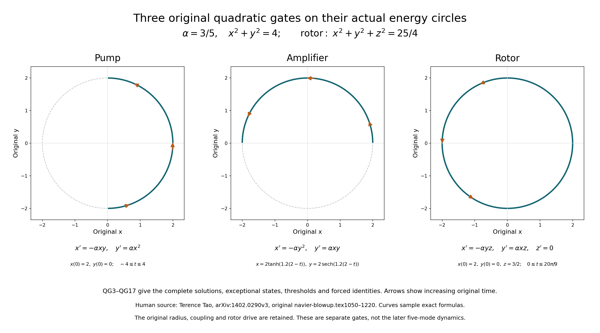
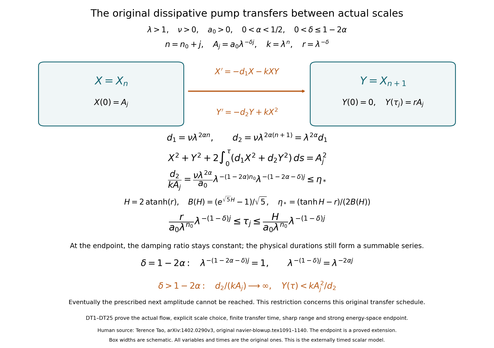
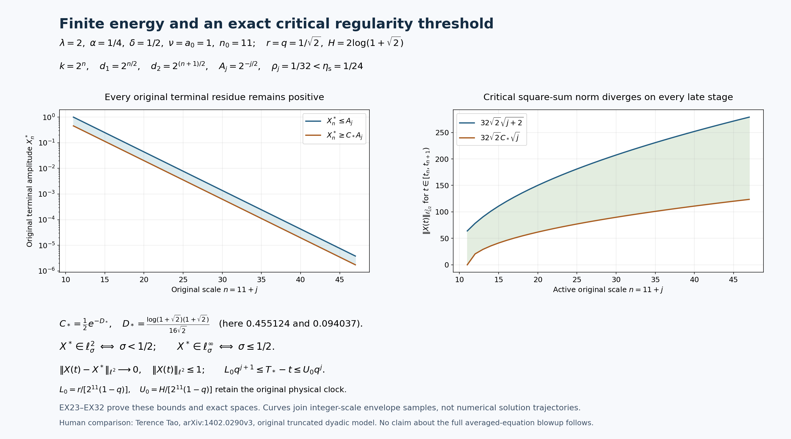

# Original quadratic gates and the exact dissipative transfer

The pump, amplifier and rotor are exact energy-preserving equations. This
lesson constructs their flows for every initial state, retains their full
forcing terms and proves the complete dissipative transfer with externally
scheduled switching times. The original upper-scale damping is corrected
visibly. Both its sharp allowable exponent and its strong energy-space
endpoint are proved, with the original amplitudes and physical clock.

The human source is Terence Tao's
[arXiv:1402.0290v3](https://arxiv.org/abs/1402.0290v3), original
navier-blowup.tex, lines 1050–1290. These are complete editorial derivations from
the author's original equations. No novelty claim is made.

The actual viscous-band equation and its complete memory are proved in
[lesson 40](the-original-viscous-cascade-and-its-exact-memory-equation.md),
VD1–VD35. The scalar dyadic equation below is the source's distinct
scheduled model. Its exact relation to the source's auxiliary coordinates
is proved with every factor retained. Its switch times are constructed
directly; the autonomous infinite cascade requires its own subsequent
argument.

Five solved exercises prove the full pump–amplifier correspondence, sharpen
the transfer estimate, establish the unique damped-output peak, continue
the scheduled flow through its energy-space endpoint, and determine the
exact terminal regularity. The final exercise also proves critical weighted
square-sum divergence throughout the final stages, with its full
physical-time rate. Three reproducible figures show the original objects
and the proved bounds.

## QG1. Construct the actual finite-dimensional flows

Let \(G:\mathbb R^m\times\mathbb R^m\to\mathbb R^m\) be a fixed bilinear map, with its original coefficients, satisfying \(U\cdot G(U,U)=0\) for every \(U\). Let \(F(t)\) be a continuous forcing vector on a time interval. We solve
\[
 U'=G(U,U)+F(t),\qquad U(t_0)=U_0.
\tag{QG1}
\]
Here and below the Euclidean energy keeps every coordinate.
To construct the solution, take a bilinear bound \(|G(V,W)|\leq B|V||W|\) and put \(R=1+|U_0|\). On a compact time neighborhood let \(F_*=\sup|F|\). The integral map on continuous paths with \(\sup|U-U_0|\leq R\) has displacement at most \(T(4BR^2+F_*)\), and its difference has coefficient at most \(4BRT\). Choose \(T>0\) so that these are at most \(R/2\) and \(1/2\), respectively. Successive substitution is then a contraction and constructs a unique continuous path; the integral equation makes it continuously differentiable. Any two continuous solutions agree on successive such short intervals by the same difference estimate.

For \(\eta>0\), differentiation and the cancellation assumption give
\[
 \frac{d}{dt}|U|^2=2U\cdot F,\qquad
 \frac{d}{dt}\sqrt{|U|^2+\eta}\leq |F|,\qquad
 |U(t)|\leq |U_0|+\int_{t_0}^t|F(r)|\,dr.
\tag{QG2}
\]
The last statement follows by integration and \(\eta\downarrow0\). Thus on any finite compact subinterval of the forcing domain the path stays bounded. Its derivative is bounded there as well, so a putative finite terminal time has an actual limit \(U_*\); the local construction from \(U_*\) extends it. The flow therefore exists throughout the forcing interval. When \(F=0\), the same argument in reversed time gives an all-real-time flow with constant energy. These constructions justify the gate calculations, rather than assuming that formal solutions exist.

## QG2. Solve every original pump state and retain forcing

In this subsection \(\alpha>0\) is the source pump coupling. Its symmetric bilinear map and equation are
\[
 G_{\rm p}(U,V)=
 \left(-\frac{\alpha}{2}(U_xV_y+V_xU_y),\ \alpha U_xV_x\right),
 \qquad x'=-\alpha xy,\quad y'=\alpha x^2.
\tag{QG3}
\]
The energy derivative is \(-2\alpha x^2y+2\alpha yx^2=0\), so QG1 applies. Retain \(s=\sqrt{x_0^2+y_0^2}\) and \(\tau=t-t_0\).
If \(x_0=0\), the full solution is the equilibrium \((0,y_0)\), including \(s=0\). If \(x_0\ne0\), then \(|y_0|<s\), and
\[
 \theta=\operatorname{atanh}(y_0/s),\qquad
 x(t)=\operatorname{sgn}(x_0)s\,\operatorname{sech}(\alpha s\tau+\theta),
 \quad y(t)=s\tanh(\alpha s\tau+\theta).
\tag{QG4}
\]
At \(\tau=0\), \(s\operatorname{sech}\theta=\sqrt{s^2-y_0^2}=|x_0|\). The derivatives \((\tanh z)'=\operatorname{sech}^2z\) and \((\operatorname{sech}z)'=-\operatorname{sech}z\tanh z\) verify both original equations, with the sign of \(x_0\) retained. Uniqueness identifies this explicit path with the constructed flow.
For any \(-1<r<1\) with \(y_0/s\leq r\), its first forward time at which \(y=rs\) is exactly
\[
 \tau_r=\frac{\operatorname{atanh}r-\theta}{\alpha s}.
\tag{QG5}
\]
Strict monotonicity gives uniqueness; equality in the initial inequality means \(\tau_r=0\). No finite time reaches \(y=s\). This proves the incomplete-transfer behavior of the original pump, including its exceptional equilibria.

For the forced equations \(x'=-\alpha xy+f,\ y'=\alpha x^2+g\), let \(I(t)=\alpha\int_{t_0}^t y(r)\,dr\). The exact identities are
\[
\begin{gathered}
 x(t)=e^{-I(t)}
 \left[x_0+\int_{t_0}^t e^{I(r)}f(r)\,dr\right],\\
 y(t)=y_0+\alpha\int_{t_0}^t x(r)^2\,dr+\int_{t_0}^t g(r)\,dr,
 \qquad (x^2+y^2)'=2xf+2yg.
\end{gathered}
\tag{QG6}
\]
Multiplication by the actual integrating factor and differentiation prove every term. In particular, zero output forcing makes \(y\) nondecreasing even when \(x\) changes sign. Nonzero \(g\) contributes its full signed integral and cannot be discarded. The source's informal oscillatory-input prediction is not used as an estimate here.

## QG3. Solve the original amplifier, including its threshold time

Keep the source amplifier coupling \(\alpha>0\). Its exact map and equation are
\[
 G_{\rm a}(U,V)=
 \left(-\alpha U_yV_y,\ \frac{\alpha}{2}(U_xV_y+V_xU_y)\right),
 \qquad x'=-\alpha y^2,\quad y'=\alpha xy.
\tag{QG7}
\]
Again the two cubic energy terms cancel. Put \(s=\sqrt{x_0^2+y_0^2}\). For \(y_0=0\), the solution is \((x_0,0)\). Otherwise \(\theta=\operatorname{atanh}(x_0/s)\) is finite and the entire solution is
\[
 x(t)=s\tanh(\theta-\alpha s\tau),\qquad
 y(t)=\operatorname{sgn}(y_0)s\,\operatorname{sech}(\theta-\alpha s\tau).
\tag{QG8}
\]
The same elementary derivatives verify the initial data and both equations; QG1 supplies uniqueness. If \(x_0>0\) and \(|y_0|\leq b\leq s\), the first time when \(|y|=b\) is
\[
 \tau_b=\frac{\theta-\operatorname{arcosh}(s/b)}{\alpha s}.
\tag{QG9}
\]
Here \(b>0\) automatically. Indeed \(\theta>0\), and on \(0\leq\tau\leq\theta/(\alpha s)\) the argument decreases from \(\theta\) to zero, while \(\operatorname{sech}\) strictly increases. The inverse relation \(\cosh z=s/b\) gives QG9 and its nonnegative value. The maximum \(b=s\) occurs at \(x=0\); subsequently \(|y|\) decreases. Thus the exponential-growth description has a precisely stated interval.

For \(x'=-\alpha y^2+f,\ y'=\alpha xy+g\), retain \(J(t)=\alpha\int_{t_0}^t x(r)\,dr\). Direct integration gives
\[
\begin{gathered}
 y(t)=e^{J(t)}
 \left[y_0+\int_{t_0}^t e^{-J(r)}g(r)\,dr\right],
 \quad
 x(t)=x_0-\alpha\int_{t_0}^t y(r)^2\,dr+\int_{t_0}^t f(r)\,dr,
 \\
(x^2+y^2)'=2xf+2yg.
\end{gathered}
\tag{QG10}
\]
These identities retain the sign and every effect of the external inputs.

## QG4. Keep the entire rotor and its exact averaging error

The source coupling is again \(\alpha>0\). The full three-coordinate map is
\[
\begin{gathered}
 G_{\rm r}(U,V)=
 \left(-\frac{\alpha}{2}(U_yV_z+V_yU_z),
 \frac{\alpha}{2}(U_xV_z+V_xU_z),0\right),\\
 x'=-\alpha yz,\qquad y'=\alpha xz,\qquad z'=0.
\end{gathered}
\tag{QG11}
\]
The two nonlinear energy terms cancel, including the unchanged third-coordinate energy. For every real initial state, with \(\omega=\alpha z_0\), the solution is
\[
 x=x_0\cos(\omega\tau)-y_0\sin(\omega\tau),\qquad
 y=y_0\cos(\omega\tau)+x_0\sin(\omega\tau),\qquad z=z_0.
\tag{QG12}
\]
Initial values and differentiation verify this formula, also when \(z_0=0\).
With all three forcings \(f,g,h\), set \(z(t)=z_0+\int_{t_0}^t h(r)\,dr\) and \(\Theta(t)=\alpha\int_{t_0}^t z(r)\,dr\). The exact original solution satisfies
\[
 x(t)+iy(t)=e^{i\Theta(t)}
 \left[x_0+iy_0+
 \int_{t_0}^t e^{-i\Theta(r)}(f(r)+ig(r))\,dr\right].
\tag{QG13}
\]
This follows by differentiating \(e^{-i\Theta}(x+iy)\); it makes no constant-frequency assumption. Its energy and product identities are
\[
 (x^2+y^2)'=2xf+2yg,\qquad
 (xy)'=\alpha z(x^2-y^2)+fy+gx.
\tag{QG14}
\]
If \(z\) has no zero on a compact interval \([a,b]\), division and integration by parts are legitimate and give
\[
\begin{aligned}
 \int_a^b(x^2-y^2)\,dt
 ={}&\left[\frac{xy}{\alpha z}\right]_a^b
 -\int_a^b\frac{fy+gx}{\alpha z}\,dt
 +\int_a^b\frac{xy z'}{\alpha z^2}\,dt.
\end{aligned}
\tag{QG15}
\]
Indeed \(\bigl(xy/(\alpha z)\bigr)'=(xy)'/(\alpha z)-xy z'/(\alpha z^2)\). This proves the exact connecting identity for variable drive and all forcings, including its final sign. QG14 remains valid across zeros of \(z\); QG15 asserts no division there.

For the unforced rotor, \(E=x_0^2+y_0^2\) is constant. If \(\omega\ne0\) and \(T>0\), squaring QG12 and integrating each trigonometric term gives
\[
 \frac1T\int_{t_0}^{t_0+T}x(t)^2\,dt
 =\frac E2+
 \frac{(x_0^2-y_0^2)\sin(2\omega T)}{4\omega T}
 -\frac{x_0y_0(1-\cos(2\omega T))}{2\omega T}.
\tag{QG16}
\]
This retains the exact phase and time endpoints. Writing \(x_0=\sqrt E\cos\phi,\ y_0=\sqrt E\sin\phi\) only to compute the maximum over the circle of original initial states, the last two terms become
\(E\sin(\omega T)\cos(2\phi+\omega T)/(2\omega T)\). Consequently
\[
 \sup_{x_0^2+y_0^2=E}
 \left|\frac1T\int_{t_0}^{t_0+T}x(t)^2\,dt-\frac E2\right|
 =\frac{E|\sin(\omega T)|}{2|\omega|T}
 \leq\frac{E}{2|\omega|T}.
\tag{QG17}
\]
Choosing the phase to make the cosine have absolute value one proves sharpness, including the zero-sine case. For \(\omega=0\), the separate average is \(x_0^2\), with no division by zero. The average of \(y^2\) is exactly \(E\) minus that of \(x^2\).

## QG5. Assemble and justify the source five-mode circuit

These are samples of the exact formulas QG4, QG8 and QG12, with the original coordinates on both axes. The pump has \((x_0,y_0)=(2,0)\); the amplifier uses \(x=2\tanh(1.2(2-t))\), \(y=2\operatorname{sech}(1.2(2-t))\); the rotor has \((x_0,y_0,z_0)=(2,0,3/2)\). All three couplings are \(\alpha=3/5\). The circles have the actual radius two. The rotor's retained third-coordinate energy is \(9/4\), so its total energy is \(25/4\). Arrowheads show increasing original time. These exact sampled curves illustrate the proved formulas; they are not a simulation of the later circuit. [Reproducible source](../assets/original-quadratic-gate-trajectories.py) and [vector figure](../assets/original-quadratic-gate-trajectories.svg). Human source: Tao, original navier-blowup.tex, lines 1050–1220.

Retain \(\epsilon>0\), \(K>0\) and the original five real coordinates \((a,b,c,d,\widetilde a)\). Their exact equations and original initial data are
\[
\begin{aligned}
 a'&=-\epsilon^{-2}cd-\epsilon ab-\epsilon^2e^{-K^{10}}ac,\\
 b'&=\epsilon a^2-\epsilon^{-1}K^{10}c^2,\\
 c'&=\epsilon^2e^{-K^{10}}a^2+\epsilon^{-1}K^{10}bc,\\
 d'&=\epsilon^{-2}ca-Kd\widetilde a,\qquad
 \widetilde a'=Kd^2,\\
 (a,b,c,d,\widetilde a)(0)&=(1,0,0,0,0).
\end{aligned}
\tag{QG18}
\]
These are the sum of the original pump \(a\to b\) with coupling \(\epsilon\), pump \(a\to c\) with coupling \(\epsilon^2e^{-K^{10}}\), amplifier \(b\to c\) with coupling \(\epsilon^{-1}K^{10}\), rotor on \((a,d)\) driven by \(c\) with coupling \(\epsilon^{-2}\), and pump \(d\to\widetilde a\) with coupling \(K\). Inserting QG3, QG7 and QG11 into these specified coordinate slots proves each term of QG18. In the total energy derivative their contributions are, respectively,
\(-2\epsilon a^2b+2\epsilon a^2b\),
\(-2\epsilon^2e^{-K^{10}}a^2c+2\epsilon^2e^{-K^{10}}a^2c\),
\(-2\epsilon^{-1}K^{10}bc^2+2\epsilon^{-1}K^{10}bc^2\),
\(-2\epsilon^{-2}acd+2\epsilon^{-2}acd\), and
\(-2Kd^2\widetilde a+2Kd^2\widetilde a\).
Thus QG1 constructs the global original flow and proves
\[
 a^2+b^2+c^2+d^2+\widetilde a^2=1.
\tag{QG19}
\]
For \(t\geq0\), its additional exact relations are
\[
\begin{gathered}
 c(t)=\epsilon^2e^{-K^{10}}
 \int_0^t a(r)^2
 \exp\!\left(\epsilon^{-1}K^{10}\int_r^t b(s)\,ds\right)\,dr,
 \qquad
 \widetilde a(t)=K\int_0^t d(r)^2\,dr,\\
 (b^2+c^2)'=
 2\epsilon a^2b+2\epsilon^2e^{-K^{10}}a^2c.
\end{gathered}
\tag{QG20}
\]
The first is the integrating-factor solution for \(c\); the second is direct integration; in the last the full amplifier terms cancel. Since \(a(0)=1\) and \(a\) is continuous, the first integral is strictly positive for every \(t>0\); hence \(c(t)>0\), and \(\widetilde a\geq0\) is nondecreasing. No sign for \(b\) or \(d\) follows from these identities, and none is assumed. The source's delayed rapid transfer requires further quantitative estimates for this actual circuit.

## DT1. Construct the original dissipative pump at one scale

In the source dyadic application, \(\alpha\) now denotes the dissipation exponent, rather than a gate coupling. Retain all parameters
\[
\begin{gathered}
 \lambda>1,\quad \alpha>0,\quad \nu\geq0,\quad a_0>0,\quad
 \delta>0,\quad n_0\in\mathbb Z_{\geq0},\\
n=n_0+j,\quad A_j=a_0\lambda^{-\delta j}\quad(j\geq0).
\end{gathered}
\tag{DT1}
\]
The source has \(\nu=a_0=1\). We keep these original coefficients explicit and prove the extension, without replacing the original variables by rescaled ones. At stage \(j\) put \(k=\lambda^n\), \(d_1=\nu\lambda^{2\alpha n}\), \(d_2=\nu\lambda^{2\alpha(n+1)}\). The actual physical-time initial-value problem is
\[
 X'=-d_1X-kXY,\qquad
 Y'=-d_2Y+kX^2,\qquad (X(0),Y(0))=(A_j,0).
\tag{DT2}
\]
Local existence follows from the polynomial Picard construction as in QG1, with the additional linear bound \(\max(d_1,d_2)\). The exact integrating factors give
\[
 X(\tau)=A_j\exp\!\left(-d_1\tau-k\int_0^\tau Y(s)\,ds\right)>0,\qquad
 Y(\tau)=k\int_0^\tau e^{-d_2(\tau-s)}X(s)^2\,ds\geq0.
\tag{DT3}
\]
Direct differentiation retains the full energy identity
\[
 X(\tau)^2+Y(\tau)^2+
 2\int_0^\tau(d_1X(s)^2+d_2Y(s)^2)\,ds=A_j^2.
\tag{DT4}
\]
The path is bounded by \(A_j\), so bounded derivatives and the same restart argument extend it to every \(\tau\geq0\). In particular all subsequent hitting times refer to actual solutions.

Compare it with the actual inviscid pump at the same original amplitude and coupling,
\[
 X^{(0)}(\tau)=A_j\operatorname{sech}(kA_j\tau),\qquad
 Y^{(0)}(\tau)=A_j\tanh(kA_j\tau).
\tag{DT5}
\]
Both paths lie in the closed ball of radius \(A_j\).
For \(N(X,Y)=(-kXY,kX^2)\), its full derivative is
\[
 DN(X,Y)=
 \begin{pmatrix}-kY&-kX\\2kX&0\end{pmatrix},
 \qquad
 \|DN(X,Y)\|_{\rm op}\leq
 k\sqrt{Y^2+5X^2}\leq\sqrt5\,kA_j.
\tag{DT6}
\]
The first inequality is the sum-of-squares bound for a matrix acting on a unit vector. Integrate this derivative along the segment between the two points; convexity of the ball gives the same Lipschitz constant. The damping vector has norm at most \(d_2A_j\), since \(0\leq d_1\leq d_2\). Subtracting the two integral equations therefore gives, with \(L=\sqrt5\,kA_j\),
\[
\begin{gathered}
 |(X,Y)-(X^{(0)},Y^{(0)})|(\tau)
 \leq\int_0^\tau\left(L|(X,Y)-(X^{(0)},Y^{(0)})|(s)+d_2A_j\right)\,ds,\\
 |(X,Y)-(X^{(0)},Y^{(0)})|(\tau)
 \leq\frac{d_2}{\sqrt5\,k}
       \bigl(e^{\sqrt5\,kA_j\tau}-1\bigr).
\end{gathered}
\tag{DT7}
\]
For completeness, if the first right-hand integral is \(v(\tau)\), then the left-hand quantity is at most \(v\), and \(v'\leq Lv+d_2A_j,\ v(0)=0\). Multiplication by \(e^{-L\tau}\) and integration prove the second line. This is the full perturbation estimate in the unchanged physical variables.

## DT2. Prove finite transfer, including the endpoint exponent

Set
\[
 r=\lambda^{-\delta}\in(0,1),\quad
 H=2\operatorname{atanh}r,\quad
 B(H)=\frac{e^{\sqrt5H}-1}{\sqrt5},\quad
 \eta_*=\frac{\tanh H-r}{2B(H)}>0.
\tag{DT8}
\]
The strict positivity follows from \(H>\operatorname{atanh}r>0\) and the strict increase of \(\tanh\).
If
\[
 \frac{d_2}{kA_j}\leq\eta_*,
\tag{DT9}
\]
then at the actual time \(\tau=H/(kA_j)\), DT7 gives
\[
 Y(\tau)\geq
 A_j\left(\tanh H-\eta_*B(H)\right)
 =A_j\frac{\tanh H+r}{2}>rA_j.
\]
Since \(Y(0)=0<rA_j\), continuity supplies a first hitting time \(\tau_j\) with \(Y(\tau_j)=rA_j\). The set of hitting times before \(H/(kA_j)\) is nonempty and compact, so its first element is attained and positive. Also \(Y'\leq kA_j^2\) by DT3–DT4. Integrating from zero at that hitting time proves both full bounds
\[
 \frac{r}{kA_j}\leq\tau_j\leq\frac{H}{kA_j}.
\tag{DT10}
\]
No monotonicity of the damped output is needed.

The exact parameter ratio in DT9 is
\[
 \frac{d_2}{kA_j}=
 \frac{\nu\lambda^{2\alpha}}{a_0}\,
 \lambda^{-(1-2\alpha)n_0}\,
 \lambda^{-(1-2\alpha-\delta)j}.
\tag{DT11}
\]
Consequently every stage satisfies DT9 whenever
\(0<\alpha<1/2\), \(0<\delta\leq1-2\alpha\), and, for \(\nu>0\),
\[
 n_0\geq
 \max\left\{0,\
 \left\lceil
 \frac{\log_\lambda\!\bigl(\nu\lambda^{2\alpha}/(a_0\eta_*)\bigr)}
 {1-2\alpha}
 \right\rceil\right\}.
\tag{DT12}
\]
At equality \(\delta=1-2\alpha\) the last factor of DT11 is exactly one at every stage; the same smallness condition therefore works. This proves the endpoint extension, rather than assuming the perturbation vanishes with the stage index. If \(\nu=0\), DT9 holds at every scale without DT12.

Here is the exact comparison with the source's auxiliary coordinates, while DT2 remains the working equation. For a stage beginning at physical time \(t_n\), define only for this comparison
\[
\begin{gathered}
 x(s)=A_j^{-1}X_n(t_n+s/(kA_j)),\qquad
 y(s)=A_j^{-1}X_{n+1}(t_n+s/(kA_j)),\\
 x_s=-\varepsilon_jx-xy,\qquad
 y_s=-\lambda^{2\alpha}\varepsilon_jy+x^2,\\
 \varepsilon_j=\frac{d_1}{kA_j}
 =\frac{\nu}{a_0}\lambda^{-(1-2\alpha)n_0}
             \lambda^{-(1-2\alpha-\delta)j}.
\end{gathered}
\tag{DT13}
\]
The chain rule contributes \(1/(kA_j^2)\) to each physical derivative. Thus \(d_2/(kA_j)=\lambda^{2\alpha}\varepsilon_j\). Source line 1133 prints \(\lambda^{-2\alpha}\varepsilon_j\), whereas its original equations at lines 1116–1117 require the positive exponent shown here. Every estimate DT3–DT12 was derived with the actual larger upper-scale damping \(d_2\), so this correction is already received in the proof.

## DT3. Assemble the complete externally timed dyadic flow

Assume the positive-viscosity range and scale choice of DT12, or \(\nu=0\) with \(0<\delta<1\). Let \(t_{n_0}=0\), \(X_{n_0}(0)=a_0\), and \(X_n(0)=0\) for \(n>n_0\). At stage \(j\), solve the original pair DT2 from physical time \(t_n\) until its first hitting time \(\tau_j\), and set \(t_{n+1}=t_n+\tau_j\). Evolve every other mode by its original linear equation \(X_m'=-\nu\lambda^{2\alpha m}X_m\). In particular all as-yet unused higher modes remain zero. DT10 and induction prove that this constructs every stage and that
\[
\begin{gathered}
 \partial_tX_n=-\nu\lambda^{2\alpha n}X_n
 +1_{(t_{n-1},t_n)}(t)\lambda^{n-1}X_{n-1}^2
 -1_{(t_n,t_{n+1})}(t)\lambda^nX_nX_{n+1},\\
 X_{n_0+j}(t_{n_0+j})=A_j=a_0\lambda^{-\delta j},\qquad
 X_{n_0+j}(t)=0\quad(j\geq1,\ 0\leq t\leq t_{n_0+j-1}).
\end{gathered}
\tag{DT14}
\]
Use the original boundary convention \(t_{n_0-1}=0,\ X_{n_0-1}=0\). At a switching time each coordinate is joined with the same endpoint value; hence it is continuous. Between switches it is smooth and satisfies DT14. The equation is asserted off the switch times, just as in the source. Previously visited modes retain their nonzero residues and their subsequent damping; none is deleted.

Since \(kA_j=a_0\lambda^{n_0}\lambda^{(1-\delta)j}\), the full physical durations satisfy
\[
 \frac{r}{a_0\lambda^{n_0}}\lambda^{-(1-\delta)j}
 \leq t_{n_0+j+1}-t_{n_0+j}
 \leq\frac{H}{a_0\lambda^{n_0}}\lambda^{-(1-\delta)j}.
\tag{DT15}
\]
Here \(0<\delta<1\); in the positive-viscosity case it follows from \(\delta\leq1-2\alpha\) and \(\alpha>0\). The geometric series proves an actual finite accumulation time with explicit lower and upper bounds:
\[
 \frac{r}{a_0\lambda^{n_0}(1-\lambda^{-(1-\delta)})}
 \leq T_*:=\lim_{j\to\infty}t_{n_0+j}
 \leq
 \frac{H}{a_0\lambda^{n_0}(1-\lambda^{-(1-\delta)})}.
\tag{DT16}
\]
Every compact interval \([0,T]\subset[0,T_*)\) intersects finitely many stages, since the increasing switch times converge to \(T_*\). Only finitely many modes are nonzero there. Thus all original weighted sums are finite on such intervals; no infinite-series solution has been postulated.

On each stage the pump cubic terms cancel exactly, and the previously visited modes obey their full linear equations. Adding every mode's energy derivative and joining the finitely many intervals gives
\[
 \sum_{n\geq n_0}X_n(t)^2+
 2\nu\int_0^t\sum_{n\geq n_0}\lambda^{2\alpha n}X_n(s)^2\,ds
 =a_0^2\qquad(0\leq t<T_*).
\tag{DT17}
\]
For every \(\delta'>\delta\), the actual switch-time values satisfy
\[
 \lambda^{\delta'(n_0+j)}
 |X_{n_0+j}(t_{n_0+j})|
 =a_0\lambda^{\delta'n_0}\lambda^{(\delta'-\delta)j}\longrightarrow\infty.
\tag{DT18}
\]
The switch times tend to \(T_*\), so DT18 proves the source weighted-supremum limsup blowup. It also proves divergence along that sequence of every weighted \(\ell^2\) norm whose square contains these terms. This includes the endpoint \(\delta=1-2\alpha\) allowed by DT12.

## DT4. Prove the exact restriction of this transfer mechanism

Let \(\nu>0\), and retain any \(\alpha>0,\delta>0\). For the actual stage pair, DT3 and \(X^2\leq A_j^2\) give for every finite \(\tau>0\)
\[
 Y(\tau)\leq
 \frac{kA_j^2}{d_2}(1-e^{-d_2\tau})
 <\frac{kA_j^2}{d_2}.
\tag{DT19}
\]
Reaching \(rA_j\) at a finite time therefore requires \(d_2/(kA_j)<1/r\). If \(\delta>1-2\alpha\), DT11 tends to infinity with \(j\), whatever finite \(n_0\) was chosen. Some stage then violates this necessary condition and cannot complete. Combining this argument with DT12 proves the exact classification:

For fixed \(\lambda>1,\alpha>0,\nu>0,a_0>0,\delta>0\), the original prescribed geometric transfer at every stage can be constructed by choosing a sufficiently large \(n_0\) if and only if
\[
 0<\delta\leq1-2\alpha.
\tag{DT20}
\]
In that range its physical time is finite by DT16. Outside it, the stated amplitude schedule fails at a finite stage; this is a proved capacity bound for DT2, not a conclusion about different gates, amplitude schedules or equations.

When \(\nu=0\), the exact formula DT5 instead gives
\[
 \tau_j=\frac{\operatorname{atanh}r}{a_0\lambda^{n_0}}
          \lambda^{-(1-\delta)j}.
\tag{DT21}
\]
Thus every stage succeeds for every \(\delta>0\), and their total time is finite precisely when \(0<\delta<1\). At \(\delta=1\) every duration is the same positive constant; at \(\delta>1\) the durations increase. This proves the separate zero-viscosity case without dividing by a vanishing damping coefficient.

## DT5. Construct the energy-space endpoint despite weighted blowup

For any of the finite-time flows just constructed and each \(N\geq n_0+1\), retain the complete high-mode tail. Before the incoming stage \(N-1\) it is zero. During that stage only mode \(N\) in the tail is nonzero and DT4 bounds its squared magnitude by \(A_{N-1-n_0}^2\). At time \(t_N\) the tail equals \(A_{N-n_0}^2\). After \(t_N\), every active pump has both endpoints in the tail, so its energy cancels internally; there is no further incoming edge from \(N-1\). Dissipation is nonnegative, including that of all previously visited tail modes. The finite-stage identity therefore proves
\[
 \sup_{0\leq t<T_*}\sum_{n\geq N}X_n(t)^2
 \leq A_{N-1-n_0}^2
 =a_0^2\lambda^{-2\delta(N-1-n_0)}
 \longrightarrow0.
\tag{DT22}
\]
For a fixed mode \(n\), after its outgoing stage it has the exact continuation
\[
 X_n(t)=X_n(t_{n+1})
 e^{-\nu\lambda^{2\alpha n}(t-t_{n+1})}
 \qquad(t_{n+1}\leq t<T_*).
\tag{DT23}
\]
It therefore has a limit \(X_n^*\) at \(T_*\). Passing to finite partial tail sums and then increasing their length in DT22 shows that \(X^*\in\ell^2\) with the same tail bound. Given any positive tolerance, choose \(N\) so that both tail norms are below one quarter of it, and then use convergence of the finitely many coordinates \(n_0,\ldots,N-1\). The triangle inequality proves
\[
 \|X(t)-X^*\|_{\ell^2}\longrightarrow0
 \quad(t\uparrow T_*).
\tag{DT24}
\]
This constructs a continuous energy-space endpoint of the same flow. For \(\nu>0\), DT17 bounds the increasing dissipation integral, so taking the limit with DT24 gives
\[
 \sum_{n\geq n_0}(X_n^*)^2+
 2\nu\int_0^{T_*}\sum_{n\geq n_0}\lambda^{2\alpha n}X_n(t)^2\,dt
 =a_0^2.
\tag{DT25}
\]
For \(\nu=0\), its separate value is \(\sum_n(X_n^*)^2=a_0^2\), by the constant energy in DT17 and strong convergence. No product of zero with an unexamined infinite integral is needed. The higher-weight divergence DT18 and the strong energy-space limit DT24 hold simultaneously for these actual original coordinates.

The quantitative delayed transition of the same five-mode circuit QG18 is now proved in DA1–DA37, with every original coefficient, explicit parameters and a complete repair of the product sign and activation interval. Its endogenous infinite-scale iteration remains to be proved. The exact gate maps, full forced rotor identity, corrected larger upper-scale damping and complete physical-time transfer estimates above provide usable inputs. They do not assume that externally prescribed switch times already arise from the autonomous averaged equation.

DT1–DT25 prove the actual pair, every displayed coefficient, the explicit starting-scale choice DT12, the finite physical-time sum and its strong energy-space endpoint. The lower orange case states the separate failure when \(\delta>1-2\alpha\). Box widths are schematic; every coordinate and elapsed physical time is retained. The arrow is the original nonlinear energy transfer, whose cancellation and full dissipative cost are in DT4. [Reproducible source](../assets/original-dissipative-scale-transfer.py) and [vector figure](../assets/original-dissipative-scale-transfer.svg). Human source: Tao, original navier-blowup.tex, lines 1091–1140. The endpoint extension carries no novelty claim.

## Five solved exercises

These exercises use the original equations QG1–QG20 and DT1–DT25. Every map acts on their stated physical coordinates and clock. The extensions below are editorial consequences of those complete proofs; no novelty claim is made. Human comparison: Terence Tao, [arXiv:1402.0290v3](https://arxiv.org/abs/1402.0290v3), original navier-blowup.tex, lines 1050–1290.

### Exercise 1. Prove the exact relation between the pump and amplifier

For the same coupling \(\alpha>0\), construct an orthogonal map intertwining the full pump and amplifier bilinear maps QG3 and QG7. Include arbitrary initial states, both forcing coordinates, and the exact flow relation. Identify the exceptional equilibrium states under this map.

**Solution.** On the original Euclidean plane define
\[
 R(x,y)=(-y,x),\qquad R^{-1}(u,v)=(v,-u),\qquad
 R=\begin{pmatrix}0&-1\\1&0\end{pmatrix},\quad
 R^{\mathsf T}R=I,\quad\det R=1.
\tag{EX1}
\]
This is a bijective orientation-preserving isometry. Retaining both input vectors, direct substitution gives
\[
\begin{aligned}
 R G_{\rm p}(U,V)
 &=\left(-\alpha U_xV_x,
 -\tfrac\alpha2(U_xV_y+V_xU_y)\right)\\
 &=G_{\rm a}(RU,RV).
\end{aligned}
\tag{EX2}
\]
Consequently, if the actual forced pump has initial state \((x_0,y_0)\) and force \((f,g)\), its image \((u,v)=(-y,x)\) satisfies the actual amplifier equations
\[
\begin{gathered}
 u'=-\alpha v^2-g,\qquad v'=\alpha uv+f,\qquad
 (u,v)(t_0)=(-y_0,x_0),\\
 \Phi_{\rm a}^{(-g,f)}(t,t_0,RU_0)
 =R\Phi_{\rm p}^{(f,g)}(t,t_0,U_0).
\end{gathered}
\tag{EX3}
\]
Here each \(\Phi\) is the unique flow constructed in QG1–QG2, on the entire common forcing interval. The chain rule and EX2 prove that the right side solves the left side's initial-value problem; uniqueness proves the equality. Applying \(R^{-1}\) gives the converse, including every forced state. The clock and coupling have not changed.

For the unforced non-equilibrium case \(x_0\ne0\), retain \(s=\sqrt{x_0^2+y_0^2}\) and \(\theta=\operatorname{atanh}(y_0/s)\). The amplifier image has parameter \(-\theta\), so its exact original coordinates are
\[
 u(t)=-s\tanh(\alpha s(t-t_0)+\theta),\qquad
 v(t)=\operatorname{sgn}(x_0)s\operatorname{sech}(\alpha s(t-t_0)+\theta).
\tag{EX4}
\]
This agrees with QG8, since \(\tanh\) is odd and \(\operatorname{sech}\) is even. The pump equilibria \((0,y_0)\) map exactly to all amplifier equilibria \((-y_0,0)\), including the zero state. Under forcing, the entire energy input is preserved:
\(2u(-g)+2vf=2yg+2xf\).
Thus the exact relation includes the bilinear maps, all initial states, the forcing, the full energy, and both directions of the flow.

### Exercise 2. Strengthen the actual dissipative transfer estimate

For the physical pair DT2, replace the full Jacobian norm estimate by the sharp one-sided Euclidean estimate on the first-quadrant ball. Keep both damping coefficients and derive a smaller sufficient starting-scale bound for the same prescribed amplitude schedule.

**Solution.** Write \(A=A_j\), \(k=\lambda^{n_0+j}\), and retain the original \(d_1,d_2\). For \(N(X,Y)=(-kXY,kX^2)\), the symmetric part of its derivative is
\[
 S(X,Y)=\tfrac12(DN+DN^{\mathsf T})
 =\begin{pmatrix}-kY&kX/2\\kX/2&0\end{pmatrix},
 \qquad
 \mu_\pm=\tfrac k2\left(-Y\pm\sqrt{X^2+Y^2}\right).
\tag{EX5}
\]
The characteristic polynomial is \(\mu^2+kY\mu-k^2X^2/4\), giving the displayed roots. On \(X,Y\geq0\), \(X^2+Y^2\leq A^2\), its largest eigenvalue is at most \(kA/2\). At \((A,0)\), the unit vector \((1,1)/\sqrt2\) attains that eigenvalue. Interior points approaching \((A,0)\) and short segments parallel to that vector show that no smaller uniform one-sided constant works on the whole first-quadrant ball. This claim concerns the directional quadratic form, not the generally larger full derivative norm.

Both the actual damped path \(U=(X,Y)\) and the actual inviscid path \(V=(X^{(0)},Y^{(0)})\) belong to that convex region by DT3–DT5. Put \(W=U-V\) and \(D=\operatorname{diag}(d_1,d_2)\). Their exact difference is
\[
 W'=N(U)-N(V)-DW-DV,
 \qquad
 \tfrac12(|W|^2)'\leq
 \left(\tfrac{kA}{2}-d_1\right)|W|^2+d_2A|W|.
\tag{EX6}
\]
To prove the inequality, write
\(N(U)-N(V)=\int_0^1 DN(V+\theta W)W\,d\theta\).
The skew part has zero quadratic pairing with \(W\), so EX5 bounds this term. The two original damping terms give \(-W\cdot DW\leq-d_1|W|^2\) and \(|DV|\leq d_2A\).

For every real \(L\) and \(\tau\geq0\), retain
\[
 J_L(\tau)=\int_0^\tau e^{Ls}\,ds
 =\begin{cases}(e^{L\tau}-1)/L,&L\ne0,\\\tau,&L=0.
 \end{cases}
\tag{EX7}
\]
With \(L=kA/2-d_1\), EX6 proves
\[
 |U(\tau)-V(\tau)|\leq d_2A J_{kA/2-d_1}(\tau)
 \leq\frac{2d_2}{k}\left(e^{kA\tau/2}-1\right).
\tag{EX8}
\]
Here is a justification also when \(L\) is zero or negative. For \(\zeta>0\), put \(w_\zeta=\sqrt{|W|^2+\zeta}\). EX6 gives
\(w_\zeta'\leq Lw_\zeta+d_2A+|L|\sqrt\zeta\),
because \(|W|\leq w_\zeta\) and \(\zeta/w_\zeta\leq\sqrt\zeta\). Multiply by \(e^{-L\tau}\), integrate with \(w_\zeta(0)=\sqrt\zeta\), and let \(\zeta\downarrow0\). This proves the first inequality. Since \(J_L\) increases with \(L\) and \(L\leq kA/2\), it also proves the second. Thus the negative part of the actual damping has been retained rather than assigned a favorable sign without proof.

Keep \(r=\lambda^{-\delta}\) and \(H=2\operatorname{atanh}r\) from DT8, and define
\[
 B_{\rm s}(H)=2(e^{H/2}-1),\qquad
 \eta_{\rm s}=\frac{\tanh H-r}{2B_{\rm s}(H)}>0.
\tag{EX9}
\]
If the actual ratio \(d_2/(kA_j)\leq\eta_{\rm s}\), EX8 at time \(H/(kA_j)\) gives

\[
Y\geq A_j(\tanh H-\eta_{\rm s}B_{\rm s}(H))=A_j(\tanh H+r)/2>rA_j.
\]

The first hitting-time construction and both physical duration bounds DT10 therefore hold. The two constants can be compared without discarding their exponential factors:

\[
B_{\rm s}(H)=\int_0^H e^{s/2}ds<\int_0^H e^{\sqrt5s}ds=B(H).
\]

Hence \(\eta_{\rm s}>\eta_*\), and this sufficient damping restriction is weaker than DT9.

For \(\nu>0\), \(0<\alpha<1/2\), \(0<\delta\leq1-2\alpha\), the exact ratio DT11 shows that the same full construction works with
\[
 n_0\geq\max\left\{0,
 \left\lceil\frac{
 \log_\lambda\bigl(\nu\lambda^{2\alpha}/(a_0\eta_{\rm s})\bigr)}
 {1-2\alpha}\right\rceil\right\}.
\tag{EX10}
\]
This integer bound never exceeds the earlier sufficient bound; rounding can make them equal. The endpoint \(\delta=1-2\alpha\) is included. For \(\nu=0\), the actual paths agree and the error in EX8 is exactly zero; no logarithm involving zero is used.

### Exercise 3. Prove that the damped output has one peak and a stronger capacity bound

For the original positive-viscosity pair DT2, construct its exact second-order output equation and the inverse map back to both coordinates. Prove that its output has exactly one maximum. Then retain the decay of the input to strengthen DT19, including the case \(d_2=2d_1\).

**Solution.** Here \(\nu>0\), so \(0<d_1<d_2\), and \(A=A_j>0\), \(k>0\). Differentiate the original output equation, retaining \(X'=-d_1X-kXY\):
\[
\begin{gathered}
 Y''+(d_2+2d_1+2kY)Y'+2d_2(d_1+kY)Y=0,\\
 Y(0)=0,\qquad Y'(0)=kA^2,
 \qquad W:=Y'+d_2Y=kX^2>0.
\end{gathered}
\tag{EX11}
\]
Indeed \(W'=2kXX'=-2(d_1+kY)W\). Conversely, for any twice continuously differentiable solution of the first two parts of EX11 on an interval starting at zero,
\[
 W(\tau)=kA^2e^{-2d_1\tau-2k\int_0^\tau Y(s)ds}>0,
 \qquad X(\tau)=\sqrt{W(\tau)/k}.
\tag{EX12}
\]
The differential equation in EX11 gives the displayed linear equation for \(W\), so its integrating factor proves the first formula. Differentiating the positive square root gives \(X'=-(d_1+kY)X\), while the definition of \(W\) gives \(Y'=-d_2Y+kX^2\). The initial state is exactly \((A,0)\). Uniqueness therefore identifies this lift with the actual global pair of DT2–DT4. This proves both directions of the exact correspondence, including positivity and the initial derivative, without deleting a state variable from the original flow.

Since \(Y>0\) for every \(\tau>0\), the actual first integral DT3 gives the strict bound \(X(\tau)<Ae^{-d_1\tau}\) there. Inserting it into the complete output integral gives
\[
 0<Y(\tau)<kA^2
 \begin{cases}
 \displaystyle\frac{e^{-2d_1\tau}-e^{-d_2\tau}}{d_2-2d_1},&d_2\ne2d_1,\\[6pt]
 \tau e^{-d_2\tau},&d_2=2d_1
 \end{cases}
 \qquad(\tau>0).
\tag{EX13}
\]
The strict inequality follows on a positive-length part of the integral, not only at its endpoint. Both expressions are positive and tend to zero; in the unequal case the numerator and denominator always have the same sign. Thus the actual \(Y\) tends to zero. Since it begins at zero, is positive subsequently and has positive initial derivative, it attains a positive global maximum at a finite interior time.

At every critical point of \(Y\) with \(\tau>0\), EX11 gives
\[
 Y''=-2d_2(d_1+kY)Y<0,
 \qquad X^2=(d_2/k)Y.
\tag{EX14}
\]
Every zero of \(Y'\) therefore crosses strictly from positive to negative. There cannot be a later zero after the first: before the first such later zero the derivative would be negative, whereas a strictly negative derivative of \(Y'\) at that zero requires \(Y'>0\) immediately to its left. Existence of a global maximum supplies the first zero. Consequently there is exactly one peak time, \(Y\) increases strictly before it and decreases strictly after it. A positive target below the maximum is reached exactly twice, a target equal to the maximum once, and a larger target never. This identifies the first hitting time in DT10 as lying on the increasing branch whenever the target is strictly below the maximum.

To maximize the upper envelope in EX13, keep
\[
 \tau_{\rm env}=
 \begin{cases}
 \displaystyle\frac{\log(d_2/(2d_1))}{d_2-2d_1},&d_2\ne2d_1,\\[6pt]
 d_2^{-1},&d_2=2d_1,
 \end{cases}
\quad
 \Phi(d_1,d_2)=
 \begin{cases}
 \displaystyle\exp\left[-\frac{2d_1}{d_2-2d_1}
                 \log\frac{d_2}{2d_1}\right],&d_2\ne2d_1,\\[6pt]
 e^{-1},&d_2=2d_1.
 \end{cases}
\tag{EX15}
\]
In the unequal case the derivative of the envelope vanishes precisely when
\(d_2e^{-d_2\tau}=2d_1e^{-2d_1\tau}\).
This gives the positive \(\tau_{\rm env}\), and substitution gives the envelope value \(\Phi/d_2\). In the equal case differentiation of \(\tau e^{-d_2\tau}\) gives the stated time and value. In both cases \(0<\Phi<1\). At the actual peak time, EX13 is strict, so the complete capacity bound is
\[
 \max_{\tau\geq0}Y(\tau)
 <\frac{kA_j^2}{d_2}\Phi(d_1,d_2),\qquad
 Y(\tau)=rA_j\text{ for some finite }\tau
 \ \Longrightarrow\ 
 \frac{d_2}{kA_j}<\frac{\Phi(d_1,d_2)}r.
\tag{EX16}
\]
This strengthens DT19 using both original dissipative rates. Their actual ratio is \(d_2/(2d_1)=\lambda^{2\alpha}/2\), so the factor is independent of the stage index and retains its full \(\lambda,\alpha\) dependence.

For \(\nu=0\), the separate actual solution is
\[
 Y(\tau)=A_j\tanh(kA_j\tau),\qquad
 Y'(\tau)=kA_j^2\operatorname{sech}^2(kA_j\tau)>0.
\tag{EX17}
\]
It has no finite peak, tends to \(A_j\), and reaches every target \(rA_j\), \(0<r<1\), exactly once. None of EX13–EX16 is evaluated by dividing by zero in this case.

### Exercise 4. Continue the scheduled flow through its energy-space endpoint

Use the actual strong endpoint \(X^*\) from DT22–DT25 to construct a global energy-class continuation of the same externally scheduled equation. Prove its coordinate equations and full energy identity. For positive viscosity, calculate its exact post-endpoint heat-map norm into every nonnegative weighted square-sum space.

**Solution.** All switching intervals end before \(T_*\). Retain the actual original coordinates for \(t<T_*\), and define for \(h\geq0\)
\[
 X_n(T_*+h)=X_n^*e^{-\nu\lambda^{2\alpha n}h}
 \quad(n\geq n_0),\qquad X_n=0\quad(n<n_0).
\tag{EX18}
\]
For each fixed \(n\), DT23 already gives this same exponential from time \(t_{n+1}\) onward. Thus the extended coordinate is smooth at \(T_*\) and obeys the original equation there and after it; its nonlinear indicators are zero. At the earlier two switch times it has the continuous joining and piecewise smooth interpretation stated in DT14. There is no jump term at \(T_*\).

The diagonal map in EX18 has norm at most one on \(\ell^2\), and it is strongly continuous: for any \(x\in\ell^2\), split the squared sum into finitely many coordinates and a tail; the finite terms converge as the time increment tends to zero, while the tail is bounded by four times its original squared norm. This proves strong continuity without interchanging an unbounded derivative with the sum. Together with DT24, it gives \(X\in C([0,\infty);\ell^2)\).

For \(\nu>0\), integration of each exponential squared gives, and increasing finite sums preserve,
\[
\begin{aligned}
 \sum_{n\geq n_0}X_n(T_*+h)^2
 &+2\nu\int_{T_*}^{T_*+h}
       \sum_{n\geq n_0}\lambda^{2\alpha n}X_n(t)^2dt
 =\sum_{n\geq n_0}(X_n^*)^2,\\
 \sum_{n\geq n_0}X_n(t)^2
 &+2\nu\int_0^t\sum_{n\geq n_0}\lambda^{2\alpha n}X_n(s)^2ds
 =a_0^2\qquad(t\geq0).
\end{aligned}
\tag{EX19}
\]
The first limit uses monotone convergence of the nonnegative dissipation terms; the second joins it to DT25. Thus the continuation also belongs to \(L^2([0,T];\ell^2_\alpha)\) for every finite \(T\), where
\(\|x\|_{\ell^2_\alpha}^2=\sum\lambda^{2\alpha n}|x_n|^2\).
For zero viscosity the continuation is separately constant after \(T_*\), and its exact energy is \(a_0^2\), as proved in DT25. No assertion of an infinite weighted dissipation integral multiplied by zero is needed.

The coordinate equations give a distributional equation against every test sequence with finite index support and smooth compact time support, by integration on the finitely many pieces for each tested coordinate. Endpoint terms at \(T_*\) cancel because the coordinates are continuous. This is the stated meaning of the global scheduled solution; no unproved integrability of the entire nonlinear vector in \(\ell^2\) is assumed.

Now let \(\nu>0\), \(h>0\), and retain the original weighted norm
\(\|x\|_{\ell^2_\sigma}^2=\sum_{n\geq n_0}\lambda^{2\sigma n}|x_n|^2\).
The exact operator norm of the diagonal map from \(\ell^2\) to \(\ell^2_\sigma\) is
\[
 C_\sigma(h)=\sup_{n\geq n_0}
       \lambda^{\sigma n}e^{-\nu h\lambda^{2\alpha n}},
 \qquad
 \|X(T_*+h)\|_{\ell^2_\sigma}
 \leq C_\sigma(h)\|X^*\|_{\ell^2}.
\tag{EX20}
\]
The inequality is termwise. A unit vector at a maximizing index, or at indices approaching the supremum, proves the reverse operator-norm inequality. For \(\sigma=0\), it is exactly \(C_0(h)=e^{-\nu h\lambda^{2\alpha n_0}}\).
For \(\sigma>0\), define
\[
 n_*=
 \frac{\log(\sigma/(2\alpha\nu h))}{2\alpha\log\lambda},
 \qquad m=\max\{n_0,\lfloor n_*\rfloor\},\qquad
 C_\sigma(h)=\max_{n\in\{m,m+1\}}
       \lambda^{\sigma n}e^{-\nu h\lambda^{2\alpha n}}.
\tag{EX21}
\]
Indeed the logarithmic derivative of the same expression with a real index is
\(\log\lambda\,[\sigma-2\alpha\nu h\lambda^{2\alpha n}]\).
It is positive before \(n_*\) and negative after it, so only these two allowed adjacent integers can maximize it. This keeps the actual discrete scales and the lower boundary \(n_0\).

For comparison, allowing every positive value of \(z=\lambda^{2\alpha n}\), while keeping its full power, gives
\[
 C_\sigma(h)\leq
 \left(\frac{\sigma}{2e\alpha\nu h}\right)^{\sigma/(2\alpha)}
 \quad(\sigma>0).
\tag{EX22}
\]
This follows by maximizing \(z^{\sigma/(2\alpha)}e^{-\nu hz}\); its derivative vanishes at \(z=\sigma/(2\alpha\nu h)\). Hence the actual continued flow has every nonnegative weighted square-sum norm finite for each positive time after \(T_*\). This does not remove the weighted blowup before \(T_*\), nor does an externally scheduled energy-class continuation prove the corresponding autonomous cascade theorem.

### Exercise 5. Determine the exact regularity of the terminal sequence

Choose a sufficient starting scale so that the retained residues in every completed mode have a uniform positive fraction of their original amplitudes. Prove the exact weighted \(\ell^2\) and weighted supremum thresholds of \(X^*\). Strengthen the critical weighted blowup from a possible subsequence to a quantitative estimate throughout the last stages.

**Solution.** Retain \(r=\lambda^{-\delta}\), \(H=2\operatorname{atanh}r\), and \(\eta_{\rm s}\) from EX9. For positive viscosity use \(0<\alpha<1/2\), \(0<\delta\leq1-2\alpha\), and set
\[
\begin{gathered}
 \eta_{\rm r}=\min\left\{\eta_{\rm s},\frac{1-r^2}{4H}\right\}>0,\\
 n_0\geq\max\left\{0,
 \left\lceil\frac{
 \log_\lambda\bigl(\nu\lambda^{2\alpha}/(a_0\eta_{\rm r})\bigr)}
 {1-2\alpha}\right\rceil\right\}.
\end{gathered}
\tag{EX23}
\]
Exercise 2 constructs the same scheduled flow at this scale. The exact stage ratio
\(\rho_j=d_2/(kA_j)\), given by DT11, satisfies \(\rho_j\leq\rho_0\leq\eta_{\rm r}\).
For \(\nu=0\), use any \(\alpha>0\), \(0<\delta<1\), and \(n_0\geq0\); the ratios are separately zero and the exact inviscid flow constructs every stage. All subsequent formulas retain \(\nu\); none divides by it in the zero case.

During a mode's incoming stage it is the output \(Y\), and the stage stops at its first hit of \(A_j\). It is therefore at most \(A_j\) before and at that hit. During its outgoing stage its equation makes it positive and decreasing. Afterwards the full linear damping continues to decrease it. Thus, including both exceptional initial and endpoint times,
\[
 0\leq X_{n_0+j}(t)\leq A_j=a_0\lambda^{-\delta j}
 \quad(j\geq0,\ t\geq0).
\tag{EX24}
\]
For the stronger lower bound, use the actual pair energy DT4 at its outgoing time \(\tau_j\leq H/(kA_j)\). Its dissipation satisfies
\(2\int_0^{\tau_j}(d_1X^2+d_2Y^2)ds\leq2d_2A_j^2\tau_j\leq2\rho_jH A_j^2\).
Since the output there equals \(rA_j\), the original input residue satisfies
\[
 X_{n_0+j}(t_{n_0+j+1})^2
 \geq A_j^2(1-r^2-2\rho_jH)
 \geq\tfrac12(1-r^2)A_j^2.
\tag{EX25}
\]
Its sign is positive by DT3, so this is also a lower bound on the positive square root.

Put \(q=\lambda^{-(1-\delta)}\in(0,1)\). Summing all remaining actual duration bounds from DT15 retains
\[
\begin{aligned}
 T_*-t_{n_0+j+1}
 &\leq\frac{H}{a_0\lambda^{n_0}}
           \frac{q^{j+1}}{1-q},\\
 \nu\lambda^{2\alpha(n_0+j)}(T_*-t_{n_0+j+1})
 &\leq\frac{\nu H}{a_0}
 \lambda^{-(1-2\alpha)n_0}
 \lambda^{-(1-2\alpha-\delta)j}\frac{q}{1-q}
 \leq D_*:=\frac{\nu H}{a_0}
 \lambda^{-(1-2\alpha)n_0}\frac{q}{1-q}.
\end{aligned}
\tag{EX26}
\]
The last inequality uses \(1-2\alpha-\delta\geq0\) when \(\nu>0\). When \(\nu=0\), all three actual damping quantities are zero, so it holds separately without any such restriction. Combining the full continuation DT23 with EX25–EX26 gives the two-sided terminal estimate
\[
 C_*a_0\lambda^{-\delta j}
 \leq X_{n_0+j}^*\leq a_0\lambda^{-\delta j},
 \qquad
 C_*:=\sqrt{\frac{1-r^2}{2}}e^{-D_*}>0.
\tag{EX27}
\]
In particular no completed mode's original residue has been removed at the endpoint. The same lower bound holds before \(T_*\) for a mode after its outgoing stage, since it then decreases toward its terminal value.

For every real \(\sigma\), define the original weighted norms
\(\|x\|_{\ell^2_\sigma}^2=\sum_{n\geq n_0}\lambda^{2\sigma n}|x_n|^2\)
and \(\|x\|_{\ell^\infty_\sigma}=\sup_{n\geq n_0}\lambda^{\sigma n}|x_n|\).
Multiplying the two sides of EX27 by the full weight proves exactly
\[
 X^*\in\ell^2_\sigma\ \Longleftrightarrow\ \sigma<\delta,
 \qquad
 X^*\in\ell^\infty_\sigma\ \Longleftrightarrow\ \sigma\leq\delta.
\tag{EX28}
\]
Indeed the squared terms are bounded above and below by positive constants times
\(a_0^2\lambda^{2\sigma n_0}\lambda^{2(\sigma-\delta)j}\).
The geometric sum converges precisely when \(\sigma<\delta\); at equality each term has a positive lower bound, while above equality they increase without bound. For the supremum, the corresponding geometric sequence is bounded precisely when \(\sigma\leq\delta\). These are both directions of each assertion.

For every \(\sigma<\delta\), EX24 also gives the uniform full tail
\[
 \sup_{t\geq0}\sum_{j\geq J}
 \lambda^{2\sigma(n_0+j)}X_{n_0+j}(t)^2
 \leq
 \frac{a_0^2\lambda^{2\sigma n_0}
          \lambda^{-2(\delta-\sigma)J}}
      {1-\lambda^{-2(\delta-\sigma)}}.
\tag{EX29}
\]
Splitting at a large finite \(J\) and using the already proved convergence of each coordinate therefore proves the actual stronger limit
\(\|X(t)-X^*\|_{\ell^2_\sigma}\to0\) as \(t\uparrow T_*\).
The same finite-plus-tail argument gives continuity of the extended flow in this space. No finite weighted endpoint is claimed at \(\sigma=\delta\).

For a time in the actual stage \([t_{n_0+j},t_{n_0+j+1})\), all modes with indices \(n_0,\ldots,n_0+j-1\) have completed their outgoing stages. Only the first \(j+2\) modes can have been activated. EX24 and EX27 consequently imply the full inequalities
\[
\begin{aligned}
 C_*^2a_0^2\lambda^{2\sigma n_0}
       \sum_{\ell=0}^{j-1}\lambda^{2(\sigma-\delta)\ell}
 &\leq\|X(t)\|_{\ell^2_\sigma}^2\\
 &\leq a_0^2\lambda^{2\sigma n_0}
       \sum_{\ell=0}^{j+1}\lambda^{2(\sigma-\delta)\ell}.
\end{aligned}
\tag{EX30}
\]
The lower sum is zero for \(j=0\). At \(\sigma=\delta\), these sums are exactly \(j\) and \(j+2\). Thus the critical weighted square-sum norm tends to infinity throughout the final stages, with bounds proportional to \(\sqrt j\), even though the critical weighted supremum remains bounded by \(a_0\lambda^{\delta n_0}\).

This rate also has a full physical-time statement. Define the actual constants
\(L_0=r/[a_0\lambda^{n_0}(1-q)]\) and
\(U_0=H/[a_0\lambda^{n_0}(1-q)]\).
The remaining duration sums give
\(L_0q^{j+1}\leq T_*-t\leq U_0q^j\) on the same stage. Taking logarithms with \(0<q<1\), retaining the inequality reversals, gives
\[
\begin{aligned}
 C_*^2a_0^2\lambda^{2\delta n_0}
 \max\left\{0,\frac{\log(L_0/(T_*-t))}{\log(1/q)}-1\right\}
 &\leq\|X(t)\|_{\ell^2_\delta}^2\\
 &\leq a_0^2\lambda^{2\delta n_0}
 \left(\frac{\log(U_0/(T_*-t))}{\log(1/q)}+2\right).
\end{aligned}
\tag{EX31}
\]
In particular the divergence is logarithmic for the squared norm, with every original amplitude and clock factor present. For \(\sigma>\delta\), the lower sum in EX30 likewise tends to infinity at every time approaching \(T_*\), strengthening the earlier subsequence conclusion DT18 for this constructed parameter range.

Finally the zero-viscosity case has an exact endpoint, not only bounds. Pair energy at each outgoing threshold gives
\[
 X_{n_0+j}^*=a_0\lambda^{-\delta j}\sqrt{1-r^2},\qquad
 \|X^*\|_{\ell^2_\sigma}^2
 =\frac{a_0^2(1-r^2)\lambda^{2\sigma n_0}}
        {1-\lambda^{2(\sigma-\delta)}}
 \quad(\nu=0,\ \sigma<\delta).
\tag{EX32}
\]
There is no later damping in this case. At \(\sigma=0\), the denominator equals \(1-r^2\), recovering the full energy \(a_0^2\). Thus the explicit residue formulas, exact endpoint spaces, full-time critical divergence and strong subcritical limits all refer to the same original scheduled flow.

The figure samples the proved EX27 and EX30 envelopes with \(\lambda=2\), \(\alpha=1/4\), \(\delta=1/2\), \(\nu=a_0=1\), and \(n_0=11\). Here \(r=q=1/\sqrt2\), \(H=2\log(1+\sqrt2)\), \(\tanh H=2\sqrt2/3\), and \(e^{H/2}=1+\sqrt2\), so EX9 gives exactly \(\eta_{\rm s}=1/24\). Since \(H<2\), EX23 has \(\eta_{\rm r}=1/24\), whereas the actual ratio at every scale is \(\rho_j=1/32\). Thus the pictured parameters satisfy the proved construction. The vertical scales retain the actual amplitude and the critical factor \(a_0\lambda^{\delta n_0}=32\sqrt2\). Curves join integer-scale samples of bounds; they do not claim to trace an ODE solution. EX26 and EX31 retain the corresponding original physical-time factors. [Reproducible figure source](../assets/original-scheduled-cascade-endpoint.py), [vector rendering](../assets/original-scheduled-cascade-endpoint.svg), and [sampled bound values](../assets/original-scheduled-cascade-endpoint-data.json) are included. Human comparison: Tao's original truncated dyadic model, navier-blowup.tex, lines 1091–1140.

## Continue to the delayed autonomous circuit

The original gates and scheduled dissipative flow are now fully constructed.
The endpoint retains all mode residues, has an exact regularity threshold,
and admits the stated energy-class continuation. Its weighted blowup is a
proved property of that same scheduled equation.

The next lesson integrates the original autonomous five-mode delayed
transfer and its visible product-sign, energy-sign and interval repairs.
The complete finite proof is already available,
DA1–DA37, together with the
exact cascade coefficient corrections,
CR1–CR20. The subsequent infinite-scale induction must retain the incoming
and outgoing couplings and the actual viscous-band terms. The full
averaged-equation blowup theorem remains under examination as the wider
series continues toward the Alpöge–Buckmaster, OpenAI and workbench work.
