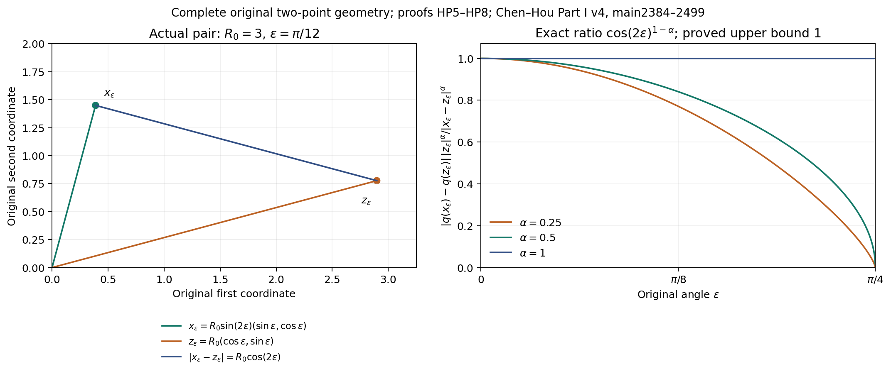
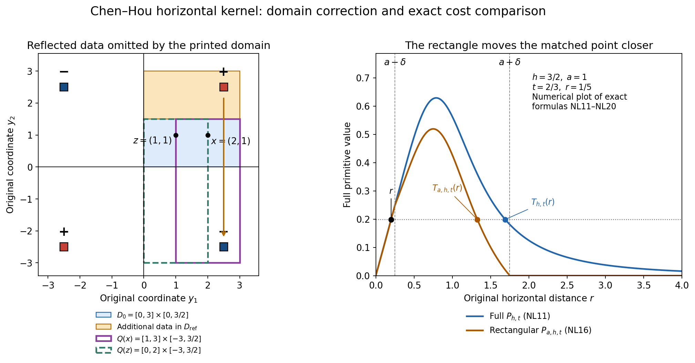
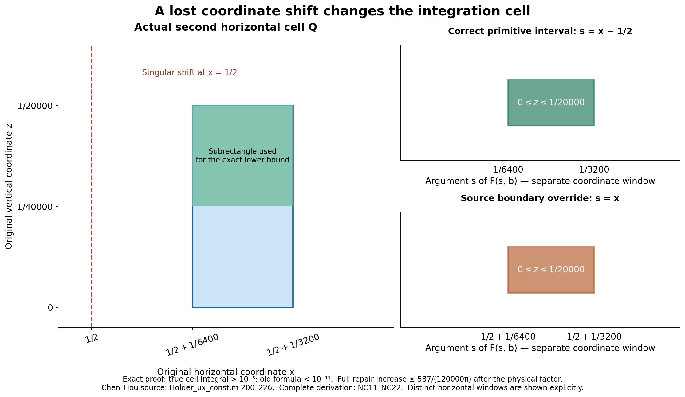
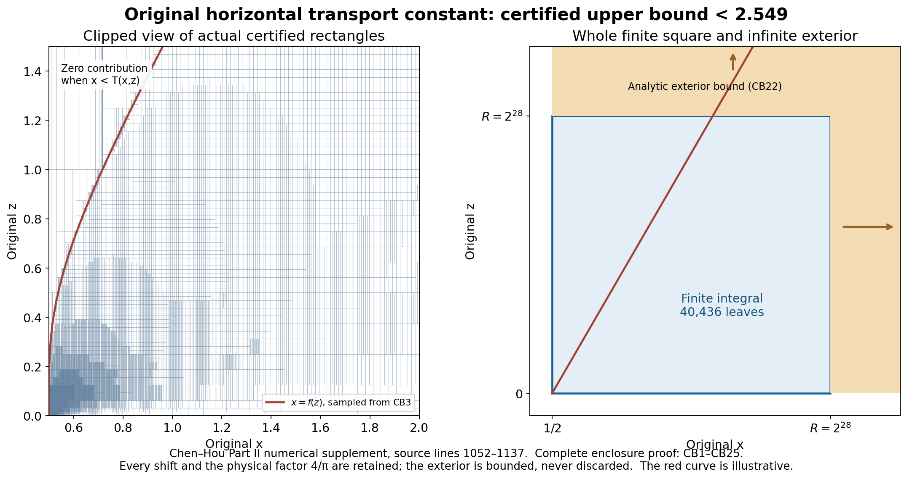
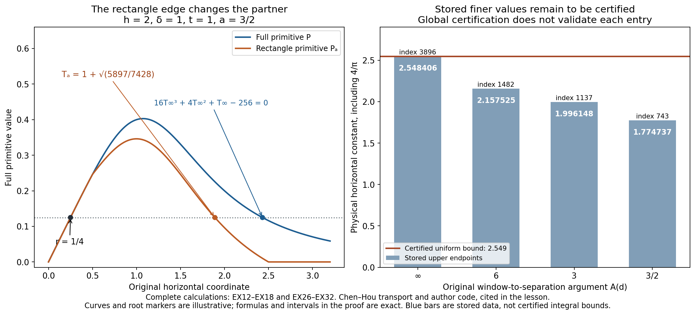

# Original two-point transport and certified kernel bounds

This lesson connects the original weighted transport equation to the
localized nonlocal operator and its numerical bounds. The complete
arguments keep both observation points, their original separation,
the physical boundary, both cutoff lengths and every kernel prefactor.

Part 1 evaluates the exact angular coefficient and carries both coupled
components through the two-point estimate. Part 2 proves the full
rectangular transport comparison, corrects the data region in the
general source statement and checks the actual Part II mesh geometry.
Part 3 identifies a concrete wrong cell formula and proves the complete
repair budget. Part 4 independently encloses the original global
horizontal constant below 2.549, including rigorous rounding and the
whole infinite exterior.

The five exercises calculate the coupled weighted bounds, an actual
reflected mesh region, an exact rectangle transport partner, the
cell-to-global comparison, and four actual cutoff-array lookups with
their receiving costs. A global numerical certificate does not certify
each finer stored entry; the last exercise makes the difference exact.

The source statements and editorial corrections remain identifiable.
The original source authors are Jiajie Chen and Thomas Y. Hou. These
results recover a specific global estimate while leaving the complete
numerical stability and singularity proof under continuing audit.

## Part 1. The exact angular coefficient in the original weighted Hölder estimate
Human comparison: Jiajie Chen and Thomas Y. Hou,
[Part I, arXiv:2210.07191v4](https://arxiv.org/abs/2210.07191v4),
original author TeX2384–2499, especially the two-point transport
identity and the unspecified angular constant following it. The
original frozen equations and full characteristic solution are LT1–LT3
in the complete fiftieth lesson.
The full radial estimate used below is proved there at LT19–LT20.
This calculation evaluates the angular
constant exactly and gives the complete coupled receiving estimate.
It does not replace the full source nonlocal stability calculation.

### HP1. Full two-point transport identity

Keep the original coordinates \(x=(x_1,x_2)\),
\(z=(z_1,z_2)\) in the upper half-plane
\(\Omega=\mathbb R\times(0,\infty)\), with \(x\ne z\).
For a smooth scalar field satisfying

\[
 f_t+b(x)\cdot\nabla f=c(x)f+R(t,x),
 \qquad Z(t,x)=\varphi(x)f(t,x),\quad
 d(x)=c(x)+\frac{b(x)\cdot\nabla\varphi(x)}{\varphi(x)},
 \tag{HP1}
\]

assume the spatial weight is positive and continuously differentiable
on this domain. Let \(g\) be positive and continuously differentiable
away from zero and retain the original difference

\[
 F(t,x,z)=(Z(t,x)-Z(t,z))g(x-z).
 \tag{HP2}
\]

The product rule first gives
\(Z_t+b\cdot\nabla Z=dZ+\varphi R\).
Subtract that equation at the two original points. The two transports
differentiate \(g(x-z)\) with coefficient \(b(x)-b(z)\).
Use the complete identity

\[
 d(x)Z(x)-d(z)Z(z)
 =d(x)(Z(x)-Z(z))+(d(x)-d(z))Z(z).
\]

It yields exactly

\[
 \begin{aligned}
 &(\partial_t+b(x)\cdot\nabla_x+b(z)\cdot\nabla_z)F\\
 &\quad=\left(d(x)+
       \frac{(b(x)-b(z))\cdot\nabla g(x-z)}{g(x-z)}\right)F\\
 &\qquad +(d(x)-d(z))g(x-z)Z(t,z)\\
 &\qquad +\big(\varphi(x)R(t,x)-\varphi(z)R(t,z)\big)g(x-z).
 \end{aligned}
 \tag{HP3}
\]

Every source and both spatial points remain. This derivation also
specifies the exact map from the scalar equation to its two-point
equation, rather than treating the latter as a separate assumed model.

### HP2. The precise angular constant, with original distances

Take \(0<a_1\leq a_2\), real \(a_3\), \(\gamma_2\geq0\),
and \(0<\alpha\leq1\). For the source model put

\[
 \begin{gathered}
 b(x)=(a_1x_1,a_2x_2),\qquad
 \varphi(x)=|x|^{-\gamma_2},\qquad g(h)=|h|^{-\alpha},\\
 q(x)=\frac{x_2^2}{x_1^2+x_2^2},\qquad
 d_\eta(x)=a_3-\gamma_2a_1-\gamma_2(a_2-a_1)q(x),\\
 e(x,z)=-\alpha
       \frac{a_1(x_1-z_1)^2+a_2(x_2-z_2)^2}{|x-z|^2}.
 \end{gathered}
 \tag{HP4}
\]

These follow by differentiating the original radial powers. The full
angular and difference quotients have not been replaced by averages.
The exact best constant in the source's angular comparison is

\[
 \sup_{x,z\in\Omega,\ x\ne z}
 |d_\eta(x)-d_\eta(z)|\frac{|z|^\alpha}{|x-z|^\alpha}
 =\gamma_2(a_2-a_1)=:C_*.
 \tag{HP5}
\]

Here is a proof including the sharpness. Write the actual points as
\(x=r_x(\cos\theta,\sin\theta)\) and
\(z=r_z(\cos\phi,\sin\phi)\), where both original radii
are positive and \(\theta,\phi\in(0,\pi)\).
For \(\delta=\theta-\phi\), the complete distance identity is

\[
 \begin{aligned}
 |x-z|^2
 &=r_x^2+r_z^2-2r_xr_z\cos\delta\\
 &=(r_x-r_z\cos\delta)^2+r_z^2\sin^2\delta,\\
 q(x)-q(z)&=\sin(\theta+\phi)\sin\delta.
 \end{aligned}
 \tag{HP6}
\]

If \(\cos\delta\geq0\) and \(\sin\delta\ne0\), these
identities imply

\[
 |q(x)-q(z)|\frac{r_z^\alpha}{|x-z|^\alpha}
 \leq |\sin(\theta+\phi)|\,|\sin\delta|^{1-\alpha}
 \leq1.
 \tag{HP7}
\]

When \(\sin\delta=0\), the numerator is zero. If
\(\cos\delta<0\), the first line of HP6 gives
\(|x-z|\geq r_z\), and \(0\leq q\leq1\) again gives
the bound one. This covers all pairs in the original half-plane,
including pairs with opposite signs of the first coordinate.

For any original radius \(R_0>0\) and
\(0<\varepsilon<\pi/4\), choose the actual pair

\[
 \begin{gathered}
 z_\varepsilon=R_0(\cos\varepsilon,\sin\varepsilon),\qquad
 x_\varepsilon=R_0\sin(2\varepsilon)
                         (\sin\varepsilon,\cos\varepsilon),\\
 |x_\varepsilon-z_\varepsilon|=R_0\cos(2\varepsilon),\qquad
 q(x_\varepsilon)-q(z_\varepsilon)=\cos(2\varepsilon),\\
 |q(x_\varepsilon)-q(z_\varepsilon)|
  \frac{|z_\varepsilon|^\alpha}
       {|x_\varepsilon-z_\varepsilon|^\alpha}
     =\cos(2\varepsilon)^{1-\alpha}.
 \end{gathered}
 \tag{HP8}
\]

Both points are in the positive quadrant for every permitted
\(\varepsilon\). The last expression tends to one as
\(\varepsilon\downarrow0\); for \(\alpha=1\) it equals
one for every such pair. All factors of \(R_0\) are displayed
before they cancel in the ratio. Multiplication by the actual
coefficient in HP4 proves HP5. If \(\gamma_2=0\) or
\(a_1=a_2\), both sides of HP5 are exactly zero.

The left panel uses the actual HP8 pair with radius three and angle
one-twelfth of pi. The right panel samples the exact HP8 ratio for
three indicated Hölder exponents. The constant one and its sharpness
are proved in HP6–HP8; the curves are numerical evaluations of those
formulas. The [reproducible source](../assets/chen-hou-exact-two-point-weight.py)
and [specified samples](../assets/chen-hou-two-point-samples.json)
retain the coordinates. Human comparison: Chen–Hou Part I v4,
original TeX2384–2499, as cited above.

### HP3. The complete scalar receiving estimate

For the full frozen solution define

\[
 \begin{gathered}
 \gamma=\gamma_2+\alpha,\qquad
 M_f(t)=\sup_{x\in\Omega}|x|^{-\gamma}|f(t,x)|,\\
 H_f(t)=\sup_{x,z\in\Omega,\ x\ne z}
 \frac{|\,|x|^{-\gamma_2}f(t,x)
              -|z|^{-\gamma_2}f(t,z)|}{|x-z|^\alpha}.
 \end{gathered}
 \tag{HP9}
\]

Start with smooth compactly supported data in \(\Omega\); their
supports avoid the origin and the boundary. Thus both norms are finite.
Oddness in the first coordinate may additionally be imposed and is
preserved by the diagonal flow. No boundary condition on the full
nonlocal PDE is inferred from this class of test data.

For \(\eta_t+b\cdot\nabla\eta=a_3\eta\), LT19–LT20
with the original exponent \(\gamma\) give

\[
 M_\eta(t)\leq e^{c t}M_\eta(0),\qquad
 c=a_3-a_1\gamma.
 \tag{HP10}
\]

In HP3, the main coefficient obeys
\(d_\eta(x)+e(x,z)\leq c\). The remaining term has the
exact receiving bound

\[
 \begin{aligned}
 &|d_\eta(x)-d_\eta(z)|\,|x-z|^{-\alpha}
                         |z|^{-\gamma_2}|\eta(t,z)|\\
 &\qquad\leq C_*M_\eta(t),
 \qquad C_*=\gamma_2(a_2-a_1).
 \end{aligned}
 \tag{HP11}
\]

Indeed, factor its left side into the HP5 ratio and
\(|z|^{-\gamma}|\eta(t,z)|\). Along the pair of actual
characteristics, the scalar integrating-factor inequality therefore
gives

\[
 H_\eta(t)\leq e^{ct}H_\eta(0)
       +C_*\int_0^t e^{c(t-s)}M_\eta(s)\,ds
 \leq e^{ct}\big(H_\eta(0)+C_*tM_\eta(0)\big).
 \tag{HP12}
\]

To justify the supremum, the diagonal flow maps \(\Omega\)
bijectively to itself and preserves distinctness of pairs. Integrate
the inequality for each fixed initial pair first, then take its
supremum. No differentiability of a maximizing pair or norm is used.
The explicit smooth solution makes all finite-time integrals defined.

The constant in HP11 is itself sharp over this test class. At any
pair from HP8 choose a nonnegative smooth bump supported in a small
ball about \(z_\varepsilon\), equal to one there, and multiply
it by \(|z|^\gamma\). Its \(M\) norm is one and it realizes
the entire ratio at that point. Its odd reflected copy can be added
in the other half-plane sector with disjoint support and the same
norm. This proves sharpness even with the original odd symmetry.
It is not a claim that HP12 is the optimal entire evolution bound.

### HP4. Both original coupled components, with every transfer factor

Retain the first frozen equation
\(\omega_t+b\cdot\nabla\omega=-\omega+\eta\), and set

\[
 \begin{gathered}
 b_0=-1-a_1\gamma,\qquad c=a_3-a_1\gamma,\\
 K(t)=\int_0^t e^{b_0(t-s)}e^{cs}\,ds
 =e^{-a_1\gamma t}
 \begin{cases}
 (e^{a_3t}-e^{-t})/(a_3+1),&a_3\ne-1,\\
 te^{-t},&a_3=-1.
 \end{cases}
 \end{gathered}
 \tag{HP13}
\]

The full radial estimate and the exact two-point equation give

\[
 \begin{aligned}
 M_\omega(t)&\leq e^{b_0t}M_\omega(0)+K(t)M_\eta(0),\\
 H_\omega(t)&\leq e^{b_0t}H_\omega(0)
      +\int_0^t e^{b_0(t-s)}
                \big(H_\eta(s)+C_*M_\omega(s)\big)\,ds.
 \end{aligned}
 \tag{HP14}
\]

The difference of the original \(+\eta\) forcing is exactly
the quantity bounded by \(H_\eta\); it has not been deleted.
The angular part of \(d_\omega=-1-\gamma_2a_1
-\gamma_2(a_2-a_1)q\) has the same precise constant \(C_*\).
Substitute HP12 and the first line of HP14 into the second. The
two terms involving \(C_*M_\eta(0)\) combine by the full
integral identity

\[
 \begin{aligned}
 &\int_0^t e^{b_0(t-s)}s e^{cs}\,ds
       +\int_0^t e^{b_0(t-s)}K(s)\,ds\\
 &\quad=\int_0^t e^{b_0(t-u)}e^{cu}
                        \big(u+(t-u)\big)\,du=tK(t).
 \end{aligned}
 \tag{HP15}
\]

For the second integral insert HP13, integrate on
\(0\leq u\leq s\leq t\), and interchange these finite
continuous integrals. The inner integrand then has no remaining
dependence on \(s\), giving exactly \(t-u\). Consequently

\[
 H_\omega(t)\leq
 e^{b_0t}\big(H_\omega(0)+C_*tM_\omega(0)\big)
 +K(t)\big(H_\eta(0)+C_*tM_\eta(0)\big).
 \tag{HP16}
\]

For the actual Part I triple \((a_1,a_2,a_3)=(1/2,11/2,1/2)\),
every constant and time factor becomes

\[
 C_*=5\gamma_2,\qquad
 c=\frac{1-\gamma}{2},\qquad b_0=-1-\frac\gamma2,
 \qquad K(t)=\frac23
       \left(e^{(1-\gamma)t/2}-e^{-(1+\gamma/2)t}\right).
 \tag{HP17}
\]

Thus for \(\gamma=\gamma_2+\alpha>1\), both complete
weighted supremum norms and both Hölder seminorms tend to zero.
The linear factors in time are retained and still tend to zero after
multiplication by their strictly decaying exponentials. For merely
quadratic vanishing at the origin, the source-compatible local range
is \(1<\gamma\leq2\); on our compact class every finite
\(\gamma\) is permitted. The displayed estimates also apply
directly to other smooth initial fields whenever HP9 is finite, by
the same pointwise characteristic proof. No hidden boundary term,
nonlocal forcing or full-PDE estimate has been supplied by that
extension. The next step is to apply the source's actual nonlocal
operator bounds with their complete coefficients.

## Part 2. The original rectangular kernel, reflected data, and its full transport cost
This note proves the horizontal Hölder estimate for the original localized
Chen–Hou operator, retaining the two observation points, their separation,
both vertical cutoffs, and the physical boundary. It also gives a smooth
counterexample to the unrestricted domain statement in Part I and proves
that the particular Part II mesh rectangles satisfy the needed domain
condition. The analytic integral and its convergence are proved in this part.
Part 4 supplies the full numerical certificate for the global bound 2.55;
the complete stability theorem remains outside the scope of this lesson.

Human sources: Jiajie Chen and Thomas Y. Hou,
[Part I, arXiv:2210.07191v4](https://arxiv.org/abs/2210.07191v4), original
`arXiv_Euler_P1_v2026.tex`, lines 3232–3317, 3519–3984, 14984–15067;
and [Part II, arXiv:2305.05660v3](https://arxiv.org/abs/2305.05660v3),
original `arXiv_Euler_Part2.tex`, lines 2243–2331 and 3038–3093,
and `euler_supp_Part2.tex`, lines 797–1150. The transport construction
belongs to Chen and Hou. The domain correction, complete physical-coordinate
derivation, and additional bounds below are editorial calculations;
no novelty claim is made. Original author files remain unchanged.

### NL1. The operator and the data it actually reads

Let the physical upper half-plane be \(\Omega=\mathbb R\times(0,\infty)\).
Take \(0<\alpha<1\), a bounded measurable vorticity \(\omega\) on its
closure, and define its odd vertical extension by

\[
W(y_1,y_2)=
\begin{cases}
\omega(y_1,y_2),&y_2\geq0,\\
-\omega(y_1,-y_2),&y_2<0.
\end{cases}
\tag{NL1}
\]

Values on the boundary do not affect the integrals. No vertical continuity
of this extension is assumed. The source also assumes oddness in the first
coordinate; our estimate holds with or without that extra symmetry, and
the counterexample below has it.

Fix the original points and lengths

\[
\begin{gathered}
x=(x_1,y_0),\quad z=(z_1,y_0),\quad x_1>z_1,\quad y_0>0,\\
h=x_1-z_1>0,\quad \delta=h/2,\quad m=(x_1+z_1)/2,\\
a\geq\delta,\quad b_1>0,\quad b_2>0,\\
Q(p)=[p_1-a,p_1+a]\times[y_0-b_1,y_0+b_2],\\
K_1(v_1,v_2)=\frac{v_1v_2}{(v_1^2+v_2^2)^2},\\
U(p)=-\frac1\pi\operatorname{PV}\int_{Q(p)}K_1(p-y)W(y)\,dy.
\end{gathered}
\tag{NL2}
\]

The principal value deletes a disk centered at \(p\). At every fixed
height, both the horizontal integration interval and the deleted interval
are symmetric about \(p_1\). The integral of the kernel times
\(W(p_1,y_2)\) is therefore exactly zero. Subtracting that value leaves
an integrand bounded near \(p\) by a constant times
\(|p-y|^{\alpha-2}\), provided the horizontal Hölder seminorm of the
sampled data is finite. Its two-dimensional integral near the origin is
finite because \(\int_0^\varepsilon r^{\alpha-1}\,dr
=\varepsilon^\alpha/\alpha\). Away from the singularity, boundedness
of the data suffices on the finite rectangle. This proves existence of
the stated principal value and justifies horizontal slice integration
after this subtraction.

For any set \(D\) in the physical half-plane, including its boundary,
write

\[
[\omega]_{C_x^\alpha(D)}=
\sup_{\substack{(u,v),(u',v)\in D\\u\ne u'}}
\frac{|\omega(u,v)-\omega(u',v)|}{|u-u'|^\alpha}.
\tag{NL3}
\]

The reflection map \(\mathcal R(y_1,y_2)=(y_1,|y_2|)\) preserves
the distance between two points at the same height. Their signs in
NL1 agree. Consequently every horizontal difference of \(W\) in a
set \(A\) is bounded by NL3 on \(\mathcal R(A)\), with exactly the
same coefficient. This proves the actual receiving map between the two
seminorms, including the data below the boundary.

The two horizontal intervals overlap because \(a\geq\delta\). Hence
their union is the interval \(I=[m-a-\delta,m+a+\delta]\), and the
complete physical region sampled by NL2 is

\[
\begin{aligned}
D_{\rm ref}&=\mathcal R(Q(x)\cup Q(z))\\
&=I\times
\left[\max(0,y_0-b_1),\ \max(y_0+b_2,b_1-y_0)\right].
\end{aligned}
\tag{NL4}
\]

Indeed, if the vertical interval stays above zero, reflection does
nothing. If it crosses zero, its positive portion is
\([0,y_0+b_2]\) and its reflected negative portion is
\([0,b_1-y_0]\). This proves NL4 in both cases. The unreflected
positive part in the printed Part I lemma is

\[
\begin{gathered}
D_0=(Q(x)\cup Q(z))\cap\overline\Omega
=I\times[\max(0,y_0-b_1),y_0+b_2],\\
D_{\rm ref}=D_0\quad\Longleftrightarrow\quad b_1\leq2y_0+b_2.
\end{gathered}
\tag{NL5}
\]

The equivalence follows by comparing the two upper endpoints. In
particular it holds for symmetric vertical cutoffs. The estimate proved
below uses any \(D\supset D_{\rm ref}\) with finite NL3.

### NL2. A smooth counterexample to the unrestricted domain statement

Keep the original kernel and take exactly

\[
x=(2,1),\quad z=(1,1),\quad a=1,\quad b_1=4,
\quad b_2=\tfrac12,\quad D_0=[0,3]\times[0,\tfrac32].
\tag{NL6}
\]

Define the smooth compactly supported function

\[
\begin{gathered}
\rho(s)=
\begin{cases}e^{-1/(1-s^2)},&|s|<1,\\0,&|s|\geq1,
\end{cases}\\
B(u,v)=\rho(8(u-\tfrac52))\rho(8(v-\tfrac52)),\\
\omega(u,v)=B(u,v)-B(-u,v),\qquad v\geq0.
\end{gathered}
\tag{NL7}
\]

All derivatives of \(\rho\) tend to zero at either endpoint: each
derivative inside the interval is the exponential times a rational
function whose denominator is a power of \(1-s^2\), and
\(q^N e^{-q}\to0\) for every finite \(N\) as \(q\to\infty\).
This proves the claimed smoothness across the endpoints. Thus NL7 is
smooth, compactly supported, odd in its first coordinate, and zero on a
neighborhood of \(D_0\). Every seminorm in NL3 on \(D_0\) is zero.

The positive bump has support in
\([19/8,21/8]^2\). Its original positive-height copy is outside both
rectangles in NL6. Its reflected copy lies inside \(Q(x)\), whose
horizontal interval is \([1,3]\) and vertical interval is
\([-3,3/2]\), and outside \(Q(z)\), whose horizontal interval is
\([0,2]\). The negative first-coordinate bump and its reflection are
outside both rectangles. No support meets a kernel singularity. Direct
substitution, retaining the sign in NL1 and the factor in NL2, gives

\[
\begin{gathered}
U(z)=0,\\
U(x)=-\frac1\pi\int_{19/8}^{21/8}\int_{19/8}^{21/8}
\frac{(u-2)(1+v)}{((u-2)^2+(1+v)^2)^2}B(u,v)\,du\,dv<0.
\end{gathered}
\tag{NL8}
\]

The integrand is strictly positive on the interior of the support.
For a quantitative lower bound, on the whole support its rational
factor is at least

\[
\frac{(3/8)(27/8)}{((5/8)^2+(29/8)^2)^2}
=\frac{1296}{187489}.
\tag{NL9}
\]

On the inner square of side \(1/8\) centered at \((5/2,5/2)\),
each factor \(\rho\) is at least \(e^{-4/3}\). Therefore

\[
\frac{|U(x)-U(z)|}{|x-z|^\alpha}
\geq\frac{81e^{-8/3}}{749956\pi}>0,
\qquad [\omega]_{C_x^\alpha(D_0)}=0.
\tag{NL10}
\]

This disproves the domain statement in Part I, lines 3284–3303, when
the vertical cutoffs are unrestricted. It applies in particular to its
printed exponent \(\alpha=1/2\). It does not disprove the estimate
with the reflected region NL4.

The figure uses the exact points and endpoints in NL6–NL8. The blue
region is \(D_0\); the orange extension completes \(D_{\rm ref}\).
Both signs of the actual vorticity and both signs of its odd vertical
extension are displayed. The positive bump is absent from \(D_0\),
but its negative vertical image is sampled by \(Q(x)\) alone.
Source comparison: Chen–Hou Part I, `eq:ext_w_odd`, `eq:ux_local`,
`lem:holx_ux`. Complete proof: NL4–NL10. Rectangle and support outlines
are exact; the interior shading only identifies support and sign.
The right panel plots the complete primitives in NL11 and NL16 at
the labelled actual lengths. The two equal-height intersections show
the partner comparison proved in NL18–NL20. These plotted intersections
are numerical samples, not the proof of the comparison.

### NL3. Full primitive, sign threshold, and transport map

Use actual translated integration coordinates
\(r=y_1-m\), \(t=y_0-y_2\); their area Jacobian has absolute value
one. The vertical interval is exactly \([-b_2,b_1]\). For \(t>0\),
define

\[
\begin{gathered}
k_{h,t}(r)=K_1(r+\delta,t)-K_1(r-\delta,t),\\
P_{h,t}(r)=\frac t2
\left(\frac1{(r-\delta)^2+t^2}
-\frac1{(r+\delta)^2+t^2}\right)\\
=\frac{htr}{((r-\delta)^2+t^2)((r+\delta)^2+t^2)}.
\end{gathered}
\tag{NL11}
\]

Differentiation proves \(P'_{h,t}=k_{h,t}\).
Both endpoint values \(P_{h,t}(0)\) and
\(\lim_{r\to\infty}P_{h,t}(r)\) are zero; inside the positive
half-line the primitive is positive. The full numerator of the kernel is

\[
k_{h,t}(r)=
\frac{ht\left(t^4-2r^2t^2-3r^4+2\delta^2r^2
+2\delta^2t^2+\delta^4\right)}
{((r-\delta)^2+t^2)^2((r+\delta)^2+t^2)^2}.
\tag{NL12}
\]

Its sign polynomial, considered as a quadratic in \(r^2\), has
negative leading coefficient and positive constant term, so exactly one
positive root. The positive sign threshold and its exact displacement are

\[
\begin{gathered}
F_{h}(t)^2=
\frac{\delta^2-t^2+2\sqrt{\delta^4+\delta^2t^2+t^4}}3,\\
F_{h}(t)^2-\delta^2=
\frac{t^4}{2\sqrt{\delta^4+\delta^2t^2+t^4}+2\delta^2+t^2}>0.
\end{gathered}
\tag{NL13}
\]

Thus \(k_{h,t}>0\) on \((0,F_h(t))\) and \(k_{h,t}<0\)
on \((F_h(t),\infty)\). The primitive is strictly increasing and
then strictly decreasing on these intervals. Each value between zero
and its maximum has exactly one preimage on each branch. Define
\(T_{h,t}(r)\) as the preimage on the other branch, and set
\(T_{h,t}(F_h(t))=F_h(t)\). This constructs a continuous strictly
decreasing involution of \((0,\infty)\), with
\(T_{h,t}(0+)=\infty\) and \(T_{h,t}(\infty)=0\), satisfying

\[
\begin{gathered}
P_{h,t}(T_{h,t}(r))=P_{h,t}(r),\\
T'_{h,t}(r)\,k_{h,t}(T_{h,t}(r))=k_{h,t}(r)
\quad(r\ne F_h(t)),\\
rT\left(T^2+rT+r^2+2t^2-2\delta^2\right)
-(t^2+\delta^2)^2=0,\qquad T=T_{h,t}(r).
\end{gathered}
\tag{NL14}
\]

The last identity follows by cross-multiplication in the first and
division by \(T-r\) away from the fixed point; continuity gives it
at the fixed point. It is not a license to select the trivial solution
\(T=r\) of the primitive equality at other points. The cubic has
exactly one positive root: after division by \(r\), its coefficients
are \(1,r,r^2+2t^2-2\delta^2,-(t^2+\delta^2)^2/r\), with one
sign change whether or not the third coefficient is negative. To avoid
requiring a root-counting theorem, its derivative on the positive axis
is \(3T^2+2rT+r^2+2t^2-2\delta^2\), which is strictly increasing
there. If initially nonnegative the cubic strictly increases from a
negative value to infinity. If initially negative it first decreases
from a negative value and then strictly increases to infinity. In
either case it has exactly one positive zero.

There are no negative real zeros: a negative zero would, by reversing
the cross-multiplication (all denominators are positive for \(t>0\)),
give \(P_{h,t}(T)=P_{h,t}(r)>0\), whereas the primitive is negative
for \(T<0\). Zero is not a zero of the cubic. Its positive zero is
simple by the derivative argument. This also proves uniqueness of its
real root without a floating-point discriminant computation.

For every horizontal function \(g\) with finite Hölder seminorm,
change variables from one branch to the other using NL14 to obtain

\[
\begin{aligned}
\int_0^\infty k_{h,t}(r)g(r)\,dr
&=\int_0^{F_h(t)} k_{h,t}(r)
\bigl(g(r)-g(T_{h,t}(r))\bigr)\,dr,\\
J_{h,\alpha}(t)
&=\int_0^{F_h(t)} k_{h,t}(r)(T_{h,t}(r)-r)^\alpha\,dr\\
&=\int_{F_h(t)}^\infty[-k_{h,t}(r)]
(r-T_{h,t}(r))^\alpha\,dr.
\end{aligned}
\tag{NL15}
\]

For fixed \(t>0\), the kernel is regular on the entire real axis
and decays as \(r^{-4}\); subtracting a fixed value of \(g\)
allows its growth bound \(O(r^\alpha)\). Thus these changes of
variables can first be made on compact subintervals and then passed to
the endpoints by absolute convergence. The cost integrability in the
remaining variable is proved in NL5 below.

### NL4. Exact rectangular localization decreases the cost

Retain \(h,t,a\), and define the actual truncated horizontal kernel
and its primitive by

\[
\begin{gathered}
k_{a,h,t}(r)=K_1(r+\delta,t)\mathbf1_{|r+\delta|\leq a}
-K_1(r-\delta,t)\mathbf1_{|r-\delta|\leq a},\\
P_{a,h,t}(r)=\int_0^r k_{a,h,t}(u)\,du\quad(r\geq0),\\
P_{a,h,t}(r)=
\begin{cases}
P_{h,t}(r),&0\leq r\leq a-\delta,\\
\displaystyle\frac t2\left(\frac1{(r-\delta)^2+t^2}
-\frac1{a^2+t^2}\right),&a-\delta\leq r\leq a+\delta,\\
0,&r\geq a+\delta.
\end{cases}
\end{gathered}
\tag{NL16}
\]

On the first interval both kernels remain. On the second only the
negative second kernel remains. Integration and matching at
\(a-\delta\) prove NL16, including the case \(a=\delta\).
It also proves exact zero total mass, including the contribution at
the rectangle edge. There is no discarded boundary term.

The primitive is strictly increasing and then decreasing on its
support, with maximum at

\[
c_{a,h}(t)=\min\bigl(F_h(t),\max(\delta,a-\delta)\bigr).
\tag{NL17}
\]

For \(\delta\leq a\leq2\delta\), its maximum is at
\(\delta\); for \(2\delta<a<F_h(t)+\delta\), at
\(a-\delta\); and for \(a\geq F_h(t)+\delta\), at
\(F_h(t)\). These follow directly from the signs in NL12 and
the sign of \(-K_1(r-\delta,t)\) in the second interval of NL16.
Construct \(T_{a,h,t}\) by matching the two primitive branches as
above. Its domain is \((0,a+\delta)\), its fixed point is
\(c_{a,h}(t)\), and its endpoints are interchanged. It is continuous
and strictly decreasing, and is differentiable away from the finitely
many joins and the fixed point. The branch change-of-variables formula
uses its derivative only on those open pieces; continuity and zero
measure of the joins give the full formula.

Here is a direct comparison preserving the edge contribution. On
\([0,a+\delta]\), define \(E(r)=P_{h,t}(r)-P_{a,h,t}(r)\).
Its full formula is

\[
E(r)=
\begin{cases}
0,&0\leq r\leq a-\delta,\\
\displaystyle\frac t2\left(\frac1{a^2+t^2}
-\frac1{(r+\delta)^2+t^2}\right),
&a-\delta\leq r\leq a+\delta.
\end{cases}
\tag{NL18}
\]

It is nonnegative and nondecreasing, since on the second interval its
derivative is \(K_1(r+\delta,t)>0\). For
\(0<r<c_{a,h}(t)\), put \(T=T_{h,t}(r)\). If
\(T\geq a+\delta\), the local partner is automatically at most
\(T\). Otherwise \(T\geq F_h(t)\geq c_{a,h}(t)\), and

\[
P_{a,h,t}(T)=P_{h,t}(r)-E(T)
\leq P_{h,t}(r)-E(r)=P_{a,h,t}(r).
\tag{NL19}
\]

The local primitive strictly decreases on its right branch. Its point
with value \(P_{a,h,t}(r)\) is therefore no farther right than
\(T\). On the left branch, differentiating NL18 almost everywhere
also gives \(0\leq k_{a,h,t}(r)\leq k_{h,t}(r)\). Consequently

\[
\begin{gathered}
r\leq c_{a,h}(t)\leq T_{a,h,t}(r)\leq T_{h,t}(r)
\quad(0<r\leq c_{a,h}(t)),\\
J_{a,h,\alpha}(t)
=\int_0^{c_{a,h}(t)}k_{a,h,t}(r)
(T_{a,h,t}(r)-r)^\alpha\,dr
\leq J_{h,\alpha}(t).
\end{gathered}
\tag{NL20}
\]

The inequality first bounds the integrand on the smaller interval and
then extends to \([0,F_h(t)]\), where the added integrand is
nonnegative. This proves the localization comparison for every
\(\alpha>0\) for which the costs exist. NL18 records precisely the
primitive contribution removed by the rectangular edge.

### NL5. Convergence and a bound for the transport distance

For \(r\geq F_h(t)\), the partner lies to its left and satisfies

\[
0\leq r-T_{h,t}(r)\leq\min\bigl(r,2(r-\delta)\bigr).
\tag{NL21}
\]

Positivity of \(T\) gives the first upper bound. If
\(r\geq2\delta\), it also gives the second. Otherwise write
\(r=\delta+w\) with \(0\leq w\leq\delta\). The value
\(\delta-w\) lies on the increasing branch. Comparing its
primitive with that at \(\delta+w\), using the common positive
denominators in NL11, has numerator

\[
(\delta-w)((2\delta+w)^2+t^2)
-(\delta+w)((2\delta-w)^2+t^2)
=-2w(t^2+w^2)\leq0.
\tag{NL22}
\]

Thus \(P_{h,t}(\delta-w)\leq P_{h,t}(r)\), so strict
monotonicity on that branch gives
\(T_{h,t}(r)\geq\delta-w=2\delta-r\), which proves NL21.

The only possible finite singularity of the integral in the last line
of NL15, for \(r\geq F_h(t)\) and \(t\geq0\), is
\((r,t)=(\delta,0)\). Let
\(\varrho=((r-\delta)^2+t^2)^{1/2}\). The singular kernel obeys
\(|K_1(r-\delta,t)|\leq1/(2\varrho^2)\).
By NL21 its cost multiplier is at most \(2^\alpha\varrho^\alpha\).
The resulting singular majorant is
\(2^{\alpha-1}\varrho^{\alpha-2}\), integrable in two dimensions
for every \(\alpha>0\). The other kernel is regular there since
\(h=2\delta>0\).

For the tail set \(\rho=(r^2+t^2)^{1/2}\geq R>\delta\),
retain the full difference by writing

\[
\begin{gathered}
k_{h,t}(r)=\int_{-\delta}^{\delta}
\frac{t(t^2-3(r+s)^2)}{((r+s)^2+t^2)^3}\,ds,\\
\left|\frac{t(t^2-3v^2)}{(v^2+t^2)^3}\right|
\leq(v^2+t^2)^{-3/2},\\
|k_{h,t}(r)|\leq\frac{h}{(\rho-\delta)^3}
\leq h\left(\frac R{R-\delta}\right)^3\rho^{-3}.
\end{gathered}
\tag{NL23}
\]

For the middle bound, write \(v=\ell\cos\theta\),
\(t=\ell\sin\theta\); the numerator divided by \(\ell^3\)
is \(-\sin3\theta\), of absolute value at most one. The reverse
triangle inequality gives the other bounds. The first upper bound in
NL21 now yields the explicit tail estimate

\[
\int_{\substack{t\geq0,\ r\geq F_h(t)\\r^2+t^2\geq R^2}}
[-k_{h,t}(r)](r-T_{h,t}(r))^\alpha\,dr\,dt
\leq\frac{\pi h}{2(1-\alpha)}
\left(\frac R{R-\delta}\right)^3 R^{\alpha-1}.
\tag{NL24}
\]

This follows by integrating over the entire first quadrant in polar
coordinates. The angular interval has length \(\pi/2\), and the
radial integral is \(R^{\alpha-1}/(1-\alpha)\). Near the singularity,
on compact subsets away from it, and at infinity we have now proved
absolute convergence. No numerical quadrature is used in this proof.

### NL6. The full estimate and exact comparison to the source integral

Returning to the original operator and its original fields, the sign
of the first kernel coordinate and the two indicator functions give

\[
U(x)-U(z)=-\frac1\pi\operatorname{PV}
\int_{-b_2}^{b_1}\int_{\mathbb R}
k_{a,h,t}(r)W(m+r,y_0-t)\,dr\,dt.
\tag{NL25}
\]

The kernel is even in \(r\), odd in \(t\), and supported in
\(|r|\leq a+\delta\). At each nonzero \(t\), use the branch
identity of NL15 for the positive half-axis with the localized primitive,
and again for the negative half-axis after \(r\mapsto-r\).
Each matched pair is at the same height and inside \(Q(x)\cup Q(z)\).
The reflection argument after NL3 therefore bounds each difference by
\(H=[\omega]_{C_x^\alpha(D)}\) times its original horizontal
distance to the power \(\alpha\), whenever \(D\supset D_{\rm ref}\).
The two halves give a factor of two. Oddness in \(t\) lets us bound
the two unequal vertical ranges separately. We obtain

\[
\begin{aligned}
|U(x)-U(z)|
&\leq\frac{2H}{\pi}
\left(\int_0^{b_1}J_{a,h,\alpha}(t)\,dt
+\int_0^{b_2}J_{a,h,\alpha}(t)\,dt\right)\\
&\leq\frac{2H}{\pi}
\left(\int_0^{b_1}J_{h,\alpha}(t)\,dt
+\int_0^{b_2}J_{h,\alpha}(t)\,dt\right).
\end{aligned}
\tag{NL26}
\]

The principal values in NL25 agree with the slice formula. Indeed,
subtracting the value at each singularity's horizontal coordinate,
at each fixed height, changes each integral by zero and leaves the
locally integrable majorant proved after NL2. Fubini and dominated
convergence then apply. The cost majorant is integrable by NL20–NL24.
This also covers a jump in \(W\) across the physical boundary.

For comparison with the source, introduce auxiliary variables only
inside the explicit integrals: \(r=hs\), \(t=h\tau\).
The original fields, points and cutoff lengths in NL25–NL26 remain
unchanged. Define the source auxiliary functions and cost by

\[
\begin{gathered}
\Delta(s,\tau)=\frac{(s+1/2)\tau}{((s+1/2)^2+\tau^2)^2}
-\frac{(s-1/2)\tau}{((s-1/2)^2+\tau^2)^2},\\
f(\tau)=\left(\frac{1/2-2\tau^2+
\sqrt{16\tau^4+4\tau^2+1}}6\right)^{1/2},\\
\mathcal T(s,\tau)=h^{-1}T_{h,h\tau}(hs),\\
\mathcal C_\alpha(B)=\frac4\pi\int_0^B\int_{f(\tau)}^\infty
[-\Delta(s,\tau)](s-\mathcal T(s,\tau))^\alpha\,ds\,d\tau.
\end{gathered}
\tag{NL27}
\]

The cubic NL14 proves that \(\mathcal T\) is independent of
\(h\): substitution cancels the common factor \(h^4\) and gives
the source cubic. Uniqueness of its positive root proves the equality
of the maps, rather than merely a resemblance of their equations.
Likewise NL12–NL13 give
\(k_{h,h\tau}(hs)=h^{-2}\Delta(s,\tau)\) and
\(F_h(h\tau)=hf(\tau)\). The distance multiplier contributes
\(h^\alpha\), while \(dr\,dt=h^2ds\,d\tau\). Thus the
complete result is

\[
\boxed{\quad
\frac{|U(x)-U(z)|}{h^\alpha}
\leq\frac{\mathcal C_\alpha(b_1/h)+\mathcal C_\alpha(b_2/h)}2
[\omega]_{C_x^\alpha(D)},\qquad D\supset D_{\rm ref}.
\quad}
\tag{NL28}
\]

The constants are finite by NL24, nonnegative, and increasing in their
argument because their integrands are nonnegative. At \(\alpha=1/2\),
\(\mathcal C_{1/2}\) is exactly the source's \(C_1\), including
the factor \(4/\pi\). The average in NL28 is no larger than
\(C_1(\max(b_1,b_2)/h)\). This recovers the printed analytic
bound with the corrected data domain and retains an additional
improvement when the vertical cutoffs differ. NL28 also proves the
same transport construction for every \(0<\alpha<1\), with its
explicit integral constant. It asserts no optimality of the full
operator norm and no certified decimal value.

### NL7. Exact propagation to the rectangles used in Part II

Part II, lines 2250–2267 and 3081–3092, uses a mesh size called
\(h\) in that source. Write it as \(\ell\) here solely to keep it
distinct from the already fixed observation distance in NL2. No length
is changed. Its parameters are exactly

\[
\begin{gathered}
\ell>0,\quad j\in\mathbb Z_{\geq0},\quad k>0,
\quad y_0\in[j\ell,(j+1)\ell],\\
a=k\ell,\quad b_1=y_0-(j-k)\ell,
\quad b_2=(j+1+k)\ell-y_0,\\
k\ell\leq b_i\leq(k+1)\ell\quad(i=1,2),\\
2y_0+b_2-b_1=(2j+1)\ell>0.
\end{gathered}
\tag{NL29}
\]

The restriction \(j\geq0\) follows from the source's positive
observation height and the definition of its grid cells. If a height
lies exactly at a positive grid boundary, either adjacent cell still
has nonnegative index. Substitution proves every equality and inequality
in NL29. Hence these actual rectangles satisfy NL5, even though their
vertical cutoffs generally differ. Their reflected negative portion is
contained in their positive portion: when \(j<k\), its top is
\((k-j)\ell\), at most the actual positive top
\((j+1+k)\ell\); when \(j\geq k\), there is no negative portion.
Their separation restriction \(h\leq k\ell/2\) implies
\(a=k\ell\geq h/2\), as needed in NL2.

For the physical operator with the prefactor in NL2, NL28 therefore gives

\[
\begin{aligned}
\frac{|U(x)-U(z)|}{h^{1/2}}
&\leq\frac12\left[
C_1\!\left(\frac{y_0-(j-k)\ell}{h}\right)
+C_1\!\left(\frac{(j+1+k)\ell-y_0}{h}\right)\right]
[\omega]_{C_x^{1/2}(D_0)}\\
&\leq C_1\!\left(\frac{(k+1)\ell}{h}\right)
[\omega]_{C_x^{1/2}(D_0)}.
\end{aligned}
\tag{NL30}
\]

Replacing the data by the source's weighted data uses its actual
horizontal seminorm on the same reflected domain. Its global seminorm,
when finite, bounds this local one. Part II explicitly suppresses
\(-1/\pi\) in the definition of its \(I_2\) at lines 2319–2331;
the exact physical receiving map is \(U_2=-I_2/\pi\). Consequently
a bound for the unprefactored \(I_2\) has an additional factor
\(\pi\) on the right of NL30. This note retains that factor and
does not certify the subsequent numerical assembly or infer its
convention from notation alone.

We have proved a failure of the general domain statement, its repair,
and the absence of this particular reflected-domain failure for the
displayed Part II mesh rectangles. The full weighted commutator,
the remaining directional constants (including 2.53), the finer cutoff-dependent
numerical constants, and the complete computational stability proof
remain subjects of the continuing audit. No failure of the main
singularity theorem follows from NL10.

Exposition and illustration: GPT-6 Astra (OpenAI), CC0-1.0.
Review status: author self-review, with selected symbolic checks;
no independent or formal certification.

## Part 3. Original singular cells, verification coverage and the physical prefactor
This note audits the author code accompanying Jiajie Chen and Thomas Y. Hou,
*Stable nearly self-similar blowup of the 2D Boussinesq and 3D Euler equations
with smooth data*, Parts I and II. It proves a failure of a particular cell
formula, supplies its mathematical repair, and bounds the increase that
repair can require. It also traces the physical prefactor through one
receiving assembly and checks the saved values against a missed assertion.
It does not certify the complete computational proof or disprove the main
singularity theorem.

The original code was obtained on 11 October 2026 through the
[author's code page](https://jiajiechen94.github.io/codes) and its linked
[shared code collection](https://www.dropbox.com/scl/fo/bp2g3by8bic201jvkcdua/ABgfysDlNEK_Mk3yBODjuss?rlkey=ecet2s5ofcwpmzp03f967juy6&dl=0).
The downloaded archives and the original MATLAB files are preserved
unchanged. No original MATLAB program was executed for this note.
The saved MAT file was read as data. The proofs below concern the exact
arithmetic meanings of the formulas; an INTLAB execution and the full
remaining quadrature still require reconstruction.

### NC1. Original objects and the integral being estimated

Retain the author's coordinates \((x,z)=(s_1,s_2)\), the two shifts
\(1/2\), and the full kernel

\[
 K_1(r,z)=\frac{rz}{(r^2+z^2)^2},\qquad
 \Delta(x,z)=K_1(x+1/2,z)-K_1(x-1/2,z).
 \tag{NC1}
\]

For \(x>0,z\geq0\), let \(T(x,z)>0\) solve

\[
 xT\bigl(T^2+xT+x^2+2z^2-1/2\bigr)
       -(z^2+1/4)^2=0.
 \tag{NC2}
\]

There is exactly one positive root. After division by \(x\), the
polynomial has value \(-(z^2+1/4)^2/x<0\) at zero. Its derivative
is \(3T^2+2xT+x^2+2z^2-1/2\), whose derivative in \(T\) is
\(6T+2x>0\). If its derivative starts nonnegative, the polynomial
increases to infinity. Otherwise it first decreases from a negative
value and subsequently increases to infinity. Both cases give precisely
one positive root, on the increasing portion.

Write \(A=z^2+1/4\), \(P=4xT\) and \(Q=4z^2+1\).
Equation (NC2) and \(T^2+xT+x^2\geq3xT\) give

\[
 Q^2\geq3P^2+2PQ-4P,\qquad P\leq Q,\qquad xT\leq A.
 \tag{NC3}
\]

For the middle implication, if \(P>Q\geq1\), the expression
\(3P^2+2PQ-4P-Q^2\) is strictly larger than its value
\(4Q(Q-1)\geq0\) at \(P=Q\), since its derivative in \(P\)
is positive there and beyond. This contradicts the first inequality.
In particular the derivative of the divided polynomial at its root is

\[
 D_T=3T^2+2xT+x^2+2z^2-1/2
     =2T^2+xT+\frac{A^2}{xT}\geq\frac14.
 \tag{NC4}
\]

Implicit differentiation now proves

\[
 T_x=-\frac{T^2+2xT+A^2/x^2}{D_T}<0,\qquad
 T_z=\frac{4z(A-xT)}{xD_T}\geq0.
 \tag{NC5}
\]

The positive fixed point is

\[
 f(z)=\sqrt{\frac{1/2-2z^2+\sqrt{16z^4+4z^2+1}}6}\geq\frac12.
 \tag{NC6}
\]

Indeed substitution \(T=x\) in (NC2) gives this unique positive
solution. Its lower bound follows by squaring the nonnegative terms in
\(\sqrt{16z^4+4z^2+1}\geq1+2z^2\).
Because \(T_x<0\), \(x\geq f(z)\) implies \(T(x,z)\leq x\).
Direct expansion of (NC1) gives

\[
 \Delta(x,z)=
 \frac{z\{z^4-2x^2z^2-3x^4+x^2/2+z^2/2+1/16\}}
 {((x+1/2)^2+z^2)^2((x-1/2)^2+z^2)^2}.
 \tag{NC7}
\]

The numerator polynomial in \(x^2\) has negative leading coefficient,
positive constant for \(z>0\), and its unique positive root is
\(f(z)^2\). Thus \(\Delta\leq0\) when \(x\geq f(z)\).
The exact cell contribution used in Part II's numerical supplement is

\[
 S_Q=\int_Q\mathbf1_{x\geq f(z)}
          \sqrt{x-T(x,z)}\,[-\Delta(x,z)]\,dx\,dz.
 \tag{NC8}
\]

The indicator is retained. Bounds on \(x-T\) proved on its support
must not be asserted at all points of a rectangle crossing that support.
The physical sharp constant multiplies the sum of these contributions,
including all other regions and tails, by \(4/\pi\).

### NC2. The exact primitive and its boundary values

For \(s,t>0\), put

\[
\begin{aligned}
 F(s,t)=\frac{\sqrt t}{4\sqrt2}\Bigg[&
  2\arctan\!\left(1+\sqrt{2s/t}\right)
 -2\arctan\!\left(1-\sqrt{2s/t}\right)\\
 &+\log\frac{s+\sqrt{2st}+t}{s-\sqrt{2st}+t}\Bigg].
\end{aligned}
\tag{NC9}
\]

Every sign, factor and argument in the author's primitive is retained.
The denominator in the logarithm is positive: it equals
\((\sqrt s-\sqrt{t/2})^2+t/2\).
An exact integral representation, with both limits unchanged, is

\[
\begin{aligned}
 F(s,t)
 &=\int_0^s\!\int_0^t
       \frac{r^{3/2}v}{(r^2+v^2)^2}\,dv\,dr\\
 &=\int_0^{\sqrt s}\frac{t^2}{u^4+t^2}\,du
  =\sqrt t\int_0^{\sqrt{s/t}}\frac{dv}{1+v^4}.
\end{aligned}
\tag{NC10}
\]

To prove it, integration in the inner variable in the first line gives
\(t^2/(2\sqrt r(r^2+t^2))\); then set \(r=u^2\), retaining
\(dr=2u\,du\). The final substitution is \(u=\sqrt t\,v\).
For the closed formula, differentiate the bracket in (NC9), after
putting \(v=\sqrt{s/t}\). Its derivative divided by \(4\sqrt2\)
is \(1/(1+v^4)\), and its value at zero is zero. This proves all
three equalities, including their additive constants.

Define \(F(0,t)=F(s,0)=0\). These are the continuous boundary values:
the final integral in (NC10) is bounded by
\(\int_0^1 1\,dv+\int_1^\infty v^{-4}\,dv=4/3\).
The nonnegative integrand also proves rectangle additivity. In particular,
for a cell \([x_l,x_u]\times[z_l,z_u]\) with \(x_l\geq1/2\),

\[
\begin{aligned}
 J_Q={}&F(x_u-1/2,z_u)-F(x_l-1/2,z_u)\\
       &-F(x_u-1/2,z_l)+F(x_l-1/2,z_l)\\
 ={}&\int_Q\sqrt{x-1/2}\,K_1(x-1/2,z)\,dx\,dz\geq0.
\end{aligned}
\tag{NC11}
\]

The boundary overrides in `Holder_ux_const.m`, lines216,218–219,
omit the shift \(-1/2\) in their calls to this primitive. The first
row in the horizontal direction therefore integrates over a larger
horizontal interval starting at zero; the first row in the vertical
direction, away from the first horizontal cell, instead integrates
over \([x_l,x_u]\). It should integrate over
\([x_l-1/2,x_u-1/2]\). These two mistakes have different signs.

### NC3. A complete counterexample to the cell formula

Use the exact arithmetic grid defined by the default source parameters
\(\lambda=2\), \(801\) horizontal points between \(1/2\) and
\(5/8\), and \(1001\) vertical points between zero and \(1/20\).
Its second horizontal cell and first vertical cell are

\[
 a=\frac1{6400},\quad u=\frac1{3200}=2a,\quad b=\frac1{20000},
 \qquad Q=[1/2+a,1/2+u]\times[0,b].
 \tag{NC12}
\]

This is a statement about the displayed grid and formulas in exact
arithmetic, not a claim that decimal inputs have these exact binary
representations in a particular MATLAB runtime.

For \(x=1/2+s\), the left side of (NC2), evaluated at \(T=1/2\),
equals

\[
 \frac{s^3}{2}+s^2+sz^2+\frac{s}{2}-z^4>0
 \quad(a\leq s\leq u,\ 0\leq z\leq b).
 \tag{NC13}
\]

The strict inequality follows already from \(s/2-z^4\geq a/2-b^4>0\).
Uniqueness of the root implies \(T<1/2\). Thus \(x-T\geq a\),
\(x>f(z)\), and \(\sqrt{x-T}\geq1/80\) throughout this cell.
On its subrectangle with \(b/2\leq z\leq b\),

\[
 -\Delta(x,z)\geq
 \frac{ab/2}{(u^2+b^2)^2}-\frac{(1+u)b}{(1+a)^4}>0.
 \tag{NC14}
\]

Every bound follows directly from the positive numerator and denominator
of the two original kernels in (NC1). Integrating only this subrectangle
therefore gives the rational lower bound

\[
\begin{aligned}
 S_Q&\geq L:=\frac{ab}{160}
       \left[\frac{ab/2}{(u^2+b^2)^2}
                   -\frac{(1+u)b}{(1+a)^4}\right]\\
 &=\frac{655769695925825665441}
         {34488743483684476224050000}
 >\frac1{100000}.
\end{aligned}
\tag{NC15}
\]

Now evaluate the exact arithmetic meaning of the alternative cell
estimate in source lines223–224. Write \(D\) for its cumulative
derivative bound plus one and \(M\) for `Tmx_impr`. On the first
two horizontal cells, \(0<T<1\): substitution of \(T=1\) in
(NC2) is at least \(5/8-(b^2+1/4)^2>0\) for
\(1/2\leq x\leq1/2+u\), \(0\leq z\leq b\).
The numerator used for the derivative bound is consequently at most
\(1+2(1/2+u)+(4b^2+1)^2/4<5/2\), while its denominator is
at least \(1/4\). Thus \(1\leq D<11\), \(\sqrt D<4\), and
\(0\leq M\leq Du<1\).

The regular-kernel cell integral \(G_Q\) and the incorrectly shifted
primitive difference \(J_Q^{\mathrm{old}}\) satisfy

\[
\begin{aligned}
 G_Q&=\int_Q K_1(x+1/2,z)\,dx\,dz\leq\frac{ab^2}{2},\\
 J_Q^{\mathrm{old}}
 &=\int_{1/2+a}^{1/2+u}\!\int_0^b
       \frac{r^{3/2}z}{(r^2+z^2)^2}\,dz\,dr
   \leq4ab^2.
\end{aligned}
\tag{NC16}
\]

For the first bound use \(K_1(x+1/2,z)\leq z\), since
\(x+1/2\geq1\). For the second use
\(r^{3/2}/(r^2+z^2)^2\leq r^{-5/2}\leq2^{5/2}<8\).
The formula supplied as `est2` is therefore bounded by

\[
 B_Q^{\mathrm{old}}=MG_Q+\sqrt D\,J_Q^{\mathrm{old}}
 <\frac{33}{2}ab^2
 =\frac{33}{5120000000000}<10^{-11}<10^{-5}<S_Q.
 \tag{NC17}
\]

This proves failure of the cell majorant in exact arithmetic. Taking
the minimum with another proposed bound cannot repair an underestimated
entry. Interval arithmetic encloses operations; it does not supply a
missing coordinate shift. This proof does not claim the exact output
of an unexecuted interval implementation. It also does not claim that
the sum of all the incorrect entries lies below the total integral:
some other entries overestimate, as shown next.

### NC4. The repaired formula and its total increase

For a cell \(Q_{ij}=[x_l,x_u]\times[z_l,z_u]\), retain the
complete endpoint and derivative formulas

\[
\begin{aligned}
 T_l&=T(x_u,z_l),\qquad T_u=T(x_l,z_u),\\
 H_{ij}&=1+
 \frac{T_u^2+2x_uT_u+(4z_u^2+1)^2/(16x_l^2)}
 {\max(3T_l^2+2x_lT_l+x_l^2-1/2+2z_l^2,\,1/4)},\\
 D_{ij}&=\max_{1\leq k\leq i}H_{kj},\\
 M_{ij}&=\min\!\left(
 \max(|T_l-x_u|,|T_u-x_l|),\ D_{ij}(x_u-1/2)\right).
\end{aligned}
\tag{NC18a}
\]

The monotonicity in (NC5) proves the endpoint bounds. The numerator
of \(-T_x\) is bounded from above by the displayed numerator;
its denominator is bounded from below by both entries of the maximum,
using (NC4). Thus \(D_{ij}\) bounds \(1+|T_x|\) throughout all
preceding cells in that vertical interval. Write \(D_Q=D_{ij}\)
and \(M_Q=M_{ij}\).

The author's alternate bounds at large coordinates are compatible
with these exact endpoints. With \(g=x^2-1/2+2z^2>0\) and
\(\widehat T=(4z^2+1)^2/(16xg)\), the full cubic gives

\[
 T=\widehat T-\frac{T^3+xT^2}{g},\qquad
 \widehat T-\frac{\widehat T^3+x\widehat T^2}{g}
       \leq T\leq\widehat T.
 \tag{NC18b}
\]

The upper bound follows from positivity; inserting it in the
subtracted increasing polynomial proves the lower bound. Bounds
obtained from these formulas cannot improve on an exact extremal
endpoint. They matter for finite precision evaluation, which is not
being asserted here.

On \(x\geq f(z)\), the mean value theorem,
starting at \(T(f(z),z)=f(z)\), gives both
\(x-T\leq M_Q\) and \(x-T\leq D_Q(x-1/2)\).
The triangle inequality for the two original kernels then proves

\[
 S_Q\leq B_Q^{\mathrm{new}}
      :=\sqrt{M_Q}\,G_Q+\sqrt{D_Q}\,J_Q.
 \tag{NC18}
\]

Both integrals on the right are over the full cell; the inequality
is first proved on the indicator's support and only then enlarged
using nonnegative integrands. The exact regular integral is the
rectangle increment of \(-\tfrac14\log(r^2+z^2)\), with
\(r=x+1/2\). Equation (NC11) supplies the exact singular integral
including its boundary values. In addition to restoring the shifts,
the regular coefficient must be \(\sqrt{M_Q}\). Source line223
uses \(M_Q\). On \(0<M_Q<1\) the latter is smaller.

There is a useful quantitative consequence. Compare the two formulas
on every cell where the source applies `est2`. In its default grid
this means the first \(1402\) horizontal cells and all vertical
cells in \([0,1/20]\). The horizontal mesh uses steps \(1/6400\)
up to \(5/8\), \(11/4800\) up to \(2\), and \(1/50\)
thereafter; the last included endpoint is \(51/25\).
Every adjacent ratio satisfies \(x_u/x_l\leq101/100\).

Only the first vertical row has coordinate underestimates. On that
row put \(A_b=b^2+1/4\). By (NC3),
\(T_u\leq A_b/x_l\), so the exact source expression obeys

\[
 D_Q\leq1+4\left(8A_b^2+\frac{202}{100}A_b\right)<6.
 \tag{NC19}
\]

The same bound survives the cumulative maximum in the horizontal
direction. Its denominator is at least \(1/4\); the two squared
terms in its numerator each contribute at most \(4A_b^2\), and
\(2x_uT_u\leq(202/100)A_b\). This proves (NC19) directly from
the original formula, without evaluating a cubic root numerically.

On the first horizontal row, the old boundary formula integrates a
larger interval starting at zero, so \(J_Q^{\mathrm{new}}\leq
J_Q^{\mathrm{old}}\), including their corner cell. All remaining
changed cells lie in the first vertical row and have shifted
horizontal coordinate at least \(a\). Their positive increase is
at most their full corrected singular integral. Using
\(\sqrt{D_Q}<5/2\) and extending the upper horizontal endpoint to
infinity gives

\[
\begin{aligned}
 \sum_Q\sqrt{D_Q}
       (J_Q^{\mathrm{new}}-J_Q^{\mathrm{old}})_+
 &\leq\frac52\int_a^\infty\!\int_0^b
                    \frac{s^{3/2}z}{(s^2+z^2)^2}\,dz\,ds\\
 &\leq\frac52\frac{b^2}{3a^{3/2}}=\frac2{1875}.
\end{aligned}
\tag{NC20}
\]

Here \((v)_+=\max(v,0)\). The first integral was bounded by
\(\int_0^b z\,dz\int_a^\infty s^{-5/2}\,ds\), retaining
both constants and endpoints. For the regular coefficient use the
identity \(\sqrt M-M=1/4-(\sqrt M-1/2)^2\). Since \(G_Q\geq0\),

\[
\begin{aligned}
 \sum_Q(\sqrt{M_Q}-M_Q)_+G_Q
 &\leq\frac14\int_1^\infty\!\int_0^{1/20}
                         \frac{rz}{(r^2+z^2)^2}\,dz\,dr\\
 &\leq\frac14\int_1^\infty r^{-3}\,dr
                    \int_0^{1/20}z\,dz=\frac1{6400}.
\end{aligned}
\tag{NC21}
\]

Combining (NC20) and (NC21) proves the unconditional comparison
between the two exact arithmetic formulas:

\[
 \sum_Q(B_Q^{\mathrm{new}}-B_Q^{\mathrm{old}})_+
 \leq\frac{587}{480000},\qquad
 \frac4\pi\sum_Q(B_Q^{\mathrm{new}}-B_Q^{\mathrm{old}})_+
 \leq\frac{587}{120000\pi}.
 \tag{NC22}
\]

This comparison also survives taking a minimum with an unchanged
entry: for real \(A,B,C\),
\(\min(A,C)-\min(A,B)\leq(C-B)_+\). To prove it, when
\(C\leq B\) monotonicity gives a nonpositive difference; otherwise
the function \(v\mapsto\min(A,v)\) increases by at most
\(C-B\), as is checked separately on either side of \(v=A\).
This algebraic fact does not certify the unchanged entry as a valid
bound. The other quadrature terms, interval rounding and tails must
still be audited.

The left panel retains the author's singular coordinate \(x=1/2\)
and the exact second-cell endpoints. The two right panels show the
distinct intervals supplied to the primitive in separately labelled
coordinate windows. The footer records rigorous bounds from (NC15),
(NC17) and (NC22); it is not a plot of an executed MATLAB certificate.
Human source: Chen–Hou Part II
numerical supplement, formulas for the transport integral and its
finite-domain estimates, and `Holder_ux_const.m`, lines200–226.

### NC5. Stored values and the scope of the repair margin

The saved `Input_data/Est_hol_const_itl.mat` has SHA-256
`c02c90a99cb3a557d55398396c4f28559581aac0c1436456230dffac508ee303`.
Its real interval structures store the following maxima of their
upper endpoints. These are readings of saved data, not newly
established bounds for the underlying operators.

| Quantity | Saved maximum upper endpoint | Displayed threshold |
|---|---:|---:|
| Horizontal \(u_x\) | 2.5484056809137856 | 2.55 |
| Horizontal \(v_x\) | 2.526764852852575 | 2.53 |
| Horizontal \(u_y\) | 1.5454808200248937 | 1.55 |
| Vertical \(u_x\) | 2.095541671081446 | separate mixed estimate |
| Vertical \(v_x\) | 2.597973989728046 | 2.6 |
| Vertical \(u_y\) | 2.598342340663128 | 2.61 |

Let \(c_*\) be the exact binary rational represented by the saved
horizontal \(u_x\) upper endpoint. It equals
\(2869249718738045/1125899906842624\). Exact rational arithmetic
gives

\[
 c_*+\frac{587}{120000(157/50)}<\frac{51}{20}.
 \tag{NC23}
\]

The denominator \(157/50\) is smaller than \(\pi\). One elementary
proof uses Machin's identity
\(\pi/4=4\arctan(1/5)-\arctan(1/239)\): applying the tangent
addition formula gives tangent one, and both sides lie in
\((0,\pi/2)\). The alternating integral expansion yields
\(\arctan(1/5)>1/5-(1/5)^3/3\) and
\(\arctan(1/239)<1/239\); these give
\(\pi>16(1/5-1/375)-4/239>157/50\).
Thus the numerical budget in (NC22) fits inside this saved scalar
margin. This is an exact comparison of numbers and formulas. It does
not establish that the saved interval arose from the current source,
that its unchanged part is valid, or that binary interval evaluation
of a repaired grid has the asserted total. No certification of
\(C_1<2.55\) is claimed here.

`Holder_const_main.m`, line54, tests the horizontal \(u_y\) array
entry against \(2.61\) where its comment and displayed pair call
for the vertical entry. The horizontal entry has already been tested
against the smaller threshold \(1.55\), so this part of the later
assertion adds no coverage. Setting a hypothetical vertical entry
to any positive number leaves that assertion unchanged. Reading the
actual saved vertical entry does, however, show it is below \(2.61\).
The test omission is proved; failure of that actual scalar inequality
is not proved.

### NC6. The exact prefactor map and a receiving assembly

Part II suppresses \(-1/\pi\) in the displayed raw integral
decomposition. If \(I_2\) is that raw singular term, its physical
contribution is \(U_2=-I_2/\pi\). Hence, for the same two points
and the same horizontal seminorm \(H\),

\[
 |U_2(x)-U_2(z)|\leq C_1 H|x-z|^{1/2}
 \quad\Longleftrightarrow\quad
 |I_2(x)-I_2(z)|\leq\pi C_1 H|x-z|^{1/2}.
 \tag{NC24}
\]

This equivalence follows by multiplying the exact equality by the
positive number \(\pi\); its sign is retained in the operator map.
The notation in Part II therefore needs the convention stated
explicitly when a physical sharp constant is applied to a raw term.

The acquired generator does retain this factor. `Holder_ux_const.m`,
line247, returns four times the transport integral estimate;
`Linear_nhol_step0.m`, line54, divides it by \(\pi\) when storing
the horizontal \(u_x\) constant. Its other directional constants
likewise include their indicated \(1/\pi\) in lines58,64–73.
`Lip/Holder_C.m` retrieves these entries without removing that factor,
and `Holder_C_main.m`, lines4–8, expressly documents it.

One actual receiving path is `Linear_stability/Est_hol_profi.m`.
Lines202–207 divide the regular contribution by \(\pi\).
Lines228–241 retrieve the already physical singular constant, multiply
it by the appropriate horizontal or mixed input seminorm, and add it
to that regular estimate. Lines247–257 perform the same assembly for
the refined distance intervals. The factor is therefore present once
in each part of this inspected assembly. The sharp constant's numerical
validity is a separate question, addressed only to the extent above.
This reading does not certify the remaining stability paths.

### NC7. Source identity, proof status and continuation

Original author TeX sources:

- [Chen–Hou Part I, arXiv:2210.07191v4](https://arxiv.org/abs/2210.07191v4),
  main3284–3303 and the sharp horizontal transport estimate.
- [Chen–Hou Part II, arXiv:2305.05660v3](https://arxiv.org/abs/2305.05660v3),
  main1820–1910,2319–2331,3085–3089,3860–3995;
  numerical supplement950–1137, especially1083–1109.
- The complete original rectangular transport argument, including the
  reflected-domain correction and the actual Part II mesh comparison,
  is proved in
  NL1–NL30 of the preceding course supplement.

The archived `Holder_const.zip` has SHA-256
`30320c66d4fed9c45d331256f9dc55cd3bb145a15d052c7a061c2487e43253ce`.
Within it, `Holder_ux_const.m` has SHA-256
`39a4c443205b7c73aa570d746bd655b9a4bdc24cd9992dea46db4e25ba8b2936`.
`Lip.zip` has SHA-256
`e965a449b9f98e88ec7202a17355aabfdfdf7dfe497523b57cf1732dfe7c95b4`.
`Linear_stability.zip` has SHA-256
`1f2e5e9cb6452731cf43570d06b053a76ceaadc7884b7c6c16f29b1d27cf2cb9`.
These identify the acquired versions; a shared folder's current state
need not be the version that generated a historical MAT file.

The exact cell counterexample, corrected primitive, repaired cell
majorant and aggregate increase bound are proved in this note.
The arithmetic comparison against saved data is checked exactly.
Part 4 supplies a complete new enclosure of the global horizontal
integral, including every finite cell and the whole infinite tail.
The historical cutoff-dependent array, its receiving stability uses,
and the other kernel and commutator estimates remain to be certified.
The original source remains identifiable throughout. No novelty claim,
independent review or complete theorem certification is made.

Exposition and illustration: GPT-6 Astra (OpenAI), CC0-1.0.
Human source authorship remains as cited; original author code is not
relicensed by this note.

## Part 4. A complete enclosure of the original horizontal transport constant
The original Chen–Hou horizontal transport integral satisfies
\(C_1(b)<2549/1000<2.55\) for every \(0\leq b\leq\infty\).
This note proves the analytic bounds and records a finite computation
with rigorous rounding that establishes the stated rational upper bound.
The calculation uses no saved author constant and executes no original
MATLAB program. It recovers the advertised global horizontal constant
despite the cell-formula defect proved in NC12–NC17 of the preceding
audit. It does not certify the author's finer saved array of bounds for
individual cutoffs, the other directional constants, or the complete
singularity theorem.

The human sources are Jiajie Chen and Thomas Y. Hou,
[Part I, arXiv:2210.07191v4](https://arxiv.org/abs/2210.07191v4),
the sharp horizontal transport estimate, source lines 3284–3303, and
[Part II, arXiv:2305.05660v3](https://arxiv.org/abs/2305.05660v3),
numerical supplement, source lines 1052–1137. The original cell audit is
NC1–NC24.
The full comparison with the original localized velocity operator,
including its physical prefactor, reflected domain and rectangle edges,
is proved in
NL1–NL30.

### CB1. The complete original integral

Retain the exact variables of the source's defining integral:

\[
 K_1(r,z)=\frac{rz}{(r^2+z^2)^2},\qquad
 \Delta(x,z)=K_1(x+1/2,z)-K_1(x-1/2,z).
 \tag{CB1}
\]

For \(x>0,z\geq0\), define \(T(x,z)\) as the positive root of

\[
 P_{x,z}(T)=xT(T^2+xT+x^2+2z^2-1/2)-(z^2+1/4)^2=0.
 \tag{CB2}
\]

After division by \(x\), the polynomial is negative at zero. Its
derivative is strictly increasing for \(T\geq0\), since its
second derivative is \(6T+2x>0\). It either increases immediately,
or decreases first and then increases to infinity from a negative
minimum. Thus it has exactly one positive root, with positive derivative
there.

This cubic retains the paper's transport equation exactly. For \(z>0\),
put

\[
\begin{aligned}
 D_z(r)&=((r-1/2)^2+z^2)((r+1/2)^2+z^2)\\
       &=r^4+(2z^2-1/2)r^2+(z^2+1/4)^2,\\
 H_z(r)&=\frac z2\left(
       \frac1{(r-1/2)^2+z^2}-\frac1{(r+1/2)^2+z^2}\right)
       =\frac{zr}{D_z(r)},\qquad H_z'(r)=\Delta(r,z).
\end{aligned}
\tag{CB2a}
\]

Factoring the full numerator, with both original denominators retained,
gives

\[
 \int_T^x\Delta(r,z)\,dr
 =H_z(x)-H_z(T)
 =\frac{z(T-x)P_{x,z}(T)}{D_z(T)D_z(x)}.
 \tag{CB2b}
\]

The two denominators are positive. Away from the trivial solution
\(T=x\), the paper's zero-integral equation is therefore equivalent to
(CB2). The monotonicities proved below place its positive root in
\(0<T<f(z)\) whenever \(x>f(z)\), exactly the branch required
in the original definition. Its positive fixed point and the original
constant are

\[
\begin{aligned}
 f(z)&=\sqrt{\frac{1/2-2z^2+\sqrt{16z^4+4z^2+1}}6},\\
 C_1(b)&=\frac4\pi\int_0^b\!\int_{f(z)}^\infty
       [-\Delta(x,z)]\sqrt{x-T(x,z)}\,dx\,dz.
\end{aligned}
\tag{CB3}
\]

Substitution of \(T=x\) into (CB2) gives the formula for \(f\).
The inequality \(\sqrt{16z^4+4z^2+1}\geq1+2z^2\), proved by
squaring, yields \(f(z)\geq1/2\). Direct expansion gives

\[
 \Delta(x,z)=
 \frac{z\{z^4-2x^2z^2-3x^4+x^2/2+z^2/2+1/16\}}
 {((x+1/2)^2+z^2)^2((x-1/2)^2+z^2)^2}.
 \tag{CB4}
\]

The numerator polynomial in \(x^2\), for \(z>0\), has negative
leading coefficient and positive constant, hence one positive root.
That root is \(f(z)^2\). Consequently \(-\Delta\geq0\) in
the domain in (CB3). The measure-zero boundary \(z=0\) is interpreted
by the nonnegative improper integral. All estimates below retain the
support \(x\geq f(z)\). An indicator below means that the integrand
is extended by zero outside this support; the square root is evaluated
only on the support. In particular \(C_1(b)\leq C_1(\infty)\).

### CB2. Root bounds and the singular distance

Set \(A=z^2+1/4\), \(P=4xT\), \(Q=4z^2+1\).
The inequality \(T^2+xT+x^2\geq3xT\) and (CB2) imply
\(Q^2\geq3P^2+2PQ-4P\). If \(P>Q\geq1\), the right
side minus \(Q^2\) is strictly larger than its nonnegative value
\(4Q(Q-1)\) at \(P=Q\): its derivative in \(P\) is
\(6P+2Q-4>0\). Therefore

\[
 xT\leq A,\qquad
 D_T:=3T^2+2xT+x^2+2z^2-1/2
       =2T^2+xT+\frac{A^2}{xT}\geq\frac14.
 \tag{CB5}
\]

Implicit differentiation, justified by this positive denominator, gives

\[
 T_x=-\frac{T^2+2xT+A^2/x^2}{D_T}<0,\qquad
 T_z=\frac{4z(A-xT)}{xD_T}\geq0.
 \tag{CB6}
\]

Thus \(x-T(x,z)\) is strictly increasing in \(x\), and vanishes
precisely at \(f(z)\). This also proves that \(x\geq T(x,z)\)
is exactly the support condition \(x\geq f(z)\).

A global distance bound removes the singular corner. For
\(1/2\leq x\leq1\), direct substitution gives

\[
 P_{x,z}(1-x)=-\bigl((x-1/2)^2+z^2\bigr)^2\leq0.
 \tag{CB7}
\]

The uniqueness argument above shows the polynomial stays negative
between zero and its positive root. Hence \(1-x\leq T\).
For \(x\geq1\) the same inequality follows from \(T>0\).
On the integral's support this proves both bounds

\[
 0\leq x-T(x,z)\leq\min\bigl(x,2(x-1/2)\bigr).
 \tag{CB8}
\]

No coordinate shift or scale has been suppressed in this comparison.

### CB3. A fully specified enclosure for the cubic root

Put \(Z=T+x/3\). The exact depressed cubic has coefficients

\[
\begin{aligned}
 p&=2x^2/3+2z^2-1/2,\\
 q&=-\left(\frac{(4z^2+1)^2}{16x}+\frac{xp}{3}+\frac{x^3}{27}\right),\\
 d&=q^2/4+p^3/27,\qquad
 U=(-q/2+\sqrt d)^{1/3},\\
 T&=U-\frac{p}{3U}-\frac{x}{3}.
\end{aligned}
\tag{CB9}
\]

These retain the full original cubic; the last formula is evaluated
with balls, not approximate untracked roots. Its real branches are
verified as follows. With \(y=x^2\), exact expansion gives

\[
 -qx=\frac7{27}(y-9/28)^2+\frac1{28}
        +(2y/3+1/2)z^2+z^4>0.
 \tag{CB10}
\]

For \(x\geq1/2\), a positive expression for the discriminant is

\[
\begin{aligned}
 x^2d={}&
 \frac{(2x-1)^2(2x+1)^2
       \{48(y-7/12)^2+32/3\}}{27648}\\
 &+\frac{320(y-1/4)^3+32}{1728}\,z^2\\
 &+\frac{464(y-1/4)^2+112(y-1/4)+80}{864}\,z^4\\
 &+\frac{68y+27}{108}\,z^6+\frac{z^8}{4}.
\end{aligned}
\tag{CB11}
\]

Every summand is nonnegative; the result is positive except at
\((x,z)=(1/2,0)\), where the positive root is exactly \(1/2\).
The two polynomial identities (CB10) and (CB11) are also checked
symbolically by the supplied verifier.

Elsewhere \(d>0\) and \(U>0\). Write \(V=-p/(3U)\).
Then \(UV=-p/3\), \(U^3+V^3=-q\), and \(U+V\) solves
\(Z^3+pZ+q=0\). Factoring out that root leaves
\(Z^2+(U+V)Z+U^2-UV+V^2\), whose discriminant is
\(-3(U-V)^2<0\), because \(U^3-V^3=2\sqrt d>0\).
Thus it is the only real root, and its corresponding \(T\) must
be the positive root proved in CB1. This proves the exact formula
used by the program, including its exceptional point.

### CB4. Bounds on an arbitrary original rectangle

Take a rectangle
\(Q=[x_l,x_u]\times[z_l,z_u]\) with \(1/2\leq x_l<x_u\) and
\(0\leq z_l<z_u\). Obtain outward bounds

\[
 t_l\leq T(x_u,z_l),\qquad T(x_l,z_u)\leq t_u,
 \qquad t_l\geq0.
 \tag{CB12}
\]

By (CB6), \(t_l\leq T(x,z)\leq t_u\) on \(Q\).
If \(t_l\geq x_u\), the rectangle contributes zero to (CB3).
If \(t_u\leq x_l\), the entire rectangle lies in its support.
In all remaining cases it may cross that support, and the program
uses a lower contribution of zero. On the supported portion define

\[
 m_Q=\min\bigl(x_u-t_l,2(x_u-1/2),x_u\bigr),\qquad
 \ell_Q=\max(0,x_l-t_u).
 \tag{CB13}
\]

For a rectangle that is not certified to have zero contribution,
\(m_Q>0\); it bounds \(x-T\) above. When the whole rectangle
is in the support, \(\ell_Q\) bounds \(x-T\) below.

For any function \(G\) defined at the four corners, write its
complete rectangle increment as

\[
 [G]_Q=G(x_u,z_u)+G(x_l,z_l)-G(x_u,z_l)-G(x_l,z_u).
 \tag{CB14}
\]

The two exact primitives used are

\[
\begin{aligned}
 \Phi(x,z)&=\frac14\log\!\left(
      1+\frac{2x}{(x-1/2)^2+z^2}\right),\\
 \Gamma(x,z)&=-\frac14\log\bigl((x+1/2)^2+z^2\bigr),\\
 \partial_x\partial_z\Phi&=-\Delta,\qquad
 \partial_x\partial_z\Gamma=K_1(x+1/2,z).
\end{aligned}
\tag{CB15}
\]

The first logarithm is exactly the ratio of the two original squared
distances; `log1p` merely evaluates that identity accurately.
For a rectangle that does not meet the singular corner, let
\(I_Q=[\Phi]_Q\), \(G_Q=[\Gamma]_Q\).
If the whole rectangle is supported, \(I_Q\geq0\) and

\[
 \sqrt{\ell_Q}\,I_Q\leq S_Q\leq\sqrt{m_Q}\,I_Q,
 \quad
 S_Q:=\int_Q\mathbf1_{x\geq f(z)}[-\Delta]\sqrt{x-T}\,dx\,dz.
 \tag{CB16}
\]

On a crossing rectangle, positivity of the two individual kernels gives
\(\int_Q|\Delta|\leq I_Q+2G_Q\). A second bound preserves
the cancellation between the kernels. Direct differentiation gives

\[
 \partial_rK_1(r,z)=\frac{z(z^2-3r^2)}{(r^2+z^2)^3},\qquad
 (r^2+z^2)^3-z^2(z^2-3r^2)^2=r^2(r^2-3z^2)^2\geq0.
 \tag{CB17}
\]

Hence \(|\partial_rK_1|\leq(r^2+z^2)^{-3/2}\).
The difference in (CB1) integrates this derivative over the complete
interval \([x-1/2,x+1/2]\), of length one. Consequently, away
from the singular corner, the crossing rectangle satisfies

\[
 0\leq S_Q\leq\sqrt{m_Q}\min\!\left(
 I_Q+2G_Q,
 \frac{(x_u-x_l)(z_u-z_l)}{((x_l-1/2)^2+z_l^2)^{3/2}}
 \right).
 \tag{CB18}
\]

The denominator is strictly positive here. This bound, rather than
the triangle inequality alone at large coordinates, keeps the full
kernel cancellation in the numerical enclosure.

### CB5. The singular corner and the whole infinite exterior

For \(s,t>0\), the exact primitive needed at the corner is

\[
\begin{aligned}
 F(s,t)=\frac{\sqrt t}{4\sqrt2}\Bigg[&
 2\arctan\!\left(1+\sqrt{2s/t}\right)
 -2\arctan\!\left(1-\sqrt{2s/t}\right)\\
 &+\log\frac{s+\sqrt{2st}+t}{s-\sqrt{2st}+t}\Bigg]\\
 =\int_0^s\!\int_0^t
       &\frac{r^{3/2}v}{(r^2+v^2)^2}\,dv\,dr
 =\sqrt t\int_0^{\sqrt{s/t}}\frac{dv}{1+v^4}.
\end{aligned}
\tag{CB19}
\]

For completeness, the inner integral in the double integral is
\(t^2/(2\sqrt r(r^2+t^2))\). Substituting \(r=u^2\), with
\(dr=2u\,du\), and then \(u=\sqrt t\,v\), gives its final
form. Differentiating the bracket with respect to \(\sqrt{s/t}\)
gives \(4\sqrt2/(1+v^4)\); the bracket is zero at zero.
Thus the additive constant is exact. The logarithm's denominator is
\((\sqrt s-\sqrt{t/2})^2+t/2>0\). Finally
\(\int_0^\infty(1+v^4)^{-1}dv\leq4/3\), so
\(F(s,0)=F(0,t)=0\) are the continuous boundary values.

On the corner rectangle \(Q=[1/2,x_u]\times[0,z_u]\),
(CB8) and the triangle inequality give the finite bound

\[
 0\leq S_Q\leq
      \sqrt{m_Q}\,[\Gamma]_Q+\sqrt2\,F(x_u-1/2,z_u).
 \tag{CB20}
\]

The shift \(x_u-1/2\) and square root of \(m_Q\) are essential.
The estimate is first applied on the support of the integrand, then
extended to the full rectangle by positivity. This proves integrability
at the singularity as well as supplying its certified cell estimate.

Now set \(R=2^{28}\). The finite region is
\(D_R=[1/2,R]\times[0,R]\). Outside it, on the original supported
domain, \(\rho=\sqrt{x^2+z^2}\geq R\).
Every point \((r,z)\), \(x-1/2\leq r\leq x+1/2\), has norm
at least \(\rho-1/2\). Thus (CB17) and the length-one interval give

\[
 |\Delta(x,z)|\leq
     \left(\frac{R}{R-1/2}\right)^3\rho^{-3},\qquad
 \sqrt{x-T}\leq\sqrt x\leq\sqrt\rho.
 \tag{CB21}
\]

Enlarge the exterior only to the full first-quadrant region
\(\rho\geq R\). Its polar Jacobian and full angular length give

\[
\begin{aligned}
 S_{\mathrm{exterior}}
 &\leq\left(\frac R{R-1/2}\right)^3
       \int_0^{\pi/2}\!\int_R^\infty\rho^{-5/2}\rho\,d\rho\,d\theta\\
 &=\pi\left(\frac R{R-1/2}\right)^3R^{-1/2},\\
 \frac4\pi S_{\mathrm{exterior}}
 &\leq\frac1{4096}
      \left(\frac{2^{29}}{2^{29}-1}\right)^3.
\end{aligned}
\tag{CB22}
\]

Every boundary contribution is included: the discarded part of the
quadrant merely enlarges the nonnegative upper bound. No far-field
contribution is set to zero.

### CB6. Exact partition, interval arithmetic and replay

The initial horizontal endpoints are \(1/2\), then
\(1/2+2^k\) for \(-8\leq k\leq27\), then \(R\).
The initial vertical endpoints are zero, then \(2^k\) for
\(-8\leq k\leq28\). Their Cartesian rectangles form a disjoint
partition of \(D_R\), up to common edges. All endpoints are exact
dyadic rationals. There are \(37^2=1369\) initial rectangles.

A refinement replaces one rectangle by the two rectangles obtained
by bisecting one coordinate interval at its exact rational midpoint.
The children have disjoint interiors and their union is the parent.
Induction proves that every resulting leaf collection is a complete
partition of \(D_R\). The stored split record identifies each
parent and axis. Replay rejects a nonexistent parent and constructs
both children itself, so it does not accept a list with an omitted
portion of the finite domain.

The program uses Python-FLINT 0.9.0 and its Arb real balls. Arb operations
enclose the results, and its lower and upper endpoint operations round
outward. The relevant primary documentation is
[Python-FLINT's real-number arithmetic](https://python-flint.readthedocs.io/en/latest/general.html#inexact-numbers-and-numerical-evaluation)
and [Arb endpoint operations](https://python-flint.readthedocs.io/en/latest/arb.html).
All rational inputs are constructed from integers and exact rational
objects; decimal floating-point literals are not used as mathematical
inputs. The root formula (CB9) is evaluated using (CB11), and each
computed root enclosure is additionally substituted into the full
original polynomial to check that its residual contains zero.
The branch proof in CB3, rather than that residual check alone,
justifies the enclosure.

Each corner root's lower endpoint is rounded downward and, if necessary,
replaced by zero using \(T>0\). Its upper endpoint is rounded upward.
The comparisons used for zero and fully supported rectangles are
therefore valid for every exact value in those enclosures. Every integral
primitive and product is likewise evaluated by balls. Negative lower
roundoff at a known nonnegative integral is replaced by zero; a negative
upper endpoint causes failure. The lower and upper contribution of
every final leaf is retained separately.

Let \(L_Q,U_Q\) denote these outward leaf bounds. The final inequality is

\[
 \frac4\pi\sum_Q L_Q
 \leq C_1(\infty)
 \leq \frac4\pi\sum_Q U_Q
      +\frac1{4096}\left(\frac{2^{29}}{2^{29}-1}\right)^3.
 \tag{CB23}
\]

The factor \(4/\pi\) is evaluated with its own enclosing value of
\(\pi\). Each final total is recomputed from all active leaves.
Ordinary floating-point numbers are used only to choose which rectangle
and direction to refine; they enter none of the mathematical bounds.
The validity of (CB23) holds for every partition produced by such choices.

### CB7. The numerical certificate and its exact scope

The 160-bit run used 39,067 refinements, leaving 40,436 rectangles.
Replay reconstructed that same partition from its initial grid and
split record and recomputed every final leaf at 320 bits. The outward
320-bit total endpoints, shown here as enclosing decimal balls, are

\[
\begin{aligned}
 L&\in[2.51580354655923523572931464943826987666424207173878072635
        \ \pm 3\cdot10^{-56}],\\
 U&\in[2.54899993424121024034187691877519353165738753238558418938
        \ \pm 6\cdot10^{-56}].
\end{aligned}
\tag{CB24}
\]

The displayed radii enclose the longer saved replay values; the supplied
checks verify this containment. More simply, the complete program
establishes the strict rational comparison

\[
 C_1(b)\leq C_1(\infty)\leq U
             <\frac{2549}{1000}<\frac{51}{20}=2.55
 \qquad(0\leq b\leq\infty).
 \tag{CB25}
\]

The high-precision replay does not reuse the saved leaf bounds or any
original MATLAB data. It uses only the exact initial mesh and split
record, and recomputes all the root, primitive, cell and tail enclosures.
The source hash and partition hash are retained in the two certificates.

The left panel is a clipped view of actual certified leaf rectangles in
the original \((x,z)\) coordinates. The right panel shows the complete
finite square and the exterior governed by (CB22). The curve
\(x=f(z)\) is a sampled rendering of the exact formula (CB3), not
an additional numerical assumption. Source and proof locators are
retained in the figure. Neither display substitutes different coordinates
or a different kernel in the computation.

Run `python certify_chen_hou_horizontal_constant.py --bits 320 --replay
state/CHEN_HOU_HORIZONTAL_CONSTANT_PARTITION.json.gz` from this collection
to reconstruct the complete partition and enclosure. Python-FLINT 0.9.0
is the arithmetic dependency. The separate checker verifies the exact
polynomial identities, primitive derivatives, singular regression cell,
partition coverage, certificate bindings and rational threshold comparison.
The implementation and written proof have received author self-review;
this is a rigorous computational enclosure using the stated arithmetic
library, not a formal proof-assistant certificate or an independent review.

The global scalar horizontal bound is therefore recovered by a new
complete computation. This does not repair or recertify each historical
array entry for a smaller cutoff, and it does not establish all the other
estimates required for the main theorem. Those receiving calculations
remain part of the ongoing audit.

Exposition, implementation and illustration: GPT-6 Astra (OpenAI), CC0-1.0.
Human source authorship remains as cited. No optimality or novelty claim
is made for the numerical bound.

## Five solved exercises

### Exercise 1. Keep both components and evaluate the angular coefficient

Use the original frozen coefficients
\((a_1,a_2,a_3)=(1/2,11/2,1/2)\), with
\(\gamma_2=1\) and \(\alpha=1/2\). Suppose the four finite initial
quantities in HP9 are bounded by
\[
 M_\omega(0)\leq2,\quad H_\omega(0)\leq3,\quad
 M_\eta(0)\leq5,\quad H_\eta(0)\leq7.
 \tag{EX1}
\]
Calculate the complete four bounds at time \(t\geq0\), including the
forcing from \(\eta\) into \(\omega\). Evaluate the angular ratio at the
actual pair in HP8 with \(R_0=3\) and \(\varepsilon=\pi/12\).

**Solution.**
The full weight exponent is \(\gamma=3/2\). Substitution in
HP10, HP13 and HP17 gives
\[
 \begin{gathered}
 C_*=5,\qquad c=-1/4,\qquad b_0=-7/4,\\
 K(t)=\frac23(e^{-t/4}-e^{-7t/4})\geq0.
 \end{gathered}
 \tag{EX2}
\]
The four receiving bounds therefore are
\[
 \begin{aligned}
 M_\eta(t)&\leq5e^{-t/4},\\
 H_\eta(t)&\leq e^{-t/4}(7+25t),\\
 M_\omega(t)&\leq2e^{-7t/4}
       +\frac{10}{3}(e^{-t/4}-e^{-7t/4}),\\
 H_\omega(t)&\leq e^{-7t/4}(3+10t)
       +\frac23(e^{-t/4}-e^{-7t/4})(7+25t).
 \end{aligned}
 \tag{EX3}
\]
The last term contains both the original forcing difference and its
angular contribution: HP15 combines their two integrals into \(tK(t)\).
Deleting the forcing would remove the second terms in the last two
lines and would not solve the original coupled system. Every term in
EX3 tends to zero. For example, \(e^{t/8}\geq t^2/128\) gives
\(t e^{-t/4}\leq128t^{-1}e^{-t/8}\to0\), and the terms with the
larger decay rate are bounded by the same expression.

The actual coordinates, radii and separation of the specified pair are
\[
 \begin{aligned}
 z&=\left(\frac{3(\sqrt6+\sqrt2)}4,
           \frac{3(\sqrt6-\sqrt2)}4\right),\\
 x&=\left(\frac{3(\sqrt6-\sqrt2)}8,
           \frac{3(\sqrt6+\sqrt2)}8\right),\\
 |z|&=3,\qquad |x|=3/2,\qquad |x-z|=3\sqrt3/2,\\
 q(x)-q(z)&=\sqrt3/2.
 \end{aligned}
 \tag{EX4}
\]
These follow from the exact sine and cosine of \(\pi/12\), retaining
both original radii. The precise angular quantity is
\[
 |d_\eta(x)-d_\eta(z)|
       \frac{|z|^{1/2}}{|x-z|^{1/2}}
 =5\frac{\sqrt3}{2}\frac{\sqrt3}{\sqrt{3\sqrt3/2}}
 =5\left(\frac{\sqrt3}{2}\right)^{1/2}<5.
 \tag{EX5}
\]
At general \(\varepsilon\) this ratio is
\(5\cos(2\varepsilon)^{1/2}\), tending to \(5\) as
\(\varepsilon\downarrow0\). HP6–HP8 bounds every other pair by \(5\).
Thus the angular coefficient cannot be lowered. This does not assert
optimality of all four evolution bounds.

### Exercise 2. Calculate both the missed data and an actual mesh domain

First use the exact counterexample data from NL6–NL7. Determine the
entire region of physical data read by the two operators and calculate
the positive discrepancy missed by the printed region.

Then take the original Part II mesh parameters
\[
 \ell=\frac1{10},\quad j=1,\quad k=2,\quad y_0=\frac4{25},
 \quad x_1=1,\quad z_1=\frac{19}{20},\quad a=k\ell.
 \tag{EX6}
\]
Determine both cutoffs, the reflected region, the two arguments of
\(C_1\), and a certified bound for the physical operator difference.

**Solution.**
For NL6 the horizontal union is \([0,3]\). The full vertical interval
is \([-3,3/2]\), so the reflection map gives
\[
 D_0=[0,3]\times[0,3/2],\qquad
 D_{\rm ref}=[0,3]\times[0,3].
 \tag{EX7}
\]
The bump centered at \((5/2,5/2)\), supported in
\([19/8,21/8]^2\), is absent from \(D_0\). Its negative-height image
is read by \(Q(x)\) alone. On that support the kernel factor in NL8
is at least \(1296/187489\). On the inner square of side \(1/8\),
the bump product is at least \(e^{-8/3}\). Retaining the area,
physical prefactor and distance \(h=1\) gives
\[
 \frac{|U(x)-U(z)|}{h^\alpha}
 \geq \frac1\pi\frac{1296}{187489}\frac1{64}e^{-8/3}
 =\frac{81e^{-8/3}}{749956\pi}>0,
 \qquad[\omega]_{C_x^\alpha(D_0)}=0.
 \tag{EX8}
\]
The signs and smoothness of this actual odd field were proved in
NL7–NL10; no kernel singularity meets its support.

For EX6 the original lengths are
\[
 \begin{gathered}
 h=\frac1{20},\quad \delta=\frac1{40},\quad
 m=\frac{39}{40},\quad a=\frac15,\\
 b_1=y_0-(j-k)\ell=\frac{13}{50},\qquad
 b_2=(j+1+k)\ell-y_0=\frac6{25},\\
 2y_0+b_2-b_1=\frac3{10}=(2j+1)\ell>0.
 \end{gathered}
 \tag{EX9}
\]
The horizontal union is \([3/4,6/5]\), and the full vertical interval
is \([-1/10,2/5]\). The reflected negative part ends at \(1/10\),
inside its positive part. Consequently
\[
 \begin{gathered}
 D_{\rm ref}=D_0=[3/4,6/5]\times[0,2/5],\\
 \frac{b_1}{h}=\frac{26}{5},\qquad
 \frac{b_2}{h}=\frac{24}{5},\qquad
 h=\frac1{20}\leq\frac{k\ell}{2}=\frac1{10}.
 \end{gathered}
 \tag{EX10}
\]
All geometric conditions of NL30 hold. With
\(H=[\omega]_{C_x^{1/2}(D_0)}\), its complete receiving bound is
\[
 |U(x)-U(z)|
 \leq \frac{C_1(26/5)+C_1(24/5)}2
             \left(\frac1{20}\right)^{1/2}H
 \leq\frac{2549}{1000}\left(\frac1{20}\right)^{1/2}H.
 \tag{EX11}
\]
CB25 proves the last step. The inequality is non-strict when \(H=0\).
Both cutoffs and the original separation remain explicit.
For the source integral \(I_2\), the exact relation \(U=-I_2/\pi\)
multiplies this right side by \(\pi\).

### Exercise 3. Keep the rectangle edge in a transport partner

Take \(h=2\), \(\delta=1\), \(t=1\), \(a=3/2\), and \(r=1/4\)
in NL11–NL20. Find the exact localized partner. Locate the unrestricted
partner with its full cubic, and compare their distances from \(r\).

**Solution.**
The unrestricted and local thresholds are
\[
 F_h(1)^2=\frac{2\sqrt3}{3}>1,\qquad
 c_{a,h}(1)=\min(F_h(1),\max(1,1/2))=1.
 \tag{EX12}
\]
Since \(r=1/4<a-\delta=1/2\), its primitive value is
\[
 P_{a,h,1}(1/4)=P_{h,1}(1/4)
 =\frac{2(1)(1/4)}
 {((1/4-1)^2+1)((1/4+1)^2+1)}
 =\frac{128}{1025}.
 \tag{EX13}
\]
On the entire right local branch, \(1\leq T\leq5/2\), retain the edge:
\[
 P_{a,h,1}(T)=\frac12\left(
           \frac1{(T-1)^2+1}-\frac4{13}\right).
 \tag{EX14}
\]
Equating these exact values yields
\[
 \frac1{(T-1)^2+1}=\frac{256}{1025}+\frac4{13}
 =\frac{7428}{13325},\qquad
 T_a=1+\sqrt{\frac{5897}{7428}}\in(1,2).
 \tag{EX15}
\]
The positive square root selects the right branch, and
\(T_a<2<5/2\) verifies the domain of EX14.

The complete unrestricted cubic at \(r=1/4\) is
\[
 \frac14T\left(T^2+\frac14T+\frac1{16}
                 +2(1)^2-2(1)^2\right)
 -(1^2+1^2)^2=0,
 \quad 16T^3+4T^2+T-256=0.
 \tag{EX16}
\]
Multiplication by \(64\) gives the second displayed equation; every
original term remains in the first. Its derivative is
\(48T^2+8T+1>0\) for \(T>0\). Its values at \(2\) and \(5/2\)
are \(-110\) and \(43/2\). Thus its unique positive root
\(T_\infty\) lies in \((2,5/2)\), giving
\[
 T_a-r=\frac34+\sqrt{\frac{5897}{7428}}
       <\frac74<T_\infty-r<\frac94.
 \tag{EX17}
\]
This proves strict distance improvement for every positive cost exponent.

The complete removed primitive contribution is
\[
 E(r)=0,\qquad
 E(T_a)=\frac12\left(
       \frac4{13}-\frac1{(T_a+1)^2+1}\right)>0.
 \tag{EX18}
\]
Indeed \(T_a>1\), so the second fraction is less than
\(1/5<4/13\). Hence
\(P_{h,1}(T_a)=P_{h,1}(r)+E(T_a)>P_{h,1}(r)\).
Both partners lie on the decreasing unrestricted branch:
\(T_\infty>2>F_h(1)\), and
\(T_a>1+\sqrt{1/2}>F_h(1)\), using
\(5897/7428>1/2\) and \(F_h(1)^2=2\sqrt3/3<4/3\).
Strict decrease gives the same partner comparison directly. Removing
the constant \(4/13\) from EX14 would change the partner equation.

### Exercise 4. Compare a wrong cell formula with the whole integral

Use the original singular cell from NC12–NC17:
\[
 Q=\left[\frac12+\frac1{6400},\frac12+\frac1{3200}\right]
          \times\left[0,\frac1{20000}\right].
 \tag{EX19}
\]
The full argument there bounds its integral \(S_Q\) and the old
exact-arithmetic formula \(B_Q\) by
\[
 S_Q\geq
 L:=\frac{655769695925825665441}{34488743483684476224050000},
 \qquad B_Q<\frac{33}{5120000000000}.
 \tag{EX20}
\]
Quantify the discrepancy. Then use the exact saved scalar
\(c_*=2869249718738045/1125899906842624\) and NC22's complete
repair budget to calculate the remaining margin below \(2.55\).
Compare this data calculation with the whole-integral certificate.

**Solution.**
Exact integer cross-multiplication gives
\[
 L>\frac{19}{1000000},\qquad
 L>2950000\,\frac{33}{5120000000000}.
 \tag{EX21}
\]
Thus \(S_Q>2950000 B_Q\). Without dividing by the old formula or
assuming its sign, the discrepancy also obeys
\[
 S_Q-B_Q>
 \frac{655769695925825665441}{34488743483684476224050000}
 -\frac{33}{5120000000000}
 >\frac{18}{1000000}.
 \tag{EX22}
\]
This concerns one original cell and makes no assertion about the
signs of all other cell errors.

NC19–NC22 retains the other contributions and proves the full
formula-increase budget \(587/480000\) before the physical factor:
\[
 \frac4\pi\frac{587}{480000}
 =\frac{587}{120000\pi}<\frac{587}{376800}.
 \tag{EX23}
\]
The inequality uses \(\pi>157/50\), proved by the complete
Machin-identity argument in NC23. The exact saved-data comparison is
\[
 \begin{aligned}
 \frac{51}{20}
 -\left(\frac{2869249718738045}{1125899906842624}
               +\frac{587}{376800}\right)
 &=\frac{483413276714621}{13257471403071897600}\\
 &>\frac{36}{1000000}>0.
 \end{aligned}
 \tag{EX24}
\]
This is arithmetic room in a stored value. It does not prove that
the value bounds the integral or identify its historical generator.

CB1–CB25 gives a complete enclosure using every cell and the entire
infinite exterior, independently of that stored value:
\[
 C_1(b)\leq C_1(\infty)<\frac{2549}{1000},\qquad
 \frac{51}{20}-C_1(\infty)>
 \frac{51}{20}-\frac{2549}{1000}=\frac1{1000}.
 \tag{EX25}
\]
The wrong cell formula and the recovered global bound are therefore
compatible mathematical facts. Neither establishes the full theorem.

### Exercise 5. Trace the actual cutoff lookup and its receiving cost

Use the exact choices \(\mathrm{Der}=(1,1)\), horizontal direction,
\(\mathrm{sk}=2\), and lower separation multiples \(d=0,1,2,4\)
in the original Holder_C_main.m routine. Trace its arguments to
Holder_C.m, retain the actual stored upper endpoints, and calculate
the change caused by replacing them with the certified global bound.

The source files are Chen and Hou's author code, Lip/Holder_C_main.m,
lines 1–24, Lip/Holder_C.m, lines 1–35, and
Linear_stability/Est_hol_profi.m, lines 202–280, obtained through the
[author's code page](https://jiajiechen94.github.io/codes).
The unchanged Est_hol_const_itl.mat has SHA-256
`c02c90a99cb3a557d55398396c4f28559581aac0c1436456230dffac508ee303`.
Selected binary endpoints and bracketing edges are retained in the
[exact data record](../assets/CHEN_HOU_CUTOFF_LOOKUP_DATA.json).
These are observations of stored intervals, not certified bounds on
the underlying integrals.

**Solution.**
The original selector retains the complete window-size factors:
\[
 A(d)=\frac{(\mathrm{sk}+1)2}{d}=\frac6d,\qquad
 (A(0),A(1),A(2),A(4))=(\infty,6,3,3/2).
 \tag{EX26}
\]
The limiting infinite argument at \(d=0\) selects the terminal interval.
For positive \(d\), Holder_C chooses the first upper grid edge at
least \(A(d)\). The four MATLAB indices and binary upper endpoints are
\[
 \begin{aligned}
 j_0&=3896,& q_0&=\frac{2869249718738045}{1125899906842624},\\
 j_1&=1482,& q_1&=\frac{4858314485510007}{2251799813685248},\\
 j_2&=1137,& q_2&=\frac{8989850704159971}{4503599627370496},\\
 j_4&=743,& q_4&=\frac{1998176179006309}{1125899906842624}.
 \end{aligned}
 \tag{EX27}
\]
The original array has 3896 entries. For each finite argument, the
previous edge's upper endpoint is strictly below it and the selected
edge's lower endpoint is strictly above it:
\[
 \begin{aligned}
 \frac{3371423257243637}{562949953421312}
 &<6<\frac{3388264239944697}{562949953421312},\\
 \frac{6748193681651951}{2251799813685248}
 &<3<\frac{6756750520943955}{2251799813685248},\\
 \frac{6753598001204795}{4503599627370496}
 &<\frac32<\frac{6770711679788803}{4503599627370496}.
 \end{aligned}
 \tag{EX28}
\]
The edge preceding infinity is exactly \(100000000\).
The source grid is increasing, so no earlier index passes these
tests. The comparisons are unambiguous even when the edges are
treated as intervals. Every finite value displayed is an exact
rational representation of binary data.

Put \(C_{\rm new}=2549/1000\). Exact subtraction gives
\[
 \begin{aligned}
 C_{\rm new}-q_0
 &=\frac{83642975475447}{140737488355328000}>0,\\
 C_{\rm new}-q_1
 &=\frac{110190404946711269}{281474976710656000}>\frac{39}{100},\\
 C_{\rm new}-q_2
 &=\frac{311228093250927913}{562949953421312000}>\frac{55}{100},\\
 C_{\rm new}-q_4
 &=\frac{108967835441942447}{140737488355328000}>\frac{77}{100}.
 \end{aligned}
 \tag{EX29}
\]
Closeness to the terminal stored value therefore does not imply
closeness to the smaller-cutoff values used by the code.

In the horizontal \((1,1)\) branch, Est_hol_profi.m lines 207 and
234–241 have the following complete receiving expression in exact arithmetic:
\[
 V_d=\frac{\operatorname{Tot\_cost}
                    (\mathrm{dif}_d,\mathrm{hol}_d)}{\pi}
                   +q_d\,\mathrm{hol}_x.
 \tag{EX30}
\]
The local refinement at lines 247–280 makes the same physical addition
before taking a minimum with the full supremum-norm estimate and a
maximum over separation intervals. With unchanged regular terms,
\[
 V_d^{\rm new}-V_d^{\rm stored}
       =(C_{\rm new}-q_d)\,\mathrm{hol}_x.
 \tag{EX31}
\]
There is no additional division by \(\pi\) on this difference: both
constants already include it. The four different increases retain
the original seminorm multiplier.

Minima and maxima do not enlarge a uniform additive change. For
real \(v,i\) and \(0\leq\epsilon\leq E\),
\[
 0\leq\min(v+\epsilon,i)-\min(v,i)\leq E.
 \tag{EX32}
\]
Monotonicity gives the lower bound. For the upper bound,
\(v+\epsilon\leq v+E\) and \(i\leq i+E\), hence

\[
 \min(v+\epsilon,i)\leq\min(v+E,i+E)=\min(v,i)+E.
\]

If each element of a finite collection increases by an amount in
\([0,E]\), take maxima of the two pointwise inequalities to obtain
the same bounds for the change of the maximum. Applying these facts
in the original order proves the full comparison after the source's
minima, maximum and final minimum with another bound.

CB25 makes \(C_{\rm new}\) valid for each actual cutoff. It does not
prove the smaller stored \(q_d\), nor does EX31 certify the unchanged
regular contributions or the final stability margin. The remaining
calculation must enclose the original cutoff-dependent integrals and
use their actual values in the complete receiving assembly.

The left panel uses the full original primitives in EX13–EX18, including
the rectangle edge constant. The right panel shows the four exact binary
upper endpoints from EX27 alongside the rigorously certified global bound.
The plotted curves and root positions are illustrative; the displayed
formulas and exact interval arguments supply the proofs. The stored
values are not thereby certified as bounds on their underlying integrals.

## Continue with the cutoff and stability calculations

The exact original horizontal global bound is now established. The
complete replayable certificate, source and partition are included in
the supporting collection original-chen-hou-horizontal-constant-certificate
in both course downloads. Run its commands from that collection's
directory. The earlier three supporting collections retain the complete
two-point, rectangular-domain and singular-cell derivations.

The next calculations must enclose the finer cutoff-dependent integrals
and carry their actual values through the full receiving estimates.
The other directional constants, coefficient differences, commutators,
finite-rank contraction, semigroup and nonlinear bounds remain part of
the full source audit. The course continues through the remaining human
constructions, Alpöge–Buckmaster, OpenAI and retained workbench results.
