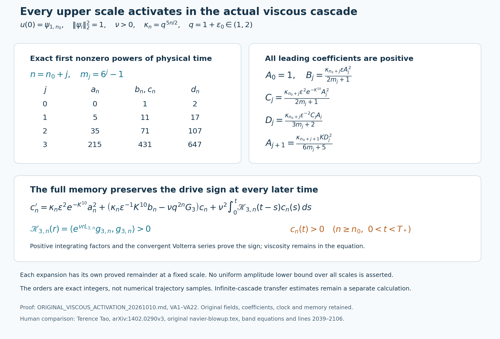
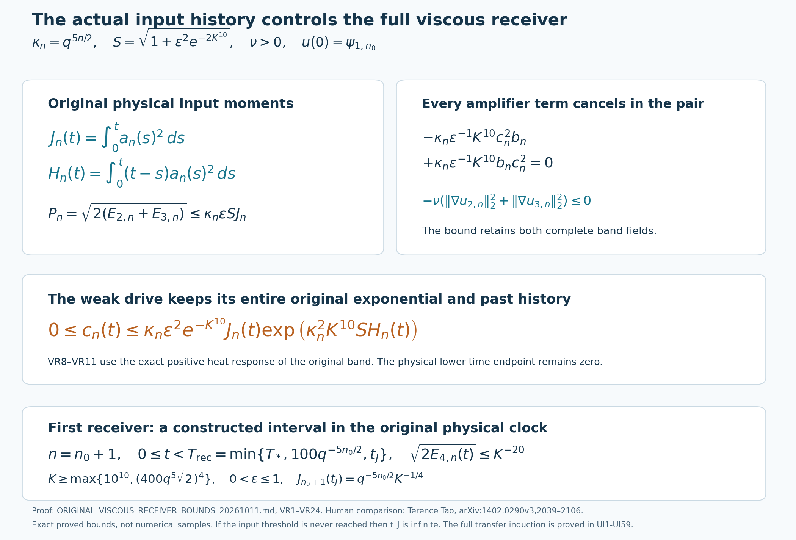
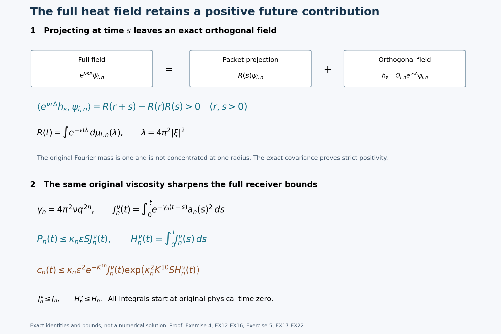

# Positive viscous memory and the complete receiver bounds

A viscous band keeps more information than its projection onto one wave
packet. Its orthogonal field feeds back through a positive memory kernel.
This lesson proves that the actual weak drive is positive at every upper
scale and every positive time, computes its first nonzero coefficients,
and carries the entire history through each physical checkpoint.

The second part controls the complete receiving fields. Cancellation of
the full amplifier in their pair energy gives input-history bounds
without replacing viscosity by an arbitrary error. The heat response
then bounds the weak drive, while the signed outgoing pump controls the
rotor. An actual first receiver interval is constructed before any
future transfer is assumed.

The human source is Terence Tao,
[arXiv:1402.0290v3](https://arxiv.org/abs/1402.0290v3), original author file
navier-blowup.tex, especially the band equations at827–1008 and receiver
argument at2039–2106. This is an independent editorial derivation from
the original equations, with no novelty claim.
[Lesson40](the-original-viscous-cascade-and-its-exact-memory-equation.md),
VD1–VD35, supplies the actual maximal flow, full band spaces and exact
memory operators.
[Lesson42](the-original-autonomous-circuit-and-its-complete-delayed-transfer.md),
CR16–CR20, supplies the corrected coefficient table and four original
equations. Both complete proofs are retained in this course.

Five solved exercises evaluate the complete activation coefficient,
bound a positive-memory truncation, prove the exact checkpoint maps for
all four moments, identify the positive heat contribution discarded by
a scalar restart, and strengthen the receiver bounds by retaining
viscous decay. The formulas below retain the original physical fields,
time origin, packet norms, scale coefficients and viscosity.

## VA1. Retain the actual fields, viscosity and full memory

Keep the original nonzero real solenoidal fields \(\psi_i\), with their source squared norms \(A_i=\|\psi_i\|_2^2=1\). This is a stated property of the source fields, not a change of their amplitudes. Put \(q=1+\epsilon_0\), \(1<q<2\), retain \(\epsilon,K>0\), and let \(\nu>0\) be the original viscosity. Let \(u\) be the constructed maximal \(H^{10}\) solution with \(u(0)=\psi_{1,n_0}\), on \([0,T_*)\). Write
\[
 a_n=X_{1,n},\quad b_n=X_{2,n},\quad
 c_n=X_{3,n},\quad d_n=X_{4,n},\qquad
 \kappa_n=q^{5n/2}.
\tag{VA1}
\]
Thus \(a_{n_0}(0)=1\), and every other coordinate initially vanishes. All bands with \(n<n_0\) remain zero by VD12 and VD20. On every compact interval inside \([0,T_*)\), each fixed band coordinate is continuously differentiable and bounded. These properties come from the already constructed flow; no arbitrary scalar sequence is postulated.

Retain the full wave-packet quantities
\[
\begin{gathered}
 G_i=\|\nabla\psi_i\|_2^2,\quad
 J_i=\|\Delta\psi_i\|_2^2,\quad
 g_i=\Delta\psi_i+G_i\psi_i,\quad
 \sigma_i^2=J_i-G_i^2>0,\\
 g_{i,n}=q^{2n}D_{q^n}g_i,\quad
 L_{i,n}=Q_{i,n}\Delta\big|_{\ker\Pi_{i,n}},\quad
 \mathscr K_{i,n}(r)=\langle e^{\nu rL_{i,n}}g_{i,n},g_{i,n}\rangle,\\
 q^{4n}\sigma_i^2e^{-4\pi^2\nu(1+\epsilon_0/2)^2q^{2n}r}
 \leq\mathscr K_{i,n}(r)
 \leq q^{4n}\sigma_i^2e^{-4\pi^2\nu q^{2n}r}
 \quad(r\geq0).
\end{gathered}
\tag{VA2}
\]
Here \(D_{q^n}\), \(\Pi\) and \(Q\) are exactly the dilation and orthogonal maps of VD21–VD31. Their complete definitions, domains and positivity proof are retained there. In particular each kernel is continuous, strictly positive, and bounded by \(q^{4n}\sigma_i^2\). Define only an abbreviation for the full viscous contribution:
\[
 \mathcal V_{i,n}[x](t)
 =-\nu q^{2n}G_i x(t)
 +\nu^2\int_0^t\mathscr K_{i,n}(t-s)x(s)\,ds.
\tag{VA3}
\]
The four actual equations, with both adjacent scales present, are
\[
\begin{aligned}
 a_n'={}&\kappa_n[-\epsilon^{-2}c_nd_n-\epsilon a_nb_n
 -\epsilon^2e^{-K^{10}}a_nc_n+Kd_{n-1}^2]
 +\mathcal V_{1,n}[a_n],\\
 b_n'={}&\kappa_n[\epsilon a_n^2-\epsilon^{-1}K^{10}c_n^2]
 +\mathcal V_{2,n}[b_n],\\
 c_n'={}&\kappa_n[\epsilon^2e^{-K^{10}}a_n^2
 +\epsilon^{-1}K^{10}b_nc_n]
 +\mathcal V_{3,n}[c_n],\\
 d_n'={}&\kappa_n[\epsilon^{-2}a_nc_n-q^{5/2}Kd_na_{n+1}]
 +\mathcal V_{4,n}[d_n].
\end{aligned}
\tag{VA4}
\]
These are CR19 and VD29, with the actual source field norms inserted. In particular the memory integrals are part of the equation and keep the original initial time zero.

## VA2. Prove nonnegativity without a sign assumption on the other coordinates

Fix any integer \(n\) and \(0<T<T_*\). In the actual third equation set
\[
 \lambda_n(t)=\kappa_n\epsilon^{-1}K^{10}b_n(t)-\nu q^{2n}G_3,
 \qquad f_n(t)=\kappa_n\epsilon^2e^{-K^{10}}a_n(t)^2\geq0.
\tag{VA5}
\]
Multiplication by the positive integrating factor gives the exact Volterra equation
\[
\begin{aligned}
 c_n(t)&=g_n(t)+(\mathcal T_n c_n)(t),\\
 g_n(t)&=\int_0^t e^{\int_s^t\lambda_n(v)dv}f_n(s)\,ds,\\
 (\mathcal T_n z)(t)&=\nu^2\int_0^t
 \int_r^t e^{\int_s^t\lambda_n(v)dv}
 \mathscr K_{3,n}(s-r)\,ds\ z(r)\,dr.
\end{aligned}
\tag{VA6}
\]
The double integral follows by exchanging the triangular region \(0\leq r\leq s\leq t\). The integrand is continuous on that compact region, so the exchange is justified for every continuous signed \(z\). Put
\[
 M=\sup_{[0,T]}|\lambda_n|,\qquad
 H=\nu^2T e^{MT}q^{4n}\sigma_3^2.
\tag{VA7}
\]
The integral kernel of \(\mathcal T_n\) lies between zero and \(H\). Iterating over the ordered simplex gives, for every integer \(j\geq0\),
\[
 |(\mathcal T_n^j z)(t)|
 \leq\|z\|_{C[0,T]}\frac{H^jt^j}{j!}.
\tag{VA8}
\]
For \(j=0\) this is the supremum bound; integration of the inductive bound against \(H\) proves the next value. Therefore the series \(\sum_{j=0}^{\infty}\mathcal T_n^jg_n\) converges uniformly and solves VA6 by boundedness of the integral operator. If two continuous solutions differed by \(w\), then \(w=\mathcal T_n^jw\) for every \(j\); VA8 and \(H^jT^j/j!\to0\) force \(w=0\). The actual coordinate is consequently this series. Every summand is nonnegative, proving
\[
 c_n(t)\geq g_n(t)\geq0\qquad(0\leq t<T_*).
\tag{VA9}
\]
No sign restriction on \(a_n,b_n,d_n\) or neighboring coordinates was used. If \(a_n\) is nonzero on any open subinterval of \((0,t)\), its squared forcing and the strictly positive exponential make \(g_n(t)>0\). We next establish this prerequisite at every upper scale from the actual original initial datum.

## VA3. A finite-band integral estimate with the memory retained

Here is the estimate needed for the actual coordinate induction. Suppose a continuous finite-dimensional vector \(z\), with \(z(0)=0\), satisfies a linear differential equation on \([0,T]\) whose matrix coefficient has norm at most \(M_0\), whose memory kernel has norm at most \(H_0\), and whose forcing has norm at most \(F_0t^{m-1}\), where \(m\geq1\) is an integer. Integration of the full equation gives
\[
 |z(t)|\leq\frac{F_0}{m}t^m+(M_0+H_0T)\int_0^t|z(s)|\,ds.
\tag{VA10}
\]
Indeed the double memory integral is bounded by \(H_0T\int_0^t|z(s)|ds\). To prove the resulting estimate directly, write \(L=M_0+H_0T\) and \(w(t)=\int_0^t|z(s)|ds\). Then \(w'\leq(F_0/m)t^m+Lw\), and integration of \((e^{-Lt}w)'\) gives
\[
 |z(t)|\leq\frac{F_0}{m}\left[t^m+
 L\int_0^t e^{L(t-s)}s^m ds\right]
 \leq\frac{F_0}{m}t^m e^{Lt}.
\tag{VA11}
\]
The last inequality uses \(s^m\leq t^m\) only within the proved integral estimate, not in the original equation. Thus a bounded matrix coefficient and bounded memory preserve the actual forcing's order of vanishing after one integration. The estimate also applies to a scalar equation. All its uses below have finite coefficients at a fixed original scale; no uniform bound over infinitely many scales is assumed.

## VA4. Compute every first nonzero coefficient at every scale

For \(j\geq0\), put \(n=n_0+j\) and define positive coefficients recursively by
\[
\begin{gathered}
 m_0=0,\qquad m_{j+1}=6m_j+5,\qquad m_j=6^j-1,\qquad A_0=1,\\
 B_j=\frac{q^{5(n_0+j)/2}\epsilon A_j^2}{2m_j+1},\qquad
 C_j=\frac{q^{5(n_0+j)/2}\epsilon^2e^{-K^{10}}A_j^2}{2m_j+1},\\
 D_j=\frac{q^{5(n_0+j)/2}\epsilon^{-2}C_jA_j}{3m_j+2},\qquad
 A_{j+1}=\frac{q^{5(n_0+j+1)/2}K D_j^2}{6m_j+5}.
\end{gathered}
\tag{VA12}
\]
The symbols \(A_j,B_j,C_j,D_j\) in this display are expansion coefficients, not field norms. Each denominator is a positive integer, and each numerator retains its original positive factors. In particular no weak-pump exponential or inverse power of \(\epsilon\) has been dropped.

We prove the actual expansions, for each fixed \(j\) as \(t\downarrow0\),
\[
\begin{aligned}
 a_{n_0+j}(t)&=A_jt^{m_j}+O(t^{m_j+1}),\\
 b_{n_0+j}(t)&=B_jt^{2m_j+1}+O(t^{2m_j+2}),\\
 c_{n_0+j}(t)&=C_jt^{2m_j+1}+O(t^{2m_j+2}),\\
 d_{n_0+j}(t)&=D_jt^{3m_j+2}+O(t^{3m_j+3}).
\end{aligned}
\tag{VA13}
\]
Every error means an actual bound \(|R(t)|\leq C t^r\) on some fixed positive interval; its constant may depend on the full parameters and the particular scale. There is no infinite-series or analyticity assumption.

For the base scale, continuous differentiability gives \(a_{n_0}=1+O(t)\). The third equation is a scalar linear equation with bounded actual coefficient \(\lambda_{n_0}\), bounded memory, zero initial value and bounded forcing. VA10–VA11 with \(m=1\) give \(c_{n_0}=O(t)\). The second equation now has bounded forcing \(\kappa_{n_0}(\epsilon a_{n_0}^2-\epsilon^{-1}K^{10}c_{n_0}^2)\), so \(b_{n_0}=O(t)\) by the same estimate. The fourth is linear in \(d_{n_0}\), with actual bounded coefficient \(-\kappa_{n_0}q^{5/2}K a_{n_0+1}-\nu q^{2n_0}G_4\), bounded memory and forcing \(\kappa_{n_0}\epsilon^{-2}a_{n_0}c_{n_0}=O(t)\). Thus \(d_{n_0}=O(t^2)\).

Return these estimates to the complete equations. The third forcing is \(\kappa_{n_0}\epsilon^2e^{-K^{10}}+O(t)\); its coefficient times \(c_{n_0}\) is \(O(t)\), and its memory is \(O(t^2)\). Integration proves the asserted \(C_0t+O(t^2)\). The second equation gives \(B_0t+O(t^2)\), retaining the negative \(c^2\) term as \(O(t^2)\). The fourth forcing is then \(\kappa_{n_0}\epsilon^{-2}C_0t+O(t^2)\), its bounded coefficient times \(d\) is \(O(t^2)\), and its memory is \(O(t^3)\). Integration gives \(D_0t^2+O(t^3)\), exactly as VA12.

Now suppose VA13 holds at scale \(n-1=n_0+j\), and put \(m=6m_j+5\). The exact incoming source at scale \(n\) is
\[
 \kappa_nK d_{n-1}(t)^2
 =\kappa_nK D_j^2 t^{m-1}+O(t^m).
\tag{VA14}
\]
First consider the pair \((a_n,d_n)\). Its initial value is zero. The first and fourth equations of VA4 form a linear equation for this pair with the following actual matrix and diagonal memory:
\[
 \begin{pmatrix}
 -\kappa_n(\epsilon b_n+\epsilon^2e^{-K^{10}}c_n)-\nu q^{2n}G_1
 &-\kappa_n\epsilon^{-2}c_n\\
 \kappa_n\epsilon^{-2}c_n
 &-\kappa_n q^{5/2}K a_{n+1}-\nu q^{2n}G_4
 \end{pmatrix},\qquad
 \nu^2\begin{pmatrix}\mathscr K_{1,n}&0\\0&\mathscr K_{4,n}\end{pmatrix}.
\tag{VA15}
\]
All entries are already continuous and bounded for the actual solution on a fixed compact interval, regardless of the signs or vanishing orders of the other coordinates. The only inhomogeneous vector is \((\kappa_nK d_{n-1}^2,0)\). VA11 proves \(|a_n|+|d_n|=O(t^m)\). The third equation then gives \(c_n=O(t^{2m+1})\). The second gives \(b_n=O(t^{2m+1})\), since its two source terms have orders \(2m\) and \(4m+2\). Finally the fourth gives the improved \(d_n=O(t^{3m+2})\). Each application retains its full bounded diagonal damping and memory.

In the first equation the rotor term has order \(5m+3\), the two remaining quadratic drain terms have order \(3m+1\), the diagonal viscous term has order \(m\), and the memory has order \(m+1\). Combining these with VA14 and integrating gives
\[
 a_n(t)=\frac{\kappa_nK D_j^2}{m}t^m+O(t^{m+1}).
\tag{VA16}
\]
Inserting this expansion into the third equation gives the leading forcing \(\kappa_n\epsilon^2e^{-K^{10}}A_{j+1}^2t^{2m}\). All its other terms have order at least \(2m+1\); hence integration gives precisely \(C_{j+1}\) and its stated error. In the second equation the negative amplifier term has order \(4m+2\); damping and memory have orders at least \(2m+1\) and \(2m+2\). This gives \(B_{j+1}\). In the fourth equation the source is \(\kappa_n\epsilon^{-2}A_{j+1}C_{j+1}t^{3m+1}+O(t^{3m+2})\); the bounded outgoing and damping coefficient times \(d_n\) has order at least \(3m+2\), and memory has order \(3m+3\). This gives \(D_{j+1}\). The induction proves every line of VA12–VA13, with every original term accounted for.

## VA5. Strict activation, original orthogonal defects and the exact scope

All four leading coefficients in VA12 are strictly positive. Therefore, for each fixed \(n\geq n_0\), all four coordinates are strictly positive for sufficiently small positive time. The size of this interval may depend on \(n\); no common interval for the signs of \(a_n,b_n,d_n\) is asserted. VA9 and its positive forcing integral now give the stronger all-time conclusion
\[
 c_n(t)>0\quad\text{for every }n\geq n_0\text{ and every }0<t<T_*.
\tag{VA17}
\]
For a quantitative version at one fixed scale and compact time interval, choose \(0<\eta\leq T\) so that \(a_n(s)\geq A_js^{m_j}/2\) on \((0,\eta]\), as guaranteed by VA13. Put
\[
 M_n=\kappa_n\epsilon^{-1}K^{10}\sup_{[0,T]}|b_n|
       +\nu q^{2n}G_3.
\]
The third equation's integrating factor is at least \(e^{-M_nt}\). Its nonnegative memory resolvent and original forcing give
\[
 c_n(t)\geq
 \frac{\kappa_n\epsilon^2e^{-K^{10}}A_j^2}{4(2m_j+1)}
 e^{-M_nt}\min\{t,\eta\}^{2m_j+1}>0
 \qquad(0<t\leq T).
\tag{VA18}
\]
This proves the bound using the entire original forcing coefficient. In particular every positive-time solution has a nonzero coordinate in each upper band. It need not have finite support in scale. This statement is compatible with the constructed \(H^{10}\) solution: VA13 supplies no uniform lower bound as the scale tends to infinity, and makes no assertion of divergent Sobolev norm at such a time.

There is an exact leading term for the orthogonal components as well. For any one of the four coordinates in VA13, denote its proved exponent by \(p\) and its positive leading coefficient by \(L\). VD24 gives, in its actual band \(L^2\) space,
\[
\begin{aligned}
 h_{i,n}(t)&=\frac{\nu L}{p+1}g_{i,n}t^{p+1}
                 +O_{L^2}(t^{p+2}),\\
 D_{i,n}(t)&=\frac{\nu^2L^2q^{4n}\sigma_i^2}{2(p+1)^2}
                 t^{2p+2}+O(t^{2p+3}).
\end{aligned}
\tag{VA19}
\]
To justify the first error, \(L_{i,n}\) is bounded at the fixed scale, and its exponential satisfies \(\|e^{\nu rL_{i,n}}-I\|\leq\nu r\|L_{i,n}\|e^{\nu r\|L_{i,n}\|}\). Insert VA13 in the full VD24 integral: the coordinate error integrates to \(O(t^{p+2})\), and the exponential error is bounded by a constant times \(\int_0^t(t-s)s^p ds= t^{p+2}/[(p+1)(p+2)]\). Squaring its norm and using \(D=\|h\|_2^2/2\) proves the second line, including the cross term in the error. Thus the leading scalar coefficients are independent of viscosity, while the full actual viscous defect is explicitly nonzero for small time at every upper band.

## VA6. Carry positivity through the actual checkpoint map without erasing its history

Fix any integer \(N\), any amplitude \(e>0\), and any actual checkpoint time \(0<t_N<T_*\). Keep the entire physical clock and its inverse:
\[
\begin{gathered}
 \beta=e q^{5N/2},\qquad
 \tau=\beta(t-t_N),\qquad
 t=t_N+\tau/\beta,\\
 Y_{i,k}(\tau)=e^{-1}X_{i,N+k}(t),\qquad
 \tau_{\rm start}=-\beta t_N.
\end{gathered}
\tag{VA20}
\]
This is a bijection between the original time interval and \([\tau_{\rm start},\beta(T_*-t_N))\); division by the positive amplitude preserves each coordinate's sign. Direct differentiation retains the full transformed equation:
\[
\begin{aligned}
 \partial_\tau Y_{i,k}
 ={}&\widehat F_{i,k}(Y)
 -\frac{\nu q^{2(N+k)}G_i}{\beta}Y_{i,k}(\tau)\\
 &+\frac{\nu^2}{\beta^2}
 \int_{\tau_{\rm start}}^\tau
 \mathscr K_{i,N+k}\bigl((\tau-s)/\beta\bigr)Y_{i,k}(s)\,ds.
\end{aligned}
\tag{VA21}
\]
Here \(\widehat F_{i,k}\) is exactly the four quadratic bracket expressions in VA4 with indices \(n,n\pm1\) replaced by \(k,k\pm1\), and with the original common factor \(q^{5k/2}\). To check that factor, every quadratic term contributes \(e^2q^{5(N+k)/2}/(e\beta)=q^{5k/2}\); the outgoing term still contains its additional \(q^{5/2}K\), and the incoming term still contains \(K\). In the memory integral the substitution \(s=\beta(r-t_N)\) contributes the additional \(\beta^{-1}\) displayed in VA21. The damping factor is equivalently \(\nu q^{-N/2}e^{-1}q^{2k}G_i\), with all its factors retained. The inverse substitution recovers VA4 term by term.

For \(\tau\geq0\), split the last integral exactly into its intervals \([\tau_{\rm start},0]\) and \([0,\tau]\). In the third coordinate both integrals are nonnegative whenever \(N+k\geq n_0\), by VA2 and VA17. The first is the nonzero history contribution of the original physical solution; resetting it to zero would change the equation. Consequently
\[
 Y_{3,k}(\tau)>0\quad
 \bigl(N+k\geq n_0,\quad
 \tau_{\rm start}<\tau<\beta(T_*-t_N)\bigr).
\tag{VA22}
\]
This is the exact map receiving VA17 at every actual checkpoint, with the past history included. It strengthens the source's small negative lower allowance for this actual viscous solution. It does not automatically prove an assertion for arbitrary scalar systems whose viscosity was replaced by a signed error bound. The receiver bounds below use this full history. The later transfer proof must also retain it, together with both neighboring scales and every viscous contribution.

VA12–VA13 prove each exponent and coefficient in the upper panels, with a remainder at every fixed original scale. VA2–VA9 and VA17 prove the full lower-panel memory equation and its strict positivity conclusion. The table records powers of physical time, not amplitudes or numerical samples. It gives no scale-uniform lower bound. [Reproducible figure source](../assets/original-viscous-activation.py) and [vector rendering](../assets/original-viscous-activation.svg) retain the exact formulas. Human comparison: Tao, original author TeX, band equations and lines 2039–2106.

## VR1. Full physical coordinates and heat response

Retain \(q=1+\epsilon_0\in(1,2)\), \(K,\epsilon,\nu>0\), the original integer \(n_0\), and the actual maximal solution \(u\) on \([0,T_*)\), with \(u(0)=\psi_{1,n_0}\). The source fields have their original squared norms \(\|\psi_i\|_2^2=1\). For each original band let
\[
\begin{gathered}
 a_n=\langle u_{1,n},\psi_{1,n}\rangle,\quad
 b_n=\langle u_{2,n},\psi_{2,n}\rangle,\quad
 c_n=\langle u_{3,n},\psi_{3,n}\rangle,\quad
 d_n=\langle u_{4,n},\psi_{4,n}\rangle,\\
 E_{i,n}=\tfrac12\|u_{i,n}\|_2^2,\qquad
 \kappa_n=q^{5n/2},\qquad
 S=\sqrt{1+\epsilon^2e^{-2K^{10}}}.
\end{gathered}
\tag{VR1}
\]
The band fields, not just their four scalar projections, satisfy
\[
 \partial_tu_{i,n}=\nu\Delta u_{i,n}+F_{i,n}\psi_{i,n},\qquad
 E_{i,n}'=F_{i,n}X_{i,n}-\nu\|\nabla u_{i,n}\|_2^2.
\tag{VR2}
\]
Here \(F_{i,n}\) are the full four expressions CR19, including both adjacent scales. The complete heat response for a fixed band is
\[
\begin{aligned}
 R_{i,n}(r)&=\langle e^{\nu r\Delta}\psi_{i,n},\psi_{i,n}\rangle\\
 &=\int_{\mathbb R^3}e^{-4\pi^2\nu r|\xi|^2}
                |\widehat\psi_{i,n}(\xi)|^2\,d\xi,\\
 e^{-4\pi^2\nu(1+\epsilon_0/2)^2q^{2n}r}
 &\leq R_{i,n}(r)\leq e^{-4\pi^2\nu q^{2n}r}\leq1
 \quad(r\geq0).
\end{aligned}
\tag{VR3}
\]
Plancherel with the original Fourier convention proves the integral. The original support lies between the two stated radii, and its total Fourier mass is one; bounding the exponential on that support proves both inequalities. In particular \(R_{i,n}\) is positive and continuous, with \(R_{i,n}(0)=1\).

Every initially unoccupied band obeys the exact physical response
\[
 X_{i,n}(t)=\int_0^t R_{i,n}(t-s)F_{i,n}(s)\,ds.
\tag{VR4}
\]
This follows by solving the bounded-band heat equation VR2 and pairing with the original wave packet. It is equivalent to the full viscous memory equation, with its original lower endpoint zero; it does not replace that equation by scalar damping. All the \(i=2,3,4\) bands are initially unoccupied, including at \(n=n_0\).

## VR2. Cancel the amplifier in the full pair energy

For each fixed \(n\), add the exact \(i=2,3\) energy equations, without changing either field. The entire cancellation is
\[
\begin{aligned}
 (E_{2,n}+E_{3,n})'
 ={}&\kappa_n\epsilon a_n^2b_n
 -\kappa_n\epsilon^{-1}K^{10}c_n^2b_n\\
 &+\kappa_n\epsilon^2e^{-K^{10}}a_n^2c_n
 +\kappa_n\epsilon^{-1}K^{10}b_nc_n^2\\
 &-\nu\bigl(\|\nabla u_{2,n}\|_2^2+\|\nabla u_{3,n}\|_2^2\bigr)\\
 ={}&\kappa_na_n^2(\epsilon b_n+\epsilon^2e^{-K^{10}}c_n)
 -\nu\bigl(\|\nabla u_{2,n}\|_2^2+\|\nabla u_{3,n}\|_2^2\bigr).
\end{aligned}
\tag{VR5}
\]
Put \(P_n=\sqrt{2(E_{2,n}+E_{3,n})}\). The original packet norms give \(b_n^2+c_n^2\leq P_n^2\). Differentiate \(\sqrt{P_n^2+\eta}\) for \(\eta>0\), use VR5 and Cauchy–Schwarz on the complete two-component forcing vector, and retain the nonpositive viscous term before taking an upper bound. The result is
\[
 \frac{d}{dt}\sqrt{P_n^2+\eta}
 \leq\kappa_n a_n^2
 \sqrt{\epsilon^2+\epsilon^4e^{-2K^{10}}}
 \frac{P_n}{\sqrt{P_n^2+\eta}}
 \leq\kappa_n\epsilon S a_n^2.
\tag{VR6}
\]
Since \(P_n(0)=0\), integration and \(\eta\downarrow0\) prove, with the actual input integral,
\[
\begin{gathered}
 J_n(t)=\int_0^t a_n(s)^2\,ds,\\
 |b_n(t)|,|c_n(t)|\leq P_n(t)
 \leq\kappa_n\epsilon S J_n(t),\\
 E_{2,n}(t)+E_{3,n}(t)
 \leq\tfrac12\kappa_n^2
       (\epsilon^2+\epsilon^4e^{-2K^{10}})J_n(t)^2.
\end{gathered}
\tag{VR7}
\]
This bounds the complete pair energy, including both orthogonal components. No artificial viscous forcing is introduced. In particular the pair estimate needs no bootstrap assumption about the time integral of \(|b_n|\).

## VR3. Bound the actual weak drive with its whole past

The third coordinate is nonnegative on its entire actual interval by VA9, and is strictly positive for \(n\geq n_0\) at positive times by VA17. The full third response VR4 is
\[
 c_n(t)=\kappa_n\int_0^t R_{3,n}(t-s)
 \bigl[\epsilon^2e^{-K^{10}}a_n(s)^2
 +\epsilon^{-1}K^{10}b_n(s)c_n(s)\bigr]ds.
\tag{VR8}
\]
Bound \(R\leq1\) only after retaining this exact expression, replace a negative amplifier contribution by an upper bound using \(|b_n|c_n\), and define
\[
 H_n(t)=\int_0^t(t-s)a_n(s)^2ds
       =\int_0^t J_n(s)ds.
\tag{VR9}
\]
The second identity is integration over the triangle \(0\leq r\leq s\leq t\). Thus
\[
 c_n(t)\leq\kappa_n\epsilon^2e^{-K^{10}}J_n(t)
      +\kappa_n\epsilon^{-1}K^{10}\int_0^t|b_n(s)|c_n(s)ds.
\tag{VR10}
\]
For completeness, fix a terminal time \(t\). On \([0,t]\), replace only the nondecreasing \(J_n(s)\) in the first upper-bound term by \(J_n(t)\). If \(w(s)\) is that constant plus the integral term up to \(s\), then \(c_n(s)\leq w(s)\) and \(w'\leq\kappa_n\epsilon^{-1}K^{10}|b_n|w\). Its integrating factor gives the first inequality below, also when \(J_n(t)=0\). VR7 and VR9 give the second:
\[
\begin{aligned}
 0\leq c_n(t)
 &\leq\kappa_n\epsilon^2e^{-K^{10}}J_n(t)
 \exp\left(\kappa_n\epsilon^{-1}K^{10}\int_0^t|b_n(s)|ds\right)\\
 &\leq\kappa_n\epsilon^2e^{-K^{10}}J_n(t)
       \exp\left(\kappa_n^2K^{10}S H_n(t)\right).
\end{aligned}
\tag{VR11}
\]
All quantities in this estimate are defined from the actual flow. It holds for every \(0\leq t<T_*\), at every original scale. It has no additive error from viscosity and retains the entire original weak-pump exponential. The viscosity remains in the exact heat response and in the full energy calculation producing the estimate.

The second response also retains the two signed inputs individually:
\[
\begin{aligned}
 -\kappa_n\epsilon^{-1}K^{10}
       \int_0^t R_{2,n}(t-s)c_n(s)^2ds
 \leq b_n(t)
 \leq\kappa_n\epsilon\int_0^t R_{2,n}(t-s)a_n(s)^2ds.
\end{aligned}
\tag{VR12}
\]
These follow directly by dropping the nonnegative or nonpositive integral from the exact original second response. They make no assertion that \(b_n\) has a fixed sign.

## VR4. Bound the full rotor-band energy, retaining the outgoing sign

Let \(Q_n=\sqrt{2E_{4,n}}\), so \(|d_n|\leq Q_n\), and write \(x_-=\max\{-x,0\}\). The exact fourth energy equation is
\[
 E_{4,n}'=\kappa_n\epsilon^{-2}a_nc_nd_n
 -\kappa_n q^{5/2}K a_{n+1}d_n^2
 -\nu\|\nabla u_{4,n}\|_2^2.
\tag{VR13}
\]
The positive part of \(a_{n+1}\) contributes a nonpositive drain. With the complete signed term retained before estimation, regularization by \(\sqrt{Q_n^2+\eta}\) yields
\[
 \frac{d}{dt}\sqrt{Q_n^2+\eta}
 \leq\kappa_n\epsilon^{-2}|a_n|c_n
      +\kappa_nq^{5/2}K(a_{n+1})_-
                            \sqrt{Q_n^2+\eta}.
\tag{VR14}
\]
The first term uses \(|d_n|\leq Q_n\) and \(c_n\geq0\); the second uses \(d_n^2\leq Q_n^2\). The dissipation is nonpositive. Integrate with the full coefficient and let \(\eta\downarrow0\), using the exact initial value \(Q_n(0)=0\):
\[
 Q_n(t)\leq\kappa_n\epsilon^{-2}\int_0^t
 |a_n(s)|c_n(s)
 \exp\left(\kappa_nq^{5/2}K\int_s^t(a_{n+1}(r))_-dr\right)ds.
\tag{VR15}
\]
Define two further actual physical integrals
\[
 L_n(t)=\int_0^t|a_n(s)|ds,\qquad
 N_n(t)=\int_0^t(a_{n+1}(s))_-ds.
\tag{VR16}
\]
All four functions \(J_n,H_n,L_n,N_n\) are nondecreasing. Inserting VR11 in VR15, then bounding their values at earlier times by their terminal values, gives
\[
\begin{aligned}
 |d_n(t)|\leq Q_n(t)
 \leq{}&\kappa_n^2\epsilon^{-2}\epsilon^2e^{-K^{10}}
          J_n(t)L_n(t)\\
 &\times\exp\left(\kappa_n^2K^{10}S H_n(t)
                   +\kappa_nq^{5/2}K N_n(t)\right).
\end{aligned}
\tag{VR17}
\]
The inverse and direct powers of \(\epsilon\) are both displayed so their origins remain visible. This is a bound on the entire fourth-band radius, not solely its projection. The negative part of the actual next-scale input, rather than an assigned sign or a surrogate trajectory, controls the possible outgoing growth.

## VR5. Construct and control the first receiver interval in original physical time

We now give an actual interval on which these estimates have small numerical upper bounds. Take
\[
 K\geq\max\{10^{10},(400q^5\sqrt2)^4\},\qquad
 0<\epsilon\leq1,
 \qquad \kappa_0:=q^{5n_0/2},\quad n=n_0+1.
\tag{VR18}
\]
The symbol \(\kappa_0\) here names the actual initial-scale factor, not the factor of spatial scale zero. No coordinate, initial amplitude, time or viscosity is changed. The total energy identity from the constructed solution is
\[
 \tfrac12\|u(t)\|_2^2+
 \nu\int_0^t\|\nabla u(s)\|_2^2ds=\tfrac12.
\tag{VR19}
\]
Hence every original coordinate has absolute value at most one, because its packet norm is one and its band is an orthogonal part of \(u\).

Let \(t_J\) be the first time in \((0,T_*)\) at which
\(J_{n_0+1}(t)=\kappa_0^{-1}K^{-1/4}\), with value \(+\infty\) if no such time exists. Define the actual upper endpoint
\[
 T_{\rm rec}=\min\{T_*,\ 100\kappa_0^{-1},\ t_J\}.
\tag{VR20}
\]
It is positive: local existence gives \(T_*>0\), and continuity of the actual integral, initially zero, keeps it below its positive threshold on some positive interval. The definition uses the already constructed flow and specifies a genuine interval, without assuming a future transfer. All following assertions hold for \(0\leq t<T_{\rm rec}\), and also at \(T_{\rm rec}\) whenever it is below \(T_*\), by continuity.

The definitions, nonnegative integrands, Cauchy–Schwarz and VR19 give
\[
\begin{gathered}
 J_n(t)\leq\kappa_0^{-1}K^{-1/4},\qquad
 H_n(t)\leq tJ_n(t)\leq100\kappa_0^{-2}K^{-1/4},\\
 L_n(t)\leq\sqrt{tJ_n(t)}\leq10\kappa_0^{-1}K^{-1/8},\qquad
 N_n(t)\leq t\leq100\kappa_0^{-1},\\
 \kappa_n=q^{5/2}\kappa_0,\qquad S\leq\sqrt2.
\end{gathered}
\tag{VR21}
\]
In particular the two full exponents in VR17 satisfy
\[
\begin{aligned}
 \kappa_n^2K^{10}S H_n(t)
 &\leq100q^5\sqrt2 K^{10-1/4}\leq K^{10}/4,\\
 \kappa_nq^{5/2}KN_n(t)
 &\leq100q^5K\leq K^{10}/4.
\end{aligned}
\tag{VR22}
\]
The first final inequality is exactly the fourth-power restriction in VR18. For the second, \(q^5<32\), so it suffices that \(K^9\geq12800\), which follows from \(K\geq10^{10}\).

Equations VR7 and VR11 now yield
\[
\begin{gathered}
 |b_n(t)|,|c_n(t)|\leq P_n(t)
 \leq q^{5/2}\epsilon S K^{-1/4},\\
 0<c_n(t)\leq q^{5/2}\epsilon^2 K^{-1/4}e^{-3K^{10}/4}
 \quad(0<t<T_{\rm rec}).
\end{gathered}
\tag{VR23}
\]
Strict positivity is the actual-flow result VA17. The stronger exponential in the second line follows from the original factor \(e^{-K^{10}}\) and the first exact exponent bound VR22.

Keeping all physical factors in VR17 before their exact multiplication gives
\[
\begin{aligned}
 Q_n(t)
 &\leq(q^{5/2}\kappa_0)^2\epsilon^{-2}\epsilon^2
       (\kappa_0^{-1}K^{-1/4})
       (10\kappa_0^{-1}K^{-1/8})e^{-K^{10}/2}\\
 &=10q^5\epsilon^{-2}\epsilon^2 K^{-3/8}e^{-K^{10}/2}
 \leq K^{-20}.
\end{aligned}
\tag{VR24}
\]
Here is a proof of the last bound over the entire parameter range. The positive exponential series gives \(e^{K^{10}/2}\geq(K^{10}/2)^3/6\), hence \(e^{-K^{10}/2}\leq48K^{-30}\). The preceding expression is therefore at most \(480q^5K^{-243/8}\); the exact factors \(\epsilon^{-2}\epsilon^2=1\) have been accounted for. Since \(480q^5<15360<K\leq K^{83/8}\), the claimed upper bound follows. This proves both \(|d_n|\leq K^{-20}\) and the stronger full energy estimate \(E_{4,n}\leq K^{-40}/2\).

No assumption about small next-scale energy was needed here: the complete total energy VR19 controlled its possible negative input. No lower bound on \(n_0\) or upper bound on the positive viscosity was needed for these receiver conclusions. Large initial scale remains relevant to the distinct problem of proving that the incoming transfer actually occurs before viscous loss prevents it.

## VR6. Exact scope and continuation

VR7, VR11, VR12 and VR15–VR17 are unconditional estimates for the full actual cascade, valid at every scale and every time of its maximal solution. VR18–VR24 construct and control a genuine first-receiver interval in the original physical clock. These calculations avoid the source's additive viscous error in its small-mode estimates and avoid its integral bootstrap for the small amplifier input. They supply a proved small rotor bound for the actual first receiver rather than trying to improve a weaker initial scalar bound by Gronwall alone.

For later checkpoints, the lower endpoint of every physical integral remains the original zero time. VA20–VA22 give the exact transformed history; nothing in this note resets it at a checkpoint. The complete original-viscosity induction, UI1–UI59, now bounds those finite histories and constructs all successive intervals. This lesson supplies its positive-memory and receiver arguments; the later teaching sequence develops the actual transfers and uniform induction in full.

VR5–VR7 prove the full pair-energy bound; VR8–VR11 prove the upper drive estimate from the actual original heat response. VR18–VR24 construct the first physical receiver interval and its complete rotor-band energy bound. The diagram keeps every displayed coefficient and the original time origin. It records exact inequalities, not numerical trajectories. [Reproducible figure source](../assets/original-viscous-receiver.py) and [vector rendering](../assets/original-viscous-receiver.svg) accompany the argument. Human comparison: Tao, original author file navier-blowup.tex, lines 2039–2106.

## Five solved exercises

### Exercise 1. Compute the complete leading coefficient at every scale

Keep the original coefficients and all physical parameters in VA12. Give a finite product for \(A_j\), evaluate the total power of \(q\), and compute the first receiving coefficient \(A_1\). The calculation must retain the weak-pump exponential and both powers of \(\epsilon\) that enter the rotor.

**Solution.** Write \(\kappa_j^\circ=q^{5(n_0+j)/2}\) only in this exercise. The original recursion gives
\[
 D_j=\frac{(\kappa_j^\circ)^2\epsilon^{-2}\epsilon^2
               \exp(-K^{10})A_j^3}
              {(2m_j+1)(3m_j+2)} .
\tag{EX1}
\]
Consequently
\[
\begin{gathered}
 A_{j+1}=F_jA_j^6,\\
 F_j=\frac{\kappa_{j+1}^\circ K(\kappa_j^\circ)^4
               \epsilon^{-4}\epsilon^4\exp(-2K^{10})}
              {(6m_j+5)(2m_j+1)^2(3m_j+2)^2},\\
 A_j=\prod_{\ell=0}^{j-1}F_\ell^{\,6^{j-1-\ell}}
 \quad(j\geq1),\qquad A_0=1 .
\end{gathered}
\tag{EX2}
\]
The last formula follows by induction: raising the product for \(A_j\) to the sixth power multiplies all its exponents by six, and multiplication by \(F_j\) supplies its last factor with exponent one. All factors are positive.

For the exact powers let
\[
 S_0(j)=\sum_{\ell=0}^{j-1}6^{j-1-\ell}
       =\frac{6^j-1}{5},\qquad
 S_1(j)=\sum_{\ell=0}^{j-1}\ell6^{j-1-\ell}
       =\frac{6^j-5j-1}{25}.
\tag{EX3}
\]
At \(j=0\) both sums are zero. The first formula follows by multiplying the finite geometric sum by \(6-1\). For the second, its defining sum satisfies \(S_1(j+1)=6S_1(j)+j\). Substituting the stated expression verifies this recurrence and its zero initial value, proving it for every \(j\).

Substitute \(m_\ell=6^\ell-1\) in EX2. The complete evaluated product is
\[
\begin{aligned}
 A_j={}&
 q^{((25n_0+5)/2)S_0(j)+(25/2)S_1(j)}
 K^{S_0(j)}\epsilon^{-4S_0(j)}\epsilon^{4S_0(j)}
          \exp[-2K^{10}S_0(j)]\\
 &\times\prod_{\ell=0}^{j-1}
 \left[(6^{\ell+1}-1)(2\cdot6^\ell-1)^2
                         (3\cdot6^\ell-1)^2\right]^{-6^{j-1-\ell}} .
\end{aligned}
\tag{EX4}
\]
The two terms in the \(q\) exponent arise from
\(\kappa_{\ell+1}^\circ(\kappa_\ell^\circ)^4\); their sum is
\[
 \frac{(5n_0+2)(6^j-1)-5j}{2}.
\]
The inverse and direct powers of \(\epsilon\) multiply to one, with both origins displayed in EX4. This exact comparison does not change any original coefficient or replace the original flow.

In particular
\[
 A_1=\frac{\kappa_1^\circ K(\kappa_0^\circ)^4
                  \epsilon^{-4}\epsilon^4\exp(-2K^{10})}{20}.
\tag{EX5}
\]
At that scale the input, second coordinate, third coordinate and rotor have respective first powers \(5,11,11,17\). At the next scale they are \(35,71,71,107\). These are fixed-scale small-time expansions with their proved remainders. They supply no common positive lower bound over all scales.

### Exercise 2. Bound a finite positive-memory expansion and its omitted tail

For the actual third-coordinate operator \(\mathcal T_n\) in VA6, prove that truncating its positive series after \(M\) terms gives a lower bound with an explicit uniform error. Then prove monotone dependence on a nonnegative added history source while the actual coefficient \(\lambda_n\) and memory kernel are held fixed.

**Solution.** Fix \(0<T<T_*\) and retain \(H\) from VA7. For an integer \(M\geq0\), define
\[
 c_n^{[M]}=\sum_{j=0}^{M}\mathcal T_n^jg_n .
\]
VA8 and the positivity of the operator give the exact identity and inequalities
\[
\begin{gathered}
 c_n-c_n^{[M]}=\mathcal T_n^{M+1}c_n\geq0,\\
 \|c_n-c_n^{[M]}\|_{C[0,T]}
 \leq\|c_n\|_{C[0,T]}\frac{(HT)^{M+1}}{(M+1)!}
 \leq\|g_n\|_{C[0,T]}\exp(HT)
                    \frac{(HT)^{M+1}}{(M+1)!}.
\end{gathered}
\tag{EX6}
\]
To prove the identity, substitute \(c_n=g_n+\mathcal T_nc_n\) exactly \(M+1\) times. The first bound is VA8 with \(z=c_n\). For the last use the uniformly convergent series and sum
\(\sum_{j\geq0}(HT)^j/j!=\exp(HT)\). This proves the error bound even when \(H=0\), with the usual value of the zero power in the series.

More generally take continuous \(g,\widetilde g\) with \(0\leq g\leq\widetilde g\). The same operator has unique continuous solutions
\[
 c=(I-\mathcal T_n)^{-1}g,\qquad
 \widetilde c=(I-\mathcal T_n)^{-1}\widetilde g,
\]
where the inverse means the convergent Volterra series, not an assumption of a small operator norm. Subtracting the series proves
\[
 0\leq\widetilde c-c
 =\sum_{j=0}^{\infty}\mathcal T_n^j(\widetilde g-g),\qquad
 \|\widetilde c-c\|_{C[0,T]}
 \leq\exp(HT)\|\widetilde g-g\|_{C[0,T]} .
\tag{EX7}
\]
In particular the past-history contribution at a checkpoint can be retained as a positive source and compared by this formula. This is a comparison for the stated linear response with its coefficient and kernel fixed. It does not assert that changing one coordinate of the coupled cascade leaves its other coordinates unchanged.

### Exercise 3. Transport all four physical history integrals through an actual checkpoint

Use the exact checkpoint map VA20. Prove the receiving maps for \(J,H,L,N\), including the original negative lower endpoint in the checkpoint clock. Then express the receiver inequalities in that clock while retaining their exact correspondence with the original physical equations.

**Solution.** Fix the actual checkpoint \(t_N\), amplitude \(e>0\), and
\(\beta=e q^{5N/2}\). For \(n=N+k\) and
\(t=t_N+\tau/\beta\), define
\[
\begin{gathered}
 \widetilde J_k(\tau)=\int_{\tau_{\rm start}}^\tau Y_{1,k}(s)^2\,ds,
 \qquad
 \widetilde H_k(\tau)=\int_{\tau_{\rm start}}^\tau
                          (\tau-s)Y_{1,k}(s)^2\,ds,\\
 \widetilde L_k(\tau)=\int_{\tau_{\rm start}}^\tau|Y_{1,k}(s)|\,ds,
 \qquad
 \widetilde N_k(\tau)=\int_{\tau_{\rm start}}^\tau
                                    (Y_{1,k+1}(s))_-\,ds .
\end{gathered}
\tag{EX8}
\]
The substitution \(s=\beta(r-t_N)\), with
\(Y_{1,k}(s)=e^{-1}a_n(r)\), gives the four exact maps
\[
 \widetilde J_k=\frac{\beta}{e^2}J_n(t),\qquad
 \widetilde H_k=\frac{\beta^2}{e^2}H_n(t),\qquad
 \widetilde L_k=\frac{\beta}{e}L_n(t),\qquad
 \widetilde N_k=\frac{\beta}{e}N_n(t).
\tag{EX9}
\]
The last map uses \((e^{-1}x)_-=e^{-1}x_-\), which holds because \(e>0\). The inverse factors recover every physical integral. The additional factor of \(\beta\) in the weighted moment comes from the time difference, not from the coordinate.

For \(h\geq0\) with \(t_N+h<T_*\), direct splitting at the physical checkpoint also gives
\[
\begin{aligned}
 J_n(t_N+h)&=J_n(t_N)+\int_0^h a_n(t_N+r)^2\,dr,\\
 H_n(t_N+h)&=H_n(t_N)+hJ_n(t_N)
                     +\int_0^h(h-r)a_n(t_N+r)^2\,dr,\\
 L_n(t_N+h)&=L_n(t_N)+\int_0^h|a_n(t_N+r)|\,dr,\\
 N_n(t_N+h)&=N_n(t_N)+\int_0^h(a_{n+1}(t_N+r))_-\,dr .
\end{aligned}
\tag{EX10}
\]
All retained past terms are nonnegative. Resetting them would generally change the upper bounds and the memory equation itself.

Define only the corresponding full-field radii
\(\widetilde P_k=e^{-1}P_n(t)\) and
\(\widetilde Q_k=e^{-1}Q_n(t)\). Since
\(\kappa_n e/\beta=q^{5k/2}\), VR7, VR11 and VR17 become
\[
\begin{aligned}
 \widetilde P_k&\leq q^{5k/2}\epsilon S\widetilde J_k,\\
 0\leq Y_{3,k}&\leq q^{5k/2}\epsilon^2\exp(-K^{10})
    \widetilde J_k\exp(q^{5k}K^{10}S\widetilde H_k),\\
 \widetilde Q_k&\leq
 q^{5k}\epsilon^{-2}\epsilon^2\exp(-K^{10})
 \widetilde J_k\widetilde L_k
 \exp\!\left(q^{5k}K^{10}S\widetilde H_k
                      +q^{5(k+1)/2}K\widetilde N_k\right).
\end{aligned}
\tag{EX11}
\]
These inequalities hold on the exact mapped maximal interval, with
\(\tau_{\rm start}=-\beta t_N\). They are images of the physical bounds, not equations for a newly initialized trajectory. Inverting EX9 and multiplying the radii by \(e\) recovers the original statements, including all powers of \(q\), the outgoing coefficient, and both powers of \(\epsilon\).

### Exercise 4. Prove the positive heat remainder omitted by a scalar restart

For one original wave packet prove that its heat response is strictly logarithmically convex. Prove that
\(R_{i,n}(r+s)>R_{i,n}(r)R_{i,n}(s)\) for \(r,s>0\), and identify the exact orthogonal field whose subsequent evolution supplies that difference.

**Solution.** Let \(\mu_{i,n}\) be the probability measure on
\([4\pi^2q^{2n},4\pi^2(1+\epsilon_0/2)^2q^{2n}]\)
obtained by sending the measure
\(|\widehat\psi_{i,n}(\xi)|^2\,d\xi\) under
\(\xi\mapsto4\pi^2|\xi|^2\). Its total mass is the original packet's squared norm, one. It is not a point mass: a sphere in \(\mathbb R^3\) has Lebesgue measure zero, so a nonzero \(L^2\) Fourier density cannot be supported at one radius. Write \(R=R_{i,n}\). The exact representation and first moments are
\[
\begin{gathered}
 R(t)=\int\exp(-\nu t\lambda)\,d\mu_{i,n}(\lambda),\\
 \int\lambda\,d\mu_{i,n}=q^{2n}G_i,\qquad
 \int\lambda^2\,d\mu_{i,n}=q^{4n}J_i .
\end{gathered}
\tag{EX12}
\]
The bounded support permits differentiating every order under the integral. Multiplying the derivative formulas and symmetrizing yields
\[
 R''(t)R(t)-R'(t)^2
 =\frac{\nu^2}{2}\iint(\lambda-\eta)^2
       \exp[-\nu t(\lambda+\eta)]
            \,d\mu_{i,n}(\lambda)d\mu_{i,n}(\eta)>0 .
\tag{EX13}
\]
The integrand is nonnegative, the exponential is strictly positive, and the non-point-mass property gives positive product-measure mass off the diagonal. Since \(R(t)>0\), division by \(R(t)^2\) proves
\((\log R)''>0\).

For the lower bound one may prove the needed convexity inequality directly:
\(\exp(x)\geq1+x\), with strict inequality for \(x\ne0\).
Apply it to \(x=-\nu t(\lambda-q^{2n}G_i)\), integrate, and retain its mean-zero linear term. Thus
\[
 R(t)\geq\exp(-\nu q^{2n}G_i t),
 \qquad R(t)>\exp(-\nu q^{2n}G_i t)\quad(t>0).
\tag{EX14}
\]
This strengthens the lower support bound in VR3 while retaining the original full response and its exact spectral measure.

Similarly the exact covariance identity gives
\[
\begin{aligned}
 R(r+s)-R(r)R(s)
 =\frac12\iint&
 [\exp(-\nu r\lambda)-\exp(-\nu r\eta)]\\
 &\times[\exp(-\nu s\lambda)-\exp(-\nu s\eta)]
                  \,d\mu_{i,n}(\lambda)d\mu_{i,n}(\eta)>0
 \quad(r,s>0).
\end{aligned}
\tag{EX15}
\]
To verify the identity expand the four terms: the two diagonal products integrate to \(2R(r+s)\), and the other two to \(2R(r)R(s)\). Both bracketed functions are strictly decreasing in their spectral argument, so their product is positive whenever \(\lambda\ne\eta\). This proves strictness using the same non-point-mass property.

The original full heat evolution at time \(s\) has the exact orthogonal decomposition
\[
 e^{\nu s\Delta}\psi_{i,n}
 =R(s)\psi_{i,n}+h_s,\qquad
 h_s=Q_{i,n}e^{\nu s\Delta}\psi_{i,n}.
\]
Pairing its further heat evolution with the same packet gives
\[
 \langle e^{\nu r\Delta}h_s,\psi_{i,n}\rangle
       =R(r+s)-R(r)R(s)>0 .
\tag{EX16}
\]
Indeed the heat semigroup property supplies the first response and linearity supplies the second. The vector \(h_s\) lies in the original orthogonal band and is not an invented forcing. Formula EX16 is the exact receiving map for the part discarded by retaining only the scalar projection at time \(s\). It supplies a concrete reason to keep the full field or its exact memory.

### Exercise 5. Retain viscous decay in every receiver bound

Strengthen VR7, VR11 and VR15 by retaining the original lower annular dissipation rate. Prove the resulting inequalities for the actual flow at every scale and time, and compare them with the earlier undamped moment bounds.

**Solution.** For one fixed scale retain
\[
 \gamma_n=4\pi^2\nu q^{2n}>0,\qquad
 J_n^\nu(t)=\int_0^t\exp[-\gamma_n(t-s)]a_n(s)^2\,ds,
\]
and
\[
 H_n^\nu(t)=\int_0^t
 \frac{1-\exp[-\gamma_n(t-s)]}{\gamma_n}a_n(s)^2\,ds
          =\int_0^t J_n^\nu(s)\,ds .
\tag{EX17}
\]
The equality follows by integrating the exponential over the same triangular time region. These are additional quantities attached to the original input; \(J_n,H_n\) keep their earlier definitions.

The Fourier support gives
\[
 \nu\bigl(\|\nabla u_{2,n}\|_2^2+\|\nabla u_{3,n}\|_2^2\bigr)
 \geq\gamma_n P_n^2.
\]
Put \(P_\eta=(P_n^2+\eta)^{1/2}\). The exact energy identity VR5 implies
\[
 P_\eta'\leq\kappa_n\epsilon S a_n^2
       -\gamma_nP_\eta+\gamma_n\sqrt\eta .
\]
For the last term use
\(P_n^2/P_\eta=P_\eta-\eta/P_\eta\) and
\(\eta/P_\eta\leq\sqrt\eta\). The initial radius is
\(P_\eta(0)=\sqrt\eta\). Integrating with the coefficient
\(\gamma_n\) and letting \(\eta\downarrow0\) gives
\[
 |b_n(t)|,|c_n(t)|\leq P_n(t)
      \leq\kappa_n\epsilon S J_n^\nu(t).
\tag{EX18}
\]
This bounds both original fields, including their orthogonal components.

Use \(R_{3,n}(t-s)\leq\exp[-\gamma_n(t-s)]\) in the exact third response, after first taking absolute values of its possibly signed amplifier term. Multiply the upper bound by \(\exp(\gamma_n t)\). Its first term is the nondecreasing function
\[
 \kappa_n\epsilon^2\exp(-K^{10})
                     \int_0^t\exp(\gamma_n s)a_n(s)^2\,ds .
\]
The same terminal-time integrating-factor argument used for VR11 applies to this function. EX18 and EX17 then give
\[
 0\leq c_n(t)\leq\kappa_n\epsilon^2\exp(-K^{10})
 J_n^\nu(t)
 \exp\!\left(\kappa_n^2K^{10}S H_n^\nu(t)\right).
\tag{EX19}
\]
No monotonicity of \(J_n^\nu\) was assumed: it can decrease. The monotone object in that argument is
\(\exp(\gamma_n t)J_n^\nu(t)\).

For the fourth band, its original annular support similarly gives
\(\nu\|\nabla u_{4,n}\|_2^2\geq\gamma_n Q_n^2\).
Let \(\zeta_n(t)=\kappa_nq^{5/2}K(a_{n+1}(t))_-\).
Square-root regularization of VR13 gives
\[
 Q_\eta'\leq\kappa_n\epsilon^{-2}|a_n|c_n
       +(\zeta_n-\gamma_n)Q_\eta+\gamma_n\sqrt\eta .
\]
The coefficient is bounded on every fixed compact actual time interval. Its integrating factor therefore bounds the terms proportional to \(\sqrt\eta\) by a constant times \(\sqrt\eta\); they vanish as \(\eta\downarrow0\). Hence the full radius satisfies
\[
 Q_n(t)\leq\kappa_n\epsilon^{-2}\int_0^t |a_n(s)|c_n(s)
 \exp\!\left[-\gamma_n(t-s)
         +\kappa_nq^{5/2}K\int_s^t(a_{n+1}(r))_-\,dr\right]ds .
\tag{EX20}
\]
Define the additional physical input integral
\[
 W_n^\nu(t)=\int_0^t\exp[-\gamma_n(t-s)]
                            |a_n(s)|J_n^\nu(s)\,ds .
\]
Since \(H_n^\nu\) and \(N_n\) are nondecreasing, inserting EX19 in EX20 yields
\[
\begin{aligned}
 |d_n(t)|\leq Q_n(t)\leq{}&
 \kappa_n^2\epsilon^{-2}\epsilon^2\exp(-K^{10})
 W_n^\nu(t)\\
 &\times\exp\!\left(\kappa_n^2K^{10}S H_n^\nu(t)
                     +\kappa_nq^{5/2}K N_n(t)\right).
\end{aligned}
\tag{EX21}
\]
Both powers of \(\epsilon\), the full outgoing coefficient and the original viscosity remain visible.

Finally \(0<\exp(-\gamma_n r)\leq1\) and
\(0\leq(1-\exp(-\gamma_n r))/\gamma_n\leq r\) for \(r\geq0\).
They prove
\[
 J_n^\nu(t)\leq J_n(t),\qquad H_n^\nu(t)\leq H_n(t),\qquad
 W_n^\nu(t)\leq J_n(t)L_n(t).
\tag{EX22}
\]
For the last inequality first use \(J_n^\nu(s)\leq J_n(s)\leq J_n(t)\) inside its full defining integral. Thus the new bounds imply the earlier ones by a proved comparison, without changing their original objects. They apply at every fixed original scale and every \(t<T_*\); all comparison integrals retain physical time zero. As \(\nu\downarrow0\), dominated convergence on a compact time interval gives \(J_n^\nu\to J_n\), \(H_n^\nu\to H_n\) and
\[
 W_n^\nu(t)\longrightarrow\int_0^t|a_n(s)|J_n(s)\,ds
\]
when the input is held fixed. This last statement is about the displayed integral operators on that fixed input, not an unproved viscosity limit of the coupled nonlinear solutions.

Exercise4, EX12–EX16, proves the strict spectral covariance and its exact orthogonal-field receiving map. Exercise5, EX17–EX22, retains the original annular viscosity in the full pair, drive and rotor bounds. Here S is the complete two-source factor in VR1, and the spectral variable is the original Fourier multiplier. The diagram gives identities and proved bounds, not numerical trajectories. [Reproducible figure source](../assets/positive-heat-remainder-and-viscous-receiver.py) and [vector rendering](../assets/positive-heat-remainder-and-viscous-receiver.svg) retain all displayed coefficients. These are editorial consequences of the original band equations and heat response; human comparison: Terence Tao, arXiv:1402.0290v3, original navier-blowup.tex827–1008 and2039–2106. No novelty claim is made.

## Continue with actual transfers and the uniform cascade

The positive drive, full-field receiver estimates and exact history maps
are now available for every actual scale. The next lessons use the
rotation corrector to control each forcing interval, construct the
actual transfers, and teach the completed uniform induction.
The complete supporting proof
already establishes the finite maximal endpoint for this original
averaged equation, with the receiving-drive correction visible.

That operator is the averaged local cascade defined in the preceding
lessons. This conclusion does not prove singularity for the unmodified
Navier–Stokes equation or validate the separate OpenAI construction.
The wider series continues through the assigned human, Alpöge–Buckmaster,
OpenAI and workbench mathematics.
