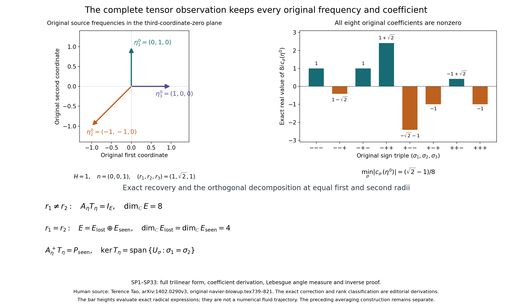
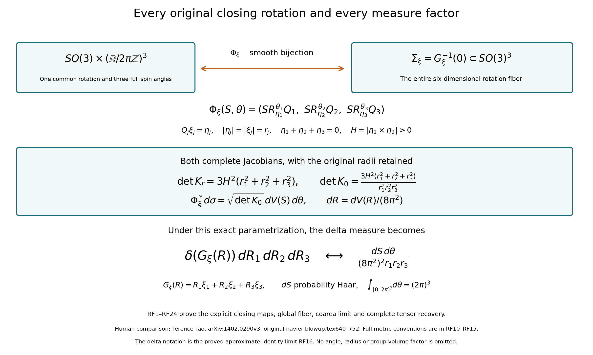
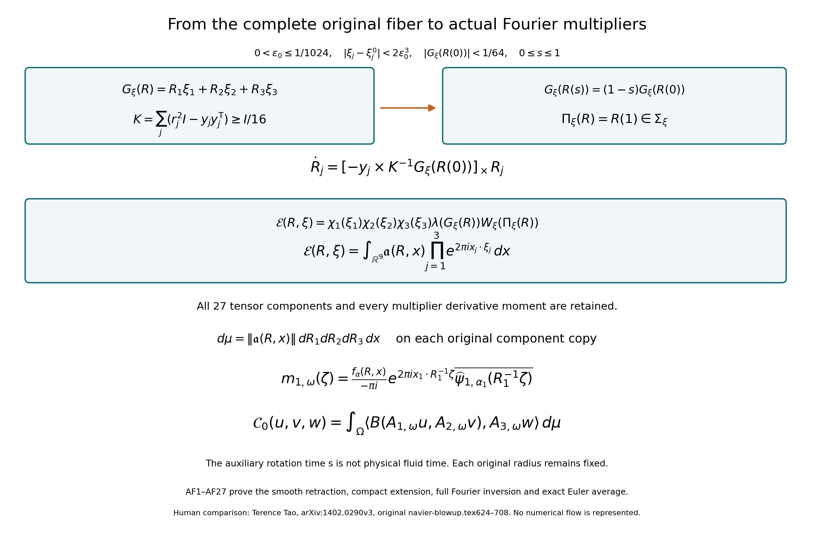
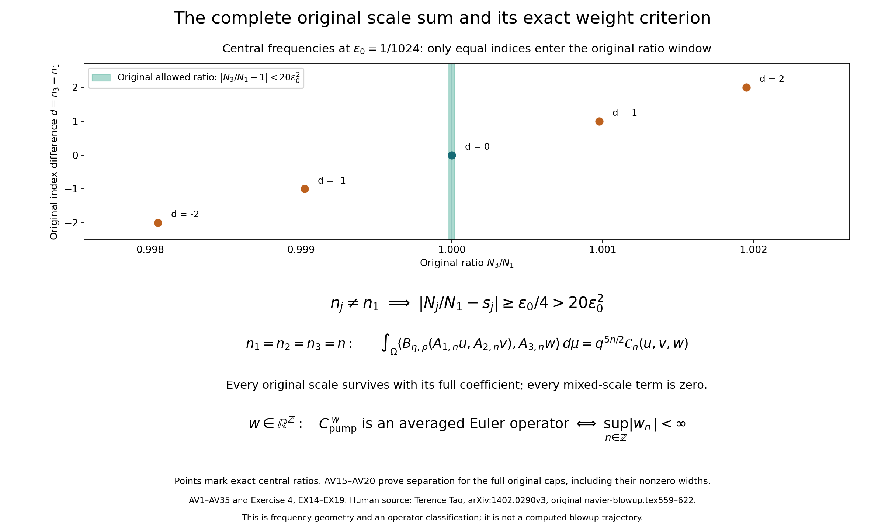

# The complete original cascade averaging theorem

Every original local cascade in the stated small-parameter range can be
written as an average of the original Euler operator. This lesson proves
the whole construction from Terence Tao's
[arXiv:1402.0290v3](https://arxiv.org/abs/1402.0290v3),
original navier-blowup.tex, lines 501–826. Every frequency, scale,
rotation, dilation, Fourier coefficient and measure factor remains explicit.

The proof begins with the exact tensor observation at a closed frequency
triangle. It constructs the full rotation fiber and its measure, a smooth
extension and all Fourier multipliers, then the complete scale sum and the
maps back to the original real annular fields. Source coefficient and index
corrections are stated next to their full derivations.

The operator, Fourier and physical conventions are those of
[lesson 37](the-original-averaged-equation-and-its-full-energy-and-force-maps.md).
The local-cascade fields, exact pump and full real/complex composition
formulas are proved in
[lesson 38](the-original-local-cascade-and-its-full-viscous-dynamics.md).
References to CC or to that lesson's EX formulas identify those proofs.
All SP, RF, AF, AV and current EX formulas are proved below.

Five solved exercises calculate the full closing measure and its moments,
the smallest possible recovery kernel, the exact retraction derivative,
the sharp scale-weight class for the original pump and the stability of
its actual original-viscosity flows. The averaging theorem is one ingredient
of the later blowup construction; the finite-time dynamics still need their
own proof.

## SP1. Keep the original triangle, orientation and trilinear form

Let the original real frequencies satisfy
\[
\eta_1+\eta_2+\eta_3=0,\qquad
H=|\eta_1\times\eta_2|>0,\qquad r_j=|\eta_j|>0.
\tag{SP1}
\]
No frequency is replaced by a unit vector. Define the auxiliary frame, retaining every original radius,
\[
n=\frac{\eta_1\times\eta_2}{H},\qquad
w_j=\frac{\eta_j\times n}{r_j},\qquad
E_j=\{Y\in\mathbb C^3:\eta_j\cdot Y=0\}.
\tag{SP2}
\]
Here a dot without a bar is the complex bilinear extension of the real Euclidean dot product. Norms of complex vectors and tensors use the Hermitian Euclidean norm. Closure of the triangle implies \(\eta_3\cdot n=0\). Each pair \(n,w_j\) is a real orthonormal basis of the original perpendicular plane, hence a complex basis of \(E_j\).

The rotation about the oriented original axis \(\eta_j\) is specified on this plane by
\[
\begin{gathered}
R_{\eta_j}^{\theta}n=\cos\theta\,n+\sin\theta\,w_j,\qquad
R_{\eta_j}^{\theta}w_j=-\sin\theta\,n+\cos\theta\,w_j,\\
R_{\eta_j}^{\theta}\eta_j=\eta_j.
\end{gathered}
\tag{SP3}
\]
The second equality follows from
\((\eta_j/r_j)\times((\eta_j/r_j)\times n)=-n\).
These formulas define a real orthogonal determinant-one map on the full orthogonal basis and fix its angle and orientation exactly. They extend complex linearly, without any restriction on the magnitude of an input vector.

Retain the source trilinear expression and its actual angle function:
\[
\begin{gathered}
\Lambda_\eta(Y_1,Y_2,Y_3)
=(Y_1\cdot\eta_2)(Y_2\cdot Y_3)
+(Y_2\cdot\eta_1)(Y_1\cdot Y_3),\\
\Theta_\eta(\gamma)
=\Lambda_\eta(R_{\eta_1}^{\gamma_1}n,
R_{\eta_2}^{\gamma_2}n,R_{\eta_3}^{\gamma_3}n).
\end{gathered}
\tag{SP4}
\]
Both original summands and frequencies remain in every comparison below.

## SP2. Calculate all eight coefficients from both summands

The exact scalar products are
\[
\begin{gathered}
a=w_1\cdot\eta_2=-\frac{H}{r_1},\qquad
b=w_2\cdot\eta_1=\frac{H}{r_2},\\
d_{23}=w_2\cdot w_3
=\frac{r_1^2-r_2^2-r_3^2}{2r_2r_3},\qquad
d_{13}=w_1\cdot w_3
=\frac{r_2^2-r_1^2-r_3^2}{2r_1r_3}.
\end{gathered}
\tag{SP5}
\]
For the first two identities, use the scalar triple product and
\(n\cdot(\eta_1\times\eta_2)=H\); in particular
\((\eta_1\times n)\cdot\eta_2=-H\).
For the last two, the identity
\((\eta_j\times n)\cdot(\eta_k\times n)=\eta_j\cdot\eta_k\)
holds because \(n\) is unit and orthogonal to both frequencies. Squaring
\(\eta_2+\eta_3=-\eta_1\) and
\(\eta_1+\eta_3=-\eta_2\) gives the two full numerators.

Substitution of SP3 into both terms of SP4 gives
\[
\begin{aligned}
\Theta_\eta(\gamma)
={}&a\sin\gamma_1\bigl(\cos\gamma_2\cos\gamma_3
 +d_{23}\sin\gamma_2\sin\gamma_3\bigr)\\
&+b\sin\gamma_2\bigl(\cos\gamma_1\cos\gamma_3
 +d_{13}\sin\gamma_1\sin\gamma_3\bigr).
\end{aligned}
\tag{SP6}
\]
For each original angle, retain the exact expansions
\[
\cos\gamma=\frac12\sum_{\sigma=\pm1}e^{i\sigma\gamma},
\qquad
\sin\gamma=\frac1{2i}\sum_{\sigma=\pm1}\sigma e^{i\sigma\gamma}.
\]
The product of the two sine coefficients has the negative sign from
\(i^{-2}=-1\). Consequently the complete Fourier series is
\[
\begin{gathered}
\Theta_\eta(\gamma)=\sum_{\sigma\in\{-1,1\}^3}
c_\sigma(\eta)e^{i(\sigma_1\gamma_1+\sigma_2\gamma_2+\sigma_3\gamma_3)},\\
c_\sigma(\eta)=\frac1{8i}
\left[
-\frac{H}{r_1}\sigma_1(1-d_{23}\sigma_2\sigma_3)
+\frac{H}{r_2}\sigma_2(1-d_{13}\sigma_1\sigma_3)
\right].
\end{gathered}
\tag{SP7}
\]
This is the source's general coefficient formula with its original geometric scalar products evaluated exactly.

To classify its zeros, keep SP7 and prove the following additional identity:
\[
c_\sigma(\eta)=
\frac{H\sigma_1\sigma_2}{8i r_1r_2r_3}
(\sigma_1r_1-\sigma_2r_2)
\bigl[r_3+\sigma_3(\sigma_1r_1+\sigma_2r_2)\bigr].
\tag{SP8}
\]
Indeed the constant part of \(8i c_\sigma/H\) is
\((-\sigma_1r_2+\sigma_2r_1)/(r_1r_2)\), and its triple-sign part has numerator
\[
r_2d_{23}-r_1d_{13}=\frac{r_1^2-r_2^2}{r_3}.
\]
Expanding the full right side of SP8 gives precisely those two terms. This proves an identity for the original coefficient; it does not discard either source summand.

Noncollinearity in SP1 implies the strict triangle inequalities
\[
|r_1-r_2|<r_3<r_1+r_2.
\tag{SP9}
\]
For example equality in \(|\eta_1+\eta_2|\leq r_1+r_2\) would make the two original vectors positively collinear, by equality in Cauchy–Schwarz. Equality in the reverse inequality would make them negatively collinear. Both contradict \(H>0\).
The last bracket of SP8 is therefore nonzero for all eight sign triples: the absolute value of the signed sum of \(r_1,r_2\) is either \(r_1+r_2\) or \(|r_1-r_2|\), neither of which equals \(r_3\).
The other factor vanishes precisely when \(r_1=r_2\) and \(\sigma_1=\sigma_2\).
We have thus proved the exact condition
\[
\begin{gathered}
\text{all eight }c_\sigma(\eta)\ne0
\quad\Longleftrightarrow\quad r_1\ne r_2,\\
r_1=r_2\quad\Longrightarrow\quad
c_\sigma=0\ \Longleftrightarrow\ \sigma_1=\sigma_2.
\end{gathered}
\tag{SP10}
\]
The radius \(r_3\) need not differ from both other radii.

## SP3. Check the source base frequencies and provide a full neighborhood bound

At the actual source base point retain
\[
\eta_1^0=(0,1,0),\qquad
\eta_2^0=(-1,-1,0),\qquad
\eta_3^0=(1,0,0).
\tag{SP11}
\]
Then \(H=1\), \(n=(0,0,1)\), \((r_1,r_2,r_3)=(1,\sqrt2,1)\),
\(a=-1\), \(b=1/\sqrt2\), \(d_{23}=-1/\sqrt2\), \(d_{13}=0\).
The exact result is
\[
c_\sigma(\eta^0)
=\frac1{8i}
\left(-\sigma_1+\frac{\sigma_2}{\sqrt2}
-\frac{\sigma_1\sigma_2\sigma_3}{\sqrt2}\right),
\qquad
\min_\sigma|c_\sigma(\eta^0)|=\frac{\sqrt2-1}{8}.
\tag{SP12}
\]
For the minimum, when \(\sigma_1\sigma_3=1\) the last two terms cancel and the absolute numerator is one. When \(\sigma_1\sigma_3=-1\) it is \(|-\sigma_1+\sqrt2\,\sigma_2|\), whose two possible values are \(\sqrt2-1\) and \(\sqrt2+1\).

The original source's line 820 instead displays
\[
-\frac1{8i}
\left(-\sigma_1+\frac{\sigma_2}{\sqrt2}
+\frac{\sigma_1\sigma_2\sigma_3}{\sqrt2}\right)
+O(\epsilon_0).
\tag{SP13}
\]
Its limiting coefficient does not agree with its own general formula at lines 809–811. For example, at the base point and signs \((+,+,+)\), SP12 gives \(-1/(8i)\), while the displayed leading term SP13 gives \(-(\sqrt2-1)/(8i)\). This is a coefficient correction, not a failure of the required nonvanishing conclusion. Lines 814–815 also use a dot where the cross product in SP5 and source lines 810–811 is needed; a scalar dotted with \(\eta_j\) is not the expression being evaluated.

The nonvanishing can be made uniform with every neighborhood constant explicit. Suppose the original frequencies close as in SP1 and
\[
|\eta_j-\eta_j^0|\leq h,\qquad 0<h\leq\frac1{16}.
\tag{SP14}
\]
Triangle and reverse triangle inequalities give
\[
\begin{gathered}
H\geq1-(1+\sqrt2)h-h^2,\qquad
|r_1-r_2|\geq\sqrt2-1-2h,\\
r_1+r_2-r_3\geq\sqrt2-3h,\qquad
r_3-|r_1-r_2|\geq2-\sqrt2-3h,\\
r_1r_2r_3\leq(1+h)^2(\sqrt2+h).
\end{gathered}
\tag{SP15}
\]
For the first inequality, expand both perturbations in
\(\eta_1\times\eta_2-\eta_1^0\times\eta_2^0\);
the three errors have bounds \(\sqrt2 h,h,h^2\).
For all remaining inequalities use \(|r_j-r_j^0|\leq h\), retaining the sign \(r_2>r_1\), which follows from its displayed positive lower gap. The two strict triangle gaps in SP15 are positive for \(h\leq1/16\), as is its bound for \(H\).
The absolute value of the last SP8 bracket is at least the smaller of those two gaps, and the first factor is at least \(|r_1-r_2|\). Thus every coefficient obeys the original quantitative bound
\[
|c_\sigma(\eta)|\geq
\frac{\bigl[1-(1+\sqrt2)h-h^2\bigr]
(\sqrt2-1-2h)(2-\sqrt2-3h)}
{8(1+h)^2(\sqrt2+h)}>0.
\tag{SP16}
\]
This estimate keeps all original frequencies; no rescaled triangle replaces them.

## SP4. Construct the full tensor inverse for arbitrary input sizes

Let \(E=E_1\otimes_{\mathbb C}E_2\otimes_{\mathbb C}E_3\), of complex dimension eight. For signs \(\sigma_j=\pm1\), define
\[
v_{j,\sigma_j}=\frac{n-i\sigma_jw_j}{2},\qquad
U_\sigma=v_{1,\sigma_1}\otimes v_{2,\sigma_2}
\otimes v_{3,\sigma_3}.
\tag{SP17}
\]
For an arbitrary \(Y_j=\alpha_j n+\beta_jw_j\in E_j\),
\(\alpha_j=n\cdot Y_j\) and \(\beta_j=w_j\cdot Y_j\) are its actual complex coefficients. SP3 gives
\[
R_{\eta_j}^{\theta_j}Y_j
=\sum_{\sigma_j=\pm1}
v_{j,\sigma_j}(\alpha_j+i\sigma_j\beta_j)e^{i\sigma_j\theta_j}.
\tag{SP18}
\]
To verify both components, sum the terms for \(Y_j=n\) and \(Y_j=w_j\). They are respectively
\(\cos\theta_j n+\sin\theta_j w_j\) and
\(-\sin\theta_j n+\cos\theta_j w_j\); linearity gives the full formula with its original \(\alpha_j,\beta_j\).

Define a functional on simple tensors by
\[
\ell_\sigma(Y_1\otimes Y_2\otimes Y_3)
=\prod_{j=1}^3(\alpha_j+i\sigma_j\beta_j),
\tag{SP19}
\]
and extend linearly to \(E\). Each factor is linear in its own \(Y_j\), so the tensor functional is well-defined.
For a basis candidate \(v_{j,\tau_j}\), the factor equals
\((1+\sigma_j\tau_j)/2\).
It follows that
\[
\ell_\sigma(U_\tau)=\delta_{\sigma,\tau},\qquad
X=\sum_\sigma U_\sigma\ell_\sigma(X)\quad(X\in E).
\tag{SP20}
\]
Indeed the eight \(U_\sigma\) are linearly independent by these functionals; they form a basis in the eight-dimensional tensor space, proving the expansion.
Multilinearity, SP18 and SP7 also prove
\[
\Lambda_\eta(R_{\eta_1}^{\theta_1}Y_1,
R_{\eta_2}^{\theta_2}Y_2,R_{\eta_3}^{\theta_3}Y_3)
=\sum_\sigma c_\sigma\ell_\sigma(Y_1\otimes Y_2\otimes Y_3)
e^{i\sigma\cdot\theta}.
\tag{SP21}
\]
Here \(c_\sigma=\Lambda_\eta(v_{1,\sigma_1},v_{2,\sigma_2},v_{3,\sigma_3})\), because this is exactly the coefficient obtained by setting all \(\alpha_j=1,\beta_j=0\). Thus the coefficient in the actual rotated-input expression is the original SP7 coefficient, without an extra magnitude assumption.

When \(r_1\ne r_2\), define the actual tensor-valued kernel
\[
F_\eta(\theta)=
\sum_{\sigma\in\{-1,1\}^3}
\frac{U_\sigma e^{-i\sigma\cdot\theta}}{(2\pi)^3c_\sigma(\eta)}.
\tag{SP22}
\]
Integration uses the full Lebesgue measure \(d\theta_1d\theta_2d\theta_3\) on \([0,2\pi]^3\), not a probability measure. Since
\(\int_{[0,2\pi]^3}e^{i(\tau-\sigma)\cdot\theta}d\theta=(2\pi)^3\delta_{\sigma,\tau}\),
SP20–SP22 prove the complete original recovery identity
\[
\begin{aligned}
Y_1\otimes Y_2\otimes Y_3
={}&\int_{[0,2\pi]^3}F_\eta(\theta)\,
\Lambda_\eta(R_{\eta_1}^{\theta_1}Y_1,
R_{\eta_2}^{\theta_2}Y_2,R_{\eta_3}^{\theta_3}Y_3)
\,d\theta.
\end{aligned}
\tag{SP23}
\]
Every denominator, radius, orientation and input magnitude in this map is explicit.

The construction is smooth in every noncollinear closed triangle with \(r_1\ne r_2\): the cross product, positive square root, divisions by \(H,r_j,c_\sigma\), and finite exponential sum are smooth there. Differentiating these explicit formulas gives every local derivative. On a compact subset the same formulas bound all derivatives because their denominators have positive minima. SP16 provides a definite such lower bound near the original base frequencies.

For real \(\eta\), \(U_{-\sigma}=\overline{U_\sigma}\) and
\(c_{-\sigma}=\overline{c_\sigma}\). Pairing the opposite signs in SP22 shows that \(F_\eta(\theta)\) lies in the real tensor product for real \(\theta\).
Also
\[
\|v_{j,\sigma_j}\|=\frac1{\sqrt2},\quad
\|U_\sigma\|=\frac1{2\sqrt2},\quad
\|F_\eta(\theta)\|\leq
\frac{2\sqrt2}{(2\pi)^3\min_\sigma|c_\sigma|}.
\tag{SP24}
\]
The first identity follows by the Hermitian norm of \(n-i\sigma_jw_j\); the second uses the tensor norm, and the third sums all eight original coefficients. In particular the integral in SP23 is a genuine finite-dimensional Bochner integral.

## SP5. Prove the exact operator norms and the space defined by degeneracy

Keep the full Lebesgue \(L^2\) norm on the angle torus. Define the actual linear observation map
\[
T_\eta:E\longrightarrow L^2([0,2\pi]^3;\mathbb C),
\qquad
(T_\eta X)(\theta)=\sum_\sigma c_\sigma\ell_\sigma(X)e^{i\sigma\cdot\theta}.
\tag{SP25}
\]
For simple tensors this is exactly the rotated original trilinear expression SP21. Its range consists of a subspace of the eight indicated Fourier characters.
The vectors \(U_\sigma\) are Hermitian orthogonal: in any coordinate where two signs differ, the corresponding inner product is
\((n+i\sigma_jw_j)\cdot(n+i\sigma_jw_j)/4=0\).
Each tensor has squared norm \(1/8\), hence
\[
\|X\|^2=\frac18\sum_\sigma|\ell_\sigma(X)|^2,\qquad
\|T_\eta X\|_{L^2}^2=(2\pi)^3
\sum_\sigma|c_\sigma|^2|\ell_\sigma(X)|^2.
\tag{SP26}
\]
Orthogonality of the original angle characters proves the second identity, including its full measure factor. The singular values on the nonzero modes are exactly
\(\sqrt8(2\pi)^{3/2}|c_\sigma|\).

For \(r_1\ne r_2\), define
\[
A_\eta g=\int_{[0,2\pi]^3}F_\eta(\theta)g(\theta)d\theta
=\sum_\sigma U_\sigma\frac{\widehat g(\sigma)}{c_\sigma},
\quad
\widehat g(\sigma)=\frac1{(2\pi)^3}
\int_{[0,2\pi]^3}g(\theta)e^{-i\sigma\cdot\theta}d\theta.
\tag{SP27}
\]
This is bounded on the full angle \(L^2\) space: the eight coefficient functionals are bounded by Cauchy–Schwarz. Equations SP20 and SP25 give \(A_\eta T_\eta=I_E\), and \(T_\eta A_\eta\) is the orthogonal projection onto the span of the eight angle characters. Bessel's inequality, obtained directly by subtracting the finite orthogonal projection, and SP26 prove the exact norms
\[
\|T_\eta\|=\sqrt8(2\pi)^{3/2}\max_\sigma|c_\sigma|,
\qquad
\|A_\eta\|=\frac1{\sqrt8(2\pi)^{3/2}\min_\sigma|c_\sigma|}.
\tag{SP28}
\]
Equality in each bound is attained by an individual maximizing or minimizing mode. These are the full physical coefficient maps and their exact norms, not bounds on a replacement tensor.

At an original noncollinear triangle with \(r_1=r_2\), define instead
\[
\begin{gathered}
E_{\rm lost}=\operatorname{span}_{\mathbb C}
\{U_\sigma:\sigma_1=\sigma_2\},\qquad
E_{\rm seen}=\operatorname{span}_{\mathbb C}
\{U_\sigma:\sigma_1\ne\sigma_2\},\\
\mathcal R_{\rm seen}=\operatorname{span}_{\mathbb C}
\{e^{i\sigma\cdot\theta}:\sigma_1\ne\sigma_2\}.
\end{gathered}
\tag{SP29}
\]
Each has complex dimension four. The exact SP10 zeros and dual expansion SP20 imply
\[
\ker T_\eta=E_{\rm lost},\qquad
\operatorname{ran}T_\eta=\mathcal R_{\rm seen},\qquad
E=E_{\rm lost}\oplus E_{\rm seen},\qquad
E_{\rm lost}\perp E_{\rm seen}.
\tag{SP30}
\]
Construct \(F_\eta^+\) and \(A_\eta^+\) by the SP22 and SP27 formulas with only the four signs satisfying \(\sigma_1\ne\sigma_2\).
Every retained denominator is nonzero. The same character integrals prove
\[
A_\eta^+T_\eta=P_{\rm seen}
=\sum_{\sigma_1\ne\sigma_2}U_\sigma\ell_\sigma,\qquad
T_\eta A_\eta^+=P_{\mathcal R_{\rm seen}}.
\tag{SP31}
\]
Both displayed projections are the actual orthogonal projections for the declared full norms. The restricted map \(T_\eta:E_{\rm seen}\to\mathcal R_{\rm seen}\) is an isomorphism with inverse \(A_\eta^+\), and the exact norm calculation SP28 holds after restricting both extrema to these four signs.
This supplies the split exact sequence
\[
0\longrightarrow E_{\rm lost}
\xrightarrow{\ \iota\ }E
\xrightarrow{\ T_\eta\ }\mathcal R_{\rm seen}
\longrightarrow0,
\tag{SP32}
\]
whose right splitting is \(A_\eta^+|_{\mathcal R_{\rm seen}}\). Exactness follows from SP30; the composition with the splitting is the identity by SP31. Thus the failure of full recovery defines a precise four-dimensional space, with an exact recovery map for all remaining data.

All these subspaces and maps preserve real tensors. Complex conjugation takes \(U_\sigma\) to \(U_{-\sigma}\), preserving both sign conditions. For the lost space a real basis is given, for each \(\sigma=(+,+,+)\) and \((+,+,-)\), by
\[
U_\sigma+U_{-\sigma},\qquad
\frac{U_\sigma-U_{-\sigma}}{i}.
\tag{SP33}
\]
Linear independence follows by the four distinct complex basis coefficients in SP20; these four real tensors span the conjugation-fixed part. The same construction from \((+,-,+)\) and \((+,-,-)\) gives a real basis of the seen space. Hence the original real observation also has rank four and a four-dimensional kernel. No original complex or real data have been discarded by calling this loss a notation issue.

## RF1. Close the original frequencies by explicit rotations

Retain the original base vectors
\(\xi_1^0=(0,1,0)\), \(\xi_2^0=(-1,-1,0)\),
\(\xi_3^0=(1,0,0)\).
For the current construction take the original parameter and input region
\[
0<\epsilon_0\leq\frac1{1024},\qquad
h=2\epsilon_0^3,\qquad
|\xi_j-\xi_j^0|<h,\qquad r_j=|\xi_j|.
\tag{RF1}
\]
The vectors \(\xi_j\) need not close. Their original radii are never changed.
Define
\[
\begin{gathered}
b=\frac{r_2^2-r_1^2-r_3^2}{2r_1},\qquad
a=\sqrt{r_3^2-b^2},\\
\eta_1=(0,r_1,0),\quad
\eta_2=(-a,-r_1-b,0),\quad
\eta_3=(a,b,0).
\end{gathered}
\tag{RF2}
\]
The positive square root is well-defined. To see this and retain definite bounds, first \(|r_j-r_j^0|\leq h\), where
\((r_1^0,r_2^0,r_3^0)=(1,\sqrt2,1)\). Since \(h<1/128\),
\[
\begin{gathered}
|r_2^2-r_1^2-r_3^2|
\leq(4+2\sqrt2+3h)h<7h,\qquad
|b|<4h,\\
|r_3^2-b^2-1|\leq2h+17h^2<3h,\qquad
a^2>1-3h>0,\qquad |a-1|<3h.
\end{gathered}
\tag{RF3}
\]
The first bound expands the three square differences from their original values \(2,1,1\); the denominator \(2r_1\geq2(1-h)\) gives the second. The next follows from
\(|r_3^2-1|\leq(2+h)h\) and \(b^2\leq16h^2\).
The last follows by dividing \(|a^2-1|\) by \(a+1>1\).
The definitions now give exactly
\[
\begin{gathered}
\eta_1+\eta_2+\eta_3=0,\qquad|\eta_j|=r_j,\qquad
H=|\eta_1\times\eta_2|=r_1a>0,\\
|\eta_1-\xi_1^0|\leq h,\qquad
|\eta_3-\xi_3^0|<5h,\qquad
|\eta_2-\xi_2^0|<6h.
\end{gathered}
\tag{RF4}
\]
For \(\eta_2\), its squared norm is
\(a^2+(r_1+b)^2=r_3^2+r_1^2+2r_1b=r_2^2\).
Its displacement has components of absolute value at most \(3h,5h\), hence is less than \(\sqrt{34}h<6h\).
Thus SP14–SP16 apply with their actual neighborhood radius \(6h=12\epsilon_0^3<1/16\). In particular the eight original spin coefficients are nonzero with the complete bound supplied there.

There is also an explicit original-field rotation. Write
\[
u_j=\frac{\xi_j}{r_j},\quad v_j=\frac{\eta_j}{r_j},\quad
k_j=u_j\times v_j,\quad d_j=u_j\cdot v_j,\qquad
Q_j=I+[k_j]_\times+\frac{[k_j]_\times^2}{1+d_j},
\tag{RF5}
\]
where \([k]_\times x=k\times x\). The auxiliary unit directions retain their full original radii in this formula.
By RF4,
\(|u_j-v_j|\leq7h/(1-h)<8h\), so
\(d_j=1-|u_j-v_j|^2/2>1-32h^2>0\).
Every denominator in RF5 is positive. To verify the map exactly, put \(K=[k_j]_\times\). Then
\(K^{\mathsf T}=-K\),
\(K^2=k_jk_j^{\mathsf T}-|k_j|^2I\),
\(|k_j|^2=1-d_j^2\), and \(K^3=-|k_j|^2K\).
Put \(t=(1+d_j)^{-1}\). Expanding RF5 and its transpose gives
\[
Q_j^{\mathsf T}Q_j
=I+(2t-1)K^2+t^2K^4
=I+\left[\frac{2}{1+d_j}-1
-\frac{1-d_j^2}{(1+d_j)^2}\right]K^2=I.
\]
Also
\[
Ku_j=v_j-d_ju_j,\qquad K^2u_j=-(1-d_j^2)u_j,
\qquad Q_ju_j=v_j.
\]
The determinant is one: continuously move \(v_j\) to \(u_j\) along the shorter spherical arc, on which \(1+d_j>0\); RF5 remains orthogonal and reaches \(I\), and an orthogonal determinant cannot change between \(1\) and \(-1\) continuously. Consequently
\[
Q_j\in SO(3),\qquad Q_j\xi_j=\eta_j.
\tag{RF6}
\]
All these maps are smooth on the entire open region RF1 by their explicit formulas.

## RF2. Identify the entire six-dimensional fiber

For the original fixed \(\xi=(\xi_1,\xi_2,\xi_3)\), define
\[
\begin{gathered}
G_\xi:SO(3)^3\longrightarrow\mathbb R^3,\qquad
G_\xi(R)=R_1\xi_1+R_2\xi_2+R_3\xi_3,\\
\Sigma_\xi=G_\xi^{-1}(0).
\end{gathered}
\tag{RF7}
\]
Its full parametrization is
\[
\Phi_\xi(S,\theta)=
\bigl(SR_{\eta_1}^{\theta_1}Q_1,\,
SR_{\eta_2}^{\theta_2}Q_2,\,
SR_{\eta_3}^{\theta_3}Q_3\bigr),
\qquad (S,\theta)\in SO(3)\times(\mathbb R/2\pi\mathbb Z)^3.
\tag{RF8}
\]
Each image lies in the fiber, because its three frequency images are \(S\eta_j\), whose sum is zero.

Conversely let \(R\in\Sigma_\xi\) and \(y_j=R_j\xi_j\). The original lengths are \(r_j\), the three vectors close, and
\[
y_1\cdot y_2=\eta_1\cdot\eta_2
=\frac{r_3^2-r_1^2-r_2^2}{2}.
\tag{RF9}
\]
Their Gram matrices agree, and their cross products are nonzero by RF4 and RF9. There is a unique \(S\in SO(3)\) sending all \(\eta_j\) to \(y_j\). Explicitly use the two oriented orthonormal frames whose first vectors are respectively \(\eta_1/r_1\) and \(y_1/r_1\), whose second vectors are the components of \(\eta_2\) and \(y_2\) perpendicular to those first vectors divided by their common positive length, and whose third vectors are the cross products of the first two. If these frame matrices are \(E\) and \(Y\), then \(S=YE^{\mathsf T}\). It sends the first two original vectors correctly by RF9, and the third by closure. Uniqueness follows because a proper rotation agreeing on two independent vectors also agrees on their cross product.

The map \(S^{-1}R_jQ_j^{-1}\) fixes \(\eta_j\); its restriction to the oriented perpendicular plane is therefore a unique planar rotation. Its angle determines \(\theta_j\) modulo \(2\pi\), as in SP3. This proves bijectivity of RF8. The frame formulas and the sine and cosine entries of these planar rotations give a smooth inverse valued in \(SO(3)\times(\mathbb R/2\pi\mathbb Z)^3\); no global real angle branch is needed.
The differential metric below is nonsingular, proving that this is a diffeomorphism of the entire fiber, not only a parametrized subset. In particular every frequency-closing rotation is included.

## RF3. Specify the original group metric and Haar volume

On each \(SO(3)\), identify a tangent vector by its spatial angular velocity \(\alpha\in\mathbb R^3\):
\(\dot R=[\alpha]_\times R\).
The metric is \(|\alpha|^2\); use its product metric on \(SO(3)^3\).
Both left and right translations preserve this metric, since their angular maps are rotations. Its Riemannian volume \(dV\) is thus invariant. Its exact total volume is
\[
\operatorname{vol}(SO(3))=8\pi^2,\qquad dR=\frac{dV(R)}{8\pi^2},
\tag{RF10}
\]
where \(dR\) denotes probability Haar measure.
For completeness use Euler coordinates
\(R=R_{e_3}^{\alpha}R_{e_2}^{\beta}R_{e_3}^{\gamma}\),
with \(0\leq\alpha,\gamma<2\pi\) and \(0<\beta<\pi\).
Their angular tangent columns are
\(e_3,R_{e_3}^{\alpha}e_2,R_{e_3}^{\alpha}R_{e_2}^{\beta}e_3\).
The absolute determinant is \(\sin\beta\). These coordinates are one-to-one away from the two pole circles: \(Re_3\) determines \(\alpha,\beta\), and the remaining stabilizer rotation determines \(\gamma\). The omitted sets have volume zero, since local three-dimensional smooth volume assigns zero measure to those circles. Thus integrating \(\sin\beta\) gives
\((2\pi)\cdot2\cdot(2\pi)=8\pi^2\), proving RF10 with this specified metric.

At a point of the fiber put \(y_j=R_j\xi_j\). The full derivative and its Euclidean adjoint satisfy
\[
\begin{gathered}
DG_\xi(\alpha_1,\alpha_2,\alpha_3)
=\sum_{j=1}^3\alpha_j\times y_j,\\
DG_\xi DG_\xi^*
=\sum_{j=1}^3(r_j^2I-y_jy_j^{\mathsf T}),\qquad
J_\xi(R)=\sqrt{\det(DG_\xi DG_\xi^*)}.
\end{gathered}
\tag{RF11}
\]
For example the adjoint applied to \(z\) has entries \(y_j\times z\), by the scalar triple product, and
\((y_j\times z)\times y_j=r_j^2z-(y_j\cdot z)y_j\).
For nonzero \(z\), the quadratic form is
\(\sum_j|y_j\times z|^2>0\), because \(y_1,y_2\) are noncollinear. Thus the derivative is surjective. The finite-dimensional implicit function theorem now gives an embedded six-dimensional fiber and justifies its induced surface measure \(d\sigma\).

Let
\[
L_r=r_1^2+r_2^2+r_3^2,\qquad
K_r=\sum_{j=1}^3(r_j^2I-\eta_j\eta_j^{\mathsf T}),\qquad
K_0=\sum_{j=1}^3\left(I-\frac{\eta_j\eta_j^{\mathsf T}}{r_j^2}\right).
\tag{RF12}
\]
Then \(DG_\xi DG_\xi^*=SK_rS^{\mathsf T}\) on RF8. Direct determinants give
\[
\det K_r=3H^2L_r,\qquad
\det K_0=\frac{3H^2L_r}{r_1^2r_2^2r_3^2},\qquad
J_\xi=\sqrt{3H^2L_r}.
\tag{RF13}
\]
Here is the full determinant calculation. The common perpendicular vector \(n\) is an eigenvector of \(K_r\) with eigenvalue \(L_r\). On the common plane write \(M=\sum_j\eta_j\eta_j^{\mathsf T}\), a two-dimensional matrix with trace \(L_r\). The plane restriction of \(K_r\) is \(L_rI-M\), whose determinant is \(\det M\). Expanding that determinant as a sum of all two-column minors gives
\(\det M=\sum_{j<k}|\eta_j\times\eta_k|^2=3H^2\), since closure makes all three cross-product magnitudes \(H\).
For \(K_0\), its normal eigenvalue is three; the same plane calculation gives
\[
\sum_{j<k}\left|\frac{\eta_j}{r_j}\times\frac{\eta_k}{r_k}\right|^2
=H^2\left(\frac1{r_1^2r_2^2}+\frac1{r_1^2r_3^2}
+\frac1{r_2^2r_3^2}\right)
=\frac{H^2L_r}{r_1^2r_2^2r_3^2}.
\]
This proves both determinants, retaining every original radius.

## RF4. Derive the complete surface and delta measures

In the parametrization RF8, an angular variation \(\alpha\) of \(S\) and angle variations \(t_j\) produce the three original angular velocities
\(\alpha+t_j S\eta_j/r_j\).
Writing \(U\) for the matrix with these three unit-direction columns, the six-dimensional metric matrix is exactly
\[
\begin{pmatrix}3I&U\\U^{\mathsf T}&I\end{pmatrix}.
\tag{RF14}
\]
Its determinant is \(\det(3I-UU^{\mathsf T})=\det K_0>0\), by subtracting its off-diagonal blocks or the block determinant formula. Therefore the full induced surface measure pulls back to
\[
\Phi_\xi^*d\sigma=\sqrt{\det K_0}\,dV(S)\,d\theta_1d\theta_2d\theta_3.
\tag{RF15}
\]
The angle measure has its full length \(2\pi\) in every coordinate.

The notation involving a delta function can now be defined and proved without a formal change of variables. Fix any nonnegative smooth compactly supported \(\rho\) on \(\mathbb R^3\) with integral one, put \(\rho_\tau(z)=\tau^{-3}\rho(z/\tau)\), and let \(g\) be continuous on the compact group product. Then
\[
\lim_{\tau\downarrow0}\int_{SO(3)^3}
g(R)\rho_\tau(G_\xi(R))\,dR_1dR_2dR_3
=\frac1{(8\pi^2)^3}\int_{\Sigma_\xi}
\frac{g(R)}{J_\xi(R)}\,d\sigma(R).
\tag{RF16}
\]
To prove the measure factor, take local coordinates \((z,t)\), with \(z\in\mathbb R^6\) along the fiber and \(t=G_\xi(R)\in\mathbb R^3\), allowed by the surjective derivative RF11. If the metric matrix in these coordinates is \(G\), its lower-right inverse block is the Gram matrix of the gradients of the three coordinates \(t\), namely \(DG_\xi DG_\xi^*\). The block determinant identity therefore gives
\(\det G=\det G_{zz}/\det(DG_\xi DG_\xi^*)\).
Thus the volume at \(t=0\) is the fiber volume in \(z\) divided by \(J_\xi\), times \(dt\). Continuity in \(t\), compact support of the local coordinate cutoff and the integral-one approximate identity give this same limit in each chart. A finite smooth partition in a neighborhood of the compact fiber combines the chart identities. Its complementary compact set has \(|G_\xi|\) bounded away from zero, so contributes zero for sufficiently small \(\tau\). This proves RF16 and its independence of the chosen approximate identity. It also proves the formula for each component of a continuous tensor-valued \(g\).

Combining RF10, RF13 and RF15 gives the exact more explicit identity
\[
\begin{aligned}
&\int_{SO(3)^3}\delta(G_\xi(R))g(R)\,dR_1dR_2dR_3\\
&\qquad=
\frac1{(8\pi^2)^2r_1r_2r_3}
\int_{SO(3)}\int_{[0,2\pi]^3}
g(\Phi_\xi(S,\theta))\,d\theta\,dS .
\end{aligned}
\tag{RF17}
\]
The left side is exactly the limit RF16, and \(dS\) is probability Haar measure. The cancellation of the two computed Jacobians is the exact identity
\(\sqrt{\det K_0}/\sqrt{\det K_r}=1/(r_1r_2r_3)\); both determinants remain explicitly available in RF13.
In particular the total delta mass is
\[
\int_{SO(3)^3}\delta(G_\xi(R))\,dR_1dR_2dR_3
=\frac{(2\pi)^3}{(8\pi^2)^2r_1r_2r_3}
=\frac1{8\pi r_1r_2r_3}.
\tag{RF18}
\]
No original angle or Haar-volume factor has been suppressed.

## RF5. Attach the exact tensor inverse inside the required rotation region

We require only rotations that nearly fix the original base frequencies. Choose the explicit positive number and smooth bump
\[
\begin{gathered}
q_*=\frac{\epsilon_0^2}{16},\qquad
\zeta(S)=
\begin{cases}
\exp[-1/(q_*^2-\|S-I\|_{\mathrm F}^2)],
&\|S-I\|_{\mathrm F}<q_*,\\
0,&\|S-I\|_{\mathrm F}\geq q_*,
\end{cases}\\
Z=\int_{SO(3)}\zeta(S)dS>0,\qquad \beta(S)=\zeta(S)/Z.
\end{gathered}
\tag{RF19}
\]
Here \(\|\cdot\|_{\mathrm F}\) is the Frobenius matrix norm. The bump is smooth, including on its support boundary, because every boundary derivative is a polynomial in reciprocal positive powers times its exponential, which tends to zero faster than any power. Its value at \(I\) is positive and it is positive on an open neighborhood, so \(Z>0\); compactness gives finiteness. Both the original \(Z\) and the divided weight are retained, and \(\int\beta\,dS=1\) follows directly.

On the support of \(\beta\), every angle in RF8 gives
\[
\begin{aligned}
|R_j\xi_j^0-\xi_j^0|
&\leq|\xi_j^0-\xi_j|+|S\eta_j-\eta_j|
+|\eta_j-\xi_j^0|\\
&<7h+2q_*
=14\epsilon_0^3+\frac{\epsilon_0^2}{8}
<\frac{\epsilon_0^2}{4}.
\end{aligned}
\tag{RF20}
\]
The first term uses exact preservation of length by \(R_j\), and the middle term uses \(r_j<2\) and the operator norm bounded by the Frobenius norm. The last strict inequality follows from \(14/1024+1/8<1/4\). Thus this whole supported fiber lies in the precise original source rotation region, with all three spin angles unrestricted.

Let \(F_\eta(\theta)\) be the complete real tensor kernel SP22 for the actual \(\eta\) from RF2. Let
\(\mathcal Q^{-1}=Q_1^{-1}\otimes Q_2^{-1}\otimes Q_3^{-1}\).
On the entire fiber define two explicit smooth tensor functions by its unique RF8 coordinates:
\[
\begin{gathered}
W_\xi(\Phi_\xi(S,\theta))
=(8\pi^2)^2r_1r_2r_3\,\beta(S)
\,\mathcal Q^{-1}F_\eta(\theta),\\
W_\xi^{\rm surf}(\Phi_\xi(S,\theta))
=\frac{\beta(S)\mathcal Q^{-1}F_\eta(\theta)}
{8\pi^2\sqrt{\det K_0}}.
\end{gathered}
\tag{RF21}
\]
Smoothness follows from the proved smooth inverse of RF8, RF5, SP22 and the positive determinants. Their supports satisfy RF20.
For arbitrary original vectors \(X_j\in\xi_j^\perp\otimes\mathbb C\), the exact original tensor identity is
\[
\begin{aligned}
X_1\otimes X_2\otimes X_3
={}&\int_{\Sigma_\xi}W_\xi^{\rm surf}(R)
\Lambda_{R_1\xi_1,R_2\xi_2,R_3\xi_3}
(R_1X_1,R_2X_2,R_3X_3)\,d\sigma(R).
\end{aligned}
\tag{RF22}
\]
Equivalently, with the delta integral interpreted by RF16, it is
\[
\begin{aligned}
X_1\otimes X_2\otimes X_3
={}&\int_{SO(3)^3}\delta(G_\xi(R))W_\xi(R)
\Lambda_{R_1\xi_1,R_2\xi_2,R_3\xi_3}
(R_1X_1,R_2X_2,R_3X_3)\,dR_1dR_2dR_3 .
\end{aligned}
\tag{RF23}
\]
For a function specified on the fiber, the last expression means the right side of RF16 with those fiber values; any continuous extension to a neighborhood has that same limit. No particular ambient extension is assumed to construct the later Fourier multipliers.

To prove both identities, set \(Y_j=Q_jX_j\in\eta_j^\perp\otimes\mathbb C\). The complete source trilinear expression is invariant under a common proper rotation, since each of its three dot products is preserved. Hence on RF8 its actual value is
\[
\Lambda_{\eta_1,\eta_2,\eta_3}
(R_{\eta_1}^{\theta_1}Y_1,
 R_{\eta_2}^{\theta_2}Y_2,
 R_{\eta_3}^{\theta_3}Y_3).
\tag{RF24}
\]
Inserting RF15 and the surface formula in RF21 gives the full angle integral SP23 and the factor
\(dV(S)/(8\pi^2)=dS\).
The angle integral is \(Y_1\otimes Y_2\otimes Y_3\);
\(\mathcal Q^{-1}\) returns the original \(X_1\otimes X_2\otimes X_3\);
integrating \(\beta\) gives one. This proves RF22. Alternatively RF17 cancels precisely the prefactor \((8\pi^2)^2r_1r_2r_3\) of RF21 and gives the same proof of RF23.
All original tensor domains and inverse rotations are thus explicit.

The third argument in RF24 uses the third angle and third closing rotation. In the original source's line 734, the second angle and second closing rotation are printed in that third slot. Substituting the actual RF8 maps proves the corrected third argument exactly; it is not an independent choice of convention.

## AF1. Construct a definite neighborhood of the entire original fiber

Keep RF1, its original \(\epsilon_0\), \(h=2\epsilon_0^3\), original \(\xi_j\), radii \(r_j\), and closing maps \(Q_j\). For arbitrary \(R=(R_1,R_2,R_3)\in SO(3)^3\), put
\[
y_j=R_j\xi_j,\qquad z=G_\xi(R)=y_1+y_2+y_3,\qquad
K(R,\xi)=\sum_{j=1}^3(r_j^2I-y_jy_j^{\mathsf T}).
\tag{AF1}
\]
This is the exact derivative Gram matrix, including away from the fiber.
If \(|z|\leq1/64\), it has the definite bound
\[
K(R,\xi)\geq\frac1{16}I,\qquad
\|K(R,\xi)^{-1}\|_{\rm op}\leq16.
\tag{AF2}
\]
Here and below inequalities between real symmetric matrices mean inequalities of their quadratic forms.

To prove AF2 without a prospective nondegeneracy assumption, use
\[
y_1\cdot y_2=\frac{r_3^2-r_1^2-r_2^2}{2}
-z\cdot y_3+\frac{|z|^2}{2}.
\tag{AF3}
\]
The original radius estimates give
\[
r_1\geq63/64,\qquad r_2\geq11/8,\qquad r_j<2,
\qquad
\left|\frac{r_3^2-r_1^2-r_2^2}{2}\right|\leq1+4h.
\]
Indeed its difference from \(-1\) is bounded by
\((4+2\sqrt2+3h)h/2<4h\), as in RF3. Since \(h<1/128\), AF3 implies
\[
|y_1\cdot y_2|\leq1+4h+2/64+1/(2\cdot64^2)<9/8,
\]
and consequently
\[
|y_1\times y_2|^2
\geq(63/64)^2(11/8)^2-(9/8)^2>\frac12.
\tag{AF4}
\]
The sum of the first two terms of \(K\) has normal eigenvalue \(r_1^2+r_2^2\). On their plane its two positive eigenvalues have product \(|y_1\times y_2|^2\) and sum \(r_1^2+r_2^2<8\). Its smaller eigenvalue is therefore at least \((1/2)/8=1/16\). The third term of \(K\) is positive semidefinite. This proves AF2.

## AF2. Close the original frequency sum by an actual smooth rotation flow

Fix an initial pair \((R^0,\xi)\) with \(|G_\xi(R^0)|<1/64\), and retain its full defect
\(z_0=G_\xi(R^0)\).
For \(0\leq s\leq1\), solve the actual matrix equations
\[
\begin{gathered}
\frac{dR_j(s)}{ds}=[\alpha_j(s)]_\times R_j(s),\qquad
R_j(0)=R_j^0,\\
y_j(s)=R_j(s)\xi_j,\qquad
\alpha_j(s)=-y_j(s)\times K(R(s),\xi)^{-1}z_0.
\end{gathered}
\tag{AF5}
\]
The auxiliary time \(s\) is not the physical Navier–Stokes time. This equation changes the actual rotations and keeps every original \(\xi_j\) and radius fixed.
Its coefficients are smooth in the stated open region by AF2. Local solutions are constructed by Picard iteration in matrix entries: on a compact neighborhood where the inverse is bounded, the right side and its first derivatives are bounded, and a sufficiently short time makes its integral map a contraction. The geometric series of successive differences converges to a differentiable solution. The usual bilinear difference estimate and Gronwall's inequality give uniqueness.

The solution stays in \(SO(3)\): differentiating \(R_j^{\mathsf T}R_j\) gives zero because \([\alpha_j]_\times\) is skew, and its determinant remains one by continuity. Its original frequency sum satisfies the exact identity
\[
\frac d{ds}G_\xi(R(s))
=-\sum_{j=1}^3
(r_j^2I-y_j(s)y_j(s)^{\mathsf T})K(R(s),\xi)^{-1}z_0
=-z_0.
\]
Thus
\[
G_\xi(R(s))=(1-s)z_0,\qquad
|\alpha_j(s)|\leq32|z_0|,\qquad
\|R_j(s)-R_j^0\|_{\rm op}\leq32s|z_0|.
\tag{AF6}
\]
The first equality prevents departure from the region where AF2 holds. The second uses \(r_j<2\); the third integrates the matrix velocity and \(\|R_j(s)\|_{\rm op}=1\). On any closed smaller initial-defect region, the solution remains in a compact subset where all coefficients are smooth and bounded. The same local contraction time therefore restarts it to \(s=1\). This proves actual existence and uniqueness on the entire displayed time interval.

Define the exact retraction
\[
\Pi_\xi(R^0)=R(1),\qquad
G_\xi(\Pi_\xi(R^0))=0,\qquad
G_\xi(R^0)=0\ \Longrightarrow\ \Pi_\xi(R^0)=R^0.
\tag{AF7}
\]
The last assertion follows because \(z_0=0\) makes every velocity in AF5 zero. The full joint map \((R^0,\xi)\mapsto\Pi_\xi(R^0)\) is smooth, with bounded derivatives of every fixed order on compact subsets of the stated region. Here is the needed dependence argument. Regard \(\xi,z_0\) as fixed parameters of AF5, and then compose with the smooth original map \(z_0=G_\xi(R^0)\). The first parameter derivative of its integral equation solves a linear Volterra equation with continuous bounded coefficients; its successive approximations converge on the same short intervals. Difference quotients converge to that solution by the integral remainder formula and Gronwall's inequality. For an order-\(m\) derivative, differentiation gives the same linear term applied to that derivative, plus the finite sum indexed by partitions of the \(m\) derivative directions of derivatives of the smooth vector field applied to the already constructed lower derivatives. All these lower terms are bounded on the compact set. The same linear construction and difference-quotient argument prove the next derivative and its bound. Induction, followed by finitely many interval restarts, proves the assertion at \(s=1\). This constructs all required derivative orders rather than assuming smooth dependence.

## AF3. Extend the actual supported tensor and retain its rotation support

An explicit scalar cutoff will be useful. Put
\[
\vartheta(t)=
\begin{cases}e^{-1/t},&t>0,\\0,&t\leq0,\end{cases}
\qquad
b(t)=\frac{\vartheta(1-t)}
{\vartheta(1-t)+\vartheta(t-1/4)}.
\tag{AF8}
\]
The denominator is positive for every real \(t\): simultaneous vanishing would require both \(t\geq1\) and \(t\leq1/4\). Thus \(b\) is smooth, equals one on \(t\leq1/4\), vanishes on \(t\geq1\), and lies in \([0,1]\). Smoothness of \(\vartheta\) across zero follows from its exponential boundary-derivative estimates, as in RF19.
To give a frequency cutoff with precisely the needed plateau, define
\[
\begin{gathered}
\chi_j(\xi_j)=
b\!\left(\frac{3}{5}\frac{|\xi_j-\xi_j^0|^2}{\epsilon_0^6}
-\frac7{20}\right),\\
\tau=\frac{\epsilon_0^2}{1024},\qquad
\lambda(z)=b(|z|^2/\tau^2).
\end{gathered}
\tag{AF9}
\]
If \(|\xi_j-\xi_j^0|\leq\epsilon_0^3\), the argument of \(b\) is at most \(1/4\), so \(\chi_j=1\).
If \(|\xi_j-\xi_j^0|\geq3\epsilon_0^3/2\), the argument is at least one, so \(\chi_j=0\).
Thus the supports are strictly inside the original open RF1 radius \(2\epsilon_0^3\).
Also \(\lambda(0)=1\), \(\lambda=1\) for \(|z|\leq\tau/2\), and \(\lambda=0\) for \(|z|\geq\tau<1/64\).

Let \(W_\xi\) be the actual smooth fiber tensor RF21, with all its original measure factors and its original bump \(\beta\). Define the ambient tensor
\[
\mathcal E(R,\xi)=
\left(\prod_{j=1}^3\chi_j(\xi_j)\right)
\lambda(G_\xi(R))\,W_\xi(\Pi_\xi(R)).
\tag{AF10}
\]
Use this formula where \(\xi\) is in RF1 and \(|G_\xi(R)|<1/64\), and set it to zero elsewhere. This defines a smooth function on \(SO(3)^3\times\mathbb R^9\): both cutoffs have supports strictly inside the formula's open domain and vanish with every derivative across their support boundaries. The full tensor \(W_\xi\) is jointly smooth in \(\xi\) and its fiber coordinates by the explicit RF2, RF5, RF8 and SP22 formulas, so its composition with AF7 is smooth. The frequency support is compact. Every derivative of every fixed order is bounded, since the remaining rotation variables range over a compact group.

If \(\mathcal E(R,\xi)\ne0\), then \(W_\xi(\Pi_\xi(R))\ne0\). By RF20 and AF6,
\[
\begin{aligned}
|R_j\xi_j^0-\xi_j^0|
&\leq|\Pi_\xi(R)_j\xi_j^0-\xi_j^0|
+32|G_\xi(R)|\,|\xi_j^0|\\
&<14\epsilon_0^3+\frac{\epsilon_0^2}{8}
+64\tau
\leq\left(\frac{14}{1024}+\frac18+\frac1{16}\right)
\epsilon_0^2
<\frac{\epsilon_0^2}{4}.
\end{aligned}
\tag{AF11}
\]
There is a uniform positive margin in the last inequality. Consequently the ambient tensor has compact rotation support inside the original source region of nearly fixing rotations, not merely inside the unrestricted group.
For every \(\xi_j\in B(\xi_j^0,\epsilon_0^3)\), its exact fiber restriction is
\[
\mathcal E(R,\xi)=W_\xi(R)\qquad(G_\xi(R)=0),
\tag{AF12}
\]
because both cutoffs equal one there and the retraction fixes the fiber. The full original tensor identity RF23 therefore holds with this actual smooth ambient extension.

## AF4. Separate all nine original frequency coordinates

Use the original \(2\pi\) Fourier convention in all nine frequency variables. For \(x=(x_1,x_2,x_3)\in\mathbb R^9\), define
\[
\begin{gathered}
\mathfrak a(R,x)=\int_{\mathbb R^9}
\mathcal E(R,\xi)e^{-2\pi i\sum_{j=1}^3x_j\cdot\xi_j}\,d\xi,\\
\mathcal E(R,\xi)=\int_{\mathbb R^9}
\mathfrak a(R,x)\prod_{j=1}^3e^{2\pi i x_j\cdot\xi_j}\,dx .
\end{gathered}
\tag{AF13}
\]
Both formulas are componentwise in the original \(27\)-dimensional tensor space.
The second is the genuine Fourier inverse of this smooth compactly supported function. To verify the convergence needed below, for every integer \(N\geq0\) integration by parts gives
\[
\begin{gathered}
(1+4\pi^2|x|^2)^N\mathfrak a(R,x)
=\int_{\mathbb R^9}(1-\Delta_\xi)^N
\mathcal E(R,\xi)e^{-2\pi i x\cdot\xi}\,d\xi,\\
(1-\Delta_\xi)^N
=\sum_{\ell=0}^N\binom N\ell(-1)^\ell\Delta_\xi^\ell,\qquad
A_N=\sup_R\int_{\mathbb R^9}
\|(1-\Delta_\xi)^N\mathcal E(R,\xi)\|\,d\xi<\infty,\\
\|\mathfrak a(R,x)\|\leq
A_N(1+4\pi^2|x|^2)^{-N}.
\end{gathered}
\tag{AF14}
\]
There are no boundary terms, since the complete extension is smooth with compact frequency support. Every original \(4\pi^2\), sign and binomial coefficient remains. Applying the same integration by parts to any fixed rotation derivative gives the corresponding rapid decay with its own finite full derivative integral.
In particular, for every \(k\geq0\) and integer \(N\) with \(2N>k+9\),
\[
\int_{SO(3)^3}\int_{\mathbb R^9}
(1+|x|)^k\|\mathfrak a(R,x)\|\,dx\,dR
\leq A_N\int_{\mathbb R^9}
\frac{(1+|x|)^k}{(1+4\pi^2|x|^2)^N}\,dx<\infty.
\tag{AF15}
\]
The integral is finite at zero; at infinity its polar radial integrand is bounded by a constant times \(r^{k+8-2N}\), with exponent less than \(-1\).
This proves absolute Fourier convergence. For completeness, multiply the transform by \(e^{-\pi\delta|x|^2}\). Its inverse is the convolution of \(\mathcal E\) with the integral-one Gaussian
\(\delta^{-9/2}e^{-\pi|\xi|^2/\delta}\), as follows by the product of the nine one-dimensional Gaussian integrals. That convolution tends uniformly to \(\mathcal E\) by uniform continuity and Gaussian tails. The absolutely convergent transform integral tends to the second AF13 formula by dominated convergence as \(\delta\downarrow0\). This proves the required inverse identity.

## AF5. Construct the finite positive measure and every original multiplier moment

Fix any three original complex Schwartz vector fields \(\psi_j\) whose Fourier transforms have support in \(B(\xi_j^0,\epsilon_0^3)\), with the source Fourier convention. For \(\alpha_j\in\{1,2,3\}\), set
\[
h_{j,\alpha_j}(\xi)=\overline{\widehat\psi_{j,\alpha_j}(\xi)}.
\tag{AF16}
\]
These are the full original components, without a size or polarization replacement. They are smooth with the stated compact supports. Define the finite positive measure space
\[
\begin{gathered}
\Omega=SO(3)^3\times\mathbb R^9\times\{1,2,3\}^3,\\
d\mu(R,x,\alpha)=\|\mathfrak a(R,x)\|\,dR_1dR_2dR_3\,dx
\quad\text{on each of the 27 component copies},\\
f_\alpha(R,x)=
\begin{cases}
\mathfrak a_\alpha(R,x)/\|\mathfrak a(R,x)\|,&
\|\mathfrak a(R,x)\|>0,\\
0,&\|\mathfrak a(R,x)\|=0 .
\end{cases}
\end{gathered}
\tag{AF17}
\]
Equation AF15 proves \(\mu(\Omega)<\infty\), including the factor 27. Every \(f_\alpha\) is measurable and satisfies \(|f_\alpha|\leq1\).
For each \(\omega=(R,x,\alpha)\), define the actual scalar symbols in the output frequency of its rotation:
\[
\begin{gathered}
m_{1,\omega}(\zeta)
=\frac{f_\alpha(R,x)}{-\pi i}
e^{2\pi i x_1\cdot R_1^{-1}\zeta}
h_{1,\alpha_1}(R_1^{-1}\zeta),\\
m_{j,\omega}(\zeta)
=e^{2\pi i x_j\cdot R_j^{-1}\zeta}
h_{j,\alpha_j}(R_j^{-1}\zeta),\qquad j=2,3.
\end{gathered}
\tag{AF18}
\]
The factor \(1/(-\pi i)\) is retained explicitly to match the original Euler Fourier trilinear coefficient. Every dilation is exactly one.
Their complete supports are
\[
\operatorname{supp}m_{j,\omega}
\subset R_j\operatorname{supp}\widehat\psi_j
\subset B(R_j\xi_j^0,\epsilon_0^3),\qquad
r_j^0-\epsilon_0^3\leq|\zeta|\leq r_j^0+\epsilon_0^3.
\tag{AF19}
\]
The last radii are the original base lengths \(r_j^0=|\xi_j^0|\), not the varying \(r_j=|\xi_j|\) used in the extension. Rotations preserve radius exactly. No asserted post-rotation ball has silently been recentered.

Use the complete Euclidean derivative-tensor seminorm
\(\|m\|_k=\sup_{\zeta\ne0}|\zeta|^k\|\nabla^k m(\zeta)\|\).
For each original component retain the finite constants
\[
H_{j,\alpha_j,k,\ell}
=\sup_{\xi\in\mathbb R^3}
|\xi|^k\|\nabla^{k-\ell}h_{j,\alpha_j}(\xi)\|,
\qquad 0\leq\ell\leq k.
\tag{AF20}
\]
Rotation is an isometry on derivative tensors and preserves the weighted radius. The full Leibniz rule therefore gives
\[
\begin{gathered}
\|m_{1,\omega}\|_k
\leq\frac1\pi\sum_{\ell=0}^k
\binom k\ell(2\pi|x_1|)^\ell H_{1,\alpha_1,k,\ell},\\
\|m_{j,\omega}\|_k
\leq\sum_{\ell=0}^k
\binom k\ell(2\pi|x_j|)^\ell H_{j,\alpha_j,k,\ell},
\qquad j=2,3.
\end{gathered}
\tag{AF21}
\]
Each derivative of the original exponential supplies the full factor \(2\pi iR_jx_j\), whose tensor norm is \(2\pi|x_j|\). Choosing which \(\ell\) derivatives fall on it gives precisely the binomial coefficient; the remaining derivatives act on the original component. The first symbol also retains \(|f_\alpha|/\pi\leq1/\pi\).
Multiplying the three displayed sums and integrating against the actual measure gives
\[
\begin{aligned}
&\int_\Omega\prod_{j=1}^3\|m_{j,\omega}\|_{k_j}\,d\mu(\omega)\\
&\leq\frac1\pi\sum_{\alpha\in\{1,2,3\}^3}
\sum_{\ell_1=0}^{k_1}\sum_{\ell_2=0}^{k_2}\sum_{\ell_3=0}^{k_3}
\left(\prod_{j=1}^3\binom{k_j}{\ell_j}
(2\pi)^{\ell_j}H_{j,\alpha_j,k_j,\ell_j}\right)\\
&\qquad\cdot\int_{SO(3)^3}\int_{\mathbb R^9}
\|\mathfrak a(R,x)\|\prod_{j=1}^3|x_j|^{\ell_j}\,dx\,dR<\infty.
\end{aligned}
\tag{AF22}
\]
Finiteness follows from AF15 with \(k=k_1+k_2+k_3\). This proves every required original triple moment, not only the zeroth operator bound.

## AF6. Prove the actual single-scale averaging identity

Let \(A_{j,\omega}=m_{j,\omega}(D)\operatorname{Rot}_{R_j}\), with the exact symbols AF18. The complete single-scale rank-one trilinear form is
\[
\mathcal C_0(u,v,w)=
\langle u,\overline{\psi_1}\rangle
\langle v,\overline{\psi_2}\rangle
\langle w,\overline{\psi_3}\rangle,
\qquad
\langle u,\overline{\psi_j}\rangle
=\int_{\mathbb R^3}\widehat u(\xi)\cdot
\overline{\widehat\psi_j(\xi)}\,d\xi .
\tag{AF23}
\]
The pairing on the left is the original complex bilinear physical-space pairing; the last equality is Fourier inversion with the original conjugated test, not a change to a Hermitian operator convention.
Then the actual Euler operator \(B\), with its full Fourier trilinear coefficient \(-\pi i\), satisfies
\[
\mathcal C_0(u,v,w)
=\int_\Omega
\langle B(A_{1,\omega}u,A_{2,\omega}v),
A_{3,\omega}w\rangle\,d\mu(\omega)
\tag{AF24}
\]
for all original complex solenoidal \(H^{10}\) inputs.

First consider smooth inputs with compact Fourier support. The right side has the complete Fourier integrand
\[
-\pi i\,\delta(R_1\xi_1+R_2\xi_2+R_3\xi_3)
\prod_{j=1}^3m_{j,\omega}(R_j\xi_j)
\Lambda_{R_1\xi_1,R_2\xi_2,R_3\xi_3}
(R_1\widehat u(\xi_1),R_2\widehat v(\xi_2),
R_3\widehat w(\xi_3)).
\tag{AF25}
\]
All three rotation Jacobians are one. Integration on
\(\xi_1+\xi_2+\xi_3=0\) in the source convention means
\(\int d\xi_1d\xi_2\) with \(\xi_3=-\xi_1-\xi_2\); equivalently its delta is the ordinary three-dimensional delta with total mass one. This convention agrees with RF16; it is not the unweighted induced six-dimensional Euclidean surface measure.

Insert the three AF18 symbols and AF17 measure in AF25. The factors \(-\pi i\) and \(1/(-\pi i)\) cancel exactly. For each component, \(f_\alpha\|\mathfrak a\|=\mathfrak a_\alpha\), including at every zero. Integration in the full nine \(x\) coordinates gives \(\mathcal E_\alpha(R,\xi)\) by AF13. Summing the 27 components contracts \(\mathcal E(R,\xi)\) with the original tensor
\(h_1(\xi_1)\otimes h_2(\xi_2)\otimes h_3(\xi_3)\).
The factors \(h_j\) restrict every \(\xi_j\) to its original small ball. On this region AF12 and the complete RF23 tensor identity return exactly
\(\widehat u(\xi_1)\otimes\widehat v(\xi_2)\otimes\widehat w(\xi_3)\).
Its contraction with that original \(h\) tensor, integrated in \(\xi\), is the product AF23. This proves the full algebraic identity.

The preceding interchanges are absolute. The three original \(h_j\) supports form a fixed compact subset of \(\mathbb R^9\), and their values and the current smooth input Fourier functions are bounded there. The trilinear polynomial is bounded on that set and the compact rotation product. Formula RF18 bounds the delta mass uniformly on this input region because all three \(r_j\) have a positive lower bound. Finally AF15 bounds the \(x\)-integral of \(\|\mathfrak a\|\). These facts provide an integrable nonnegative majorant for all component integrals. One can also first use the approximate identities RF16; their masses are uniformly bounded on the compact input set, by the same local coarea coordinates and continuity, so dominated convergence gives precisely the same delta integral.

For general \(H^{10}_\sigma\) inputs, AF22 with all orders zero and the complete original Euler product estimate from lesson37 give an absolutely convergent \(H^9_\sigma\)-valued Bochner integral
\[
C_0(u,v)=\int_\Omega A_{3,\omega}^{\mathrm t}
B(A_{1,\omega}u,A_{2,\omega}v)\,d\mu(\omega).
\tag{AF26}
\]
The transpose is exactly the complex bilinear transpose from lesson38 EX1, including symbol reflection and reversed rotation. Strong measurability follows from the measurable phase, continuous rotation action and smooth dependence of the compact symbols; simple-function approximation and the integrable zeroth bound justify the integral. Dense smooth compact-Fourier solenoidal inputs extend AF24 by continuity of both sides. Pairing AF26 with every original \(H^{10}_\sigma\) test gives AF23, so it is the actual rank-one operator represented by that trilinear form.
This proves a complete finite-measure complex average of the original Euler operator, with all original symbol moments and dilation bounds verified.

The resulting original field is also explicit:
\[
C_0(u,v)=\langle u,\overline{\psi_1}\rangle
\langle v,\overline{\psi_2}\rangle\,P\overline{\psi_3}.
\tag{AF27}
\]
Indeed the real even symmetric Leray multiplier is self-transpose for the complex bilinear pairing, and it fixes every solenoidal test \(w\). Thus pairing AF27 with \(w\) gives exactly AF23. Its target is the one-dimensional span of the displayed original projected field (or zero when that field is zero). For every real \(s\), the complete norm bound is
\[
\|C_0(u,v)\|_{H^s}\leq
\|\psi_1\|_{H^{-10}}\|\psi_2\|_{H^{-10}}
\|P\overline{\psi_3}\|_{H^s}
\|u\|_{H^{10}}\|v\|_{H^{10}},
\]
by weighted Fourier Cauchy–Schwarz in each original pairing. The projected field has every Sobolev order because its original Fourier support is smooth, compact and away from zero. This identifies the averaged operator in all those targets without replacing its full formula.

## AV1. Keep both cutoff domains and the complete frequency-ratio average

Retain the original parameter \(0<\epsilon_0\leq1/1024\), \(q=1+\epsilon_0\), and the original source base vectors
\(\xi_1^0=(0,1,0)\), \(\xi_2^0=(-1,-1,0)\), \(\xi_3^0=(1,0,0)\).
Their lengths are \(s_1=1,s_2=\sqrt2,s_3=1\).
Use the actual scalar cutoff \(b\) constructed in AF8 and define two distinct functions with their correct domains:
\[
\varphi(t)=b(t^2/4)\quad(t\in\mathbb R),\qquad
\Phi(z)=b(|z|^2/4)\quad(z\in\mathbb R^3).
\tag{AV1}
\]
They equal one on the respective closed unit interval and ball, and vanish outside the respective radius-two sets. Both are smooth, by AF8. The source uses its scalar \(\varphi\) on a vector in line585; AV1 supplies the required three-dimensional map explicitly, while retaining the scalar function in the frequency-ratio formula.

For the original positive frequency magnitudes define
\[
\begin{gathered}
\eta(N_1,N_2,N_3)=
\prod_{j=2}^3
\varphi\!\left(\frac{N_j/N_1-s_j}{10\epsilon_0^2}\right),\\
F(y_2,y_3)=\eta(1,e^{y_2},e^{y_3}),\qquad
\phi(t_2,t_3)=\frac1{(2\pi)^2}
\int_{\mathbb R^2}F(y_2,y_3)e^{-i(t_2y_2+t_3y_3)}\,dy_2dy_3.
\end{gathered}
\tag{AV2}
\]
This \(\phi\) is a two-dimensional Fourier coefficient function, distinct from the three-dimensional \(\Phi\). Each ratio in the support lies between \(s_j-20\epsilon_0^2>0\) and \(s_j+20\epsilon_0^2\). Thus the logarithmic variables lie in a fixed compact rectangle and \(F\in C^\infty_c(\mathbb R^2)\).
Repeated integration by parts, with the complete factor \((1+|t|^2)^N\) and operator \((1-\Delta_y)^N\), proves rapid decay of \(\phi\). Fourier inversion, proved by the Gaussian argument AF13–AF15 with the present angular-frequency convention, gives exactly
\[
\begin{aligned}
\eta(N_1,N_2,N_3)
&=\int_{\mathbb R^2}
N_1^{-i(t_2+t_3)}N_2^{it_2}N_3^{it_3}
\phi(t_2,t_3)\,dt_2dt_3,\\
\int_{\mathbb R^2}|\phi(t)|(1+|t_2|+|t_3|)^k\,dt&<\infty
\qquad(k\geq0).
\end{aligned}
\tag{AV3}
\]
The factor \((2\pi)^{-2}\) in AV2 is essential for this measure convention.

For \(\tau\in\mathbb R\), keep the original multiplier
\[
D^{i\tau}(\xi)=|\xi|^{i\tau}\qquad(\xi\ne0).
\tag{AV4}
\]
Its order-\(k\) symbol seminorm is bounded by a polynomial in \(|\tau|\) of degree at most \(k\). Here is a complete derivative construction. Write \(r=|\xi|\), \(\omega=\xi/r\), and
\[
\partial_{a_1}\cdots\partial_{a_k}r^{i\tau}
=r^{i\tau-k}T_{k,a_1\ldots a_k}(\omega;\tau).
\tag{AV5}
\]
Start with \(T_0=1\). The exact recurrence is
\[
T_{k+1,a_1\ldots a_k b}
=(i\tau-k)\omega_bT_{k,a_1\ldots a_k}
+\sum_{c=1}^3(\delta_{bc}-\omega_b\omega_c)
\partial_{\omega_c}T_{k,a_1\ldots a_k}.
\tag{AV6}
\]
It follows by differentiating \(r\) and \(\omega_c\) directly. Every component is a polynomial in \(\omega\) and \(\tau\), of \(\tau\)-degree at most \(k\), with finitely many explicitly determined coefficients. Sum the absolute values of those coefficients over all tensor components; call this finite number \(M_k\). Since \(|\omega_c|\leq1\), the Euclidean tensor norm is at most the sum of its component absolute values, giving
\(\|D^{i\tau}\|_k\leq M_k(1+|\tau|)^k\).
This proves the required bound for every derivative order while preserving AV4.

Define a finite positive measure \(d\nu(t)=|\phi(t)|dt\), and its phase
\(\gamma(t)=\phi(t)/|\phi(t)|\) where \(\phi\ne0\), zero elsewhere.
Use the symbols
\(\gamma(t)|\xi|^{-i(t_2+t_3)}\),
\(|\xi|^{it_2}\), \(|\xi|^{it_3}\), with identity rotations and dilations.
AV3 and AV6 prove every triple symbol moment. The complete strong Euler product estimate from lesson37 therefore constructs the actual \(H^9_\sigma\)-valued complex average \(B_\eta\). Its trilinear formula is
\[
\langle B_\eta(u,v),w\rangle
=-\pi i\int_{\xi_1+\xi_2+\xi_3=0}
\eta(|\xi_1|,|\xi_2|,|\xi_3|)
\Lambda_\xi(\widehat u(\xi_1),\widehat v(\xi_2),\widehat w(\xi_3)).
\tag{AV7}
\]
For smooth inputs this follows from AV3 and absolute Fourier convergence; for all original \(H^{10}_\sigma\) inputs it follows by the strong integral bound and density. The frequency sets where one \(\xi_j=0\) have measure zero in the six integration variables, so no unassigned value affects this formula.

## AV2. Construct the actual three-dimensional scale cutoff

Define the original scale sum with the correctly typed cutoff:
\[
\rho(\zeta)=\sum_{n\in\mathbb Z}
\Phi\!\left(\frac{q^{-n}\zeta-\xi_1^0}{\epsilon_0^2}\right)
\qquad(\zeta\ne0).
\tag{AV8}
\]
At most one term is nonzero. In fact its radial support lies in
\([q^n(1-2\epsilon_0^2),q^n(1+2\epsilon_0^2)]\), and these intervals are disjoint because
\[
\frac{1+2\epsilon_0^2}{1-2\epsilon_0^2}<q
\quad\Longleftrightarrow\quad
(4+2\epsilon_0)\epsilon_0<1,
\tag{AV9}
\]
which holds in the original parameter range. The sum is locally finite on \(\mathbb R^3\setminus\{0\}\), hence smooth there, and \(0\leq\rho\leq1\).
Its complete seminorm bound is
\[
\|\rho\|_k\leq
(1+2\epsilon_0^2)^k\epsilon_0^{-2k}
\sup_{z\in\mathbb R^3}\|\nabla^k\Phi(z)\|.
\tag{AV10}
\]
On the \(n\)-th support, its derivative has the full factor
\(q^{-nk}\epsilon_0^{-2k}\), while \(|\zeta|^k\leq q^{nk}(1+2\epsilon_0^2)^k\).
There is no overlap loss because only one term is active. This proves AV10 including all scale factors. Reindexing also proves \(\rho(q^n\zeta)=\rho(\zeta)\).

The actual operator
\[
B_{\eta,\rho}(u,v)=B_\eta(\rho(D)u,v)
\tag{AV11}
\]
is a complex average of the original Euler operator: multiply its first AV4 symbol by \(\rho\). The full derivative-tensor Leibniz rule and AV3–AV10 prove all triple moments. In particular no assumed multiplier theorem is needed to justify this operation.
The complete trilinear integral is AV7 with the additional factor \(\rho(\xi_1)\).

## AV3. Prove exact separation of all original scale indices

Use the actual single-scale symbols \(m_{j,\omega}\) from AF18 and their finite measure AF17. They satisfy every moment, contain the original factor \(1/(-\pi i)\) in the first slot, and have the precise original supports AF19.
For \(\mu\)-almost every parameter their rotations obey AF11: outside that compact rotation support the ambient tensor is identically zero in every frequency, so its entire Fourier transform and the measure density are zero.
Define
\[
m_{j,\omega,n}(\zeta)=m_{j,\omega}(q^{-n}\zeta),\qquad
\widetilde m_{j,\omega}(\zeta)=\sum_{n\in\mathbb Z}m_{j,\omega,n}(\zeta).
\tag{AV12}
\]
For each fixed \(j\), their radial supports are disjoint:
\[
\frac{s_j+\epsilon_0^3}{s_j-\epsilon_0^3}<q
\quad\Longleftrightarrow\quad
(2+\epsilon_0)\epsilon_0^2<s_j.
\tag{AV13}
\]
The latter holds because \(s_j\geq1\). Therefore the sums are smooth away from zero and keep every full seminorm:
\[
\|\widetilde m_{j,\omega}\|_k\leq\|m_{j,\omega}\|_k.
\tag{AV14}
\]
The equality of each rescaled seminorm before summing follows from the derivative factor \(q^{-nk}\) and original weight \(|\zeta|^k\); disjoint supports give the bound for their sum. All triple moments remain integrable under the same finite measure.

Suppose a Fourier interaction has a nonzero contribution from the three indices \(n_1,n_2,n_3\) and from \(\eta\). Write its actual magnitudes as
\[
N_j=q^{n_j}(s_j+\delta_j),\qquad |\delta_j|\leq\epsilon_0^3.
\tag{AV15}
\]
For \(j=2,3\), if \(d=n_j-n_1\geq1\), then
\[
\frac{N_j}{N_1}-s_j
\geq\frac{\epsilon_0s_j-(q+s_j)\epsilon_0^3}{1+\epsilon_0^3}
\geq\frac{\epsilon_0-3\epsilon_0^3}{1+\epsilon_0^3}
\geq\frac{\epsilon_0}{4}.
\tag{AV16}
\]
Here \(q+s_j<3\); the numerator is at least \(\epsilon_0/2\) and the denominator at most two. If \(d\leq-1\), then
\[
s_j-\frac{N_j}{N_1}
\geq\frac{\epsilon_0s_j-(qs_j+1)\epsilon_0^3}
{q(1-\epsilon_0^3)}
\geq\frac{\epsilon_0-3\epsilon_0^3}{q(1-\epsilon_0^3)}
\geq\frac{\epsilon_0}{4}.
\tag{AV17}
\]
The same estimates apply, since \(qs_j+1<3\) and the denominator is below two.
But \(\eta\ne0\) requires
\(|N_j/N_1-s_j|<20\epsilon_0^2<\epsilon_0/4\).
Both alternatives are impossible. Hence
\[
\eta\ne0\text{ on this interaction}\quad\Longrightarrow\quad
n_1=n_2=n_3.
\tag{AV18}
\]
This proves the removal of every mixed-scale term.

When all three indices equal \(n\), their ratios instead obey
\[
\left|\frac{N_j}{N_1}-s_j\right|
\leq\frac{(1+s_j)\epsilon_0^3}{1-\epsilon_0^3}
<10\epsilon_0^2,\qquad j=2,3,
\tag{AV19}
\]
so \(\eta=1\). The rotation support AF11 and the first original cap give, on the first symbol support,
\[
|q^{-n}\zeta_1-\xi_1^0|
\leq|R_1\xi_1^0-\xi_1^0|+\epsilon_0^3
<\epsilon_0^2/4+\epsilon_0^3<\epsilon_0^2.
\tag{AV20}
\]
Thus the \(n\)-th AV8 term is one, and all other terms are zero by AV9. Therefore \(\rho=1\) too. Both original cutoff factors are exactly retained and evaluated, not removed without a support argument.

## AV4. Recover every original scale coefficient and prove the strong infinite sum

Keep the original \(L^2\) dilation \(D_\lambda u(x)=\lambda^{3/2}u(\lambda x)\) and rotations. Let
\(A_{j,\omega,n}=m_{j,\omega,n}(D)\operatorname{Rot}_{R_j}\),
\(A_{j,\omega}=m_{j,\omega}(D)\operatorname{Rot}_{R_j}\).
Their exact identity is
\[
A_{j,\omega,n}=D_{q^n}A_{j,\omega}D_{q^{-n}}.
\tag{AV21}
\]
Indeed the Fourier multiplier identity
\(D_{q^{-n}}m_{j,\omega,n}(D)=m_{j,\omega}(D)D_{q^{-n}}\)
retains the full argument \(q^{-n}q^n\xi=\xi\), and rotations commute with these scalar dilations.

The original Euler trilinear form scales by \(\lambda^{5/2}\), as proved with all Jacobians in lessons37–38. The ratios in \(\eta\) are homogeneous of degree zero, and AV8 has its exact discrete invariance. Thus \(B_{\eta,\rho}\) has the same trilinear scaling for \(\lambda=q^n\). Alternatively this follows directly from its complete AV7/AV11 Fourier integral: the six-dimensional frequency Jacobian is \(\lambda^6\), the three input amplitudes give \(\lambda^{-9/2}\), and \(\Lambda\) contributes \(\lambda\), with product \(\lambda^{5/2}\).

For the original scaled fields
\(\psi_{j,n}=D_{q^n}\psi_j\), set
\[
\mathcal C_n(u,v,w)
=\prod_{j=1}^3\langle u_j,\overline{\psi_{j,n}}\rangle,
\qquad(u_1,u_2,u_3)=(u,v,w).
\tag{AV22}
\]
Combining AV19–AV21 with the actual AF24 identity gives
\[
\int_\Omega
\langle B_{\eta,\rho}(A_{1,\omega,n}u,A_{2,\omega,n}v),
A_{3,\omega,n}w\rangle\,d\mu
=q^{5n/2}\mathcal C_n(u,v,w).
\tag{AV23}
\]
The scaled pairing is
\(\langle D_{q^{-n}}u_j,\overline{\psi_j}\rangle
=\langle u_j,\overline{D_{q^n}\psi_j}\rangle\)
by the original unitary dilation and its real coefficients. This proves the full right side, including its coefficient.

The complete cascade identity is consequently
\[
\begin{aligned}
&\sum_{n\in\mathbb Z}q^{5n/2}\mathcal C_n(u,v,w)\\
&\qquad=\int_\Omega
\langle B_{\eta,\rho}(\widetilde m_{1,\omega}(D)\operatorname{Rot}_{R_1}u,
\widetilde m_{2,\omega}(D)\operatorname{Rot}_{R_2}v),
\widetilde m_{3,\omega}(D)\operatorname{Rot}_{R_3}w\rangle\,d\mu .
\end{aligned}
\tag{AV24}
\]
Here is the required convergence proof. First truncate all three sums AV12 to \(|n|\leq N\). Expanding this finite trilinear expression produces only equal-index terms by AV18; AV23 identifies each such term. Each truncated symbol has the same seminorm bound AV14. Its multiplier converges strongly in every original \(H^s\), because at each nonzero frequency at most one index contributes and its uniform bound is the original \(\|m_{j,\omega}\|_0\). Weighted Fourier dominated convergence proves this statement.
The actual operator \(B_{\eta,\rho}:H^{10}\times H^{10}\to H^9\) is bounded by AV3, AV10 and the strong Euler estimate. Its third complex bilinear transpose acts boundedly on \(H^9\) with the same zeroth symbol bound. The bilinear difference identity and strong convergence therefore give convergence of the corresponding integrand in \(H^9\) for each \(\omega\). Its norm is bounded by a fixed multiple of
\(\prod_j\|m_{j,\omega}\|_0\|u\|_{H^{10}}\|v\|_{H^{10}}\), integrable by AF22. Dominated convergence in this separable Sobolev space proves that the right side of AV24 is an actual \(H^9\)-valued integral and is the strong limit of the finite cascade sums.

The original cascade series is also directly absolutely convergent in scalar duality and unconditionally convergent in \(H^9\). To verify this independently of the representation, retain the common annular bounds
\[
L_*=1-\epsilon_0^3>0,\qquad U_*=\sqrt2+\epsilon_0^3,
\qquad J_*=\left\lfloor\frac{\log(U_*/L_*)}{\log q}\right\rfloor+1.
\tag{AV25}
\]
All original scaled supports, including the reflected output support of \(P\overline{\psi_3}\), lie in these annuli. The complete CC1–CC7 proof applies with these actual bounds: its index-interval argument, both weight comparisons and finite-tail estimate use only \(0<L_*<U_*<\infty\) and the unchanged \(q\).
For input orders ten and output order nine, the retained exponent difference is \(10+10-9=11>5/2\). Thus its exact coefficient bound is finite and gives unconditional \(H^9\) convergence, with all original projected field norms. Complex bilinear pairing changes no absolute-value estimate. Pairing with the third \(H^{10}\) input then proves absolute scalar convergence by the same weighted sequence inequalities. This identifies the strong limit in AV24 with the original series rather than defining a different operator.

The original source line620 states the equal-index localized term without its \(q^{5n/2}\) coefficient. In the source convention, where \(C_0\) is an average of its \(B_{\eta,\rho,0}\) without the Euler coefficient \(-\pi i\), that term must be
\[
-\pi i\,q^{5n/2}\langle C_n(u,v),w\rangle.
\tag{AV26}
\]
The source decomposition at line592 already includes that scale coefficient. Equations AV21–AV23 derive it independently. In our AF18 representation the first symbol contains \(1/(-\pi i)\), so the precise resulting term is AV23. These are two fully stated coefficient conventions for the same original Euler integral.

The full moment estimates AF22 and AV14, followed by the exact composition formula in lesson38 EX7–EX10, now express AV24 as a complex average of the original Euler \(B\). Both intervening finite positive measures and every transformed symbol in that composition are retained. No dilation other than one has yet been used for this small-cap class.

## AV5. Return to every original annular field with its exact maps

Let \(\psi_j\) now be any of the original real Schwartz fields in the source definition, with
\[
\operatorname{supp}\widehat\psi_j\subset
K=\{\xi:1-2\epsilon_0\leq|\xi|\leq1+2\epsilon_0\}.
\tag{AV27}
\]
Construct a finite smooth frequency partition as follows. Put
\(r_*=\epsilon_0^3/8\) and \(d_*=\epsilon_0^3/(128\sqrt3)\).
Take all points \(\kappa\) of the lattice \(d_*\mathbb Z^3\) whose distance from \(K\) is at most \(r_*/2\). This set is finite, since \(K\) is bounded. Every point of \(K\) is within distance
\(\sqrt3\,d_*/2=\epsilon_0^3/256<r_*/2\)
of one of these lattice points. All such centers are nonzero.
For each center use the actual bump
\[
b_\kappa(\xi)=\vartheta(1-|\xi-\kappa|^2/r_*^2),
\qquad
D(\xi)=\sum_\kappa b_\kappa(\xi).
\tag{AV28}
\]
The function \(D\) is positive on a neighborhood of \(K\). Define
\(\widehat{\psi_{j,\kappa}}=(b_\kappa/D)\widehat\psi_j\)
there and zero elsewhere. This is a globally smooth compactly supported function: a neighborhood of the zero set of \(D\) is disjoint from \(K\), by compactness and positivity on \(K\), and the original \(\widehat\psi_j\) is zero outside \(K\). The quotient therefore meets the zero extension only where its numerator field is identically zero. The inverse Fourier fields are Schwartz, with
\[
\sum_\kappa\psi_{j,\kappa}=\psi_j,\qquad
\operatorname{supp}\widehat{\psi_{j,\kappa}}\subset \overline B(\kappa,r_*).
\tag{AV29}
\]
These pieces can be complex. Since the original \(\psi_j\) is real,
\(\sum_\kappa\overline{\psi_{j,\kappa}}=\psi_j\) also holds exactly.
The finite triple expansion of its trilinear cascade is consequently a sum of the original complex small-cap forms with these conjugated pieces.

For each triple of centers and each \(j\), retain the exact positive dilation
\[
\lambda_j=\frac{s_j}{|\kappa_j|}.
\tag{AV30}
\]
Choose a proper rotation \(S_j\) sending \(\kappa_j/|\kappa_j|\) to \(\xi_j^0/s_j\). Such a rotation can be constructed by completing each direction to a positively oriented orthonormal frame and multiplying the second frame by the transpose of the first. If the directions are not opposite, RF5 gives another explicit choice. Only finitely many rotations are needed, so no global direction chart or parameter measurability issue arises.
Define the actual maps and transformed fields
\[
T_j=\operatorname{Rot}_{S_j}D_{\lambda_j},\qquad
\psi'_j=T_j\psi_{j,\kappa_j},\qquad
\widehat{\psi'_j}(\zeta)=
\lambda_j^{-3/2}S_j\widehat{\psi_{j,\kappa_j}}
(\lambda_j^{-1}S_j^{-1}\zeta).
\tag{AV31}
\]
Every original amplitude, coordinate and radius factor is displayed. The centers satisfy
\(1-2\epsilon_0-r_*/2\leq|\kappa_j|\leq1+2\epsilon_0+r_*/2\);
in particular \(1/2<|\kappa_j|<2\).
Hence \(1/2<\lambda_j<3\), and
\[
\operatorname{supp}\widehat{\psi'_j}
\subset \overline B(\xi_j^0,\lambda_jr_*)
\subset B(\xi_j^0,3\epsilon_0^3/8)
\subset B(\xi_j^0,\epsilon_0^3).
\tag{AV32}
\]
The already completed AV24 construction applies to these actual transformed fields.

The precise comparison back to the original piece is
\[
\langle u_j,\overline{D_{q^n}\psi_{j,\kappa_j}}\rangle
=\langle T_ju_j,\overline{D_{q^n}\psi'_j}\rangle .
\tag{AV33}
\]
Rotations and the original \(L^2\) dilations are real unitary maps; they commute with \(D_{q^n}\), and their inverses and Fourier amplitudes are exactly those in AV31. Moving \(T_j\) simultaneously onto both factors therefore proves AV33. Thus the original piece is the already represented transformed cascade evaluated on \(T_1u,T_2v,T_3w\). If a represented input map is \(m_j(D)\operatorname{Rot}_{R_j}\), its exact composition is
\[
m_j(D)\operatorname{Rot}_{R_j}T_j
=m_j(D)\operatorname{Rot}_{R_jS_j}D_{\lambda_j}.
\tag{AV34}
\]
No map or amplitude has been discarded in returning to the original field. The dilations lie in the fixed compact interval \([1/3,3]\); the multiplier moment bounds are unchanged. Summing the finitely many cap triples on disjoint finite-measure spaces proves the required complex representation for the entire original basic cascade. Finite linear combinations are handled by retaining each original scalar coefficient in that component's first symbol and taking the finite disjoint union.

## AV6. Recover the original real probability representation

The original operator in AV27 is real on real fields, by its original real defining series, whose full Sobolev convergence was proved in lesson38. The actual complex representation just constructed has a finite positive measure, all source triple moments, proper rotations and compact positive dilation bounds.
Apply the complete realification construction in lesson38 EX1–EX6: split each original symbol into
\[
m_0(\xi)=\frac{m(\xi)+\overline{m(-\xi)}}2,\qquad
m_1(\xi)=\frac{m(\xi)-\overline{m(-\xi)}}{2i}.
\tag{AV35}
\]
Both preserve real fields and every seminorm is bounded by the original one. Expanding all eight terms and taking physical real parts keeps precisely signs \(+,-,-,-\) at indices \(000,110,101,011\). If the current finite measure has mass \(M>0\), retain four copies with measure \(d\mu/(4M)\), first symbol multiplied by its exact \(4M\) and sign, and unchanged second and third symbols. This has total mass one, recovers each original signed integral, and has all required moments. If \(M=0\), the represented operator is zero and the one-atom zero-first-symbol construction gives it.

Consequently every original local cascade with \(0<\epsilon_0\leq1/1024\) is an averaged Euler operator in the source's real probability-space sense, with the full original fields, scales and coefficients preserved by the proved maps. This conclusion concerns the representation theorem at source line478. It supplies no finite-time blowup trajectory by itself; the original viscous cascade dynamics at lines481–494 require their own complete proof.

## Four pictures of the complete original maps

SP1–SP33 supply the complete proof behind this picture. The original coordinates, coefficients and measure conventions are retained. The [reproducible source](../assets/original-cascade-spin-frame.py) and [vector rendering](../assets/original-cascade-spin-frame.svg) are included. The [exact expressions and evaluated data](../assets/original-cascade-spin-frame-data.json) are retained.

Human comparison: Tao, original navier-blowup.tex501–826. The pictures show the proved constructions and their editorial consequences; they do not simulate a singular fluid trajectory.

RF1–RF24 supply the complete proof behind this picture. The original coordinates, coefficients and measure conventions are retained. The [reproducible source](../assets/original-rotation-fiber-measure.py) and [vector rendering](../assets/original-rotation-fiber-measure.svg) are included.

Human comparison: Tao, original navier-blowup.tex501–826. The pictures show the proved constructions and their editorial consequences; they do not simulate a singular fluid trajectory.

AF1–AF27 supply the complete proof behind this picture. The original coordinates, coefficients and measure conventions are retained. The auxiliary rotation time is distinct from physical fluid time. The [reproducible source](../assets/original-full-cascade-averaging.py) and [vector rendering](../assets/original-fiber-extension.svg) are included.

Human comparison: Tao, original navier-blowup.tex501–826. The pictures show the proved constructions and their editorial consequences; they do not simulate a singular fluid trajectory.

AV1–AV35 and Exercise 4 supply the complete proof behind this picture. The original coordinates, coefficients and measure conventions are retained. The five points mark central ratios; the proof treats the full caps and every integer scale. The [reproducible source](../assets/original-full-cascade-averaging.py) and [vector rendering](../assets/original-cascade-scale-selection.svg) are included. The [exact expressions and evaluated data](../assets/original-cascade-scale-selection-data.json) are retained.

Human comparison: Tao, original navier-blowup.tex501–826. The pictures show the proved constructions and their editorial consequences; they do not simulate a singular fluid trajectory.

## Five solved exercises

### Exercise 1. Compute the original closing measure and its complete second moments

For a noncollinear closed reference triangle with original lengths \(r_j\), use the exact rotation-fiber measure RF17. Determine its total mass and the first and second moments of the actual rotated frequencies \(y_j=R_j\xi_j\).

**Solution.** Keep \(r_j>0\), the original reference vectors \(\eta_j\), and the complete delta measure
\[
d\mathcal M_\xi(R)=
\delta(R_1\xi_1+R_2\xi_2+R_3\xi_3)\,dR_1dR_2dR_3,
\qquad
M_\xi=\frac1{8\pi r_1r_2r_3}.
\tag{EX1}
\]
The total mass is RF18. Retain both this original measure and the associated probability measure \(d\mathbb P_\xi=d\mathcal M_\xi/M_\xi\). Under the full parametrization RF8, RF17 gives exactly
\[
d\mathbb P_\xi=dS\,
\frac{d\theta_1d\theta_2d\theta_3}{(2\pi)^3},
\qquad y_j=S\eta_j.
\tag{EX2}
\]
Thus the original frequencies depend only on the common Haar rotation; the three original spin angles remain independent uniform angles in this representation.

For any fixed vector \(a\), the vector \(\int Sa\,dS\) is fixed by every rotation, by left Haar invariance. A vector fixed by rotations by \(\pi\) around two perpendicular coordinate axes is zero. Therefore \(\mathbb E_\xi y_j=0\).
For any original vectors \(a,b\), the matrix
\(T=\int(Sa)(Sb)^{\mathsf T}dS\) satisfies \(QTQ^{\mathsf T}=T\) for every proper rotation \(Q\). The same three coordinate half-turns force every off-diagonal entry to vanish, and quarter-turns between coordinate axes force the diagonal entries to agree. Thus \(T=cI\), and its retained trace is \(3c=a\cdot b\). Consequently
\[
\begin{gathered}
\int y_j\,d\mathcal M_\xi=0,\qquad
\int y_jy_k^{\mathsf T}\,d\mathcal M_\xi
=\frac{\eta_j\cdot\eta_k}{24\pi r_1r_2r_3}I,\\
\eta_j\cdot\eta_k=
\begin{cases}
r_j^2,&j=k,\\
(r_\ell^2-r_j^2-r_k^2)/2,&\{j,k,\ell\}=\{1,2,3\}.
\end{cases}
\end{gathered}
\tag{EX3}
\]
The original mass factor is present in every unscaled integral. For arbitrary real test vectors \(a,b\), this also proves
\[
\mathbb E_\xi[(a\cdot y_j)(b\cdot y_k)]
=\frac{(a\cdot b)(\eta_j\cdot\eta_k)}3.
\tag{EX4}
\]
Summing EX3 over \(k\) gives zero because \(\sum_k\eta_k=0\), exactly as required by the pointwise original constraint \(\sum_k y_k=0\). These identities concern the constructed closing measure; no statistical law for a fluid trajectory is being assumed.

### Exercise 2. Find the smallest possible full tensor recovery kernel

Among all square-integrable tensor kernels \(K(\theta)\) that recover every original \(X\in E\) by integrating \(K(\theta)(T_\eta X)(\theta)\) against the full Lebesgue angle measure, prove that SP22 has the least squared norm. Compute the exact minimum at the original source base point.

**Solution.** Work first at a noncollinear original triangle with \(r_1\ne r_2\). The exact basis and observation formula SP20 and SP25 give
\[
T_\eta U_\sigma=c_\sigma e^{i\sigma\cdot\theta}.
\]
Hence the recovery constraint is equivalent to all eight exact conditions
\[
\int_{[0,2\pi]^3}K(\theta)e^{i\sigma\cdot\theta}\,d\theta
=\frac{U_\sigma}{c_\sigma}.
\tag{EX5}
\]
Necessity follows by testing each \(U_\sigma\); sufficiency follows by its full basis expansion. The orthogonal projection in tensor-valued \(L^2\) onto these eight characters is therefore forced to be exactly \(F_\eta\) from SP22. If \(K=F_\eta+H\), all eight corresponding Fourier coefficients of \(H\) vanish, so orthogonality gives
\[
\begin{gathered}
\int\|K(\theta)\|^2d\theta
=\int\|F_\eta(\theta)\|^2d\theta+\int\|H(\theta)\|^2d\theta,\\
\min_K\int\|K(\theta)\|^2d\theta
=\frac1{8(2\pi)^3}\sum_{\sigma\in\{-1,1\}^3}\frac1{|c_\sigma|^2}.
\end{gathered}
\tag{EX6}
\]
This proof uses only the finite orthogonal projection: no completeness assertion about an infinite Fourier series is needed. Equality holds precisely when \(H=0\) almost everywhere. Thus the minimum is unique in \(L^2\), and its smooth real representative is the explicit SP22 kernel.

At the original source triangle, the eight real values of \(8ic_\sigma\) consist of four numbers of absolute value one, two of absolute value \(\sqrt2-1\), and two of absolute value \(\sqrt2+1\). Retaining every contribution,
\[
\begin{gathered}
\sum_\sigma|c_\sigma|^{-2}
=64\left[4+\frac2{(\sqrt2-1)^2}+\frac2{(\sqrt2+1)^2}\right]
=1024,\\
\int_{[0,2\pi]^3}\|F_{\eta^0}(\theta)\|^2d\theta
=\frac{1024}{8(2\pi)^3}=\frac{16}{\pi^3}.
\end{gathered}
\tag{EX7}
\]
The torus-volume and original tensor norms have both been retained.
When \(r_1=r_2\), no kernel can recover the lost subspace, because \(T_\eta\) is zero on it. For recovery of \(P_{\rm seen}X\), the same proof gives the unique minimum \(F_\eta^+\) using only the four signs \(\sigma_1\ne\sigma_2\), and the exact EX6 sum restricted to those signs. This proves the optimal recoverable map of the precise obstruction space.

### Exercise 3. Differentiate the exact closing retraction

Compute the derivative of the actual retraction AF7 at a point of the original closing fiber. Include perturbations of the original frequencies, not only perturbations of the rotations.

**Solution.** Fix \(R\in\Sigma_\xi\), put \(y_j=R_j\xi_j\), and retain
\[
\mathcal D(v_1,v_2,v_3)=\sum_jv_j\times y_j,\qquad
K=\mathcal D\mathcal D^*=\sum_j(r_j^2I-y_jy_j^{\mathsf T}).
\tag{EX8}
\]
The \(v_j\) are spatial angular velocities of the initial rotations. Let \(h_j\) be arbitrary original frequency variations, and define the full varying defect
\[
g=\mathcal Dv+\sum_jR_jh_j.
\tag{EX9}
\]
At the base point the actual auxiliary flow AF5 is constant, because its initial defect is zero. Differentiating its vector field, all derivatives of \(y_j\) and \(K^{-1}\) multiply that zero defect. The only nonzero first variation of the angular velocity is therefore
\(-y_j\times K^{-1}g\), independent of the auxiliary time. Integrating from zero to one gives the entire derivative
\[
D\Pi_\xi(R)[v,h]_j
=v_j-y_j\times K^{-1}
\left(\mathcal Dv+\sum_kR_kh_k\right).
\tag{EX10}
\]
The output frequencies remain the original \(\xi+h\); the associated derivative in that component is \(h\). Applying the derivative of the full closing constraint to this pair gives
\[
\mathcal D\bigl(D\Pi[v,h]\bigr)+\sum_jR_jh_j
=g-\mathcal D\mathcal D^*K^{-1}g=0.
\tag{EX11}
\]
Thus it is an actual tangent map of the complete fiber family.

For fixed frequencies \(h=0\), the derivative is the orthogonal projection
\[
D\Pi_\xi(R)=I-\mathcal D^*K^{-1}\mathcal D
\tag{EX12}
\]
in the declared nine-dimensional product angular metric. Self-adjointness follows from the symmetric positive \(K^{-1}\), and squaring the complementary term gives
\(\mathcal D^*K^{-1}(\mathcal D\mathcal D^*)K^{-1}\mathcal D
=\mathcal D^*K^{-1}\mathcal D\).
Its range is exactly \(\ker\mathcal D=T_R\Sigma_\xi\), of dimension six; its kernel is \(\operatorname{ran}\mathcal D^*\), of dimension three. The projection norm is one. Its exact block entries and full correction cost are
\[
\begin{gathered}
(D\Pi_\xi)_{jk}
=\delta_{jk}I+[y_j]_\times K^{-1}[y_k]_\times,\\
\|v-D\Pi_\xi v\|^2
=(\mathcal Dv)^{\mathsf T}K^{-1}(\mathcal Dv).
\end{gathered}
\tag{EX13}
\]
The block sign follows from \(\mathcal D_k=-[y_k]_\times\), while the adjoint block is \([y_j]_\times\). The norm formula follows by inserting \(\mathcal D\mathcal D^*=K\).
These are derivatives of the actual nonlinear AF5 flow. They do not replace that flow by its tangent projection away from the fiber.

### Exercise 4. Determine the exact allowed weights of the original pump scales

Extend the averaging construction to bounded scale coefficients. For the explicit original pump of lesson38, prove that boundedness of those coefficients is also necessary for any averaged Euler representation with the source moment and dilation conditions.

**Solution.** For a bounded sequence \(w=(w_n)_{n\in\mathbb Z}\), keep the full modified cascade series
\[
\mathcal C^w(u,v,z)=
\sum_{n\in\mathbb Z}w_nq^{5n/2}
\langle u,\overline{\psi_{1,n}}\rangle
\langle v,\overline{\psi_{2,n}}\rangle
\langle z,\overline{\psi_{3,n}}\rangle.
\tag{EX14}
\]
In AV12 change only the first actual symbol to
\[
\widetilde m^w_{1,\omega}
=\sum_n w_nm_{1,\omega,n},\qquad
\|\widetilde m^w_{1,\omega}\|_k
\leq\|w\|_{\ell^\infty}\|m_{1,\omega}\|_k.
\tag{EX15}
\]
The disjoint original radial supports prove the estimate and smoothness for every bounded sequence; no regularity in \(n\) is needed. The mixed-scale exclusion AV18 remains unchanged. Each surviving term is multiplied by precisely its original \(w_n\), and the same strong dominated-convergence proof gives EX14 as an actual complex average. The original cap partition and retargeting AV27–AV34 commute with each unchanged \(q^n\) scale, so the conclusion holds for the original annular fields. For real \(w_n\) and real original fields the full realification AV35 supplies an actual real probability representation.

Now take the explicit real pump fields \(\phi_1,\phi_2\) from lesson38 CC13, with their mutually orthogonal scale families, \(A=\|\phi_1\|_2^2>0\) and \(B=\|\phi_2\|_2^2>0\). Multiply all three original terms of CC15 at scale \(n\) by the same real \(w_n\); denote the resulting pump by \(C_{\rm pump}^w\). On its original single-scale tests the exact value is
\[
\left\langle C_{\rm pump}^w(D_{q^n}\phi_1,D_{q^n}\phi_1),
D_{q^n}\phi_2\right\rangle
=w_nq^{5n/2}A^2B.
\tag{EX16}
\]
Only the incoming term at index \(n\) survives, by the proved support orthogonality. This identity holds already on those tests, even before an extension for an unbounded sequence has been chosen.

For any actual averaged Euler representation with source symbols \(m_{j,\omega}\), rotations \(R_{j,\omega}\) and original compact positive dilations \(\lambda_{j,\omega}\), its transformed inputs at a common original scale \(\lambda>0\) satisfy
\[
m_j(D)\operatorname{Rot}_{R_j}D_{\lambda_j}D_\lambda f_j
=D_\lambda
m_j(\lambda D)\operatorname{Rot}_{R_j}D_{\lambda_j}f_j.
\tag{EX17}
\]
Both Fourier amplitude factors remain those of the original dilations; the argument \(m_j(\lambda\xi)\) follows directly from their Fourier formula. Its zeroth seminorm is exactly \(\|m_j\|_0\).
The original Euler trilinear scaling and its complete \(H^{10}\times H^{10}\to H^9\) product bound \(C_9\), followed by the \(L^2\) third pairing, imply
\[
\begin{aligned}
&|\langle C(D_\lambda f_1,D_\lambda f_2),D_\lambda f_3\rangle|
\leq \lambda^{5/2}\mathcal B\,
\|f_1\|_{H^{10}}\|f_2\|_{H^{10}}\|f_3\|_2,\\
&\mathcal B=
C_9\int_\Omega
\prod_{j=1}^3\|m_{j,\omega}\|_0
d_{10}(\lambda_{1,\omega})
d_{10}(\lambda_{2,\omega})\,d\mu(\omega)<\infty .
\end{aligned}
\tag{EX18}
\]
Here \(d_{10}\) is the full original dilation norm bound from lesson37; the third original dilation is an \(L^2\) isometry, so its complete bound is one. The source compact dilation interval and zeroth triple moment give finiteness. The rotated and dilated original fields are retained inside this estimate; they have not been replaced by unit-norm tests.

Apply EX18 with \(\lambda=q^n\), \(f_1=f_2=\phi_1\), \(f_3=\phi_2\), and compare EX16. Every such representation forces
\[
|w_n|\leq
\frac{\mathcal B\,\|\phi_1\|_{H^{10}}^2\|\phi_2\|_2}{A^2B}
\qquad(n\in\mathbb Z).
\tag{EX19}
\]
Thus a real coefficient sequence for this original pump admits an averaged Euler representation if and only if it is bounded. Sufficiency is the actual construction EX14–EX15, applied to the pump's three original basic terms; necessity is the exact scale test above. Unbounded coefficients cannot be repaired by choosing a different averaging representation under the same source conditions.
For bounded real coefficients the pump remains symmetric and energy-canceling, because the same coefficient multiplies the three terms of each original cancellation identity. Its complete critical Sobolev map and local evolution therefore remain available with their coefficient multiplied by \(\|w\|_\infty\).

### Exercise 5. Prove stability of the actual original-viscosity flows under scale weights

For the same original pump, quantify the dependence of its actual local flow on the bounded scale sequence and on its initial datum, preserving the full original viscosity.

**Solution.** Let \(K_*>0\) be the full \(H^{5/2}\times H^{5/2}\to H^{5/2}\) coefficient of the three-term original pump from lesson38 CC7. For bounded real sequences \(w,\widetilde w\), its full series estimate gives
\[
\begin{gathered}
\|C_{\rm pump}^{w}(u,v)\|_{H^{5/2}}
\leq K_*\|w\|_\infty\|u\|_{H^{5/2}}\|v\|_{H^{5/2}},\\
\|(C_{\rm pump}^{w}-C_{\rm pump}^{\widetilde w})(u,v)\|_{H^{5/2}}
\leq K_*\|w-\widetilde w\|_\infty
\|u\|_{H^{5/2}}\|v\|_{H^{5/2}}.
\end{gathered}
\tag{EX20}
\]
No original field norm or annular constant in \(K_*\) has been replaced.
Fix the original \(\nu\geq0\), data \(u_0,v_0\), and retain
\[
M=\max(\|u_0\|_{H^{5/2}},\|v_0\|_{H^{5/2}}),\qquad
L=\max(\|w\|_\infty,\|\widetilde w\|_\infty).
\]
If \(M,L>0\), the actual heat Picard construction CC11 with EX20 gives both unique flows on
\[
T=(8K_*LM)^{-1},\qquad
\|u(t)\|_{H^{5/2}},\|v(t)\|_{H^{5/2}}\leq2M.
\tag{EX21}
\]
Both equations keep the same original heat semigroup \(e^{\nu t\Delta}\).
Subtract their exact mild formulas, decompose the nonlinear difference into the two \(w\)-bilinear differences and the coefficient difference applied to \(v,v\), and use its contraction norm. With
\[
E(t)=\|u(t)-v(t)\|_{H^{5/2}},\quad
\delta_0=\|u_0-v_0\|_{H^{5/2}},\quad
\delta_w=\|w-\widetilde w\|_\infty,
\]
the full inequality is
\[
E(t)\leq\delta_0+
4K_*LM\int_0^t E(r)\,dr+4K_*M^2\delta_w\,t.
\tag{EX22}
\]
To retain the exact forcing contribution, put
\(a=4K_*LM\) and \(b=4K_*M^2\delta_w\).
The absolutely continuous majorant
\(F(t)=\delta_0+a\int_0^tE(r)\,dr+bt\)
satisfies \(E\leq F\), \(F(0)=\delta_0\), and \(F'\leq aF+b\).
Multiplication by \(e^{-at}\) and direct integration prove
\[
E(t)\leq
\delta_0e^{4K_*LMt}
+\frac{M\delta_w}{L}\bigl(e^{4K_*LMt}-1\bigr),
\qquad 0\leq t\leq T.
\tag{EX23}
\]
If \(M=0\), both actual flows are zero. If \(L=0\), both weights vanish and both flows are the original heat evolutions, so \(E(t)\leq\delta_0\) for every \(t\geq0\); no division by zero is used. For positive original viscosity, every individual bounded-weight pump also has the unchanged full energy identity by its exact cancellation and CC12. EX23 proves local stability of these actual trajectories; it asserts no new global regularity or finite-time cascade.

## Continue to the actual viscous cascade dynamics

The original local-cascade averaging theorem is now proved with the entire
tensor, geometric, measure and Fourier construction. The exact bounded-weight
classification also applies to the original pump, and its local trajectories
have a proved quantitative stability bound.

The next step is the original infinite-dimensional cascade equation:
its actual coefficients, viscosity errors, successive transfers and
finite-time endpoint. The series then continues through the remaining
model and self-similar results toward the Alpöge–Buckmaster, OpenAI and
workbench constructions.
