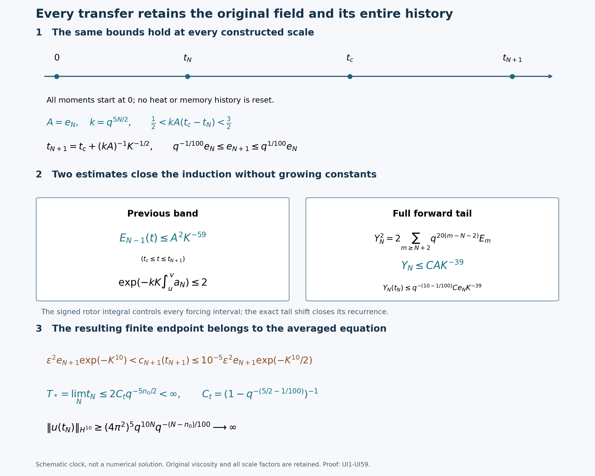
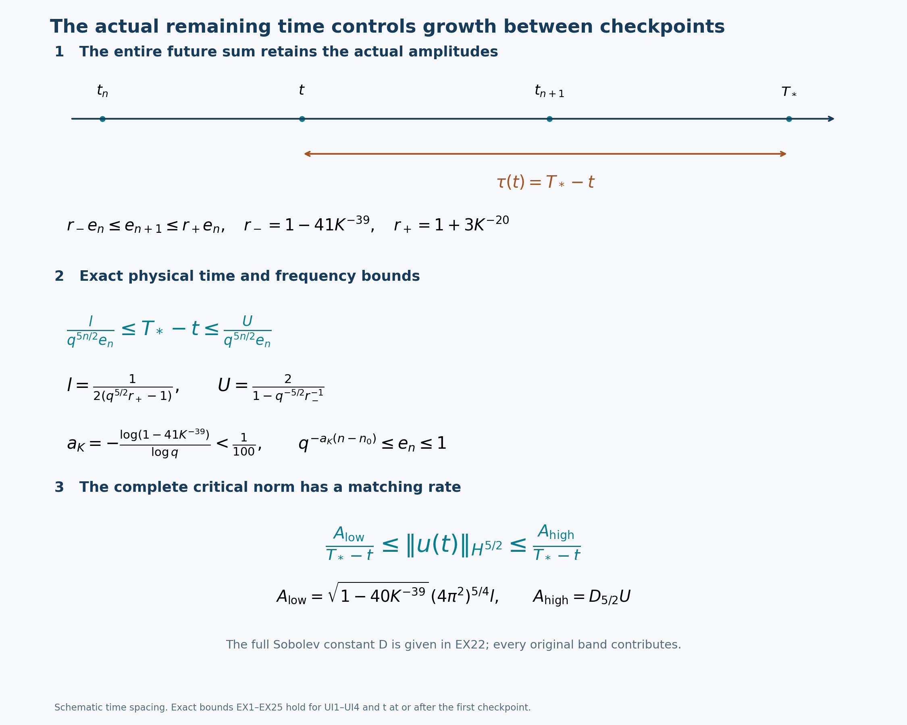
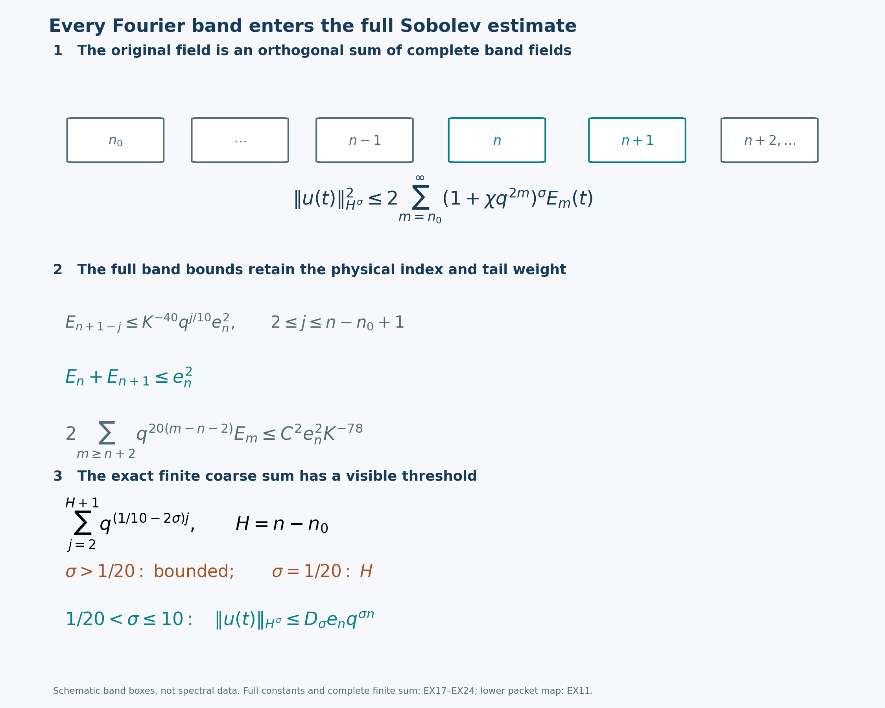

# The complete uniform viscous cascade and its finite-time growth

The preceding lessons constructed the original averaged equation, its
actual viscous flow and the first complete transfer. This lesson proves
that the same solution transfers through every later scale with uniform
bounds, and that the physical transfer times accumulate at its finite
maximal endpoint.

The proof retains the actual fields, viscosity, coefficients, packet
supports and physical clock. Every receiver moment starts at physical
time zero. The previous band receives an input of its own, which enters
both the energy and the corrected product. The complete forward weighted
tail provides continuation before any later activation is used.
The corrected receiving-drive range is preserved at every checkpoint,
and every coarse-energy forcing interval has its own proved bound.

Human comparison: Terence Tao,
[arXiv:1402.0290v3](https://arxiv.org/abs/1402.0290v3),
original author navier-blowup.tex1506–1798,1830–2014,2039–2171 and2173–2550.
This is an editorial reconstruction with the source correction kept
visible. The operator is the original local cascade represented by the
averaging theorem of [lesson39](the-complete-original-cascade-averaging-theorem.md).
The actual maximal solution and all its physical field maps are
constructed in [lesson40](the-original-viscous-cascade-and-its-exact-memory-equation.md).
The original coefficient table is proved in
[lesson42](the-original-autonomous-circuit-and-its-complete-delayed-transfer.md),
the positive memory and receiver bounds in
[lesson43](positive-viscous-memory-and-the-complete-receiver-bounds.md),
and the full corrector and first transfer in
[lesson44](the-complete-viscous-rotation-corrector-and-actual-first-transfer.md).
The supporting collection retains the complete second transfer ST1–ST68.
Upright exponential notation and the indexed checkpoint amplitudes
refer to different quantities throughout.

Five solved exercises strengthen the actual amplitude comparison,
bound the complete remaining physical lifetime, prove Sobolev growth
throughout each transfer, retain every band in a matching critical
upper bound, and determine the resulting time-integrability threshold.
All constants are explicit. The matching critical rate concerns this
averaged equation. No singularity of the unmodified Navier–Stokes
equation, or validation of the separate OpenAI construction, is inferred.

## UI1. Original parameters and the stronger energy ranges

Fix the original unit packet system, its original \(q=1+\epsilon_0\in(1,2)\), and \(\nu>0\). Retain
\[
 \chi=4\pi^2(1+\epsilon_0/2)^2,\quad
 \kappa_n=q^{5n/2},\quad \alpha=1/100,\quad B=K^{10}.
\tag{UI1}
\]
For \(a>0\) and an integer \(H\geq0\), define the exact finite sum
\[
 G_a(H)=\sum_{h=1}^Hq^{-ah}
       =\frac{q^{-a}(1-q^{-aH})}{1-q^{-a}},
 \qquad G_a(0)=0 .
\tag{UI2}
\]
Set
\[
\begin{gathered}
 C_t=(1-q^{-(5/2-\alpha)})^{-1},\qquad
 C=200+\frac{32q^5}{1-q^{-(10-\alpha)}},\\
 S=1+q^{100}+C+(1-q^{-\alpha})^{-1}
        +(1-q^{-2/25})^{-1}+C_t\\
 \hspace{2em}+(1-q^{-5/2})^{-1}
        +(1-q^{-5})^{-1}
        +(1-q^{-(15/2-\alpha)})^{-1},\qquad
 M=10^{12}S^4 .
\end{gathered}
\tag{UI3}
\]
These are explicit positive functions of the original \(q\), not changed scale parameters. Choose
\[
\begin{gathered}
 K\geq M^{1000},\qquad
 0<\epsilon\leq K^{-1000}\exp(-M^{100}B),\\
 n_0\in\mathbb Z,\qquad
 n_0\geq\max\left\{1,\frac2{\log q}
 [\log(\nu\chi)+1000\log K+M^{100}B]\right\}.
\end{gathered}
\tag{UI4}
\]
Thus \(\delta_0=\nu\chi q^{-n_0/2}\leq K^{-1000}\exp(-M^{100}B)\).
Every parameter restriction in FT and ST follows from UI3–UI4.

Here are parameter margins used throughout the proof. Each positive summand of \(S\) is less than \(M\), and \(M\geq10^{12}\), \(M\leq K^{1/1000}\), \(K\geq10^{12000}\). Thus
\[
 M^aK^{-b}\leq K^{a/1000-b}\quad(a,b\geq0).
\]
In particular \(C^2q^{10}\leq M^3<K^{18}\),
\((q^{20}-1)C^2\leq M^3<K^{38}\), and
\(1-q^{-\alpha}>M^{-1}\),
\(1-q^{-2/25}>M^{-1}\).
The fixed coefficients in UI20 divided by its initial margin are at most
\(100M^3K^{-19}<1/2\); the positive power of \(q\) has been retained in UI20 before this upper bound is used.
The amplitude errors below obey \(41MK^{-39}<1\) and \(3MK^{-20}<1\).
For the exponentially small terms, \(M^{100}>12M+4\) and the bounds on \(\epsilon,\mu\) imply
\[
 \epsilon^2\exp(6MB)\leq K^{-2000}\exp(-M^{100}B),\qquad
 \mu\exp((3M+1)B)\leq K^{-1000}.
\]
These inequalities also hold with smaller positive exponential coefficients. They justify the small weak-gate and viscosity terms without evaluating enormous exponentials numerically.

We construct actual times \(t_n<T_*\) and amplitudes
\(e_n=a_n(t_n)>0\), starting with \(t_{n_0}=0,e_{n_0}=1\).
At every constructed transition they will obey
\[
 q^{-\alpha}e_n\leq e_{n+1}\leq q^\alpha e_n,\qquad
 \frac1{2\kappa_ne_n}<t_{n+1}-t_n<\frac2{\kappa_ne_n}.
\tag{UI5}
\]
The full band energies remain \(E_m=\tfrac12\sum_i\|u_{i,m}\|_2^2\).
Throughout each completed interval \(I_n=[t_n,t_{n+1}]\), retain
\[
\begin{gathered}
 E_{n+1-j}\leq K^{-40}q^{j/10}e_n^2\quad(j\geq2),\qquad
 E_n+E_{n+1}\leq e_n^2,\\
 Y_n^2:=2\sum_{m\geq n+2}q^{20(m-n-2)}E_m
                \leq C^2e_n^2K^{-78},\\
 E_{n+1+j}\leq K^{-60}q^{-10j}e_n^2\quad(j\geq1).
\end{gathered}
\tag{UI6}
\]
The last line follows from the weighted bound: it uses
\(C^2q^{10}/2\leq K^{18}\), which UI3–UI4 imply.
This retains a stronger bound than the source's \(K^{-10}\) coarse and \(K^{-30}\) forward estimates. The extra room is used in the incoming-pump calculation below.

At each noninitial checkpoint \(t_n\), the full retained data are
\[
\begin{gathered}
 \frac{\epsilon e_nK^{-1/2}}{25600}
 \leq b_n(t_n)\leq10^{-5}\epsilon e_n,\qquad
 \epsilon^2e_n\mathrm e^{-B}<c_n(t_n)
       \leq10^{-5}\epsilon^2e_n\mathrm e^{-B/2},\\
 |d_n(t_n)|\leq e_nK^{-10},\qquad
 E_{n-1}(t_n)\leq e_n^2K^{-50},\\
 \frac{\epsilon e_n}{100}\leq b_{n-1}(t_n)\leq10\epsilon e_n,\qquad
 \epsilon^2e_n\mathrm e^{K^9}\leq c_{n-1}(t_n)
                                \leq\epsilon^2e_n\mathrm e^B,\\
 \frac{\kappa_n}{e_n}\int_0^{t_n}a_n(s)^2\,ds
                                      \leq MK^{-1/2}.
\end{gathered}
\tag{UI7}
\]
The stronger printed receiving-drive upper bound with exponent \(-B\) is not among these invariants. Its failure at the constructed checkpoints is proved in FT64 and ST68; the corrected range is preserved here.

The actual first interval supplied by FT is a base for every line of UI5–UI7. Its old energy is at most \(7K^{-80}/2\), its weighted tail radius is at most \(65K^{-39}\), and its receiving moment is at most \(2q^{5/2}K^{-1/2}/e_{n_0+1}\) in the last expression of UI7. Since \(C>200\), \(M>10^{12}\), \(e_{n_0+1}\geq99/100\), and \(K\geq M^{1000}\), these imply the stated stronger ranges. The first spin bounds in FT59 and FT66 give the remaining checkpoint data. All earlier bands vanish exactly.

## UI2. Complete finite histories with the original amplitude factors

Fix a constructed \(N\geq n_0+1\); write
\[
 A=e_N,\qquad k=\kappa_N,\qquad
 \mu=\frac{\nu\chi q^{-N/2}}{A}.
\tag{UI8}
\]
These abbreviations retain the original physical coordinates and clock. By the previous amplitude comparisons and the complete energy identity,
\[
 q^{-\alpha(N-n_0)}\leq A\leq1,\qquad
 0<\mu\leq\delta_0q^{-(1/2-\alpha)(N-n_0)}\leq\delta_0 .
\tag{UI9}
\]
In particular all ensuing viscosity margins are uniform in \(N\).

For \(j\leq N-1\), the actual elapsed time from the beginning of \(I_j\) satisfies
\[
 t_N-t_j\leq\frac2{\kappa_je_j}
       \sum_{\ell=0}^{N-j-1}q^{-(5/2-\alpha)\ell}
       \leq\frac{2C_t}{\kappa_je_j}.
\tag{UI10}
\]
This keeps each original reciprocal amplitude. Let \(H=N-n_0\).
For every integer \(r\geq1\), the forward energy bound on all completed intervals gives
\[
\begin{aligned}
 J_{N+r}(t_N):=\int_0^{t_N}a_{N+r}^2
 &\leq\frac{4A}{k}K^{-60}q^{-10(r-1)}
                                  G_{15/2-\alpha}(H),\\
 H_{N+r}(t_N):=\int_0^{t_N}(t_N-s)a_{N+r}(s)^2\,ds
 &\leq\frac{8C_t}{k^2}K^{-60}q^{-10(r-1)}G_5(H),\\
 L_{N+r}(t_N):=\int_0^{t_N}|a_{N+r}|
 &\leq\frac{2\sqrt2}{k}K^{-30}q^{-5(r-1)}G_{5/2}(H).
\end{aligned}
\tag{UI11}
\]
Here is the full calculation of the factors. On \(I_j\), put \(h=N-j\).
The energy bound is
\(E_{N+r}\leq K^{-60}e_j^2q^{-10(r+h-1)}\), and
\(|a_{N+r}|\leq\sqrt2K^{-30}e_jq^{-5(r+h-1)}\).
Multiply respectively by the actual length bound \(2/(\kappa_je_j)\), and for the weighted moment also by \(2C_t/(\kappa_je_j)\).
The first product contains \(4e_j/\kappa_j\), whose ratio to \(4A/k\) is at most \(q^{(5/2+\alpha)h}\).
The weighted product contains \(8C_t/\kappa_j^2\), with ratio \(q^{5h}\) to \(8C_t/k^2\).
The absolute-input product contains \(2\sqrt2/\kappa_j\), with ratio \(q^{5h/2}\) to \(2\sqrt2/k\).
Summing proves UI11. Each canceled amplitude factor has thus been accounted for; none of the physical contributions was dropped.

For comparison with the source's common-scale display, the exact map is
\(\tau=kA(t-t_N)\) and
\(\widetilde E_\ell(\tau)=A^{-2}E_{N+\ell}(t)\).
On \(I_j\), with source index \(s=j+1-N\),
\(e_j^2/A^2\leq q^{2\alpha(N-j)}=q^{|s-1|/50}\).
Thus the original absolute-index weight is present in the comparison.
UI11 improves a separate worst-case multiplication by retaining the same actual \(e_j\) in both energy and physical interval length. It does not replace the original flow by the comparison variables.

We shall use an interval of length at most \(4/(kA)\) after \(t_N\), on which the proposed UI6 bounds are retained up to their first exit. For \(m=N-1,N\), the same finite history gives
\[
 J_m(t)\leq MA/k,\qquad H_m(t)\leq M/k^2,\qquad
 \int_0^t|X_{i,m}(s)|\,ds\leq M/k.
\tag{UI12}
\]
To verify these bounds, the only earlier intervals where \(m\) is one of the two active scales are \(I_{m-1},I_m\), when present. There are at most two and their indices differ from \(N\) by at most two.
Their square-input integrals are at most \(4e_j/\kappa_j\), and their absolute-input integrals at most \(2\sqrt2/\kappa_j\).
For the weighted moment up to the current \(t\), use
\(t-s\leq(2C_t+4)/(\kappa_je_j)\leq6C_t/(\kappa_je_j)\).
Each active interval contributes at most \(24C_t/\kappa_j^2\).
All earlier forward contributions have the factors in UI11, enlarged by \(q^{20}\) for \(m=N-1\), and by a factor3 in the weighted moment.
The current interval contributes at most \(8A/k,16/k^2,4\sqrt2/k\), respectively, since its involved energies are at most \(A^2\).
Every coefficient is bounded by \(10^4S^4<M\), directly from UI3. This proves UI12 for each of the four original coordinates as needed.

The exact orthogonal component, with its original zero initial value, satisfies
\[
 h_{i,m}'=\nu Q_{i,m}\Delta Q_{i,m}h_{i,m}
              +\nu X_{i,m}Q_{i,m}\Delta\psi_{i,m}.
\]
Dissipativity and the original annular bound give
\[
 \|h_{i,m}(t)\|_2\leq\nu\chi q^{2m}
                  \int_0^t|X_{i,m}(s)|\,ds
 \leq M\mu A q^{2(m-N)},\quad m=N-1,N .
\]
Consequently the full scalar-to-field energy comparison is
\[
 0\leq E_m-\tfrac12(a_m^2+b_m^2+c_m^2+d_m^2)
       =\tfrac12\sum_i\|h_{i,m}\|_2^2
       \leq A^2K^{-100}\quad(m=N-1,N).
\tag{UI13}
\]
UI4 makes \(2M^2\mu^2<K^{-100}\). The equality retains all four orthogonal diffusion components.

## UI3. Actual receiver, weighted tail and all preliminary exits

Let \(T\) be the first of the clock \(t_N+4/(kA)\), the maximal endpoint \(T_*\), and the exits from the following closed bounds:
the coarse and active bounds in UI6, the radius \(Y_N\leq CAK^{-39}\), and
\[
 J_{N+1}(t)\leq A k^{-1}K^{-1/4}.
\tag{UI14}
\]
Initially the coarse bounds for indices \(N+1-j\), \(j\geq3\), improve by the strict factor
\(q^{-1/10+2\alpha}=q^{-2/25}\), using the preceding interval.
The near-old energy is at most \(A^2K^{-50}\).
The active pair is at most \(0.6A^2\): use UI7 for its scalar coordinates, UI13 for its orthogonal defect at the endpoint, and the previous forward tail for scale \(N+1\).
The new weighted radius at the endpoint obeys
\[
 Y_N(t_N)\leq Cq^{-(10-\alpha)}AK^{-39},
\tag{UI15}
\]
because shifting the full squared weighted norm by one scale multiplies it by \(q^{-20}\), and \(e_{N-1}/A\leq q^\alpha\).
The receiver moment is strictly below its threshold by UI11.
There are finitely many nonzero coarse bands. The weighted norm is continuous on compact actual \(H^{10}\) intervals. Thus \(T>t_N\).

All statements initially hold before \(T\). From UI11 and UI14,
\[
 H_{N+1}(t)\leq5k^{-2}K^{-1/4},\qquad
 L_{N+1}(t)\leq3k^{-1}K^{-1/8}.
\tag{UI16}
\]
For the first inequality use

\[
H_{N+1}(t)=H_{N+1}(t_N)+(t-t_N)J_{N+1}(t_N)
+\int_{t_N}^t(t-s)a_{N+1}^2
\]

and bound the last two contributions together by
\(4J_{N+1}(t)/(kA)\).
For the second use UI11 and Cauchy–Schwarz on the current interval.

The full actual receiver estimates VR7,VR11 and VR15–VR17, with their original lower time endpoint zero, now give
\[
\begin{gathered}
 |b_{N+1}|\leq q^{5/2}\sqrt2\,\epsilon AK^{-1/4},\qquad
 0<c_{N+1}\leq q^{5/2}\epsilon^2AK^{-1/4}\mathrm e^{-3B/4},\\
 \sqrt{2E_{4,N+1}}\leq
           3q^5AK^{-3/8}\mathrm e^{-B/2}\leq AK^{-20}.
\end{gathered}
\tag{UI17}
\]
The positivity is at positive times.
The drive exponent is bounded by
\(5q^5\sqrt2\,BK^{-1/4}<B/4\).
For the outgoing sign in the rotor estimate,
\[
 \int_0^t(a_{N+2})_-\leq
       Mk^{-1}K^{-30}+4Ck^{-1}K^{-39}
       \leq2Mk^{-1}K^{-30}.
\]
Thus its exponent is at most \(2q^5MK^{-29}<B/4\).
The final polynomial rotor bound follows from the third positive term of the exponential series, as in VR24. These calculations retain all history and the possible negative next input.

The full weighted radius has the exact field-energy identity of ST14 at indices shifted to \(N\). Its cubic coefficient is
\(kq^5(q^{20}-1)q^{-15(m-N-2)/2}\).
Square-root regularization, UI15 and UI17 give
\[
 Y_N(t)\leq Cq^{-(10-\alpha)}AK^{-39}
 +\int_{t_N}^t[kq^5A^2K^{-39}
          +kq^5(q^{20}-1)K Y_N(s)^2]\,ds .
\tag{UI18}
\]
The finite-sum flux and integrated dissipation limits are justified by actual \(H^{10}\) decay exactly as in ST14–ST18.
At the proposed radius exit, UI18 yields
\[
 Y_N\leq A K^{-39}
 \left[Cq^{-(10-\alpha)}+4q^5+
              4q^5(q^{20}-1)C^2K^{-38}\right]<CAK^{-39}.
\tag{UI19}
\]
Indeed \((q^{20}-1)C^2K^{-38}\leq1\) and
\(C(1-q^{-(10-\alpha)})\geq32q^5\).
The entire radius exit is excluded with a strict margin independent of \(N\).

For a coarse index \(m=N+1-j\), \(j\geq3\), retain its exact signed energy flux and its nonpositive full viscous dissipation.
The possible increase during this interval is at most
\[
 8\sqrt2 q^{5/2}(q^{1/10}+q^{49/20})
       A^2K^{-59}q^{-47j/20}.
\tag{UI20}
\]
This follows by inserting
\(d_{m-1}^2\leq2A^2K^{-40}q^{(j+1)/10}\),
\(|a_m|\leq\sqrt2 AK^{-20}q^{j/20}\),
\(d_m^2\leq2A^2K^{-40}q^{j/10}\), and
\(|a_{m+1}|\leq\sqrt2 AK^{-20}q^{(j-1)/20}\)
into
\(\kappa_mK[d_{m-1}^2a_m-q^{5/2}d_m^2a_{m+1}]\),
then integrating for at most \(4/(kA)\).
The initial margin is
\((1-q^{-2/25})A^2K^{-40}q^{j/10}\).
The ratio of UI20 to that margin is less than one half by UI3–UI4. Hence every far coarse exit is excluded.

For the active pair, the only remaining scale fluxes are its incoming old pump and outgoing receiver pump.
Using the retained coarse bound and full weighted radius, their total absolute contribution over the interval is at most
\[
 A^2[8\sqrt2 q^{1/5}K^{-39}+8Cq^5K^{-38}]<0.1A^2 .
\tag{UI21}
\]
Its initial energy was at most \(0.6A^2\), so the active-pair exit is also excluded.

The full \(H^{10}\) norm is uniformly bounded before the endpoint:
\[
 \|u(t)\|_{H^{10}}^2
 \leq(1+\chi q^{2(N+2)})^{10}(1+C^2A^2K^{-78}).
\tag{UI22}
\]
All lower bands together have squared norm at most one by the original total energy; the full weighted tail supplies the remaining term.
The established local lifespan excludes \(T=T_*\). Thus \(T<T_*\), all bounds extend to \(T\), and the only still possible nonclock exits are the near-old energy and the receiving moment.

## UI4. Full drives, actual activation and the proposed transfer time

The sharper arrival moment in UI7 and the actual active interval give
\[
 \sqrt{2(E_{2,N}+E_{3,N})}\leq16\epsilon A .
\]
For the old scale, split its input at its own arrival \(t_{N-1}\). Its arrival moment is supplied by UI7 (or is zero when \(N-1=n_0\)); its own active interval contributes at most \(4e_{N-1}/\kappa_{N-1}\), and its current coarse interval contributes at most \(8q^{1/5}AK^{-40}/k\).
Since \(q^\alpha<101/100\), this also proves
\[
 \sqrt{2(E_{2,N-1}+E_{3,N-1})}\leq16\epsilon A.
\tag{UI23}
\]
Here \(q^\alpha<101/100\) follows from
\((101/100)^{100}>1+100/100=2>q\).

Apply the original heat-response bound VR11 using UI12. For \(m=N-1,N\), throughout the whole physical history up to the current endpoint,
\[
 c_m(t)\leq\epsilon^2A\exp(3MB),\qquad
 \int_0^t c_m(s)\,ds
              \leq\epsilon^2k^{-1}\exp(3MB).
\tag{UI24}
\]
For the second bound integrate

\[
c_m(s)\leq\kappa_m\epsilon^2\mathrm e^{-B}J_m(s)
\exp(\kappa_m^2B\sqrt2 H_m(t));
\]

the exact identity \(\int_0^tJ_m(s)\,ds=H_m(t)\) retains the full original history.
The coefficients \(\kappa_m/k\leq1\), UI12 and
\(M\exp(2MB)\leq\exp(3MB)\) prove both bounds.

The negative contributions to \(b_m(t)-b_m(t_N)\) over the current interval are at most
\[
 \epsilon A[4\epsilon^2B\exp(6MB)+64\mu]
                                      \leq\epsilon A K^{-900}.
\tag{UI25}
\]
The first term is the exact negative amplifier integral; the second uses the full viscous projection and UI23.
Therefore \(b_N\geq\epsilon AK^{-1/2}/51200>0\), and
\(b_{N-1}\geq\epsilon A/200>0\).
The positive memory equation gives
\[
 c_m'\geq
 [\kappa_m\epsilon^{-1}B b_m-\nu\chi q^{2m}]c_m
       +\kappa_m\epsilon^2\mathrm e^{-B}a_m^2.
\]
For \(m=N\), the bracket is at least
\(kA[K^{19/2}/51200-\mu]>0\).
For \(m=N-1\), it is at least
\(kA[B/1200-\mu]>0\), since \(q^{5/2}<6\).
Consequently both drives increase after \(t_N\). This establishes the lower bound on the divisor before using any estimate for its reciprocal.
UI7 and UI24 then bound their complete viscous quotient:
\[
 -kA\mu\leq \frac{v_{3,m}}{c_m}\leq kA\mu
       \quad(m=N-1,N).
\tag{UI26}
\]
The positive part is at most
\(kA\mu^2q^{4(m-N)}\exp((3M+1)B)\leq kA\mu\);
the negative local damping is at most \(kA\mu q^{2(m-N)}\).
In particular
\[
 c_N'/c_N\leq17kAB,\qquad
 kAB/2000\leq c_{N-1}'/c_{N-1}\leq17kAB .
\tag{UI27}
\]
The weak source divided by each drive is at most \(2kA\), using
\(c_m(t_N)\geq\epsilon^2A\mathrm e^{-B}\).
The positive old amplifier and \(q^{-5/2}>1/6\) supply its lower bound.

Until the first threshold \(c_N=\epsilon^2AK^{-10}\), sum the full fourth-band energy at \(N\) and every higher-band energy.
Its initial radius is at most \(2AK^{-10}\), by UI7, UI13 and the previous weighted tail.
All internal pumps cancel, leaving only
\(k\epsilon^{-2}c_Na_Nd_N\) and the complete negative dissipation.
Square-root regularization therefore gives
\[
 |d_N|,\ |a_{N+1}|\leq8AK^{-10}.
\tag{UI28}
\]
The incoming term \(kKd_{N-1}^2\) in \(a_N'\) is nonnegative. Retaining that sign, the other exact terms give before threshold
\[
 a_N\geq A(1-33K^{-20}),\qquad
 b_N'\geq k\epsilon A^2(1-70K^{-20}).
\tag{UI29}
\]
For the first bound the rotor loss is at most \(8kA^2K^{-20}\), the two weak-gate losses at most \(3MkA^2\epsilon^2\), and the viscous loss at most \(\sqrt2 kA^2\mu\); integrate for at most \(4/(kA)\).
For the second, use the squared first bound, the threshold value, and
\(|v_{2,N}|\leq16k\epsilon A^2\mu\).

Let \(\sigma=kA(t-t_N)\) be an integration variable only.
The lower positive-memory integrating factor, with the positive initial drive and past memory retained before taking a lower bound, gives
\[
 c_N(t)\geq
 \epsilon^2A(1-70K^{-20})
 \exp[B(\sigma^2/2-1)-560/B-4\mu]
             \int_0^\sigma\exp(-Bs^2/2)\,ds .
\tag{UI30}
\]
The loss \(560/B\) bounds
\((70/(2B))\sigma^2\) on \(0\leq\sigma\leq4\).
At \(\sigma=3/2\) this exceeds the threshold, since the integral is at least
\(\mathrm e^{-1/2}/\sqrt B\).

Conversely, the exact second equation gives
\(b_N(t)\leq\epsilon A[10^{-5}+(2+16\mu)\sigma]\).
On \(\sigma\leq1/2\), UI26 bounds the integrated upper logarithmic coefficient by \(0.4B\); the weak source contributes at most
\(\epsilon^2A\mathrm e^{-B}\).
Thus
\[
 c_N(t)\leq
 [10^{-5}\epsilon^2A\mathrm e^{-B/2}
               +\epsilon^2A\mathrm e^{-B}]\mathrm e^{0.4B}
       <\epsilon^2A/B .
\tag{UI31}
\]
All constants are explicit: the amplifier exponent is at most
\(B[5\cdot10^{-6}+(2+16\mu)/8]\), and the quotient contribution is at most \(\mu/2\), which together are less than \(0.4B\).
The final inequality follows from a positive exponential-series term.

Before this threshold, the old full energy satisfies
\[
 E_{N-1}'\leq3kA^3K^{-59}
                   -kK d_{N-1}^2a_N .
\tag{UI32}
\]
The first term bounds the incoming pump from scale \(N-2\) using both coarse bounds; the full dissipation is nonpositive.
Since \(a_N>0\), this excludes the near-old exit before the threshold:

\[
E_{N-1}\leq A^2(K^{-50}+12K^{-59})<A^2q^{1/5}K^{-40}.
\]

UI11 and UI28 also exclude the receiver exit there.
The other exits have already been excluded in UI19–UI22.
Consequently the first actual threshold \(t_c<T\) exists and obeys
\[
 \frac12<kA(t_c-t_N)<\frac32,\qquad
 c_N(t_c)=\epsilon^2AK^{-10}.
\tag{UI33}
\]
After threshold, UI25 and UI29 give \(b_N\geq\epsilon A/3\), hence
\[
 kAB/4\leq c_N'/c_N\leq17kAB .
\tag{UI34}
\]
Define the candidate times
\[
 s_0=t_c+(kA)^{-1}K^{-9},\qquad
 t_1=t_c+(kA)^{-1}K^{-1},\qquad
 t_2=t_c+(kA)^{-1}K^{-1/2}.
\tag{UI35}
\]
They lie below the proposed clock. Up to \(\min\{t_2,T\}\), the receiver moment improves to
\[
 J_{N+1}\leq \frac Ak
      [MK^{-60}+96K^{-20}+2K^{-1/2}]
                  \leq3Ak^{-1}K^{-1/2}<Ak^{-1}K^{-1/4}.
\tag{UI36}
\]
The terms are the entire old history, the pre-threshold interval, and the short final interval.
Also \(\omega_N=c_N/\epsilon^2\) satisfies
\[
 \omega_N\geq AK^{100}\quad(t\geq s_0),\qquad
 \omega_N\leq A\exp(17K^{19/2})\quad(t_c\leq t\leq t_2),
\tag{UI37}
\]
where each statement is restricted to actual times below \(T\) until the remaining exit is closed.

## UI5. Exact incoming-pump correctors and the last exit

For each actual scale \(m\), keep
\[
\begin{gathered}
 \omega_m=c_m/\epsilon^2,\quad
 p_m=\epsilon b_m+\epsilon^2\mathrm e^{-B}c_m,\quad
 r_m=c_m'/c_m,\quad g_m=\kappa_mK d_{m-1}^2,\\
 \lambda_m=\kappa_mq^{5/2}K,\quad
 \rho_m=a_{m+1}'-\lambda_md_m^2,\\
 \rho_m
       =-\kappa_{m+1}\omega_{m+1}d_{m+1}
        -\kappa_{m+1}p_{m+1}a_{m+1}+v_{1,m+1},\\
 U_m=\tfrac12(a_m^2+b_m^2+c_m^2+d_m^2),\quad
 V_m=\sum_{i=1}^4X_{i,m}v_{i,m},\\
 M_m=a_md_m/\omega_m,\quad
 U_m^*=U_m-\frac{\lambda_m}{2\kappa_m}M_ma_{m+1}.
\end{gathered}
\tag{UI38}
\]
The complete original equations give the exact identity
\[
\begin{aligned}
 (U_m^*)'={}&-\lambda_m a_{m+1}U_m^*+\mathcal Q_m,\\
 \mathcal Q_m={}&\frac{\lambda_m}{2}a_{m+1}(b_m^2+c_m^2)
                       +a_mg_m+V_m\\
 &+\frac{\lambda_m}{2\kappa_m}M_m
   [(\kappa_mp_m+r_m)a_{m+1}-\lambda_md_m^2-\rho_m]\\
 &-\frac{\lambda_m}{2\kappa_m}\omega_m^{-1}a_{m+1}
                 [d_m(g_m+v_{1,m})+a_mv_{4,m}].
\end{aligned}
\tag{UI39}
\]
Indeed

\[
M_m'=\kappa_m(a_m^2-d_m^2)
-(\kappa_mp_m+\lambda_ma_{m+1}+r_m)M_m
+\omega_m^{-1}[d_m(g_m+v_{1,m})+a_mv_{4,m}].
\]

Differentiate \(M_ma_{m+1}\), use the full derivative in UI38, and substitute

\[
(a_m^2+d_m^2)/2=U_m^*+\lambda_mM_ma_{m+1}/(2\kappa_m)-(b_m^2+c_m^2)/2.
\]

The two terms with \(\lambda_m^2M_ma_{m+1}^2/(2\kappa_m)\) cancel.
In particular both occurrences of the incoming pump \(g_m\) are present.

Apply this first to \(m=N-1\), with \(\lambda_{N-1}=kK\).
Before \(t_c\), its drive obeys \(\omega_{N-1}\geq A\exp(K^9)\);
the current derivative \(\rho_{N-1}\) is bounded by
\(10kA^2K^{-20}\), using UI28 and the current weak gates.
After \(t_c\), UI27 and UI33 give
\(\omega_{N-1}\geq A\exp(B/5000)\), while
\(|\rho_{N-1}|\leq3kA^2\exp(17K^{19/2})\).
The other retained factors satisfy
\[
\begin{gathered}
 |a_{N-1}|,|d_{N-1}|\leq\sqrt2 AK^{-20}q^{1/10},\qquad
 g_{N-1}\leq2\kappa_{N-1}A^2K^{-39}q^{3/10},\\
 |a_{N-1}g_{N-1}|\leq3kA^3K^{-59},\qquad
 |V_{N-1}|\leq2\nu\chi q^{2(N-1)}E_{N-1},\\
 b_{N-1}^2+c_{N-1}^2\leq256\epsilon^2A^2,\qquad
 r_{N-1}\leq17kAB .
\end{gathered}
\tag{UI40}
\]
Substitution in every term of UI39 yields
\[
 |U_{N-1}^*-U_{N-1}|\leq A^2K^{-100},\qquad
 |\mathcal Q_{N-1}|\leq4kA^3K^{-59}
\tag{UI41}
\]
on the whole actual interval up to \(\min\{t_2,T\}\).
For an explicit term-by-term bound put
\[
 (D,R)=
 \begin{cases}
 (\exp(-K^9),10),&t_N\leq t\leq t_c,\\
 (\exp(-B/5000),3\exp(17K^{19/2})),&t_c\leq t\leq\min\{t_2,T\}.
 \end{cases}
\]
The reciprocal old drive is at most \(D/A\).
The retained coarse energy gives \(|M_{N-1}|\leq3AD\);
also \(\lambda_{N-1}/(2\kappa_{N-1})<3K\),
\(|a_N|\leq2A\), \(g_{N-1}\leq3kA^2\),
\(|v_{i,N-1}|\leq2kA^2\mu\), and
\(\kappa_{N-1}|p_{N-1}|\leq kA\).
Therefore the correction to the energy is at most \(18A^2KD\).
Apart from the incoming energy product \(a_{N-1}g_{N-1}\), the successive terms in UI39 have absolute values at most
\[
 kA^3\left[
 256K\epsilon^2+2\mu+
 9KD(40B+R)+84KD\right].
\]
For the bracket, use

\[
(\kappa_{N-1}|p_{N-1}|+r_{N-1})|a_N|
+\lambda_{N-1}d_{N-1}^2+|\rho_{N-1}|
\leq kA^2(40B+R).
\]

For the final product use
\[
 |d_{N-1}|(g_{N-1}+|v_{1,N-1}|)
       +|a_{N-1}v_{4,N-1}|\leq14kA^3 .
\]
Before activation the two corrected products together are bounded by
\(534kA^3K^{11}\exp(-K^9)\).
After activation they are bounded by
\(471kA^3K^{11}\exp[-B/5000+17K^{19/2}]\).
Both polynomial coefficients, as well as the energy correction coefficient, are less than \(M^{20}K^{20}\).
UI4 gives
\[
 M^{20}K^{20}\mathrm e^{-K^9}\leq K^{-100},\qquad
 M^{20}K^{20}
  \exp[-B/5000+17K^{19/2}]\leq K^{-100}.
\]
Use \(\log K\leq\sqrt K\), \(M^{20}\leq K^{1/50}\),
and \(\sqrt K\geq M^{500}>170000\).
For the second exponential,
\(-B/5000+17K^{19/2}\leq-B/10000\);
\(B/10000>121\log K\) follows from
\(K^{19/2}>1210000\).
The corresponding first exponential margin is
\(K^9>121\log K\).
The pair and viscous terms sum to at most \(kA^3K^{-100}\) by UI4.
Thus the total is at most
\(kA^3(3K^{-59}+2K^{-100})<4kA^3K^{-59}\).
This proves UI41 with both original incoming-pump terms present.

Before \(t_c\), \(a_N\geq0.9A\). The exact integrating factor in UI39 therefore gives
\[
 E_{N-1}(t_c)
 \leq A^2\!\left[
  \mathrm e^{-0.45K}(K^{-50}+K^{-100})
       +\frac{40}{9}K^{-60}+2K^{-100}\right]
 \leq6A^2K^{-60}.
\tag{UI42}
\]
Here UI13 restores the full field energy, and
\(kA(t_c-t_N)>1/2\).

For later forcing intervals use the actual current fourth equation. For
\(s_0\leq u\leq v\leq\min\{t_2,T\}\), with \(w=\omega_N^{-1}\),
\[
 \int_u^v a_N
 =k^{-1}[wd_N]_u^v+
   k^{-1}\int_u^v wd_N(r_N+\lambda_Na_{N+1})
       -k^{-1}\int_u^v wv_{4,N}.
\tag{UI43}
\]
Here \(w\leq A^{-1}K^{-100}\),
\(|d_N|,|a_{N+1}|\leq\sqrt2 A\),
\(r_N\leq17kAB\), and
\(|v_{4,N}|\leq\sqrt2 kA^2\mu\).
The complete endpoint and integral terms are at most
\(43k^{-1}K^{-90}\).
The part of any interval in \([t_c,s_0]\) has absolute integral at most
\(2k^{-1}K^{-9}\). Thus
\[
 \left|\int_u^v a_N\right|\leq3k^{-1}K^{-9},\qquad
 \exp\left(-kK\int_u^v a_N\right)\leq2
 \quad(t_c\leq u\leq v\leq\min\{t_2,T\}).
\tag{UI44}
\]
This covers every inhomogeneous propagator, even if \(T<s_0\), in which case only the short first portion occurs.

Using UI41–UI44 and the full defect UI13 gives
\[
 E_{N-1}(t)\leq
 A^2[12K^{-60}+8K^{-119/2}+5K^{-100}]
                 \leq A^2K^{-59}
 \quad(t_c\leq t\leq\min\{t_2,T\}).
\tag{UI45}
\]
Before \(t_c\), UI32 already excluded the near-old exit.
After it, UI45 is strictly below that exit bound.
UI36 excludes the receiving-moment exit. All other exits were excluded earlier.
Since \(t_2\) is below the clock, we conclude \(t_2<T<T_*\).
Every interval used in the remaining calculation is therefore actual.

## UI6. Transfer to the next original packet

Write \(a,b,c,d,z\) for \(a_N,b_N,c_N,d_N,a_{N+1}\).
The complete output equation has the original coefficient:
\[
 z'=\lambda_Nd^2+r_z,\qquad
 |r_z|\leq kA^2K^{-100},\qquad
 z(t)\geq-MAK^{-39}.
\tag{UI46}
\]
The four terms of \(r_z\) are
\(-\kappa_{N+1}\epsilon z b_{N+1}\),
\(-\kappa_{N+1}\epsilon^2\mathrm e^{-B}z c_{N+1}\),
\(-\kappa_{N+1}\epsilon^{-2}c_{N+1}d_{N+1}\), and
\(v_{1,N+1}\).
UI17 bounds the first three; the active-pair energy bounds the full last projection by
\(\sqrt2q^2kA^2\mu\).
The exponential-series bound in FT33 proves the displayed error.
The last inequality starts from the actual forward tail at \(t_N\), then integrates this error. It also gives
\(z(t)\geq z(s)-kA^2K^{-100}(t-s)\) on every subinterval.

The original five-coordinate energy \(S_5=a^2+b^2+c^2+d^2+z^2\) obeys
\[
 \tfrac12S_5'=a g_N+V_N+zr_z,\qquad
 A^2(1-40K^{-39})\leq S_5(t)\leq A^2(1+3K^{-20}).
\tag{UI47}
\]
For the total variation use the retained near-old coarse bound:

\[
|ag_N|\leq2\sqrt2q^{1/5}kA^3K^{-39}<4kA^3K^{-39},
\]

\(|V_N|\leq2kA^3\mu\), and \(|zr_z|\leq2kA^3K^{-100}\).
The interval has length less than \(4/(kA)\).
At its initial point \(S_5\geq A^2\) and \(S_5\leq A^2(1+2K^{-20})\), by all the actual checkpoint and forward-tail data.
Thus its total variation is at most

\[
A^2(32K^{-39}+16\mu+16K^{-100})<40A^2K^{-39}.
\]

The upper bound follows because \(40K^{-39}<K^{-20}\).
The factor \(q^{1/5}\) in the incoming pump is retained before taking the numerical upper bound.

On \([s_0,t_2]\), the complete product rule for \(M_N=ad/\omega_N\) gives
\[
 \left|\int_u^v(a^2-d^2)\right|
 \leq2Ak^{-1}K^{-100}+20A^2K^{-90}(v-u).
\tag{UI48}
\]
The product magnitude is at most \(AK^{-100}\).
In its derivative, \(\kappa_Np_N\), \(\lambda_Nz\), and \(r_N\) contribute at most
\(kA(1+9K+17B)\); the incoming and viscous product terms are smaller than
\(kA^2K^{-90}\) after UI45. This proves UI48 with the stated constant.

If \(z(t_1)\leq A/10\), UI46 gives \(|z|\leq11A/100\) on
\([s_0,t_1]\). UI23 and UI47 then give \(a^2+d^2\geq0.98A^2\).
With \(h=t_1-s_0\geq(2kAK)^{-1}\), UI48 implies
\(\int_{s_0}^{t_1}d^2>A/(5kK)\).
Integrating the full output equation would yield

\[
z(t_1)>-MAK^{-39}+q^{5/2}A/5-2AK^{-101}>A/10,
\]
 a contradiction.
Therefore
\[
 z(t_1)>A/10,\qquad z(t)\geq A/20\quad(t_1\leq t\leq t_2).
\tag{UI49}
\]

Apply the exact UI39 now to \(m=N\). The improved old energy gives
\(0\leq g_N\leq2kA^2K^{-58}\), so its complete energy and corrected-product contributions are both retained.
Substitution gives
\[
 |U_N^*-U_N|\leq5A^2K^{-99},\qquad
 |\mathcal Q_N|\leq4kA^3K^{-58}.
\tag{UI50}
\]
The dominant term is \(|a_Ng_N|\leq3kA^3K^{-58}\).
The pair term is at most \(1100kA^3K\epsilon^2\).
The corrected bracket contributes at most \(90kA^3K^{-89}\);
it uses \(|M_N|\leq AK^{-100}\), \(|z|\leq\sqrt2A\) and
\(r_N\leq17kAB\).
The remaining incoming-product and viscous terms are smaller than
\(kA^3K^{-80}\) by UI4, UI26 and UI45. These estimates prove UI50 without omitting either incoming term.

Every output propagator on \([s_0,t_2]\) is at most2 by UI46.
Its homogeneous factor over the full interval is at most
\[
 2\exp[-q^{5/2}(\sqrt K-1)/20]\leq2K^{-100},
\]
using UI49. The last inequality follows because
\((\sqrt K-1)/20-100\log K\) is positive at \(K=10^{10}\) and has positive derivative thereafter.
Since \(U_N^*(s_0)\leq2A^2\), the exact integrating factor proves
\[
 U_N(t_2)\leq A^2[4K^{-100}+8K^{-117/2}+5K^{-99}]
                         \leq A^2K^{-58}.
\tag{UI51}
\]
UI13 therefore gives \(E_N(t_2)\leq2A^2K^{-58}\).

Set \(t_{N+1}=t_2\), \(e_{N+1}=z(t_2)>0\).
UI47 and UI51 imply
\[
 A(1-41K^{-39})\leq e_{N+1}\leq A(1+3K^{-20}).
\tag{UI52}
\]
Both margins lie inside \([q^{-\alpha}A,q^\alpha A]\) by UI3–UI4.
UI33–UI35 give the time comparisons UI5.
Also
\(E_N(t_{N+1})\leq K^{-50}e_{N+1}^2\).
The entire interval already has UI6, with its original signs and weights.

## UI7. Preserve the corrected receiving data

The sharpened actual input moment UI36 gives
\[
 \frac{\kappa_{N+1}}{e_{N+1}}J_{N+1}(t_{N+1})
 \leq3q^{5/2+\alpha}K^{-1/2}\leq MK^{-1/2},
\]
and hence the required upper bound on \(b_{N+1}\) by its exact signed heat response.
UI17 gives the required \(d_{N+1}\) bound and the corrected \(c_{N+1}\) upper bound in UI7.

For completeness, their positive lower bounds also follow from the full history.
UI16–UI17 and the original drive-response identity give
\[
 \int_0^{t_2}c_{N+1}
 \leq5q^{5/2}\epsilon^2k^{-1}K^{-1/4}\mathrm e^{-3B/4}.
\]
Multiplying this by the full maximum drive bound in UI17 proves
\[
 \kappa_{N+1}\epsilon^{-1}B
              \int_0^{t_2}c_{N+1}^2
 \leq5q^{15/2}\epsilon^3ABK^{-1/2}\mathrm e^{-3B/2}
 \leq\epsilon A K^{-200}.
\tag{UI53}
\]
This is the entire negative second-coordinate response, with its original time origin; no earlier interval has been erased.

Put \(\ell=t_2-t_1\), \(t_A=t_1+\ell/4\).
Then \(kA\ell\geq K^{-1/2}/2\).
On the last interval UI49 gives \(z^2\geq A^2/400\), and its original heat response is at least
\(\exp(-4q^2\mu)\geq1/2\).
Combining its positive source with UI53 yields
\[
 b_{N+1}(t)\geq\epsilon AK^{-1/2}/12800
       \quad(t_A\leq t\leq t_2).
\tag{UI54}
\]
The endpoint comparison \(A/e_{N+1}\geq q^{-\alpha}>100/101\) gives the lower bound in UI7.

On the current interval the lower bound
\(b_{N+1}\geq-\epsilon AK^{-200}\), together with positive third-coordinate memory, gives an integrating factor at least1/2 on every subinterval of \([t_1,t_2]\).
Integrating just the positive weak source from \(t_1\) to \(t_A\), then the amplifier from \(t_A\) to \(t_2\), gives the full estimate
\[
 c_{N+1}(t_2)\geq
 \frac{\epsilon^2A\mathrm e^{-B}K^{-1/2}}{6400}
                        \exp(3K^9/204800)
       >\epsilon^2 e_{N+1}\mathrm e^{-B}.
\tag{UI55}
\]
The constants are obtained respectively from
\((1/2)(1/400)(1/8)=1/6400\) and
\((1/25600)(3/8)=3/204800\).
The positive exponential series makes the final ratio exceed \(q^\alpha\).
Together with UI17 this proves the entire receiving-drive range UI7 at the new checkpoint.

Finally the actual active spin satisfies
\[
 \epsilon A/3\leq b_N(t_2)\leq5\epsilon A,\qquad
 \epsilon^2AK^{-10}\exp(K^{19/2}/4)
 \leq c_N(t_2)\leq
       \epsilon^2AK^{-10}\exp(17K^{19/2}).
\tag{UI56}
\]
For the upper \(b_N\) bound integrate the full second equation, including
\(|v_{2,N}|\leq16k\epsilon A^2\mu\), for the actual interval of length less than \(2/(kA)\), using \(a_N^2\leq2A^2\).
These bounds imply the old-spin comparisons in UI7 with amplitude \(e_{N+1}\):
use \(q^\alpha<101/100\),
\(K^{19/2}/4-K^9-10\log K>1\), and \(17K^{19/2}<B/2\).
Thus every checkpoint and interval invariant has been propagated.

## UI8. The finite endpoint of this original averaged flow

The base and the proved inductive step construct all finite checkpoints within the same maximal solution. The physical time sum retains all original scale and amplitude factors:
\[
 t_{N+1}
 \leq\sum_{n=n_0}^{N}\frac2{\kappa_ne_n}
 \leq\frac2{\kappa_{n_0}}
      \sum_{j=0}^{N-n_0}q^{-(5/2-\alpha)j}
 \leq\frac{2C_t}{\kappa_{n_0}}<\infty .
\tag{UI57}
\]
Let \(T_\infty=\lim_Nt_N\). Since every \(t_N<T_*\), we have
\(T_\infty\leq T_*\). At the actual checkpoint, the original annular support and unit packet pairing give
\[
 \|u(t_N)\|_{H^{10}}
 \geq(1+4\pi^2q^{2N})^5|a_N(t_N)|
 \geq(4\pi^2)^5q^{10N}q^{-\alpha(N-n_0)}
 \longrightarrow\infty .
\tag{UI58}
\]
If \(T_\infty<T_*\), continuity of the constructed \(H^{10}\) flow on a compact interval containing \(T_\infty\) would contradict UI58. Therefore
\[
 T_*=T_\infty\leq2C_tq^{-5n_0/2}<\infty .
\tag{UI59}
\]
The local theory already proves that all the smooth Sobolev maximal times agree and that the \(H^{5/2}\) norm diverges at a finite maximal endpoint. Thus this is a finite-time singularity of the original averaged cascade equation with its actual viscosity. No claim about the unmodified Navier–Stokes equation follows from replacing its nonlinearity by this averaged operator.

The source's weaker coarse and forward energy estimates follow from UI6. Its receiving-drive upper bound with exponent \(-B\) must remain visibly corrected; UI55 proves that it fails at these constructed checkpoints. The stronger invariant used here, the incoming-pump terms in UI39, and the complete propagator control UI43–UI45 supply the full repair in the original physical coordinates.

The diagram shows the constructed physical clock and the proved bounds, with schematic time spacing. It does not depict a computed solution. UI11 gives the three complete historical moments; UI19 closes the full tail recurrence; UI39 retains both incoming-pump terms; UI43–UI45 control every coarse-energy forcing interval. The displayed coarse-energy bound applies after activation, and its propagator bound applies to every interval between activation and the next checkpoint. UI55 proves the receiving-drive lower bound and UI57–UI59 prove the finite endpoint. The original viscosity, packet support, energy weights and nonlinear operator remain those specified above. The [reproducible figure source](../assets/uniform-viscous-cascade.py) and [vector rendering](../assets/uniform-viscous-cascade.svg) retain these constants. Human comparison: Terence Tao, original author source navier-blowup.tex, arXiv:1402.0290v3, lines1506–1798 and2039–2550. This is an editorial reconstruction and correction of the argument, with no novelty claim.

## Five solved exercises

All five exercises concern the same actual averaged viscous flow, with
the complete original parameters UI1–UI4, packet supports, fields and
physical times. No coordinate, amplitude, viscosity or clock is replaced.
The estimates below are consequences of the proved induction, not new
assumptions. Human comparison: Terence Tao, arXiv:1402.0290v3,
original author navier-blowup.tex1506–1798 and2039–2550.
The stronger consequences are editorial deductions; no novelty is asserted.

### Exercise 1. Retain the sharper amplitude ratios

Use UI52 and the first transfer to prove a sharper comparison between
any two actual checkpoint amplitudes. Give its exact relation to the
exponent \(\alpha=1/100\) used in the induction.

**Solution.** Set
\[
 p=\frac52,\qquad r_-=1-41K^{-39},\qquad r_+=1+3K^{-20},
 \qquad
 a_K=-\frac{\log r_-}{\log q},\qquad
 b_K=\frac{\log r_+}{\log q}.
\tag{EX1}
\]
These are comparison constants for the unchanged amplitudes \(e_n\).
The UI3–UI4 margins give
\[
 41K^{-39}<M^{-1}<1-q^{-\alpha},\qquad
 3K^{-20}<M^{-1}<1-q^{-\alpha}<q^\alpha-1.
\tag{EX2}
\]
For the last inequality, put \(x=q^\alpha>1\): \(1-x^{-1}<x-1\).
Thus
\[
 0<q^{-\alpha}<r_-<1<r_+<q^\alpha,\qquad
 0<a_K<\alpha,\quad 0<b_K<\alpha.
\tag{EX3}
\]
At every step after the first, UI52 gives
\(r_-e_n\leq e_{n+1}\leq r_+e_n\).
At the first step, FT51–FT52 give
\(1-7K^{-80}\leq e_{n_0+1}\leq1\).
Since \(7K^{-80}\leq41K^{-39}\) and \(e_{n_0}=1\),
the same comparison holds there. The full energy identity independently
gives \(e_n\leq\|u(t_n)\|_2\leq1\) at every checkpoint.

Multiplying the actual consecutive ratios, with no reset of the
physical history, proves for all integers \(n\geq n_0\), \(j\geq0\),
\[
 r_-^j e_n\leq e_{n+j}\leq r_+^j e_n,\qquad
 q^{-a_K(n-n_0)}\leq e_n\leq
       \min\{1,q^{b_K(n-n_0)}\}=1.
\tag{EX4}
\]
The \(j=0\) case is equality. Each later case follows by multiplying one
more positive inequality, so no limiting amplitude is assumed.
There is also an explicit quantitative bound:
\[
 0<a_K\leq
 \frac{41K^{-39}}{(1-41K^{-39})\log q},\qquad
 0<b_K\leq\frac{3K^{-20}}{\log q}.
\tag{EX5}
\]
Indeed, for \(0<x<1\),
\(-\log(1-x)=\int_0^x(1-s)^{-1}ds\leq x/(1-x)\);
for \(y>0\), \(\log(1+y)=\int_0^y(1+s)^{-1}ds\leq y\).
Apply these identities to the full constants in EX1.
These comparisons strengthen the amplitude exponent; they do not
identify the actual amplitudes with geometric sequences.

### Exercise 2. Bound the complete remaining physical lifetime

Bound \(T_*-t_n\) on both sides in terms of the actual amplitude \(e_n\).
Then retain corresponding bounds at every time inside a transfer
interval.

**Solution.** Write
\[
 R_-=q^p r_-,\quad R_+=q^p r_+,\qquad
 L=\frac1{2(1-R_+^{-1})},\quad
 U=\frac2{1-R_-^{-1}},\quad
 l=\frac L{R_+}.
\tag{EX6}
\]
EX3 gives \(R_->q^{p-\alpha}>1\) and \(R_+>1\);
every denominator is strictly positive.
For any integer \(J\geq1\), the actual time comparisons UI5 and EX4 yield
\[
 \frac1{2\kappa_ne_n}\sum_{j=0}^{J-1}R_+^{-j}
 <t_{n+J}-t_n
 <\frac2{\kappa_ne_n}\sum_{j=0}^{J-1}R_-^{-j}.
\tag{EX7}
\]
Here the \(j\)-th term still comes from the actual
\(\kappa_{n+j}=q^{pj}\kappa_n\) and actual \(e_{n+j}\).
For \(R>1\),
\(\sum_{j=0}^{J-1}R^{-j}=(1-R^{-J})/(1-R^{-1})\):
multiply the sum by \(1-R^{-1}\) and cancel its consecutive terms.
Let \(J\) tend to infinity. UI59 identifies the limit of the actual
checkpoints with \(T_*\). Consequently
\[
 \frac L{\kappa_ne_n}\leq \tau_n:=T_*-t_n
       \leq\frac U{\kappa_ne_n},\qquad
 \frac L{\kappa_{n_0}}\leq T_*
       \leq\frac U{\kappa_{n_0}}.
\tag{EX8}
\]
The non-strict displayed bounds suffice; no claim of equality is made.
They include the full infinite physical sum, not only the next step.
In particular UI59 can be strengthened to the smaller upper constant
\(U<2C_t\), because \(r_->q^{-\alpha}\).

For \(n\geq n_0\) and \(t_n\leq t<t_{n+1}\), set
\(\tau(t)=T_*-t\). Since
\(\tau_{n+1}<\tau(t)\leq\tau_n\) and
\(\kappa_{n+1}e_{n+1}\leq R_+\kappa_ne_n\), EX8 gives
\[
 \frac l{\kappa_ne_n}\leq \tau(t)
              \leq\frac U{\kappa_ne_n}.
\tag{EX9}
\]
This controls all points in the interval, including times after the
rotor has begun transferring its energy.

Let \(H=n-n_0\geq0\), \(\kappa_0=\kappa_{n_0}=q^{pn_0}\),
where the subscript \(0\) is only an abbreviation for the unchanged
initial scale. EX4, EX9 and the full energy bound give
\[
 \frac l{\kappa_0\tau(t)}
 \leq q^{pH}e_n\leq\frac U{\kappa_0\tau(t)},\qquad
 \left(\frac l{\kappa_0\tau(t)}\right)^{1/p}
 \leq q^H
 \leq\left(\frac U{\kappa_0\tau(t)}\right)^{1/(p-a_K)}.
\tag{EX10}
\]
For the left frequency bound use \(e_n\leq1\).
For the right one use \(e_n\geq q^{-a_KH}\).
The original \(n_0\), physical clock and amplitude factors remain explicit.

### Exercise 3. Prove growth throughout each actual interval

Prove Sobolev growth at every time approaching \(T_*\), and find
quantitative lower bounds in terms of the remaining physical time.
Retain the full inhomogeneous Sobolev weight before deriving a power
bound.

**Solution.** Let \(n\geq n_0+1\), \(t_n\leq t<t_{n+1}\), and
\(H=n-n_0\). The five coordinates in UI47 pair with five mutually
orthogonal unit packets, four in band \(n\) and one in band \(n+1\).
Their original Fourier supports have \(|\xi|\geq q^n\). For \(\sigma\geq0\),
the full inhomogeneous norm therefore obeys
\[
 \begin{split}
 \|u(t)\|_{H^\sigma}^2
 &\geq (1+4\pi^2q^{2n})^\sigma
   \bigl(a_n(t)^2+b_n(t)^2+c_n(t)^2
                       +d_n(t)^2+a_{n+1}(t)^2\bigr)\\
 &\geq (1+4\pi^2q^{2n})^\sigma
                 (1-40K^{-39})e_n^2.
 \end{split}
\tag{EX11}
\]
To justify the first line, restrict the Fourier integral to the five
disjoint packet support sets, bound its weight from below on each set,
and use \(|\langle u,\psi_{i,m}\rangle|^2\leq\|u_{i,m}\|_2^2\)
with \(\|\psi_{i,m}\|_2=1\). All other support sets and all orthogonal
components contribute nonnegative terms. They have not been assumed
zero. This argument applies to the unchanged physical field, including
its orthogonal diffusion remainders.

Put \(c_K=\sqrt{1-40K^{-39}}>0\). EX11 and EX4 imply
\[
 \|u(t)\|_{H^\sigma}\geq
 c_K(1+4\pi^2q^{2n})^{\sigma/2}e_n
 \geq c_K(4\pi^2)^{\sigma/2}
                 q^{\sigma n_0}q^{(\sigma-a_K)H}.
\tag{EX12}
\]
No inhomogeneous weight has been replaced in EX11; the second
inequality in EX12 is its explicitly weaker consequence.
Every \(t<T_*\) lies in exactly one half-open checkpoint interval,
because the checkpoints increase strictly to \(T_*\). For any fixed
integer \(J\), times sufficiently near \(T_*\) exceed \(t_{n_0+J}\).
Thus \(H\) tends to infinity as \(t\) tends to \(T_*\).
It follows that the full norm tends to infinity for every
\(\sigma>a_K\) for which the norm is finite before the endpoint.
In particular this proves the assertion for \(a_K<\sigma\leq10\).
The smooth local theory in VD supplies finiteness at every fixed higher
order for these original smooth initial data as well.

There is a sharper physical-time statement than just inserting the
left bound of EX10 into EX12. Define
\[
 \gamma_-(\sigma)=
 \begin{cases}
  (\sigma-a_K)/(p-a_K),&a_K<\sigma\leq p,\\
  \sigma/p,&\sigma\geq p .
 \end{cases}
\tag{EX13}
\]
For \(a_K<\sigma\leq p\), the first bound in EX10 gives
\(e_n\geq l/(\kappa_0q^{pH}\tau)\). Since
\(\sigma-p\leq0\), the right frequency bound in EX10 gives
\[
 \begin{split}
 \|u(t)\|_{H^\sigma}
 &\geq c_K(4\pi^2)^{\sigma/2}q^{\sigma n_0}
       \frac l{\kappa_0\tau(t)}q^{(\sigma-p)H}\\
 &\geq c_K(4\pi^2)^{\sigma/2}q^{\sigma n_0}
       l\,U^{(\sigma-p)/(p-a_K)}
       [\kappa_0\tau(t)]^{-(\sigma-a_K)/(p-a_K)}.
 \end{split}
\tag{EX14}
\]
The sign of \(\sigma-p\) is essential to the direction of the second
inequality.

For \(\sigma\geq p\), retain the complete amplitude in the identity
\[
 q^{\sigma H}e_n
    =(q^{pH}e_n)^{\sigma/p}e_n^{1-\sigma/p}.
\]
Since \(0<e_n\leq1\), the last factor is at least one.
EX10 therefore gives
\[
 \|u(t)\|_{H^\sigma}\geq
 c_K(4\pi^2)^{\sigma/2}q^{\sigma n_0}
       \left(\frac l{\kappa_0\tau(t)}\right)^{\sigma/p}.
\tag{EX15}
\]
The two expressions agree at \(\sigma=p\). In particular, throughout
\(t_{n_0+1}\leq t<T_*\),
\[
 \|u(t)\|_{H^{5/2}}\geq
     \frac{c_K(4\pi^2)^{5/4}l}{T_*-t}.
\tag{EX16}
\]
The initial scale cancels here because its original factor is
\(q^{pn_0}=\kappa_0\). This is a proved cancellation, not a choice of a
new scale.

### Exercise 4. Retain every band and prove the matching critical upper bound

Bound the full \(H^\sigma\) norm from above for \(0\leq\sigma\leq10\),
including all coarse bands and the complete weighted forward tail.
Identify the exact geometric-sum threshold and prove a matching upper
bound at \(\sigma=5/2\).

**Solution.** With the same physical interval as Exercise 3, the
Fourier support of each \(u_{i,m}\) lies in the original annulus
\(|\xi|\leq(1+\epsilon_0/2)q^m\). Bands below \(n_0\) vanish by VD.
Consequently orthogonality and the definition
\(\chi=4\pi^2(1+\epsilon_0/2)^2\) give
\[
 \|u(t)\|_{H^\sigma}^2
 \leq 2\sum_{m=n_0}^{\infty}(1+\chi q^{2m})^\sigma E_m(t).
\tag{EX17}
\]
This includes the complete band fields, not only four scalar coordinates.
For \(\sigma=0\) this is equality.

The coarse part uses \(m=n+1-j\), \(2\leq j\leq H+1\). For the
forward part put \(h=m-n-2\geq0\). The exact inequalities
\[
 \begin{split}
 (1+\chi q^{2(n+1-j)})^\sigma
 &\leq(\chi+q^{-2n_0})^\sigma
                       q^{2\sigma(n+1-j)},\\
 (1+\chi q^{2(n+2+h)})^\sigma
 &\leq(1+\chi q^{2(n+2)})^\sigma q^{2\sigma h}
 \leq(1+\chi q^{2(n+2)})^\sigma q^{20h}
 \end{split}
\tag{EX18}
\]
hold for \(0\leq\sigma\leq10\). The first follows from
\(q^{-2m}\leq q^{-2n_0}\); the last uses \(h\geq0\).
Insert UI6 separately into the coarse, active and forward parts:
\[
 \begin{split}
 \|u(t)\|_{H^\sigma}^2\leq e_n^2\bigg[
 &2K^{-40}(\chi+q^{-2n_0})^\sigma q^{2\sigma(n+1)}
     \sum_{j=2}^{H+1}q^{(1/10-2\sigma)j}\\
 &+2(1+\chi q^{2(n+1)})^\sigma\\
 &+C^2K^{-78}(1+\chi q^{2(n+2)})^\sigma\bigg].
 \end{split}
\tag{EX19}
\]
The factor \(2\) from the definition of \(E_m\) is present in both
first terms. In the last term it is already part of the exact
definition of \(Y_n^2\), and therefore must not be inserted a second time.
Finite partial sums prove the estimates for the tail, and monotone
convergence gives the full infinite sum.

For any \(d\in\mathbb R\) and integer \(H\geq0\), the full finite sum is
\[
 \sum_{j=2}^{H+1}q^{dj}=
 \begin{cases}
  q^{2d}(1-q^{dH})/(1-q^d),&d\ne0,\\
  H,&d=0.
 \end{cases}
\tag{EX20}
\]
For \(H=0\) both versions give the empty sum zero.
For \(d\ne0\), multiplication by \(1-q^d\) cancels consecutive terms.
As \(d\) tends to zero, the original finite sum tends to \(H\), so
there is no singularity in the finite expression at \(\sigma=1/20\).
When \(\sigma>1/20\), its uniform bound is
\[
 \sum_{j=2}^{H+1}q^{(1/10-2\sigma)j}
 \leq \frac{q^{-2(2\sigma-1/10)}}{1-q^{-(2\sigma-1/10)}}.
\tag{EX21}
\]
At \(\sigma=1/20\) it grows exactly as \(H\); below this order the
infinite geometric majorant cannot be used. EX19 remains valid in
every case, and the original energy identity still gives
\(\|u(t)\|_2\leq1\).

For \(1/20<\sigma\leq10\), define the explicit positive constant
\[
 \begin{split}
 D_\sigma^2=(\chi+q^{-2n_0})^\sigma\bigg[
 &\frac{2K^{-40}q^{2\sigma}q^{-2(2\sigma-1/10)}}
              {1-q^{-(2\sigma-1/10)}}\\
 &+2q^{2\sigma}+C^2K^{-78}q^{4\sigma}\bigg].
 \end{split}
\tag{EX22}
\]
For the two remaining inhomogeneous terms in EX19 use
\(1+\chi q^{2m}\leq(\chi+q^{-2n_0})q^{2m}\) at
\(m=n+1,n+2\). Thus the full-band estimate is
\[
 \|u(t)\|_{H^\sigma}\leq D_\sigma e_n q^{\sigma n}.
\tag{EX23}
\]
All original constants and support factors in this comparison have
been retained in EX19 and EX22.

The upper half of EX10 now yields explicit physical-time upper bounds:
\[
 \begin{split}
 \|u(t)\|_{H^\sigma}
 &\leq D_\sigma\left(\frac U{\tau(t)}\right)^{\sigma/p},
             &&1/20<\sigma\leq p,\\
 \|u(t)\|_{H^\sigma}
 &\leq D_\sigma q^{\sigma n_0}
       \left(\frac U{\kappa_0\tau(t)}\right)^{(\sigma-a_K)/(p-a_K)},
             &&p\leq\sigma\leq10.
 \end{split}
\tag{EX24}
\]
For the first line write
\(e_nq^{\sigma n}=(\kappa_ne_n)^{\sigma/p}e_n^{1-\sigma/p}\);
its second factor is at most one.
For the second write
\(e_nq^{\sigma n}=(\kappa_ne_n)q^{(\sigma-p)n}\);
the exponent is nonnegative, so apply the upper frequency bound in
EX10. The two expressions agree at \(\sigma=p\).
In particular EX16 and EX24 prove
\[
 \frac{A_{\rm low}}{T_*-t}\leq\|u(t)\|_{H^{5/2}}
            \leq\frac{A_{\rm high}}{T_*-t},
 \quad
 A_{\rm low}=c_K(4\pi^2)^{5/4}l,\quad
 A_{\rm high}=D_{5/2}U
\tag{EX25}
\]
throughout \(t_{n_0+1}\leq t<T_*\).
Both constants are positive, finite and given explicitly above.
This is a matching order of growth for the actual averaged flow,
not a proposed trajectory or a numerical fit.

### Exercise 5. Determine the time-integrability consequences

Use the complete physical-time bounds to determine the critical
Sobolev norm's time-integrability threshold. State exactly what the
other proved rates imply, including their remaining gap.

**Solution.** Put \(t_{\rm start}=t_{n_0+1}\) and
\(\tau_{\rm start}=T_*-t_{\rm start}>0\).
For \(0<\delta<\tau_{\rm start}\) and \(r>0\), EX25 gives
\[
 \begin{split}
 A_{\rm low}^r I_r(\delta)
 &\leq\int_{t_{\rm start}}^{T_*-\delta}
             \|u(t)\|_{H^{5/2}}^r\,dt
       \leq A_{\rm high}^r I_r(\delta),\\
 I_r(\delta)
 &=\int_\delta^{\tau_{\rm start}} s^{-r}ds
 =\begin{cases}
  \bigl(\tau_{\rm start}^{1-r}-\delta^{1-r}\bigr)/(1-r),
                                                  &r\ne1,\\
  \log(\tau_{\rm start}/\delta),&r=1 .
 \end{cases}
 \end{split}
\tag{EX26}
\]
The substitution is \(s=T_*-t\), \(dt=-ds\), with both original
physical endpoints retained. The antiderivative can be checked by
differentiation. Letting \(\delta\) decrease to zero proves
\[
 \int_0^{T_*}\|u(t)\|_{H^{5/2}}^r\,dt
 \begin{cases}
  <\infty,&0<r<1,\\
  =\infty,&r\geq1 .
 \end{cases}
\tag{EX27}
\]
The integral over \([0,t_{\rm start}]\) is finite because the actual
strong solution is continuous in \(H^{10}\) on that compact interval.
For \(r=1\) the divergence is logarithmic between the exact constants
in EX26. For \(0<r<1\) this is integrability of the positive power,
without asserting that the usual \(L^r\) expression is a norm.

There is an exact weak-\(L^1\) consequence as well. Let
\(F(t)=\|u(t)\|_{H^{5/2}}\) and
\(B_{\rm early}=\sup_{0\leq t\leq t_{\rm start}}F(t)<\infty\).
For
\(\lambda>\max\{B_{\rm early},A_{\rm high}/\tau_{\rm start},
                              A_{\rm low}/\tau_{\rm start}\}\),
EX25 gives the inclusions, up to an endpoint of measure zero,
\[
 (T_*-A_{\rm low}/\lambda,T_*)
 \ \subseteq\ \{t\in[0,T_*):F(t)>\lambda\}
 \ \subseteq\ (T_*-A_{\rm high}/\lambda,T_*).
\]
Consequently, with \(|\cdot|\) denoting physical time Lebesgue measure,
\[
 \frac{A_{\rm low}}{\lambda}
 \leq |\{t:F(t)>\lambda\}|
 \leq \frac{A_{\rm high}}{\lambda}.
\tag{EX28}
\]
For smaller positive \(\lambda\) the measure is at most \(T_*\).
Thus \(\sup_{\lambda>0}\lambda|\{F>\lambda\}|<\infty\),
which is precisely membership in weak \(L^1(0,T_*)\).
EX27 proves failure of membership in \(L^1(0,T_*)\).
This concerns the time function of the full Sobolev norm; no spatial
weak-space conclusion is being substituted for it.

For \(1/20<\sigma\leq10\), define
\[
 \gamma_+(\sigma)=
 \begin{cases}
  \sigma/p,&1/20<\sigma\leq p,\\
  (\sigma-a_K)/(p-a_K),&p\leq\sigma\leq10 .
 \end{cases}
\tag{EX29}
\]
Here \(\sigma>a_K\) follows from \(a_K<1/100<1/20\).
EX14–EX15 and EX24 give positive finite constants
\(A_\sigma,B_\sigma\), with their exact values displayed there, such that
\(A_\sigma\tau^{-\gamma_-(\sigma)}
 \leq\|u(t)\|_{H^\sigma}
 \leq B_\sigma\tau^{-\gamma_+(\sigma)}\).
Differentiating the same elementary antiderivative as in EX26 proves
\[
 \begin{split}
 r\gamma_+(\sigma)<1
 &\ \Longrightarrow\
       \int_0^{T_*}\|u(t)\|_{H^\sigma}^r\,dt<\infty,\\
 r\gamma_-(\sigma)\geq1
 &\ \Longrightarrow\
       \int_0^{T_*}\|u(t)\|_{H^\sigma}^r\,dt=\infty.
 \end{split}
\tag{EX30}
\]
The exact gap between the two proved exponents is
\[
 \gamma_+(\sigma)-\gamma_-(\sigma)
     =\frac{a_K|\sigma-p|}{p(p-a_K)}.
\tag{EX31}
\]
For \(\sigma\leq p\), subtract
\((\sigma-a_K)/(p-a_K)\) from \(\sigma/p\).
For \(\sigma\geq p\), subtract in the reverse order.
Both computations give the displayed nonnegative expression.
It vanishes at \(\sigma=p\), producing the complete classification
EX27. For other orders the estimates do not decide the intervening
range \(1/\gamma_+(\sigma)\leq r<1/\gamma_-(\sigma)\);
the actual amplitudes have not been identified with either bound.
This states the precise reach of the proved estimates while retaining
their complete mathematical content.

Exercises 1–4 retain every actual amplitude and the original physical time in the remaining-lifetime sums. EX11 carries the five original packet coordinates into the full inhomogeneous Sobolev norm. EX19 retains every band in the upper bound. EX25 proves matching critical growth throughout all times after the first checkpoint. The clock spacing is schematic; no computed nonlinear trajectory is shown. The complete constants and domains are in EX1–EX25. [Reproducible source for both diagrams](../assets/original-cascade-lifetime-and-growth.py) and [vector rendering](../assets/original-cascade-lifetime-and-growth.svg). Human comparison: Tao, original navier-blowup.tex1506–1798 and2039–2550.

The boxes identify the original band indices and are not spectral measurements. Every band field includes its orthogonal diffusion components. EX17–EX24 give the complete physical support factors, finite coarse sum, critical sum threshold and full forward weight. The source produces both new diagrams. [Vector rendering](../assets/original-cascade-sobolev-sums.svg). These are editorial consequences of the full induction, with no novelty claim.

## Continue with the other fluid constructions

The complete induction and its stronger physical-time consequences are
now supplied in the same original averaged flow. The unchanged
supporting proof UI1–UI59 and the full first- and second-transfer notes
remain available in the source collection. The new exercises strengthen
their conclusions without rewriting the original author's statements.

The series next returns to the remaining Chen–Hou and
Wang–Lai–Gomez-Serrano–Buckmaster constructions and their complete
source arguments. The assigned Alpöge–Buckmaster, OpenAI and retained
workbench developments continue afterward through their exact
receiving equations, forces, domains and proof dependencies.
