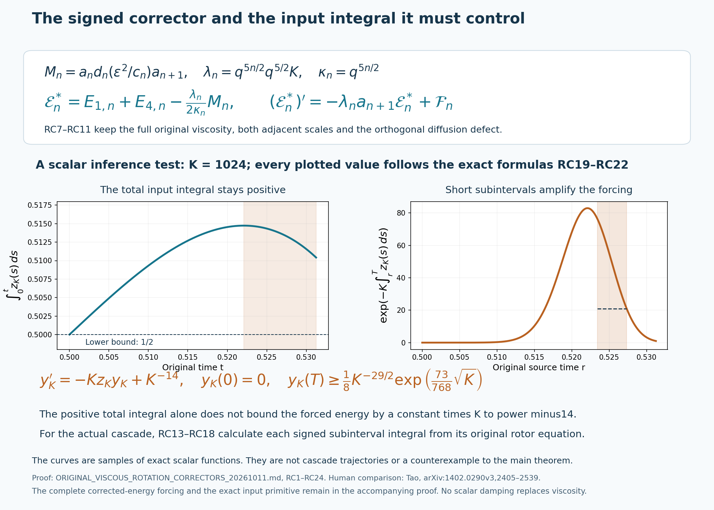
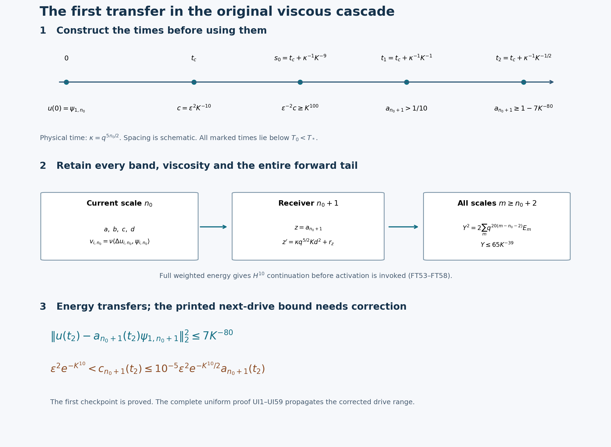
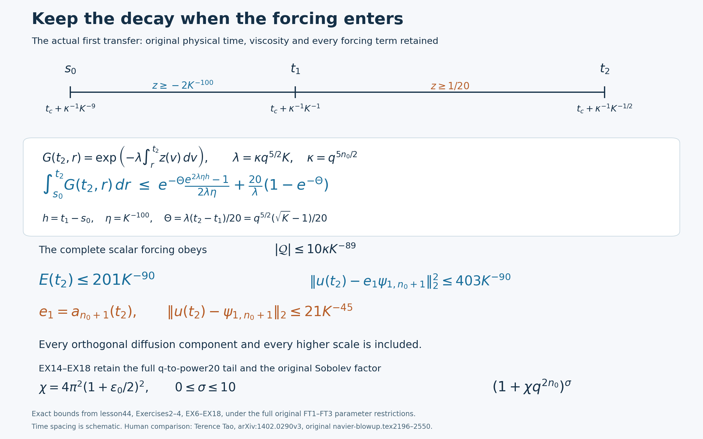
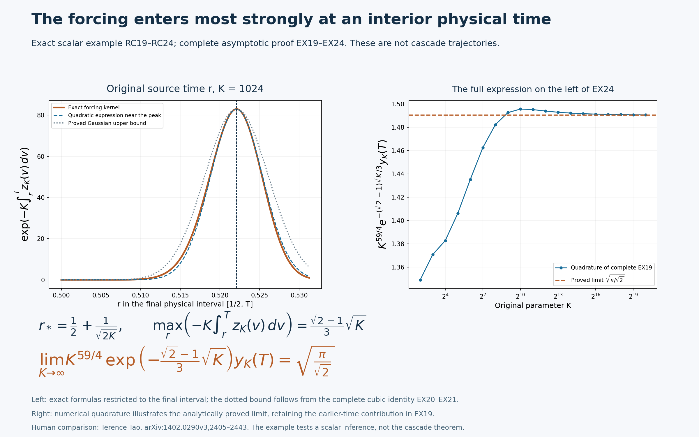

# The complete viscous rotation corrector and actual first transfer

The rotor exchanges energy between two original coordinates while an
outgoing pump transfers it to the next scale. A useful corrected energy
must keep the exact product-rule sign, both adjacent scales, the full
viscous projections and the orthogonal diffusion components. This lesson
derives that energy and its complete forcing before using it.

The forcing enters at every intermediate time. We therefore calculate
the signed input integral on every such subinterval, and give an explicit
scalar counterexample to an estimate based only on the total integral.
The actual circuit provides additional identities that control the
required subintervals.

The second part constructs the entire first transfer in the original
infinite viscous flow. The weighted tail supplies continuation before
activation is invoked. The trigger time, strongly activated interval,
output growth and complete energy transfer are then proved on their
actual domains. The next-drive checkpoint needs a weaker exponential
range than the printed source bound; both the failure of the stronger
bound and the valid replacement are derived explicitly.

Human comparison: Terence Tao,
[arXiv:1402.0290v3](https://arxiv.org/abs/1402.0290v3), original author
navier-blowup.tex1506–1604,2039–2171 and2196–2550.
[Lesson40](the-original-viscous-cascade-and-its-exact-memory-equation.md),
VD1–VD35, constructs the actual maximal flow.
[Lesson42](the-original-autonomous-circuit-and-its-complete-delayed-transfer.md),
CR16–CR20, gives the corrected original coefficient table.
[Lesson43](positive-viscous-memory-and-the-complete-receiver-bounds.md)
proves positive memory, all-scale activation and full receiver bounds.
Their complete proofs remain in the course.

Five solved exercises determine the exact positive domain of the
corrected full energy, retain the decay in the forcing response to
strengthen the actual transfer, carry that improvement into every
original Sobolev order through ten, solve the full weighted-tail
comparison, and compute the complete asymptotic of the scalar
counterexample. These are editorial deductions with no novelty claim.
All original physical constants, fields, time domains and viscosity
remain explicit.

## RC1. Keep the original physical equations and every viscous projection

Use the actual initial datum \(u(0)=\psi_{1,n_0}\), the original packet squared norms one, \(q=1+\epsilon_0\in(1,2)\), and \(K,\epsilon,\nu>0\). The solution exists on its constructed maximal interval \([0,T_*)\). Fix an original scale \(n\geq n_0\) and write
\[
\begin{gathered}
 a=a_n,\quad b=b_n,\quad c=c_n,\quad d=d_n,\quad z=a_{n+1},\\
 \kappa= q^{5n/2},\qquad
 \lambda=q^{5n/2}q^{5/2}K,\qquad
 v_i=\nu\langle\Delta u_{i,n},\psi_{i,n}\rangle.
\end{gathered}
\tag{RC1}
\]
These are names for the original quantities, with no change of amplitude, time, viscosity or spatial scale. For later estimates the exact viscous projection and its full moment bound are
\[
\begin{aligned}
 v_i&=-\nu\langle\nabla u_{i,n},\nabla\psi_{i,n}\rangle,\\
 |v_i|&\leq\nu q^{2n}\|\Delta\psi_i\|_2\sqrt{2E_{i,n}},\\
 \|\Delta\psi_i\|_2^2
 &=\int_{\mathbb R^3}(4\pi^2|\xi|^2)^2
                      |\widehat\psi_i(\xi)|^2\,d\xi.
\end{aligned}
\tag{RC2}
\]
Integration by parts, the original spatial dilation and Cauchy–Schwarz prove these identities and inequality. The band Fourier support is compact, so all displayed derivatives and pairings are defined. No viscous term is assigned a scalar damping law.

Name the complete part of the input equation outside its rotor term:
\[
\begin{aligned}
 A&=A^{\rm q}+v_1,\\
 A^{\rm q}&=\kappa\bigl[-\epsilon ab
             -\epsilon^2e^{-K^{10}}ac+K d_{n-1}^{2}\bigr].
\end{aligned}
\tag{RC3}
\]
The relevant original equations, including the entire next-scale input derivative, are
\[
\begin{aligned}
 a'&=-\kappa\epsilon^{-2}cd+A,\\
 d'&=\kappa\epsilon^{-2}ca-\lambda dz+v_4,\\
 c'&=\kappa\epsilon^2e^{-K^{10}}a^2
       +\kappa\epsilon^{-1}K^{10}bc+v_3,\\
 z'&=\kappa q^{5/2}\bigl[-\epsilon z b_{n+1}
       -\epsilon^2e^{-K^{10}}z c_{n+1}\\
   &\hspace{34mm}-\epsilon^{-2}c_{n+1}d_{n+1}+K d^2\bigr]
       +\nu\langle\Delta u_{1,n+1},\psi_{1,n+1}\rangle.
\end{aligned}
\tag{RC4}
\]
All the following differential identities hold at every \(0<t<T_*\). VA17 proves \(c(t)>0\), so the divisions by \(c\) are justified on this entire open interval. Every integrated identity is taken on a closed interval \([s,t]\subset(0,T_*)\); no integration through a singular initial quotient is performed.

## RC2. Derive the signed corrector with all remainders

Put
\[
 w=\frac{\epsilon^2}{c},\qquad
 U=\frac{a^2+d^2}{2},\qquad M=adwz.
\tag{RC5}
\]
Direct multiplication of the first two original equations gives
\[
\begin{aligned}
 U'&=-\lambda z d^2+aA+d v_4,\\
 (ad)'&=\kappa\epsilon^{-2}c(a^2-d^2)
              -\lambda adz+dA+a v_4,\\
 w'&=-w\frac{c'}c.
\end{aligned}
\tag{RC6}
\]
In particular the leading rotor product has the positive sign \(a^2-d^2\). Applying the product rule to all four factors in \(M\), with none discarded, gives
\[
\begin{aligned}
 M'&=\kappa(a^2-d^2)z+\mathcal R,\\
 \mathcal R&=wz(dA+a v_4)-\lambda wad z^2
             +wad z'-wad z\frac{c'}c.
\end{aligned}
\tag{RC7}
\]
RC3–RC4 give every term occurring in \(\mathcal R\), including both adjacent scales and the four physical viscous projections. In particular the last term contains \(z\), and the penultimate term differentiates \(z\).

The scalar corrected energy and its complete derivative are therefore
\[
\begin{aligned}
 U^*&=U-\frac{\lambda}{2\kappa}M
       =\frac{a^2+d^2}{2}-\frac{q^{5/2}K}{2}
                       ad\frac{\epsilon^2}{c}z,\\
 (U^*)'&=-\frac{\lambda}{2}z(a^2+d^2)
          +aA+d v_4-\frac{\lambda}{2\kappa}\mathcal R,\\
 &=-\lambda zU^*+aA+d v_4
       -\frac{\lambda}{2\kappa}\mathcal R
       -\frac{\lambda^2}{2\kappa}zM.
\end{aligned}
\tag{RC8}
\]
To verify the leading term, subtract \(\lambda z(a^2-d^2)/2\) from the original \(-\lambda z d^2\). This produces \(-\lambda z(a^2+d^2)/2\). The last line then substitutes \(U=U^*+\lambda M/(2\kappa)\). Both the minus sign of the corrector and the original outgoing factor \(q^{5/2}\) are forced by these exact identities.

## RC3. Keep the full band energy and its orthogonal defect

The full two-band energy and its scalar-projection defect are
\[
\begin{aligned}
 \mathcal E&=E_{1,n}+E_{4,n},\\
 \mathcal D&=\mathcal E-U
 =\tfrac12\|u_{1,n}-a\psi_{1,n}\|_2^2
  +\tfrac12\|u_{4,n}-d\psi_{4,n}\|_2^2\geq0.
\end{aligned}
\tag{RC9}
\]
The norm-one projections are orthogonal, which proves the equality. Adding the two exact field-energy equations cancels their rotor exchange and gives
\[
 \mathcal E'=-\lambda z d^2+aA^{\rm q}
       -\nu\bigl(\|\nabla u_{1,n}\|_2^2
                 +\|\nabla u_{4,n}\|_2^2\bigr).
\tag{RC10}
\]
Define the full corrected energy and retain its entire forcing:
\[
\begin{aligned}
 \mathcal E^*&=\mathcal E-\frac{\lambda}{2\kappa}M,\\
 (\mathcal E^*)'&=-\lambda z\mathcal E^*+\mathcal F,\\
 \mathcal F&=aA^{\rm q}
       -\nu\bigl(\|\nabla u_{1,n}\|_2^2
                 +\|\nabla u_{4,n}\|_2^2\bigr)\\
 &\quad-\frac{\lambda}{2\kappa}\mathcal R
       +\lambda z\mathcal D
       -\frac{\lambda^2}{2\kappa}zM.
\end{aligned}
\tag{RC11}
\]
Indeed RC7 and RC10 first give
\[
 -\lambda zU+aA^{\rm q}
 -\nu(\|\nabla u_{1,n}\|_2^2+\|\nabla u_{4,n}\|_2^2)
 -\lambda\mathcal R/(2\kappa).
\]
Substitution of \(U=\mathcal E^*+\lambda M/(2\kappa)-\mathcal D\) gives precisely RC11. Thus the full positive defect survives as its signed term \(\lambda z\mathcal D\). It cannot be deleted merely because the scalar rotor calculation closes.

There is also an exact quantitative comparison with the unmodified energy:
\[
 \left|\mathcal E^*-\mathcal E\right|
 \leq\frac{\lambda}{2\kappa}\frac{\epsilon^2}{c}|z|U
 \leq\frac{\lambda}{2\kappa}\frac{\epsilon^2}{c}|z|\mathcal E.
\tag{RC12}
\]
The inequality \(|ad|\leq(a^2+d^2)/2\) proves the first bound; RC9 proves the second. Neither \(U^*\) nor \(\mathcal E^*\) is asserted positive without evaluating this comparison. In particular a later square-root estimate must first justify its radicand.

## RC4. Calculate the actual primitive of a rotating input

For any fixed upper scale \(m\geq n_0\), give \(a_m,c_m,d_m,w_m,\kappa_m,\lambda_m,v_{4,m}\) their original definitions RC1–RC5. The fourth equation rearranges exactly to
\[
 a_m=\kappa_m^{-1}w_m d_m'
      +\kappa_m^{-1}\lambda_m w_m d_m a_{m+1}
      -\kappa_m^{-1}w_m v_{4,m}.
\tag{RC13}
\]
Integration by parts, using \(w_m'=-w_m c_m'/c_m\), proves for every \(0<s<t<T_*\)
\[
\begin{aligned}
 \int_s^t a_m(r)\,dr
 ={}&\kappa_m^{-1}[w_md_m]_s^t\\
 &+\kappa_m^{-1}\int_s^t w_md_m
                   \left(\frac{c_m'}{c_m}+\lambda_m a_{m+1}\right)dr
   -\kappa_m^{-1}\int_s^t w_m v_{4,m}\,dr.
\end{aligned}
\tag{RC14}
\]
This is an identity for the actual signed input integral, including both endpoint values. Its complete absolute majorant is the explicitly defined finite quantity
\[
\begin{aligned}
 \mathcal B_m(s,t)=\kappa_m^{-1}\bigg[&w_m(t)|d_m(t)|+w_m(s)|d_m(s)|\\
 &+\int_s^t w_m|d_m|
       \left(\left|\frac{c_m'}{c_m}\right|
                    +\lambda_m|a_{m+1}|\right)dr
   +\int_s^t w_m|v_{4,m}|\,dr\bigg],\\
 -\mathcal B_m(s,t)&\leq\int_s^t a_m(r)\,dr\leq\mathcal B_m(s,t).
\end{aligned}
\tag{RC15}
\]
The integrands are continuous on the compact interval because the actual \(c_m\) is strictly positive there. Formula RC2 bounds the last integrand with its original spatial moment whenever an explicit viscosity estimate is needed. Formula RC4 gives the full logarithmic derivative in the preceding integrand; no monotonicity of \(c_m\) is assumed.

Now return to the full corrected energy RC11 at scale \(n\). Its exact propagation factor is
\[
 G_n(t,r)=\exp\left(-\lambda_n\int_r^t a_{n+1}(\rho)\,d\rho\right),
 \qquad s\leq r\leq t.
\tag{RC16}
\]
Differentiating the integrating factor in RC11 proves the complete identity
\[
 \mathcal E_n^*(t)
   =G_n(t,s)\mathcal E_n^*(s)
     +\int_s^t G_n(t,r)\mathcal F_n(r)\,dr.
\tag{RC17}
\]
This holds for a signed corrected energy and a signed forcing. Apply RC15 at the actual next scale \(m=n+1\) on each subinterval \([r,t]\). The result is
\[
\begin{aligned}
 0<G_n(t,r)&\leq
               \exp\bigl(\lambda_n\mathcal B_{n+1}(r,t)\bigr),\\
 |\mathcal E_n^*(t)|
 &\leq e^{\lambda_n\mathcal B_{n+1}(s,t)}|\mathcal E_n^*(s)|\\
 &\quad+\int_s^t e^{\lambda_n\mathcal B_{n+1}(r,t)}
                                 |\mathcal F_n(r)|\,dr.
\end{aligned}
\tag{RC18}
\]
All terms are actual solution quantities with complete definitions and exact connecting identities. In the coarser-band decay argument, this uses the original rotor equation of the current input band. The bound needed for the forcing integral is a bound on every \(\mathcal B_{n+1}(r,t)\), rather than only on the single integral beginning at the earlier initial time.

## RC5. A complete counterexample to the total-integral inference alone

Here we examine only a scalar integrating-factor inference. These functions are not proposed as a cascade solution. For every \(K\geq4\), let \(\delta=K^{-1/2}\), \(T=1/2+\delta\), and define the continuously differentiable drift on \([0,T]\) by
\[
 z_K(t)=
 \begin{cases}
  1,&0\leq t\leq1/2,\\
  1-2\left(\dfrac{t-1/2}{\delta}\right)^2,
                   &1/2\leq t\leq T.
 \end{cases}
\tag{RC19}
\]
Its values and first derivatives match at \(1/2\), and \(|z_K|\leq1\). For \(t=1/2+\delta\theta\), \(0\leq\theta\leq1\), direct integration gives
\[
 \int_0^t z_K(r)\,dr
   =\frac12+\delta\left(\theta-\frac23\theta^3\right)
   \geq\frac12.
\tag{RC20}
\]
The inequality follows from \(\theta-2\theta^3/3\geq\theta/3\geq0\). Thus the total drift integral has a fixed positive lower bound throughout the short final interval of length \(K^{-1/2}\).

Nevertheless consider the actual unique scalar solution
\[
\begin{gathered}
 y_K'=-Kz_Ky_K+K^{-14},\qquad y_K(0)=0,\\
 y_K(t)=K^{-14}\int_0^t
       \exp\left(-K\int_r^t z_K(\rho)\,d\rho\right)dr.
\end{gathered}
\tag{RC21}
\]
Multiplying by \(\exp(K\int_0^t z_K)\) proves this formula and uniqueness. In particular \(y_K\geq0\). If \(r=1/2+\delta\theta\) with \(3/4\leq\theta\leq7/8\), then
\[
 \int_r^T z_K(\rho)\,d\rho
 =\delta\left(\frac13-\theta+\frac23\theta^3\right)
 \leq-\frac{73}{768}\delta.
\tag{RC22}
\]
The expression in parentheses has derivative \(-1+2\theta^2>0\) on this interval and value \(-73/768\) at its right endpoint. Restricting the positive integral RC21 to this subinterval of length \(\delta/8\) proves
\[
 y_K(T)\geq\frac18K^{-29/2}
                  \exp\left(\frac{73}{768}\sqrt K\right).
\tag{RC23}
\]
Consequently no constant independent of \(K\) bounds \(y_K(T)\) by that constant times \(K^{-14}\). Indeed the ratio is at least \(e^{h\sqrt K}/(8\sqrt K)\), with \(h=73/768>0\). The quadratic term of the positive exponential series gives the explicit divergence
\[
 \frac{y_K(T)}{K^{-14}}
 \geq\frac{h^2}{16}\sqrt K\longrightarrow\infty.
\tag{RC24}
\]
This example has an initial value no larger than the source coarse-energy bound, a uniformly bounded continuously differentiable drift, a constant forcing of size \(K^{-14}\), and a positive total drift integral throughout a final interval of the original \(K^{-1/2}\) length. It disproves the scalar inference from only those data. It does not satisfy or contradict the full original circuit equations. Those additional equations supply the exact missing subinterval information through RC13–RC18.

## RC6. What these calculations establish

RC1–RC18 prove exact identities and estimates on the actual viscous cascade, with all four original coordinates, the complete next-scale equation, original physical viscosity, full band energies, orthogonal defects and every outgoing scale factor. RC19–RC24 prove that the scalar total-integral step needs additional information. Both results identify the actual rotor primitive on every relevant subinterval and the complete signed forcing in RC11. The later complete uniform viscous cascade proof, UI1–UI59 supplies the quantitative transfer estimates and finite endpoint; RC1–RC24 here supply its exact identities and scalar inference test.

The source product-rule signs and outgoing factors at2482–2498 are repaired by RC7–RC11; the same formulas retain the original coarser-scale factors at2417–2438. In the source's square-root differential at2500, damping must carry a negative sign, as its following negative exponential also requires. The later uniform proof establishes closeness of the corrected energy, bounds the full forcing and controls every integrating-factor subinterval. The exact quotient is used only where the previously proved positive third coordinate makes it defined.

These are editorial reconstructions and an explicit scalar counterexample to one inference, with no novelty claim. The full infinite-cascade proof is supplied by the later UI1–UI59 note in its stated averaged-equation scope. Its review is author self-review; it does not validate the unmodified Navier–Stokes or separate OpenAI constructions. The scalar counterexample above identifies an insufficient inference, not a failure of the cascade theorem.

RC7–RC11 give the complete original energy corrector. The two curves sample the exact scalar functions RC19–RC22 at \(K=1024\) and \(T=1/2+K^{-1/2}\); they are not cascade trajectories. The left panel retains the entire integral beginning at time zero; the right panel shows the actual propagation factor for a forcing input at each physical time \(r\). The shaded interval on the right is precisely
\[
 1/2+(3/4)K^{-1/2}\leq r\leq1/2+(7/8)K^{-1/2},
\]
used in the complete proof RC22–RC24. The left shading marks the portion where the drift is negative. [Reproducible figure source](../assets/original-viscous-rotation-correctors.py) and [vector rendering](../assets/original-viscous-rotation-correctors.svg) accompany the complete argument. Human comparison: Tao, original author file navier-blowup.tex,2405–2443 and2470–2539.

## FT1. Parameters and the actual first transfer

Let \(q=1+\epsilon_0\in(1,2)\), let the original packet squared norms be one, and retain \(\nu>0\). Define the original annular Laplacian bound and physical scale factor by
\[
 \chi=4\pi^2(1+\epsilon_0/2)^2,\qquad
 \kappa=q^{5n_0/2},\qquad
 B=K^{10},\qquad \delta=\nu\chi q^{-n_0/2}.
\tag{FT1}
\]
The letters \(B,\kappa,\delta\) abbreviate these full expressions; they do not alter the equations or their physical time. Take
\[
\begin{gathered}
 K\geq\max\{10^{10},(400q^5\sqrt2)^4\},\qquad
 K\geq\left(\frac{7}{1-q^{-1/100}}\right)^{1/80},\\
 0<\epsilon\leq K^{-100}e^{-10K^{10}},\qquad
 \delta\leq K^{-200}e^{-10K^{10}}.
\end{gathered}
\tag{FT2}
\]
The last restriction is achieved by any integer
\[
 n_0\geq\frac{2}{\log q}
          \bigl[\log(\nu\chi)+200\log K+10K^{10}\bigr].
\tag{FT3}
\]
Let \(u(0)=\psi_{1,n_0}\) and let \([0,T_*)\) be its already constructed maximal \(H^{10}\) interval. Define an actual initial receiver endpoint by
\[
\begin{gathered}
 t_J=\inf\left\{t\in(0,T_*):\int_0^t a_{n_0+1}(s)^2\,ds
                      =\kappa^{-1}K^{-1/4}\right\},\\
 T_0=\min\{2\kappa^{-1},t_J,T_*\},\qquad \inf\varnothing=+\infty.
\end{gathered}
\tag{FT4}
\]
We prove that there is a first time \(t_c\) with \(c_{n_0}(t_c)=\epsilon^2K^{-10}\), and an actual transfer time
\[
 t_2=t_c+\kappa^{-1}K^{-1/2}<T_0\leq2\kappa^{-1},\qquad T_0<T_*,
\tag{FT5}
\]
such that
\[
\begin{gathered}
 1<\kappa t_c<\sqrt2,\qquad
 0<\sqrt2-\kappa t_c\leq\frac{10\log K+2}{K^{10}},\\
 1-7K^{-80}\leq a_{n_0+1}(t_2)\leq1,\\
 \|u(t_2)-a_{n_0+1}(t_2)\psi_{1,n_0+1}\|_2^2\leq7K^{-80},\\
 \|u(t_2)-\psi_{1,n_0+1}\|_2\leq3K^{-40}.
\end{gathered}
\tag{FT6}
\]
Initially all estimates are interpreted on compact subintervals of \([0,T_0)\). The full weighted-tail argument FT53–FT58 below depends only on this endpoint definition and VR24, and is independent of activation or transfer. It gives a uniform bound for the original \(H^{10}\) norm up to \(T_0\). The uniform local existence time from the constructed flow therefore excludes \(T_0=T_*\): otherwise restart at a time sufficiently close to \(T_*\) with the same bounded norm. Thus \(T_0<T_*\), all estimates extend to \(T_0\) by continuity, and that endpoint is either the clock \(2\kappa^{-1}\) or the first actual receiver-input threshold. This establishes the continuation needed before constructing the transfer; no lifetime or transfer estimate is assumed.

Write only for readability
\[
 a=a_{n_0},\quad b=b_{n_0},\quad c=c_{n_0},\quad
 d=d_{n_0},\quad z=a_{n_0+1},\qquad
 \lambda=\kappa q^{5/2}K.
\tag{FT7}
\]
All these are the original coordinates, evaluated at original physical time \(t\). The total energy identity and disjoint band projections give
\[
 \|u(t)\|_2\leq1,\quad |X_{i,n}(t)|\leq1,\quad
 |v_{i,n}(t)|\leq\nu\chi q^{2n}\sqrt{2E_{i,n}(t)},
 \qquad v_{i,n}=\nu\langle\Delta u_{i,n},\psi_{i,n}\rangle.
\tag{FT8}
\]
In particular \(|v_{i,n_0}|\leq\kappa\delta\). VR7 also proves throughout this whole interval
\[
 \sqrt{2(E_{2,n_0}+E_{3,n_0})}
 \leq\kappa\epsilon\sqrt{1+\epsilon^2e^{-2B}}\,t
 \leq3\epsilon.
\tag{FT9}
\]
Thus \(|v_{2,n_0}|\leq3\kappa\delta\epsilon\), and \(b^2+c^2\leq9\epsilon^2\). The actual \(c\) is positive at positive times by VA17.

The timeline is schematic: its spacing does not represent the very different physical durations. FT19–FT29 construct the marked times, FT31–FT52 prove concentration, and FT53–FT58 control every upper band and give continuation. FT64–FT65 give the displayed lower and upper bounds for the receiving drive at the same checkpoint. The original viscosity, physical time and outgoing coefficient remain explicit. Human comparison: Terence Tao, arXiv:1402.0290v3, original author TeX, lines1506–1604,2039–2171 and2196–2550. The diagram represents proved bounds, not a numerical trajectory.

## FT2. Control the entire outgoing collection before activation

Keep the full fourth band at the initial scale and every band above it:
\[
 W=E_{4,n_0}+\sum_{m>n_0}\sum_{i=1}^4E_{i,m}.
\tag{FT10}
\]
Adding their actual field-energy equations cancels every internal pump and gives
\[
 W'=\kappa\epsilon^{-2}cad
 -\nu\left(\|\nabla u_{4,n_0}\|_2^2
       +\sum_{m>n_0,i}\|\nabla u_{i,m}\|_2^2\right).
\tag{FT11}
\]
The boundary term \(-\lambda d^2z\) from the fourth band cancels the incoming term \(+\lambda d^2z\) of the upper collection. The remaining scale boundary at infinity tends to zero: VD14 bounds each coordinate by a constant times \(q^{-10m}\), uniformly on this compact time interval, whereas each cubic flux has coefficient \(q^{5m/2}K\). The complete dissipation sum is integrable by the full energy identity. Finite partial sums followed by their integrated limit therefore justify FT11.

Since \(W(0)=0\) and \(|d|\leq\sqrt{2W}\), regularization by \(\sqrt{2W+\eta}\), integration and \(\eta\downarrow0\) give
\[
 \sqrt{2W(t)}\leq\kappa\epsilon^{-2}\int_0^t c(s)|a(s)|\,ds.
\tag{FT12}
\]
Define the first threshold by the largest initial interval in \([0,T_0]\) on which \(c\leq\epsilon^2/B\). It has positive length. Until its endpoint, FT12 gives
\[
 |d(t)|,|z(t)|\leq\sqrt{2W(t)}\leq\frac{\kappa t}{B}\leq\frac2B.
\tag{FT13}
\]
All lower bands vanish exactly, so the actual first-coordinate equation has no previous-scale input. It is
\[
 a'=-\kappa\epsilon^{-2}cd-\kappa\epsilon ab
                  -\kappa\epsilon^2e^{-B}ac+v_{1,n_0}.
\tag{FT14}
\]
Before the threshold its absolute derivative is at most
\(\kappa(2B^{-2}+4\epsilon^2+\delta)\): use FT13 for the rotor, FT9 for the second coordinate, \(c\leq\epsilon^2/B\) for the weak pump, and FT8 for viscosity. Integrating for \(\kappa t\leq2\), and using \(a\leq1\), proves
\[
 0\leq1-a(t)\leq4B^{-2}+8\epsilon^2+2\delta
        \leq5B^{-2},\qquad a(t)^2\geq1-10B^{-2}.
\tag{FT15}
\]
The last inequality uses \((1-x)^2\geq1-2x\); FT2 gives \(8\epsilon^2+2\delta\leq B^{-2}\). The complete second equation and its exact signed heat-response upper bound VR12 give
\[
\begin{gathered}
 b'\geq\kappa\epsilon
        (1-10B^{-2}-\epsilon^2/B-3\delta)
       \geq\kappa\epsilon(1-12B^{-2}),\\
 \epsilon\kappa t(1-12B^{-2})\leq b(t)\leq\epsilon\kappa t.
\end{gathered}
\tag{FT16}
\]
Here \(\epsilon^2/B+3\delta\leq2B^{-2}\) follows directly from FT2. In particular \(b\geq0\) on this initial interval.

## FT3. Construct and locate the actual viscous activation time

The exact memory equation retains its positive kernel:
\[
\begin{aligned}
 c'={}&\kappa\epsilon^2e^{-B}a^2
       +\kappa\epsilon^{-1}Bbc
       -\nu q^{2n_0}G_3c
       +\nu^2\int_0^t\mathscr K_{3,n_0}(t-s)c(s)\,ds,\\
 &0<G_3\leq\chi,\qquad
 0\leq\mathscr K_{3,n_0}(r)\leq q^{4n_0}\chi^2.
\end{aligned}
\tag{FT17}
\]
The bounds are consequences of the original Fourier support, and the kernel and coordinate are nonnegative by VA2–VA9. Thus the last term can be discarded only for a lower estimate, and the remaining damping is at most \(\kappa\delta c\).

For the upper estimate use the exact positive heat response VR8, with \(R\leq1\), \(a^2\leq1\), and \(b(s)\leq\epsilon\kappa s\). The resulting scalar Volterra inequality is bounded by its integrating-factor solution. This can be proved by iterating its nonnegative kernel, whose successive iterates have the simplex-factorial bound on the compact interval. For the lower estimate integrate the differential inequality from FT17 using FT15–FT16. Keeping the factor from the physical substitution \(\sigma=\kappa s\), define
\[
 I_B(x)=\int_0^x e^{-B\sigma^2/2}\,d\sigma,\qquad
 \ell=(1-10B^{-2})e^{-24/B-2\delta}\geq\frac12.
\tag{FT18}
\]
Indeed 
\[
 \ell\geq1-10B^{-2}-24/B-2\delta\geq1-26/B\geq1/2.
\]
 On the entire initial threshold interval the two comparisons are
\[
 \ell\epsilon^2e^{B((\kappa t)^2/2-1)}I_B(\kappa t)
 \leq c(t)\leq
 \epsilon^2e^{B((\kappa t)^2/2-1)}I_B(\kappa t).
\tag{FT19}
\]
For the lower exponent, the exact integrated coefficient is at least
\(B((\kappa t)^2-(\kappa s)^2)/2-24/B-2\delta\), because both physical endpoints have \(\kappa t\leq2\). The forcing has the lower factor \(1-10B^{-2}\). This proves every factor in FT19.

For \(\kappa t\leq1\) the upper bound is at most \(\epsilon^2e^{-B/2}<\epsilon^2/B\), since \(e^{B/2}\geq B^2/8>B\). For \(1\leq x\leq2\), direct integration gives
\[
 \frac{e^{-1/2}}{\sqrt B}\leq I_B(x)<\frac2{\sqrt B}.
\tag{FT20}
\]
The lower estimate integrates \([0,B^{-1/2}]\); the upper follows from
\(\int_0^\infty e^{-v^2/2}\,dv\leq1+\int_1^\infty v e^{-v^2/2}\,dv<2\), with the complete substitution factor \(B^{-1/2}\). FT19 at \(\kappa t=3/2\) exceeds the threshold: its lower bound is \(\epsilon^2e^{B/8-1/2}/(2\sqrt B)>\epsilon^2/B\), since \(e^{-1/2}>1/2\) and \(\sqrt B>4\). Thus the first threshold is attained at some \(1<\kappa t_c<3/2\).

For completeness, this comparison cannot be cut off by the receiver endpoint. If the drive threshold were not attained strictly before \(T_0\), FT13 would give
\(\kappa\int_0^{T_0}z^2\leq8/(3B^2)<K^{-1/4}\), excluding \(T_0=t_J\). We would then have \(T_0=2\kappa^{-1}\), so the comparison at \(3/(2\kappa)\) would be available and contradictory. Thus the threshold occurs strictly before \(T_0\). The upper comparison excludes \(\kappa t_c\leq1\); if \(\kappa t_c\geq3/2\), the lower comparison again contradicts its definition. This justifies the first threshold on the actual existence interval.

Before it, FT17 gives
\(c'\geq\kappa\epsilon^2[e^{-B}(1-10B^{-2})-\delta/B]>0\).
The strict positivity follows from \(\delta/B\leq K^{-210}e^{-10B}<e^{-B}/2\) and \(1-10B^{-2}>1/2\). Hence this is the first threshold time. Substitution of its exact value into FT19–FT20 gives
\[
 -\tfrac12\log B-\log2
 \leq B((\kappa t_c)^2/2-1)
 \leq-\tfrac12\log B+\log2+\tfrac12<0.
\tag{FT21}
\]
This proves the first line of FT6: divide the left inequality by
\(B(\sqrt2+\kappa t_c)/2\), use \(\kappa t_c>1\), and retain \(\log B=10\log K\).

## FT4. Strong activation and an actual receiver interval

First obtain bounds on the entire actual interval \([0,T_0]\). FT9 and the positive heat-response comparison give
\[
 0\leq c(t)\leq
 \epsilon^2e^{-B}\frac{e^{3B\kappa t}-1}{3B}
 \leq\epsilon^2e^{5B}.
\tag{FT22}
\]
Retaining the negative amplifier and viscous terms in the integral for \(b\), we therefore have for \(t_c\leq t\leq T_0\)
\[
 b(t)\geq\epsilon(1-12B^{-2})
              -2\epsilon^3Be^{10B}-6\delta\epsilon
          \geq\epsilon/2.
\tag{FT23}
\]
Each of \(12B^{-2},2\epsilon^2Be^{10B},6\delta\) is at most \(1/8\) by FT2, so this final bound follows. FT17 now gives
\[
 c'\geq\kappa(B/2-\delta)c\geq\kappa Bc/3>0.
\tag{FT24}
\]
Consequently \(c\) is nondecreasing from time zero through the whole interval. The complete viscous memory in FT17 then obeys
\[
 -\kappa\delta\leq\frac{v_{3,n_0}(t)}{c(t)}
 \leq\nu^2q^{4n_0}\chi^2t
 \leq2\kappa\delta^2\qquad(t>0).
\tag{FT25}
\]
No division by \(\epsilon\) or deletion of past memory is used here. For \(t\geq t_c\), the retained weak source divided by \(c\) is at most \(\kappa B e^{-B}\). Together with \(b\leq3\epsilon\), FT24–FT25 give
\[
 \kappa B/3\leq c'/c\leq4\kappa B,
 \qquad
 \epsilon^2K^{-10}e^{B\kappa(t-t_c)/3}
 \leq c(t)\leq\epsilon^2K^{-10}e^{4B\kappa(t-t_c)}.
\tag{FT26}
\]
For the upper bound use \(e^{-B}+2\delta^2/B\leq1\), which follows from \(B\geq2\) and FT2.

Define actual physical times
\[
 s_0=t_c+\kappa^{-1}K^{-9},\qquad
 t_1=t_c+\kappa^{-1}K^{-1},\qquad
 t_2=t_c+\kappa^{-1}K^{-1/2}.
\tag{FT27}
\]
They satisfy \(t_c<s_0<t_1<t_2<2\kappa^{-1}\). Since \(\log K\leq\sqrt K\) and \(\sqrt K\geq10^5>330\), we have \(K/3\geq110\log K\). Hence FT26 proves
\[
 \omega:=\epsilon^{-2}c\geq K^{100}
 \qquad(s_0\leq t\leq T_0).
\tag{FT28}
\]

The receiver moment is now bounded from the actual constructed interval. Before \(t_c\), FT13 gives \(z^2\leq(\kappa t)^2/B^2\). Afterwards use only \(|z|\leq1\). First apply these estimates up to \(\min\{t_2,T_0\}\). They give
\[
 \kappa\int_0^{\min\{t_2,T_0\}}z(t)^2\,dt
 \leq4K^{-20}+K^{-1/2}<K^{-1/4}.
\tag{FT29}
\]
The strict inequality follows from \(K^{-1/2}\leq K^{-1/4}/2\) and \(4K^{-20}<K^{-1/4}/2\). If \(T_0\leq t_2\), then \(t_2<2\kappa^{-1}\) forces \(T_0=t_J\), contradicting this strict bound. Hence \(t_2<T_0<T_*\), and FT29 also holds with its upper endpoint simply \(t_2\). The receiver stopping threshold in VR20 is not reached anywhere in \([0,t_2]\). VR23–VR24 apply on the entire interval, giving
\[
\begin{gathered}
 |b_{n_0+1}|\leq q^{5/2}\sqrt2\epsilon K^{-1/4},\qquad
 0\leq c_{n_0+1}\leq q^{5/2}\epsilon^2K^{-1/4}e^{-3B/4},\\
 |d_{n_0+1}|\leq\sqrt{2E_{4,n_0+1}}\leq K^{-20}.
\end{gathered}
\tag{FT30}
\]
This proves that the entire chosen transfer interval lies inside the previously constructed receiver interval. It does not assume that conclusion as a bootstrap input.

## FT5. Keep and bound every output error

The exact output equation is
\[
\begin{aligned}
 z'&=\lambda d^2+r_z,\\
 r_z&=-\kappa q^{5/2}\epsilon z b_{n_0+1}
       -\kappa q^{5/2}\epsilon^2e^{-B}z c_{n_0+1}\\
 &\quad-\kappa q^{5/2}\epsilon^{-2}c_{n_0+1}d_{n_0+1}
       +v_{1,n_0+1}.
\end{aligned}
\tag{FT31}
\]
FT8 and FT30 retain all four contributions in the bound
\[
 \frac{|r_z|}{\kappa}
 \leq q^5\sqrt2\epsilon^2K^{-1/4}
     +q^5\epsilon^4K^{-1/4}e^{-7B/4}
     +q^5K^{-81/4}e^{-3B/4}+q^2\delta
 \leq\eta,\qquad \eta:=K^{-100}.
\tag{FT32}
\]
Here are whole-range bounds for the last inequality. The first, second and fourth terms are each at most \(\eta/4\): use \(q^5<32\), \(\sqrt2<3/2\), \(q^2<4\), \(\epsilon\leq K^{-100}\), \(\delta\leq K^{-200}\), and \(K\geq10^{10}\). For the third, the ninth term of the positive exponential series gives
\[
 e^{-3B/4}\leq9!(4/3)^9K^{-90},\qquad
 32\cdot9!(4/3)^9<2\cdot10^8<K/4.
\tag{FT33}
\]
It is therefore at most \(K^{-437/4}/4\leq\eta/4\). In particular
\[
 z(t)\geq-\kappa\eta t\geq-2\eta,
 \qquad z(t)\geq z(s)-\kappa\eta(t-s)
 \quad(0\leq s\leq t\leq t_2).
\tag{FT34}
\]

Let \(S_5=a^2+b^2+c^2+d^2+z^2\). Every original quadratic gate cancels in its derivative, including the full \(\lambda\) pump, so
\[
 \tfrac12 S_5'
 =av_{1,n_0}+bv_{2,n_0}+cv_{3,n_0}+dv_{4,n_0}+zr_z.
\tag{FT35}
\]
FT8 and FT32 yield \(|S_5'|\leq2\kappa(4\delta+\eta)\). Its initial value is one, and \(\delta\leq\eta\), so
\[
 1-20\eta\leq S_5(t)\leq1\qquad(0\leq t\leq t_2).
\tag{FT36}
\]
The upper bound is the original total energy and orthogonality, not an assumed scalar conservation law. All actual viscous losses remain in FT35.

## FT6. Start the transfer using the complete rotor product

On \([s_0,t_2]\), put
\[
 p=\epsilon b+\epsilon^2e^{-B}c,\qquad
 r=c'/c,\qquad M=ad/\omega.
\tag{FT37}
\]
We have \(0\leq p\leq6\epsilon^2\leq1\), \(0<r\leq4\kappa B\), \(|M|\leq K^{-100}/2\), and \(\lambda<6\kappa K\). Differentiating the actual first and fourth equations gives
\[
 M'=\kappa(a^2-d^2)-(\kappa p+\lambda z+r)M
          +\omega^{-1}(dv_{1,n_0}+av_{4,n_0}).
\tag{FT38}
\]
The absolute value of the remainder after the leading term is at most
\[
 \frac{\kappa}{2}(1+6K+4B)K^{-100}
       +2\kappa\delta K^{-100}
 \leq4\kappa K^{-90}.
\tag{FT39}
\]
Indeed \(1+6K+4B\leq6B\) for \(K\geq2\), and \(2\delta K^{-100}\leq K^{-90}\). Thus every subinterval of the actual strongly activated interval satisfies
\[
 \left|\int_u^v(a^2-d^2)\,dt\right|
 \leq\kappa^{-1}K^{-100}+4K^{-90}(v-u),
 \qquad s_0\leq u\leq v\leq t_2.
\tag{FT40}
\]

We claim \(z(t_1)>1/10\). Otherwise FT34 gives

\[
 -2\eta\leq z(t)\leq1/10+2\eta\leq11/100
\]
 on \([s_0,t_1]\). FT9 and FT36 then imply

\[
 a^2+d^2\geq1-20\eta-9\epsilon^2-(11/100)^2\geq49/50.
\]

For 
\[
 h=t_1-s_0=\kappa^{-1}(K^{-1}-K^{-9})\geq(2\kappa K)^{-1},
\]
 FT40 gives
\[
\begin{aligned}
 \int_{s_0}^{t_1}d^2\,dt
 &\geq(49/100-2K^{-90})h-\tfrac12\kappa^{-1}K^{-100}\\
 &\geq(12/25)h-\tfrac12\kappa^{-1}K^{-100}
 >\frac1{5\kappa K}.
\end{aligned}
\tag{FT41}
\]
Use \(2K^{-90}\leq1/100\) and \(K^{99}>25/2\) for the last two inequalities. Integrating the full FT31, with FT32 and FT34, would then give
\[
 z(t_1)>-2\eta+q^{5/2}/5-\eta/K>1/10,
\tag{FT42}
\]
contradiction. It follows that
\[
 z(t_1)>1/10,\qquad z(t)\geq1/20
                 \quad(t_1\leq t\leq t_2).
\tag{FT43}
\]
The second estimate uses FT34 and \(2\eta\leq1/20\). No monotonicity of the actual output is asserted.

## FT7. Complete the forced-energy transfer on its valid interval

Use the scalar energy outside the output and its exact corrected companion:
\[
 E=\tfrac12(a^2+b^2+c^2+d^2),\qquad
 E^*=E-\frac{\lambda}{2\kappa}Mz.
\tag{FT44}
\]
Write 
\[
 V=av_{1,n_0}+bv_{2,n_0}+cv_{3,n_0}+dv_{4,n_0}.
\]
 FT35 gives \(E'=-\lambda zd^2+V\). Apply FT38 to \(Mz\), differentiate \(z\) using its full FT31 equation, and substitute 
\[
 (a^2+d^2)/2=E^*+\lambda Mz/(2\kappa)-(b^2+c^2)/2.
\]
 The result is
\[
\begin{aligned}
 (E^*)'&=-\lambda zE^*+\mathcal Q,\\
 \mathcal Q&=\tfrac{\lambda}{2}z(b^2+c^2)+V\\
 &\quad+\frac{\lambda}{2\kappa}M
         [ (\kappa p+r)z-\lambda d^2-r_z ]\\
 &\quad-\frac{\lambda}{2\kappa}\omega^{-1}z
                       (dv_{1,n_0}+av_{4,n_0}).
\end{aligned}
\tag{FT45}
\]
The two terms containing \(\lambda^2Mz^2/(2\kappa)\) cancel exactly. FT45 retains the weak pump, the changing drive, every viscous projection, the entire next-band error and the original outgoing scale factor. It is the actual viscous specialization of the corrected product calculation, not the inviscid five-mode equation.

Its error and comparison bounds on \([s_0,t_2]\) are
\[
\begin{aligned}
 |E^*-E|&\leq\tfrac32K^{-99},\\
 |\mathcal Q|&\leq\kappa\bigl[
 27K\epsilon^2+4\delta+9K^{-89}+6\delta K^{-99}\bigr]
 \leq10\kappa K^{-89}.
\end{aligned}
\tag{FT46}
\]
The bracket in the third term of FT45 has absolute value at most
\(\kappa(1+4B+6K+\eta)\leq6\kappa B\); its prefactor is at most \((3/2)K^{-99}\). The other displayed terms follow respectively from FT9, FT8 and FT28. FT2 makes their sum outside \(9K^{-89}\) at most \(K^{-89}\), proving the final bound.

The exact integrating factor on this valid interval is
\[
 E^*(t)=e^{-\lambda\int_{s_0}^t z}E^*(s_0)
       +\int_{s_0}^t e^{-\lambda\int_v^t z}\mathcal Q(v)\,dv.
\tag{FT47}
\]
Here \(E^*(s_0)\leq1\); its sign is immaterial. FT34 bounds every subinterval factor, including those multiplying the forcing, by
\[
 e^{-\lambda\int_v^t z}
 \leq e^{24K\eta}\leq2,
 \qquad s_0\leq v\leq t\leq t_2.
\tag{FT48}
\]
For the final inequality, \(24K\eta\leq1/2\) and
\(e^{1/2}\leq\sum_{j\geq0}(1/2)^j=2\). For the homogeneous term at \(t_2\), split the interval at \(t_1\) and use FT43:
\[
 e^{-\lambda\int_{s_0}^{t_2}z}
 \leq2\exp\left(-\frac{q^{5/2}(\sqrt K-1)}{20}\right)
 \leq2K^{-80}.
\tag{FT49}
\]
To verify the final inequality over the whole range, the function
\(g(K)=(\sqrt K-1)/20-80\log K\) has derivative
\((\sqrt K-3200)/(40K)>0\) for \(K\geq10^{10}\), and
\(g(10^{10})>99999/20-2400>0\), using \(\log10<3\). Finally \(q^{5/2}>1\).

Combining FT46–FT49 with \(t_2-s_0<2\kappa^{-1}\) proves
\[
 0\leq E(t_2)
 \leq2K^{-80}+40K^{-89}+\tfrac32K^{-99}
 \leq3K^{-80}.
\tag{FT50}
\]
Since \(z(t_2)>0\), FT36 now yields
\[
\begin{gathered}
 z(t_2)^2=S_5(t_2)-2E(t_2)
 \geq1-20K^{-100}-6K^{-80}\geq1-7K^{-80},\\
 0\leq1-z(t_2)\leq7K^{-80}.
\end{gathered}
\tag{FT51}
\]
The full original state, including every orthogonal diffusion component and every other scale, satisfies
\[
\begin{aligned}
 \|u(t_2)-z(t_2)\psi_{1,n_0+1}\|_2^2
 &=\|u(t_2)\|_2^2-z(t_2)^2\leq7K^{-80},\\
 \|u(t_2)-\psi_{1,n_0+1}\|_2^2
 &\leq7K^{-80}+49K^{-160}\leq8K^{-80}.
\end{aligned}
\tag{FT52}
\]
This proves all concentration statements FT6 and also
\(\sum_iE_{i,n_0}(t_2)\leq(7/2)K^{-80}\).

## FT8. Prove continuation and control every further scale

This argument is independent of the activation and transfer estimates. Set \(r_0=n_0+2\), let \(E_m=\sum_iE_{i,m}\), and retain all weights in
\[
 F(t)=\sum_{m\geq r_0}q^{20(m-r_0)}E_m(t),\qquad Y(t)=\sqrt{2F(t)}.
\tag{FT53}
\]
This auxiliary quantity is finite on every compact subinterval of \([0,T_0)\) by the actual \(H^{10}\) regularity. Its full integrated energy identity, and its derivative almost everywhere, are
\[
\begin{aligned}
 F'={}&\kappa q^5K d_{n_0+1}^2a_{r_0}\\
 &+K\sum_{m>r_0}q^{5m/2}
      [q^{20(m-r_0)}-q^{20(m-1-r_0)}]d_{m-1}^2a_m\\
 &-\nu\sum_{m\geq r_0,i}q^{20(m-r_0)}
                                     \|\nabla u_{i,m}\|_2^2.
\end{aligned}
\tag{FT54}
\]
The original local scale-energy equation gives this first for finite sums. On a fixed compact time interval the cubic terms and the final boundary flux are uniformly bounded by a constant times \(q^{-15m/2}\), using VD14. The weighted energy is finite by \(H^{10}\) regularity. The nonnegative integrated dissipation partial sums are therefore bounded by the initial energy and these integrable cubic terms. Monotone convergence supplies their finite limit and proves the full integrated identity, hence the derivative almost everywhere. This argument does not assume an extra instantaneous derivative of the solution.

Put \(Y_m=\sqrt{2q^{20(m-r_0)}E_m}\). Each interior coefficient in the cubic bound is exactly
\[
 q^{5m/2}\frac{q^{20(m-r_0)}-q^{20(m-1-r_0)}}
 {q^{20(m-1-r_0)}q^{10(m-r_0)}}
 =\kappa q^5(q^{20}-1)q^{-15(m-r_0)/2}.
\tag{FT55}
\]
Moreover \(\sum_{m>r_0}Y_{m-1}^2Y_m\leq Y^3\), since each \(Y_m\leq Y\) and the squared sum is at most \(Y^2\). The endpoint definition FT4 alone places the solution inside the receiver interval VR20, so VR24 directly gives \(|d_{n_0+1}|\leq K^{-20}\) on \([0,T_0)\). This use is independent of the later activation and transfer estimates. Keep the negative dissipation before taking an upper bound, and regularize \(\sqrt{2F+\eta_0}\). Passing \(\eta_0\downarrow0\) gives
\[
 Y(t)\leq\int_0^t
     [\kappa q^5K^{-39}
      +\kappa q^5(q^{20}-1)K Y(s)^2]\,ds.
\tag{FT56}
\]
Its zero initial value is exact. If a first time with \(Y=K^{-30}\) occurred before \(T_0\leq2\kappa^{-1}\), FT56 before that time would give
\[
 Y\leq64K^{-39}+67108800K^{-59}<K^{-30},
\tag{FT57}
\]
because \(q^5<32\), \(q^{20}-1<1048575\), and \(64K^{-9}+67108800K^{-29}<1\). This contradicts first attainment. Therefore the same estimate holds throughout, and \(67108800K^{-59}\leq K^{-39}\) implies
\[
 Y(t)\leq65K^{-39},\qquad
 E_m(t)\leq\frac{4225}{2}K^{-78}q^{-20(m-n_0-2)}
 \quad(m\geq n_0+2,\ 0\leq t<T_0).
\tag{FT58}
\]
These bounds control the entire original Sobolev norm up to the proposed endpoint. Indeed the two initial scale bands have total squared norm at most one, all lower bands vanish, and the original Fourier support gives
\[
 \|u(t)\|_{H^{10}}^2
 \leq(1+\chi q^{2r_0})^{10}[1+Y(t)^2]
 \leq(1+\chi q^{2r_0})^{10}(1+4225K^{-78}).
\]
For the upper bands retain
\((1+\chi q^{2m})^{10}\leq q^{20(m-r_0)}(1+\chi q^{2r_0})^{10}\); the factor is finite for the fixed original \(n_0\). This supplies the uniform continuation bound used after FT6, so \(T_0<T_*\). All estimates then extend to \(T_0\) by continuity.

In particular FT58 holds throughout the constructed first transfer. Since \(q^{-20(m-r_0)}\leq q^{-10(m-r_0)}\) and \((4225/2)q^{10}\leq2163200<K^{48}\), it implies the printed forward energy estimate
\(E_{n_0+1+j}(t)\leq K^{-30}q^{-10j}\) for every integer \(j\geq1\) on this entire first interval. All earlier scales \(m<n_0\) vanish exactly, and the two active scale energies sum to at most \(1/2\). Thus the full energy statements of the first transition are controlled with their original weights.

## FT9. The actual drive at the next checkpoint and the printed mismatch

At the end of this constructed transfer, FT23 and FT26 give
\[
\begin{gathered}
 \epsilon/2\leq b_{n_0}(t_2)\leq3\epsilon,\\
 \epsilon^2K^{-10}e^{K^{19/2}/3}
 \leq c_{n_0}(t_2)\leq\epsilon^2K^{-10}e^{4K^{19/2}}.
\end{gathered}
\tag{FT59}
\]
The next second coordinate is small even under the sharper actual moment in FT29:
\[
 |b_{n_0+1}(t_2)|
 \leq2q^{5/2}\sqrt2\epsilon K^{-1/2}
 \leq\frac{\sqrt2}{160000q^{15/2}}\epsilon
 <9\cdot10^{-6}\epsilon.
\tag{FT60}
\]
The middle inequality is exactly the fourth-power restriction in FT2. Here \(4K^{-20}\leq K^{-1/2}\), and \(\sqrt2<36/25\) proves the last inequality.

The source additionally prints a next-drive bound of size
\(10^{-5}\epsilon^2e^{-K^{10}}a_{n_0+1}(t_2)\) in its claimed reduction from lines2162–2171 to2021. Its earlier receiver proposition2046 supplies only an exponential with half that decay exponent. We now prove that the stronger printed bound actually fails at the very transfer time constructed here.

Let \(\ell=t_2-t_1=\kappa^{-1}(K^{-1/2}-K^{-1})\) and
\(t_A=t_1+\ell/4\). FT43 gives \(z^2\geq1/400\) on \([t_1,t_2]\), and \(\kappa\ell\geq K^{-1/2}/2\). The exact signed heat response VR12, with the next-band response bounded below by \(e^{-8\delta}\geq1/2\), gives
\[
\begin{aligned}
 b_{n_0+1}(t)&\geq-\epsilon\eta
                         &&(0\leq t\leq t_2),\\
 b_{n_0+1}(t)&\geq\epsilon
       [q^{5/2}\kappa(t-t_1)/800-\eta]
                         &&(t_1\leq t\leq t_2),\\
 b_{n_0+1}(t)&\geq\epsilon K^{-1/2}/12800
                         &&(t_A\leq t\leq t_2).
\end{aligned}
\tag{FT61}
\]
For the negative part retain the entire square-drive term: FT30 bounds its integral by
\(2q^{15/2}\epsilon^3K^{19/2}e^{-3B/2}\leq\epsilon\eta\).
Indeed \(2q^{15/2}<364\), and FT2 bounds its ratio to \(\epsilon\) by
\(364K^{-381/2}e^{-43B/2}\leq K^{-100}\).
The positive term in the second line integrates \(z^2\) on \([t_1,t]\). For the third use \(\kappa(t_A-t_1)\geq K^{-1/2}/8\) and \(\eta\leq K^{-1/2}/12800\).

The next third-coordinate memory is still positive. Its differential lower bound, on its original entire history, is
\[
 c_{n_0+1}'\geq\kappa q^{5/2}\epsilon^2e^{-B}z^2
 +[\kappa q^{5/2}\epsilon^{-1}B b_{n_0+1}
                         -\kappa q^2\delta]c_{n_0+1}.
\tag{FT62}
\]
The first line of FT61 bounds the bracket below by \(-7\kappa K^{-90}\) throughout. Its integrating factor is at least \(1/2\) across an interval of length at most \(2\kappa^{-1}\). Integrating just the positive source on \([t_1,t_A]\) therefore gives
\[
 c_{n_0+1}(t_A)\geq
             \frac{\epsilon^2e^{-B}}{6400}K^{-1/2}.
\tag{FT63}
\]
On \([t_A,t_2]\), the last line of FT61 bounds the bracket in FT62 below by
\(\kappa K^{19/2}/25600\); the damping \(\kappa q^2\delta\) is smaller than the discarded half. Since \(\kappa(t_2-t_A)\geq3K^{-1/2}/8\), we obtain
\[
\begin{aligned}
 c_{n_0+1}(t_2)
 &\geq\frac{\epsilon^2e^{-B}}{6400}K^{-1/2}
                         e^{3K^9/204800}\\
 &\geq\frac{\epsilon^2e^{-B}}{6400}K^{-1/2}
                         e^{K^9/100000}
 >\epsilon^2e^{-B}.
\end{aligned}
\tag{FT64}
\]
The second inequality uses \(3/204800>1/100000\). For the strict last inequality, the linear term of the exponential series already gives the ratio at least
\(K^{17/2}/640000000>1\), because \(K\geq10^{10}\). Thus it exceeds the printed next-drive bound even with \(a_{n_0+1}(t_2)\leq1\).

This does not show that energy transfer fails: FT6 and FT58 prove that it succeeds. It shows that the stated reduction to the stronger drive bound cannot be applied to this constructed checkpoint. The actual upper bound FT30 still gives a much smaller drive than the activated current one, and in particular
\[
 c_{n_0+1}(t_2)
 \leq10^{-5}\epsilon^2e^{-B/2}a_{n_0+1}(t_2).
\tag{FT65}
\]
To verify this, use \(a_{n_0+1}(t_2)\geq99/100\), \(q^{5/2}<6\) and
\(e^{-B/4}\leq4/B\). The needed ratio is at most
\(24K^{-41/4}< (99/100)10^{-5}\), valid already at \(K\geq10^{10}\). FT65 is a proved first-checkpoint replacement bound. Propagating it through every later step is a further calculation, not asserted here. The original stronger bound remains identifiable and is not silently replaced.

For an exact comparison with the other printed first-step statements, set \(e_0=1\), \(e_1=z(t_2)\), \(t_{n_0}=0\) and \(t_{n_0+1}=t_2\). The additional \(q\)-dependent lower bound on \(K\) in FT2 gives \(7K^{-80}\leq1-q^{-1/100}\). Therefore
\[
\begin{gathered}
 q^{-1/100}e_0\leq e_1\leq q^{1/100}e_0,\qquad
 \kappa^{-1}<t_{n_0+1}-t_{n_0}<2\kappa^{-1},\\
 |b_{n_0+1}(t_2)|\leq10^{-5}\epsilon e_1,\qquad
 |d_{n_0+1}(t_2)|\leq K^{-10}e_1,\\
 E_{n_0}(t_2)\leq K^{-20}e_1^2,\qquad
 10^{-5}\epsilon e_1\leq b_{n_0}(t_2)\leq10^5\epsilon e_1,\\
 e^{K^9}\epsilon^2e_1\leq c_{n_0}(t_2)
                   \leq e^{K^{10}}\epsilon^2e_1.
\end{gathered}
\tag{FT66}
\]
Here \(e_1\geq99/100\). The second-coordinate comparison follows from FT60, and the next rotor and old full energy follow from FT52. For the lower drive comparison, FT59 suffices because
\(K^{19/2}/3-10\log K\geq K^9\): use \(\sqrt K\geq10^5\) and \(\log K\leq\sqrt K\). For the upper comparison, \(4K^{19/2}\leq K^{10}/2\), and \(K^{-10}e^{-K^{10}/2}\leq1/2<e_1\). The second-coordinate spin bounds follow directly from FT59. The entire interval energy estimates were already proved in FT58, FT8 and the vanishing of the lower bands. Thus all those first-step statements hold in the original variables, with the change of the next-drive bound explicitly isolated in FT64–FT65.

## FT10. Exact scope of the completed step

The proof constructs the first actual viscous transfer and proves that the maximal flow continues through its checkpoint. The full weighted tail supplies the original \(H^{10}\) continuation bound before activation is used. No artificial five-coordinate trajectory replaces the original infinite system. The proof retains all of its higher bands, original viscosity, memory, outgoing scale coefficients and full energy. The first threshold, strong activation, output growth, corrected energy and forward weighted tail are all derived on their actual intervals.

The next-drive lower bound FT64 is an additional finding: it rules out the printed stronger drive estimate at the particular checkpoint used by this proof, while FT65 supplies a rigorously proved weaker replacement at the same checkpoint. It is not a counterexample to the main averaged-equation blowup theorem. The complete uniform induction, UI1–UI59 uses the corrected checkpoint drive range, complete physical histories and exact rotor primitive to construct every later interval and prove the finite maximal endpoint for this averaged equation. The subsequent lesson develops that full induction. The first step, its amplitude comparison for the whole stated \(q\) range, and its full band estimates are complete.

## Five solved exercises

These exercises use the same maximal viscous flow, physical clock, initial packet, coefficients and parameter restrictions as RC1–RC24 and FT1–FT66. They are editorial deductions from the complete arguments above. The scalar example in Exercise 5 has the separate, explicitly stated domain RC19–RC24; it is not a trajectory of the cascade.

### Exercise 1. Determine exactly when the corrected full energy is positive

At a fixed original time and scale, retain the original positive \(c\), the real next input \(z\), and
\[
 \beta=\frac{\lambda}{2\kappa}\frac{\epsilon^2}{c}z
       =\frac{q^{5/2}K}{2}\frac{\epsilon^2}{c}z.
\tag{EX1}
\]
On the direct sum of the two real band spaces for coordinates 1 and 4, determine the exact positive domain, zero space at its boundary, and best comparison constants for the full corrected energy in RC11. Then apply the result on the actual first-transfer interval \([s_0,t_2]\).

**Solution.** A pair of fields in these two original band spaces has the unique decomposition
\[
\begin{aligned}
 u_{1,n}&=a\psi_{1,n}+h_1,&
 \langle h_1,\psi_{1,n}\rangle&=0,\\
 u_{4,n}&=d\psi_{4,n}+h_4,&
 \langle h_4,\psi_{4,n}\rangle&=0.
\end{aligned}
\]
Both packets have squared norm one. Thus the original energy and its correction are exactly
\[
\begin{aligned}
 \mathcal E&=\frac{a^2+d^2}{2}+\mathcal D,&
 \mathcal D&=\frac{\|h_1\|_2^2+\|h_4\|_2^2}{2},\\
 \mathcal E^*
 &=\frac{a^2+d^2}{2}-\beta ad+\mathcal D\\
 &=\frac{1-\beta}{4}(a+d)^2
       +\frac{1+\beta}{4}(a-d)^2+\mathcal D.
\end{aligned}
\tag{EX2}
\]
Expansion proves the last identity without changing the fields or discarding their orthogonal components. The map from the original pair to \((a,d,h_1,h_4)\) is given by the two inner products and their exact residuals; its inverse is the first displayed decomposition. The further map \((a,d)\mapsto(a+d,a-d)\) has inverse \((r,s)\mapsto((r+s)/2,(r-s)/2)\). These formulas specify the complete comparison of coordinates, with the original norm retained in EX2.

Since \(|ad|\leq(a^2+d^2)/2\), we obtain
\[
 (1-|\beta|)\mathcal E
       \leq\mathcal E^*
       \leq(1+|\beta|)\mathcal E.
\tag{EX3}
\]
Both constants are best possible over the full band-pair space. For \(\beta\ne0\), take \(h_1=h_4=0\), \(a\ne0\), and respectively \(d=\operatorname{sgn}(\beta)a\) or \(d=-\operatorname{sgn}(\beta)a\). These two actual pairs of packet fields give equality in the lower and upper bounds. For \(\beta=0\), both bounds are the identity.

Consequently the form is strictly positive on every nonzero pair if and only if \(|\beta|<1\). At \(\beta=1\) its zero space is exactly
\[
 (u_{1,n},u_{4,n})=(a\psi_{1,n},a\psi_{4,n}),
 \qquad a\in\mathbb R;
\]
at \(\beta=-1\) it is exactly
\[
 (u_{1,n},u_{4,n})=(a\psi_{1,n},-a\psi_{4,n}),
 \qquad a\in\mathbb R.
\]
Indeed EX2 forces both orthogonal components and the remaining nonzero square to vanish. If \(|\beta|>1\), the two equality examples give one negative and one positive value. This identifies the precise defect when coercivity fails. These equality examples classify the frozen quadratic form; they are not asserted to be states attained by the nonlinear flow.

For the actual first transfer, FT28 and the total energy bound give \(c\geq\epsilon^2K^{100}\) and \(|z|\leq1\) on \([s_0,t_2]\). Hence
\[
 |\beta|\leq\rho,\qquad
 \rho:=\frac{q^{5/2}}2K^{-99}<3K^{-99}<1,
 \qquad
 (1-\rho)\mathcal E\leq\mathcal E^*
                         \leq(1+\rho)\mathcal E.
\tag{EX4}
\]
Here \(q<2\) gives \(q^{5/2}<4\sqrt2<6\). The scalar energy \(E\) in FT44 has the additional nonnegative term \((b^2+c^2)/2\) and the same cross-term correction. The proof of EX3 therefore also gives
\[
 (1-\rho)E\leq E^*\leq(1+\rho)E
 \qquad(s_0\leq t\leq t_2).
\tag{EX5}
\]
This justifies positivity wherever such a corrected energy is used as a radicand. It does not remove the derivative of \(\beta\): all its time dependence and viscous contributions remain in RC11 and FT45.

### Exercise 2. Keep the decay inside the complete forcing integral

For the original first transfer, use the already constructed times and coefficients
\[
\begin{gathered}
 h=t_1-s_0=\kappa^{-1}(K^{-1}-K^{-9}),\qquad
 \ell=t_2-t_1=\kappa^{-1}(K^{-1/2}-K^{-1}),\\
 \eta=K^{-100},\qquad \lambda=\kappa q^{5/2}K,\qquad
 \Theta=\frac{\lambda\ell}{20}
       =\frac{q^{5/2}(\sqrt K-1)}{20}.
\end{gathered}
\tag{EX6}
\]
Determine the exact operator norm of the scalar forcing response in FT47, retaining the actual \(z\). Bound it using both parts of the constructed interval, and prove the stronger conclusion \(E(t_2)\leq201K^{-90}\).

**Solution.** For every actual \(s_0\leq r\leq t\leq t_2\), write the original propagator
\[
 G(t,r)=\exp\left(-\lambda\int_r^t z(v)\,dv\right)>0.
\]
At the fixed endpoint \(t_2\), the linear map
\[
 \mathcal T_z:L^\infty([s_0,t_2];\mathbb R)\longrightarrow\mathbb R,
 \qquad
 \mathcal T_z f=\int_{s_0}^{t_2}G(t_2,r)f(r)\,dr
\]
has exact norm
\[
 \|\mathcal T_z\|=\int_{s_0}^{t_2}G(t_2,r)\,dr.
\tag{EX7}
\]
The integral bounds the response of every function of norm at most one; the constant function one attains equality. This is the response operator for the fixed actual coefficient \(z\). Its equality example need not be the nonlinear forcing \(\mathcal Q\).

The actual estimates FT34 and FT43 say \(z\geq-2\eta\) throughout the interval and \(z\geq1/20\) on \([t_1,t_2]\). Splitting the exact integral at \(t_1\) gives
\[
 G(t_2,r)\leq
 \begin{cases}
 e^{-\Theta}e^{2\lambda\eta(t_1-r)},
                   &s_0\leq r\leq t_1,\\
 e^{-\lambda(t_2-r)/20},&t_1\leq r\leq t_2.
 \end{cases}
\]
Integration of these two full exponentials proves
\[
 \|\mathcal T_z\|
 \leq e^{-\Theta}\frac{e^{2\lambda\eta h}-1}{2\lambda\eta}
       +\frac{20}{\lambda}(1-e^{-\Theta}).
\tag{EX8}
\]
Every denominator is positive. The estimate controls forcing arriving at every intermediate time.

We need numerical bounds valid over the entire original range \(K\geq10^{10}\). Since \(h\leq(\kappa K)^{-1}\) and \(q^{5/2}<6\),
\[
 2\lambda\eta h\leq12K^{-100}<\frac12,\qquad
 e^{2\lambda\eta h}\leq2,\qquad
 \frac{e^{2\lambda\eta h}-1}{2\lambda\eta}\leq2h.
\tag{EX9}
\]
The middle bound follows from \(e^x=\sum_{j\geq0}x^j/j!\leq\sum_{j\geq0}2^{-j}=2\) for \(0\leq x\leq1/2\). The last bound is also immediate by integrating \(e^{2\lambda\eta r}\leq2\) over \(0\leq r\leq h\).

In addition,
\[
 e^{-\Theta}\leq K^{-100}.
\tag{EX10}
\]
To prove this for all permitted \(K\), put \(g(K)=(\sqrt K-1)/20-100\log K\). Its derivative is
\[
 g'(K)=\frac{\sqrt K-4000}{40K}>0
 \qquad(K\geq10^{10}),
\]
and
\[
 g(10^{10})>\frac{99999}{20}-3000>0.
\]
For the strict inequality use \(\log10<3\), which follows already from \(e^3>1+3+9/2+27/6>10\). Finally \(q^{5/2}>1\), so \(\Theta\geq(\sqrt K-1)/20>100\log K\).

The exact FT47 identity and the complete bounds \(|\mathcal Q|\leq10\kappa K^{-89}\), \(E^*(s_0)\leq1\), and \(|E^*-E|\leq(3/2)K^{-99}\) now give
\[
\begin{aligned}
 0\leq E(t_2)
 &\leq \frac32K^{-99}
       +e^{-\Theta}e^{2\lambda\eta h}\\
 &\quad+10\kappa K^{-89}
       \left[e^{-\Theta}\frac{e^{2\lambda\eta h}-1}{2\lambda\eta}
                +\frac{20}{\lambda}(1-e^{-\Theta})\right]\\
 &\leq \frac32K^{-99}+2K^{-100}
       +20K^{-190}+200q^{-5/2}K^{-90}\\
 &\leq201K^{-90}.
\end{aligned}
\tag{EX11}
\]
For the final step, \(q^{-5/2}<1\), and division of the other three terms by \(K^{-90}\) gives
\[
 \frac32K^{-9}+2K^{-10}+20K^{-100}<1.
\]
For example \(K\geq10\) makes these at most \(3/(2\cdot10^9)\), \(2/10^{10}\), and \(20/10^{100}\), whose sum is less than one. The actual parameter range is much larger. No original viscous or adjacent-scale forcing term was removed from \(\mathcal Q\); the gain comes from retaining the decay in its receiving integral.

### Exercise 3. Receive the stronger transfer in the full original Sobolev spaces

Let \(e_1=z(t_2)\), let \(\psi=\psi_{1,n_0+1}\), and let
\[
 w=u(t_2)-e_1\psi,\qquad
 D_0=403K^{-90},\qquad
 \chi=4\pi^2(1+\epsilon_0/2)^2.
\]
Derive explicit stronger \(L^2\) concentration and a complete bound for \(w\) in every original \(H^\sigma\), \(0\leq\sigma\leq10\), retaining \(n_0\), \(q\), \(\chi\) and the full upper tail.

**Solution.** FT36, Exercise 2 and the exact identity \(z^2=S_5-2E\) imply
\[
\begin{aligned}
 e_1^2&\geq1-20K^{-100}-402K^{-90}
             \geq1-D_0,\\
 0<e_1&\leq1,\qquad
 0\leq1-e_1\leq D_0.
\end{aligned}
\tag{EX12}
\]
The middle inequality in the first line uses \(20K^{-10}<1\). Positivity of \(e_1\) is already proved in FT43. Since \(1-e_1=(1-e_1^2)/(1+e_1)\leq1-e_1^2\), the stated amplitude bound follows without choosing the sign of a square root.

The map from the complete velocity to \(e_1\psi\) is the original orthogonal packet projection. Hence
\[
\begin{aligned}
 \langle w,\psi\rangle&=0,\\
 \|w\|_2^2&=\|u(t_2)\|_2^2-e_1^2\leq D_0,\\
 \|u(t_2)-\psi\|_2^2
   &=\|w\|_2^2+(1-e_1)^2
       \leq D_0+D_0^2\leq404K^{-90},\\
 \|u(t_2)-\psi\|_2&\leq21K^{-45},\qquad
 \sum_{i=1}^4E_{i,n_0}(t_2)\leq\frac{403}{2}K^{-90}.
\end{aligned}
\tag{EX13}
\]
For the third line, \(403^2K^{-90}<1\); for the fourth, \(404<21^2\). The old scale is orthogonal to the next packet, so its complete energy is no larger than \(\|w\|_2^2/2\). These estimates include every orthogonal diffusion component and every upper band.

For the Sobolev estimate, let \(w_{i,m}\) be the original band components of \(w\). They vanish for \(m<n_0\). Only the component \(w_{1,n_0+1}=u_{1,n_0+1}(t_2)-e_1\psi\) differs from the corresponding component of \(u(t_2)\). Retain the complete weighted sum
\[
 \mathcal W_{20}(w)
   =\sum_{m\geq n_0}\sum_{i=1}^4
                 q^{20(m-n_0)}\|w_{i,m}\|_2^2.
\]
FT58 and the exact definition \(Y^2=2F\) give
\[
 \mathcal W_{20}(w)
 \leq q^{20}D_0+q^{40}\,4225K^{-78}.
\tag{EX14}
\]
Indeed the first two scales have weights at most \(q^{20}\), and their squared norms sum to at most \(D_0\). For \(m\geq n_0+2\) the weight is exactly \(q^{40}q^{20(m-n_0-2)}\), while the latter weighted squared sum is \(Y(t_2)^2\leq4225K^{-78}\).

Use the original Fourier convention
\[
 \|w\|_{H^\sigma}^2
 =\int_{\mathbb R^3}(1+4\pi^2|\xi|^2)^\sigma
                              |\widehat w(\xi)|^2\,d\xi.
\]
The band supports are disjoint and obey \(4\pi^2|\xi|^2\leq\chi q^{2m}\). For \(m\geq n_0\),
\[
 (1+\chi q^{2m})^\sigma
 \leq(1+\chi q^{2n_0})^\sigma q^{2\sigma(m-n_0)}.
\]
For \(0<\sigma<10\), apply Hölder with exponents \(1/(1-\sigma/10)\) and \(10/\sigma\) to the two nonnegative sequences
\(\|w_{i,m}\|_2^2\) and \(q^{20(m-n_0)}\|w_{i,m}\|_2^2\). First do so on finite sums, then pass to their increasing limits. This proves
\[
\begin{aligned}
 \|w\|_{H^\sigma}^2
 &\leq(1+\chi q^{2n_0})^\sigma
      \bigl(403K^{-90}\bigr)^{1-\sigma/10}\\
 &\quad{}\times
 \bigl[q^{20}\,403K^{-90}
          +q^{40}\,4225K^{-78}\bigr]^{\sigma/10},
 \qquad 0\leq\sigma\leq10.
\end{aligned}
\tag{EX15}
\]
At the two endpoints this is respectively EX13 and the direct weighted estimate EX14 with its Fourier factor, so no limiting interpretation is needed. This is the exact receiving estimate in the original physical Sobolev spaces. Since the required initial scale may be large, the retained factor \((1+\chi q^{2n_0})^\sigma\) prevents any unsupported assertion that the physical \(H^{10}\) error must be small.

### Exercise 4. Solve the full weighted-tail comparison with all original coefficients

Retain \(F,Y,\kappa,q,K,T_0\) from FT4 and FT53–FT58. Solve the scalar comparison supplied by FT56 without replacing its coefficients by their endpoint bounds in \(q\). Use it to strengthen the full weighted tail and then EX15.

**Solution.** Define the original constants
\[
 A=\kappa q^5K^{-39}>0,\qquad
 C=\kappa q^5(q^{20}-1)K>0.
\]
The full weighted equation FT54 retains all dissipation
\[
 -\nu\sum_{m\geq n_0+2,i}
       q^{20(m-n_0-2)}\|\nabla u_{i,m}\|_2^2.
\]
The proved upper estimate FT56, after this nonpositive term is retained and bounded above by zero, is
\[
 0\leq Y(t)\leq\int_0^t[A+C Y(s)^2]\,ds
                 \qquad(0\leq t<T_0).
\]
On each compact subinterval let \(V(t)=\int_0^t[A+C Y(s)^2]\,ds\). It is absolutely continuous, \(Y\leq V\), \(V(0)=0\), and \(V'\leq A+CV^2\) almost everywhere. Therefore
\[
 \frac{d}{dt}\arctan\!\left(\sqrt{C/A}\,V(t)\right)
       =\frac{\sqrt{C/A}\,V'(t)}{1+(C/A)V(t)^2}
       \leq\sqrt{AC}.
\]
Integrating and applying the increasing tangent on its first positive interval proves
\[
\begin{aligned}
 Y(t)&\leq \sqrt{\frac AC}\tan(\sqrt{AC}\,t)\\
 &=\frac{K^{-20}}{\sqrt{q^{20}-1}}\,
      \tan\!\left(\kappa q^5\sqrt{q^{20}-1}\,K^{-19}t\right).
\end{aligned}
\tag{EX16}
\]
The scalar equality function has zero initial value and derivative \(A+Cy^2\), as follows by direct differentiation. Thus no scalar comparison theorem has been invoked without its proof.

Throughout \(0\leq t\leq T_0\leq2\kappa^{-1}\), the argument \(x=\sqrt{AC}\,t\) satisfies
\[
 0\leq x\leq2q^5\sqrt{q^{20}-1}\,K^{-19}
       <65536K^{-19}<\frac12.
\]
In particular the tangent pole cannot occur on this actual interval. For \(0\leq x\leq1/2\), \(\sin x\leq x\) follows by integrating \(\cos x\leq1\); then
\(\cos x=1-\int_0^x\sin r\,dr\geq1-x^2/2>0\).
Consequently \(\tan x\leq x/(1-x^2/2)\), and EX16 gives
\[
\begin{aligned}
 Y(t)&\leq
 \frac{\kappa q^5K^{-39}t}
 {1-\tfrac12\kappa^2q^{10}(q^{20}-1)K^{-38}t^2}\\
 &\leq
 \frac{2q^5K^{-39}}{1-2q^{10}(q^{20}-1)K^{-38}}
 =:\mathcal Y_q,\\
 E_m(t)&\leq\frac{\mathcal Y_q^2}{2}
                  q^{-20(m-n_0-2)}
 \qquad(m\geq n_0+2).
\end{aligned}
\tag{EX17}
\]
The first upper bound increases in \(t\) on this interval; alternatively use the upper bound on the numerator and lower bound on the denominator separately. The common denominator is positive, since
\[
 2q^{10}(q^{20}-1)K^{-38}
 <2147481600K^{-38}<\frac1{65}.
\]
The last inequality follows already from \(K\geq10\): multiply \(2147481600\) by \(65\), obtaining \(139586304000<10^{38}\). As \(2q^5<64\), this also proves \(\mathcal Y_q<65K^{-39}\), with the original dependence on \(q\) retained. The estimates extend to \(T_0\) by the already established continuation and continuity in FT1 and FT8.

Replacing the upper-tail input in EX14 by EX17 yields the stronger complete receiving bound
\[
\begin{aligned}
 \|w\|_{H^\sigma}^2
 &\leq(1+\chi q^{2n_0})^\sigma
      \bigl(403K^{-90}\bigr)^{1-\sigma/10}\\
 &\quad{}\times
 \left[q^{20}\,403K^{-90}
 +q^{40}
   \left(\frac{2q^5K^{-39}}
        {1-2q^{10}(q^{20}-1)K^{-38}}\right)^2
       \right]^{\sigma/10},
 \qquad0\leq\sigma\leq10.
\end{aligned}
\tag{EX18}
\]
All weights and physical factors survive the map from the original tail to the Sobolev error. This comparison proves a sharper bound on the same actual interval; it does not assert equality of the nonlinear tail with the scalar tangent solution.

### Exercise 5. Compute the exact growth of the scalar forcing counterexample

Keep exactly the continuously differentiable drift \(z_K\), zero-initial scalar solution \(y_K\), physical endpoint \(T=1/2+K^{-1/2}\), and constant forcing \(K^{-14}\) in RC19–RC24. Determine the complete leading asymptotic of \(y_K(T)\), including its polynomial power and constant.

**Solution.** First integrate the original drift separately on the two physical time intervals. If \(0\leq r\leq1/2\), then
\[
 \int_r^T z_K(v)\,dv=\frac12-r+\frac1{3\sqrt K}.
\]
For \(r=1/2+K^{-1/2}\theta\), \(0\leq\theta\leq1\), the exact integral is RC22,
\[
 \int_r^T z_K(v)\,dv
       =K^{-1/2}\left(\frac13-\theta+\frac23\theta^3\right).
\]
Substitute both expressions, including the complete Jacobian \(dr=K^{-1/2}d\theta\), into RC21. This gives
\[
\begin{aligned}
 y_K(T)
 &=K^{-15}(1-e^{-K/2})e^{-\sqrt K/3}\\
 &\quad+K^{-29/2}\int_0^1
    \exp\left[\sqrt K\left(\theta-\frac23\theta^3-\frac13\right)\right]d\theta.
\end{aligned}
\tag{EX19}
\]
The first contribution remains explicit; the change of coordinate in the second has the inverse \(\theta=\sqrt K(r-1/2)\) on the stated physical interval.

Define only for this exact scalar integral
\[
 f(\theta)=\theta-\frac23\theta^3-\frac13,\qquad
 a=\frac1{\sqrt2},\qquad
 f_*=\frac{\sqrt2-1}{3}.
\]
Since \(f'(\theta)=1-2\theta^2\), the unique maximum on \([0,1]\) is at \(a\), with \(f(a)=f_*\). The original physical source time of the maximum is
\[
 r_*=\frac12+\frac1{\sqrt{2K}}.
\]
The cubic has the exact expansion, with no omitted remainder,
\[
 f(a+h)=f_*-\sqrt2\,h^2-\frac23h^3
        =f_*-\left(\sqrt2+\frac23h\right)h^2.
\tag{EX20}
\]
For \(-a\leq h\leq1-a\), its quadratic coefficient obeys
\[
 \sqrt2+\frac23h\geq\frac{2\sqrt2}{3}>0.
\tag{EX21}
\]
Put \(x=K^{1/4}(\theta-a)\) in the second integral in EX19, retaining the inverse \(\theta=a+K^{-1/4}x\) and Jacobian \(d\theta=K^{-1/4}dx\). Thus
\[
\begin{aligned}
 &K^{1/4}e^{-f_*\sqrt K}\int_0^1e^{\sqrt K f(\theta)}\,d\theta\\
 &\qquad=
 \int_{-aK^{1/4}}^{(1-a)K^{1/4}}
       \exp\left(-\sqrt2 x^2-\frac23K^{-1/4}x^3\right)dx.
\end{aligned}
\tag{EX22}
\]
Extend the integrand by zero outside these exact endpoints. By EX21 it is bounded above everywhere by \(e^{-(2\sqrt2/3)x^2}\). At every fixed real \(x\), the endpoints eventually contain \(x\) and the integrand tends to \(e^{-\sqrt2x^2}\). Dominated convergence therefore gives
\[
 \lim_{K\to\infty}
 K^{1/4}e^{-f_*\sqrt K}\int_0^1e^{\sqrt K f(\theta)}\,d\theta
      =\int_{\mathbb R}e^{-\sqrt2x^2}\,dx
      =\sqrt{\frac{\pi}{\sqrt2}}.
\tag{EX23}
\]
For completeness, this Gaussian integral follows by squaring its positive value, applying Tonelli and polar coordinates:
\[
 \left(\int_{\mathbb R}e^{-b x^2}\,dx\right)^2
 =\int_0^{2\pi}\int_0^\infty e^{-b\rho^2}\rho\,d\rho\,d\varphi
 =\frac{\pi}{b}\quad(b>0).
\]
The same calculation proves that the dominating Gaussian is integrable.

Multiply the first term in EX19 by \(K^{59/4}e^{-f_*\sqrt K}\). Its complete value becomes
\[
 K^{-1/4}(1-e^{-K/2})
      e^{-(f_*+1/3)\sqrt K}
 =K^{-1/4}(1-e^{-K/2})e^{-(\sqrt2/3)\sqrt K}
 \longrightarrow0.
\]
Together with EX23 this proves the full limit
\[
 \boxed{\displaystyle
 \lim_{K\to\infty}
 K^{59/4}\exp\left(-\frac{\sqrt2-1}{3}\sqrt K\right)y_K(T)
       =\sqrt{\frac{\pi}{\sqrt2}}.}
\tag{EX24}
\]
The factor \(K^{-59/4}\) consists of the original forcing \(K^{-14}\), the original final-interval Jacobian \(K^{-1/2}\), and the concentration factor \(K^{-1/4}\). The source-time peak and its Gaussian receiving integral are completely identified. This strengthens the scalar lower bound RC23; it does not claim that these scalar functions satisfy the cascade equations.

Exercises 2–4, EX6–EX18, retain the decay inside every forcing interval and receive the resulting estimate in the full original velocity and Sobolev spaces. The time spacing is schematic; every marked time and coefficient is exact. All orthogonal diffusion components and upper bands are retained. [Reproducible diagram source](../assets/original-transfer-forcing-refinement.py) and [vector rendering](../assets/original-transfer-forcing-refinement.svg). Human comparison: Tao, original navier-blowup.tex2196–2550; the stronger estimates are editorial deductions under the complete FT1–FT3 hypotheses.

Exercise 5, EX19–EX24, identifies the exact physical time at which the scalar forcing kernel peaks. The left plot is restricted to the final physical interval at K=1024. Its orange curve is the exact kernel, its blue dashed curve is the quadratic expression near the peak, and its gray dotted curve is the proved upper bound from EX21. The right plot numerically integrates the complete expression EX19, including its earlier-time term, and compares it with the limit proved by dominated convergence. These scalar functions test the inference RC19–RC24; they are not nonlinear cascade trajectories. [Reproducible calculation and figure](../assets/original-scalar-forcing-peak.py) and [vector rendering](../assets/original-scalar-forcing-peak.svg). Human comparison: Tao, original navier-blowup.tex2405–2443. No novelty claim is made.

## Continue with the full uniform viscous induction

The first actual interval, the complete rotor corrector and the stronger
full-state estimates are now proved. The next lesson teaches the
complete uniform induction, UI1–UI59.
Every stage uses the actual physical past, both incoming-pump terms,
the corrected receiving-drive range and the complete weighted tail.
The supporting collection also retains the entire second-transfer
proof ST1–ST68.

That completed induction proves the finite endpoint for the specified
averaged equation. It does not prove singularity for the unmodified
Navier–Stokes equation or validate the separate OpenAI construction.
The broader series retains its Chen–Hou, Wang–Lai–Gomez-Serrano–Buckmaster,
Alpöge–Buckmaster, OpenAI and workbench assignments.
