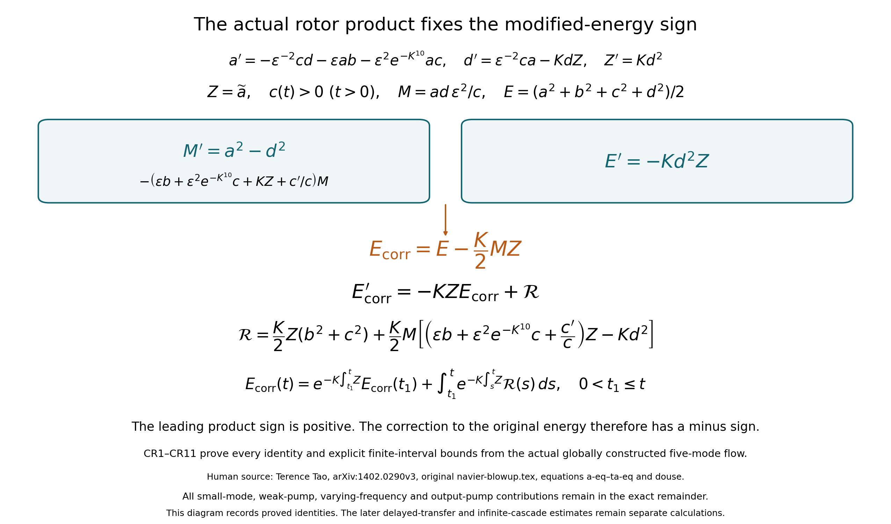
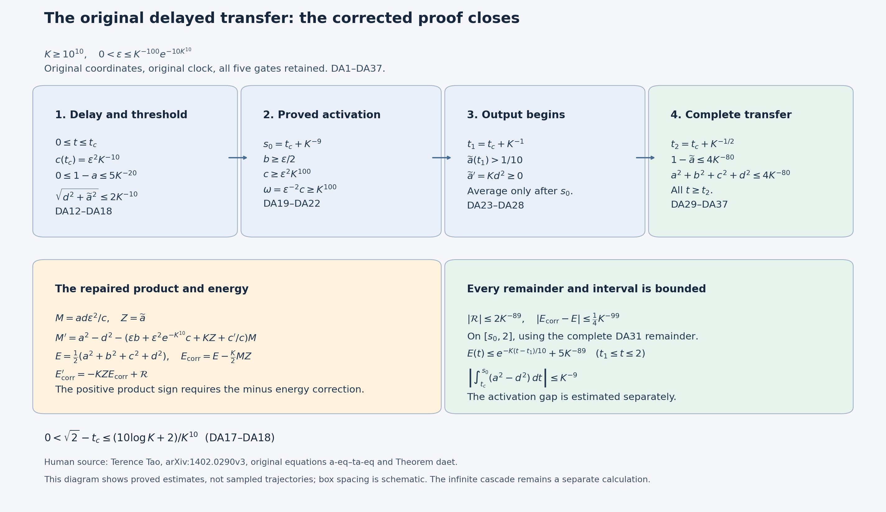
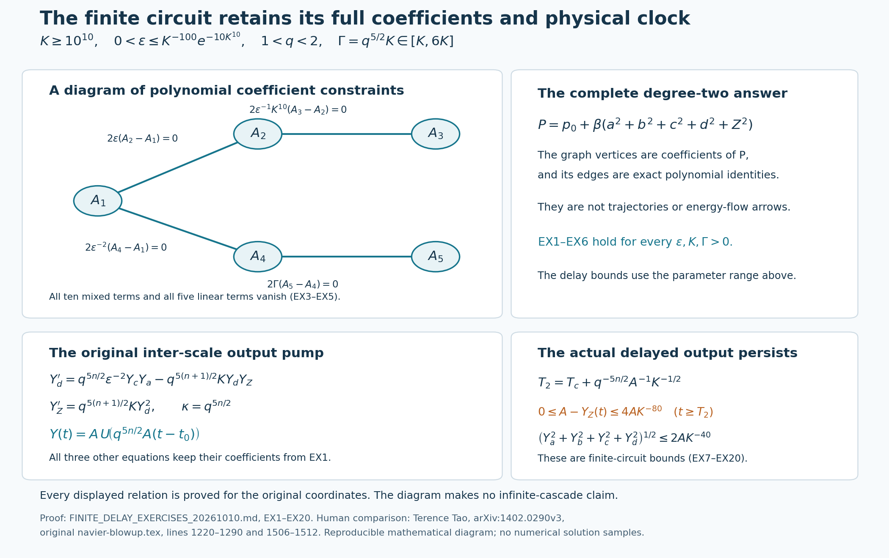

# The original autonomous circuit and its complete delayed transfer

The original five-mode circuit creates its own delayed transfer. This
lesson constructs the actual global flow and proves that its output
receives almost all the initial energy after a precisely controlled delay.
Every original coefficient and time interval is retained. The product
sign, modified-energy sign, activation interval and two coefficient-table
entries are corrected visibly and received by the complete proofs.

The human source is Terence Tao’s
[arXiv:1402.0290v3](https://arxiv.org/abs/1402.0290v3), original
navier-blowup.tex, lines 1224–1512. The exposition below is a complete
editorial reconstruction from the author's original equations. No
novelty claim is made. The earlier [gate and scheduled-transfer lesson](original-quadratic-gates-and-the-exact-dissipative-transfer.md)
constructs the component flows, while [the full viscous reduction](the-original-viscous-cascade-and-its-exact-memory-equation.md)
retains the exact orthogonal memory and physical band equations.

Five solved exercises classify every polynomial first integral of degree
at most two, return all conclusions to arbitrary amplitude and physical
time, retain the original inter-scale pump factor, prove an explicit
neighborhood of persistent finite transfer, and locate the actual trigger
time in a much shorter interval. Three reproducible diagrams show the
repaired energy, the valid stages of the proof and the exact coefficient
constraints. The subsequent infinite-cascade induction still needs its
own estimates for the additional modes and full viscosity.

## The original circuit and its visible repairs

The original five-mode flow and all its initial data are constructed in [lesson 41](original-quadratic-gates-and-the-exact-dissipative-transfer.md), QG18–QG20. That proof retains all five gates and gives
\(a^2+b^2+c^2+d^2+\widetilde a^2=1\),
\(c(t)>0\) for \(t>0\), and \(0\leq\widetilde a(t)\leq1\).
The following computations concern that actual flow.

## CR1. Differentiate the complete original rotor product

Write \(Z=\widetilde a\), and display the two auxiliary coefficients with every original contribution:
\[
 \omega=\epsilon^{-2}c,\qquad
 p=\epsilon b+\epsilon^2e^{-K^{10}}c.
\tag{CR1}
\]
They are names for the retained terms; the original equations remain
\[
\begin{aligned}
 a'&=-\epsilon^{-2}cd-\epsilon ab-\epsilon^2e^{-K^{10}}ac
     =-\omega d-pa,\\
 d'&=\epsilon^{-2}ca-KdZ=\omega a-KdZ,\qquad Z'=Kd^2.
\end{aligned}
\tag{CR2}
\]
Thus, for every \(t>0\), the actual product \(M=ad\,\epsilon^2/c=ad/\omega\) has derivative
\[
\begin{aligned}
 (ad)'&=\omega(a^2-d^2)-(p+KZ)ad,\\
 M'&=a^2-d^2-
 \left(\epsilon b+\epsilon^2e^{-K^{10}}c+KZ+\frac{c'}c\right)M,\\
 (MZ)'&=(a^2-d^2)Z-
 \left(\epsilon b+\epsilon^2e^{-K^{10}}c+KZ+\frac{c'}c\right)MZ
 +KMd^2.
\end{aligned}
\tag{CR3}
\]
The first line is \(a'd+ad'\) using both CR2 equations. Division by \(\omega>0\) and the derivative of \(1/\omega\) give the second. Multiplication by \(Z\) and \(Z'=Kd^2\) give the third. Every omitted-looking contribution has therefore been written explicitly.
The leading sign in the source's douse display is negative; the original equations give the positive sign in CR3. Its later unweighted product display has the same sign discrepancy.

## CR2. Construct the correctly signed modified energy and exact remainder

Retain the actual energy outside the final output:
\[
 E=\frac12(a^2+b^2+c^2+d^2)=\frac12(1-Z^2),
 \qquad E'=-Kd^2Z.
\tag{CR4}
\]
The source uses \(E+(K/2)MZ\) after its negative-sign product display. Using the actual positive CR3 instead, the modified energy that produces the stated symmetric drain is
\[
 E_{\rm corr}=E-\frac K2MZ.
\tag{CR5}
\]
This is a visible change of sign; the original \(E\), \(M\) and every coordinate are retained. Subtract \(K/2\) times CR3 from CR4. The two contributions to \(d^2Z\) combine to \(-Kd^2Z/2\), giving the exact identities
\[
\begin{aligned}
 E_{\rm corr}'={}&-\frac K2(a^2+d^2)Z\\
 &+\frac K2M
 \left[\left(\epsilon b+\epsilon^2e^{-K^{10}}c+KZ+\frac{c'}c\right)Z-Kd^2\right],\\
 E_{\rm corr}'={}&-KZE_{\rm corr}+\mathcal R,\\
 \mathcal R={}&\frac K2Z(b^2+c^2)
 +\frac K2M
 \left[\left(\epsilon b+\epsilon^2e^{-K^{10}}c+\frac{c'}c\right)Z-Kd^2\right].
\end{aligned}
\tag{CR6}
\]
For the last two lines, use
\((a^2+d^2)/2=E_{\rm corr}+(K/2)MZ-(b^2+c^2)/2\);
the resulting \(K^2MZ^2/2\) terms cancel exactly. This derives the full remainder, including the small-coordinate energies, original weak pump, varying rotor frequency and output pump.

For any fixed \(0<t_1\leq t\leq t_2<\infty\), all terms are continuous and \(c>0\). Multiplying CR6 by the actual integrating factor gives
\[
 E_{\rm corr}(t)=
 e^{-K\int_{t_1}^t Z}E_{\rm corr}(t_1)
 +\int_{t_1}^t e^{-K\int_s^t Z}\mathcal R(s)\,ds.
\tag{CR7}
\]
This retains the true starting time. In the source, strong rotor activation is proved only on \(I=[t_c+K^{-9},2]\); an estimate using that activation cannot start its product integral at \(t_c\) without an additional bound for the intervening interval. CR7 is valid on its entire displayed interval independently of that later estimate.

Here are actual explicit bounds that also remove any possible existence assumption from CR7. From QG19 and \(2|uv|\leq u^2+v^2\leq1\),
\[
 |a'|\leq L_a:=\frac{\epsilon^{-2}+\epsilon+\epsilon^2e^{-K^{10}}}{2}.
\tag{CR8}
\]
Let \(h_0=\min\{t_1,(2L_a)^{-1}\}\). On \(0\leq s\leq h_0\), \(a(s)\geq1-L_as\geq1/2\). Set \(\beta=\epsilon^{-1}K^{10}\). The exact QG20 integral and \(b\geq-1\) then give, throughout \([t_1,t_2]\),
\[
\begin{gathered}
 c(t)\geq c_{\min}:=
 \frac{\epsilon^2e^{-K^{10}}h_0}{4}e^{-\epsilon^{-1}K^{10}t_2}>0,\\
 \omega(t)\geq\Omega:=\epsilon^{-2}c_{\min},\qquad
 \left|\frac{c'}c\right|
 \leq\Lambda:=\frac{\epsilon^2e^{-K^{10}}}{c_{\min}}+\epsilon^{-1}K^{10}.
\end{gathered}
\tag{CR9}
\]
Indeed the exponent in QG20 is at least \(-\beta(t-s)\geq-\beta t_2\), and its forcing has \(a^2\geq1/4\) on the full interval of length \(h_0\). The last inequality is the original \(c'\) equation divided by this positive lower bound.
QG20 and regularization of \(\sqrt{b^2+c^2}\) as in QG2 also give
\[
 \sqrt{b(t)^2+c(t)^2}
 \leq \sqrt{\epsilon^2+\epsilon^4e^{-2K^{10}}}
       \int_0^t a(s)^2\,ds
 \leq t\sqrt{\epsilon^2+\epsilon^4e^{-2K^{10}}}.
\tag{CR10}
\]
Both input terms are retained through Cauchy–Schwarz applied to their two-component vector. Since \(|ad|\leq1/2\), CR9–CR10 imply
\[
\begin{gathered}
 |E_{\rm corr}-E|\leq\frac K{4\Omega},\\
 |\mathcal R(t)|\leq
 R_0:=\frac K2(\epsilon^2+\epsilon^4e^{-2K^{10}})t_2^2
 +\frac K{4\Omega}
    \left(\epsilon+\epsilon^2e^{-K^{10}}+\Lambda+K\right),\\
 |E_{\rm corr}(t)|
 \leq e^{-K\int_{t_1}^tZ}|E_{\rm corr}(t_1)|+R_0(t-t_1).
\end{gathered}
\tag{CR11}
\]
The last inequality uses \(Z\geq0\) in the complete integral CR7. These are explicit proved finite-interval bounds for every positive \(K,\epsilon\). They can be large. The complete delayed-transfer proof DA1–DA37 obtains the required stronger drive bound and small remainder on its actual interval, under an explicit sufficient parameter restriction.

## CR3. Calculate the precise defects in the printed coefficient table

CR1–CR11 prove the identities, their full signed remainder and the explicit finite-interval bounds shown here. The two upper boxes contain the actual product and energy derivatives; subtracting the product correction gives the full symmetric drain. The diagram keeps the original coordinates, every coefficient, the actual start time and all remainder terms. [Reproducible source](../assets/original-circuit-energy-repair.py) and [vector figure](../assets/original-circuit-energy-repair.svg). Human comparison: Tao's original equations a-eq–ta-eq and douse. No delayed-transfer conclusion is inferred solely from these identities.

Let \(q=1+\epsilon_0\), retain the original four fields and four shift set of lesson40, and write \(000\) for its zero shift. Three printed entries in the source table are
\[
\begin{aligned}
 \alpha^{\rm print}_{1,3,1,000}
   &=-\tfrac12\epsilon^2e^{-K^{10}},\\
 \alpha^{\rm print}_{3,1,1,000}
   &=-\tfrac12\epsilon^2e^{-K^{-10}},\\
 \alpha^{\rm print}_{1,1,3,000}
   &=\epsilon^2e^{K^{-10}}.
\end{aligned}
\tag{CR12}
\]
They do not describe the weak pump in QG18. Their exact first-two-slot symmetry defect is
\[
 \alpha^{\rm print}_{1,3,1,000}
 -\alpha^{\rm print}_{3,1,1,000}
 =\tfrac12\epsilon^2(e^{-K^{-10}}-e^{-K^{10}}).
\tag{CR13}
\]
For the three indices \((1,1,3)\), each distinct arrangement occurs twice among the six permutations. Thus their full cancellation sum is
\[
 \sum_{\sigma\in\mathfrak S_3}
 \alpha^{\rm print}_{i_{\sigma(1)},i_{\sigma(2)},i_{\sigma(3)},000}
 =\epsilon^2(2e^{K^{-10}}-e^{-K^{10}}-e^{-K^{-10}})>0.
\tag{CR14}
\]
For \(K>0\), \(e^{K^{-10}}>1\) and both negative-exponent exponentials are below one, proving the strict inequality. Hence the printed table fails the original energy-cancellation condition even when its symmetry defect happens to vanish.
If \(X_{\ell,n}=\langle u,\psi_{\ell,n}\rangle\), the contribution of these three entries to the complete cubic pairing is exactly
\[
 \frac{\epsilon^2}{2}
 (2e^{K^{-10}}-e^{-K^{10}}-e^{-K^{-10}})
 \sum_{n\in\mathbb Z}q^{5n/2}X_{1,n}^2X_{3,n}.
\tag{CR15}
\]
This follows by inserting each entry into the original cascade sum; the two \(X_1X_3X_1\) products have their distinct printed coefficients. The series is absolutely convergent in the spaces proved in lesson40. All other gate groups in the table cancel, as checked below. In particular the printed defect is an explicit cubic form, not merely a nonidentity of presentations.

## CR4. Construct the exact additive correction and its receiving operator

Preserve the printed operator \(C^{\rm print}\). Define \(\alpha^{\rm corr}\) by changing precisely its following two entries:
\[
\begin{gathered}
 \alpha^{\rm corr}_{3,1,1,000}=-\tfrac12\epsilon^2e^{-K^{10}},
 \qquad
 \alpha^{\rm corr}_{1,1,3,000}=\epsilon^2e^{-K^{10}},\\
 \Delta\alpha_{3,1,1,000}
 =\tfrac12\epsilon^2(e^{-K^{-10}}-e^{-K^{10}}),\qquad
 \Delta\alpha_{1,1,3,000}
 =\epsilon^2(e^{-K^{10}}-e^{K^{-10}}).
\end{gathered}
\tag{CR16}
\]
All other entries, fields, shifts and scale factors stay the source's original ones. In particular, listing every nonzero corrected coefficient in groups gives the entire table:
\[
\begin{aligned}
 \alpha^{\rm corr}_{3,4,1,000}
 =\alpha^{\rm corr}_{4,3,1,000}&=-\epsilon^{-2}/2,&
 \alpha^{\rm corr}_{1,3,4,000}
 =\alpha^{\rm corr}_{3,1,4,000}&=\epsilon^{-2}/2,\\
 \alpha^{\rm corr}_{1,2,1,000}
 =\alpha^{\rm corr}_{2,1,1,000}&=-\epsilon/2,&
 \alpha^{\rm corr}_{1,1,2,000}&=\epsilon,\\
 \alpha^{\rm corr}_{1,3,1,000}
 =\alpha^{\rm corr}_{3,1,1,000}&=-\epsilon^2e^{-K^{10}}/2,&
 \alpha^{\rm corr}_{1,1,3,000}&=\epsilon^2e^{-K^{10}},\\
 \alpha^{\rm corr}_{3,3,2,000}&=-\epsilon^{-1}K^{10},&
 \alpha^{\rm corr}_{2,3,3,000}
 =\alpha^{\rm corr}_{3,2,3,000}&=\epsilon^{-1}K^{10}/2,\\
 \alpha^{\rm corr}_{4,4,1,001}&=q^{5/2}K,&
 \alpha^{\rm corr}_{1,4,4,100}
 =\alpha^{\rm corr}_{4,1,4,010}&=-q^{5/2}K/2.
\end{aligned}
\tag{CR17}
\]
Every unlisted entry is zero. The pairs explicitly prove first-two-slot symmetry, including exchange of their shifts. For each pump group the six-term sum is twice its output coefficient plus twice each of the two drain coefficients and is zero. The amplifier has the same cancellation with the signs reversed. The rotor has four nonzero entries, two of each sign; its remaining two permutations have zero coefficients, so its six-term sum is zero. The cross-scale pump has the identical three-entry cancellation with the same retained \(q^{5/2}\). These groups exhaust the nonzero index-and-shift multisets, and all other permutation sums are zero term by term. Thus the complete original symmetry and cancellation conditions hold for this corrected table.

The precise map between the operators is \(C^{\rm corr}=C^{\rm print}+\Delta C\), where
\[
\begin{aligned}
 \Delta C(u,v)=\sum_{n\in\mathbb Z}q^{5n/2}\bigg[
 &\frac{\epsilon^2}{2}(e^{-K^{-10}}-e^{-K^{10}})
 \langle u,\psi_{3,n}\rangle\langle v,\psi_{1,n}\rangle\psi_{1,n}\\
 &+\epsilon^2(e^{-K^{10}}-e^{K^{-10}})
 \langle u,\psi_{1,n}\rangle\langle v,\psi_{1,n}\rangle\psi_{3,n}
 \bigg].
\end{aligned}
\tag{CR18}
\]
This is an equality of the full unchanged-field operators, because exactly the two changed entries occur in the difference of their defining sums. The complete analysis and synthesis estimate VD6 applies to each of these two terms, including all field norms, and gives unconditional convergence in \(H^s\) whenever the two input orders \(p,r\) satisfy \(p+r-s\geq5/2\). Hence subtraction, regrouping and the displayed equality are valid on those original spaces. Pairing CR18 with \(u\) cancels exactly CR15; this independently verifies the repaired energy.

For clarity the corrected scalar forcing coefficients, before their actual viscous terms are added, are
\[
\begin{aligned}
 F_{1,n}&=q^{5n/2}
 \left[-\epsilon^{-2}X_{3,n}X_{4,n}
 -\epsilon X_{1,n}X_{2,n}
 -\epsilon^2e^{-K^{10}}X_{1,n}X_{3,n}
 +KX_{4,n-1}^2\right],\\
 F_{2,n}&=q^{5n/2}
 \left[\epsilon X_{1,n}^2-\epsilon^{-1}K^{10}X_{3,n}^2\right],\\
 F_{3,n}&=q^{5n/2}
 \left[\epsilon^2e^{-K^{10}}X_{1,n}^2+\epsilon^{-1}K^{10}X_{2,n}X_{3,n}\right],\\
 F_{4,n}&=q^{5n/2}
 \left[\epsilon^{-2}X_{1,n}X_{3,n}-q^{5/2}KX_{4,n}X_{1,n+1}\right].
\end{aligned}
\tag{CR19}
\]
The incoming term in \(F_{1,n}\) has the exact product
\(q^{5(n-1)/2}q^{5/2}K=q^{5n/2}K\);
the two outgoing half-coefficients in \(F_{4,n}\) add to the retained \(-q^{5/2}K\). This verifies both boundary scales directly from CR17 and VD16.
For the original source fields \(A_i=1\). More generally, keeping their actual squared norms as in [lesson 40](the-original-viscous-cascade-and-its-exact-memory-equation.md), the exact physical coordinates satisfy
\[
 X_{i,n}'=A_iF_{i,n}
 +\nu\langle u_{i,n},\Delta\psi_{i,n}\rangle,
 \qquad
 E_{i,n}'=F_{i,n}X_{i,n}-\nu\|\nabla u_{i,n}\|_2^2.
\tag{CR20}
\]
VD21–VD32 give the complete orthogonal component and positive memory of these same bands; neither is replaced by a scalar damping assumption. CR17 now satisfies the proved averaging and local-flow hypotheses, so these are actual local flows on the constructed maximal interval.

The original finite five-mode activation and complete corrected remainder CR6 are now controlled in DA1–DA37. That proof establishes the original delayed-transfer theorem. The actual infinite circuit transfer with CR19–CR20 remains to be proved; the full averaged-equation blowup conclusion has not been validated by this finite calculation.

## DA1. The actual equations and a quantitative statement

Keep all five original coordinates and coefficients:
\[
\begin{aligned}
 a'&=-\epsilon^{-2}cd-\epsilon ab-\epsilon^2e^{-K^{10}}ac,\\
 b'&=\epsilon a^2-\epsilon^{-1}K^{10}c^2,\\
 c'&=\epsilon^2e^{-K^{10}}a^2+\epsilon^{-1}K^{10}bc,\\
 d'&=\epsilon^{-2}ca-Kd\widetilde a,\\
 \widetilde a'&=Kd^2,\qquad
 (a,b,c,d,\widetilde a)(0)=(1,0,0,0,0).
\end{aligned}
\tag{DA1}
\]
The following explicit parameter range is sufficient; no optimal size is claimed:
\[
 K\geq10^{10},\qquad
 0<\epsilon\leq K^{-100}e^{-10K^{10}}.
\tag{DA2}
\]
For these parameters there is a unique global solution. There is a first time \(t_c\) with \(c(t_c)=\epsilon^2K^{-10}\), and
\[
 1<t_c<\sqrt2<\tfrac32,\qquad
 0<\sqrt2-t_c\leq\frac{10\log K+2}{K^{10}}
 \leq K^{-1/2}.
\tag{DA3}
\]
Before this first threshold, the exact quantitative bounds are
\[
\begin{gathered}
 0\leq1-a(t)\leq5K^{-20},\qquad
 \sqrt{b(t)^2+c(t)^2}\leq3\epsilon,\\
 \sqrt{d(t)^2+\widetilde a(t)^2}\leq2K^{-10}
 \qquad(0\leq t\leq t_c).
\end{gathered}
\tag{DA4}
\]
At the later time and for the entire future one has
\[
\begin{gathered}
 0\leq1-\widetilde a(t)\leq4K^{-80},\\
 \sqrt{a(t)^2+b(t)^2+c(t)^2+d(t)^2}\leq2K^{-40}
 \qquad(t\geq t_c+K^{-1/2}).
\end{gathered}
\tag{DA5}
\]
In particular DA3–DA5 imply all conclusions of the source's Theorem daet, with the original initial data, coefficients, coordinates and time variable. They also give a smaller explicit error and a more precise location of the first threshold. The proof follows without assuming any transfer estimate.

For readable calculations below, \(A:=K^{10}\) and \(Z:=\widetilde a\) are only names for the displayed original power and output coordinate. No time, amplitude or equation is rescaled.

## DA2. Construct the global flow and prove all initial energy bounds

The polynomial right side of DA1 is a bilinear expression \(G(U,U)\) on \(\mathbb R^5\), where each mixed monomial may be split equally between the two input orders. With the Euclidean norm, its coefficient sum is bounded by
\[
 L=2\epsilon^{-2}+2\epsilon+2\epsilon^2e^{-K^{10}}
       +2\epsilon^{-1}K^{10}+2K.
\tag{DA6}
\]
Indeed there are two terms of each of the five displayed coupling strengths in the complete vector field. The absolute value of each bilinear coordinate product is at most the product of the two Euclidean input norms, and the Euclidean output norm is at most the sum of the absolute output coordinates. Consequently
\(\|G(U,V)\|\leq L\|U\|\|V\|\) and

\[
 \|G(U,U)-G(V,V)\|\leq L(\|U\|+\|V\|)\|U-V\|.
\]

For any initial vector \(U_*\), put \(R=1+\|U_*\|\). On the closed space of continuous functions with \(\sup_{[0,h]}\|U-U_*\|\leq R\), the integral map
\(U\mapsto U_*+\int_0^tG(U(s),U(s))\,ds\)
has displacement at most \(4LR^2h\) and Lipschitz constant at most \(4LRh\). Taking \(h=(8LR)^{-1}\) maps the space into itself with contraction constant at most one half. Successive iterates converge uniformly: their differences form a geometric series. Their limit is the unique fixed point, is continuously differentiable, and satisfies DA1. The same estimate on overlapping intervals proves local uniqueness.

Differentiate half the complete squared norm, retaining every contribution:
\[
\begin{aligned}
 \tfrac12(a^2+b^2+c^2+d^2+Z^2)'={}&
 -\epsilon^{-2}acd-\epsilon a^2b-\epsilon^2e^{-A}a^2c\\
 &+\epsilon a^2b-\epsilon^{-1}A bc^2
 +\epsilon^2e^{-A}a^2c+\epsilon^{-1}A bc^2\\
 &+\epsilon^{-2}acd-Kd^2Z+Kd^2Z=0.
\end{aligned}
\tag{DA7}
\]
Hence \(a^2+b^2+c^2+d^2+Z^2=1\). On any hypothetical finite maximal interval, DA6 bounds the derivative by \(L\), so the solution has a limit at its finite right endpoint. The same contraction construction restarts it there, contradicting maximality. The solution is therefore global, and uniqueness holds throughout it.

The original output and drive have the exact integral representations
\[
\begin{aligned}
 Z(t)&=K\int_0^t d(s)^2\,ds,\\
 c(t)&=\epsilon^2e^{-A}
 \int_0^t a(s)^2
 \exp\left(\epsilon^{-1}A\int_s^t b(r)\,dr\right)ds.
\end{aligned}
\tag{DA8}
\]
The second identity follows by multiplying the original linear equation for \(c\), with its actual coefficients along the constructed solution, by its integrating factor. Since \(a(0)=1\), its integrand is positive on a nonempty initial interval. Thus \(c(t)>0\) for every \(t>0\), and \(0\leq Z(t)\leq1\) is nondecreasing on the entire half-line.

The two exact partial energy identities are
\[
\begin{aligned}
 (b^2+c^2)'&=2a^2(\epsilon b+\epsilon^2e^{-A}c),\\
 (d^2+Z^2)'&=2\epsilon^{-2}cad.
\end{aligned}
\tag{DA9}
\]
To integrate the first, differentiate \(\sqrt{b^2+c^2+\eta}\), where \(\eta>0\). Cauchy–Schwarz bounds its derivative above by
\(a^2\sqrt{\epsilon^2+\epsilon^4e^{-2A}}\).
Integrate from zero and let \(\eta\downarrow0\). The same regularization for the second identity bounds its square-root derivative above by \(\epsilon^{-2}c|a|\). These calculations prove
\[
\begin{aligned}
 \sqrt{b(t)^2+c(t)^2}
 &\leq\sqrt{\epsilon^2+\epsilon^4e^{-2A}}
      \int_0^t a(s)^2ds\leq\sqrt2\epsilon t,\\
 \sqrt{d(t)^2+Z(t)^2}
 &\leq\epsilon^{-2}\int_0^t c(s)|a(s)|ds
 \leq\epsilon^{-2}\int_0^t c(s)ds.
\end{aligned}
\tag{DA10}
\]
In particular \(b^2+c^2\leq9\epsilon^2\) on \([0,2]\). Inserting \(b\leq3\epsilon\) into the actual drive equation gives
\(c'\leq\epsilon^2e^{-A}+3Ac\). Its integrating factor, initial value zero and positivity yield
\[
 0\leq c(t)\leq
 \epsilon^2e^{-A}\frac{e^{3At}-1}{3A}
 \leq\epsilon^2e^{5A}\qquad(0\leq t\leq2).
\tag{DA11}
\]
Every small forcing term remains present in the first expression; the last expression is an upper bound for that same drive.

## DA3. Prove that the original threshold is reached and locate it

Let \(t_c\) be the supremum of the times \(t\in[0,2]\) for which \(c(s)\leq\epsilon^2/A\) for all \(0\leq s\leq t\). It is positive by continuity and \(c(0)=0\). All estimates in this paragraph hold up to that supremum, whether or not it equals two.

DA10 gives \(\sqrt{d^2+Z^2}\leq2/A\) on \([0,t_c]\). From DA7 and DA10,
\[
 a^2\geq1-9\epsilon^2-4A^{-2}\geq1-5A^{-2}>0.
\tag{DA12}
\]
For the second inequality use \(9\epsilon^2\leq9K^{-200}\leq K^{-20}=A^{-2}\), valid in DA2. By continuity \(a>0\); since \(a\leq1\), this also proves \(0\leq1-a\leq1-a^2\leq5A^{-2}\).

The original equation for \(b\), including its negative term, gives
\[
 \epsilon(1-6A^{-2})\leq b'
 =\epsilon a^2-\epsilon^{-1}Ac^2\leq\epsilon,
 \qquad
 \epsilon t(1-6A^{-2})\leq b(t)\leq\epsilon t.
\tag{DA13}
\]
Here \(\epsilon^{-1}Ac^2\leq\epsilon^3/A\) and \(\epsilon^2/A\leq A^{-2}\) were used; the latter follows from \(\epsilon^2\leq K^{-200}\leq A^{-1}\).

Define the actual comparison integral and a fixed lower factor by
\[
 I_A(t)=\int_0^t e^{-As^2/2}ds,\qquad
 \ell_A=(1-5A^{-2})e^{-12/A}\geq\tfrac12.
\tag{DA14}
\]
The last inequality follows from \(e^{-x}\geq1-x\):
\(\ell_A\geq1-5A^{-2}-12/A\geq1-13/A\geq1/2\).
Use DA12–DA13 in the full integral DA8. For \(0\leq s\leq t\leq2\), its exponent lies between
\(A(t^2-s^2)/2-12/A\) and \(A(t^2-s^2)/2\). The retained forcing \(a(s)^2\) lies between \(1-5A^{-2}\) and one. Therefore
\[
 \ell_A\epsilon^2 e^{A(t^2/2-1)}I_A(t)
 \leq c(t)\leq
 \epsilon^2 e^{A(t^2/2-1)}I_A(t)
 \qquad(0\leq t\leq t_c).
\tag{DA15}
\]

For \(t\leq1\), its upper bound is at most \(\epsilon^2e^{-A/2}<\epsilon^2/A\). Indeed \(e^{A/2}\geq A^2/8>A\). If \(t_c\leq1\), the strict bound at \(t_c<2\) and continuity would allow a longer interval in its definition, a contradiction. Thus \(t_c>1\).

For \(t\geq1\), retaining the complete prefactor in the substitution \(v=\sqrt A s\) gives
\[
 \frac{e^{-1/2}}{\sqrt A}\leq I_A(t)
 <\frac2{\sqrt A}.
\tag{DA16}
\]
The lower bound integrates only \(0\leq s\leq A^{-1/2}\). For the upper bound,

\[
 \int_0^\infty e^{-v^2/2}dv\leq1+\int_1^\infty v e^{-v^2/2}dv=1+e^{-1/2}<2.
\]
If \(t_c\geq3/2\), DA15–DA16 at \(3/2\) would give
\(c(3/2)\geq\epsilon^2 e^{A/8-1/2}/(2\sqrt A)>\epsilon^2/A\).
For this last strict inequality, \(e^{A/8}\geq1\), \(e^{-1/2}>1/2\), and \(\sqrt A>4\) suffice. This contradicts the defining bound. Consequently \(1<t_c<3/2\) and \(c(t_c)=\epsilon^2/A\). Since DA13 makes \(b>0\) before this time, DA1 gives \(c'>0\) there, so this is its first threshold time.

Substitute its exact threshold value into DA15–DA16 and take logarithms:
\[
 -\tfrac12\log A-\log2
 \leq A(t_c^2/2-1)
 \leq-\tfrac12\log A+\log2+\tfrac12<0.
\tag{DA17}
\]
The right side is negative because \(A\geq10^{100}>4e\). This proves \(t_c<\sqrt2\). Since \(t_c>1\),
\[
 0<\sqrt2-t_c
 \leq\frac{\log A+2\log2}{A(1+\sqrt2)}
 <\frac{10\log K+2}{K^{10}}\leq K^{-1/2}.
\tag{DA18}
\]
For the final inequality, \(\log K\leq\sqrt K\) on \([1,\infty)\), as differentiation shows its ratio has maximum \(2/e<1\). Thus \(10\log K+2\leq12\sqrt K\leq K^{19/2}\) in DA2. DA12 and DA10 already give all of DA4.

## DA4. Bound the actual activation gap and the full rotor coefficient

The crude drive bound DA11 now supplies the needed lower bound on the original \(b\), without assuming its sign after \(t_c\):
\[
\begin{aligned}
 b(t)&=b(t_c)+\epsilon\int_{t_c}^t a(s)^2ds
       -\epsilon^{-1}A\int_{t_c}^t c(s)^2ds\\
 &\geq\epsilon(1-6A^{-2})-2\epsilon^3Ae^{10A}
 \geq\epsilon/2\qquad(t_c\leq t\leq2).
\end{aligned}
\tag{DA19}
\]
Here \(6A^{-2}\leq1/4\) and
\(2\epsilon^2Ae^{10A}\leq2K^{-190}e^{-10A}\leq1/4\).
Both are consequences of DA2. It follows from the actual \(c\) equation that
\[
 c(t)\geq\epsilon^2K^{-10}e^{K^{10}(t-t_c)/2}
 \qquad(t_c\leq t\leq2).
\tag{DA20}
\]

Set
\[
 s_0=t_c+K^{-9},\qquad
 t_1=t_c+K^{-1},\qquad
 t_2=t_c+K^{-1/2}.
\tag{DA21}
\]
These satisfy \(t_c<s_0<t_1<t_2<2\). Since \(K/2\geq110\log K\) in DA2, DA20 gives \(c\geq\epsilon^2K^{100}\) on \([s_0,2]\). To verify that parameter inequality directly, use \(\log K\leq\sqrt K\) and \(\sqrt K\geq10^5>220\).

Write out the actual coefficients used in the energy calculation:
\[
\begin{gathered}
 \omega=\epsilon^{-2}c,\qquad
 p=\epsilon b+\epsilon^2e^{-A}c,\qquad
 r=\frac{c'}c=\frac{\epsilon^2e^{-A}a^2}{c}+\epsilon^{-1}Ab,\\
 \omega\geq K^{100},\qquad
 0\leq p\leq6\epsilon^2\leq1,\qquad
 A/2\leq r\leq K^{-100}e^{-A}+3A\leq4A
 \quad(s_0\leq t\leq2).
\end{gathered}
\tag{DA22}
\]
The bound for \(p\) uses \(b,c\leq3\epsilon\); the bound for \(r\) keeps its full weak forcing term. These estimates use no assumed averaging of the rotor.

## DA5. Prove the transfer starts, using the correct product and interval

For \(t>0\) define the actual inverse-frequency product \(M=ad/\omega=ad\epsilon^2/c\). Direct differentiation using all terms in DA1 gives
\[
\begin{aligned}
 (ad)'&=\omega(a^2-d^2)-(p+KZ)ad,\\
 M'&=a^2-d^2-(p+KZ+r)M.
\end{aligned}
\tag{DA23}
\]
Thus its leading sign is positive. This corrects the negative sign in the source's douse display and later unweighted product calculation.

On \([s_0,2]\), DA7 and DA22 imply
\[
 |M|\leq\tfrac12K^{-100},\qquad
 0\leq p+KZ+r\leq1+K+4A\leq6A.
\tag{DA24}
\]
For every \(s_0\leq u\leq v\leq2\), integrate DA23 with its correct sign and bound the complete product term:
\[
 \left|\int_u^v(a^2-d^2)dt\right|
 \leq K^{-100}+3K^{-90}(v-u).
\tag{DA25}
\]
This estimate begins only where strong activation has actually been proved. For comparison with the source's earlier lower endpoint, DA7 separately proves
\[
 \left|\int_{t_c}^{s_0}(a^2-d^2)dt\right|\leq K^{-9}.
\tag{DA26}
\]
Thus no small-frequency product at \(t_c\) is assigned the later high-frequency bound. DA25 plus DA26 also gives a complete bound for any requested integral starting at \(t_c\).

We next prove \(Z(t_1)>1/10\). Suppose instead \(Z(t_1)\leq1/10\). Monotonicity then gives this bound throughout \([s_0,t_1]\). DA7 and DA10 imply there
\(a^2+d^2\geq99/100-9\epsilon^2\geq49/50\).
Put \(h=t_1-s_0=K^{-1}-K^{-9}\geq(2K)^{-1}\). By DA25,
\[
\begin{aligned}
 \int_{s_0}^{t_1}d^2dt
 &=\tfrac12\int_{s_0}^{t_1}(a^2+d^2)dt
   -\tfrac12\int_{s_0}^{t_1}(a^2-d^2)dt\\
 &\geq\left(\tfrac{49}{100}-\tfrac32K^{-90}\right)h
         -\tfrac12K^{-100}\\
 &\geq\frac{12}{25}h-\tfrac12K^{-100}
 \geq\frac6{25K}-\tfrac12K^{-100}>\frac1{5K}.
\end{aligned}
\tag{DA27}
\]
The numeric inequalities follow respectively from \(\frac32K^{-90}\leq1/100\) and \(K^{99}>25/2\), both satisfied by DA2. Since \(Z'=Kd^2\) and \(Z(s_0)\geq0\), DA27 would give \(Z(t_1)>1/5\), contradicting the supposition. Therefore
\[
 Z(t_1)>\tfrac1{10},\qquad Z(t)\geq\tfrac1{10}\quad(t\geq t_1).
\tag{DA28}
\]

## DA6. Bound every term of the repaired energy and complete the transfer

Retain the actual energy outside the output, and define its corrected companion:
\[
 E=\tfrac12(a^2+b^2+c^2+d^2)=\tfrac12(1-Z^2),
 \qquad E_{\rm corr}=E-\tfrac K2MZ.
\tag{DA29}
\]
This minus sign is the visible repair of the source's plus correction. First \(E'=-Kd^2Z\) by DA7 and \(Z'=Kd^2\). Multiplying DA23 by \(Z\), and retaining its derivative, gives
\[
 (MZ)'=(a^2-d^2)Z-(p+KZ+r)MZ+KMd^2.
\tag{DA30}
\]
Subtract \(K/2\) times this identity from \(E'\). The exact result, before any estimate, is
\[
\begin{aligned}
 E_{\rm corr}'
 &=-\tfrac K2(a^2+d^2)Z
    +\tfrac K2M\big[(p+KZ+r)Z-Kd^2\big]\\
 &=-KZE_{\rm corr}+\mathcal R,\\
 \mathcal R
 &=\tfrac K2Z(b^2+c^2)
   +\tfrac K2M\left[
      \left(\epsilon b+\epsilon^2e^{-K^{10}}c+\frac{c'}c\right)Z-Kd^2
    \right].
\end{aligned}
\tag{DA31}
\]
For the second equality substitute

\[
 (a^2+d^2)/2=E_{\rm corr}+(K/2)MZ-(b^2+c^2)/2.
\]
The two terms with \(K^2MZ^2/2\) cancel. This accounts for every contribution to the remainder, including the weak pump, changing rotor frequency and the output pump.

DA10, DA22 and DA24 now prove the required small errors on their actual common interval:
\[
\begin{aligned}
 |E_{\rm corr}-E|&\leq\tfrac14K^{-99},\\
 |\mathcal R|
 &\leq\tfrac92K\epsilon^2
      +\tfrac14K^{-99}(1+4A+K)
 \leq2K^{-89}\qquad(s_0\leq t\leq2).
\end{aligned}
\tag{DA32}
\]
Indeed the second term is at most \(\frac32K^{-89}\), and the first is at most \(\frac12K^{-89}\), since \(9\epsilon^2\leq9K^{-200}\leq K^{-90}\).

At the valid starting time \(s_0\), \(E_{\rm corr}(s_0)\leq1/2+K^{-99}/4\leq1\). Use the exact integrating factor for DA31 on this interval:
\[
 E_{\rm corr}(t)
 =e^{-K\int_{s_0}^t Z(r)dr}E_{\rm corr}(s_0)
 +\int_{s_0}^t e^{-K\int_u^t Z(r)dr}\mathcal R(u)du.
\tag{DA33}
\]
There is no need to assume \(E_{\rm corr}\) positive. Since \(Z\geq0\), DA32 and \(t-s_0\leq2\) imply
\[
 0\leq E(t)
 \leq e^{-K\int_{s_0}^t Z(r)dr}+4K^{-89}+\tfrac14K^{-99}
 \leq e^{-K(t-t_1)/10}+5K^{-89}
 \quad(t_1\leq t\leq2).
\tag{DA34}
\]
The last step is DA28, retaining the actual output accumulated after \(t_1\).

For every \(K\geq10^{10}\),
\[
 e^{-(\sqrt K-1)/10}\leq K^{-80}.
\tag{DA35}
\]
Here is an explicit check over the whole parameter range. Set
\(g(K)=(\sqrt K-1)/10-80\log K\).
Then \(g'(K)=(\sqrt K-1600)/(20K)>0\) for \(K\geq10^{10}\), and

\[
 g(10^{10})=99999/10-800\log10>99999/10-2400>0.
\]
Here \(\log10<3\). Exponentiating gives DA35.

Apply DA34 at \(t_2=t_c+K^{-1/2}\). Its exponent is exactly \(-(\sqrt K-1)/10\), so
\[
 E(t_2)\leq K^{-80}+5K^{-89}\leq2K^{-80},\qquad
 a(t_2)^2+b(t_2)^2+c(t_2)^2+d(t_2)^2\leq4K^{-80}.
\tag{DA36}
\]
Finally \(Z\) remains nonnegative and nondecreasing for every future time, while DA7 holds globally. Hence the last squared sum equals \(1-Z^2\) and cannot increase after \(t_2\). Its square root is at most \(2K^{-40}\), and
\[
 0\leq1-Z(t)=\frac{1-Z(t)^2}{1+Z(t)}\leq4K^{-80}
 \qquad(t\geq t_2).
\tag{DA37}
\]
This proves DA5 on the whole asserted half-line, rather than just through time two, and completes the finite-dimensional theorem.

## DA7. Exact scope of the repair and its next receiving calculation

DA1–DA37 prove the quantities and bounds in the diagram. The box spacing is schematic; it does not represent the vastly different interval lengths. The original five coordinates, physical time variable, explicit parameter restriction, correct product sign and energy sign are retained. The small remainder applies only on the stated interval, and the earlier activation gap has its separate bound. [Reproducible source](../assets/original-delayed-transition-proof.py) and [vector rendering](../assets/original-delayed-transition-proof.svg). Human comparison: Tao, original equations a-eq–ta-eq and Theorem daet. These are proved bounds, not numerical solution samples.

DA23 repairs the original rotor-product sign. DA29–DA31 repair and derive the corresponding modified energy with its complete remainder. DA25–DA27 account for the interval between \(t_c\) and \(t_c+K^{-9}\), and DA33 starts the energy integral at the time where the proved small remainder applies. DA2, DA17–DA18 and DA32–DA37 supply actual parameter, threshold and error bounds. Thus these defects do not obstruct this original finite five-mode delayed-transfer theorem.

The infinite cascade has additional input from the preceding scale, loss into the following scale, and the original viscous-band terms. Its exact corrected coefficient table and receiving equations are CR16–CR20 in the circuit repair proof. The full viscous memory equation is proved in lesson 40, VD16–VD35. The next calculation must propagate those actual extra terms through the successive transfer intervals. The complete finite theorem proved here is an input to that calculation, not a substitute for it. No novelty or independent review is claimed.

## Five solved exercises

These complete editorial derivations receive CR1–CR20 and DA1–DA37. The human comparison is Terence Tao, [arXiv:1402.0290v3](https://arxiv.org/abs/1402.0290v3), original navier-blowup.tex, lines 1220–1290 and 1506–1512. They concern actual finite-dimensional flows. They do not assert the remaining infinite-cascade induction. No novelty claim is made.

The complete prior proofs are retained in the private course repository: gate existence and energy, QG1–QG20, the circuit corrections, CR1–CR20, and the full delayed-transition proof, DA1–DA37. These pinned files supply every earlier estimate used below.

### Exercise 1. Classify every polynomial first integral of degree at most two

For the original five coordinates \(U=(a,b,c,d,Z)\), keep \(\varepsilon,K>0\) and the full vector field
\[
\begin{aligned}
F_1&=-\varepsilon^{-2}cd-\varepsilon ab-\varepsilon^2e^{-K^{10}}ac,\\
F_2&=\varepsilon a^2-\varepsilon^{-1}K^{10}c^2,\\
F_3&=\varepsilon^2e^{-K^{10}}a^2+\varepsilon^{-1}K^{10}bc,\\
F_4&=\varepsilon^{-2}ca-KdZ,\qquad F_5=Kd^2.
\end{aligned}
\tag{EX1}
\]
Determine all real polynomials of degree at most two that are constant along every actual trajectory of \(U'=F(U)\).

**Solution.** The full energy cancellation in QG19 constructs a global real flow for every initial state, in both time directions. Thus a polynomial \(P\) is a first integral exactly when the polynomial \(\nabla P\cdot F\) vanishes identically: necessity follows by differentiating at time zero for every initial point, and sufficiency follows by the chain rule on every constructed trajectory.

Write all coefficients without assuming a diagonal form:
\[
 P(U)=p_0+\sum_{i=1}^5\ell_iU_i
       +\sum_{i=1}^5 A_iU_i^2
       +\sum_{1\leq i<j\leq5}B_{ij}U_iU_j.
\tag{EX2}
\]
The linear part of \(P\) contributes a homogeneous polynomial of degree two to its derivative; the quadratic part contributes degree three. They must vanish separately. In the degree-two part, the coefficients of \(ab,c^2,a^2,ac,d^2\), in that order, give
\[
\begin{gathered}
 -\varepsilon\ell_1=0,\qquad
 -\varepsilon^{-1}K^{10}\ell_2=0,\qquad
 \varepsilon\ell_2+\varepsilon^2e^{-K^{10}}\ell_3=0,\\
 -\varepsilon^2e^{-K^{10}}\ell_1+\varepsilon^{-2}\ell_4=0,
 \qquad K\ell_5=0.
\end{gathered}
\tag{EX3}
\]
Every original coefficient divided by here is strictly positive; hence all five \(\ell_i\) vanish.

For the cubic part, the following individual monomials force eight mixed coefficients to vanish:
\[
\begin{array}{c|c}
\text{monomial}&\text{coefficient in }\nabla P\cdot F\\ \hline
ab^2&-\varepsilon B_{12}\\
abd&-\varepsilon B_{14}\\
abZ&-\varepsilon B_{15}\\
b^2c&\varepsilon^{-1}K^{10}B_{23}\\
bcZ&\varepsilon^{-1}K^{10}B_{35}\\
bd^2&KB_{25}\\
bdZ&-KB_{24}\\
d^3&KB_{45}
\end{array}
\tag{EX4}
\]
The coefficient of \(a^3\) is
\(\varepsilon B_{12}+\varepsilon^2e^{-K^{10}}B_{13}\), so \(B_{13}=0\).
The coefficient of \(ac^2\) is
\(-\varepsilon^{-1}K^{10}B_{12}-\varepsilon^2e^{-K^{10}}B_{13}+\varepsilon^{-2}B_{34}\), so \(B_{34}=0\).
These are all ten mixed coefficients. With them zero, the coefficients of \(a^2b,bc^2,acd,d^2Z\) are respectively
\[
\begin{gathered}
2\varepsilon(A_2-A_1),\quad
2\varepsilon^{-1}K^{10}(A_3-A_2),\\
2\varepsilon^{-2}(A_4-A_1),\quad
2K(A_5-A_4).
\end{gathered}
\tag{EX5}
\]
They force \(A_1=A_2=A_3=A_4=A_5\). Conversely, the full cancellation QG19 proves that every such polynomial is constant. The complete answer, including constants and all possible cross terms, is therefore
\[
 P(U)=p_0+\beta(a^2+b^2+c^2+d^2+Z^2),
 \qquad p_0,\beta\in\mathbb R.
\tag{EX6}
\]
This classifies degree at most two only; it makes no claim about higher-degree or nonpolynomial integrals. For a continuous original force \(f=(f_1,\ldots,f_5)\), the same polynomial has the exact derivative \(P'=2\beta\sum_iU_if_i\), with no coordinate discarded.

The same classification holds if the final pump coefficient alone is replaced by any \(\Gamma>0\). In EX3–EX5 only the coefficients arising from that pair change from \(K\) to \(\Gamma\); each remains strictly positive, and every elimination and the converse cancellation still holds. The amplifier coefficient remains \(\varepsilon^{-1}K^{10}\) throughout.

### Exercise 2. Return the delayed transition to an arbitrary amplitude and physical clock

Let \(A>0\), \(\kappa>0\), and \(t_0\in\mathbb R\). Construct the actual solution of \(Y'=\kappa F(Y)\) with \(Y(t_0)=(A,0,0,0,0)\), and return every threshold, time and final error in DA1–DA37 to these coordinates.

**Solution.** Let \(U\) be the actual DA solution, with its original unit initial amplitude and original clock \(s\). Homogeneity of each displayed quadratic monomial in EX1 gives the exact map and inverse
\[
 Y(t)=A U\bigl(\kappa A(t-t_0)\bigr),\qquad
 U(s)=A^{-1}Y\bigl(t_0+s/(\kappa A)\bigr).
\tag{EX7}
\]
Indeed differentiation of the first expression gives \(\kappa A^2F(U)=\kappa F(AU)\). Its initial value is the prescribed one. The reverse derivative proves the converse, and uniqueness identifies the image with the actual global physical flow. The full squared radius is \(A^2\). Neither \(\varepsilon\) nor \(K\) has changed.

Retain the explicit DA range
\[
 K\geq10^{10},\qquad
 0<\varepsilon\leq K^{-100}e^{-10K^{10}}.
\tag{EX8}
\]
If \(t_c\) denotes the original DA threshold time, then the first time \(T_c\) with \(Y_c=A\varepsilon^2/K^{10}\) is
\[
\begin{gathered}
 T_c=t_0+\frac{t_c}{\kappa A},\qquad
 t_0+\frac1{\kappa A}<T_c<t_0+\frac{3}{2\kappa A},\\
 0<t_0+\frac{\sqrt2}{\kappa A}-T_c
 \leq\frac{10\log K+2}{\kappa A K^{10}}.
\end{gathered}
\tag{EX9}
\]
First-hit status is preserved because EX7 is an increasing bijection of the time intervals and multiplies the original coordinate by a positive number. The activation, positive-output and final-transition times become, with every original increment retained,
\[
 S_0=T_c+\frac{K^{-9}}{\kappa A},\qquad
 T_1=T_c+\frac{K^{-1}}{\kappa A},\qquad
 T_2=T_c+\frac{K^{-1/2}}{\kappa A}.
\tag{EX10}
\]
At \(T_1\), \(Y_Z>A/10\). For every \(t\geq T_2\), DA37 and EX7 give
\[
\begin{gathered}
 \sqrt{Y_a^2+Y_b^2+Y_c^2+Y_d^2}\leq2AK^{-40},\\
 0\leq A-Y_Z\leq4AK^{-80},\qquad
 Y_a^2+Y_b^2+Y_c^2+Y_d^2+Y_Z^2=A^2.
\end{gathered}
\tag{EX11}
\]
For the original spatial coupling \(\kappa=q^{5n/2}\), the durations in EX9–EX10 contain exactly \(q^{-5n/2}A^{-1}\). This proves the complete amplitude-and-clock correspondence. The additional inter-scale pump factor is treated next, rather than being removed from this map.

### Exercise 3. Retain the full inter-scale pump factor in the finite circuit

Let \(1<q<2\). In EX1 change only the last pump pair to
\[
 F_{\Gamma,4}=\varepsilon^{-2}ca-\Gamma dZ,\qquad
 F_{\Gamma,5}=\Gamma d^2,\qquad
 \Gamma=q^{5/2}K.
\tag{EX12}
\]
The other three equations retain every original coefficient, in particular the amplifier factor \(K^{10}\). Prove the same finite delayed-transfer bounds, including EX9–EX11, for the actual circuit with this pump.

**Solution.** We prove the slightly larger complete range \(K\leq\Gamma\leq6K\); it includes EX12 because \(2^{5/2}<6\). The two altered energy terms still cancel exactly. Thus the QG Picard construction and full radius identity give an actual global flow for every state. We use the original initial state \((1,0,0,0,0)\) first; Exercise 2 then returns arbitrary amplitude and clock without changing \(\Gamma\).

Here are the pre-threshold bounds with their dependence on the changed pump checked explicitly. The equation for \(b^2+c^2\), the positive integrating factor for \(c\), and the equation for \(d^2+Z^2\) are unchanged: in the last of these, both \(\Gamma\) contributions cancel. Therefore the actual DA2–DA16 derivation uses the same inequalities on \([0,2]\):
\[
\begin{gathered}
 b^2+c^2\leq 2\varepsilon^2t^2\leq8\varepsilon^2,
 \qquad 0<c(t)\leq\varepsilon^2e^{5K^{10}}\quad(0<t\leq2),\\
 c(t_c)=\varepsilon^2K^{-10},\qquad
 1<t_c<3/2,\qquad
 0<\sqrt2-t_c\leq(10\log K+2)K^{-10},\\
 b(t)\geq\varepsilon/2\quad(t_c\leq t\leq2),\qquad
 c(t)\geq\varepsilon^2K^{-10}e^{K^{10}(t-t_c)/2}
 \quad(t_c\leq t\leq2).
\end{gathered}
\tag{EX13}
\]
For precision, the estimates before the threshold use
\(\sqrt{d^2+Z^2}\leq\int_0^t\varepsilon^{-2}c(s)\,ds\),
which is independent of \(\Gamma\); after the threshold the bound on \(b\) uses only its unchanged equation and the displayed upper bound on \(c\). These are exactly the places where a changed final pump could otherwise enter. The Gaussian integrating-factor bounds and threshold argument use only these unchanged estimates. Consequently none of EX13 assumes that the modified trajectory equals the former one.

Put \(s_0=t_c+K^{-9}\), \(t_1=t_c+K^{-1}\), and \(t_2=t_c+K^{-1/2}\). The same DA activation estimate gives, for \(s_0\leq t\leq2\),
\[
\begin{gathered}
 \omega=\varepsilon^{-2}c\geq K^{100},\qquad
 p=\varepsilon b+\varepsilon^2e^{-K^{10}}c,
 \quad |p|\leq6\varepsilon^2\leq1,\\
 K^{10}/2\leq c'/c\leq4K^{10},\qquad
 M=ad/\omega,\quad |M|\leq\tfrac12K^{-100},\\
 M'=a^2-d^2-(p+\Gamma Z+c'/c)M,
 \qquad |p+\Gamma Z+c'/c|\leq6K^{10}.
\end{gathered}
\tag{EX14}
\]
The last coefficient estimate follows from \(0\leq Z\leq1\), \(\Gamma\leq6K\), and \(1+6K+4K^{10}\leq6K^{10}\). In particular direct integration gives the same precise averaging bound
\[
 \left|\int_u^v(a^2-d^2)\,dt\right|
 \leq K^{-100}+3K^{-90}(v-u)
 \qquad(s_0\leq u\leq v\leq2).
\tag{EX15}
\]
No averaging assertion has been extended into the shorter interval before \(s_0\).

Suppose \(Z(t_1)\leq1/10\). Since \(Z'=\Gamma d^2\geq0\), EX13 and the unit radius give \(a^2+d^2\geq0.98\) on \([s_0,t_1]\). Its length \(h=K^{-1}-K^{-9}\) is at least \(1/(2K)\). EX15 implies
\[
 \int_{s_0}^{t_1}d^2\,dt
 \geq(0.49-1.5K^{-90})h-\tfrac12K^{-100}
 >\frac{0.2}{K}.
\tag{EX16}
\]
The numerical inequality follows for every \(K\geq10^{10}\), by inserting the lower bound on \(h\). Integrating \(Z'=\Gamma d^2\), with \(\Gamma\geq K\), now gives \(Z(t_1)>0.2\), a contradiction. Hence \(Z(t_1)>1/10\).

Retain \(E=(a^2+b^2+c^2+d^2)/2\) and form the actual corrected energy
\[
\begin{gathered}
 E_\Gamma=E-\tfrac\Gamma2MZ,\qquad
 E_\Gamma'=-\Gamma Z E_\Gamma+R_\Gamma,\\
 R_\Gamma=\tfrac\Gamma2Z(b^2+c^2)
 +\tfrac\Gamma2M\left[(p+c'/c)Z-\Gamma d^2\right].
\end{gathered}
\tag{EX17}
\]
To verify the entire identity, use \(E'=-\Gamma Zd^2\), EX14 and \(Z'=\Gamma d^2\); expanding the derivative of \(MZ\) gives every term in EX17. The terms with \(\Gamma^2MZ^2/2\) combine precisely into \(-\Gamma ZE_\Gamma\). In particular the minus sign in the correction is necessary.

On \([s_0,2]\), EX13–EX14 imply
\[
 |E_\Gamma-E|\leq\tfrac32K^{-99},\qquad
 |R_\Gamma|\leq10K^{-89}.
\tag{EX18}
\]
For the second estimate, its first term is bounded by \(27K\varepsilon^2\). Its second is bounded by
\((6K/4)K^{-100}(5K^{10}+6K)\leq9K^{-89}\).
The original EX8 restriction gives \(27K\varepsilon^2\leq K^{-89}\). This proves the stated sum with all powers retained.

The exact integrating factor for EX17 starts at \(s_0\). Since \(E_\Gamma(s_0)\leq1\), \(Z\geq0\), and \(Z\geq1/10\) after \(t_1\), it gives, for \(t_1\leq t\leq2\),
\[
 E(t)\leq e^{-K(t-t_1)/10}+22K^{-89}.
\tag{EX19}
\]
Indeed the full remainder integral is at most \(2\cdot10K^{-89}\), and the correction in EX18 is at most \(2K^{-89}\). No positivity of \(E_\Gamma\) is required. At \(t_2\), the exponential is
\(e^{-(\sqrt K-1)/10}\leq K^{-80}\), as proved in DA35, and \(22K^{-89}\leq K^{-80}\). Hence \(E(t_2)\leq2K^{-80}\).
Monotonicity of \(Z\), its positive value at \(t_2\), and the full conserved radius extend
\[
 \sqrt{a^2+b^2+c^2+d^2}\leq2K^{-40},
 \qquad0\leq1-Z\leq4K^{-80}
 \quad(t\geq t_2).
\tag{EX20}
\]
The second inequality follows from \(1-Z=(1-Z^2)/(1+Z)\leq2E\). This proves the claimed finite theorem for the entire \(\Gamma\) range. Returning EX7 proves EX9–EX11 in physical amplitude and time, with \(\Gamma=q^{5/2}K\) still explicit. Multiplication by \(\kappa=q^{5n/2}\) gives exactly the source outgoing pair \(-q^{5(n+1)/2}KdZ\), \(+q^{5(n+1)/2}Kd^2\). Other modes of the infinite cascade have not been set to zero by this finite theorem; their actual interactions still require their own estimates.

### Exercise 4. Prove a quantitative neighborhood of finite delayed transfer

Keep EX8 and \(K\leq\Gamma\leq6K\). Construct forced trajectories near the physical flow of Exercises 2–3 and give an explicit tolerance guaranteeing its delayed output. For an unforced perturbed initial point, extend the resulting output bound to all later time.

**Solution.** Define the complete positive coefficient bound
\[
 C_F=2\left(\varepsilon^{-2}+\varepsilon
       +\varepsilon^2e^{-K^{10}}+\varepsilon^{-1}K^{10}+\Gamma\right).
\tag{EX21}
\]
Polarize each monomial of \(F_\Gamma\) symmetrically to obtain \(G_\Gamma(U,V)\). For example the term \(-\varepsilon^{-2}cd\) becomes
\(-\varepsilon^{-2}(U_cV_d+V_cU_d)/2\); a square term keeps its coefficient. Summing the absolute values of all ten original vector contributions gives
\[
 |G_\Gamma(U,V)|\leq C_F|U||V|,\qquad
 |F_\Gamma(U)-F_\Gamma(V)|
 \leq C_F(|U|+|V|)|U-V|.
\tag{EX22}
\]
The first inequality uses the Euclidean norm bounded by the sum of component absolute values. Every product is at most \(|U||V|\). The second follows from the exact bilinear difference
\(G_\Gamma(U-V,U)+G_\Gamma(V,U-V)\). Sharpness of \(C_F\) is not claimed.

Let \(f:[t_0,t_0+2/(\kappa A)]\to\mathbb R^5\) be continuous and solve
\[
 V'=\kappa F_\Gamma(V)+f(t),\qquad V(t_0)=V_0.
\tag{EX23}
\]
The QG1 Picard construction applies with the bound \(\kappa C_F\). Its exact forced energy derivative is \((|V|^2)'=2V\cdot f\); regularization by \(\sqrt{|V|^2+\zeta}\) and integration give
\(|V(t)|\leq|V_0|+\int_{t_0}^t|f(s)|ds\).
This bound and bounded derivatives on compact intervals extend the actual solution through the full forcing interval. No unconstructed perturbation is assumed.

Set
\[
\begin{gathered}
 \Delta=|V_0-(A,0,0,0,0)|
       +\int_{t_0}^{t_0+2/(\kappa A)}|f(t)|dt,\\
 \Delta\leq A K^{-80}e^{-6C_F}.
\end{gathered}
\tag{EX24}
\]
This is an explicit positive neighborhood, including nonzero continuous forces. For example any constant force whose Euclidean norm is at most \(\kappa A^2K^{-80}e^{-6C_F}/4\), combined with an initial displacement of at most \(AK^{-80}e^{-6C_F}/2\), satisfies it. The actual perturbed radius is at most \(A+\Delta\leq2A\); the reference radius is exactly \(A\). EX22 and the integral difference equation imply
\[
 |V(t)-Y(t)|\leq\Delta e^{3\kappa A C_F(t-t_0)}
 \leq\Delta e^{6C_F}\leq AK^{-80}
 \quad\left(t_0\leq t\leq t_0+\frac2{\kappa A}\right).
\tag{EX25}
\]
For completeness, if \(w(t)=|V(t)-Y(t)|\), its integral inequality is
\(w(t)\leq\Delta+3\kappa AC_F\int_{t_0}^t w(s)ds\).
The function on the right has derivative at most \(3\kappa AC_F\) times itself and initial value \(\Delta\); its integrating factor proves EX25, including \(\Delta=0\).

The reference transition time \(T_2\) in EX10 lies before \(t_0+2/(\kappa A)\). Combining EX11 and EX25 gives the actual forced terminal bounds
\[
 V_Z(T_2)\geq A(1-5K^{-80}),\qquad
 \sqrt{V_a(T_2)^2+V_b(T_2)^2+V_c(T_2)^2+V_d(T_2)^2}
 \leq3AK^{-40}.
\tag{EX26}
\]
These are bounds at that actual specified time, with no monotonicity assertion under arbitrary forcing.

If \(f=0\), the perturbed flow exists globally, its squared radius is the constant \(|V_0|^2\), and \(V_Z'=\kappa\Gamma V_d^2\geq0\). Write \(x=K^{-80}\). Since \(|V_0|\leq A(1+x)\), EX26 implies for all \(t\geq T_2\)
\[
\begin{gathered}
 A(1-5x)\leq V_Z(t)\leq A(1+x),\qquad
 |V_Z(t)-A|\leq5Ax,\\
 V_a(t)^2+V_b(t)^2+V_c(t)^2+V_d(t)^2\\
 \leq A^2\bigl[(1+x)^2-(1-5x)^2\bigr]
 =A^2(12x-24x^2)\leq12A^2x.
\end{gathered}
\tag{EX27}
\]
Here \(1-5x>0\) follows from EX8, so squaring the output lower bound is legitimate. This proves a persistent delayed output on an explicitly constructed open neighborhood of the original initial state. It is a finite-circuit stability result, with its full, possibly very small tolerance retained.

### Exercise 5. Locate the original threshold in a much shorter explicit interval

For the actual unit-amplitude circuit of Exercise 3, retain the original threshold \(c(t_c)=\varepsilon^2/K^{10}\). Derive a sharper bound on \(t_c\) from the entire Gaussian integrating factor, without removing its endpoint or coefficient.

**Solution.** Put \(B=K^{10}\) only as an abbreviation. The unchanged pre-threshold proof DA8–DA14 gives
\[
\begin{gathered}
 I_B(t)=\int_0^t e^{-Bs^2/2}ds,\qquad
 \ell_B=(1-5/B^2)e^{-12/B},\\
 \ell_B\varepsilon^2e^{B(t^2/2-1)}I_B(t)
 \leq c(t)\leq
 \varepsilon^2e^{B(t^2/2-1)}I_B(t)
 \quad(0<t\leq t_c),\qquad 1<t_c<3/2.
\end{gathered}
\tag{EX28}
\]
The original integral and coefficients remain in the comparison. At the actual threshold define
\(\theta=c(t_c)/[\varepsilon^2e^{B(t_c^2/2-1)}I_B(t_c)]\).
It is well-defined and lies in \([\ell_B,1]\). The exact substitution \(u=\sqrt B\,s\), including both endpoints, gives
\[
 J_B:=\sqrt B I_B(t_c)=\int_0^{\sqrt B t_c}e^{-u^2/2}du,
 \qquad
 B(t_c^2/2-1)=-\tfrac12\log B-\log J_B-\log\theta.
\tag{EX29}
\]
Let \(g=\sqrt{\pi/2}\). To verify its role without an unevaluated integral, square \(\int_0^\infty e^{-u^2/2}du\), apply nonnegative two-dimensional integration, and use polar coordinates on the first quadrant. The squared integral is
\(\int_0^{\pi/2}\int_0^\infty e^{-r^2/2}r\,dr\,d\phi=\pi/2\).
The integral itself is positive, so it equals \(g\).
For any \(R>0\), its full omitted tail satisfies
\[
 0<\int_R^\infty e^{-u^2/2}du
 \leq\frac1R\int_R^\infty ue^{-u^2/2}du
 =\frac{e^{-R^2/2}}R.
\tag{EX30}
\]
Since \(t_c>1\), this proves
\[
 g(1-\eta_B)\leq J_B<g,\qquad
 \eta_B=\frac{e^{-B/2}}{g\sqrt B},\qquad
 D_B=-\log\ell_B-\log(1-\eta_B).
\tag{EX31}
\]
All quantities are positive or well-defined in EX8. Specifically \(B\geq10\) implies \(\eta_B\leq B^{-2}\): the logarithm of the equivalent inequality is
\(B/2-(3/2)\log B+\log g\geq0\), which is positive at \(B=10\) and has positive derivative for \(B\geq10\). Moreover, \(-\log(1-z)\leq2z\) for \(0\leq z\leq1/2\), by integrating \((1-z)^{-1}\leq2\). Consequently, for our \(B\geq10^{100}\),
\[
 0<D_B\leq\frac{12}{B}+\frac{10}{B^2}+\frac2{B^2}
 \leq\frac{13}{B}.
\tag{EX32}
\]
Combining EX29 with \(\ell_Bg(1-\eta_B)\leq\theta J_B\leq g\) gives the complete two-sided inequality
\[
\begin{gathered}
 S_B=\tfrac12\log B+\log g,\qquad
 -S_B\leq B(t_c^2/2-1)\leq-S_B+D_B,\\
 L_B=\sqrt{2-2S_B/B},\qquad
 L_B\leq t_c\leq\sqrt{2-2S_B/B+2D_B/B}.
\end{gathered}
\tag{EX33}
\]
The square roots are real: \(2S_B=\log B+\log(\pi/2)\leq B\) for \(B\geq10\), since the difference is positive at ten and increasing afterwards. Thus \(L_B\geq1\). Rationalizing the difference of the two square roots in EX33 bounds its length by \(D_B/B\leq13/B^2\), since their sum is at least two. Returning every original power gives
\[
\begin{gathered}
 \sqrt{\displaystyle2-\frac{10\log K+\log(\pi/2)}{K^{10}}}
 \leq t_c\\
 \leq
 \sqrt{\displaystyle2-\frac{10\log K+\log(\pi/2)}{K^{10}}}
 +13K^{-20}.
\end{gathered}
\tag{EX34}
\]
This is an explicit interval for the actual threshold, uniform over the original allowed \(\varepsilon\) and over \(K\leq\Gamma\leq6K\). The sharper upper square root in EX33 retains the complete Gaussian tail. For initial amplitude \(A\) and physical coupling \(\kappa\), EX7–EX9 multiply the interval length by exactly \((\kappa A)^{-1}\) and add \(t_0\) to its endpoints. In particular the original choice \(\kappa=q^{5n/2}\) retains the full length bound \(13q^{-5n/2}A^{-1}K^{-20}\). No claim about the remaining infinite cascade is needed for any of these finite-flow conclusions.

The upper graph displays the coefficient equations EX3–EX5. Its vertices are coefficients of a prospective polynomial integral, and each edge records an exact equality; it does not depict trajectories. The lower panels give the original physical pump and the persistent delayed output proved in EX7–EX20, with the full inter-scale factor retained. [Reproducible figure source](../assets/original-finite-circuit-coefficients.py) and [vector rendering](../assets/original-finite-circuit-coefficients.svg) accompany the proof. Human comparison: Tao, original navier-blowup.tex, lines 1220–1290 and 1506–1512. The figure is an exact mathematical diagram, with no numerical solution samples.

## Continue with the complete original infinite cascade

The finite delayed-transfer theorem is now proved, including its original
inter-scale output-pump factor and a quantitative perturbation neighborhood.
The earlier coefficient defects have explicit repairs, and every relevant
finite energy and time estimate has a complete receiving argument.

The full infinite circuit also receives energy from the preceding scale,
loses energy to the following scale, and retains the actual viscous-band
terms and their orthogonal defect. Those terms must be controlled on every
successive transfer interval. The complete infinite-cascade induction and
main averaged-equation blowup theorem remain under examination. The wider
series continues toward the Alpöge–Buckmaster, OpenAI and workbench work.
