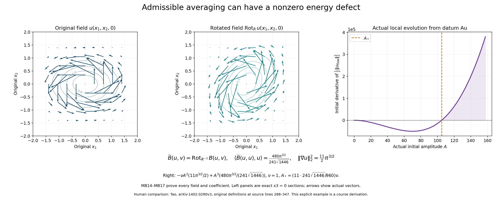
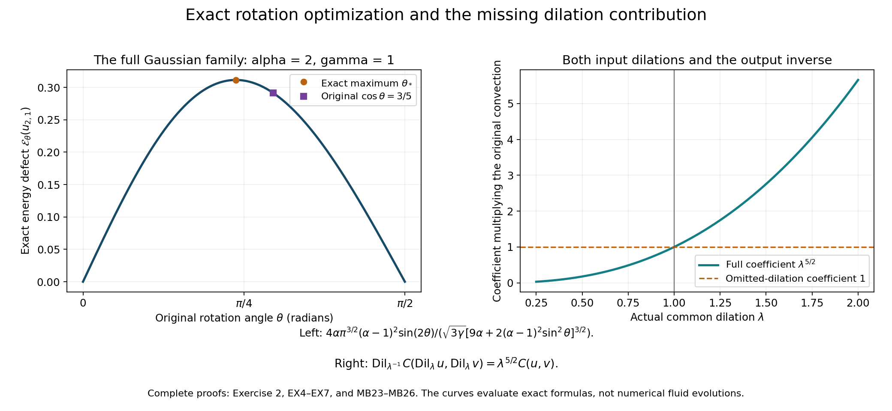
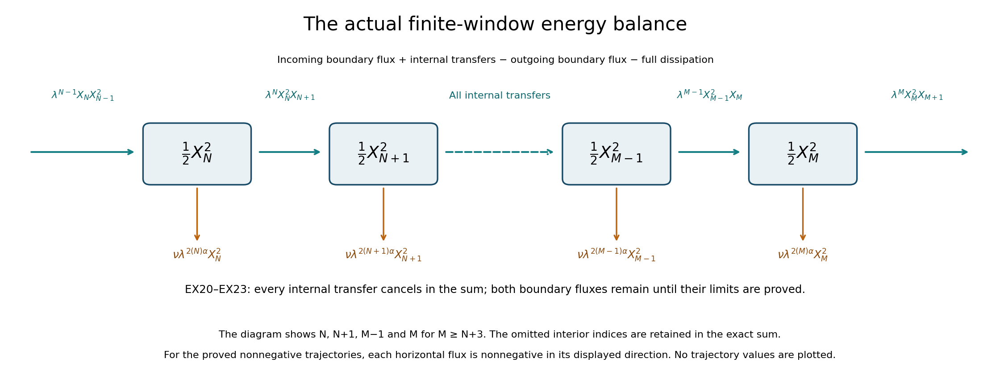

# The original averaged equation and its full energy and force maps

The next part of the series studies model and self-similar constructions.
We start with the exact averaged operator in Terence Tao's
[*Finite time blowup for an averaged three-dimensional Navier–Stokes equation*,
arXiv:1402.0290v3](https://arxiv.org/abs/1402.0290v3).
The source locators for this lesson are the original author file
navier-blowup.tex, lines 176–422, especially 192, 196–218, 288–365 and 375–402.

This lesson constructs the operator and its local evolution with the
original viscosity, full Fourier weights and every rotation, multiplier
and dilation. It proves the exact energy defect and an explicit Gaussian
example. It then gives the complete correspondence with a forced
Navier–Stokes equation and restores the dilations omitted from the
source's displayed convection formula.

The needed projection and pressure maps are proved in
[lesson 2](pressure-and-the-divergence-free-projection.md), and the full
Sobolev product constants are proved in
[lesson 35](the-original-velocity-growth-and-complete-smoothing-maps.md).
The local construction is supplied completely here.

Five solved exercises retain the transformed frequency relation, optimize
the full Gaussian defect, construct the stronger Sobolev cancellation
correction, prove an invertible map with its exact energy metric, and
construct the original dyadic local flow with both boundary energy fluxes.
These are the inputs for the later cascade. The source's finite-time
blowup theorem is not asserted in this chapter. Author self-check only;
no independent review or novelty claim is made.

## MB1. Retain the Fourier conventions and every averaging map

Use real solenoidal fields on \(\mathbb R^3\), with their complexifications when taking Fourier transforms. The course and source transforms are related by

\[
\begin{gathered}
\widehat u_{\rm phys}(\eta)=\int_{\mathbb R^3}u(x)e^{-ix\cdot\eta}dx,\\

\widehat u_{\rm source}(\xi)=\widehat u_{\rm phys}(2\pi\xi),\\

\|u\|_{H^s}^2=(2\pi)^{-3}\int_{\mathbb R^3}(1+|\eta|^2)^s
 |\widehat u_{\rm phys}(\eta)|^2d\eta
=\int_{\mathbb R^3}(1+4\pi^2|\xi|^2)^s
 |\widehat u_{\rm source}(\xi)|^2d\xi.
\end{gathered}
\tag{MB1}
\]

The norm keeps the full sum over vector components. Write \(H^s_\sigma\) for its closed divergence-free subspace. The Leray multiplier is \(P(\eta)=I-\eta\otimes\eta/|\eta|^2\) away from zero; its value at the single zero point does not change an \(L^2\) field. Retain the source's symmetric operator

\[
\begin{gathered}
B(u,v)=-\frac12P\bigl((u\cdot\nabla)v+(v\cdot\nabla)u\bigr),\\

\langle B(u,v),w\rangle
=-\frac12\int_{\mathbb R^3}
 \bigl((u\cdot\nabla)v+(v\cdot\nabla)u\bigr)\cdot w\,dx.
\end{gathered}
\tag{MB2}
\]

Here the pairing is the real \(L^2\) pairing when all entries are real. Its complex extension in a trilinear formula is bilinear in each algebraic entry, with the conjugations written explicitly whenever a Hilbert adjoint is used. The complete product proof in [lesson 35, EX14–EX15](the-original-velocity-growth-and-complete-smoothing-maps.md) gives

\[
\begin{gathered}
I_9=\int_{\mathbb R^3}(1+|\eta|^2)^{-9}d\eta
\leq4\pi\left(\frac13+\frac1{15}\right),\qquad
C_9=2^9(2\pi)^{-3/2}I_9^{1/2},\\
\|B(u,v)\|_{H^9}\leq C_9\|u\|_{H^{10}}\|v\|_{H^{10}}.
\end{gathered}
\tag{MB3}
\]

Indeed each product has one differentiated factor in \(H^9\), bounded by its original \(H^{10}\) norm. The two terms cancel only the factor \(1/2\) in this upper bound; both remain in the operator MB2. The projection has norm at most one at every frequency. The same convolution proof applies to vector products with their complete Euclidean component norms.

For the source rotation \(R\in SO(3)\), positive dilation \(\lambda\), and scalar multiplier \(m\), keep

\[
\begin{gathered}
\operatorname{Rot}_Ru(x)=Ru(R^{-1}x),\qquad
\operatorname{Dil}_\lambda u(x)=\lambda^{3/2}u(\lambda x),\\
\widehat{\operatorname{Rot}_Ru}_{\rm phys}(\eta)
=R\widehat u_{\rm phys}(R^{-1}\eta),\qquad
\widehat{\operatorname{Dil}_\lambda u}_{\rm phys}(\eta)
=\lambda^{-3/2}\widehat u_{\rm phys}(\eta/\lambda),\\
\widehat{m(D)u}_{\rm phys}(\eta)=m(\eta/(2\pi))\widehat u_{\rm phys}(\eta).
\end{gathered}
\tag{MB4}
\]

The last \(2\pi\) is necessary because \(m\) is the symbol in the source convention. A rotation is an isometry in every norm MB1 and in \(L^2\). Dilation is an \(L^2\) isometry, with the exact inhomogeneous formula

\[
\begin{gathered}
\|\operatorname{Dil}_\lambda u\|_{H^s}^2
=(2\pi)^{-3}\int_{\mathbb R^3}
 (1+\lambda^2|\zeta|^2)^s|\widehat u_{\rm phys}(\zeta)|^2d\zeta,\\
\min(1,\lambda^s)\|u\|_{H^s}
\leq\|\operatorname{Dil}_\lambda u\|_{H^s}
\leq d_s(\lambda)\|u\|_{H^s},\qquad
d_s(\lambda)=\max(1,\lambda^s),\qquad s\in\mathbb R.
\end{gathered}
\tag{MB5}
\]

The ratio \((1+\lambda^2r^2)/(1+r^2)\) lies between \(1\) and \(\lambda^2\); raising that ratio to the real power \(s\) proves both inequalities, including negative \(s\). No homogeneous norm replaces MB1.

The source requires \(m(-\xi)=\overline{m(\xi)}\) and every seminorm
\(\|m\|_k=\sup_{\xi\ne0}|\xi|^k|\nabla^k m(\xi)|\) to be finite. The reality condition follows exactly from the conjugate symmetry of the Fourier transform of a real field. Scalar multiplication preserves \(\eta\cdot\widehat u(\eta)=0\). Rotations and dilations also preserve it by MB4. Each map therefore preserves real solenoidal fields.

For \(A=m(D)\operatorname{Rot}_R\operatorname{Dil}_\lambda\), the order and adjoint are

\[
A^*=\operatorname{Dil}_{\lambda^{-1}}\operatorname{Rot}_{R^{-1}}
 \overline m(D),\qquad
\|A\|_{H^s\to H^s}\leq\|m\|_0d_s(\lambda),\qquad
\|A^*\|_{H^s\to H^s}\leq\|m\|_0d_s(\lambda^{-1}).
\tag{MB6}
\]

The first identity follows by three changes of variables and Plancherel, reversing all three factors. It does not commute the multiplier past the rotation or dilation. Each adjoint factor preserves real solenoidal fields as well.

## MB2. Construct the averaged operator as a full Sobolev-valued integral

Keep the source probability space \((\Omega,\mu)\), all three measurable maps
\(A_{j,\omega}=m_{j,\omega}(D)\operatorname{Rot}_{R_{j,\omega}}
\operatorname{Dil}_{\lambda_{j,\omega}}\), every moment
\(\int\prod_{j=1}^3\|m_{j,\omega}\|_{k_j}d\mu<\infty\), and the stated common bound \(C^{-1}\leq\lambda_{j,\omega}\leq C\). Define

\[
\begin{gathered}
\widetilde B(u,v)=\int_\Omega
 A_{3,\omega}^*B(A_{1,\omega}u,A_{2,\omega}v)\,d\mu(\omega),\\
K=C_9\int_\Omega
 \|m_{1,\omega}\|_0\|m_{2,\omega}\|_0\|m_{3,\omega}\|_0
 d_{10}(\lambda_{1,\omega})d_{10}(\lambda_{2,\omega})
 d_9(\lambda_{3,\omega}^{-1})\,d\mu(\omega)<\infty,\\
\|\widetilde B(u,v)\|_{H^9}
\leq K\|u\|_{H^{10}}\|v\|_{H^{10}}.
\end{gathered}
\tag{MB7}
\]

This is a Bochner integral in \(H^9_\sigma\). To justify measurability, first restrict each Fourier input to a compact annulus. Convergence in the source symbol seminorms gives uniform convergence there. Rotations and dilations act strongly continuously by change of variables, first on smooth compact Fourier inputs and then by density and MB5. Multipliers act strongly continuously under symbol convergence by Plancherel and their uniform zeroth seminorm bound. The same argument applies to adjoints. Thus the integrand is a strongly measurable function into the separable space \(H^9_\sigma\), using continuity of MB2 supplied by MB3. Its norm has the integrable upper bound displayed in MB7. Approximation by simple functions consequently constructs the integral and proves its bound. Its pairing with \(w\in H^{10}_\sigma\) is exactly source formula (bogo), since a bounded linear functional commutes with this norm-convergent integral.

This supplies a stronger target space than the source's \(H^{-10}_\sigma\) definition for these inputs, without altering the operator, its probability measure, or a single averaging factor. Only the zeroth symbol moment is needed for this Hilbert-space bound. Other source estimates may need higher moments; they are retained.

## MB3. Construct the original-viscosity local evolution

Let \(u_0\in H^{10}_\sigma\) be real, and retain the actual \(\nu>0\). The required evolution is

\[
u(t)=e^{\nu t\Delta}u_0+
 \int_0^t e^{\nu(t-r)\Delta}\widetilde B(u(r),u(r))dr.
\tag{MB8}
\]

The heat multiplier and its complete one-derivative estimate are

\[
\begin{gathered}
\|e^{\nu h\Delta}\|_{H^{10}\to H^{10}}\leq1,\\

\|e^{\nu h\Delta}g\|_{H^{10}}
\leq\left(1+\frac1{\sqrt{2e\nu h}}\right)\|g\|_{H^9},\\

J_\nu(T)=\int_0^T\left(1+\frac1{\sqrt{2e\nu h}}\right)dh
=T+\sqrt{\frac{2T}{e\nu}}.
\end{gathered}
\tag{MB9}
\]

Indeed \(\sqrt{1+r^2}\leq1+r\), and the maximum of
\(re^{-\nu h r^2}\) occurs at \(r=(2\nu h)^{-1/2}\). These prove MB9 with the original inhomogeneous weights.

For \(M=\|u_0\|_{H^{10}}>0\) and \(K>0\), take the definite time

\[
T=\min\left\{1,\frac1{16KM},\frac{e\nu}{512K^2M^2}\right\}.
\qquad K M J_\nu(T)\leq\frac18.
\tag{MB10}
\]

On the closed radius-\(2M\) ball of \(C([0,T];H^{10}_\sigma)\), MB7–MB9 bound the right side of MB8 by \(M+4KM^2J_\nu(T)\leq3M/2\). The full difference identity
\(\widetilde B(u,u)-\widetilde B(v,v)=
\widetilde B(u-v,u)+\widetilde B(v,u-v)\)
gives Lipschitz constant \(4KMJ_\nu(T)\leq1/2\). No symmetry of \(\widetilde B\) is needed here. The integral is continuous in \(H^{10}\): its portion with \(t-r<\epsilon\) is bounded uniformly by a constant times \(J_\nu(\epsilon)\), and the remaining portion is continuous by strong heat continuity and dominated convergence.

Starting with the heat curve, repeated substitution gives a uniformly convergent geometric series of differences in this complete space. Its limit satisfies MB8 because the integral map is Lipschitz. Every iterate and limit is real and solenoidal. Two fixed points in this ball agree by contraction.

This is uniqueness among all \(C H^{10}\) solutions on their common interval, not only the construction ball. Two such solutions have bounded norms on each compact time interval. On a sufficiently short initial subinterval their difference is bounded by itself times \(2KM_*J_\nu(h)<1\), where \(M_*\) bounds both curves. Hence the difference vanishes. Repeat from that endpoint using MB8 with its starting time changed; finitely many such intervals cover the compact interval. The same argument proves continuation and uniqueness at every restart.

If \(K=0\), MB7 gives \(\widetilde B=0\) and the heat curve is the solution. If \(M=0\), the zero curve is a solution, and the preceding short-interval uniqueness argument proves it is the only one. These cases are not divided by zero in MB10.

The local solutions join into a unique maximal trajectory \(u:[0,T_{\max})\to H^{10}_\sigma\). If \(T_{\max}<\infty\), then

\[
\lim_{t\uparrow T_{\max}}\|u(t)\|_{H^{10}}=\infty.
\tag{MB11}
\]

To prove the full limit, a bounded sequence of norms at times tending to \(T_{\max}\) would give, by MB10, one common positive existence time after each selected time. Choose one so close to \(T_{\max}\) that its new interval crosses \(T_{\max}\). Uniqueness on the overlap gives an extension of the original trajectory, contradicting maximality.

The solution is \(C^1([0,T];H^8_\sigma)\), with one-sided derivative at zero, and satisfies \(u_t=\nu\Delta u+\widetilde B(u,u)\). For the heat term this follows from its generator multiplier and \(u_0\in H^{10}\). For the integral, its forcing is continuous in \(H^9\); moreover
\[
\|\nu\Delta e^{\nu h\Delta}g\|_{H^8}
\leq\sqrt{\frac{\nu}{2eh}}\|g\|_{H^9}.
\tag{MB12}
\]
The multiplier bound follows from
\(\nu r^2(1+r^2)^{-1/2}e^{-\nu hr^2}\leq
\nu r e^{-\nu hr^2}\). This integrable bound justifies differentiation of the integral, giving its endpoint forcing plus the integrated Laplacian. It also gives continuity of that derivative by the same small-tail argument. Thus the asserted differential equation is an actual \(H^8\) identity.

## MB4. Identify and calculate the exact cancellation defect

Define
\[
\mathcal E(u)=\langle\widetilde B(u,u),u\rangle
=\int_\Omega
 \langle B(A_{1,\omega}u,A_{2,\omega}u),A_{3,\omega}u\rangle\,d\mu(\omega).
\tag{MB13}
\]

The ordinary Euler cancellation is
\(\langle B(v,v),v\rangle=-\int(v\cdot\nabla)v\cdot v=0\).
For completeness, insert a spatial cutoff equal to one on \(B_R\); integration by parts gives the boundary term
\(\tfrac12\int|v|^2v\cdot\nabla\chi_R\), bounded by
\(C\|v\|_\infty\|v\|_2^2/(2R)\). The original integral is absolutely convergent for \(v\in H^{10}\), so the limit is zero. This proves that coincident maps \(A_{1,\omega}=A_{2,\omega}=A_{3,\omega}\) give \(\mathcal E=0\), without requiring these maps to be isometries. Different maps need not give zero.

Here is an exact counterexample within the source averaging class. Put \(x=(x_1,x_2,x_3)\), \(y=(x_1,x_2)^t\), and retain

\[
\begin{gathered}
Q=\begin{pmatrix}1&0\\0&2\end{pmatrix},\quad
J=\begin{pmatrix}0&-1\\1&0\end{pmatrix},\quad
R_2=\frac15\begin{pmatrix}3&-4\\4&3\end{pmatrix},\quad
R=\operatorname{diag}(R_2,1),\\
G(x)=e^{-x_1^2-2x_2^2-x_3^2},\qquad
u(x)=(-4x_2,2x_1,0)G(x)=(2JQy,0)G(x),\\
A_1=A_2=I,\quad A_3=\operatorname{Rot}_R,\qquad
\widetilde B(u,v)=\operatorname{Rot}_{R^{-1}}B(u,v).
\end{gathered}
\tag{MB14}
\]

Use a one-point probability space, all symbols identically one, and all dilations one. Every source moment and measurability requirement holds, and the operator is symmetric in its two inputs. The field \(u\) is nonzero and Schwartz. Its divergence vanishes directly, or by writing it as \((\partial_2G,-\partial_1G,0)\). Its exact convection and the rotated Gaussian give

\[
\begin{gathered}
(u\cdot\nabla)u=(-8x_1,-8x_2,0)G^2,\qquad
Q'=R_2QR_2^t=\frac1{25}\begin{pmatrix}41&-12\\-12&34\end{pmatrix},\\
M_2=2Q+Q'=\frac1{25}\begin{pmatrix}91&-12\\-12&134\end{pmatrix},
\quad \det M_2=\frac{482}{25},\quad
\operatorname{tr}(JQ'M_2^{-1})=\frac{12}{241},\\
\mathcal E(u)=16\int_{\mathbb R^3}y^tJQ'y\,
 e^{-y^tM_2y-3x_3^2}dx
=\frac{480\pi^{3/2}}{241\sqrt{1446}}>0.
\end{gathered}
\tag{MB15}
\]

There is no hidden projection contribution: \(\operatorname{Rot}_Ru\) is solenoidal, so \(P\) in MB2 moves to that field and acts as the identity. To verify the integral, the complete Gaussian identities are
\(\int_{\mathbb R^n}e^{-x^tMx}dx=\pi^{n/2}/\sqrt{\det M}\) and
\(\int x_ix_j e^{-x^tMx}dx=
\pi^{n/2}(M^{-1})_{ij}/(2\sqrt{\det M})\).
Orthogonal diagonalization and the one-dimensional Gaussian integral prove the first; differentiation in a symmetric matrix direction proves the second. Apply them to \(\operatorname{diag}(M_2,3)\). The factor \(16\), the covariance factor \(1/2\), and the \(x_3\) integral give \(8\pi^{3/2}\operatorname{tr}(JQ'M_2^{-1})/\sqrt{3\det M_2}\), exactly the last value in MB15.

The local curve from MB8 has the exact energy identity

\[
\frac12\|u(t)\|_2^2+\nu\int_0^t\|\nabla u(r)\|_2^2dr
=\frac12\|u_0\|_2^2+\int_0^t\mathcal E(u(r))dr.
\tag{MB16}
\]

Its \(C^1L^2\) regularity justifies pairing the equation with \(u\); integration by parts in the original full Fourier norm gives the dissipation. All terms are continuous, so time integration proves MB16 including zero. Thus \(\mathcal E=0\) gives the source energy identity, while MB15 proves that symmetry of the bilinear operator and admissible averaging alone do not.

The example also gives an actual local flow with initially increasing energy. Its original field has

\[
\begin{gathered}
\|u\|_2^2=\frac34\pi^{3/2},\\

\|\nabla u\|_2^2=\frac{11}{2}\pi^{3/2},\\

\left.\frac d{dt}\frac12\|u_{\rm flow}(t)\|_2^2\right|_{t=0}
=-\nu A^2\frac{11}{2}\pi^{3/2}
+A^3\frac{480\pi^{3/2}}{241\sqrt{1446}}>0
\\
\text{if }A>\frac{11\cdot241\sqrt{1446}}{960}\nu,
\end{gathered}
\tag{MB17}
\]

where the actual initial datum is \(u_{\rm flow}(0)=Au\), with \(A>0\). These norms follow from the same Gaussian moments with weight \(G^2\). More explicitly its Gaussian integral is \(\pi^{3/2}/4\), the expected value of \(16x_2^2+4x_1^2\) is \(3\), and the expected full derivative-square polynomial is \(22\). These give both coefficients. Bilinearity gives the cubic energy term and the displayed threshold. MB8 constructs this trajectory, so the counterexample is an actual evolution statement and not merely a formal tensor calculation.

## MB5. Construct the space defined by the cancellation condition

Let \(V=H^{10}_\sigma(\mathbb R^3;\mathbb R)\). For the actual averaged operator first retain its symmetric part
\(T_s(u,v)=(\widetilde B(u,v)+\widetilde B(v,u))/2\), which has the same diagonal. Set \(S(u,v,w)=\langle T_s(u,v),w\rangle\). This is a bounded trilinear form symmetric in the first two variables. Its complete symmetric part is

\[
\begin{gathered}
(\Pi S)(u,v,w)=\frac13\bigl(S(u,v,w)+S(v,w,u)+S(w,u,v)\bigr),\\
(\Pi S)(u,v,w)=\frac16\bigl[
\mathcal E(u+v+w)-\mathcal E(u+v)-\mathcal E(u+w)
\\
-\mathcal E(v+w)+\mathcal E(u)+\mathcal E(v)+\mathcal E(w)\bigr],\\
\Pi^2S=\Pi S,\qquad
\{S:\mathcal E(u)=0\text{ for all }u\in V\}=\ker\Pi.
\end{gathered}
\tag{MB18}
\]

For the second formula, expand each cubic term by trilinearity. Every term missing one of \(u,v,w\) cancels; the six remaining permutations sum to six times the fully symmetric form. First-two symmetry reduces that sum to the first line. A fully symmetric form is unchanged by \(\Pi\), proving idempotence; its diagonal is \(S(u,u,u)\), proving the kernel identity. In the trilinear operator norm, \(\|\Pi S\|\leq\|S\|\), so the kernel is closed.

Every such bounded form determines a bounded bilinear map \(V\times V\to V^*\) by evaluation on its third entry. Thus the exact decomposition and connecting maps are

\[
\begin{gathered}
S=(S-\Pi S)+\Pi S,\\

S-\Pi S\in\ker\Pi,\\

\Pi S\in\operatorname{Sym}^3(V^*),\\

\langle D(u,v),w\rangle=(\Pi S)(u,v,w).
\end{gathered}
\tag{MB19}
\]

Here \(\operatorname{Sym}^3(V^*)\) means bounded symmetric trilinear forms, not a finite-rank tensor restriction. The maps are bounded, the two subspaces intersect only at zero, and every symmetric form occurs as its own image. The kernel of the energy defect and its complementary component are therefore constructed exactly. For an averaged operator, \(\langle D(u,u),u\rangle=\mathcal E(u)\).

The corrected map \(T_s-D:V\times V\to V^*\) has zero cubic energy pairing. This last statement specifies its actual target \(V^*\); no assertion is made here that the correction retains the source's averaging representation or the stronger \(H^9\) target. The original averaged operator itself retains both, by MB7. Exercise3 below constructs the stronger Sobolev target for this correction with every transposed interaction retained. The counterexample MB14–MB15 has a nonzero complementary component, while coincident averaging maps lie in the kernel.

## MB6. Prove the full correspondence with a forced physical equation

For the actual local solution of MB8, define the following fields without changing \(u,\nu,x\), or \(t\):

\[
\begin{gathered}
f_u=\widetilde B(u,u)-B(u,u),\qquad
\widehat p_0(\eta,t)=
-\sum_{i,j=1}^3\frac{\eta_i\eta_j}{|\eta|^2}
\widehat{u_i u_j}_{\rm phys}(\eta,t)\quad(\eta\ne0),\\
\partial_tu-\nu\Delta u+(u\cdot\nabla)u+\nabla p_0=f_u,
\qquad \operatorname{div}u=\operatorname{div}f_u=0,\\
\|f_u(t)\|_{H^9}\leq(K+C_9)\|u(t)\|_{H^{10}}^2,\qquad
\langle f_u(t),u(t)\rangle=\mathcal E(u(t)).
\end{gathered}
\tag{MB20}
\]

The pressure tensor multiplier has norm one, so the full product bound makes \(p_0\) a continuous \(H^{10}\) representative. Its gradient equals
\(-(I-P)((u\cdot\nabla)u)\), with that negative sign. Hence
\((u\cdot\nabla)u+\nabla p_0=P((u\cdot\nabla)u)=-B(u,u)\).
Insert the actual differential equation proved after MB12 to obtain MB20. Solenoidality, the force norm and the energy pairing follow from MB2, MB7 and the proved Euler cancellation.

Conversely, a \(C H^{10}_\sigma\), \(C^1H^8\) solution of the full equation with precisely the force and pressure in MB20 satisfies
\(u_t=\nu\Delta u+\widetilde B(u,u)\). Multiplying this equality by the heat evolution over a finite interval, or differentiating
\(e^{\nu(t-r)\Delta}u(r)\) in the weak \(H^8\) pairing and then integrating, gives MB8. The integral gains the required derivative by MB9; hence the equality is also in \(H^{10}\). This proves both directions of the trajectory correspondence.

The pressure is the \(L^2\) representative. Among \(L^2\) solenoidal forces, \(f_u\) is unique: projecting the full equation gives necessarily \(f_u=P(u_t-\nu\Delta u+(u\cdot\nabla)u)\). More generally, for any scalar distribution \(q(x,t)\), the pair
\[
(p_0,f_u)\longmapsto(p_0+q,f_u+\nabla q)
\tag{MB21}
\]
gives the same velocity equation whenever the stated operations make sense. This retains the gradient force and pressure freedom explicitly. A purely time-dependent pressure constant gives no force change. The norm in MB20 applies to the fixed solenoidal representative.

The exact energy identity MB16 is consequently the full forced Navier–Stokes energy identity for this trajectory. This proves a concrete relation between the averaged and original equations. It also identifies precisely what would be needed to place a later model singularity in a prescribed force class: estimates for the actual difference \(\widetilde B(u,u)-B(u,u)\) at its endpoint. The current local construction gives a continuous \(H^9\) force on every compact subinterval of its existence interval; it asserts no bounded or smooth terminal extension through a singular time.

Finally the viscosity-one source evolution and the evolution at the original \(\nu>0\) have the exact invertible time-and-amplitude map

\[
\begin{gathered}
u_\nu(t,x)=\nu v(\nu t,x),\qquad
v(s,x)=\nu^{-1}u_\nu(s/\nu,x),\\
p_\nu(t,x)=\nu^2p_v(\nu t,x),\qquad
f_\nu(t,x)=\nu^2 f_v(\nu t,x),\qquad
u_\nu(0,x)=\nu v(0,x).
\end{gathered}
\tag{MB22}
\]

The actual operator \(\widetilde B\) is unchanged. Direct differentiation gives
\(\partial_tu_\nu=\nu^2\partial_sv\),
\(\nu\Delta u_\nu=\nu^2\Delta v\), and
\(\widetilde B(u_\nu,u_\nu)=\nu^2\widetilde B(v,v)\).
The pressure and force formulas follow from MB20 and their quadratic definitions. All time intervals map by \(s=\nu t\); no spatial rescaling or suppressed viscosity is used. This corrects the faulty displayed rescaling at source line 192 in the same explicit way already used in lesson 2.

## MB7. Restore all dilations in the source convection formulation

The displayed source convection formula at original lines 356–365 omits the three dilations that its definition (bogo) includes. The full receiving formula is obtained from the actual adjoint MB6. For two real solenoidal inputs define

\[
\begin{gathered}
\widetilde C(u,v)=\frac12\int_\Omega A_{3,\omega}^*
\bigl((A_{1,\omega}u\cdot\nabla)A_{2,\omega}v
 +(A_{2,\omega}v\cdot\nabla)A_{1,\omega}u\bigr)d\mu,\\
\mathcal A_{3,\omega}^{*,(2)}
=\operatorname{Dil}_{\lambda_{3,\omega}^{-1}}^{(2)}
 \operatorname{Rot}_{R_{3,\omega}^{-1}}^{(2)}
 \overline m_{3,\omega}(D),\\
\mathcal S(u,v)=\frac12\int_\Omega\lambda_{3,\omega}
 \mathcal A_{3,\omega}^{*,(2)}
\bigl(A_{1,\omega}u\otimes A_{2,\omega}v
 +A_{2,\omega}v\otimes A_{1,\omega}u\bigr)d\mu,\qquad
\widetilde C(u,v)=\operatorname{div}\mathcal S(u,v).
\end{gathered}
\tag{MB23}
\]

For tensors the maps in this formula mean exactly
\(\operatorname{Rot}^{(2)}_R T(x)=RT(R^{-1}x)R^t\) and
\(\operatorname{Dil}^{(2)}_\lambda T(x)=\lambda^{3/2}T(\lambda x)\).
The divergence is \((\operatorname{div}T)_i=\partial_jT_{ij}\). The input fields are solenoidal, so the product rule gives the symmetric convection as one-half the divergence of their two ordered tensors. Rotation commutes with this tensor divergence. Dilation satisfies
\(\operatorname{Dil}_{\lambda^{-1}}\operatorname{div}T
=\lambda\operatorname{div}(\operatorname{Dil}^{(2)}_{\lambda^{-1}}T)\).
This proves the extra original factor \(\lambda_{3,\omega}\) in MB23, without discarding an output derivative.

Both integrals converge in their stated spaces: \(\widetilde C\in H^9\), by MB3 without the projection, and \(\mathcal S\in H^{10}\), by the full product constant \(C_{10}\) from lesson 35 EX14. In the latter bound the integrand coefficient is
\(C_{10}\lambda_{3,\omega}\prod_j\|m_{j,\omega}\|_0
d_{10}(\lambda_{1,\omega})d_{10}(\lambda_{2,\omega})
d_{10}(\lambda_{3,\omega}^{-1})\).
It is integrable by the original moments and bounded dilation interval. The measurability proof of MB7 applies component by component to tensors.

Each rotation, dilation and scalar multiplier commutes with the vector Leray projection. In Fourier variables the precise identities are
\(P(\eta)R=RP(R^{-1}\eta)\) and \(P(\lambda\eta)=P(\eta)\);
scalar multiplication commutes pointwise. Consequently MB2 and MB23 give

\[
\begin{gathered}
\widetilde B(u,v)=-P\widetilde C(u,v),\qquad
\widehat p_{\rm av}(\eta,t)
=-\sum_{i,j=1}^3\frac{\eta_i\eta_j}{|\eta|^2}
 \widehat{\mathcal S(u(t),u(t))}_{ij}(\eta),\\
\nabla p_{\rm av}=-(I-P)\widetilde C(u,u),\qquad
\partial_tu-\nu\Delta u+\widetilde C(u,u)+\nabla p_{\rm av}=0.
\end{gathered}
\tag{MB24}
\]

The tensor multiplier gives a genuine continuous \(H^{10}\) pressure representative, with norm at most that of \(\mathcal S\). Its gradient identity follows exactly as in MB20. This proves the source's intended convection formulation with every original dilation restored. It is distinct from the original-equation pressure \(p_0\) in MB20; both equations and their actual force correspondence are now explicit.

The omission has a direct counterexample and an exact correction coefficient. Choose a one-point averaging measure, symbols one, rotations the identity, and all three dilations equal to an arbitrary fixed \(\lambda>0\). The original objects then give

\[
\begin{gathered}
C(u,v)=\frac12\bigl((u\cdot\nabla)v+(v\cdot\nabla)u\bigr),\\
C(\operatorname{Dil}_\lambda u,\operatorname{Dil}_\lambda v)
=\lambda^{5/2}\operatorname{Dil}_\lambda C(u,v),\\
\widetilde C(u,v)=\lambda^{5/2}C(u,v),\qquad
\widetilde B(u,v)=\lambda^{5/2}B(u,v).
\end{gathered}
\tag{MB25}
\]

The two input amplitudes contribute \(\lambda^3\), the spatial derivative contributes \(\lambda\), and the inverse output dilation contributes \(\lambda^{-3/2}\), giving the full power \(\lambda^{5/2}\). By contrast the source display without any dilations yields \(C(u,v)\).

This difference cannot in general be absorbed into a pressure. For the actual Schwartz field MB14, direct differentiation of its full convection in MB15 gives

\[
\nabla\times C(u,u)=
(-32x_2x_3,\ 32x_1x_3,\ -32x_1x_2)\,
 e^{-2x_1^2-4x_2^2-2x_3^2}\ne0.
\tag{MB26}
\]

For example the second component is nonzero at \((1,0,1)\). If \(\lambda\ne1\), the difference between the complete and the printed convection therefore has nonzero curl. A pressure gradient has zero curl distributionally. Thus the source display is not the same equation even after allowing its full pressure freedom. MB23–MB25 give the exact replacement, including its pressure receiver and the original physical coefficients.

The next source calculation is the complete cascade representation and its actual finite-time dynamics. The local operator, energy defect, complete convection formula and forced correspondence above are available for that calculation; they do not replace it.

## Three pictures of the original maps

MB14–MB17 prove the fields, their rotation and every energy coefficient in this figure. The left panels are the exact \(x_3=0\) sections, with arrows showing the actual vector values and contours showing the corresponding Gaussian factor. The right panel evaluates the proved initial derivative for the actual local evolution from \(Au\), with the displayed original \(\nu=1\). It is an analytic curve, not a simulation of the later trajectory. The complete [reproducible source](../assets/original-averaged-energy-defect.py), [vector image](../assets/original-averaged-energy-defect.svg) and [all 162 field samples and 301 energy samples](../assets/original-averaged-energy-defect-data.json) are retained.

Exercise2, EX4–EX7 proves the entire Gaussian family and its exact maximizing
rotation. The left curve uses the stated original parameters 2 and 1, with
the original rational rotation marked separately. The right curve retains
the full coefficient from MB23–MB26, comparing it with the source display
that omits the dilations. Both curves evaluate proved analytic formulas.
The [portable source](../assets/original-averaged-rotation-and-flux.py)
and [all 602 curve samples](../assets/original-averaged-rotation-and-flux-data.json)
are included. Human comparison: Tao, original source288–365.

Exercise5, EX17–EX23 constructs the actual sequence flow and proves the
finite-window identity and its two boundary limits. This picture shows
four named modes; the intervening modes remain in the exact sum. The
arrows have their displayed nonnegative signs for the proved nonnegative
trajectories. It plots no trajectory values. Human comparison: Tao,
original source375–402. The
[reproducible diagram source](../assets/original-averaged-rotation-and-flux.py)
retains every index and coefficient.

## Five solved exercises

### Exercise 1. Keep the full transformed frequency relation

For one actual triple of averaging maps in MB4–MB7, calculate its trilinear form in the source Fourier convention. Retain every Jacobian, multiplier, rotation and dilation. Test the resulting formula when all three dilations agree.

**Solution.** Write \(\widehat u=\widehat u_{\rm source}\), so the Fourier exponential is \(e^{-2\pi ix\cdot\xi}\). For independent variables \(\zeta_1,\zeta_2\in\mathbb R^3\), define the entire third frequency by

\[
\xi_j=\lambda_jR_j\zeta_j,\qquad
\zeta_3=-\lambda_3^{-1}R_3^{-1}
 (\lambda_1R_1\zeta_1+\lambda_2R_2\zeta_2),\qquad
\xi_1+\xi_2+\xi_3=0.
\tag{EX1}
\]

For vector entries \(X_j\perp\xi_j\), keep

\[
\begin{aligned}
\Lambda_{\xi_1,\xi_2,\xi_3}(X_1,X_2,X_3)
={}&(X_1\cdot\xi_2)(X_2\cdot X_3)\\
&+(X_2\cdot\xi_1)(X_1\cdot X_3).
\end{aligned}
\]

Here each dot product extends algebraically to complex vectors; there is no conjugation in this trilinear expression. The original real-space pairing MB2 gives the complete formula

\[
\begin{gathered}
\langle B(A_1u,A_2v),A_3w\rangle
={}-\pi i\,\lambda_1^{3/2}\lambda_2^{3/2}\lambda_3^{-3/2}\\
\quad\cdot\int_{\mathbb R^3}\int_{\mathbb R^3}
\Lambda_{\xi_1,\xi_2,\xi_3}\bigl(
 m_1(\xi_1)R_1\widehat u(\zeta_1),
 m_2(\xi_2)R_2\widehat v(\zeta_2),
 m_3(\xi_3)R_3\widehat w(\zeta_3)\bigr)
 \,d\zeta_1d\zeta_2.
\end{gathered}
\tag{EX2}
\]

To prove it, Fourier inversion sends a derivative to \(2\pi i\xi\); the two terms and factor \(-1/2\) in MB2 give precisely \(-\pi i\Lambda\). Spatial integration sets \(\xi_3=-\xi_1-\xi_2\). Each transformed Fourier input contributes \(\lambda_j^{-3/2}\), while the changes \(\xi_1=\lambda_1R_1\zeta_1\), \(\xi_2=\lambda_2R_2\zeta_2\) contribute \(\lambda_1^3\lambda_2^3\). Their product is the factor in EX2. No additional measure on an unspecified frequency surface is used.

The integrals are absolute for the stated \(H^{10}\) inputs. For example the term with the derivative on the second input is bounded, before the linear changes of variables, by
\(\|\widehat{A_1u}\|_1\||\xi|\widehat{A_2v}\|_2
\|\widehat{A_3w}\|_2\), using Cauchy–Schwarz in the second variable after convolution. The other term interchanges the first two inputs. Weighted Fourier Cauchy–Schwarz bounds the \(L^1\) norm by the full \(H^{10}\) norm; MB4–MB6 give the remaining bounds. Thus density extends the direct Schwartz calculation to all the inputs under consideration.

The third transformed entry is transverse to \(\xi_3\) because \(R_3\widehat w(\zeta_3)\cdot \lambda_3R_3\zeta_3=0\), and similarly for the first two. In particular the original projection has not been dropped without justification.

If the three rotations are one common \(R\), the three dilations equal \(\lambda\), and the symbols equal one, then \(\zeta_3=-\zeta_1-\zeta_2\) and orthogonality gives

\[
\begin{gathered}
\Lambda_{\lambda R\zeta_1,\lambda R\zeta_2,\lambda R\zeta_3}
 (RX_1,RX_2,RX_3)=\lambda
\Lambda_{\zeta_1,\zeta_2,\zeta_3}(X_1,X_2,X_3).
\\

\langle B(Au,Av),Aw\rangle
=\lambda^{5/2}\langle B(u,v),w\rangle.
\end{gathered}
\tag{EX3}
\]

The full Jacobian factor is \(\lambda^{3/2}\), and the frequency factor is \(\lambda\). This independently recovers MB25, including its original exponent. For different maps, EX1 is the actual frequency relation; replacing it by \(\zeta_1+\zeta_2+\zeta_3=0\) would change the operator.

### Exercise 2. Calculate the whole Gaussian family and its strongest rotation

Extend the exact example MB14 to arbitrary transverse anisotropy and axial width. Find its full energy defect, physical norms, sign and the rotation producing the largest positive defect within this family.

**Solution.** Fix \(\alpha>0,\gamma>0\) and retain

\[
\begin{gathered}
G_{\alpha,\gamma}(x)=e^{-x_1^2-\alpha x_2^2-\gamma x_3^2},\qquad
u_{\alpha,\gamma}=(-2\alpha x_2,2x_1,0)G_{\alpha,\gamma},\\
Q_\alpha=\operatorname{diag}(1,\alpha),\quad
R_\theta=\begin{pmatrix}\cos\theta&-\sin\theta\\
\sin\theta&\cos\theta\end{pmatrix},\quad
Q'_\theta=R_\theta Q_\alpha R_\theta^t,\\
\widetilde B_\theta(u,v)=
\operatorname{Rot}_{\operatorname{diag}(R_\theta^{-1},1)}B(u,v),\qquad
\Delta_\theta=\det(2Q_\alpha+Q'_\theta)
=9\alpha+2(\alpha-1)^2\sin^2\theta.
\end{gathered}
\tag{EX4}
\]

The field is an actual nonzero Schwartz solenoidal field, since it is \((\partial_2G_{\alpha,\gamma},-\partial_1G_{\alpha,\gamma},0)\). Its convection is exactly
\((-4\alpha x_1,-4\alpha x_2,0)G_{\alpha,\gamma}^2\).
Applying the complete Gaussian calculation MB15, now with axial coefficient \(3\gamma\), gives

\[
\begin{gathered}
\mathcal E_\theta(u_{\alpha,\gamma})
=\frac{4\alpha\pi^{3/2}(\alpha-1)^2\sin(2\theta)}
 {\sqrt{3\gamma}\,\Delta_\theta^{3/2}},\\
Z_{\alpha,\gamma}=\int G_{\alpha,\gamma}^2dx
=\frac{\pi^{3/2}}{2\sqrt{2\alpha\gamma}},\qquad
\|u_{\alpha,\gamma}\|_2^2=(\alpha+1)Z_{\alpha,\gamma},\\
\|\nabla u_{\alpha,\gamma}\|_2^2=
\bigl(3\alpha^2+2\alpha+3+\gamma(\alpha+1)\bigr)Z_{\alpha,\gamma}.
\end{gathered}
\tag{EX5}
\]

Here is the full matrix calculation. The off-diagonal entry of \(Q'_\theta\) is
\((1-\alpha)\cos\theta\sin\theta\). The inverse of \(2Q_\alpha+Q'_\theta\) therefore gives
\(\operatorname{tr}(JQ'_\theta(2Q_\alpha+Q'_\theta)^{-1})
=(\alpha-1)^2\sin(2\theta)/\Delta_\theta\).
The convection contributes \(8\alpha\) before Gaussian integration, whose covariance factor is \(1/2\). These are exactly the first coefficient in EX5. Expansion of the \(2\)-by-\(2\) determinant gives \(\Delta_\theta\).

For the two norms, the centered Gaussian with density \(G_{\alpha,\gamma}^2/Z_{\alpha,\gamma}\) has independent coordinates and variances
\(1/4,1/(4\alpha),1/(4\gamma)\). The expected squared vector polynomial is \(\alpha+1\). Let \(L=2JQ_\alpha\), extended by a zero third row and column. In the full derivative-square expansion,
\(\sum_{i,j}L_{ij}^2=4(1+\alpha^2)\); the cross term is its negative. The remaining fourth moments give
\((\alpha+1)(1+\alpha+\gamma)+2(1+\alpha^2)\),
which is the last coefficient in EX5. All axial derivatives are included.

For \(\alpha\ne1\), the sign of the defect is exactly the sign of \(\sin(2\theta)\). To maximize its positive value it suffices, by the formula's periodicity, to take \(0<\theta<\pi/2\). Put \(a_0=9\alpha\), \(b_0=2(\alpha-1)^2>0\), and \(r=\sin^2\theta\). The variable part is
\(2\sqrt{r(1-r)}/(a_0+b_0r)^{3/2}\). Its unique maximum is at

\[
r_*=\frac{a_0}{a_0+b_0+\sqrt{a_0^2+a_0b_0+b_0^2}},
\qquad
\theta_*=\arcsin\sqrt{r_*},\qquad 0<r_*<\frac12.
\tag{EX6}
\]

Indeed its logarithmic derivative has the sign of
\(a_0-2(a_0+b_0)r+b_0r^2\). This polynomial is strictly decreasing on \([0,1]\), positive at zero and negative at one. Solving it gives the root in EX6, with its full coefficients; the function vanishes at both endpoints, so that root is the global maximum. If \(\alpha=1\), the defect is zero for every rotation of this particular field. Likewise \(\sin(2\theta)=0\) only proves zero defect on this field; it is not a cancellation assertion for all inputs of that operator.

For any positive defect \(D=\mathcal E_\theta(u_{\alpha,\gamma})\), the actual local solution from datum \(A u_{\alpha,\gamma}\) has

\[
\begin{gathered}
\left.\frac d{dt}\frac12\|u_{\rm flow}(t)\|_2^2\right|_{0}
=-\nu A^2\|\nabla u_{\alpha,\gamma}\|_2^2+A^3D.
\\

\text{It is positive exactly when }\ 
A>\frac{\nu\|\nabla u_{\alpha,\gamma}\|_2^2}{D},\quad A>0.
\end{gathered}
\tag{EX7}
\]

MB8 constructs this curve, and MB16 proves its derivative. The original example is recovered by \(\alpha=2,\gamma=1,\cos\theta=3/5,\sin\theta=4/5\). Thus the whole family and its optimal rotation are derived without replacing that original field or its norms.

### Exercise 3. Receive the cancellation correction in the full Sobolev space

MB19 constructs the exact cancellation correction in \(V^*\). For the actual averaged operator, prove a stronger \(H^9\) target, writing every transposed interaction and its bound. Construct the corrected local evolution.

**Solution.** For real solenoidal \(a,b,c\), integration by parts in MB2 gives

\[
\begin{gathered}
\langle B(a,b),c\rangle
=\langle a,B^\sharp(b,c)\rangle,\\

B^\sharp(b,c)=\frac12P\bigl((b\cdot\nabla)c-(\nabla b)^tc\bigr),\\

\|B^\sharp(b,c)\|_{H^9}
\leq C_9\|b\|_{H^{10}}\|c\|_{H^{10}}.
\end{gathered}
\tag{EX8}
\]

The matrix convention is \((\nabla b)_{ij}=\partial_jb_i\), so the \(j\)-th component of its transposed product is \(\sum_i(\partial_jb_i)c_i\). The first term of MB2 contributes the negative transpose-gradient term; integrating the second using \(\operatorname{div}b=0\) contributes the positive transport of \(c\). A cutoff justifies the integration exactly as in MB13, using the bounded higher Sobolev norms and the \(L^2\) factors. The complete product estimate proves the bound, retaining both terms and their factor \(1/2\).

Write \(A_j=A_{j,\omega}\) only inside the following integral. The bilinear map \(D\) defined by MB19 equals the actual \(H^9_\sigma\)-valued integral

\[
\begin{aligned}
D(u,v)=\frac16\int_\Omega\bigl[{}
&A_3^*B(A_1u,A_2v)+A_3^*B(A_1v,A_2u)\\
&+A_2^*B^\sharp(A_1v,A_3u)+A_1^*B^\sharp(A_2v,A_3u)\\
&+A_1^*B^\sharp(A_2u,A_3v)+A_2^*B^\sharp(A_1u,A_3v)
\bigr]\,d\mu.
\end{aligned}
\tag{EX9}
\]

To verify every term, pair with \(w\). The first row gives \(S(u,v,w)/3\). Apply EX8 to the two terms of \(S(v,w,u)/3\); they give the second row with their exact adjoints. The last two terms similarly give \(S(w,u,v)/3\). MB18–MB19 therefore identify EX9 with the already constructed correction, rather than a different formal expression.

For each \(j\in\{1,2,3\}\), let \(k,l\) be the other two indices and retain

\[
K_j=C_9\int_\Omega
\left(\prod_{i=1}^3\|m_{i,\omega}\|_0\right)
d_9(\lambda_{j,\omega}^{-1})
d_{10}(\lambda_{k,\omega})d_{10}(\lambda_{l,\omega})\,d\mu.
\qquad K_3=K.
\tag{EX10}
\]

All three are finite by the original moments and compact dilation interval. Each term in EX9 has the \(H^9\) bound corresponding to the index on its outside adjoint. Each index occurs twice. The same strong measurability argument as in MB7 applies to EX8. Thus

\[
\begin{gathered}
\|D(u,v)\|_{H^9}\leq\frac{K_1+K_2+K_3}{3}
 \|u\|_{H^{10}}\|v\|_{H^{10}},\\
Q(u,v)=T_s(u,v)-D(u,v),\\

\|Q(u,v)\|_{H^9}\leq\frac{K_1+K_2+4K_3}{3}
 \|u\|_{H^{10}}\|v\|_{H^{10}},\\

\langle Q(u,u),u\rangle=0.
\end{gathered}
\tag{EX11}
\]

The last equality is exactly MB18, and \(Q\) is symmetric in its inputs. Replace the coefficient \(K\) in the complete MB8–MB12 construction by the displayed coefficient for \(Q\), retaining the same original \(\nu\) and datum. This constructs its actual local solution and full maximal continuation in \(H^{10}\). Its exact energy identity follows from MB16 with zero defect. The original averaged operator and this corrected operator remain distinct named objects. EX9–EX11 strengthen the target in MB19; they do not assert that the six transposed terms have the original averaging representation in terms of \(B\) alone.

### Exercise 4. Prove the exact weighted evolution for a common averaging map

Take a one-point average with the same map \(A=m(D)\operatorname{Rot}_R\operatorname{Dil}_\lambda\) in all three positions. Suppose the original real order-zero symbol has \(c\leq |m(\xi)|\leq C\), with \(c>0\). Construct the invertible trajectory map, its complete energy metric and the force in the original equation.

**Solution.** First \(m^{-1}\) is again a real order-zero symbol. Reality follows by taking the reciprocal of \(m(-\xi)=\overline{m(\xi)}\). For every nonzero multiindex \(\rho\),
\(\partial^\rho(m^{-1})=-m^{-1}\sum_{0<\beta\leq\rho}
\binom{\rho}{\beta}(\partial^\beta m)(\partial^{\rho-\beta}m^{-1})\).
Multiply by \(|\xi|^{|\rho|}\), use \(|m|^{-1}\leq c^{-1}\), and induct in \(|\rho|\). This gives every finite source seminorm of the reciprocal, with the displayed binomial factors. The actual inverse and its \(H^s\) bound are

\[
A^{-1}=\operatorname{Dil}_{\lambda^{-1}}\operatorname{Rot}_{R^{-1}}m^{-1}(D),
\qquad
\|A^{-1}v\|_{H^s}\leq c^{-1}d_s(\lambda^{-1})\|v\|_{H^s}.
\tag{EX12}
\]

For the full original equation \(u_t=\nu\Delta u+A^*B(Au,Au)\), put \(v=Au\), retaining \(u=A^{-1}v\) as a separate explicit field. All scalar multipliers and rotations commute with the Laplacian, while dilation gives \(A\Delta=\lambda^{-2}\Delta A\). Also \(AA^*=|m|^2(D)\), since the rotation and dilation cancel with their exact adjoints. Therefore

\[
v_t=\nu\lambda^{-2}\Delta v+|m|^2(D)B(v,v),
\qquad v(0)=Au_0,\qquad
u=A^{-1}v.
\tag{EX13}
\]

The inverse calculation gives the converse equation for \(u\). Both maps are bounded and invertible in every \(H^s\), preserve reality and divergence, and commute with the finite time integrals with their stated transformed heat coefficient. Thus they are inverse maps on the actual maximal local trajectories. Their maximal time intervals agree. Every original parameter remains visible; the coefficient \(\nu\lambda^{-2}\) belongs to the explicitly different \(v\)-equation.

The full energy metric and dissipative norm are

\[
\begin{gathered}
\|u\|_2^2=\|m^{-1}(D)v\|_2^2
=(2\pi)^{-3}\int_{\mathbb R^3}
 |m(\eta/(2\pi))|^{-2}|\widehat v_{\rm phys}(\eta)|^2d\eta,\\
\|\nabla u\|_2^2=\lambda^{-2}
 (2\pi)^{-3}\int_{\mathbb R^3}|\eta|^2
 |m(\eta/(2\pi))|^{-2}|\widehat v_{\rm phys}(\eta)|^2d\eta,\\
C^{-1}\|v\|_2\leq\|m^{-1}(D)v\|_2\leq c^{-1}\|v\|_2.
\end{gathered}
\tag{EX14}
\]

The first identity uses the actual \(L^2\) isometry of rotation and dilation in \(A^{-1}\). For the gradient, \(\nabla\operatorname{Dil}_{\lambda^{-1}}\) has its extra factor \(\lambda^{-1}\); rotations preserve the full ordered derivative norm. These give the second identity with its original \(\lambda^{-2}\).

Common averaging maps preserve the original cancellation by MB13. Hence the exact energy identity is

\[
\frac12\|m^{-1}(D)v(t)\|_2^2+
\nu\lambda^{-2}\int_0^t\|\nabla m^{-1}(D)v(r)\|_2^2dr
=\frac12\|m^{-1}(D)v(0)\|_2^2.
\tag{EX15}
\]

It follows either by the inverse map and MB16 or directly by pairing EX13 in this metric. In the direct computation the two multiplier factors cancel exactly in the nonlinear pairing, leaving \(\langle B(v,v),v\rangle=0\). The full Fourier weight in EX14 is the metric; the comparison inequalities do not replace it.

There are now two original-equation force correspondences, one for each actual field:

\[
\begin{gathered}
f_u=A^*B(Au,Au)-B(u,u),\qquad
\nu_u=\nu,\qquad
\widehat p_u(\eta)=-\frac{\eta_i\eta_j}{|\eta|^2}
\widehat{u_i u_j}(\eta),\\
f_v=(|m|^2(D)-I)B(v,v),\qquad
\nu_v=\nu\lambda^{-2},\qquad
\widehat p_v(\eta)=-\frac{\eta_i\eta_j}{|\eta|^2}
\widehat{v_i v_j}(\eta).
\end{gathered}
\tag{EX16}
\]

The sums over \(i,j=1,2,3\), the physical Fourier convention and zero-frequency representative are those of MB20. Apply that proof to both equations to obtain their full pressures and forces; each force is solenoidal and is uniquely determined in that class. The energy of \(u\) is unforced in the sense that \(\langle f_u,u\rangle=0\). The conserved weighted metric for \(v\) does not imply zero work in its unweighted energy pairing. For \(m=1\), EX13 becomes the actual unforced equation at viscosity \(\nu\lambda^{-2}\); EX12–EX16 retain the entire exact relation to the common-dilation averaged equation.

### Exercise 5. Construct the dyadic local flow and retain both boundary energy fluxes

The source overview, original lines 375–402, introduces its scalar dyadic model and states an energy identity under unspecified decay at the two ends. Construct actual local trajectories in an explicit sequence space, and prove that identity with the original coefficients and both boundary fluxes retained until their limits are justified.

**Solution.** Fix the actual parameters \(\lambda>1,\alpha>0,\nu>0\), and keep every index \(n\in\mathbb Z\). Setting \(\nu=1\) gives the exact source model. For \(s\geq\max(1,\alpha)\), use the complete inhomogeneous sequence norm

\[
\begin{gathered}
w_s(n)=(1+\lambda^{2n})^{s/2},\qquad
\|X\|_s^2=\sum_{n\in\mathbb Z}w_s(n)^2X_n^2,\\
X_n'=-\nu\lambda^{2n\alpha}X_n+
\lambda^{n-1}X_{n-1}^2-\lambda^nX_nX_{n+1}.
\end{gathered}
\tag{EX17}
\]

This is a real Hilbert space, by its isometry \(X\mapsto(w_s(n)X_n)_n\) onto \(\ell^2(\mathbb Z)\). Define the actual symmetric bilinear map

\[
\begin{gathered}
\mathcal Q(X,Y)_n=\lambda^{n-1}X_{n-1}Y_{n-1}
-\frac{\lambda^n}{2}(X_nY_{n+1}+Y_nX_{n+1}),\\
\|\mathcal Q(X,Y)\|_s\leq L_s\|X\|_s\|Y\|_s,\qquad
L_s=\lambda^s+\lambda^{-1}.
\end{gathered}
\tag{EX18}
\]

For the first term use \(w_s(n)/w_s(n-1)\leq\lambda^s\) and
\(\lambda^{n-1}|X_{n-1}|\leq\|X\|_s\), since
\(\lambda^k\leq(1+\lambda^{2k})^{s/2}\) for \(s\geq1\).
After squaring and summing, the other factor has its original shifted weighted norm. For an outgoing term,
\(\lambda^n|Y_{n+1}|\leq\lambda^{-1}\|Y\|_s\);
the remaining \(w_s(n)X_n\) has norm \(\|X\|_s\). Apply both orientations and their factor \(1/2\). The triangle inequality gives precisely EX18.

The diagonal evolution \(E_\nu(t)X=(e^{-\nu\lambda^{2n\alpha}t}X_n)_n\) is a contraction and is strongly continuous in this Hilbert space. For continuity, truncate a weighted-square tail, use scalar continuity on the remaining finite set, and use the contraction bound on the tail. Given \(M=\|X(0)\|_s>0\), take

\[
T=\frac1{8L_sM},\qquad
X(t)=E_\nu(t)X(0)+
\int_0^t E_\nu(t-r)\mathcal Q(X(r),X(r))dr.
\tag{EX19}
\]

On the radius-\(2M\) ball of \(C([0,T];\ell^2_s)\), the full right side has norm at most \(M+4L_sM^2T=3M/2\) and Lipschitz constant at most \(4L_sMT=1/2\). The same convergent Picard argument as MB10 constructs an actual solution. Zero data give the zero solution. Short-interval difference estimates prove uniqueness in the entire continuous sequence class, and restarting gives its maximal trajectory. Each coordinate is continuously differentiable and satisfies EX17: coordinate evaluation is bounded, so applying it to EX19 gives an ordinary scalar integral with continuous forcing, which differentiates directly.

For integers \(N\leq M_1\), multiply the actual \(n\)-th equation by \(X_n\) and sum. The internal transfers cancel by an index shift, leaving the exact identity

\[
\frac d{dt}\frac12\sum_{n=N}^{M_1}X_n^2+
\nu\sum_{n=N}^{M_1}\lambda^{2n\alpha}X_n^2
=\lambda^{N-1}X_NX_{N-1}^2
-\lambda^{M_1}X_{M_1}^2X_{M_1+1}.
\tag{EX20}
\]

Fix a closed time interval of the actual trajectory, and let \(B_*\) bound \(\|X(t)\|_s\) on it. Since \(w_s(n)\geq1\) and \(w_s(n)\geq\lambda^{sn}\), both boundary terms satisfy

\[
\begin{gathered}
\left|\lambda^{N-1}X_NX_{N-1}^2\right|
\leq\lambda^{N-1}B_*^3\longrightarrow0\quad(N\to-\infty),
\\

\left|\lambda^{M_1}X_{M_1}^2X_{M_1+1}\right|
\leq\lambda^{(1-3s)M_1-s}B_*^3
\longrightarrow0\quad(M_1\to+\infty).
\end{gathered}
\tag{EX21}
\]

The limits are uniform in that time interval. Moreover
\(\sum_n\lambda^{2n\alpha}X_n^2\leq\|X\|_s^2\) because \(s\geq\alpha\) and \(\lambda^{2n\alpha}\leq(1+\lambda^{2n})^s\) at both ends of the index set. Thus the full dissipation is integrable in time. Integrate EX20 between any two times \(t_0\leq t_1\) within the trajectory, use EX21, and pass the nonnegative sums to their limits. The result is the complete source energy identity

\[
\frac12\sum_{n\in\mathbb Z}X_n(t_1)^2+
\nu\int_{t_0}^{t_1}\sum_{n\in\mathbb Z}
\lambda^{2n\alpha}X_n(t)^2dt
=\frac12\sum_{n\in\mathbb Z}X_n(t_0)^2.
\tag{EX22}
\]

No mode, endpoint or boundary flux has been suppressed. This is an identity for the actual constructed trajectory, on its full local interval.

Finally nonnegative initial coordinates remain nonnegative. Indeed set
\(a_n(t)=\nu\lambda^{2n\alpha}+\lambda^nX_{n+1}(t)\), a continuous scalar function for each fixed \(n\). The exact integrating-factor formula is

\[
X_n(t)=
e^{-\int_0^t a_n(r)dr}
\left[
X_n(0)+\lambda^{n-1}\int_0^t
e^{\int_0^r a_n(q)dq}X_{n-1}(r)^2dr
\right].
\tag{EX23}
\]

Every exponential is positive even if a neighboring coordinate is not assumed positive; the squared input is nonnegative. Thus nonnegative initial coordinates give nonnegative coordinates for all times of existence. For these actual trajectories the upper boundary term in EX20 is an outgoing nonnegative energy transfer. Neither this sign nor EX22 establishes the later finite-time cascade; that construction still requires the full dynamical argument.

## Continue to the actual model cascade

The original averaged equation now has a complete operator construction,
local evolution, precise cancellation space, actual examples, full
pressure and force correspondence, and a corrected convection formula.
Its dyadic model has actual local trajectories and an exact energy
identity with both boundary fluxes justified.

The next step is the complete model cascade and its receiving map into
the original averaged equation. A finite energy identity alone does not
construct that cascade. The series then continues through the assigned
self-similar, forced Euler, hypodissipative and IPM constructions toward
the Alpöge–Buckmaster, OpenAI and workbench results.
