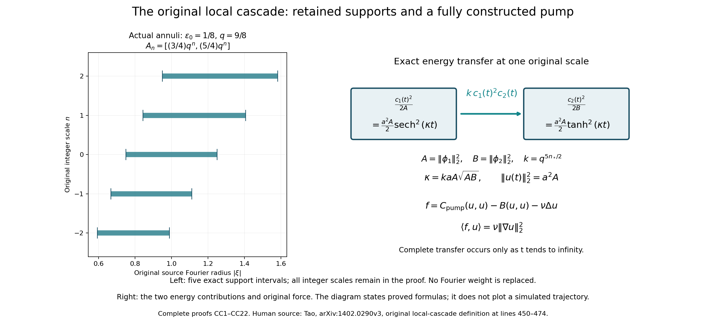
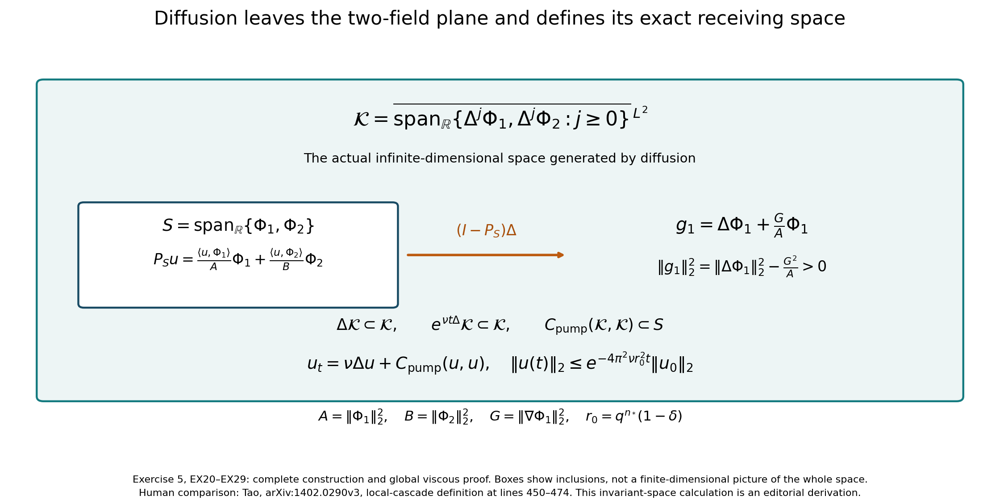

# The original local cascade and its full viscous dynamics

How can a precisely defined operator transfer energy between selected fluid
fields? This lesson constructs the local-cascade operators introduced by
Terence Tao in [arXiv:1402.0290v3](https://arxiv.org/abs/1402.0290v3),
original navier-blowup.tex, lines 450–474. We keep every original scale,
Fourier weight and field norm. The complete analysis and synthesis maps
give a sharp Sobolev range and actual local trajectories.

We then construct explicit real divergence-free fields and an exact pump
that transfers energy between them. Its full pressure and force give an
actual solution of the original positive-viscosity Navier–Stokes equation.
The five solved exercises also prove the complex averaging operations
from original source lines 502–564, solve all data on the pump plane,
calculate the complete diffusion defect, and construct the larger space
that supports the pump's own global viscous evolution.

The full averaging, Fourier and original-pressure maps used here are in
[lesson 37](the-original-averaged-equation-and-its-full-energy-and-force-maps.md).
Its MB labels refer to the precise formulas there. Product and Fourier
estimates are supplied in
[lesson 35](the-original-velocity-growth-and-complete-smoothing-maps.md).
All CC and EX formulas below are proved in this lesson.

These constructions supply prerequisites for the later cascade.
The complete representation of every relevant local cascade as an
averaged Euler operator and the finite-time blowup dynamics remain to
be proved in the following lessons.

## CC1. Retain every scale and construct both coefficient maps

Fix \(0<\epsilon_0<1/2\), and retain \(q=1+\epsilon_0\), \(L=1-2\epsilon_0>0\), \(U=1+2\epsilon_0\). This includes the sufficiently small parameter used in the source averaging argument. The following annular proof concerns these actual parameters; it does not assert the same annular argument when \(L\leq0\).

Use the source Fourier transform with exponential \(e^{-2\pi i x\cdot\xi}\). The physical Sobolev norm remains

\[
\|u\|_{H^s}^2=\int_{\mathbb R^3}(1+4\pi^2|\xi|^2)^s|\widehat u(\xi)|^2\,d\xi.
\tag{CC1}
\]

Let the original real Schwartz functions \(\psi_i\) have the source support \(L\leq|\xi|\leq U\). Define \(\phi_i=P\psi_i\), with \(P(\xi)=I-\xi\otimes\xi/|\xi|^2\). On that annulus this multiplier is smooth. Thus \(\phi_i\) remains real Schwartz, with the same permitted Fourier support, and is solenoidal. For every solenoidal \(u\), \(\langle u,\psi_i\rangle=\langle u,\phi_i\rangle\), by self-adjointness of \(P\). This identity also holds for distributional Sobolev pairings by density. Keep the original dilations

\[
\phi_{i,n}(x)=q^{3n/2}\phi_i(q^n x),\quad
\widehat{\phi_{i,n}}(\xi)=q^{-3n/2}\widehat\phi_i(q^{-n}\xi),\quad
A_n=\{\xi:Lq^n\leq|\xi|\leq Uq^n\}.
\tag{CC2}
\]

Each \(\phi_{i,n}\) has the original norm \(\|\phi_i\|_2\), without any unit-norm replacement. A nonzero frequency belongs to at most

\[
J=\left\lfloor\frac{\log(U/L)}{\log q}\right\rfloor+1
\tag{CC3}
\]

annuli. Indeed its possible integer indices lie in the closed interval
\([\log_q(|\xi|/U),\log_q(|\xi|/L)]\); an interval of length \(\ell\) contains at most \(\lfloor\ell\rfloor+1\) integers.

For each real \(s\), put

\[
\begin{gathered}
w_s(n)=(1+q^{2n})^{s/2},\quad
a_s=\max\{1,(2\pi L)^{-s},(2\pi U)^{-s}\},\\
b_s=\max\{1,(2\pi L)^s,(2\pi U)^s\},\quad
\|c\|_{\ell^2_s}^2=\sum_{n\in\mathbb Z}w_s(n)^2|c_n|^2.
\end{gathered}
\tag{CC4}
\]

The complete analysis and synthesis bounds are

\[
\begin{gathered}
\|(\langle u,\phi_{i,n}\rangle)_n\|_{\ell^2_s}
\leq\sqrt J\,a_s\|\phi_i\|_2\|u\|_{H^s},\\
\left\|\sum_n c_n\phi_{i,n}\right\|_{H^s}
\leq\sqrt J\,b_s\|\phi_i\|_2\|c\|_{\ell^2_s}.
\end{gathered}
\tag{CC5}
\]

Here is a proof retaining both full weights. On \(A_n\), write \(|\xi|=r q^n\) with \(L\leq r\leq U\). The ratio
\((1+4\pi^2r^2q^{2n})/(1+q^{2n})\) lies between 1 and \((2\pi r)^2\). Raising it to any real power gives
\[
w_s(n)(1+4\pi^2|\xi|^2)^{-s/2}\leq a_s,\qquad
(1+4\pi^2|\xi|^2)^{s/2}w_s(n)^{-1}\leq b_s.
\]
Weighted Cauchy–Schwarz on \(A_n\) therefore bounds
\(w_s(n)^2|\langle u,\phi_{i,n}\rangle|^2\) by
\(a_s^2\|\phi_i\|_2^2\int_{A_n}(1+4\pi^2|\xi|^2)^s|\widehat u|^2d\xi\).
Summation and CC3 prove analysis. For a finite synthesis sum, pointwise Cauchy–Schwarz among at most \(J\) nonzero Fourier terms gives
\[
\left|\sum_n c_n\widehat{\phi_{i,n}}(\xi)\right|^2
\leq J\sum_n |c_n|^2|\widehat{\phi_{i,n}}(\xi)|^2.
\]
Multiply by the full CC1 weight, use its second comparison and integrate. This proves the finite bound. Applying it to every finite tail proves unconditional convergence in \(H^s\) for every \(c\in\ell^2_s\) and proves the asserted synthesis map.

## CC2. Construct the entire bilinear map and identify its exact threshold

Write \(p=5/2\). For real orders \(s_1,s_2,s\) with \(d=s_1+s_2-s\geq p\), define

\[
\begin{gathered}
K_d(q)=\sup_{n\in\mathbb Z}
\frac{q^{pn}}{(1+q^{2n})^{d/2}},\\
C(u,v)=\sum_{n\in\mathbb Z}q^{5n/2}
\langle u,\phi_{1,n}\rangle\langle v,\phi_{2,n}\rangle\phi_{3,n}.
\end{gathered}
\tag{CC6}
\]

This is a genuine unconditionally convergent \(H^s_\sigma\) series, with

\[
\|C(u,v)\|_{H^s}\leq
J^{3/2}a_{s_1}a_{s_2}b_s
\|\phi_1\|_2\|\phi_2\|_2\|\phi_3\|_2
K_d(q)\|u\|_{H^{s_1}}\|v\|_{H^{s_2}}.
\tag{CC7}
\]

To prove it, write \(a_n=\langle u,\phi_{1,n}\rangle\), \(b_n=\langle v,\phi_{2,n}\rangle\). The weighted output coefficient equals
\[
w_s(n)q^{pn}a_nb_n
=\frac{q^{pn}}{(1+q^{2n})^{d/2}}
 \bigl(w_{s_1}(n)a_n\bigr)\bigl(w_{s_2}(n)b_n\bigr).
\]
The norm of a pointwise product in \(\ell^2\) is bounded by the product of its two \(\ell^2\) norms: square and sum, then bound the supremum of one squared sequence by its sum. Apply both analysis bounds and the synthesis bound CC5. This proves CC7 and convergence. For the original \(H^{10}\) inputs, pairing with \(w\in H^{10}_\sigma\) gives precisely the source trilinear definition, because each projected pairing equals its original \(\psi\) pairing. Absolute convergence of this scalar series also follows by Cauchy–Schwarz between its weighted coefficient and the corresponding dual-weight analysis sequence.

Every finite linear combination of source basic operators therefore has the same mapping range, with constant the sum of the absolute linear coefficients times their CC7 constants. The original source's \(H^{10}\times H^{10}\to L^2\) map in particular has the stronger target \(H^{35/2}\). Also \(H^{5/2}\times H^{5/2}\to H^{5/2}\) is bounded. No factor or original operator has been replaced by these estimates.

The full discrete constant can be evaluated exactly. If \(d=p\), then \(K_d(q)=1\), approached as \(n\to+\infty\). If \(d>p\), retain

\[
\begin{gathered}
y_*=\sqrt{\frac{p}{d-p}},\quad
n_-=\lfloor\log_q y_*\rfloor,\quad n_+=\lceil\log_q y_*\rceil,\\
K_d(q)=\max\left\{
\frac{q^{pn_-}}{(1+q^{2n_-})^{d/2}},
\frac{q^{pn_+}}{(1+q^{2n_+})^{d/2}}\right\}.
\end{gathered}
\tag{CC8}
\]

Indeed the logarithmic derivative of \(h(y)=y^p(1+y^2)^{-d/2}\) is
\([p+(p-d)y^2]/[y(1+y^2)]\). It is positive before \(y_*\) and negative after. Thus the discrete maximum is at one of the displayed original scales. The continuous maximum is not substituted for the exact discrete one.

For \(\lambda=q^k\), \(k\in\mathbb Z\), the actual coefficient identity is
\(\langle\operatorname{Dil}_\lambda u,\phi_{i,n}\rangle
=\langle u,\phi_{i,n-k}\rangle\).
Changing the index in the norm-convergent series gives

\[
C(\operatorname{Dil}_\lambda u,\operatorname{Dil}_\lambda v)
=\lambda^{5/2}\operatorname{Dil}_\lambda C(u,v).
\tag{CC9}
\]

Every finite linear combination retains CC9. This is a discrete covariance of the exact operator, without a change in coordinates or discarded amplitudes.

For any nonzero such operator, \(s_1+s_2-s\geq5/2\) is also necessary for boundedness \(H^{s_1}_\sigma\times H^{s_2}_\sigma\to H^s_\sigma\). First choose solenoidal real Schwartz inputs with smooth compact Fourier support away from zero and \(F=C(u,v)\ne0\). Such inputs exist: they are dense in \(H^{10}_\sigma\), by Fourier truncation, smoothing, real symmetrization and the smooth Leray projection away from zero; CC7 with output \(L^2\) would otherwise force \(C=0\) on its original domain. Only finitely many indices meet the supports of these inputs. Thus \(F\) too is Schwartz with compact Fourier support away from zero.

For each of these nonzero fields and any real \(r\), the exact dilation formula gives

\[
\begin{gathered}
\lambda^{-2r}\|\operatorname{Dil}_\lambda f\|_{H^r}^2
=\int_{\mathbb R^3}(\lambda^{-2}+4\pi^2|\xi|^2)^r|\widehat f(\xi)|^2d\xi\\
\longrightarrow\int_{\mathbb R^3}(4\pi^2|\xi|^2)^r|\widehat f(\xi)|^2d\xi
\quad(\lambda=q^k\to+\infty).
\end{gathered}
\tag{CC10}
\]

Uniform boundedness on the fixed compact annulus proves this limit for positive and negative \(r\). It is a limit of the original inhomogeneous norm, not a replacement of that norm in the operator. Apply the hypothetical boundedness estimate to the actual dilated inputs, use CC9, and divide by \(\lambda^{s_1+s_2}\). The left side is a positive limiting coefficient times \(\lambda^{5/2+s-s_1-s_2}\), whereas the right side has a finite limit. Its exponent cannot be positive. This proves necessity, hence the full sharp mapping range for every nonzero local cascade in this annular class. The zero operator is explicitly excluded from that necessity statement.

## CC3. Construct its local evolution without assuming later cascade dynamics

Fix any actual finite local cascade \(C\), original \(\nu\geq0\), and \(u_0\in H^{5/2}_\sigma\). Let \(K_C\) be the finite CC7 coefficient, summed over its basic terms, for all three orders \(5/2\). If \(M=\|u_0\|_{H^{5/2}}>0\) and \(K_C>0\), take \(T=(8K_CM)^{-1}\). The complete equation is

\[
u(t)=e^{\nu t\Delta}u_0+
\int_0^t e^{\nu(t-r)\Delta}C(u(r),u(r))\,dr.
\tag{CC11}
\]

The heat map is a strongly continuous contraction in the full CC1 norm; dominated convergence of its multiplier proves strong continuity, including \(\nu=0\). On the closed radius-\(2M\) ball in \(C([0,T];H^{5/2}_\sigma)\), CC7 bounds the image by \(M+4K_CM^2T=3M/2\) and its Lipschitz constant by \(4K_CMT=1/2\). Consecutive Picard differences therefore form a uniformly convergent geometric series. Its limit solves CC11. Every iterate is real and solenoidal. The bilinear difference identity proves uniqueness first in this ball, then on the entire continuous class by successive short intervals where both trajectories are bounded. Restarting gives the maximal interval, and any bounded sequence of norms tending to a finite endpoint contradicts maximality by the common positive lifespan. Zero data give the unique zero solution; \(K_C=0\) gives the heat solution.

This solution is \(C^1H^{1/2}\), including a one-sided initial derivative. In fact \(\nu\Delta:H^{5/2}\to H^{1/2}\) is bounded by \(\nu\), since \(4\pi^2|\xi|^2/(1+4\pi^2|\xi|^2)\leq1\). Differentiate the heat term and the convolution in this lower space by dominated convergence. The resulting equation is \(u_t=\nu\Delta u+C(u,u)\).

If the actual operator has the cancellation \(\langle C(v,v),v\rangle=0\) on \(H^{5/2}\), this proved regularity permits the \(L^2\) pairing and gives
\[
\frac12\|u(t)\|_2^2+\nu\int_0^t\|\nabla u(r)\|_2^2dr
=\frac12\|u_0\|_2^2.
\tag{CC12}
\]
Cancellation known on the dense original \(H^{10}\) subspace extends to \(H^{5/2}\) by CC7 and continuity of the \(L^2\) pairing. This is a local construction and energy identity. The later infinite cascade and its finite-time endpoint still require their own complete proof.

## CC4. Construct nonzero fields and a complete energy-transfer trajectory

The preceding statements have concrete nonzero examples. Retain
\(\delta=\epsilon_0/[8(1+\epsilon_0)]\), and define the actual even real bump
\[
\chi(\xi)=
\begin{cases}
\exp[-1/(\delta^2-|\xi|^2)],&|\xi|<\delta,\\
0,&|\xi|\geq\delta.
\end{cases}
\]
Every derivative inside the ball is a finite sum of polynomials in \(\xi\) and powers of \((\delta^2-|\xi|^2)^{-1}\) times its exponential. The limit \(t^{-m}e^{-1/t}\to0\) as \(t\downarrow0\), for every integer \(m\), follows by the exponential series lower bound \(e^{1/t}\geq t^{-m-1}/(m+1)!\). Thus every derivative extends by zero smoothly across the sphere, proving \(\chi\in C^\infty_c\).

For the actual coordinate vectors \(e_1,e_2,e_3\), put

\[
\begin{gathered}
\widehat{\phi_1}(\xi)=
[\chi(\xi-e_1)+\chi(\xi+e_1)]P(\xi)e_2,\\
\widehat{\phi_2}(\xi)=
[\chi(\xi-e_2)+\chi(\xi+e_2)]P(\xi)e_3,\qquad
\phi_{i,n}=\operatorname{Dil}_{q^n}\phi_i.
\end{gathered}
\tag{CC13}
\]

These define nonzero real solenoidal Schwartz fields: each Fourier function is real even, smooth, transverse and compactly supported away from zero; integration by parts in Fourier inversion gives every Schwartz seminorm. At the positive cap center the transverse projected vector is exactly the displayed coordinate vector and \(\chi(0)>0\), proving nonzero. Their support has \(1-\delta\leq|\xi|\leq1+\delta\), contained in the original permitted annulus. All of their dilated families are mutually orthogonal, including across indices. Indeed
\[
\frac{1+\delta}{1-\delta}<q
\quad\Longleftrightarrow\quad
\delta<\frac{\epsilon_0}{2+\epsilon_0},
\]
which follows from the chosen \(\delta\). Hence distinct scales have disjoint annuli. At one scale the caps centered at \(\pm e_1\) and \(\pm e_2\) are disjoint, since their center separation is \(\sqrt2>2\delta\). Plancherel proves all asserted orthogonalities, including between the derivatives of these two families.

For example, take all three source fields equal to \(\phi_1\). The resulting basic cascade obeys
\[
C(\phi_{1,k},\phi_{1,k})=q^{5k/2}\|\phi_1\|_2^4\phi_{1,k}\ne0.
\tag{CC14}
\]
Only index \(k\) remains in the original series. This gives an explicit nonzero family to which the sharp necessity calculation applies, while retaining its full original norm.

Define the following different, symmetric local cascade:

\[
\begin{aligned}
C_{\mathrm{pump}}(u,v)=\sum_{n\in\mathbb Z}q^{5n/2}\bigl[
&\langle u,\phi_{1,n}\rangle\langle v,\phi_{1,n}\rangle\phi_{2,n}\\
-\tfrac12(&\langle u,\phi_{1,n}\rangle\langle v,\phi_{2,n}\rangle
+\langle v,\phi_{1,n}\rangle\langle u,\phi_{2,n}\rangle)\phi_{1,n}\bigr].
\end{aligned}
\tag{CC15}
\]

It is a finite combination of three basic source operators, with coefficients \(1,-1/2,-1/2\), so all previous convergence and mapping results apply. Pairing its finite partial sums with \(u\) gives at each index
\[
q^{5n/2}
\bigl(\langle u,\phi_{1,n}\rangle^2\langle u,\phi_{2,n}\rangle
-\langle u,\phi_{1,n}\rangle\langle u,\phi_{2,n}\rangle
 \langle u,\phi_{1,n}\rangle\bigr)=0.
\]
Norm convergence and continuity of the pairing prove full cancellation. It is nonzero by applying it to \(u=v=\phi_{1,k}\). Thus the cancellation condition has produced an actual nonzero local-cascade object, not an assumed tensor.

Fix any original index \(n_*\in\mathbb Z\), amplitude \(a>0\), and retain
\[
A=\|\phi_1\|_2^2>0,\qquad B=\|\phi_2\|_2^2>0,\qquad
k=q^{5n_*/2},\qquad \kappa=kaA\sqrt{AB}.
\tag{CC16}
\]
For the inviscid equation \(u_t=C_{\mathrm{pump}}(u,u)\) and datum \(u(0)=a\phi_{1,n_*}\), the exact global trajectory is

\[
\begin{gathered}
c_1(t)=aA\,\operatorname{sech}(\kappa t),\qquad
c_2(t)=a\sqrt{AB}\,\tanh(\kappa t),\\
u(t)=a\operatorname{sech}(\kappa t)\phi_{1,n_*}
+a\sqrt{A/B}\tanh(\kappa t)\phi_{2,n_*}.
\end{gathered}
\tag{CC17}
\]

Here \(c_i=\langle u,\phi_{i,n_*}\rangle\). Orthogonality makes every other original scale coefficient zero; the exact receiving equations on this subspace are
\[
c_1'=-kA c_1c_2,\qquad c_2'=kB c_1^2,\qquad
\frac{c_1^2}{A}+\frac{c_2^2}{B}=a^2A.
\tag{CC18}
\]
Differentiate CC17 using \((\operatorname{sech}z)'=-\operatorname{sech}z\tanh z\) and \((\tanh z)'=\operatorname{sech}^2z\). The coefficient in each resulting derivative is exactly \(\kappa\) from CC16, proving both equations and the initial data. The identity \(\operatorname{sech}^2z+\tanh^2z=1\) proves the last equality. Substitution into CC15 proves the full function-space equation, rather than merely necessary coordinate equations. CC11 uniqueness identifies this explicit solution with the actual maximal local solution, which consequently extends for all finite positive times.

The original total energy is constant:
\[
\begin{gathered}
\|u(t)\|_2^2=a^2A,\qquad
\frac12\frac{c_1(t)^2}{A}=\frac{a^2A}{2}\operatorname{sech}^2(\kappa t),\\
\frac12\frac{c_2(t)^2}{B}=\frac{a^2A}{2}\tanh^2(\kappa t),\qquad
\frac d{dt}\frac{c_2^2}{2B}=k c_1^2c_2
=-\frac d{dt}\frac{c_1^2}{2A}.
\end{gathered}
\tag{CC19}
\]
For finite \(t\geq0\), \(c_1(t)>0\); complete transfer occurs only in the infinite-time limit. The original index stays fixed. These exact facts prohibit interpreting this single pump as a completed finite-time cascade.

## CC5. Give the pump its complete original physical force

Retain the original spatial coordinates and any actual \(\nu>0\), and use the same explicit \(u\) in CC17. In the physical Fourier convention of lesson 37, let

\[
\begin{gathered}
f=C_{\mathrm{pump}}(u,u)-B(u,u)-\nu\Delta u,\qquad
\widehat p_0(\eta,t)=
-\sum_{i,j=1}^3\frac{\eta_i\eta_j}{|\eta|^2}
 \widehat{u_i u_j}_{\mathrm{phys}}(\eta,t),\quad\eta\ne0,\\
u_t-\nu\Delta u+(u\cdot\nabla)u+\nabla p_0=f,\qquad
\operatorname{div}u=\operatorname{div}f=0.
\end{gathered}
\tag{CC20}
\]

The pressure has the canonical \(L^2\) representative; its value at the single Fourier point zero is immaterial. The full pressure calculation MB20 proves
\((u\cdot\nabla)u+\nabla p_0=-B(u,u)\). Inserting the actual inviscid pump equation proves CC20 term by term. In particular the viscosity is retained through the explicit \(-\nu\Delta u\) force contribution.

This is a smooth force and pressure in every Sobolev order, uniformly over \(t\geq0\), with the same property for every fixed time-derivative order. To prove that statement, the two fixed Schwartz fields in CC17 have every Sobolev norm finite. Every time derivative of its coefficients is \(\kappa^j\) times a polynomial in the bounded functions \(\operatorname{sech}(\kappa t)\) and \(\tanh(\kappa t)\); induction from their two derivative identities proves this assertion. Products of fixed Schwartz fields remain Schwartz. The Leray and pressure tensor multipliers are bounded in every \(H^r\), and each spatial derivative consumes its displayed order. Apply these facts to each differentiated term of CC20. This proves every stated uniform bound, with constants depending on the retained original fields, \(a,n_*,q,\nu\) and derivative order. Sobolev embedding, itself supplied in the earlier course foundations, gives joint smoothness. No compact spatial support is asserted for the pressure or projected force.

The complete work and gradient formulas are

\[
\begin{gathered}
\langle f,u\rangle=\nu\|\nabla u\|_2^2,\\
\|\nabla u(t)\|_2^2
=a^2q^{2n_*}\operatorname{sech}^2(\kappa t)\|\nabla\phi_1\|_2^2
+a^2(A/B)q^{2n_*}\tanh^2(\kappa t)\|\nabla\phi_2\|_2^2.
\end{gathered}
\tag{CC21}
\]

Both nonlinear pairings vanish: CC15 cancels, and the ordinary Euler pairing cancels by the proved cutoff argument MB13. Integration by parts in the full \(-\nu\Delta u\) term gives the first equality. Disjoint Fourier supports make the two gradient families orthogonal, while differentiating their actual dilation supplies \(q^{2n_*}\). These prove the second equality. Hence the full forced Navier–Stokes energy equation is satisfied with exactly constant kinetic energy and force work equal to the complete viscous loss.

For these specifically constructed fields, the exact coordinate rotation
\[
R=\begin{pmatrix}0&0&1\\1&0&0\\0&1&0\end{pmatrix}
\quad\text{gives}\quad
\phi_2=\operatorname{Rot}_R\phi_1,\quad
B=A,\quad \|\nabla\phi_2\|_2^2=\|\nabla\phi_1\|_2^2.
\tag{CC22}
\]
Indeed \(R e_1=e_2\), \(R e_2=e_3\), the bump is radial, and
\(R P(R^{-1}\xi)e_2=P(\xi)e_3\). Apply the full rotation Fourier map to the first formula in CC13 to obtain the second, at every original frequency. Rotation is an isometry of both full norms. Thus the two separate contributions in CC21, together with \(\operatorname{sech}^2+\tanh^2=1\), prove
\(\|\nabla u(t)\|_2^2=a^2q^{2n_*}\|\nabla\phi_1\|_2^2\) for these actual fields. The force work is the positive constant
\(\nu a^2q^{2n_*}\|\nabla\phi_1\|_2^2\). Positivity follows from nonzero Fourier support away from zero. CC16–CC21 retain both original norms and all their contributions; CC22 proves their precise relation rather than selecting unit-norm fields.

The remaining calculation is to represent the full relevant local cascade as an actual averaged Euler operator and construct the successive transfers with their finite-time endpoint. The source theorem statements alone do not supply either proof. The explicit pump and physical force above give verified inputs for that continuation.

## Two pictures of the original maps

CC1–CC22 prove the original annular analysis and synthesis, the complete
energy-transfer trajectory and its full physical force. The five displayed
support intervals use their stated original parameter and indices.
Every other integer scale remains in the definitions and proofs.
The diagram states exact formulas; it does not plot a simulated flow.
The [reproducible source](../assets/original-local-cascade-and-pump.py),
[vector rendering](../assets/original-local-cascade-and-pump.svg) and
[five support records](../assets/original-local-cascade-and-pump-data.json)
are included. Human comparison: Tao, original source lines 450–474.

Exercise 5, EX20–EX29 constructs the full space generated by the original
diffusion defect. The inner box is the two-field inviscid plane; the outer
box denotes its exact infinite-dimensional enlargement. Every operator,
norm and coordinate in the diagram is retained in the complete proof.
The [portable source](../assets/original-viscous-pump-space.py) and
[vector rendering](../assets/original-viscous-pump-space.svg) are included.
This is an editorial calculation from the source's original local-cascade
objects, not a numerical approximation of an infinite-dimensional flow.

## Five solved exercises

### Exercise 1. Recover real averaging with every original coefficient retained

The source begins its averaging proof by allowing complex multipliers and a finite measure. Construct this operation in the strong target, identify its correct transpose, and recover the real operator with every sign and measure factor explicit.

**Solution.** Keep a finite positive measure space \((\Omega,\mu)\), its total mass \(M=\mu(\Omega)\), the original bounded dilation interval and all the source triple symbol moments. The pairing in this exercise is the algebraic complex bilinear pairing \(\langle u,w\rangle=\int u\cdot w\), without conjugation. For \(A=m(D)\operatorname{Rot}_R\operatorname{Dil}_\lambda\), its transpose for this pairing is

\[
A^{\mathrm t}=\operatorname{Dil}_{\lambda^{-1}}
\operatorname{Rot}_{R^{-1}}m^\vee(D),\qquad m^\vee(\xi)=m(-\xi).
\tag{EX1}
\]

Indeed Fourier inversion in the source convention gives
\(\int u\cdot w=\int\widehat u(\xi)\cdot\widehat w(-\xi)d\xi\).
Moving the scalar symbol across this integral replaces \(\xi\) by \(-\xi\). The rotation and dilation changes of variables are their exact inverses, in reversed order. Thus EX1 is a bilinear transpose. It agrees with the real-field adjoint in lesson 37 when \(m(-\xi)=\overline{m(\xi)}\), but that equality is not imposed on the current complex symbols.

The actual complex operator is

\[
C_{\mathbb C}(u,v)=\int_\Omega
A_{3,\omega}^{\mathrm t}B(A_{1,\omega}u,A_{2,\omega}v)\,d\mu.
\tag{EX2}
\]

The Fourier proof MB3 and strong measurability proof MB7 apply to complex fields and the reflected symbol in EX1. They give a genuine \(H^9_\sigma\) integral and the complete bound
\[
\|C_{\mathbb C}(u,v)\|_{H^9}\leq
C_9\int_\Omega\prod_{j=1}^3\|m_{j,\omega}\|_0\,
d_{10}(\lambda_{1,\omega})d_{10}(\lambda_{2,\omega})
d_9(\lambda_{3,\omega}^{-1})\,d\mu\,
\|u\|_{H^{10}}\|v\|_{H^{10}}.
\tag{EX3}
\]
The reflected symbol has exactly the original seminorm at every order. The complex Euclidean product estimate uses absolute values; its constant is unchanged.

For any one original symbol, define the two actual real-field symbols
\[
m_0(\xi)=\frac{m(\xi)+\overline{m(-\xi)}}2,\qquad
m_1(\xi)=\frac{m(\xi)-\overline{m(-\xi)}}{2i},\qquad
m=m_0+i m_1.
\tag{EX4}
\]
Each satisfies \(m_b(-\xi)=\overline{m_b(\xi)}\). Reflection and conjugation preserve the norm of the full derivative tensor, so the triangle inequality gives
\(\|m_b\|_k\leq\|m\|_k\) for every \(k\). These symbols need not be the pointwise real and imaginary parts of \(m(\xi)\).

For real inputs define \(C_{\mathbb R}(u,v)=\operatorname{Re}C_{\mathbb C}(u,v)\), with the real part taken in physical space. Set \(A_{j,b}=m_{j,b}(D)\operatorname{Rot}_{R_j}\operatorname{Dil}_{\lambda_j}\). Expanding all eight terms in the trilinear pairing gives the exact strong operator identity
\[
\begin{gathered}
C_{\mathbb R}(u,v)=
\sum_{\beta\in\{000,110,101,011\}}
\sigma_\beta\int_\Omega A_{3,\beta_3}^*
B(A_{1,\beta_1}u,A_{2,\beta_2}v)\,d\mu,
\\
(\sigma_{000},\sigma_{110},\sigma_{101},\sigma_{011})=(1,-1,-1,-1).
\end{gathered}
\tag{EX5}
\]
The four odd powers of \(i\) have zero real part; each even term pairs real fields and has its displayed sign. All eight terms are integrable by EX3 and EX4, so taking real parts commutes with integration. Pairing with all real \(H^{10}_\sigma\) tests identifies the \(H^9_\sigma\) fields, proving EX5.

To compare the original finite measure with the source probability-space definition, retain both measures explicitly. For \(M>0\), use
\(\Omega'=\Omega\times\{000,110,101,011\}\) and
\[
\mu'(E\times\{\beta\})=\frac{\mu(E)}{4M},\qquad
m'_{1,(\omega,\beta)}=4M\,\sigma_\beta m_{1,\omega,\beta_1},
\quad
m'_{2,(\omega,\beta)}=m_{2,\omega,\beta_2},
\quad
m'_{3,(\omega,\beta)}=m_{3,\omega,\beta_3}.
\tag{EX6}
\]
Keep every original rotation and dilation on each copy. The total mass is one, and multiplying the integrand coefficient \(4M\sigma_\beta\) by its measure factor \(1/(4M)\) gives exactly the original signed integral. Every triple seminorm moment of this second representation is bounded by four times the corresponding original finite-measure moment. Thus the full source probability representation is proved without discarding the original finite measure or its mass. If \(M=0\), EX2 is zero; one atom with first symbol zero and the other symbols one represents it. Whenever EX2 is real on real inputs, EX5 gives that same original operator. Otherwise it gives precisely its stated real part.

### Exercise 2. Compose two full averaging operations

Carry out the source transitivity step with every rotation, dilation and transformed symbol retained. Prove all required symbol moments and the actual equality of the operators.

**Solution.** Let one finite averaging family have
\(A_{j,\omega}=m_{j,\omega}(D)\operatorname{Rot}_{R_{j,\omega}}
\operatorname{Dil}_{\lambda_{j,\omega}}\), and a second independent finite family have
\(D_{j,\theta}=n_{j,\theta}(D)\operatorname{Rot}_{S_{j,\theta}}
\operatorname{Dil}_{\gamma_{j,\theta}}\).
The letter \(D_{j,\theta}\) here denotes the entire displayed map; it is not a spatial derivative. Each family has its original finite positive measure, all triple symbol moments and its own compact positive dilation interval. Construct \(C_2\) by averaging the actual Euler operator with the second family as in EX2, and then construct \(C_1\) by averaging this actual \(C_2\) with the first family.

The exact combined input map is
\[
\begin{gathered}
D_{j,\theta}A_{j,\omega}
=h_{j,\omega,\theta}(D)
\operatorname{Rot}_{S_{j,\theta}R_{j,\omega}}
\operatorname{Dil}_{\gamma_{j,\theta}\lambda_{j,\omega}},\\
h_{j,\omega,\theta}(\xi)
=n_{j,\theta}(\xi)\,
m_{j,\omega}(\gamma_{j,\theta}^{-1}S_{j,\theta}^{-1}\xi).
\end{gathered}
\tag{EX7}
\]
To verify the order, first move \(m(D)\) past the dilation:
\(\operatorname{Dil}_{\gamma}m(D)=m(\gamma^{-1}D)\operatorname{Dil}_{\gamma}\).
Then move that transformed symbol past rotation:
\(\operatorname{Rot}_S m(\gamma^{-1}D)
=m(\gamma^{-1}S^{-1}D)\operatorname{Rot}_S\).
Rotations commute with these scalar dilations. The remaining rotations multiply in the order \(SR\), and the two positive scale factors multiply. These Fourier identities prove EX7 at every nonzero original frequency.

In the Euclidean derivative-tensor seminorm convention, the complete Leibniz estimate is
\[
\|h_{j,\omega,\theta}\|_k
\leq\sum_{\ell=0}^k\binom{k}{\ell}
\|n_{j,\theta}\|_\ell\|m_{j,\omega}\|_{k-\ell}.
\tag{EX8}
\]
The transformed \(k-\ell\) derivative has factor \(\gamma^{-(k-\ell)}\), and its argument has radius \(\gamma^{-1}|\xi|\). These cancel exactly in the weighted seminorm; the rotation has tensor norm one. The product derivative is a sum of \(\binom{k}{\ell}\) placements of the \(\ell\) derivatives, giving EX8 without an unspecified coefficient.

Multiply the three estimates EX8 and integrate on the product measure. Each of the finitely many resulting terms is
\[
\left(\prod_{j=1}^3\binom{k_j}{\ell_j}\right)
\left(\int_\Theta\prod_{j=1}^3\|n_{j,\theta}\|_{\ell_j}\,d\vartheta(\theta)\right)
\left(\int_\Omega\prod_{j=1}^3\|m_{j,\omega}\|_{k_j-\ell_j}\,d\mu(\omega)\right),
\tag{EX9}
\]
which is finite. Here \(\vartheta\) is the second averaging measure. The combined dilations lie in the product of the two original compact intervals. Formula EX7 preserves measurability, by the same strong continuity and symbol continuity used in MB7.

The full operator equality is
\[
C_1(u,v)=\int_{\Omega\times\Theta}
(D_{3,\theta}A_{3,\omega})^{\mathrm t}
B(D_{1,\theta}A_{1,\omega}u,
  D_{2,\theta}A_{2,\omega}v)\,d\mu(\omega)d\vartheta(\theta).
\tag{EX10}
\]
The zeroth case of EX9 and the full compact dilation bounds make the norm of the \(H^9\) integrand integrable, by EX3. Therefore Bochner Fubini is justified. The transpose identity
\(A_3^{\mathrm t}D_3^{\mathrm t}=(D_3A_3)^{\mathrm t}\)
retains the output order exactly. Substitution of the actual definition of \(C_2\) proves EX10; pairing gives the same equality in the original source duality. Thus two actual averaging operations compose into the explicitly constructed third, with every required source moment proved. No representation of an as-yet unconstructed cascade is assumed in this calculation.

### Exercise 3. Solve every real initial state of the original pump plane

Solve the inviscid pump on the exact span of \(\phi_{1,n_*}\) and \(\phi_{2,n_*}\), retaining both original norms. Include all signs and equilibrium data, and determine the time required to reach any prescribed positive transfer fraction.

**Solution.** Keep \(A,B,k\) from CC16. For initial coefficients \(c_{10}=\langle u_0,\phi_{1,n_*}\rangle\) and \(c_{20}=\langle u_0,\phi_{2,n_*}\rangle\), retain the actual datum
\[
u_0=\frac{c_{10}}A\phi_{1,n_*}+\frac{c_{20}}B\phi_{2,n_*},
\qquad E=\frac{c_{10}^2}A+\frac{c_{20}^2}B.
\tag{EX11}
\]
This parametrizes every real datum in the stated plane. If \(E=0\), both coordinates and the trajectory are zero. If \(c_{10}=0\), the full equation gives \(u(t)=u_0\) for every real \(t\); positive and negative \(c_{20}\) are both genuine equilibria.

For \(c_{10}\ne0\), define
\[
\begin{gathered}
h=\operatorname{artanh}\!\left(\frac{c_{20}}{\sqrt{BE}}\right),\qquad
\Omega=kA\sqrt{BE}>0,\\
c_1(t)=\operatorname{sgn}(c_{10})\sqrt{AE}\,
\operatorname{sech}(\Omega t+h),\qquad
c_2(t)=\sqrt{BE}\,\tanh(\Omega t+h),\\
u(t)=\frac{c_1(t)}A\phi_{1,n_*}+\frac{c_2(t)}B\phi_{2,n_*}.
\end{gathered}
\tag{EX12}
\]
The argument of \(\operatorname{artanh}\) is strictly between \(-1\) and \(1\), since \(c_{10}^2/A>0\). Using \(\operatorname{sech}(\operatorname{artanh}r)=\sqrt{1-r^2}\) recovers both original coordinates at zero, including the sign of \(c_{10}\). Differentiation gives
\[
c_1'=-kA c_1c_2,\qquad c_2'=kB c_1^2,\qquad
\frac{c_1(t)^2}A+\frac{c_2(t)^2}B=E.
\tag{EX13}
\]
The factor in the second derivative is \(\sqrt{BE}\,\Omega=kAB E\), exactly \(kB\) times the coefficient \(AE\) in \(c_1^2\). The first derivative retains \(\Omega=kA\sqrt{BE}\). All other original scale coefficients are zero by support orthogonality. Substitution into CC15 therefore proves the entire function-space equation. Local uniqueness from CC11 identifies the explicit globally defined curve. Its sign of \(c_1\) never changes, and \(c_2\) is strictly increasing.

For \(0<\theta<1\), ask when the second coordinate first satisfies \(c_2(t)\geq\sqrt{BE}\sqrt\theta\), so its energy is at least the fraction \(\theta\) of the total and its transfer direction is positive. The exact first such \(t\geq0\) is
\[
t_\theta=\max\left\{0,
\frac{\operatorname{artanh}\sqrt\theta-h}{kA\sqrt{BE}}\right\}.
\tag{EX14}
\]
This follows from strict monotonicity of \(\tanh\). If \(c_{20}<0\), the second energy initially decreases until \(c_2=0\); retaining the sign condition avoids confusing that earlier negative-coordinate energy with positive transfer. For the original datum \(a\phi_{1,n_*}\), \(E=a^2A\), \(h=0\), and the denominator is precisely the original \(\kappa=kaA\sqrt{AB}\). Every fraction strictly below one is reached in finite time, and complete transfer takes infinite time. These claims concern the exact fixed-scale pump, not an infinite sequence of pumps.

### Exercise 4. Calculate the full diffusion defect and its sharp map

Compute the difference between diffusing the original local-cascade output and diffusing its two inputs. Retain all derivative contributions. Prove its exact Sobolev range when that difference is nonzero, and test it on the explicit pump.

**Solution.** For one basic cascade define on Schwartz inputs
\[
\mathcal D_C(u,v)=\Delta C(u,v)-C(\Delta u,v)-C(u,\Delta v).
\tag{EX15}
\]
Write \(\chi_i=\Delta\phi_i\) and \(\chi_{i,n}=\operatorname{Dil}_{q^n}\chi_i\). The full dilation derivative is \(\Delta\phi_{i,n}=q^{2n}\chi_{i,n}\). Integration by parts gives \(\langle\Delta u,\phi_{i,n}\rangle=\langle u,\Delta\phi_{i,n}\rangle\). Consequently the complete identity is
\[
\begin{aligned}
\mathcal D_C(u,v)=\sum_n q^{9n/2}\bigl[
&\langle u,\phi_{1,n}\rangle\langle v,\phi_{2,n}\rangle\chi_{3,n}\\
-&\langle u,\chi_{1,n}\rangle\langle v,\phi_{2,n}\rangle\phi_{3,n}\\
-&\langle u,\phi_{1,n}\rangle\langle v,\chi_{2,n}\rangle\phi_{3,n}\bigr].
\end{aligned}
\tag{EX16}
\]
Each \(\chi_i\) has its actual derivative norm, the same permitted annular Fourier support, and no change of scale. Every output and input derivative is present, with the two negative signs.

For real \(s_1,s_2,s\) with \(d=s_1+s_2-s\geq9/2\), the CC5 proof gives
\[
\begin{gathered}
K^{(9/2)}_d(q)=\sup_{n\in\mathbb Z}
\frac{q^{9n/2}}{(1+q^{2n})^{d/2}},\\
\|\mathcal D_C(u,v)\|_{H^s}\leq
J^{3/2}a_{s_1}a_{s_2}b_s K^{(9/2)}_d(q)\\
\quad\cdot\bigl(\|\phi_1\|_2\|\phi_2\|_2\|\Delta\phi_3\|_2
+\|\Delta\phi_1\|_2\|\phi_2\|_2\|\phi_3\|_2
+\|\phi_1\|_2\|\Delta\phi_2\|_2\|\phi_3\|_2\bigr)
\|u\|_{H^{s_1}}\|v\|_{H^{s_2}}.
\end{gathered}
\tag{EX17}
\]
To prove convergence and the identity, apply CC5 to each of the three displayed coefficient products, now with the retained exponent \(9/2\). The product estimate is identical to CC7 after its explicit coefficient has changed. It proves unconditional \(H^s\) convergence. For Schwartz inputs CC6 also converges in enough Sobolev orders to differentiate it; pairing either differentiated input with the Schwartz source field gives EX16 term by term. The resulting continuous bilinear map extends the full identity to the stated spaces. Finite combinations retain the sum of absolute coefficients in their bound.

At \(d=9/2\), the discrete constant is one. For \(d>9/2\), it is the maximum at the two integer scales nearest to \(\log_q\sqrt{(9/2)/(d-9/2)}\), with the exact two values \(q^{9n/2}/(1+q^{2n})^{d/2}\) retained. This follows by differentiating the full function, as in CC8 with \(p=9/2\). Reindexing EX16 proves
\[
\mathcal D_C(\operatorname{Dil}_\lambda u,\operatorname{Dil}_\lambda v)
=\lambda^{9/2}\operatorname{Dil}_\lambda\mathcal D_C(u,v),
\qquad \lambda=q^k.
\tag{EX18}
\]
If this operator is nonzero, the dense compact-annular input argument CC10 applies to its new exponent and its actual original inhomogeneous norms. It forces \(s_1+s_2-s\geq9/2\). Thus EX17 is the complete sharp range for every nonzero diffusion defect, including the full \(H^{10}\times H^{10}\to H^{31/2}\) target.

For the actual pump at index \(n_*\), abbreviate \(\Phi_i=\phi_{i,n_*}\), retain \(G=\|\nabla\Phi_1\|_2^2\), and keep \(A=\|\Phi_1\|_2^2\), \(k=q^{5n_*/2}\). Disjoint supports give
\[
\mathcal D_{C_{\mathrm{pump}}}(\Phi_1,\Phi_1)
=k\bigl(A^2\Delta\Phi_2+2AG\Phi_2\bigr)\ne0.
\tag{EX19}
\]
Indeed \(C_{\mathrm{pump}}(\Phi_1,\Phi_1)=kA^2\Phi_2\), \(\langle\Delta\Phi_1,\Phi_1\rangle=-G\), and \(\langle\Delta\Phi_1,\Phi_2\rangle=0\), proving the coefficients and signs. If the final field were zero, \(\Phi_2\) would be a nonzero \(L^2\) Laplacian eigenfunction. Fourier transformation would put its support on a sphere of fixed radius (or an empty set), a set of Lebesgue measure zero. An \(L^2\) Fourier function supported there is zero, contradicting CC13. This proves the displayed nonvanishing and makes the sharp threshold a statement about this actual object.

### Exercise 5. Construct the space created by diffusion and its global viscous pump

Show exactly why the two-field inviscid plane is not invariant under the positive-viscosity equation. Construct the space generated by that defect and prove the actual viscous dynamics there, retaining its full original physical force.

**Solution.** Continue with the actual \(\Phi_i=\phi_{i,n_*}\), and define
\[
\begin{gathered}
S=\operatorname{span}_{\mathbb R}\{\Phi_1,\Phi_2\},\qquad
P_Su=\frac{\langle u,\Phi_1\rangle}{A}\Phi_1+
\frac{\langle u,\Phi_2\rangle}{B}\Phi_2,\\
g_1=(I-P_S)\Delta\Phi_1
=\Delta\Phi_1+\frac GA\Phi_1,\qquad
\|g_1\|_2^2=\|\Delta\Phi_1\|_2^2-\frac{G^2}{A}>0.
\end{gathered}
\tag{EX20}
\]
Orthogonality of the two Fourier supports removes the \(\Phi_2\) coefficient. Expanding the remaining square and using \(\langle\Delta\Phi_1,\Phi_1\rangle=-G\) gives its full norm. If it vanished, \(\Phi_1\) would be a nonzero \(L^2\) Laplacian eigenfunction, which EX19 excludes. For the actual equation \(u_t=\nu\Delta u+C_{\mathrm{pump}}(u,u)\) with \(\nu>0\), the derivative at datum \(\Phi_1\) has the nonzero outside component \(\nu g_1\). Thus the inviscid plane fails to be invariant for this exact initial datum, with its full defect identified.

The space generated by repeated original diffusion is
\[
\mathcal K=
\overline{\operatorname{span}_{\mathbb R}
\{\Delta^j\Phi_1,\Delta^j\Phi_2:j=0,1,2,\ldots\}}^{\,L^2}.
\tag{EX21}
\]
It is a closed real solenoidal subspace containing \(S\) and the exact defects. It is infinite-dimensional. Indeed if a finite linear combination of the powers of \(\Delta\) applied to \(\Phi_i\) were zero, its Fourier transform would be \(P(-4\pi^2|\xi|^2)\widehat\Phi_i(\xi)=0\) for a polynomial \(P\). On an open cap the original bump is positive and the projected polarization is nonzero. The radii of this open set contain an interval, so the polynomial vanishes on an interval and hence is identically zero. The two families have disjoint supports, so a dependence between both families reduces to these separate zero polynomials. This proves the asserted dimension without discarding the generated higher derivatives.

Retain the full original frequency bounds
\[
\begin{gathered}
r_0=q^{n_*}(1-\delta)>0,\qquad r_1=q^{n_*}(1+\delta),\\
\operatorname{supp}\widehat u\subset\{r_0\leq|\xi|\leq r_1\}
\quad(u\in\mathcal K).
\end{gathered}
\tag{EX22}
\]
Support is preserved under \(L^2\) limits because multiplication by the indicator of its complement is continuous in Fourier \(L^2\). Thus, for every real \(s\),
\[
\begin{gathered}
\min\{(1+4\pi^2r_0^2)^s,(1+4\pi^2r_1^2)^s\}\|u\|_2^2
\leq\|u\|_{H^s}^2\\
\leq\max\{(1+4\pi^2r_0^2)^s,(1+4\pi^2r_1^2)^s\}\|u\|_2^2.
\end{gathered}
\tag{EX23}
\]
These are estimates of the complete original norms. In particular \(\Delta\) is bounded on this \(L^2\) space, with norm at most \(4\pi^2r_1^2\), and maps the generating span into itself. Continuity therefore gives \(\Delta\mathcal K\subset\mathcal K\). The operator-norm convergent series
\[
e^{\nu t\Delta}|_{\mathcal K}
=\sum_{j=0}^{\infty}\frac{(\nu t)^j}{j!}\Delta^j|_{\mathcal K}
\tag{EX24}
\]
proves heat invariance and agrees with the original Fourier heat multiplier. Its full norm is at most one for \(t\geq0\).

Every coefficient at another original scale is zero on \(\mathcal K\), since its disjoint annulus is orthogonal to every generator and to the closure. Hence
\[
\begin{gathered}
C_{\mathrm{pump}}(\mathcal K,\mathcal K)\subset S\subset\mathcal K,\qquad
\|C_{\mathrm{pump}}(u,v)\|_2\leq2kA\sqrt B\,\|u\|_2\|v\|_2.
\end{gathered}
\tag{EX25}
\]
The incoming term has bound \(k\|\Phi_1\|_2^2\|\Phi_2\|_2\|u\|_2\|v\|_2=kA\sqrt B\|u\|_2\|v\|_2\). Each outgoing orientation has half that same bound. Their sum proves EX25 with all three original coefficients. Cubic cancellation remains exact.

The CC11 Picard construction now works directly in \(C([0,T];\mathcal K)\) with its \(L^2\) norm and coefficient \(2kA\sqrt B\). Every iterate lies in \(\mathcal K\), since both heat and the actual bilinear operator preserve it. For \(M=\|u_0\|_2>0\), the definite time \(T=(16kA\sqrt B M)^{-1}\) gives the same radius-\(2M\) contraction. Zero data give zero. Because \(\Delta\) is bounded here and the quadratic map is continuous, the actual trajectory is \(C^1L^2\) and solves the full differential equation. It retains the exact original energy identity
\[
\frac12\|u(t)\|_2^2+\nu\int_0^t\|\nabla u(r)\|_2^2dr
=\frac12\|u_0\|_2^2.
\tag{EX26}
\]
Pairing the bounded-generator equation proves this identity, and EX22–EX23 justify all its derivatives. The \(L^2\) norm stays bounded by \(M\). Therefore the definite restart time never shrinks to zero, and successive unique local solutions extend to every \(t\geq0\). This proves an actual global viscous pump in the constructed infinite-dimensional space.

The original support lower bound proves
\[
\begin{gathered}
\|u(t)\|_2\leq e^{-4\pi^2\nu r_0^2t}\|u_0\|_2,\\
\|u(t)\|_{H^s}\leq
\max\{(1+4\pi^2r_0^2)^{s/2},(1+4\pi^2r_1^2)^{s/2}\}
e^{-4\pi^2\nu r_0^2t}\|u_0\|_2.
\end{gathered}
\tag{EX27}
\]
Indeed the Fourier identity gives \(\|\nabla u\|_2^2\geq4\pi^2r_0^2\|u\|_2^2\). Multiply the differential energy inequality by \(e^{8\pi^2\nu r_0^2t}\) to obtain its nonpositive derivative and integrate; then use EX23. The exact solution and its full energy identity remain EX26, not the upper bound.

For this viscous trajectory the physical equation has the different force
\[
\begin{gathered}
f_{\mathrm{vis}}=C_{\mathrm{pump}}(u,u)-B(u,u),\qquad
\widehat p_{\mathrm{vis}}(\eta,t)=
-\sum_{i,j=1}^3\frac{\eta_i\eta_j}{|\eta|^2}
\widehat{u_i u_j}_{\mathrm{phys}}(\eta,t),\\
u_t-\nu\Delta u+(u\cdot\nabla)u+\nabla p_{\mathrm{vis}}
=f_{\mathrm{vis}},\qquad \langle f_{\mathrm{vis}},u\rangle=0.
\end{gathered}
\tag{EX28}
\]
The original differential equation and the full MB20 pressure calculation prove this correspondence. Both nonlinear energy pairings vanish. No \(-\nu\Delta u\) term is inserted here, because this actual trajectory already contains its own original viscous evolution, unlike CC17.

For completeness, this force, pressure and velocity are smooth for \(t\geq0\), with every Sobolev and fixed time-derivative norm uniformly bounded. The velocity's every spatial norm follows from EX23 and EX27. Its time derivatives follow inductively in \(\mathcal K\) from
\[
u^{(j+1)}=\nu\Delta u^{(j)}
+\sum_{\ell=0}^j\binom j\ell
C_{\mathrm{pump}}(u^{(\ell)},u^{(j-\ell)}),
\tag{EX29}
\]
using the bounded \(\Delta\), EX25 and the previously proved uniform bounds. Differentiating the actual integral equation first proves the next derivative; the finite displayed recurrence then gives its bound. This induction starts with the already constructed \(C^1\) trajectory. The full product estimates and order-zero pressure and Leray multipliers prove every corresponding norm of EX28. Sobolev embedding gives joint smoothness. Products and projection need not preserve the original compact Fourier support of \(u\); no such claim is made for the force or pressure.

The failure of the two-field plane has thus produced its exact infinite-dimensional invariant space and an actual complete viscous evolution there. This globally regular fixed-band construction does not supply the later transfer to arbitrarily high original scales; that is the remaining cascade calculation.

## Continue to the averaging representation and successive transfers

The original local cascade now has exact strong maps, sharp Sobolev bounds,
actual local trajectories and a complete energy-transfer example.
The diffusion defect defines an infinite-dimensional invariant space
with a global viscous solution and the full original force and pressure.
The real and complex averaging operations have complete composition maps.

The next step is the complete averaging representation, followed by the
successive energy transfers and their finite-time limit. A fixed-band
pump does not perform that transfer to arbitrarily high original scales.
The series continues through the other assigned model and self-similar
constructions toward the Alpöge–Buckmaster, OpenAI and workbench results.
