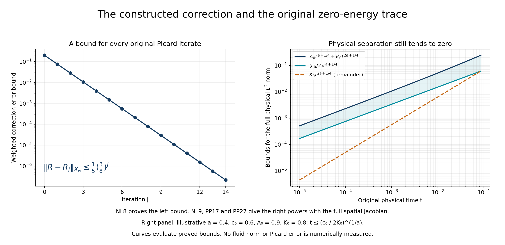
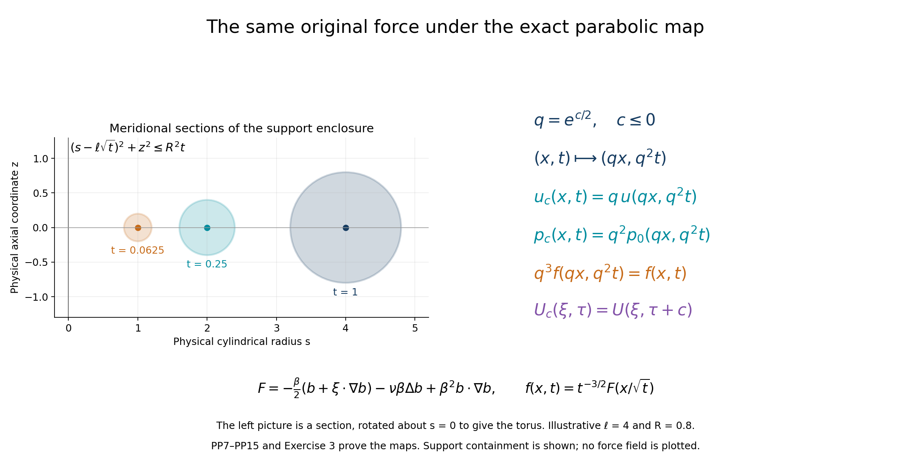

# The original nonlinear correction and distinct forced Leray flows

[Lesson35](the-original-velocity-growth-and-complete-smoothing-maps.md)
proved the full velocity growth, smoothing and nonlinear integral maps.
This lesson constructs the actual nonlinear correction and proves two
distinct suitable Leray flows with the same force and zero initial velocity.

The construction retains every original viscosity, amplitude, drift,
quadratic interaction and pressure term. An explicit time interval gives
a convergent fixed-point series. One common interval supplies all spatial
orders, all time derivatives and the full original generator domain.
Returning to physical coordinates gives the pressure, the strong zero
energy trace, global and local energy equalities, and the source's
axisymmetric no-swirl structure. A final joining argument gives global
Leray trajectories with one common extended force.

The human source is Dallas Albritton, Elia Brué and Maria Colombo,
[*Non-uniqueness of Leray solutions of the forced Navier–Stokes equations*,
arXiv:2112.03116v1](https://arxiv.org/abs/2112.03116v1), original
main.tex342–380,405–411,550–593 and2643–2934. Lessons29–35 supply
complete constructions of its required actual compact background,
unstable mode, domains and smoothing maps. Setting our retained viscosity
to one gives the source's case.

Five solved exercises improve the scalar contraction criterion, calculate
the full second-order correction, construct a continuum of flows with the
same force, retain both pressure orders, and determine the exact initial
concentration and force regularity. All consequences are proved beside
their original hypotheses. Author self-check only; no independent review
or novelty claim is asserted.

## NL1. Keep the actual restricted mode and every nonlinear term

Retain the actual compact background \(b\), its original \(\beta>0,\nu>0\), and the closed velocity operator

\[
\begin{gathered}
Lu=\nu\Delta u+\frac12x\cdot\nabla u+\frac12u
 -\beta\mathbb P(b\cdot\nabla u+u\cdot\nabla b),\\
D(L)=X_\sigma=\{u\in H^2\cap H_\sigma:x\cdot\nabla u\in L^2\}.
\end{gathered}
\tag{NL1}
\]

Work in its original rotation-and-reflection fixed space \(H_{\rm ns}\) from SG21. Its own maximal spectral value, supplied by SG22, is \(a=\operatorname{Re}\lambda>0\); no equality with the unrestricted maximum is needed. Keep the actual eigenvector \(\eta\ne0\) and the real solution \(\ell(\tau)=\operatorname{Re}(e^{\lambda\tau}\eta)\) when the eigenvalue is nonreal. For a real eigenvalue, use the existing nonzero real component chosen in SG20, and write its original real vector as \(\eta\). Do not rescale it. SM17–SM18 give every Sobolev order and the full drift.

For every real \(s\geq0\), let \(A_s>0\) be the exact upper norm coefficient from the Gram formula SG19–SG20, in \(H^s\). Let \(c_0>0\) be its lower coefficient in physical \(L^2\). In the real case both coefficients are the corresponding original vector norms. Thus

\[
\|\ell(\tau)\|_{H^s}\leq A_s e^{a\tau},\qquad
\|\ell(\tau)\|_2\geq c_0e^{a\tau},\qquad
\ell'=L\ell,\quad \tau\in\mathbb R.
\tag{NL2}
\]

Fix one real \(N>5/2\). This fixes a construction norm; it changes none of the physical fields or coefficients. Set \(w=3a/2\) and \(\delta=a/4\). For a finite endpoint \(T\), use the exact Banach space \(X_w\) of real no-swirl solenoidal curves continuous into \(H^N\) on \(( -\infty,T]\), with norm \(\sup_{\tau\leq T}e^{-w\tau}\|R(\tau)\|_{H^N}\).

Let \(\mathcal D\) be the proved bilinear map EX16–EX17 of lesson35. Retain its full constants

\[
\begin{gathered}
D_s(v)=C_{s-1}M_{\rm ns}(s-1,s+1/2,a/4)
 \frac{\Gamma(1/4)}{(v-5a/4)^{1/4}},\qquad v>5a/4,\ s>5/2,\\
\mathcal T(R)=\mathcal D(R,R)+\mathcal D(\ell,R)
 +\mathcal D(R,\ell)+\mathcal D(\ell,\ell).
\end{gathered}
\tag{NL3}
\]

The two mixed terms are distinct and are both retained. The coefficient \(C_{s-1}\) is the complete Fourier product constant EX14, and \(M_{\rm ns}\) keeps the original physical parameters through SM6. In particular the three positive margins are \(3a-5a/4=7a/4\), \(5a/2-5a/4=5a/4\) and \(2a-5a/4=3a/4\); all three integrals exist.

## NL2. Construct a definite time interval and the actual fixed point

Define the positive finite constants

\[
B_0=D_N(3a),\qquad L_0=2D_N(5a/2)A_N,\qquad
G_0=D_N(2a)A_N^2,
\tag{NL4}
\]

and the actual finite endpoint

\[
T_0=\min\left\{0,-\frac{\log(8B_0)}{w},
 -\frac{\log(8L_0)}a,-\frac{2\log(8G_0)}a\right\}.
\tag{NL5}
\]

These constants are strictly positive because the actual mode is nonzero and the proved product and semigroup bounds may be chosen positive. A negative logarithm poses no problem: taking the minimum with zero still gives the required inequality. On \(( -\infty,T_0]\), EX17 gives the full bounds

\[
\begin{aligned}
\|\mathcal D(R,R)\|_{X_w}&\leq b_*\|R\|_{X_w}^2,
 &b_*&=B_0e^{wT_0}\leq\frac18,\\
\|\mathcal D(\ell,R)+\mathcal D(R,\ell)\|_{X_w}
 &\leq l_*\|R\|_{X_w},
 &l_*&=L_0e^{aT_0}\leq\frac18,\\
\|\mathcal D(\ell,\ell)\|_{X_w}&\leq g_*,
 &g_*&=G_0e^{aT_0/2}\leq\frac18.
\end{aligned}
\tag{NL6}
\]

For example the first output has its original weight \(2w=3a\), so dividing by \(e^{w\tau}\) and taking the supremum leaves exactly \(e^{wT_0}\). The mixed output has weight \(a+w=5a/2\), and the last has weight \(2a\). This proves every exponent in NL6; it does not replace them by one unspecified small parameter.

On the closed unit ball, the map has norm at most \(b_*+l_*+g_*\leq3/8\). Bilinearity gives the full difference identity

\[
\begin{aligned}
\mathcal T(R)-\mathcal T(V)
={}&\mathcal D(R-V,R)+\mathcal D(V,R-V)\\
 &+\mathcal D(\ell,R-V)+\mathcal D(R-V,\ell),\\
\|\mathcal T(R)-\mathcal T(V)\|_{X_w}
 &\leq k_*\|R-V\|_{X_w},\qquad k_*=2b_*+l_*\leq3/8.
\end{aligned}
\tag{NL7}
\]

Set \(R_0=0\), \(R_{j+1}=\mathcal T(R_j)\). Every iterate is in that ball and preserves the original reality, divergence and symmetry. NL7 implies \(\|R_{j+1}-R_j\|_{X_w}\leq g_*k_*^j\). The geometric series converges in the complete space to an actual \(R\), with

\[
R=\mathcal T(R),\qquad
\|R\|_{X_w}\leq\frac{g_*}{1-k_*}\leq\frac15,
\qquad
\|R-R_j\|_{X_w}\leq\frac{g_*k_*^j}{1-k_*}.
\tag{NL8}
\]

The coarser unit-ball bound remains valid. Continuity of the bilinear and linear maps proves the fixed-point identity by passage to the limit. Any two fixed points in this ball have difference at most \(k_*\) times itself, so they agree. This is uniqueness of the constructed correction in its specified ball, not uniqueness of all forced Navier–Stokes solutions.

## NL3. Prove the full refined decay on the same time interval

The half-derivative estimate EX17 applied to each of the four fixed-point terms gives

\[
\|R(\tau)\|_{H^{N+1/2}}
\leq B_0e^{3a\tau}+L_0e^{5a\tau/2}+G_0e^{2a\tau}
\leq K_{N+1/2}e^{2a\tau},
\tag{NL9}
\]

where

\[
K_{N+1/2}=B_0e^{aT_0}+L_0e^{aT_0/2}+G_0.
\tag{NL10}
\]

The output is continuous at this higher order by EX17. The original solution obtained in \(H^N\) equals that higher-order integral, since the inclusion into \(H^N\) preserves the equality. In particular its \(H^N\) norm has the same refined bound.

Suppose at one order \(s>5/2\) we have already proved continuity and \(\|R(\tau)\|_{H^s}\leq K_s e^{2a\tau}\). Applying the same exact integral to its four terms at this order gives a continuous output in \(H^{s+1/2}\) and

\[
\begin{aligned}
\|R(\tau)\|_{H^{s+1/2}}&\leq K_{s+1/2}e^{2a\tau},\\
K_{s+1/2}
&=D_s(4a)K_s^2e^{2aT_0}
 +2D_s(3a)A_sK_se^{aT_0}+D_s(2a)A_s^2.
\end{aligned}
\tag{NL11}
\]

Here the full quadratic, mixed and linear-mode terms have weights \(4a,3a,2a\), respectively. Each denominator in NL3 stays strictly positive. This proves a finite explicit recurrence starting with NL10. For any real \(k\geq0\), choose a reached order \(s\geq k\); the complete Fourier weights give \(\|R\|_{H^k}\leq\|R\|_{H^s}\). Thus a single actual correction, on the unchanged interval \(( -\infty,T_0]\), belongs continuously to every \(H^k\) and has decay \(e^{2a\tau}\) there. No separate time interval is taken for each higher derivative.

The time factor in the source's displayed mixed-term estimate at main.tex2912 still uses the integrated variable. The receiving bound before taking the weighted supremum is \(e^{(2a+a/2)\tau}\), as explicitly retained in NL9. Both mixed terms and their factor two remain.

## NL4. Prove time differentiability from the actual convergent integral

We next prove membership in the full domain NL1. High spatial Sobolev regularity alone would not give the required \(x\cdot\nabla R\) integrability.

Write every convolution in the form

\[
\mathcal D(f,g)(\tau)
=-\int_0^\infty S_{\rm ns}(h)\mathbb P
 \bigl(f(\tau-h)\cdot\nabla g(\tau-h)\bigr)\,dh.
\tag{NL12}
\]

If the curves and their derivatives have the corresponding finite weighted norms, the same full integrable bound EX17 applies to their differentiated products. Difference quotients converge by dominated convergence in \(H^{N+1/2}\) on every compact interval of \(\tau\), including the remote tail: a bounded time shift multiplies each original weight bound by a fixed finite exponential. Consequently

\[
\frac d{d\tau}\mathcal D(f,g)
=\mathcal D(f',g)+\mathcal D(f,g').
\tag{NL13}
\]

No derivative of the semigroup is taken here. The actual mode has \(\|\ell'(\tau)\|_{H^N}\leq A'_N e^{a\tau}\), with for example \(A'_N=|\lambda|\|\eta\|_{H^N}\), retaining the full original complex vector norm. Starting from zero, NL13 proves differentiability of every Picard iterate into \(H^N\). Its derivative \(Z_j=R_j'\) obeys

\[
\begin{aligned}
Z_{j+1}&=\mathcal A_{R_j}Z_j+F_{R_j},\qquad Z_0=0,\\
\mathcal A_V Z&=\mathcal D(Z,V)+\mathcal D(V,Z)
 +\mathcal D(\ell,Z)+\mathcal D(Z,\ell),\\
F_V&=\mathcal D(\ell',V)+\mathcal D(V,\ell')
 +\mathcal D(\ell',\ell)+\mathcal D(\ell,\ell').
\end{aligned}
\tag{NL14}
\]

On the same ball \(\|\mathcal A_V\|\leq k_*<1\). Moreover

\[
\|F_V\|_{X_w}\leq F_*:=
2D_N(5a/2)A'_Ne^{aT_0}
+2D_N(2a)A_NA'_Ne^{aT_0/2}.
\tag{NL15}
\]

The geometric sum therefore gives \(\|Z_j\|_{X_w}\leq F_* /(1-k_*)\) for every \(j\). Define \(Z\) as the unique fixed point of the affine contraction \(Z\mapsto\mathcal A_R Z+F_R\); its geometric series proves existence and the same bound.

To prove convergence of the actual derivatives to this vector, retain the operator difference bounds

\[
\begin{aligned}
\|\mathcal A_V-\mathcal A_U\|&\leq2b_*\|V-U\|_{X_w},\\
\|F_V-F_U\|_{X_w}&\leq f_*\|V-U\|_{X_w},\qquad
f_*=2D_N(5a/2)A'_Ne^{aT_0}.
\end{aligned}
\tag{NL16}
\]

Thus, with \(E_j=\|Z_j-Z\|_{X_w}\) and \(C_*=2b_*\|Z\|_{X_w}+f_*\), NL8 gives

\[
E_{j+1}\leq k_*E_j+C_*\frac{g_*k_*^j}{1-k_*},\qquad
E_j\leq k_*^j E_0+\frac{C_*g_*}{1-k_*}j k_*^{j-1}
\quad(j\geq1).
\tag{NL17}
\]

This tends to zero. On every compact time interval, both the curves and their derivatives now converge uniformly into \(H^N\). The identity \(R_j(v)-R_j(u)=\int_u^v Z_j(r)dr\) passes to the limit, giving \(R'=Z\) and continuous differentiability there. It also gives the left derivative and continuity at \(T_0\). In particular all operations used in deriving time differentiability have been constructed, rather than inferred from an unproved analytic-semigroup assertion.

## NL5. Receive the correction in the full original generator domain

Set \(W=\ell+R\) and retain the complete projected nonlinearity

\[
Q(\tau)=-\mathbb P\bigl(
 R\cdot\nabla R+\ell\cdot\nabla R
 +R\cdot\nabla\ell+\ell\cdot\nabla\ell\bigr)(\tau)
=-\mathbb P(W\cdot\nabla W)(\tau).
\tag{NL18}
\]

It is continuous into every Sobolev space, by NL11 and the full product estimate at a higher order. Splitting the convergent improper integrals at any finite \(s<\tau\leq T_0\), and using the semigroup law on the earlier part, gives

\[
R(\tau)=S_{\rm ns}(\tau-s)R(s)
 +\int_s^\tau S_{\rm ns}(\tau-r)Q(r)dr.
\tag{NL19}
\]

The split and bounded-semigroup passage through the integral are justified by its absolute Bochner convergence already proved in EX17. At \(\tau<T_0\), put \(s=\tau\) and the upper endpoint \(\tau+h\) in this identity. The resulting generator quotient is

\[
\begin{gathered}
\frac{S_{\rm ns}(h)R(\tau)-R(\tau)}h
=\frac{R(\tau+h)-R(\tau)}h
 -\frac1h\int_0^h S_{\rm ns}(h-r)Q(\tau+r)dr
\\
\longrightarrow R'(\tau)-Q(\tau)
\quad\text{in }L^2.
\end{gathered}
\tag{NL20}
\]

Strong continuity and the local semigroup bound show that the last average tends to \(Q(\tau)\). The definition of the generator and its exact domain therefore prove \(R(\tau)\in X_\sigma\cap H_{\rm ns}\) and \(R'=LR+Q\). At \(T_0\), approach from the left: continuity of \(R\) and \(R'-Q\) in \(L^2\), together with closedness of the original generator, proves the same domain membership and identity.

Time derivatives also acquire every spatial order on this same interval. The identity \(Z=\mathcal A_RZ+F_R\), first proved in \(H^N\), gains half a derivative by EX17. Its four kinds of inputs have weights \((w,w),(a,w),(a,w),(a,a)\). Let \(r_s\) be a proved bound for \(R\) in the weight-\(w\), order-\(s\) norm: use \(r_N=1\), and \(r_s=K_s e^{aT_0/2}\) at the higher reached orders from NL11. Retain \(A'_s=|\lambda|\|\eta\|_{H^s}\). Starting with \(z_N=F_* /(1-k_*)\), the full recurrence

\[
\begin{aligned}
z_{s+1/2}={}&2D_s(3a)z_sr_s e^{3aT_0/2}
 +2D_s(5a/2)A_sz_s e^{aT_0}\\
&+2D_s(5a/2)A'_sr_s e^{aT_0}
 +2D_s(2a)A_sA'_s e^{aT_0/2}
\end{aligned}
\tag{NL21}
\]

gives \(\sup_{\tau\leq T_0}e^{-w\tau}\|Z(\tau)\|_{H^{s+1/2}}\leq z_{s+1/2}\). Each pair of terms in NL14 contributes its displayed factor two; dividing its full output weight by \(e^{w\tau}\) gives exactly the four endpoint powers in NL21. EX17 also gives continuity at the new order. Repeating is legitimate because \(R,\ell,\ell'\) already have all such orders and finite corresponding weighted norms. This proves continuous \(Z\) in every \(H^k\). The integral identity for \(R(v)-R(u)\) then holds in each such space, so \(R\) is continuously differentiable there too.

The full original spatial drift is now received without dropping any term:

\[
\frac12x\cdot\nabla R
=R'-\nu\Delta R-\frac12R
 +\beta\mathbb P(b\cdot\nabla R+R\cdot\nabla b)
 +\mathbb P(W\cdot\nabla W).
\tag{NL22}
\]

Every term on the right belongs continuously to every \(H^k\), by the proved higher-order statements and SM3. Hence so does the full drift. This constructs the exact original nonlinear equation, its domain, every spatial derivative and the time derivative, retaining the full viscosity, amplitude and both mixed products.

## NL6. Prove that the actual corrected perturbation is nonzero

Let \(K=K_{N+1/2}>0\) from NL10. Restrict the already constructed curve, without changing any field, to

\[
T_1=\min\left\{T_0,\frac1a\log\frac{c_0}{2K}\right\}.
\tag{NL23}
\]

For every \(\tau\leq T_1\), the exact real-mode lower bound and NL9 give

\[
\|W(\tau)\|_2
\geq\|\ell(\tau)\|_2-\|R(\tau)\|_2
\geq c_0e^{a\tau}-Ke^{2a\tau}
\geq\frac{c_0}2e^{a\tau}>0.
\tag{NL24}
\]

Thus the nonlinear correction does not cancel the actual mode. The original background and force remain the ones in EX5 of lesson35. The following PP1–PP29 prove the full physical pressure, original-time energy and local energy identities, zero initial trace and suitable Leray membership for this already constructed perturbation.

## PP1. Prove smoothness in time as well as space

Keep the actual \(R,\ell,W=\ell+R\), interval \(( -\infty,T_0]\), weight \(w=3a/2\) and contraction coefficient \(k_*\leq3/8\) of NL1–NL24. NL4–NL5 already prove one time derivative at every spatial order. We now construct every higher time derivative without assuming analyticity of the drift semigroup.

For a nonnegative integer \(m\), write \(\ell_m=\partial_\tau^m\ell\). Its original complex exponential gives

\[
\|\ell_m(\tau)\|_{H^s}\leq A_{m,s}e^{a\tau},\qquad
A_{m,s}=|\lambda|^m\|\eta\|_{H^s},\qquad s\geq0.
\tag{PP1}
\]

In the real case use the actual real component selected in NL1. For estimates at order zero in time we may also use the exact smaller Gram coefficient \(A_s\) of NL2. Neither choice changes the eigenvector. Denote \(Z_m=\partial_\tau^mR\), starting with the already proved \(Z_0=R,Z_1=R'\), and put \(W_j=\ell_j+Z_j\). The full product rule for the bilinear integral gives the equation to be constructed at order \(m\geq1\):

\[
\begin{aligned}
Z_m&=\mathcal A_R Z_m+F_m,\\
F_m&=\mathcal D(\ell_m,W_0)+\mathcal D(W_0,\ell_m)
 +\sum_{j=1}^{m-1}\binom mj\mathcal D(W_j,W_{m-j}).
\end{aligned}
\tag{PP2}
\]

Here \(\mathcal A_R\) is exactly NL14. The sum is empty for \(m=1\), when PP2 agrees with the proved equation. To see all terms, expand \(\partial_\tau^m\mathcal D(W,W)=\sum_{j=0}^m\binom mj\mathcal D(\partial_\tau^jW,\partial_\tau^{m-j}W)\); its two endpoint terms contain \(Z_m\), and all remaining terms are precisely PP2.

Suppose lower derivatives have been constructed in the order-\(N\), weight-\(w\) space, with finite bounds \(z_{j,N}\). Take \(z_{0,N}=1\), retaining the valid coarse NL8 bound, and \(z_{1,N}=F_* /(1-k_*)\) from NL15. At any reached spatial order \(s>5/2\), set

\[
\begin{aligned}
E_s(j,k)={}&D_s(3a)e^{3aT_0/2}z_{j,s}z_{k,s}\\
&+D_s(5a/2)e^{aT_0}
 (A_{j,s}z_{k,s}+z_{j,s}A_{k,s})
 +D_s(2a)e^{aT_0/2}A_{j,s}A_{k,s},\\
F_{m,s}={}&2D_s(5a/2)e^{aT_0}A_{m,s}z_{0,s}
 +2D_s(2a)e^{aT_0/2}A_{m,s}A_{0,s}\\
&+\sum_{j=1}^{m-1}\binom mj E_s(j,m-j).
\end{aligned}
\tag{PP3}
\]

These are the full bounds after division by the output weight \(e^{w\tau}\). The four weights before that division are \(3a,5a/2,5a/2,2a\); their original positive Gamma denominators are those in NL3. EX17 therefore bounds \(F_m\) by \(F_{m,N}\). The affine contraction in PP2 has an actual solution with bound

\[
z_{m,N}=\frac{F_{m,N}}{1-k_*}.
\tag{PP4}
\]

This constructs a vector but does not yet identify a derivative. For that identification, differentiate the actual Picard iterates \(R_{n+1}=\mathcal T(R_n)\) from NL8. Each finite iterate has all time derivatives: repeated NL13 is justified by its complete integrable kernel and finite weighted bounds. At order \(m\), their derivatives obey PP2 with \(R_n\) and all its lower derivatives on the right. By induction the lower derivatives converge in the weighted norm; their bilinear products therefore converge to \(F_m\), and are uniformly bounded. The coefficient operators converge to \(\mathcal A_R\) by NL16 and remain bounded by \(k_*\). If \(e_n\) is the distance between the order-\(m\) Picard derivative and the vector constructed in PP4, it follows that

\[
e_{n+1}\leq k_*e_n+\epsilon_n,\qquad \epsilon_n\longrightarrow0,
\qquad
e_n\leq k_*^n e_0+\sum_{j=0}^{n-1}k_*^{n-1-j}\epsilon_j.
\tag{PP5}
\]

The last sum tends to zero: fix an index after which \(\epsilon_j\) is small, bound its tail by that supremum divided by \(1-k_*\), and let the finite earlier part decay geometrically. Thus derivatives of order \(m\) converge uniformly on every compact time interval. Passing to the fundamental theorem of calculus for the order-\(m-1\) iterates identifies the new vector as the actual derivative. This completes induction in time at order \(N\), including continuous one-sided derivatives at \(T_0\).

Every such derivative has all spatial orders on the same interval. At one reached \(s\), PP2 and EX17 give the full half-step bound

\[
z_{m,s+1/2}
=2D_s(3a)e^{3aT_0/2}z_{0,s}z_{m,s}
 +2D_s(5a/2)e^{aT_0}A_{0,s}z_{m,s}+F_{m,s}.
\tag{PP6}
\]

For \(m=0\), the needed \(z_{0,s}\) comes from NL9–NL11, by multiplying its refined bound by \(e^{aT_0/2}\). Induct first in \(m\), then in these spatial half-steps: PP3 uses only lower time derivatives in its sum. Every term has a finite explicit bound and continuous output by EX17. The time integral identities pass to each higher Sobolev space, proving \(R\in C^\infty(( -\infty,T_0);H^s)\) for every finite \(s\). Sobolev embedding of each spatial derivative then gives joint smoothness in space and similarity time. This proves the smoothness needed below from the constructed curve itself.

## PP2. Construct the full original pressure

Restrict the same curve to \(\tau\leq T_1\) from NL23, and keep

\[
\begin{gathered}
U=\beta b+W,\qquad W=\ell+R,\\
F=-\frac\beta2(b+\xi\cdot\nabla b)-\nu\beta\Delta b
 +\beta^2 b\cdot\nabla b,\\
\mathcal T_{ij}=\beta(b_iW_j+W_i b_j)+W_iW_j,\qquad
H_i=\partial_j\mathcal T_{ij}
=\beta(b\cdot\nabla W+W\cdot\nabla b)_i+(W\cdot\nabla W)_i.
\end{gathered}
\tag{PP7}
\]

Both \(b\) and \(W\) are solenoidal, which proves the displayed tensor-divergence identity with its original component convention. All tensor and vector norms retain the full sums over their indices. The fixed-point equation and the linear mode equation give \(W_\tau=L_0W-\mathbb P H\), where \(L_0=\nu\Delta+(\xi\cdot\nabla)/2+1/2\). Consequently the full unprojected expression for \(U\) is

\[
U_\tau-\nu\Delta U-\frac12(U+\xi\cdot\nabla U)
 +U\cdot\nabla U=F+(I-\mathbb P)H.
\tag{PP8}
\]

Define its pressure representative by the complete Fourier multiplier

\[
\widehat P_0(\eta,\tau)
=-\sum_{i,j=1}^3\frac{\eta_i\eta_j}{|\eta|^2}
 \widehat{\mathcal T}_{ij}(\eta,\tau),\qquad \eta\ne0.
\tag{PP9}
\]

The value at the single point \(\eta=0\) may be set to zero in this \(L^2\) representative. This choice does not assert that an arbitrary spatial pressure constant vanishes. The rank-one matrix \(\eta\otimes\eta/|\eta|^2\) has full tensor norm one, so Plancherel with the original factor \((2\pi)^{-3}\) gives

\[
\|P_0(\tau)\|_{H^s}\leq\|\mathcal T(\tau)\|_{H^s},\qquad
\nabla P_0=-(I-\mathbb P)H,\qquad
-\Delta P_0=\partial_i\partial_j\mathcal T_{ij}.
\tag{PP10}
\]

The tensor is in every \(H^s\): use the complete product estimate EX15 at a higher order, or the same weighted Fourier convolution proof without its derivative. The multiplier has no singular norm at zero, hence defines an actual square-integrable pressure at each time and all stated higher orders. PP1 and bilinearity also give its smooth time dependence. The gradient identity follows from the symbols of divergence, gradient and the exact Leray complement; it retains the negative sign in PP9.

The force is the original unprojected compact force. Its divergence is \(\operatorname{div}F=\beta^2\partial_i\partial_j(b_i b_j)\) by lesson35 EX6. Therefore the complete pressure equation can also be written

\[
-\Delta P_0=\operatorname{div}\operatorname{div}(U\otimes U)
 -\operatorname{div}F.
\tag{PP11}
\]

Thus the background tensor is canceled by the actual force divergence, not omitted. Equations PP8–PP10 prove

\[
U_\tau-\nu\Delta U-\frac12(U+\xi\cdot\nabla U)
 +U\cdot\nabla U+\nabla P_0=F,\qquad\operatorname{div}U=0.
\tag{PP12}
\]

Every other pressure with the same gradient differs by a spatial constant depending on time. The underlying fact follows distributionally: a distribution on connected Euclidean space with all first derivatives zero is constant, as can be proved by convolution and the corresponding elementary statement for smooth functions. The representative PP9 is the one used in the global norms below.

## PP3. Return to physical space and time without changing the force

Set \(t_*=e^{T_1}>0\), and for \(0<t\leq t_*\) define the original variables and fields

\[
\begin{gathered}
\xi=x/\sqrt t,\qquad\tau=\log t,\qquad
u(x,t)=t^{-1/2}U(\xi,\tau),\qquad
\bar u(x,t)=\beta t^{-1/2}b(\xi),\\
p_0(x,t)=t^{-1}P_0(\xi,\tau),\qquad
\bar p=0,\qquad f(x,t)=t^{-3/2}F(\xi).
\end{gathered}
\tag{PP13}
\]

These retain the source's original similarity coordinates; viscosity and amplitude have not been absorbed into them. The chain rule gives every factor:

\[
\begin{aligned}
\partial_t u&=t^{-3/2}\left(U_\tau-\frac12U-\frac12\xi\cdot\nabla U\right),\\
\Delta_xu&=t^{-3/2}\Delta_\xi U,\qquad
u\cdot\nabla_xu=t^{-3/2}U\cdot\nabla_\xi U,\qquad
\nabla_xp_0=t^{-3/2}\nabla_\xi P_0.
\end{aligned}
\tag{PP14}
\]

The first identity is also an identity of \(L^2\) functions on every closed positive time interval, because NL22 supplies the entire spatial drift. PP12 therefore gives the original physical equation

\[
\partial_tu-\nu\Delta u+u\cdot\nabla u+\nabla p_0=f,
\qquad \operatorname{div}u=0.
\tag{PP15}
\]

The same equation holds for \(\bar u,\bar p\) by the full force calculation in lesson35 EX5. Thus the two flows have exactly the same unprojected force. Its support at each time is contained in \(\sqrt t\,\overline Q_\ell\), the original dilated compact torus; the pressure and perturbed velocity have not been assumed compactly supported. Both flows, their pressures and force are smooth in space and time for positive times by PP1 and the smooth coordinate map.

Physical dilation commutes with every rotation and reflection used in SG21. The velocity therefore retains axisymmetry and no swirl. The exact chain rule also makes the force equivariant, and the scalar pressure representative is invariant, since its tensor multiplier commutes with orthogonal changes of coordinates. Reality follows from the real fields and real Fourier multiplier. These prove the source's stated symmetries for the actual physical fields.

## PP4. Prove the exact physical bounds and zero initial trace

For each real \(s\geq0\), choose the finite proved \(K_s\) from NL9–NL11, taking a higher reached order when needed. Retain

\[
J_s=\beta\|b\|_{H^s}+A_s e^{aT_1}+K_s e^{2aT_1}.
\tag{PP16}
\]

It bounds \(\|U(\tau)\|_{H^s}\) for every \(\tau\leq T_1\). The complete spatial Jacobian gives

\[
\|u(t)\|_2=t^{1/4}\|U(\log t)\|_2\leq J_0t^{1/4},\qquad
\|\nabla u(t)\|_2=t^{-1/4}\|\nabla U(\log t)\|_2\leq J_1t^{-1/4}.
\tag{PP17}
\]

Here the full ordered derivative norm is used, and its Fourier weight is bounded by the corresponding inhomogeneous Sobolev weight. In particular

\[
\sup_{0<t\leq t_*}\|u(t)\|_2^2\leq J_0^2\sqrt{t_*},\qquad
\int_0^{t_*}\|\nabla u(t)\|_2^2dt\leq2J_1^2\sqrt{t_*},\qquad
\|f\|_{L^1((0,t_*);L^2)}=4t_*^{1/4}\|F\|_2.
\tag{PP18}
\]

Positive-time continuity in \(L^2\) follows from strong continuity of the dilation on \(L^2\) and of \(U\); dilation continuity follows by density of compact smooth functions and its exact norm factor. Define \(u(0)=0\). PP17 gives strong continuity at zero. The background has the same assertions with \(J_s\) replaced by \(\beta\|b\|_{H^s}\). Thus both belong to \(C([0,t_*];L^2)\cap L^2((0,t_*);\dot H^1)\), and have the actual zero initial datum.

For completeness retain all the physical derivative and finite-exponent estimates. Fourier inversion and Cauchy–Schwarz give
\(\|g\|_\infty\leq(8\pi)^{-1/2}\|g\|_{H^2}\), since the full three-dimensional integral \(\int(1+|\eta|^2)^{-2}d\eta=\pi^2\). Interpolation by direct integration of \(|g|^p\leq\|g\|_\infty^{p-2}|g|^2\) gives, for integer \(k\geq0\) and \(2\leq p\leq\infty\),

\[
\begin{gathered}
C_{k,p}=J_k^{2/p}\bigl((8\pi)^{-1/2}J_{k+2}\bigr)^{1-2/p},\qquad 1/\infty=0,\\
\|\nabla^ku(t)\|_p
=t^{-(k+1)/2+3/(2p)}\|\nabla^kU(\log t)\|_p
\leq C_{k,p}t^{-(k+1)/2+3/(2p)},\\
\|\nabla^k\bar u(t)\|_p
=\beta t^{-(k+1)/2+3/(2p)}\|\nabla^k b\|_p,\qquad
\|\nabla^k f(t)\|_p
=t^{-(k+3)/2+3/(2p)}\|\nabla^k F\|_p.
\end{gathered}
\tag{PP19}
\]

The two endpoint exponents are interpreted directly. For tensor-valued derivatives, the same Fourier Cauchy–Schwarz uses the full component-square norm, so its constant remains the one displayed. The last force identity also holds for \(1\leq p<2\), since \(F\) is compact and smooth. This proves the source's stated bounds while keeping the complete profiles and coefficients.

## PP5. Control the whole pressure flux and nonlinear flux at zero

The pressure multiplier has norm at most one. At each similarity time its full tensor therefore gives

\[
\begin{aligned}
\|P_0(\tau)\|_2\leq{}&
2\beta\|b\|_\infty(A_0e^{a\tau}+K_0e^{2a\tau})\\
&+(8\pi)^{-1/2}(A_2e^{a\tau}+K_2e^{2a\tau})
 (A_0e^{a\tau}+K_0e^{2a\tau}).
\end{aligned}
\tag{PP20}
\]

Both mixed background terms are present in the first line, and all four products of the linear and corrected modes remain in the second. Let \(J_P\) be this finite right side evaluated at \(T_1\). Since all exponents are positive, it is an upper bound on the entire earlier interval. The physical Jacobian and Hölder then give

\[
\begin{gathered}
\|p_0(t)\|_2\leq J_Pt^{-1/4},\qquad
\int_{\mathbb R^3}|p_0u|(x,t)dx\leq J_PJ_0,\\
\int_{\mathbb R^3}|u(x,t)|^3dx\leq C_{0,3}^3,\qquad
\int_{\mathbb R^3}|f\cdot u|(x,t)dx\leq\|F\|_2J_0t^{-1/2}.
\end{gathered}
\tag{PP21}
\]

Every quantity on the second and third positions is thus integrable in time down to zero; the force work has the complete integrable power \(-1/2\). For a bounded spatial set \(K\), Hölder also gives

\[
\int_0^{t_*}\!\int_K|p_0|^{3/2}dxdt
\leq |K|^{1/4}J_P^{3/2}\frac85t_*^{5/8}<\infty.
\tag{PP22}
\]

This establishes the pressure integrability used in suitability, including near the initial time. The zero representative of the background pressure has the same properties. One may add a spatial constant \(c(t)\) to either pressure; to retain these local integrability assertions take \(c\in L^{3/2}_{\rm loc}\) on the relevant time interval, including its initial endpoint when that endpoint is tested. Its extra local energy flux integrates to zero against a compact spatial gradient because the velocity is solenoidal. The norm bounds PP20–PP22 apply to the specified square-integrable representatives.

## PP6. Prove the full energy identity for every time pair

On every closed positive time interval the physical velocity belongs to \(C^1(L^2)\), and has all required spatial Sobolev derivatives. Take its \(L^2\) inner product with PP15. Diffusion gives \(\nu\|\nabla u\|_2^2\) by integration by parts or the complete Fourier formula. The pressure contributes zero: \(\nabla p_0\in L^2\) is orthogonal to the solenoidal velocity, by their exact Fourier symbols.

For convection, let \(\chi_R\) be a compact smooth cutoff equal to one on the ball of radius \(R\), with \(\|\nabla\chi_R\|_\infty\leq C/R\). The full product rule gives
\(\int\chi_R(u\cdot\nabla u)\cdot u=-\tfrac12\int |u|^2u\cdot\nabla\chi_R\).
The right side is at most \(C\|u\|_\infty\|u\|_2^2/(2R)\), so tends to zero. The left converges to the actual convection pairing because \(u\in L^\infty\cap H^1\cap L^2\) makes it absolutely integrable. Hence for \(0<s\leq t\leq t_*\),

\[
\frac12\|u(t)\|_2^2+\nu\int_s^t\|\nabla u(r)\|_2^2dr
=\frac12\|u(s)\|_2^2+\int_s^t\!\int f\cdot u\,dxdr.
\tag{PP23}
\]

Let \(s\downarrow0\). PP17 makes the starting energy vanish; PP18 and PP21 give absolute convergence of both integrals. Thus PP23 holds for every \(0\leq s\leq t\leq t_*\), with \(u(0)=0\). The same argument, or the exact force-work calculation in lesson35 EX7–EX8, proves PP23 for the background. These are energy equalities, in particular the required Leray energy inequalities, with the original positive viscosity and full force work.

The physical equation also holds weakly with this initial trace. For a compact smooth vector test \(\varphi\), integrate PP15 on \((\epsilon,t)\), retaining all terms, and let \(\epsilon\downarrow0\):

\[
\begin{aligned}
\int u(t)\cdot\varphi(t)dx
={}&\int_0^t\!\int\bigl[
u\cdot\partial_r\varphi-\nu\nabla u: \nabla\varphi
+(u\otimes u): \nabla\varphi\\
&\hspace{30mm}+p_0\operatorname{div}\varphi+f\cdot\varphi
\bigr]dxdr.
\end{aligned}
\tag{PP24}
\]

The starting term tends to zero by the strong \(L^2\) trace. The remaining terms are integrable by PP17–PP22, compact support of the test and Cauchy–Schwarz; in particular \(\|p_0(t)\|_2\) and \(\|f(t)\|_2\) have integrable powers \(-1/4\) and \(-3/4\). The tensor contraction means \(\sum_{i,j}u_i u_j\partial_j\varphi_i\), preserving the original convention. This proves the entire distributional equation, including pressure and the initial endpoint.

## PP7. Prove local energy equality and actual nonuniqueness

For positive times, take the pointwise scalar product of the smooth equation with \(u\). Use \(u\cdot\Delta u=\Delta(|u|^2/2)-|\nabla u|^2\), zero divergence, and the full pressure product rule. With \(e=|u|^2/2\), the result is

\[
(\partial_t-\nu\Delta)e+\nu|\nabla u|^2
 +\operatorname{div}((e+p_0)u)=f\cdot u.
\tag{PP25}
\]

For a smooth scalar \(\phi\) of compact spatial support, multiply this identity by \(\phi\) and integrate from \(\epsilon\) to \(t\). Integration by parts retains the time, diffusion, convection, pressure and force terms. PP17 gives
\(\left|\int e(\epsilon)\phi(\epsilon)\right|\leq J_0^2\sqrt\epsilon\|\phi\|_\infty/2\to0\).
The complete integrability statements PP18 and PP21 justify the other limits. Therefore

\[
\begin{aligned}
\int e(t)\phi(t)dx+\nu\int_0^t\!\int|\nabla u|^2\phi\,dxdr
={}&\int_0^t\!\int\bigl[
e(\partial_r\phi+\nu\Delta\phi)\\
&+(e+p_0)u\cdot\nabla\phi+(f\cdot u)\phi
\bigr]dxdr.
\end{aligned}
\tag{PP26}
\]

It holds for signed tests as well as nonnegative tests. In particular it proves the local energy inequality used to define suitability. The same formula holds for the background with \(\bar p=0\). Both flows satisfy the source's Leray definition: zero-divergence distributional solutions, continuous weak \(L^2\) traces (indeed strong), finite full energy norms, the same \(L^1_tL^2_x\) force, and the global energy inequality for all endpoints. PP22 and PP26 supply suitability and its stronger equality.

They are distinct at every positive time of the stated interval. The exact physical difference and NL24 give

\[
\|u(t)-\bar u(t)\|_2
=t^{1/4}\|W(\log t)\|_2
\geq\frac{c_0}2 t^{a+1/4}>0,
\qquad0<t\leq t_*.
\tag{PP27}
\]

This proves two distinct suitable Leray–Hopf flows with the same actual compact force profile and zero initial velocity, retaining the source's no-swirl symmetry, positive-time smoothness and derivative bounds. The entire nonlinear construction, pressure and both energy identities have now been supplied for these actual objects.

## PP8. Extend the two actual trajectories as global Leray flows

The source's further global extension at main.tex411 has a precise receiving map. Define one common force on all positive times by

\[
f_{\rm ext}(x,t)=
\begin{cases}f(x,t),&0<t\leq t_*,\\0,&t>t_*.
\end{cases}
\qquad
\|f_{\rm ext}\|_{L^1((0,\infty);L^2)}=4t_*^{1/4}\|F\|_2.
\tag{PP28}
\]

Its possible jump at \(t_*\) is permitted by this force class. Apply the complete whole-space existence construction in lesson4, with the same viscosity, zero subsequent force and each respective actual datum \(u(t_*)\), \(\bar u(t_*)\), which belong to \(L^2_\sigma\). Denote its two global forward Leray solutions by \(v,\bar v\), with strong \(L^2\) initial traces at their new time zero. Join each to its own original trajectory:

\[
u_{\rm ext}(t)=
\begin{cases}u(t),&0\leq t\leq t_*,\\v(t-t_*),&t>t_*,\end{cases}
\qquad
\bar u_{\rm ext}(t)=
\begin{cases}\bar u(t),&0\leq t\leq t_*,\\\bar v(t-t_*),&t>t_*.
\end{cases}
\tag{PP29}
\]

The original full \(L^2\) traces match, so weak continuity holds at the join and no time Dirac term occurs in the distributional equation. To verify the latter directly, integrate against a test on both sides of the join: their boundary pairings are equal and opposite. Join the respective pressure representatives piecewise; pressure enters through a spatial gradient, so its temporal jump contributes no extra term. The lesson4 pressure belongs to the required local class on the later portion, and PP22 supplies it on the earlier portion.

For any time after the join, add the original energy equality PP23 up to \(t_*\) to the later Leray energy inequality starting at its strong initial trace. The matching intermediate energies cancel exactly. The resulting global energy inequality retains precisely the work of \(f_{\rm ext}\). The same addition works for every earlier starting time before the join; later admissible starting times have the quantifiers proved in lesson4. The full gradient integral and energy supremum are finite globally because the subsequent force is zero. Thus these are two global Leray trajectories with the same force and zero original datum. Their restrictions remain distinct by PP27; their already proved smoothness and suitability on \((0,t_*]\) are retained.

## Two pictures of the original nonlinear and physical maps

NL8 proves the geometric bound on the left. NL9, PP17 and PP27 retain
the entire physical Jacobian in the bounds on the right. Both the full
perturbation and its smaller nonlinear correction tend to zero in energy
norm, while their separation is positive at every positive time. The
right panel uses the explicitly stated illustrative constants; its curves
evaluate bounds and are not measured fluid norms. Human comparison:
Albritton–Brué–Colombo, original main.tex2693–2934 and550–593.
The [reproducible source](../assets/original-nonlinear-leray-maps.py)
and [all216 bound samples](../assets/original-nonlinear-leray-data.json)
are included.

The left picture shows three meridional sections of the original dilated
torus enclosure, using illustrative radii4 and0.8. Rotation about the
vertical axis gives the full three-dimensional support enclosure; the
pressure and perturbed velocity are not asserted compactly supported.
The right picture records every coefficient in the actual map of
Exercise3. Its force is invariant and its viscosity stays unchanged.
PP7–PP15 and EX9–EX12 give the complete proofs. The picture does not
plot force values. Human comparison: original main.tex418–432,550–593.
[Source and all three enclosure records](../assets/original-nonlinear-leray-data.json)
accompany the [portable figure script](../assets/original-nonlinear-leray-maps.py).

## Five solved exercises

### Exercise 1. Improve the interval using the complete quadratic bound

Retain the actual constants \(B_0,L_0,G_0\) in NL4. At an arbitrary finite endpoint \(T\), determine the exact ball criterion supplied by these three norm bounds. Compare it with the convenient unit ball used in NL5.

**Solution.** Write

\[
b_T=B_0e^{3aT/2},\qquad l_T=L_0e^{aT},\qquad
g_T=G_0e^{aT/2},\qquad
d_T=(1-l_T)^2-4b_Tg_T.
\tag{EX1}
\]

The full integral map on a ball of radius \(r\) is bounded by \(b_Tr^2+l_Tr+g_T\), and its Lipschitz constant there is at most \(2b_Tr+l_T\). Since every constant is positive, both ball invariance and strict contraction are available precisely when

\[
l_T<1,\qquad d_T>0.
\tag{EX2}
\]

Indeed invariance requires the upward quadratic \(b_Tr^2-(1-l_T)r+g_T\leq0\), whose positive root interval exists only if \(l_T<1\) and its discriminant is nonnegative. Strict contraction additionally requires \(r<(1-l_T)/(2b_T)\), the midpoint of its two roots. Hence strict positive discriminant is necessary and sufficient for these inequalities. The smaller root

\[
r_- =\frac{1-l_T-\sqrt{d_T}}{2b_T}>0,
\qquad b_Tr_-^2+l_Tr_-+g_T=r_-,\qquad
2b_Tr_-+l_T=1-\sqrt{d_T}<1
\tag{EX3}
\]

gives an actual contraction on its closed ball. Its Lipschitz coefficient is nonnegative because \(\sqrt{d_T}<1-l_T\). The same Picard proof constructs the correction there. This changes a construction bound; it does not rescale the original background, mode, viscosity or force.

Substitute all three original exponentials into EX2. Since \(b_Tg_T=B_0G_0e^{2aT}\), the two conditions are exactly

\[
e^{aT}\bigl(L_0+2\sqrt{B_0G_0}\bigr)<1.
\tag{EX4}
\]

To prove equivalence without squaring an unknown sign, first write EX2 as \(1-L_0e^{aT}>2\sqrt{B_0G_0}e^{aT}\); both sides are then nonnegative. This is EX4, and reversing the steps gives EX2. The endpoint in NL5 satisfies a stronger convenient collection of inequalities, so EX4 retains a potentially larger interval from the same estimates. At equality, the scalar map \(x\mapsto b_Tx^2+l_Tx+g_T\) has derivative one at its only fixed point. Thus these three bounds alone do not prove strict contraction at that endpoint. This is an exact limit of this scalar majorant criterion, not a nonexistence assertion for the fluid equation.

### Exercise 2. Calculate the full second-order correction and its remainder

Keep the actual original eigenvector and all its phase components. Express the first nonlinear integral \(R_2=\mathcal D(\ell,\ell)\) by full resolvents, and prove an improved remainder estimate for the already constructed correction.

**Solution.** In the nonreal case, retain \(\ell=(e^{\lambda\tau}\eta+e^{\bar\lambda\tau}\bar\eta)/2\). The product contains all four terms, so

\[
\begin{aligned}
R_2(\tau)=-\frac14\bigl[{}
&e^{2\lambda\tau}(2\lambda-L_{\rm ns})^{-1}
 \mathbb P(\eta\cdot\nabla\eta)\\
&+e^{2a\tau}(2a-L_{\rm ns})^{-1}
 \mathbb P(\eta\cdot\nabla\bar\eta+\bar\eta\cdot\nabla\eta)\\
&+e^{2\bar\lambda\tau}(2\bar\lambda-L_{\rm ns})^{-1}
 \mathbb P(\bar\eta\cdot\nabla\bar\eta)\bigr].
\end{aligned}
\tag{EX5}
\]

Each resolvent is the actual restricted original operator, with its exact domain \(X_\sigma\cap H_{\rm ns}\). Its Laplace formula is valid because each displayed argument has real part \(2a>a+a/4\), while SG22 bounds the semigroup at \(a+a/4\). Substituting \(h=\tau-r\) in EX16 and integrating each exponential gives precisely EX5. The full inverse identities, obtained from the generator quotient as in VD5, prove domain membership. The products lie in every Sobolev space, and the actual smoothing estimates give their resolvent images every finite order. Complex conjugation of the first term gives the third; the middle term is real. No phase component has been discarded.

If \(\lambda=a\) and the selected actual \(\eta\) is real, the original real mode instead gives directly

\[
R_2(\tau)=-e^{2a\tau}(2a-L_{\rm ns})^{-1}
 \mathbb P(\eta\cdot\nabla\eta).
\tag{EX6}
\]

The full fixed-point equation yields the exact remainder

\[
R-R_2=\mathcal D(R,R)+\mathcal D(\ell,R)+\mathcal D(R,\ell).
\tag{EX7}
\]

For every real \(s>5/2\), use the proved refined \(K_s e^{2a\tau}\) bound on the same interval. Then

\[
\begin{aligned}
\|R(\tau)-R_2(\tau)\|_{H^{s+1/2}}
&\leq D_s(4a)K_s^2e^{4a\tau}
 +2D_s(3a)A_sK_s e^{3a\tau}\\
&\leq E_s e^{3a\tau},\qquad
E_s=D_s(4a)K_s^2e^{aT_1}+2D_s(3a)A_sK_s.
\end{aligned}
\tag{EX8}
\]

The quadratic corrected field and both mixed terms retain their separate weights before the last bound. Higher orders receive the same assertion by choosing a higher \(s\). Thus EX5–EX6 give a full second-order asymptotic expression, with an actual third-order remainder in every finite spatial Sobolev norm. Particular coefficient fields may vanish; no nonvanishing of a quadratic coefficient is presumed.

### Exercise 3. Construct a continuum of actual flows with the same force

Use the original similarity-time evolution to construct more than two solutions without changing the force. Prove the exact physical map and distinguish every pair of the resulting trajectories.

**Solution.** For every real \(c\leq0\), define on the same physical interval \((0,t_*]\)

\[
\begin{gathered}
U_c(\xi,\tau)=\beta b(\xi)+\ell(\xi,\tau+c)+R(\xi,\tau+c),\\
u_c(x,t)=t^{-1/2}U_c(x/\sqrt t,\log t),\qquad
p_c(x,t)=t^{-1}P_0(x/\sqrt t,\log t+c).
\end{gathered}
\tag{EX9}
\]

The shifted argument remains in the constructed interval because \(\tau+c\leq T_1\). Similarity equation PP12 is autonomous and its original force \(F\) is independent of similarity time. Thus every \(U_c\) solves exactly that equation with that same \(F\). The exact physical correspondence is

\[
\begin{gathered}
u_c(x,t)=e^{c/2}u(e^{c/2}x,e^ct),\qquad
p_c(x,t)=e^c p_0(e^{c/2}x,e^ct),\\
e^{3c/2}f(e^{c/2}x,e^ct)=f(x,t).
\end{gathered}
\tag{EX10}
\]

Substitution into PP13 proves every factor, including the cancellation in the force. The full physical Navier–Stokes scaling then preserves the same original \(\nu\). Time shifts compose by addition wherever their domains overlap; the maps have inverse shift \(-c\) on their images. This is an exact correspondence of the constructed flows, not a replacement of their original coordinates or norms.

All the preceding Sobolev, pressure and energy arguments apply to each shifted curve. Since \(c\leq0\), its positive exponential bounds are no larger than the original upper bounds. Thus every \(u_c\) is a suitable Leray flow with the same \(f\), zero initial velocity and no swirl, on one common interval.

For \(c\ne d\), let \(z=e^{\lambda c}-e^{\lambda d}\). It is nonzero because the moduli \(e^{ac}\) and \(e^{ad}\) are distinct. With \(b_0=\operatorname{Im}\lambda\), retain

\[
|z|^2=e^{2ac}+e^{2ad}-2e^{a(c+d)}\cos(b_0(c-d))>0.
\tag{EX11}
\]

Multiplication by \(z\) rotates and scales the complete real-mode Gram circle. SG19–SG20 therefore give
\(\|\ell(\tau+c)-\ell(\tau+d)\|_2\geq c_0|z|e^{a\tau}\).
For a real eigenvalue this follows directly from the selected real vector with \(z=e^{ac}-e^{ad}\). Meanwhile the full remainder bound gives

\[
\begin{aligned}
\|U_c(\tau)-U_d(\tau)\|_2
&\geq c_0|z|e^{a\tau}-K_0(e^{2ac}+e^{2ad})e^{2a\tau},\\
T_{c,d}&=\min\left\{T_1,
\frac1a\log\frac{c_0|z|}{2K_0(e^{2ac}+e^{2ad})}\right\},\\
\|u_c(t)-u_d(t)\|_2&\geq\frac{c_0|z|}{2}t^{a+1/4}>0,
\qquad0<t\leq e^{T_{c,d}}.
\end{aligned}
\tag{EX12}
\]

Here \(K_0>0\) is any proved zero-order remainder bound from NL9–NL11. Every pair is consequently distinct as a trajectory on the common interval, though its displayed separation interval can depend on the pair. The parameter set \(( -\infty,0]\) is uncountable, so this constructs a continuum of actual suitable Leray flows for the same force and zero datum. Each is also distinct from the background by the shifted version of PP27. This consequence is proved from the full source construction and its exact symmetry; no novelty claim is made.

### Exercise 4. Retain both orders of the pressure and the full remainder

Use Exercise2 to calculate the first two pressure contributions of the actual solution, including the interaction with the fixed background. Prove the complete order of the error in physical space.

**Solution.** Let \(\mathcal Q\) be the full tensor-to-scalar Fourier multiplier in PP9. Its norm is at most one in every original \(H^s\). Define

\[
\begin{aligned}
P_1&=\mathcal Q\bigl(\beta(b\otimes\ell+\ell\otimes b)\bigr),\\
P_2&=\mathcal Q\bigl(\beta(b\otimes R_2+R_2\otimes b)+\ell\otimes\ell\bigr),\\
P_0-P_1-P_2&=\mathcal Q\bigl(
\beta(b\otimes(R-R_2)+(R-R_2)\otimes b)\\
&\hspace{34mm}+\ell\otimes R+R\otimes\ell+R\otimes R\bigr).
\end{aligned}
\tag{EX13}
\]

This is the exact expansion of PP7: all background, mixed and quadratic terms are present, with the original tensor orientation. The complete coefficient multiplication proof SM3 gives the single-tensor constant

\[
B_s=\frac{2^{s/2}}{(2\pi)^3}
 \int_{\mathbb R^3}\langle\eta\rangle^s|\widehat b(\eta)|d\eta,
\qquad
\|b\otimes q\|_{H^s},\ \|q\otimes b\|_{H^s}
\leq B_s\|q\|_{H^s}.
\tag{EX14}
\]

Keep the original full algebra constant \(C_s\) of lesson35 EX14. For \(s>5/2\), EX8 and the full tensor product bound yield

\[
\begin{aligned}
\|P_0-P_1-P_2\|_{H^s}
&\leq2\beta B_sE_s e^{3a\tau}
 +2C_sA_sK_s e^{3a\tau}+C_sK_s^2 e^{4a\tau}\\
&\leq\bigl(2\beta B_sE_s+2C_sA_sK_s
 +C_sK_s^2e^{aT_1}\bigr)e^{3a\tau}.
\end{aligned}
\tag{EX15}
\]

The original force removes the background-only tensor exactly as in PP11; it does not remove any of these perturbation terms. Define \(p_j(x,t)=t^{-1}P_j(x/\sqrt t,\log t)\). Its physical remainder has the exact norm identity

\[
\|p_0(t)-p_1(t)-p_2(t)\|_2
=t^{-1/4}\|P_0(\log t)-P_1(\log t)-P_2(\log t)\|_2
\leq C_{P,s}t^{3a-1/4},
\tag{EX16}
\]

where \(C_{P,s}\) is the full coefficient in EX15. The same expression at higher \(s\) receives any finite spatial derivative, with its original extra factor \(t^{-k/2}\). These formulas concern the fixed square-integrable pressure representative; an arbitrary spatial pressure constant is an additional independent gauge term.

### Exercise 5. Identify the exact initial concentration and force regularity

Determine the actual initial \(L^p\) behavior of the two flows, and test whether the force is bounded near the initial spacetime point. Keep the zero \(L^2\) trace and the original compact profiles simultaneously.

**Solution.** The higher-order bounds on \(\ell,R\) and the full Fourier interpolation in PP19 show, for every \(2\leq p\leq\infty\),

\[
\|U(\tau)-\beta b\|_p\longrightarrow0
\quad(\tau\longrightarrow-\infty),\qquad
t^{1/2-3/(2p)}\|u(t)\|_p\longrightarrow\beta\|b\|_p>0.
\tag{EX17}
\]

The second assertion follows by the exact change of variables and continuity of the norm; it holds also for \(p=\infty\). Thus \(u\) tends strongly to zero in \(L^p\) for \(2\leq p<3\), its \(L^3\) norm tends to the strictly positive original \(\beta\|b\|_3\), and its norm diverges for \(p>3\). The background has the exact same limiting coefficients. In \(L^3\), the background nevertheless converges weakly to zero: its support lies in a shrinking fixed compact set, its norm stays bounded, and pairing with \(g\in L^{3/2}\) is bounded by \(\beta\|b\|_3\|g\,\mathbf1_{\sqrt t\overline Q_\ell}\|_{3/2}\to0\). The perturbation tends strongly to zero in \(L^3\) because its norm is exactly \(\|W(\log t)\|_3\). Hence \(u(t)\rightharpoonup0\) in \(L^3\) as well, while its nonzero limiting norm records the concentration.

For finite \(q\geq1\) and \(2\leq p\leq\infty\), the positive limit in EX17 gives both upper and lower bounds by constant multiples of the same original time power near zero. Therefore

\[
u,\bar u\in L^q((0,t_*);L^p)
\quad\Longleftrightarrow\quad \frac3p+\frac2q>1.
\tag{EX18}
\]

Equality gives the divergent logarithmic integral. For \(q=\infty\), the exact condition is \(3/p\geq1\), including equality. These thresholds preserve the strong zero energy trace and the nonzero critical norm at the same time.

The original force profile is nonzero by its positive energy work in lesson35 EX7. Choose an actual point \(\xi_0\) where \(F(\xi_0)\ne0\). Along the physical path \(x(t)=\sqrt t\,\xi_0\to0\),

\[
f(x(t),t)=t^{-3/2}F(\xi_0),\qquad
|f(x(t),t)|\longrightarrow\infty.
\tag{EX19}
\]

Thus this force is smooth for positive times and has the proved \(L^1_tL^2_x\) norm, but has no locally bounded extension at the initial spacetime point. Likewise, choose a point where \(b\ne0\); the uniform convergence in EX17 shows \(u(\sqrt t\,\xi,t)=t^{-1/2}(\beta b(\xi)+o(1))\), and the background has the exact leading field there. This directly identifies the initial concentration in the actual original coordinates. It does not alter the already proved continuity of both flows in physical \(L^2\).

## Continue to model blowup and the later forced-flow constructions

The original forced Leray nonuniqueness construction now has its complete
background, actual unstable mode, original domains, nonlinear correction,
pressure, zero initial trace, both energy identities and physical
separation. The exact parabolic correspondence supplies a continuum of
flows with the same force. The source's viscosity-one result and the
retained positive-viscosity formulation have complete receiving proofs
through lessons29–36.

Next the series develops the model and self-similar constructions, then
the forced Euler, hypodissipative, IPM and smooth-forcing work leading to
the Alpöge–Buckmaster, OpenAI and workbench calculations. Every later
claim still requires its complete original-source argument and receiving
maps.
