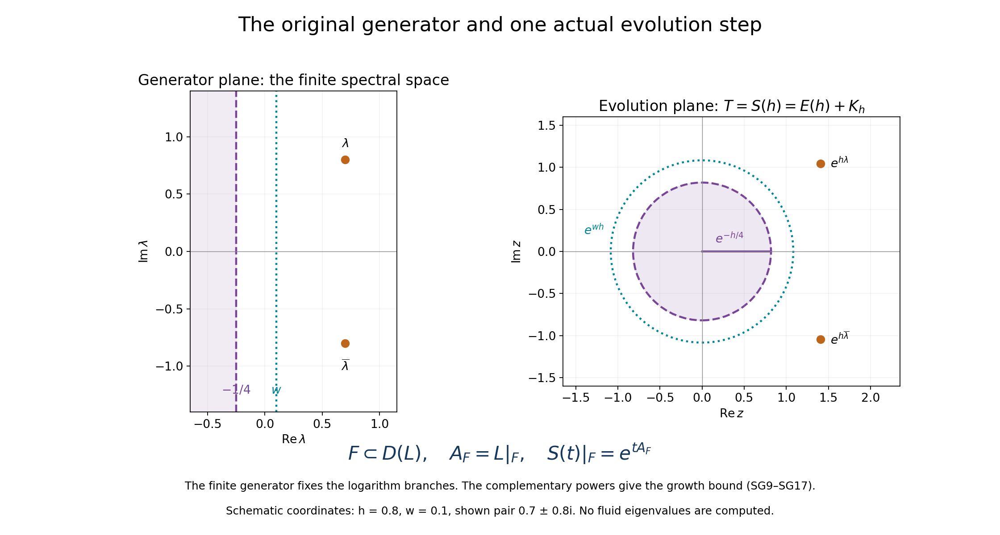
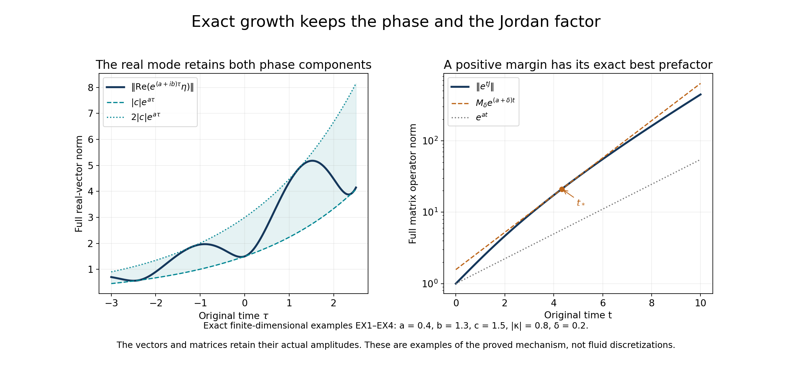

# The original velocity growth and complete smoothing maps

[Lesson34](the-original-viscous-instability-and-full-velocity-receiver.md)
constructed the actual viscous unstable mode, its full velocity domain
and its pressure. This lesson proves the precise growth and smoothing
maps needed to turn that mode into a nonlinear solution.

We prove compactness of the difference between the actual evolution and
the free heat-and-dilation evolution. Its finite spectral spaces give an
attained maximal growth rate. We then construct every real Sobolev
smoothing map, including its full time power and exponential margin.
The original viscosity, background amplitude, spatial drift and Fourier
weights stay explicit throughout. The axisymmetric no-swirl restriction
has its own proved maximal rate and all of the same receiving maps.

The human source is Dallas Albritton, Elia Brué and Maria Colombo,
[*Non-uniqueness of Leray solutions of the forced Navier–Stokes equations*,
arXiv:2112.03116v1](https://arxiv.org/abs/2112.03116v1), original
main.tex550–593,2487–2633 and2793–2917. The compact background and
its unstable mode have complete constructions in lessons29–34. The
source uses viscosity one; that value in our formulas recovers its case.
The complete arguments below supply the spectral and smoothing steps
and identify the real-mode norm correction beside its proof.

Five solved exercises calculate exact Jordan growth and oscillating
real-mode norms, construct the original compact force with its energy
balance, evaluate the whole local kernel norm, and prove the nonlinear
integral map with its exact Gamma factor. These are inputs to the next
nonlinear fixed-point construction. Author self-check only; no
independent review or novelty claim is asserted.

## SG1. Keep the entire original velocity generator

Use the original solenoidal Hilbert space \(H_\sigma\), actual background \(b=\bar U_\ell\), original \(\nu>0\) and the sufficiently large actual \(\beta>0\) from VP20. Keep

\[
\begin{gathered}
X_\sigma=\{u\in H_\sigma\cap H^2(\mathbb R^3):x\cdot\nabla u\in L^2\},\\
L_0=\nu\Delta+\frac12x\cdot\nabla+\frac12,\qquad
Cu=-\beta\mathbb P(b\cdot\nabla u+u\cdot\nabla b),\qquad L=L_0+C,\\
U_0=\|b\|_\infty,\qquad U_1=\|Db\|_\infty,\qquad
\omega=\beta U_1-\frac14.
\end{gathered}
\tag{SG1}
\]

Exercise1 of lesson34 proves that both generators have exactly domain \(X_\sigma\). Their strongly continuous semigroups \(E(t)=e^{tL_0}\) and \(S(t)=e^{tL}\) obey

\[
\begin{gathered}
E(t)f(x)=e^{t/2}(G_{q(t)}*f)(\kappa(t)x),\qquad
q(t)=\nu(e^t-1),\qquad\kappa(t)=e^{t/2},\\
G_q(y)=(4\pi q)^{-3/2}e^{-|y|^2/(4q)},\qquad
\|E(t)\|\leq e^{-t/4},\qquad\|S(t)\|\leq e^{\omega t}.
\end{gathered}
\tag{SG2}
\]

The free gradient estimate VD17, including the physical dilation factor, gives

\[
\|CE(t)\|\leq c(t):=
\beta e^{-t/4}\left(
\frac{U_0}{\sqrt{2e\nu(1-e^{-t})}}+U_1\right),\qquad t>0.
\tag{SG3}
\]

Here the projection has norm one and the full convection map has bound \(\beta(U_0\|\nabla u\|_2+U_1\|u\|_2)\). In particular, for every fixed \(h>0\),

\[
c(t)\leq d_h t^{-1/2}\quad(0<t\leq h),\qquad
d_h=\beta\left(\frac{U_0e^{h/2}}{\sqrt{2e\nu}}+U_1\sqrt h\right).
\tag{SG4}
\]

Indeed \(1-e^{-t}=\int_0^t e^{-s}ds\geq te^{-h}\), while \(e^{-t/4}\leq1\). No smallness of the original background or of its amplitude is assumed.

## SG2. Prove compactness of the actual evolution difference

Before applying \(\mathbb P\), the integral kernel of \(CE(t)\) has components

\[
A_{ij}(t;x,y)=-\beta e^{t/2}\left[
\delta_{ij}\kappa(t)b(x)\cdot\nabla G_{q(t)}(\kappa(t)x-y)
+(\partial_j b_i)(x)G_{q(t)}(\kappa(t)x-y)\right].
\tag{SG5}
\]

Both coefficients are compactly supported in the original physical torus. Integrate the squared kernel first in \(y\); translation removes \(\kappa x\) in that integral. The triangle inequality in the space of square-integrable matrix kernels gives the explicit bound

\[
\begin{aligned}
\|A(t)\|_{L^2_{x,y}}&\leq\beta e^{t/2}
 \left(\sqrt3\kappa(t)\|b\|_2\|\nabla G_{q(t)}\|_2
       +\|Db\|_2\|G_{q(t)}\|_2\right),\\
\|G_q\|_2^2&=(8\pi q)^{-3/2},\qquad
\|\nabla G_q\|_2^2=\frac3{4q}(8\pi q)^{-3/2}.
\end{aligned}
\tag{SG6}
\]

The factor \(\sqrt3\) retains the three diagonal entries in the first matrix term; the second uses the full derivative matrix norm. The Gaussian identities follow by integrating \(e^{-|y|^2/(2q)}\) and its complete three-coordinate second moment. Square-integrable kernels are compact: finite sums of products of square-integrable functions in \(x\) and \(y\) approximate their entries in kernel norm, each sum gives a finite-rank operator, and the Cauchy–Schwarz kernel bound controls the operator-norm error. Applying the bounded projection afterwards and restricting the input to the closed solenoidal subspace preserve compactness. Thus \(CE(t)\) is compact for every \(t>0\).

It is norm-continuous on each closed positive time interval. In fact SG5 is continuous there in kernel \(L^2\). The original \(x\) support is fixed and bounded, \(q(t)\) stays positive, and the Gaussian and its derivative with a bounded translated center have a common integrable squared Gaussian bound in \(y\). Dominated convergence proves the asserted kernel continuity, hence operator-norm continuity after projection.

For \(f\in X_\sigma\), differentiate \(S(h-t)E(t)f\) in \(H_\sigma\). Both semigroups preserve their exact common domain. Continuity of \(E(t)f\) in the free graph norm and equivalence with the full graph norm justify the derivative. It equals \(-S(h-t)CE(t)f\). The resulting variation identity extends to all inputs by density, SG3–SG4 and the uniform semigroup bounds:

\[
S(h)-E(h)=\int_0^h S(h-t)CE(t)\,dt.
\tag{SG7}
\]

This is an operator-norm convergent improper integral. For \(0<\epsilon<h\), its omitted initial piece has norm at most

\[
\left\|\int_0^\epsilon S(h-t)CE(t)dt\right\|
\leq2e^{\max(\omega,0)h}d_h\sqrt\epsilon.
\tag{SG8}
\]

On \([\epsilon,h]\) the integrand is norm-continuous and compact. To check the only continuity point requiring care, if bounded operators converge strongly with a uniform norm bound, their products on the left of a fixed compact operator converge in norm: approximate its image of the unit ball by a finite net and use strong convergence on that net. Apply this fact to \(S(h-t)\), together with the norm continuity of \(CE(t)\). The integral over \([\epsilon,h]\) is consequently a norm limit of compact Riemann sums. Letting \(\epsilon\downarrow0\) in SG8 proves

\[
S(h)=E(h)+K_h,\qquad K_h\text{ compact on }H_\sigma,
\qquad\|E(h)\|\leq e^{-h/4},\quad h>0.
\tag{SG9}
\]

This is compactness of the evolution difference itself. The full spatial drift and original viscosity remain in its kernel and endpoint estimate.

## SG3. Identify the finite spectral spaces outside the free disk

Fix any \(h>0\), keeping it as an auxiliary time step rather than changing the physical variables. Set \(T=S(h)\), \(T_0=E(h)\) and \(r_0=e^{-h/4}\). For \(|z|>r_0\), the geometric series gives \((z-T_0)^{-1}\), with bound \((|z|-r_0)^{-1}\), and

\[
z-T=(z-T_0)\bigl[I-(z-T_0)^{-1}K_h\bigr].
\tag{SG10}
\]

The compact factor is analytic on the connected exterior of the closed free disk, and invertible at large \(|z|\). The finite-rank reduction RT24 in lesson32 applies directly to this bounded operator: near each point write the compact analytic family as a finite-rank map plus an operator of norm below one-half. Factoring the latter leaves a finite matrix whose determinant inverse is meromorphic. Its two kernel maps show that every noninvertible point gives an actual eigenvector. Continue along the connected exterior using overlapping disks and an invertible starting point, as in the complete proof of RT24. The resulting isolated poles have finite-rank spectral projections: their resolvent difference from the free inverse is compact, and the nested-contour identity makes each compact contour integral an idempotent. This proves finite algebraic multiplicity by the full generalized-eigenvector calculation in RT6.

For any \(r>r_0\), there are only finitely many such spectral points with \(|z|\geq r\). Otherwise a sequence lies in the compact annulus \(r\leq|z|\leq\|T\|\), has a limit there, and contradicts local discreteness in the exterior. The elementary bound \(|z|>\|T\|\Rightarrow z\in\rho(T)\) follows from its geometric series.

Choose a radius \(r=e^{wh}>r_0\) whose circle contains no spectrum of \(T\). Let \(P\) be the sum of the finitely many spectral projections outside that circle and \(Q=I-P\). The resolvent identity gives \(P^2=P\), \(PT=TP\), and a direct-sum decomposition

\[
H_\sigma=F\oplus QH_\sigma,\qquad F=PH_\sigma,\qquad
\dim F<\infty,\qquad \sigma(T|_{QH_\sigma})\subset\{|z|<r\}.
\tag{SG11}
\]

For completeness, the last spectral decomposition follows from the resolvent Laurent expansion at each removed pole. Multiplication of \((z-T)^{-1}\) by \(Q\) cancels its entire principal part: that part has range in the corresponding generalized eigenspace, on which its spectral projection is the identity. The remaining singularities are removable. On the finite range the same Laurent calculation gives the finite matrix restriction. These inverses, and the block-diagonal action of \(T\), prove SG11 without an assumption about normality or orthogonal projections.

Every \(S(t)\) commutes with \(T=S(h)\), hence with its resolvents and \(P,Q\). Thus both spaces in SG11 are invariant under the entire original semigroup, not just the chosen time step.

## SG4. Prove the full generator and growth correspondence

The finite space \(F\) lies in the original domain of \(L\). To prove this without assuming differentiability, define

\[
J_\epsilon f=\frac1\epsilon\int_0^\epsilon S(t)f\,dt.
\tag{SG12}
\]

Its difference quotient at zero is \((S(\epsilon)f-f)/\epsilon\), so \(J_\epsilon f\in D(L)\). On the finite invariant space \(F\), strong continuity implies \(J_\epsilon|_F\to I_F\) in norm. It is therefore invertible there for small \(\epsilon\). Its range is all \(F\) and is in \(D(L)\), proving the claim. Difference quotients also show \(LF\subset F\). Write \(A_F=L|_F\). The finite-dimensional differential equation gives

\[
S(t)|_F=e^{tA_F},\qquad T|_F=e^{hA_F}.
\tag{SG13}
\]

In particular, all eigenvalues of \(A_F\) have real part greater than \(w\), since all eigenvalues of its exponential have modulus greater than \(e^{wh}\). The equality between these finite spectra follows by triangularizing the complex matrix: its exponential is triangular with the exponentials of its original diagonal entries. The full original generator, rather than a choice of logarithm branch for \(T\), determines \(A_F\).

On \(QH_\sigma\), write \(T_Q=T|_{QH_\sigma}\). For each \(R>r\), its entire spectrum is inside the circle of radius \(R\), and

\[
T_Q^n=\frac1{2\pi i}\int_{|z|=R}z^n(z-T_Q)^{-1}dz,
\qquad
\|T_Q^n\|\leq R^{n+1}\sup_{|z|=R}\|(z-T_Q)^{-1}\|.
\tag{SG14}
\]

The identity follows first on a larger circle beyond \(\|T_Q\|\) by integrating its geometric series; deform that circle through the resolvent annulus to \(R\). Given \(\epsilon>0\), take \(R=e^{(w+\epsilon)h}\). Write \(t=nh+s\), \(0\leq s<h\), and use \(S(t)Q=S(s)T_Q^nQ\). The original semigroup bound on \([0,h]\) now proves a finite constant \(C_{h,w,\epsilon}\), retaining the norm of the potentially nonorthogonal \(Q\), such that

\[
\|S(t)Q\|\leq C_{h,w,\epsilon}e^{(w+\epsilon)t},\qquad t\geq0.
\tag{SG15}
\]

For example the right constant can be taken as
\(\|Q\|e^{\max(\omega,0)h}R\sup_{|z|=R}\|(z-T_Q)^{-1}\|e^{|w+\epsilon|h}\).
The Laplace integral on this invariant subspace, with both inverse identities proved by the same difference-quotient argument as VD5, places its generator's spectrum in \(\{\operatorname{Re}z\leq w\}\), since \(\epsilon>0\) is arbitrary. The restriction domain is \(D(L)\cap QH_\sigma\): the subspace is closed and invariant, and convergence of a difference quotient there is the same convergence in the full Hilbert space. Moreover \(P\) preserves \(D(L)\) and commutes with \(L\), by its commutation with every \(S(t)\). The full generator is therefore the direct sum of \(A_F\) and this exact restriction. Its resolvent is the direct sum of their inverses whenever both exist.

There is already an actual nonzero velocity eigenvector \(U_*\in X_\sigma\), with eigenvalue \(\Lambda_*\) and \(a_*:=\operatorname{Re}\Lambda_*>1/4\), by lesson34. Choose \(-1/4<w<a_*\) whose associated circle avoids \(\sigma(T)\); such a choice exists because a compact subinterval of these radii contains only finitely many exceptional values. Then \(S(h)U_*=e^{h\Lambda_*}U_*\), so the outside spectral projection fixes \(U_*\), and \(F\ne0\).

Let \(a\) be the largest real part of the finitely many eigenvalues of \(A_F\). It is attained, and \(a\geq a_*>w\). Choose an actual nonzero eigenvector \(\eta\in F\subset X_\sigma\) for an eigenvalue \(\lambda=a+ib_0\). The complementary spectrum lies to the left of \(w\); hence

\[
a=\sup_{z\in\sigma(L)}\operatorname{Re}z>0,\qquad
L\eta=(a+ib_0)\eta,\qquad \eta\ne0.
\tag{SG16}
\]

Finally, every finite Jordan block of \(A_F\) contributes exactly
\(e^{\lambda_jt}\sum_{k=0}^{m_j-1}t^kN_j^k/k!\).
For any \(\delta>0\), each polynomial factor times \(e^{-\delta t}\) is bounded: its \(k\)-th term has maximum \((k/(e\delta))^k\) for \(k>0\), and the constant term is one. Retain the finite change-of-basis norms and all block coefficients. Combining this bound with SG15, taking \(w+\epsilon<a\), yields

\[
\|S(t)\|\leq M(\delta)e^{(a+\delta)t},\qquad t\geq0.
\tag{SG17}
\]

Conversely, the actual mode gives \(\|S(t)\eta\|=e^{at}\|\eta\|\), so no growth exponent below \(a\) can have a finite uniform prefactor. Thus the semigroup growth bound equals the spectral bound \(a\). Neither the original viscosity and amplitude nor the actual eigenvector norm was replaced. This establishes the full spectral-growth assertion needed by the nonlinear argument for the already constructed physical background.

## SG5. Retain the exact real-mode norm instead of an unjustified equality

The generator has real coefficients and the real Leray projection, so it commutes with complex conjugation. Write \(\eta=A+iB\) with real fields and \(\lambda=a+ib_0\). Then

\[
LA=aA-b_0B,\qquad LB=b_0A+aB,\qquad
U^{\rm lin}(\tau)=e^{a\tau}(\cos(b_0\tau)A-\sin(b_0\tau)B).
\tag{SG18}
\]

For any real Hilbert norm in which \(A,B\) belong, retain
\(p=\|A\|^2\), \(q=\|B\|^2\), \(r=\langle A,B\rangle\). Direct expansion gives

\[
\begin{aligned}
e^{-2a\tau}\|U^{\rm lin}(\tau)\|^2
&=\frac{p+q}{2}+\frac{p-q}{2}\cos(2b_0\tau)-r\sin(2b_0\tau),\\
m_\pm&=\frac{p+q\pm\sqrt{(p-q)^2+4r^2}}2.
\end{aligned}
\tag{SG19}
\]

If \(b_0\ne0\), the fields \(A,B\) are real-linearly independent. If \(A=0\), the first equation in SG18 forces \(B=0\), a contradiction. If \(B=cA\), the two equations give \(c(a-b_0c)=b_0+ac\), hence \(b_0(1+c^2)=0\), another contradiction. Strict Cauchy–Schwarz therefore gives \(pq-r^2>0\), so

\[
0<\sqrt{m_-}\,e^{a\tau}\leq\|U^{\rm lin}(\tau)\|
\leq\sqrt{m_+}\,e^{a\tau},\qquad \tau\in\mathbb R.
\tag{SG20}
\]

These extrema are exact because the phase covers the full circle. Its norm is a constant times \(e^{a\tau}\) precisely when \(p=q\) and \(r=0\). Those extra identities were not established at source2632. The universally justified statement is SG19–SG20, not that equality. If \(b_0=0\), choose one of the existing nonzero real eigenvectors \(A,B\); its evolution has exactly its original norm times \(e^{a\tau}\), without rescaling that vector. In particular the lower bound needed to distinguish the nonlinear solution holds in physical \(L^2\). At this stage \(\eta\in H^2\) is proved; higher Sobolev applications of SG19–SG20 will follow only after the full smoothing construction.

## SG6. Preserve the source's axisymmetric velocity with no swirl

The source's further assertion at main.tex593 retains axisymmetry and no swirl. A maximal mode on the entire solenoidal space is not automatically known to have those symmetries. We prove the full receiving restriction.

For each rotation about the third axis and the reflection \(J=\operatorname{diag}(1,-1,1)\), define

\[
\begin{gathered}
(\mathscr R u)(x)=R u(R^{-1}x),\qquad\\
H_{\rm ns}=\{u\in H_\sigma:\mathscr R u=u
\text{ for every such rotation and reflection}\}.
\end{gathered}
\tag{SG21}
\]

These maps are isometries in every original Sobolev norm, preserve the full spatial-drift domain, and commute with the free semigroup. A rotation-equivariant velocity has the form \(u^s(s,z)e_s+u^\theta(s,z)e_\theta+u^z(s,z)e_3\). The reflection reverses its swirl component and preserves the other two. Thus the fixed space is exactly the closed solenoidal space of axisymmetric velocities with no swirl, with its original physical measure. All derivatives are taken distributionally in the full three-dimensional space; no extra axis boundary condition is introduced.

The actual background \(b\) belongs to this space. The Cartesian chain rule gives \(\mathscr R(b\cdot\nabla u)=(\mathscr R b)\cdot\nabla(\mathscr R u)\) and the corresponding identity for the other product. The original Leray multiplier commutes with the group since \(\mathbb P(R\eta)=R\mathbb P(\eta)R^{-1}\). Hence \(C\) and \(L\) commute with it on their exact domains. Their resolvent approximants, and therefore the constructed semigroup, commute with it too. Both \(E(t)\) and \(S(t)\) leave \(H_{\rm ns}\) invariant. The defining difference quotients show that their restricted generator domains are precisely \(X_\sigma\cap H_{\rm ns}\).

Every hypothesis used in SG2–SG4 now holds on this closed space. The actual compact evolution difference restricts to a compact operator there, and the free norm is still at most \(e^{-h/4}\). The actual unstable velocity from VC9–VC14 lies in this space by PT5. Its finite spectral space is therefore nonzero. Applying the already proved domain, finite-generator and contour-power argument on this space gives an actual nonzero \(\eta_{\rm ns}\in X_\sigma\cap H_{\rm ns}\) and

\[
\begin{gathered}
a_{\rm ns}=\operatorname{Re}\lambda_{\rm ns}
=\sup_{z\in\sigma(L|_{H_{\rm ns}})}\operatorname{Re}z>0,\\
L\eta_{\rm ns}=\lambda_{\rm ns}\eta_{\rm ns},\qquad
\|S(t)|_{H_{\rm ns}}\|\leq M_{\rm ns}(\delta)e^{(a_{\rm ns}+\delta)t}.
\end{gathered}
\tag{SG22}
\]

No equality between \(a_{\rm ns}\) and the full-space value \(a\) is asserted. The symmetry-preserving construction can use this restricted bound and its actual mode. The exact real-mode Gram argument SG18–SG20 applies there too, since the space is invariant under conjugation.

For two fields \(u,v\) in the fixed space, the same chain rule and Leray identity give the exact nonlinear receiving map

\[
\mathscr R\,\mathbb P(u\cdot\nabla v)
=\mathbb P((\mathscr R u)\cdot\nabla(\mathscr R v))
=\mathbb P(u\cdot\nabla v).
\tag{SG23}
\]

Thus, whenever the Sobolev product is defined, it lies in the corresponding fixed solenoidal space. This proves preservation of both original symmetries without assuming a nonlinear solution. The next calculation is full smoothing, then the nonlinear correction with all original quadratic terms, physical force and time endpoints.

## SM1. Prove the full coefficient multiplication map for every real order

For real \(s\geq0\), use the original inhomogeneous norm

\[
\|f\|_{H^s}^2=(2\pi)^{-3}\int_{\mathbb R^3}
(1+|\eta|^2)^s|\widehat f(\eta)|^2d\eta,
\qquad \langle\eta\rangle=(1+|\eta|^2)^{1/2}.
\tag{SM1}
\]

Vector and tensor norms use the sum of all component squares. Keep the exact original tensor

\[
\mathcal F(u)=-\beta(b\otimes u+u\otimes b),\qquad
(v\otimes w)_{ij}=v_iw_j,\qquad
(\operatorname{div}F)_i=\partial_jF_{ij}.
\tag{SM2}
\]

For solenoidal \(u,b\), the full product rule gives \(\mathbb P\operatorname{div}\mathcal F(u)=Cu\) with exactly the two convection terms in SG1. The tensor itself is defined for all vector fields.

The elementary inequality
\(1+|\xi|^2\leq2(1+|\xi-\eta|^2)(1+|\eta|^2)\)
follows from \(|\xi|^2\leq2|\xi-\eta|^2+2|\eta|^2\). Raising this inequality to \(s/2\), retaining the original convolution coefficient \((2\pi)^{-3}\), and applying the integral triangle inequality in \(L^2\) give

\[
\|\mathcal F(u)\|_{H^s}\leq A_s\|u\|_{H^s},\qquad
A_s=\frac{2\beta\,2^{s/2}}{(2\pi)^3}
\int_{\mathbb R^3}\langle\eta\rangle^s|\widehat b(\eta)|d\eta.
\tag{SM3}
\]

Each of the two tensor terms has exactly the vector-product bound; the triangle inequality accounts for the factor two. To see the convolution bound directly, write the weighted transform as an integral over \(\eta\). For each fixed \(\eta\), translation preserves the \(L^2\) norm of the remaining weighted transform of \(u\); its integral coefficient is precisely the weighted \(L^1\) norm of \(\widehat b\). This also proves the bound first for smooth inputs and then by density, with no assumption of a fractional product theorem.

The constant is finite for the actual compact smooth background. Choose an integer \(m\) with \(2m>s+3\). Integration by parts in the Fourier transform gives
\(\langle\eta\rangle^{2m}|\widehat b(\eta)|\leq\|(1-\Delta)^m b\|_1\), and splitting the full radial integral at one yields

\[
\int\langle\eta\rangle^s|\widehat b(\eta)|d\eta
\leq4\pi\left(\frac13+\frac1{2m-s-3}\right)
\left\|\sum_{j=0}^m\binom mj(-\Delta)^j b\right\|_1.
\tag{SM4}
\]

Thus every coefficient and derivative required at a real order is controlled by the original field. No spatial tail of the field has been replaced or discarded.

## SM2. Derive the two exact free smoothing bounds

Keep \(E(t),q(t),\kappa(t)\) from SG2. Changing variables only inside its Fourier norm gives the exact expression

\[
\|E(t)f\|_{H^s}^2
=e^{-t/2}(2\pi)^{-3}\int
(1+\kappa(t)^2|\eta|^2)^s e^{-2q(t)|\eta|^2}
|\widehat f(\eta)|^2d\eta.
\tag{SM5}
\]

The physical amplitude and Jacobian give the full factor \(e^{-t/2}\). In particular, since \(\kappa\geq1\),

\[
\begin{aligned}
\|E(t)f\|_{H^s}&\leq e^{(s/2-1/4)t}\|f\|_{H^s},\\
\|E(t)\mathbb P\operatorname{div}F\|_{H^s}
&\leq\frac{e^{(s/2-1/4)t}}{\sqrt{2e\nu(e^t-1)}}\|F\|_{H^s},\\
\|E(t)f\|_{H^{s+1}}
&\leq e^{(s/2-1/4)t}
 \left(1+\frac{e^{t/2}}{\sqrt{2e\nu(e^t-1)}}\right)\|f\|_{H^s}.
\end{aligned}
\tag{SM6}
\]

For the second line, the original input Fourier divergence has magnitude at most \(|\eta||\widehat F(\eta)|\); the projection has norm at most one. The exact maximum of \(r e^{-qr^2}\) is \((2eq)^{-1/2}\), by differentiating at \(r=(2q)^{-1/2}\). The projection commutes with dilation and the heat multiplier because its symbol has degree zero. This proves that line on all tensors without first assuming a pointwise divergence.

For the last line keep the full weight \((1+\kappa^2r^2)^{1/2}\leq1+\kappa r\) and apply the same maximum. The constant one in that weight remains; it is needed at low frequency. Formula SM5 also proves strong continuity of \(E(t)\) on every \(H^s\), first on smooth compact Fourier functions by dominated convergence and then by density and its local norm bound.

For convenient finite-time bounds set \(c_s=\max(s/2-1/4,0)\). Since \(e^t-1\geq t\), the second line of SM6 is at most \(e^{c_st}(2e\nu t)^{-1/2}\|F\|_{H^s}\). All original coefficients in SM6 remain available; this inequality is used only to integrate the actual short-time kernel.

## SM3. Construct one full derivative of smoothing, including fractional input orders

On solenoidal \(H^s\), the exact mild equation for the already constructed original semigroup is

\[
S(t)f=E(t)f+\int_0^t E(t-r)\mathbb P\operatorname{div}
\mathcal F(S(r)f)\,dr.
\tag{SM7}
\]

First prove it on \(X_\sigma\) by differentiating \(E(t-r)S(r)f\). Both full generators have that same domain, and their graph norms are equivalent by lesson34 EX1–EX3. The derivative is the two original convection terms, represented by SM2. For arbitrary solenoidal \(L^2\) data use domain density, the semigroup bound, SM3 at order zero, and the integrable second line of SM6. This passes both sides to the limit in \(L^2\). Thus SM7 is established before using it to prove further regularity.

For each actual real \(s\geq0\), define the finite constants

\[
\begin{gathered}
K_s=\frac1{\sqrt{2e\nu}}
\max\{2A_s e^{c_s},\ \pi A_{s+1}e^{c_{s+1}}\},\\
h_s=\begin{cases}\min\{1,(4K_s)^{-2}\},&K_s>0,\\1,&K_s=0,\end{cases}
\qquad
B_s=e^{c_s}\left(1+\frac{e^{1/2}}{\sqrt{2e\nu}}\right),
\qquad M_s=\frac43 B_s.
\end{gathered}
\tag{SM8}
\]

Let \(Y_s\) consist of solenoidal fields continuous from \([0,h_s]\) into \(H^s\), continuous from \((0,h_s]\) into \(H^{s+1}\), with finite norm

\[
\|u\|_{Y_s}=\max\left\{
\sup_{0\leq t\leq h_s}\|u(t)\|_{H^s},\quad
\sup_{0<t\leq h_s}\sqrt t\,\|u(t)\|_{H^{s+1}}
\right\}.
\tag{SM9}
\]

It is complete: a Cauchy sequence converges uniformly in the first space and uniformly in the weighted second norm; on every closed positive-time interval the latter is ordinary uniform convergence. The two limits agree in \(H^s\), and both continuity properties and the bound pass to the limit.

The free curve \(E(t)f\) has \(Y_s\) norm at most \(B_s\|f\|_{H^s}\) by SM6 and \(0<t\leq h_s\leq1\). Let \(\mathcal V\) denote the integral operator in SM7. Its two components have bounds

\[
\begin{aligned}
\sup_{t\leq h_s}\|\mathcal Vu(t)\|_{H^s}
&\leq\frac{2A_s e^{c_s}\sqrt{h_s}}{\sqrt{2e\nu}}
 \sup_{t\leq h_s}\|u(t)\|_{H^s},\\
\sup_{0<t\leq h_s}\sqrt t\,\|\mathcal Vu(t)\|_{H^{s+1}}
&\leq\frac{\pi A_{s+1}e^{c_{s+1}}\sqrt{h_s}}{\sqrt{2e\nu}}
 \sup_{0<t\leq h_s}\sqrt t\,\|u(t)\|_{H^{s+1}}.
\end{aligned}
\tag{SM10}
\]

The first integral is \(\int_0^t(t-r)^{-1/2}dr=2\sqrt t\). In the second retain both endpoint factors:
\(\int_0^t(t-r)^{-1/2}r^{-1/2}dr=\pi\), by \(r=t\sin^2\theta\). The remaining outside factor is \(\sqrt t\), giving the stated bound. For positive-time continuity, truncate a short interval at each singular endpoint. On the remaining compact integration interval, approximate the continuous input by step functions and use strong continuity of the free semigroup and its Fourier maps. The two discarded tails tend uniformly to zero near each positive time by the same integrable powers. At zero the first line tends to zero. Thus the integral lies in exactly \(Y_s\).

Equations SM8–SM10 give \(\|\mathcal V\|_{Y_s\to Y_s}\leq1/4\). Its geometric series constructs the unique solution of SM7 in \(Y_s\), with norm at most \(M_s\|f\|_{H^s}\). It is the original \(S(t)f\): both solve SM7 in continuous \(L^2\), where the same order-zero estimate gives uniqueness on sufficiently short intervals, and successive such intervals cover \([0,h_s]\). We have proved

\[
\|S(t)f\|_{H^s}\leq M_s\|f\|_{H^s},\qquad
\|S(t)f\|_{H^{s+1}}\leq M_s t^{-1/2}\|f\|_{H^s},
\quad0<t\leq h_s.
\tag{SM11}
\]

This construction works for every real \(s\geq0\). It proves actual fractional input regularity directly; an unproved interpolation theorem has not been used to extend an integer argument.

## SM4. Prove every finite smoothing gain and the exact large-time margin

For \(0\leq\theta\leq1\), Hölder applied to the complete Fourier integral in SM1 gives

\[
\|g\|_{H^{s+\theta}}
\leq\|g\|_{H^s}^{1-\theta}\|g\|_{H^{s+1}}^\theta.
\tag{SM12}
\]

Indeed the integrand is the product of the two weighted squared integrands raised to powers \(1-\theta\) and \(\theta\); their powers of the Fourier coefficient and the factor \((2\pi)^{-3}\) agree exactly. The endpoints follow directly. Combined with SM11 this gives the gain \(\theta\) with bound \(M_st^{-\theta/2}\).

Take any real \(\sigma_2\geq\sigma_1\geq0\), write \(d=\sigma_2-\sigma_1=n+\theta\) with integer \(n\geq0\) and \(0\leq\theta<1\), and put \(\gamma=d/2\). If \(d>0\), use \(n\) gains of one and, if needed, one final gain \(\theta\). Let \(m\) be this number of steps and let \(s_j\) be their successive input orders. For \(t/m\leq\min_j h_{s_j}\), the semigroup law and SM11–SM12 give

\[
\|S(t)f\|_{H^{\sigma_2}}
\leq\left(m^\gamma\prod_{j=1}^m M_{s_j}\right)
t^{-\gamma}\|f\|_{H^{\sigma_1}}.
\tag{SM13}
\]

Every factor is finite and has the explicit original-parameter formula SM8. For \(d=0\), use the first line of SM11. This proves the bound near zero.

To cover \(0<t\leq2\), choose a fixed positive \(t_*\leq1\) within the just-proved short interval. For \(t\geq t_*\), apply the smoothing estimate at \(t_*/2\) and then act on its output with \(S(t-t_*/2)\) in \(H^{\sigma_2}\). Break that remaining interval into at most \(\lceil2/h_{\sigma_2}\rceil+1\) steps of length at most \(h_{\sigma_2}\). Its norm is at most \(M_{\sigma_2}^{\lceil2/h_{\sigma_2}\rceil+1}\), using \(M_{\sigma_2}>1\). Since \(t^\gamma\leq2^\gamma\), multiplying this finite bound by \(2^\gamma(t_*/2)^{-\gamma}\) supplies a finite constant for the desired form. Together with the near-zero bound this constructs \(C_{\sigma_1,\sigma_2}\) with

\[
\|S(t)f\|_{H^{\sigma_2}}\leq
C_{\sigma_1,\sigma_2}t^{-\gamma}\|f\|_{H^{\sigma_1}},
\qquad0<t\leq2.
\tag{SM14}
\]

Now retain the attained positive spectral bound \(a\) and the actual growth constants \(M(\delta)\) proved in SG16–SG17. For \(t\geq2\), apply SM14 at time one from \(L^2\) to \(H^{\sigma_2}\), after the original semigroup has run for \(t-1\). With the strictly smaller exponential margin \(\delta/2\),

\[
\|S(t)f\|_{H^{\sigma_2}}
\leq C_{0,\sigma_2}M(\delta/2)
 e^{(a+\delta/2)(t-1)}\|f\|_{H^{\sigma_1}}.
\tag{SM15}
\]

The original inhomogeneous norm contains the entire \(L^2\) norm, which justifies the input inequality. For \(\gamma>0\), direct differentiation gives
\(\sup_{t>0}t^\gamma e^{-\delta t/2}=(2\gamma/(e\delta))^\gamma\); for \(\gamma=0\) that supremum is one. Thus SM14–SM15 prove

\[
\|S(t)f\|_{H^{\sigma_2}}\leq
M(\sigma_1,\sigma_2,\delta)t^{-(\sigma_2-\sigma_1)/2}
e^{(a+\delta)t}\|f\|_{H^{\sigma_1}},\qquad t>0,
\tag{SM16}
\]

where one may take the maximum of \(C_{\sigma_1,\sigma_2}\) and
\(C_{0,\sigma_2}M(\delta/2)e^{-(a+\delta/2)}(2\gamma/(e\delta))^\gamma\), using the stated value one when \(\gamma=0\). The positive \(a+\delta\) makes the short-time bound imply the desired one immediately.

The smaller intermediate margin matters. Source2611 has no negative power of time, so combining it with the small-time estimate at exactly the same exponential margin does not directly give the stronger displayed source2555 at all large times. Using \(\delta/2\) and the exact polynomial maximum above supplies the complete argument while retaining the requested final margin.

## SM5. Receive the actual eigenmode at every order

Let \(\eta\ne0\) be the actual maximally unstable eigenvector from SG16, with \(\lambda=a+ib_0\). It is initially in the full domain \(X_\sigma\). For every \(t>0\),

\[
\eta=e^{-\lambda t}S(t)\eta.
\tag{SM17}
\]

Taking \(\sigma_1=0\) and arbitrary \(\sigma_2\) in SM16 proves membership in every \(H^{\sigma_2}\). Its original drift also has every such order: the eigen-equation retains

\[
\frac12x\cdot\nabla\eta
=\left(\lambda-\frac12\right)\eta-\nu\Delta\eta
 +\beta\mathbb P(b\cdot\nabla\eta+\eta\cdot\nabla b).
\tag{SM18}
\]

All terms on the right are in \(H^s\) for each \(s\geq0\), by the just-proved higher regularity and SM3, or by its direct coefficient multiplication proof applied to \(Db\). Thus the full equation, original viscosity, amplitude and drift remain valid at all orders. The real-mode Gram formulas SG18–SG20 now apply to every one of these Sobolev norms, for all positive and negative similarity times. This completes the smoothing input required for the actual nonlinear fixed-point construction; that construction is the next calculation.

## SM6. Retain the symmetry restriction at every Sobolev order

SG21–SG23 prove that the free evolution, full evolution, original coefficient map and projected convection preserve the closed space of axisymmetric solenoidal velocities with no swirl. The construction SM7–SM11 therefore stays in that space: every term of its convergent integral series is fixed by the same rotations and reflection. Its intersection with each Sobolev space is closed because those symmetry maps are isometries. All constants in SM3–SM14 remain valid on the restriction.

For the long-time bound use the actual restricted spectral value and growth constant in SG22 in place of the full-space pair in SM15–SM16. The same strictly smaller intermediate margin and polynomial maximum prove every restricted smoothing map. Finally SM17–SM18 applied to the actual restricted eigenvector prove its all-order regularity and full spatial drift. The real-mode Gram bounds then hold in every restricted Sobolev norm. Consequently both the full-space construction and the source's symmetry-preserving construction have their complete growth and smoothing inputs; no identity between their two maximal spectral values is needed.

## Two pictures of the growth maps and real modes

SG1–SG17 prove the maps in this schematic. The finite spectral space lies
in the full original generator domain, and its evolution is the exact
matrix exponential of that generator. The displayed auxiliary time0.8,
cutoff0.1 and pair0.7 plus or minus0.8i are illustrative positions;
they are not computed fluid eigenvalues. The actual field, viscosity and
amplitude are retained in the proof. Human comparison: Albritton–Brué–Colombo,
original main.tex2487–2529. The
[reproducible figure source](../assets/original-velocity-growth-and-smoothing.py)
is included.

Exercises1–2 prove the exact finite-dimensional formulas shown here.
The real orbit keeps amplitude1.5, growth0.4 and frequency1.3.
The Jordan block keeps its off-diagonal modulus0.8 and margin0.2.
Every curve is a numerical evaluation of those complete formulas; the
two matrices are illustrative examples, with no assertion that either
is a fluid discretization. The oscillating norm illustrates the source
correction at main.tex2632. The growth curve shows why a positive
exponential margin can be necessary even when the spectral and growth
bounds agree. [All942 samples](../assets/original-velocity-growth-data.json)
and their [source](../assets/original-velocity-growth-and-smoothing.py)
are included.

## Five solved exercises

### Exercise 1. Keep the full growth of an actual Jordan block

For real \(a>0,b\), and an actual complex \(\kappa\ne0\), calculate the exact operator norm of the matrix evolution with
\(J=\begin{pmatrix}a+ib&\kappa\\0&a+ib\end{pmatrix}\).
Find its best prefactor at each exponential margin \(\delta>0\).

**Solution.** The off-diagonal part has square zero, so the full exponential and its norm are

\[
e^{tJ}=e^{(a+ib)t}\begin{pmatrix}1&\kappa t\\0&1\end{pmatrix},\qquad
\|e^{tJ}\|=e^{at}\frac{\sqrt{4+|\kappa|^2t^2}+|\kappa|t}{2},
\quad t\geq0.
\tag{EX1}
\]

Indeed the Hermitian product of the triangular matrix with its adjoint has trace \(2+|\kappa|^2t^2\) and determinant one. Its larger eigenvalue is \((2+|\kappa|^2t^2+|\kappa|t\sqrt{4+|\kappa|^2t^2})/2\). Its square root is exactly the displayed factor. This proves the full norm, including its nonorthogonal contribution.

Set \(k=|\kappa|\). The logarithmic derivative of the last factor is \(k/\sqrt{4+k^2t^2}\). Thus the smallest constant in \(\|e^{tJ}\|\leq M_\delta e^{(a+\delta)t}\) for every \(t\geq0\) is

\[
\begin{gathered}
M_\delta=1\quad\text{if }\delta\geq k/2,\\
t_* =\sqrt{\delta^{-2}-4/k^2},\qquad
M_\delta=e^{-\delta t_*}
\frac{\sqrt{4+k^2t_*^2}+kt_*}{2}
\quad\text{if }0<\delta<k/2.
\end{gathered}
\tag{EX2}
\]

The logarithmic derivative minus \(\delta\) is decreasing, so these are its global maxima on the entire nonnegative time axis. At margin zero the factor grows without bound, for example by testing the original second basis vector. Nevertheless the infimum of permissible exponential growth exponents is exactly \(a\). This explicit finite-dimensional example explains why SG17 retains an arbitrary positive margin and its prefactor. It does not assert that the actual fluid generator has this Jordan block.

### Exercise 2. Compute the whole oscillating norm of a real mode

Let \(a>0,b\ne0,c\ne0\) be real. For
\(A=\begin{pmatrix}a&b/2\\-2b&a\end{pmatrix}\)
and \(\eta=c(1,2i)^T\), calculate the exact real orbit and all its norm extrema without rescaling \(\eta\).

**Solution.** Matrix multiplication gives \(A\eta=(a+ib)\eta\), with actual complex norm \(\|\eta\|=\sqrt5|c|\). Its real orbit is

\[
v(\tau)=ce^{a\tau}\begin{pmatrix}\cos(b\tau)\\ -2\sin(b\tau)\end{pmatrix},\qquad
\|v(\tau)\|^2=c^2e^{2a\tau}(\cos^2(b\tau)+4\sin^2(b\tau)).
\tag{EX3}
\]

Direct differentiation also verifies \(v'=Av\). The original Gram entries are \(p=c^2,q=4c^2,r=0\), so SG19 gives \(m_-=c^2,m_+=4c^2\). Consequently

\[
|c|e^{a\tau}\leq\|v(\tau)\|\leq2|c|e^{a\tau},\qquad \tau\in\mathbb R.
\tag{EX4}
\]

Equality holds at \(b\tau\in\pi\mathbb Z\) for the lower bound and at \(b\tau\in\pi/2+\pi\mathbb Z\) for the upper bound. The factor multiplying \(e^{a\tau}\) is not constant. All original amplitudes and both phase components remain in the formula; taking the real part does not preserve the complex norm. This is an exact illustration of the Gram calculation, with no claim that this matrix is a fluid discretization.

### Exercise 3. Construct the original compact force and its exact energy

For the actual nonzero compact smooth background \(b=\bar U_\ell\), keep its original \(\beta>0,\nu>0\). Construct the source's physical background force with every term, prove its exact energy balance from zero, and determine the full mixed-norm thresholds.

**Solution.** Retain the unprojected compact profile from source main.tex556, with the original coefficients restored:

\[
\begin{gathered}
\bar U=\beta b,\qquad
F=-\frac\beta2(b+\xi\cdot\nabla b)-\nu\beta\Delta b
       +\beta^2 b\cdot\nabla b,\\
\bar u(x,t)=\beta t^{-1/2}b(x/\sqrt t),\qquad
f(x,t)=t^{-3/2}F(x/\sqrt t),\qquad \bar p=0,\quad t>0.
\end{gathered}
\tag{EX5}
\]

All profiles are smooth and supported in the original compact torus. Differentiation of \(\xi=x/\sqrt t\) gives \(\partial_t\xi=-\xi/(2t)\); every term in the physical equation has the full factor \(t^{-3/2}\). Thus \(\partial_t\bar u-\nu\Delta\bar u+\bar u\cdot\nabla\bar u+\nabla\bar p=f\), with \(\operatorname{div}\bar u=0\). The physical supports are contained in the actual dilated torus \(\sqrt t\,\overline Q_\ell\). The arbitrary spatial pressure constant can also be any function of time; zero is the specified representative here.

The force is not assumed solenoidal. Its exact divergence is

\[
\operatorname{div}F=\beta^2\sum_{i,j=1}^3
(\partial_i b_j)(\partial_j b_i).
\tag{EX6}
\]

The linear terms have zero divergence by the full product rule and \(\operatorname{div}b=0\). If one also wants the projected force, its exact map is \(F_\sigma=F-\nabla\Delta^{-1}\operatorname{div}F\) and the corresponding pressure is \(P_\sigma=-\Delta^{-1}\operatorname{div}F\), up to a constant. Then \(F+\nabla P_\sigma=F_\sigma\). The source's compact force in EX5 remains the working force; the projection generally has an exterior tail.

Compact integration by parts, including the full dimension-three drift contribution, gives

\[
\int F\cdot\beta b\,d\xi
=\frac{\beta^2}{4}\|b\|_2^2+\nu\beta^2\|\nabla b\|_2^2>0.
\tag{EX7}
\]

The convection integral vanishes by zero divergence. The two drift pieces contribute \(-\beta^2\|b\|_2^2/2\) and \(+3\beta^2\|b\|_2^2/4\); diffusion contributes its positive full gradient norm. In particular \(F\ne0\). The complete physical Jacobian now yields

\[
\begin{aligned}
\frac12\|\bar u(t)\|_2^2&=\frac{\beta^2}{2}\sqrt t\,\|b\|_2^2,\\
\nu\int_0^t\|\nabla\bar u(s)\|_2^2ds
&=2\nu\beta^2\sqrt t\,\|\nabla b\|_2^2,\\
\int_0^t\!\int f\cdot\bar u\,dx\,ds
&=2\sqrt t\left(\frac{\beta^2}{4}\|b\|_2^2
                 +\nu\beta^2\|\nabla b\|_2^2\right).
\end{aligned}
\tag{EX8}
\]

Thus the energy identity holds from the actual zero initial trace, and both the full energy norm and time-integrated gradient are finite.

For \(1\leq p\leq\infty\), every nonnegative integer \(k\), and the convention \(1/\infty=0\), change variables in the original norms to obtain

\[
\|\nabla^k\bar u(t)\|_p
=\beta t^{-1/2-k/2+3/(2p)}\|\nabla^k b\|_p,\qquad
\|\nabla^k f(t)\|_p
=t^{-3/2-k/2+3/(2p)}\|\nabla^k F\|_p.
\tag{EX9}
\]

For zeroth order and finite \(q\geq1\), nonvanishing of the profiles makes the following thresholds exact on \((0,T)\), \(0<T<\infty\):

\[
\bar u\in L^q_tL^p_x\ \Longleftrightarrow\ \frac3p+\frac2q>1,
\qquad
f\in L^q_tL^p_x\ \Longleftrightarrow\ \frac3p+\frac2q>3.
\tag{EX10}
\]

They follow by integrating the indicated power of \(t\); equality gives the divergent integral \(\int_0^Tdt/t\). For \(q=\infty\), boundedness instead requires respectively \(3/p\geq1\) and \(3/p\geq3\), including equality. In particular \(f\in L^1_tL^2_x\), since its exact time power is \(-3/4\). This proves the actual background and force needed by the nonlinear construction, with no removal of the forcing.

### Exercise 4. Calculate the full local kernel norm and its time obstruction

Calculate the exact square-integrable kernel norm before projection in SG5. Compare its small-time behavior with the integrable operator bound used in SG8.

**Solution.** Keep \(q=\nu(e^t-1)\), \(\kappa=e^{t/2}\). The full Gaussian identities give

\[
\int G_q\partial_jG_q\,dy=0,\qquad
\int\partial_iG_q\partial_jG_q\,dy
=\frac{\delta_{ij}}{4q}(8\pi q)^{-3/2}.
\tag{EX11}
\]

Oddness proves the first identity and the off-diagonal second terms. The diagonal follows from the exact second moment \(\int y_j^2G_q^2dy=q\int G_q^2dy\) and \(\partial_jG_q=-y_jG_q/(2q)\). Integrating the full matrix square in SG5, including its cross term before using EX11, yields

\[
\|A(t)\|_{L^2_{x,y}}^2
=\beta^2e^t(8\pi q)^{-3/2}
\left(\frac{3\kappa^2}{4q}\|b\|_2^2+\|Db\|_2^2\right).
\tag{EX12}
\]

The factor three counts the original diagonal matrix entries. The cross term is zero by its Gaussian odd integral, not by discarding an interaction. This is the exact norm on the full unprojected vector input. Applying the orthogonal Leray projection and restricting inputs to the solenoidal space can only decrease the operator's Hilbert–Schmidt norm; no equality after those operations is asserted.

Since the actual \(b\ne0\) and \(q/t\to\nu\), this gives

\[
\|A(t)\|_{L^2_{x,y}}
\sim\beta(8\pi\nu)^{-3/4}
\sqrt{\frac3{4\nu}}\|b\|_2\,t^{-5/4}
\quad(t\downarrow0).
\tag{EX13}
\]

Its time integral near zero diverges. The original operator-norm estimate SG3–SG4 has instead the integrable power \(t^{-1/2}\). Compactness of the evolution difference is therefore proved by the bounded compact kernels away from zero and the exact operator-norm remainder SG8. It does not follow by integrating the stronger kernel norm through its divergent endpoint.

### Exercise 5. Construct the exact nonlinear Duhamel receiving map

Use the actual no-swirl semigroup from SG22 and SM6. Prove the bilinear map needed for the nonlinear correction, including its full time denominator and a half derivative of additional regularity.

**Solution.** Fix any real \(N>5/2\) and put \(s=N-1>3/2\). The full Fourier weights obey
\(\langle\xi\rangle^s\leq 2^{\max(s-1,0)}(\langle\eta\rangle^s+\langle\xi-\eta\rangle^s)\), since \(\langle\xi\rangle\leq\langle\eta\rangle+\langle\xi-\eta\rangle\) and the scalar power inequality has exactly that constant. Cauchy–Schwarz gives
\(\|\widehat f\|_1\leq(2\pi)^{3/2}I_s^{1/2}\|f\|_{H^s}\), where

\[
I_s=\int_{\mathbb R^3}(1+|\eta|^2)^{-s}d\eta
\leq4\pi\left(\frac13+\frac1{2s-3}\right),\qquad
C_s=2^{\max(s-1,0)+1}(2\pi)^{-3/2}I_s^{1/2}.
\tag{EX14}
\]

The integral bound splits the complete spherical integral at radius one. The two weighted convolution terms and the full coefficient \((2\pi)^{-3}\) therefore prove

\[
\|f\cdot\nabla g\|_{H^{N-1}}
\leq C_{N-1}\|f\|_{H^N}\|g\|_{H^N}.
\tag{EX15}
\]

For vector fields, Cauchy–Schwarz over every contracted component bounds the product by the vector norm times the full gradient tensor norm, so the same convolution proof applies. The inequality \(\|\nabla g\|_{H^{N-1}}\leq\|g\|_{H^N}\) retains the complete inhomogeneous weight. The product is defined by density and the proved bound, rather than assumed from a fractional algebra theorem.

Let \(a=a_{\rm ns}>0\), retain \(\delta>0\), and write \(S_{\rm ns}\) for the actual restricted semigroup. For finite real \(T\) and an actual weight \(m\), let \(X_m\) be the Banach space of continuous real no-swirl solenoidal fields on \(( -\infty,T]\) in \(H^N\), with norm \(\sup_{\tau\leq T}e^{-m\tau}\|f(\tau)\|_{H^N}\). Completeness follows by uniform convergence after multiplication by the displayed scalar weight, and ordinary uniform convergence on compact time intervals.

For actual weights \(m,n\) with \(m+n>a+\delta\), define

\[
\mathcal D(f,g)(\tau)=-\int_{-\infty}^\tau
S_{\rm ns}(\tau-r)\mathbb P(f(r)\cdot\nabla g(r))\,dr.
\tag{EX16}
\]

SM16 with input order \(N-1\) and output order \(N+1/2\), followed by EX15, makes this a Bochner integral in the full \(H^{N+1/2}\) space. With \(h=\tau-r\) its complete bound is

\[
\begin{aligned}
\|\mathcal D(f,g)(\tau)\|_{H^{N+1/2}}
&\leq D_{N,\delta}(m+n)e^{(m+n)\tau}
\|f\|_{X_m}\|g\|_{X_n},\\
D_{N,\delta}(w)
&=C_{N-1}M_{\rm ns}(N-1,N+1/2,\delta)
\frac{\Gamma(1/4)}{(w-a-\delta)^{1/4}}.
\end{aligned}
\tag{EX17}
\]

Indeed the exact remaining integral is
\(\int_0^\infty h^{-3/4}e^{-(m+n-a-\delta)h}dh\). Substitution of \((m+n-a-\delta)h\) gives the stated Gamma factor and its complete positive denominator. Both the recent-time singularity and the entire remote-time tail are thus controlled.

Continuity follows by truncating those two tails uniformly for \(\tau\) in any compact interval, then using continuity of the input product and strong continuity of the semigroup in the middle interval. The spatial Sobolev continuity of that semigroup was constructed in SM3. The symmetry and zero-divergence assertions follow from SG23 and invariance of the semigroup; reality follows from the real coefficients. Hence EX16 is a proved bounded bilinear map into the weighted continuous \(H^{N+1/2}\) space, and in particular into \(X_{m+n}\). Every original physical coefficient is retained in the already proved semigroup constant. This is the actual nonlinear integral map; the fixed point and the complete perturbed physical solution are the next construction.

## Continue to the nonlinear forced Leray construction

The actual original velocity evolution now has a maximal unstable mode,
the exact spectral growth bound and complete smoothing at every real
Sobolev order. Both the full solenoidal space and the source's no-swirl
space have their own proved growth and smoothing maps. The real mode
has its full oscillating Gram norm and a positive lower bound.

Exercise3 constructs the actual compact force and its physical energy
identity. Exercise5 proves the full nonlinear integral map, including
both time endpoints and the additional half derivative. Next we solve
the nonlinear fixed point, retain all quadratic terms, and prove the
refined decay, pressure, zero initial trace, energy identities and
distinct forced Leray solutions. The later Alpöge–Buckmaster, OpenAI
and workbench lessons remain part of the assigned series.
