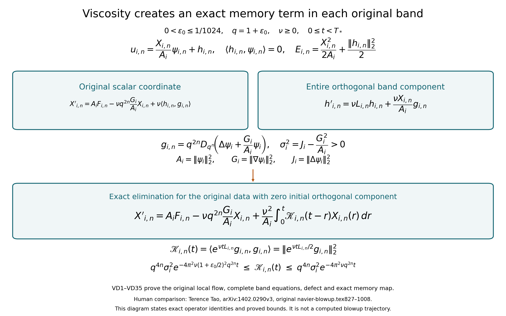
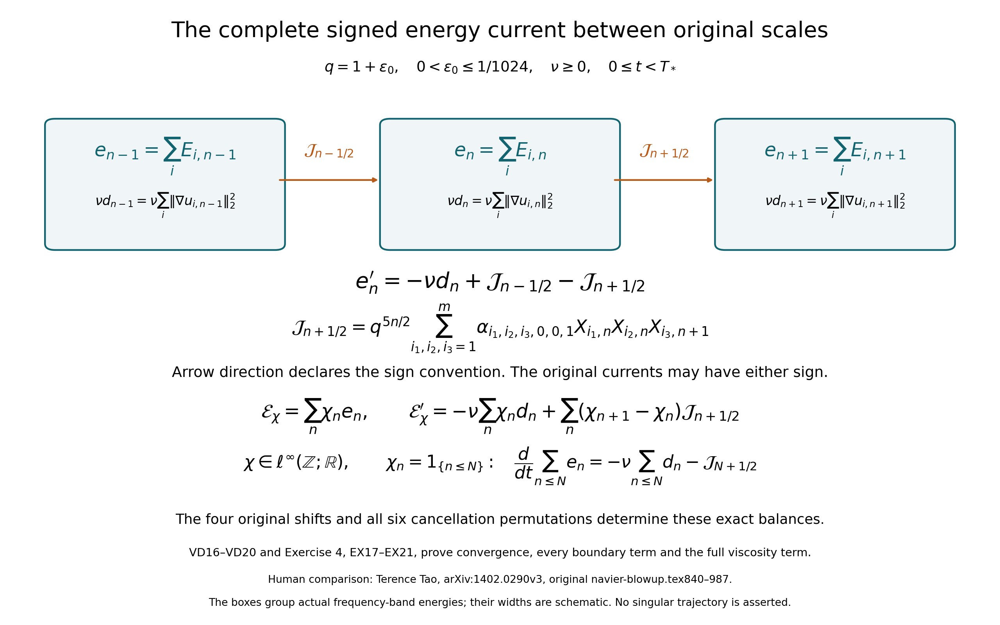

# The original viscous cascade and its exact memory equation

The original cascade equation has an actual local flow before any claim of
finite-time blowup. This lesson constructs that flow, proves its complete
frequency-band equations and retains the part of each band that viscosity
moves outside its original wave packet. Eliminating that component gives
an exact memory equation with a strictly positive kernel and proved bounds.

The human comparison is Terence Tao's
[arXiv:1402.0290v3](https://arxiv.org/abs/1402.0290v3), original
navier-blowup.tex, lines 827–1008. Every original coefficient, shift,
field norm, viscosity, time interval and boundary energy current is kept.
The three source corrections are shown beside their exact calculations.

The local-cascade analysis and evolution used below are proved in
[lesson 38](the-original-local-cascade-and-its-full-viscous-dynamics.md),
CC1–CC12. The complete Euler averaging representation is proved in
[lesson 39](the-complete-original-cascade-averaging-theorem.md),
SP1–SP33, RF1–RF24, AF1–AF27 and AV1–AV35. The original Fourier and
Sobolev conventions are those of these lessons and
[lesson 2](pressure-and-the-divergence-free-projection.md).

Five solved exercises calculate the full heat response and its resolvent,
improve the diffusion bound using the actual annular width, derive the
signed energy current at every scale, and differentiate the actual flow
with respect to its original viscosity. These results prepare the
successive-transfer argument; they do not by themselves assert a singular
trajectory.

## VD1. Retain the original fields, four shifts and all coefficients

Fix \(0<\epsilon_0\leq1/1024\), \(q=1+\epsilon_0\), a positive integer \(m\), and the source balls
\[
B_i\subset\{\xi:1<|\xi|\leq1+\epsilon_0/2\},
\qquad B_1,\ldots,B_m,-B_1,\ldots,-B_m
\quad\hbox{pairwise disjoint}.
\tag{VD1}
\]
Let the original \(\psi_i\) be nonzero real solenoidal Schwartz fields supported in these pairs of balls in Fourier space. The source also requires real Fourier transforms and squared norms one. The proof below applies to those exact fields and retains their full squared norms
\[
A_i=\|\psi_i\|_2^2,\quad
G_i=\|\nabla\psi_i\|_2^2,\quad
J_i=\|\Delta\psi_i\|_2^2,\quad
\psi_{i,n}=D_{q^n}\psi_i,\quad
D_\lambda f(x)=\lambda^{3/2}f(\lambda x).
\tag{VD2}
\]
Thus \(A_i=1\) for the source's specified fields. No field is divided by its norm or replaced. Keeping \(A_i\) in the calculation also proves the extension to arbitrary nonzero original norms. Realness of the Fourier transform is not used in the estimates; the realness of the physical field is retained.

Keep exactly the original shift set and operator
\[
\begin{gathered}
S=\{(0,0,0),(1,0,0),(0,1,0),(0,0,1)\},\\
C_\alpha(u,v)=
\sum_{k\in\mathbb Z}\sum_{i_1,i_2,i_3=1}^m
\sum_{\mu\in S}\alpha_{i_1,i_2,i_3,\mu_1,\mu_2,\mu_3}q^{5k/2}
\langle u,\psi_{i_1,k+\mu_1}\rangle
\langle v,\psi_{i_2,k+\mu_2}\rangle\psi_{i_3,k+\mu_3}.
\end{gathered}
\tag{VD3}
\]
All coefficients are original real numbers. The source symmetry and cancellation identities are
\[
\begin{gathered}
\alpha_{i_1,i_2,i_3,\mu_1,\mu_2,\mu_3}
=\alpha_{i_2,i_1,i_3,\mu_2,\mu_1,\mu_3},\\
\sum_{\sigma\in\mathfrak S_3}
\alpha_{i_{\sigma(1)},i_{\sigma(2)},i_{\sigma(3)},
\mu_{\sigma(1)},\mu_{\sigma(2)},\mu_{\sigma(3)}}=0.
\end{gathered}
\tag{VD4}
\]
The second sum has all six permutations, including their multiplicities when indices repeat. The shift set is invariant under these permutations.

For each fixed coefficient, VD3 is the original basic cascade with fields \(D_{q^{\mu_j}}\psi_{i_j}\). Their Fourier supports lie in the original admissible annulus \([1-2\epsilon_0,1+2\epsilon_0]\): the largest radius is
\(q(1+\epsilon_0/2)=1+3\epsilon_0/2+\epsilon_0^2/2\leq1+2\epsilon_0\).
Consequently there are \(4m^3\) displayed basic terms. Source line856's \(7m^3\) count does not agree with its four-element set.

Here are explicit constants for the receiving maps. Put
\[
\begin{gathered}
L=1-2\epsilon_0,\quad U=1+2\epsilon_0,\quad
J=\lfloor\log(U/L)/\log q\rfloor+1,\\
a_s=\max\{1,(2\pi L)^{-s},(2\pi U)^{-s}\},\qquad
b_s=\max\{1,(2\pi L)^s,(2\pi U)^s\},\\
K_d=\sup_{k\in\mathbb Z}
\frac{q^{5k/2}}{(1+q^{2k})^{d/2}},\\
\mathcal K(p,r;s)=J^{3/2}a_pa_rb_sK_{p+r-s}
\sum_{i_1,i_2,i_3,\mu}
|\alpha_{i_1,i_2,i_3,\mu}|
\prod_{j=1}^3\|D_{q^{\mu_j}}\psi_{i_j}\|_2 .
\end{gathered}
\tag{VD5}
\]
The complete CC1–CC7 analysis and synthesis proof then gives
\[
\|C_\alpha(u,v)\|_{H^s}
\leq\mathcal K(p,r;s)\|u\|_{H^p}\|v\|_{H^r},
\qquad p+r-s\geq5/2.
\tag{VD6}
\]
The Sobolev norm here is the full integral with weight
\((1+4\pi^2|\xi|^2)^s\). Every summand in VD5 is retained, and \(K_{5/2}=1\). The original series converges unconditionally in the receiving space, by the finite-tail proof in that provider.
VD4 gives symmetry directly. For \(u\in H^{5/2}_\sigma\), absolute scalar convergence permits averaging the cubic series over the six permutations. Its coefficient becomes the second VD4 sum divided by six, hence
\[
\langle C_\alpha(u,u),u\rangle=0.
\tag{VD7}
\]
Lesson39 therefore gives a real probability-space averaged Euler representation of this exact operator, with all its original coefficients.

## VD2. Construct the actual maximal flow before using its coordinates

Keep the original viscosity \(\nu\geq0\), and solve
\[
u(t)=e^{\nu t\Delta}u_0+
\int_0^t e^{\nu(t-s)\Delta}C_\alpha(u(s),u(s))\,ds.
\tag{VD8}
\]
For \(s\geq5/2\), put \(K_s=\mathcal K(s,s;s)\) and \(M_s=\|u_0\|_{H^s}\). If both are positive, on
\(T_s=(8K_sM_s)^{-1}\) the integral map sends the closed radius-\(2M_s\) ball of \(C([0,T_s];H^s_\sigma)\) into the radius-\(3M_s/2\) ball and has contraction factor at most one-half. These follow from the full heat contraction and VD6: the nonlinear size is \(4T_sK_sM_s^2=M_s/2\), and its difference coefficient is \(4T_sK_sM_s=1/2\).
The geometric convergence of these actual Picard iterates constructs the solution. The same difference estimate on successive shorter intervals gives uniqueness in the whole continuous class, not just in this ball. If \(M_s=0\) the solution is zero; if \(K_s=0\) it is the original heat evolution.

Restart this construction to obtain a maximal time \(T_*\) in \(H^{5/2}\). If \(T_*<\infty\), then
\(\|u(t)\|_{H^{5/2}}\to\infty\) as \(t\uparrow T_*\): otherwise a sequence of bounded norms tending to \(T_*\) supplies a uniform positive restart interval, contradicting maximality.
For \(u_0\in H^s\), the exact mixed-order estimate gives, while that solution exists,
\[
\|u(t)\|_{H^s}
\leq\|u_0\|_{H^s}
+\mathcal K(5/2,s;s)\int_0^t
\|u(r)\|_{H^{5/2}}\|u(r)\|_{H^s}\,dr,
\]
and hence
\[
\|u(t)\|_{H^s}
\leq\|u_0\|_{H^s}
\exp\!\left(\mathcal K(5/2,s;s)
\int_0^t\|u(r)\|_{H^{5/2}}\,dr\right).
\tag{VD9}
\]
For every \(T<T_*\) the latter bound is finite. If the \(H^s\) solution ended earlier, its uniform norm would permit a restart there; uniqueness identifies it with the \(H^{5/2}\) solution. Thus all these maximal times agree. In particular source Schwartz data give an actual \(H^{10}\) solution on \([0,T_*)\), without assuming that \(T_*=\infty\).

Differentiating VD8 in \(H^8\) for the \(H^{10}\) solution gives \(u'=\nu\Delta u+C_\alpha(u,u)\). One can verify this directly by the bounded Fourier heat difference quotients in \(H^8\) and continuity of the integral's \(H^{10}\) integrand. Pairing with \(u\), VD7 and Fourier integration give the complete energy identity
\[
\frac12\|u(t)\|_2^2+
\nu\int_0^t\|\nabla u(r)\|_2^2\,dr
=\frac12\|u_0\|_2^2.
\tag{VD10}
\]
All ensuing claims hold on this constructed maximal interval.

## VD3. Prove the complete frequency decomposition and its invariant lower end

Write \(\mathcal A_{i,n}=q^n(B_i\cup-B_i)\), and let \(P_{i,n}\) be its Fourier indicator projection on real solenoidal fields. The sets are pairwise disjoint: for different scales the radial upper bound \(q^n(1+\epsilon_0/2)\) is strictly below \(q^{n+1}\); within a scale VD1 applies. Each projection is orthogonal in every original \(H^s\) norm and commutes with the original heat semigroup.

Let \(\mathcal V\) be the closed subspace of fields supported in their union, interpreted up to null sets. Each VD3 output lies in \(\mathcal V\), by unconditional convergence. Heat preserves this space. Thus every Picard iterate and its limit lie in it when \(u_0\) does. In particular, for the original datum \(u_0=\psi_{1,n_0}\),
\[
u(t)=\sum_{i,n}u_{i,n}(t),\qquad
u_{i,n}=P_{i,n}u,\qquad
\|u(t)\|_{H^s}^2=\sum_{i,n}\|u_{i,n}(t)\|_{H^s}^2.
\tag{VD11}
\]
The convergence is unconditional by orthogonal Fourier integration.

The smaller closed subspace \(\mathcal V_{\geq n_0}\) using only \(n\geq n_0\) is also invariant. To prove the nonlinear assertion, consider a VD3 output at \(k+\mu_3<n_0\). If \(\mu_3=1\), both input indices equal \(k<n_0\). If \(\mu_3=0\), at least one of the two input shifts is zero, so that input index is \(k<n_0\). Its pairing with a field in \(\mathcal V_{\geq n_0}\) vanishes. Every forbidden output coefficient is therefore zero. The heat and Picard argument proves
\[
u_{i,n}(t)=0\quad(n<n_0,\ 0\leq t<T_*).
\tag{VD12}
\]
This is an invariant-space proof for the actual solution; no global existence hypothesis is used.

Keep the exact real coordinates and energies
\[
X_{i,n}=\langle u_{i,n},\psi_{i,n}\rangle,\qquad
E_{i,n}=\tfrac12\|u_{i,n}\|_2^2.
\tag{VD13}
\]
The original Fourier weights imply
\[
(1+q^{10n})|X_{i,n}(t)|
\leq\sqrt{A_i}\|u(t)\|_{H^{10}},\qquad
(1+q^{10n})\sqrt{E_{i,n}(t)}
\leq\|u(t)\|_{H^{10}}/\sqrt2.
\tag{VD14}
\]
Indeed the lower band radius is \(q^n\), and
\((1+4\pi^2q^{2n})^5\geq1+q^{10n}\). Cauchy–Schwarz then gives both bounds. These are uniform on each \([0,T]\subset[0,T_*)\).
The original initial values are
\[
X_{i,n}(0)=A_1\,1_{(i,n)=(1,n_0)},\qquad
E_{i,n}(0)=\tfrac12A_1\,1_{(i,n)=(1,n_0)}
=\frac{X_{i,n}(0)^2}{2A_i}.
\tag{VD15}
\]

## VD4. Keep the exact scalar and vector viscous equations

For each original band define its actual scalar forcing coefficient
\[
F_{i,n}(X)=
\sum_{i_1,i_2=1}^m\sum_{\mu\in S}
\alpha_{i_1,i_2,i,\mu_1,\mu_2,\mu_3}
q^{5(n-\mu_3)/2}
X_{i_1,n-\mu_3+\mu_1}X_{i_2,n-\mu_3+\mu_2}.
\tag{VD16}
\]
Projecting VD8 and using disjoint supports gives
\[
\begin{gathered}
u_{i,n}'=\nu\Delta u_{i,n}+F_{i,n}(X)\psi_{i,n},\\
X_{i,n}'=A_iF_{i,n}(X)+\nu\langle u_{i,n},\Delta\psi_{i,n}\rangle,\\
E_{i,n}'=F_{i,n}(X)X_{i,n}
-\nu\|\nabla u_{i,n}\|_2^2.
\end{gathered}
\tag{VD17}
\]
The projected Laplacian is a bounded operator on this fixed band's \(L^2\) space, with norm at most \(4\pi^2(1+\epsilon_0/2)^2q^{2n}\). Thus the projected integral equation is continuously differentiable in \(L^2\), which justifies every displayed derivative independently of a formal scalar reduction.
The retained dissipation and error bounds are
\[
\begin{gathered}
8\pi^2q^{2n}E_{i,n}
\leq\|\nabla u_{i,n}\|_2^2
\leq8\pi^2(1+\epsilon_0/2)^2q^{2n}E_{i,n},\\
|\nu\langle u_{i,n},\Delta\psi_{i,n}\rangle|
\leq\nu q^{2n}\sqrt{2E_{i,n}}\sqrt{J_i}.
\end{gathered}
\tag{VD18}
\]
Here \(\Delta\psi_{i,n}=q^{2n}D_{q^n}\Delta\psi_i\). Source line960 prints a squared Laplacian norm in its Cauchy–Schwarz step; the exact factor is the single norm \(\sqrt{J_i}\), as VD18 proves. The full viscosity and the negative term in VD17 remain in the equations.

For completeness the source lower-frequency energy argument has an exact boundary identity too. Put \(\mathcal E_<(t)=\sum_{n<n_0,i}E_{i,n}(t)\). Regrouping the absolutely convergent cubic series by its original base scale gives
\[
\begin{aligned}
\mathcal E_<'(t)
={}&-\nu\sum_{n<n_0,i}\|\nabla u_{i,n}\|_2^2\\
&+q^{5(n_0-1)/2}
\sum_{i_1,i_2,i_3}\sum_{\mu\in\{(1,0,0),(0,1,0)\}}
\alpha_{i_1,i_2,i_3,\mu}\,
X_{i_1,n_0-1+\mu_1}X_{i_2,n_0-1+\mu_2}X_{i_3,n_0-1}.
\end{aligned}
\tag{VD19}
\]
Every base scale below \(n_0-1\) has all three slots below the boundary and cancels by VD4; every base scale at least \(n_0\) has none. At base \(n_0-1\), the shift \(000\) cancels internally, the shift \(001\) has its output above the boundary, and the two displayed shifts remain. Absolute convergence follows either from VD6's analysis bounds or from VD14 at large positive scales and the geometric factor \(q^{5k/2}\) at negative scales. The quadratic dissipation sum is integrable by VD10. Equivalently one may pair the original equation with the single bounded projection onto all lower bands and obtain VD19 in the integrated form.

Let \(A_{\max}=\max_i A_i\), let \(\beta\) be the sum of the absolute values of the coefficients displayed in VD19, and let \(H_T=\max_i\sup_{t\leq T}|X_{i,n_0}(t)|\). Each boundary product has two lower slots, whose product has absolute value at most \(2A_{\max}\mathcal E_<\), and one upper slot bounded by \(H_T\). Thus
\[
\mathcal E_<(t)
\leq2q^{5(n_0-1)/2}\beta A_{\max}H_T
\int_0^t\mathcal E_<(r)\,dr
\tag{VD20}
\]
for the original zero lower initial energy. Integrating the elementary Gronwall majorant proves \(\mathcal E_<=0\), agreeing with VD12. The upper integration endpoint is \(t\); source line987's \(t'\) at that position is a typographical error.

## VD5. Construct the exact component outside each original wave packet

Inside the real solenoidal \(L^2\) space of a fixed original band put
\[
\begin{gathered}
\Pi_{i,n}f=\frac{\langle f,\psi_{i,n}\rangle}{A_i}\psi_{i,n},
\quad Q_{i,n}=I-\Pi_{i,n},\quad
h_{i,n}=Q_{i,n}u_{i,n},\\
u_{i,n}=\frac{X_{i,n}}{A_i}\psi_{i,n}+h_{i,n},
\quad\langle h_{i,n},\psi_{i,n}\rangle=0,\\
D_{i,n}:=E_{i,n}-\frac{X_{i,n}^2}{2A_i}
=\frac12\|h_{i,n}\|_2^2.
\end{gathered}
\tag{VD21}
\]
This is the full orthogonal decomposition; in particular the source energy defect is an actual squared norm. Retain
\[
\begin{gathered}
g_i=\Delta\psi_i+\frac{G_i}{A_i}\psi_i,\qquad
\sigma_i^2=\|g_i\|_2^2=J_i-\frac{G_i^2}{A_i}>0,\\
g_{i,n}=Q_{i,n}\Delta\psi_{i,n}
=q^{2n}D_{q^n}g_i,\qquad
L_{i,n}=Q_{i,n}\Delta\big|_{\ker\Pi_{i,n}}.
\end{gathered}
\tag{VD22}
\]
Integration by parts gives \(\langle\psi_i,\Delta\psi_i\rangle=-G_i\), and expansion proves the squared-norm identity. If it were zero, the Fourier transform of the nonzero \(L^2\) field \(\psi_i\) would be supported on the sphere \(4\pi^2|\xi|^2=G_i/A_i\), a set of measure zero. This is impossible. Thus the strict inequality is proved for every original nonzero field, not assumed.

The compression \(L_{i,n}\) is bounded and self-adjoint on the indicated closed subspace: for \(h,k\) there, \(\langle Q\Delta h,k\rangle=\langle\Delta h,k\rangle=\langle h,\Delta k\rangle\). Its entire quadratic-form bounds are
\[
-4\pi^2(1+\epsilon_0/2)^2q^{2n}I
\leq L_{i,n}\leq-4\pi^2q^{2n}I.
\tag{VD23}
\]
Its exponential is defined by its norm-convergent power series. Differentiating the squared norm of this actual evolution gives
\(\|e^{\nu tL_{i,n}}\|\leq e^{-4\pi^2\nu q^{2n}t}\).
Applying \(Q_{i,n}\) to VD17, the complete equation and its solved integral are
\[
\begin{aligned}
h_{i,n}'&=\nu L_{i,n}h_{i,n}
+\frac{\nu X_{i,n}}{A_i}g_{i,n},\\
h_{i,n}(t)&=e^{\nu tL_{i,n}}h_{i,n}(0)
+\frac{\nu}{A_i}\int_0^t
e^{\nu(t-r)L_{i,n}}X_{i,n}(r)g_{i,n}\,dr .
\end{aligned}
\tag{VD24}
\]
The nonlinear forcing has no omitted orthogonal component: it is exactly \(F_{i,n}\psi_{i,n}\), which \(Q_{i,n}\) annihilates.

For the source initial datum every \(h_{i,n}(0)=0\). Thus VD24 gives the stronger explicit defect estimate
\[
\begin{aligned}
\sqrt{D_{i,n}(t)}
&\leq\frac{\nu q^{2n}\sigma_i}{\sqrt{A_i}}
\int_0^t e^{-4\pi^2\nu q^{2n}(t-r)}
\sqrt{E_{i,n}(r)}\,dr,\\
D_{i,n}(t)
&\leq\frac{\nu^2q^{4n}\sigma_i^2}{A_i}\,
t\int_0^t E_{i,n}(r)\,dr .
\end{aligned}
\tag{VD25}
\]
The first inequality uses the exact factor \(|X|\leq\sqrt{2A_iE}\) and \(\|h\|=\sqrt{2D}\); the second is integral Cauchy–Schwarz after retaining, then bounding, the nonnegative exponential by one.
The original source's linear-in-time integral bound follows directly as well:
\[
\begin{gathered}
D_{i,n}'=
-\nu\|\nabla u_{i,n}\|_2^2
-\frac{\nu X_{i,n}}{A_i}
\langle u_{i,n},\Delta\psi_{i,n}\rangle,\\
0\leq D_{i,n}(t)\leq
\frac{2\nu q^{2n}\sqrt{J_i}}{\sqrt{A_i}}
\int_0^t E_{i,n}(r)\,dr.
\end{gathered}
\tag{VD26}
\]
The equality keeps the full dissipation; VD18 gives the second estimate. Both VD25 and VD26 concern the same original defect.

For the initially occupied band, \(X_{1,n_0}(0)=A_1\), so
\[
h_{1,n_0}'(0)=\nu g_{1,n_0},\qquad
D_{1,n_0}(t)
=\tfrac12\nu^2q^{4n_0}\sigma_1^2t^2+o(t^2).
\tag{VD27}
\]
This follows from differentiability in \(L^2\) and the exact squared norm VD21. For every \(\nu>0\) the actual trajectory immediately acquires a nonzero component outside the original wave packet.

## VD6. Obtain an exact scalar memory equation with its full positive kernel

Return VD24 to the scalar VD17 equation. Define, for \(t\geq0\),
\[
\mathscr K_{i,n}(t)=
\langle e^{\nu tL_{i,n}}g_{i,n},g_{i,n}\rangle .
\tag{VD28}
\]
For the original data with \(h(0)=0\), the exact closed coordinate equation is
\[
X_{i,n}'(t)=
A_iF_{i,n}(X(t))
-\nu q^{2n}\frac{G_i}{A_i}X_{i,n}(t)
+\frac{\nu^2}{A_i}\int_0^t
\mathscr K_{i,n}(t-r)X_{i,n}(r)\,dr .
\tag{VD29}
\]
Indeed \(\langle h,\Delta\psi_{i,n}\rangle=\langle h,g_{i,n}\rangle\), and the component along \(\psi_{i,n}\) has pairing
\(-q^{2n}(G_i/A_i)X_{i,n}\). These two identities and VD24 give every term and sign in VD29. For general initial \(h(0)\), add the exact term
\(\nu\langle e^{\nu tL_{i,n}}h_{i,n}(0),g_{i,n}\rangle\).

The kernel is strictly positive and keeps both original band bounds:
\[
q^{4n}\sigma_i^2
e^{-4\pi^2\nu(1+\epsilon_0/2)^2q^{2n}t}
\leq\mathscr K_{i,n}(t)
\leq q^{4n}\sigma_i^2e^{-4\pi^2\nu q^{2n}t}.
\tag{VD30}
\]
To prove this without an unproved spectral assertion, self-adjointness of the power-series exponential gives
\(\mathscr K(t)=\|e^{\nu tL/2}g\|_2^2\). Differentiate this norm and apply both VD23 bounds. Integration gives VD30 with \(\|g_{i,n}\|^2=q^{4n}\sigma_i^2\).
There is also the exact original scaling identity
\[
L_{i,n}=q^{2n}D_{q^n}L_{i,0}D_{q^{-n}},
\qquad
\mathscr K_{i,n}(t)
=q^{4n}\langle e^{\nu q^{2n}tL_{i,0}}g_i,g_i\rangle.
\tag{VD31}
\]
The dilation maps the entire orthogonal complement onto the scaled one, since its full \(L^2\) pairing is preserved. Its Laplacian identity proves the first formula, and the convergent exponential series proves the second.

This is an exact elimination of the orthogonal component of the actual equation. It also has an exact reverse map. Given coordinates on an interval and \(h\) defined by VD24, assume their reconstructed series \(u=\sum_{i,n}(X_{i,n}\psi_{i,n}/A_i+h_{i,n})\) is continuous in the original \(H^{10}\) norm and the coordinates satisfy VD29 with the stated initial data. Differentiating each bounded-band equation proves VD17, since its parallel and orthogonal components agree separately. Its integrated heat formula can then be summed: VD6 and the continuous \(H^{10}\) bound make the complete nonlinear series and its time integral converge in \(H^{10}\). Orthogonal projections of both sides of VD8 agree, and both sides lie in \(\mathcal V\), so VD8 holds. This proves the precise equivalence on the stated function space; it does not assert existence for arbitrary coordinate sequences. Existence on that space was already constructed in VD2.

The function space in this equivalence keeps the entire Sobolev expression. In particular, its band norm is
\[
\|u_{i,n}\|_{H^{10}}^2=
\frac{X_{i,n}^2}{A_i^2}\|\psi_{i,n}\|_{H^{10}}^2
+\frac{2X_{i,n}}{A_i}
\langle\psi_{i,n},h_{i,n}\rangle_{H^{10}}
+\|h_{i,n}\|_{H^{10}}^2.
\tag{VD32}
\]
The middle term is not generally zero; orthogonality in VD21 is the original \(L^2\) orthogonality. The sum of these full band expressions, not a substituted diagonal norm, specifies the original \(H^{10}\) space.

## VD7. Prove the source viscosity comparison with all original variables retained

For an integer \(k\), retain \(\lambda=q^k\), an amplitude \(a>0\), and a clock \(b=a\lambda^{5/2}\). The full cascade covariance from VD3, by reindexing its base scale, is
\[
C_\alpha(D_\lambda v,D_\lambda v)
=\lambda^{5/2}D_\lambda C_\alpha(v,v).
\tag{VD33}
\]
No field or coefficient changes. If \(v\) has original viscosity
\(\nu'=\nu/(a\sqrt\lambda)\), direct substitution proves
\[
u(t,x)=a\lambda^{3/2}v(bt,\lambda x),\qquad
u'=\nu\Delta u+C_\alpha(u,u).
\tag{VD34}
\]
The time derivative has factor \(ab\), diffusion has factor \(a\nu\lambda^2\), and the nonlinear term has factor \(a^2\lambda^{5/2}\). Thus both equations agree exactly with the displayed \(b,\nu'\). The inverse map uses \(a^{-1}D_{\lambda^{-1}}\) and time \(t=s/b\), so this is an actual two-way correspondence of the maximal solutions. Its coordinates, energy and defect retain
\[
X^u_{i,n}(t)=aX^v_{i,n-k}(bt),\qquad
E^u_{i,n}(t)=a^2E^v_{i,n-k}(bt),\qquad
D^u_{i,n}(t)=a^2D^v_{i,n-k}(bt).
\tag{VD35}
\]
These follow from the exact original unitary pairing and band dilation.
With \(a=1,k=n_0\), the actual datum \(\psi_{1,n_0}\) corresponds to the datum \(\psi_{1,0}\) at viscosity \(\nu q^{-n_0/2}\) and clock \(q^{5n_0/2}\). This proves the source footnote's comparison while retaining the original datum, physical time and viscosity in VD8–VD32.

## Two pictures of the original viscous dynamics

VD1–VD35 prove the complete identities and bounds shown here. Every original norm, scale and viscosity factor is retained. The [reproducible source](../assets/original-viscous-cascade-memory.py) and [vector rendering](../assets/original-viscous-cascade-memory.svg) are included. Human comparison: Tao, original navier-blowup.tex827–1008. No numerical blowup trajectory is represented.

VD16–VD20 and Exercise 4, EX17–EX21 prove the complete identities and bounds shown here. Every original norm, scale and viscosity factor is retained. The arrows specify a signed current; no positivity of that current is assumed. The box widths are schematic. The [reproducible source](../assets/original-cascade-energy-current.py) and [vector rendering](../assets/original-cascade-energy-current.svg) are included. Human comparison: Tao, original navier-blowup.tex827–1008. No numerical blowup trajectory is represented.

## Five solved exercises

### Exercise 1. Calculate the full original heat response of one band

Compute the scalar response of the original band field under its actual heat evolution. Recover the exact nonlinear coordinate integral equation, and calculate the energy defect for free heat evolution without replacing the field by a Laplacian eigenfunction.

**Solution.** Fix \(i,n\), retain every original constant in VD2, and put
\[
\begin{gathered}
H_{i,n}(t)=\langle e^{\nu t\Delta}\psi_{i,n},\psi_{i,n}\rangle\\
\hspace{15mm}=
\int_{\mathbb R^3}
e^{-4\pi^2\nu q^{2n}|\xi|^2t}
|\widehat\psi_i(\xi)|^2\,d\xi .
\end{gathered}
\tag{EX1}
\]
This follows from the full original Fourier dilation formula and its Jacobian. The measure in the last integral has mass \(A_i\); it has not been replaced by a measure of mass one. Its compact support makes differentiation of every order legitimate, and gives
\[
\begin{gathered}
(-1)^k H_{i,n}^{(k)}(t)
=\nu^kq^{2kn}\int(4\pi^2|\xi|^2)^k
e^{-4\pi^2\nu q^{2n}|\xi|^2t}
|\widehat\psi_i(\xi)|^2\,d\xi\geq0,\\
H_{i,n}(0)=A_i,\quad
H_{i,n}'(0)=-\nu q^{2n}G_i,\quad
H_{i,n}''(0)=\nu^2q^{4n}J_i .
\end{gathered}
\tag{EX2}
\]
Every equality includes the original \(4\pi^2\) convention.
Writing \(\rho=1+\epsilon_0/2\), the actual band bounds yield
\[
A_i e^{-4\pi^2\nu q^{2n}\rho^2t}
\leq H_{i,n}(t)
\leq A_i e^{-4\pi^2\nu q^{2n}t}.
\tag{EX3}
\]

The vector band equation VD17 has the exact integral solution
\[
u_{i,n}(t)=e^{\nu t\Delta}u_{i,n}(0)
+\int_0^t F_{i,n}(X(r))e^{\nu(t-r)\Delta}\psi_{i,n}\,dr.
\]
For the original initial data its projection is therefore
\[
X_{i,n}(t)=\frac{X_{i,n}(0)}{A_i}H_{i,n}(t)
+\int_0^t F_{i,n}(X(r))H_{i,n}(t-r)\,dr.
\tag{EX4}
\]
This is another exact scalar integral equation for the already constructed flow. It retains the full original heat response; no scalar damping approximation is made.

For the actual free heat equation with initial datum \(a\psi_{i,n}\), where \(a\in\mathbb R\), the precise coordinate, energy and defect are
\[
\begin{gathered}
X(t)=aH_{i,n}(t),\qquad
E(t)=\tfrac12a^2H_{i,n}(2t),\\
D(t)=\frac{a^2}{2}
\left[H_{i,n}(2t)-\frac{H_{i,n}(t)^2}{A_i}\right].
\end{gathered}
\tag{EX5}
\]
The energy identity follows because the heat semigroup is self-adjoint and its square is the semigroup at time \(2t\). The bracket is nonnegative by Cauchy–Schwarz in the original measure \(|\widehat\psi_i|^2d\xi\).
If \(a\ne0,\nu>0,t>0\), equality would force \(e^{-4\pi^2\nu q^{2n}|\xi|^2t}\) to be constant almost everywhere for that measure. Its nonzero smooth density is positive on an open set, where \(|\xi|\) is not constant. Thus \(D(t)>0\).
Using the two actual derivatives in EX2 gives
\[
D(t)=\frac{a^2\nu^2q^{4n}}2
\left(J_i-\frac{G_i^2}{A_i}\right)t^2+o(t^2).
\tag{EX6}
\]
All original field norms and the complete diffusion variance remain.

### Exercise 2. Relate the two exact kernels through their full resolvents

Prove an exact relation between the Laplace transforms of EX1 and the memory kernel VD28. Show that the positive memory contribution is consistent with the original strictly dissipative heat operator.

**Solution.** Keep the fixed original band and write
\[
\begin{gathered}
\gamma_{i,n}=q^{2n}G_i/A_i,\qquad
a_n=4\pi^2q^{2n},\qquad b_n=4\pi^2\rho^2q^{2n},\\
\mathcal H(p)=\int_0^\infty e^{-pt}H_{i,n}(t)\,dt,\qquad
\mathcal Q(p)=\int_0^\infty e^{-pt}\mathscr K_{i,n}(t)\,dt
\quad(p>0).
\end{gathered}
\tag{EX7}
\]
Tonelli's theorem applies to the nonnegative EX1 integrand, and gives
\[
\mathcal H(p)=
\int_{\mathbb R^3}
\frac{|\widehat\psi_i(\xi)|^2}
{p+4\pi^2\nu q^{2n}|\xi|^2}\,d\xi
=\langle(p-\nu\Delta)^{-1}\psi_{i,n},\psi_{i,n}\rangle .
\tag{EX8}
\]
All operators here act on the fixed band. Both \(\Delta\) and \(L_{i,n}\) are bounded there. Integrating the derivative of \(e^{-pt}e^{\nu tL}\) in operator norm shows that its integral is a two-sided inverse of \(p-\nu L\); the boundary at infinity vanishes by the proved exponential bound. The same argument applies to the band Laplacian. Consequently
\(\mathcal Q(p)=\langle(p-\nu L_{i,n})^{-1}g_{i,n},g_{i,n}\rangle\).

Let \(z=(p-\nu\Delta)^{-1}\psi_{i,n}\), and decompose it exactly as
\(z=x\psi_{i,n}/A_i+h\), with \(h\perp\psi_{i,n}\). Pairing its equation with the original field and projecting orthogonally give
\[
\begin{gathered}
(p+\nu\gamma_{i,n})x-\nu\langle h,g_{i,n}\rangle=A_i,\\
(p-\nu L_{i,n})h=\frac{\nu x}{A_i}g_{i,n}.
\end{gathered}
\tag{EX9}
\]
The second equation has the inverse just proved, and \(x=\mathcal H(p)>0\). Thus
\[
\frac{A_i}{\mathcal H(p)}
=p+\nu\gamma_{i,n}-\frac{\nu^2}{A_i}\mathcal Q(p).
\tag{EX10}
\]
This identity retains the complete direct heat response and the memory response. In particular, for \(\nu>0\),
\[
\mathcal Q(p)=\frac{A_i}{\nu^2}
\left[p+\nu\gamma_{i,n}-\frac{A_i}{\mathcal H(p)}\right].
\tag{EX11}
\]
At \(\nu=0\) the separate exact values are
\(\mathcal H(p)=A_i/p\) and
\(\mathcal Q(p)=q^{4n}\sigma_i^2/p\); EX10 still holds without division by zero.

The full band bounds give
\[
\begin{gathered}
\frac{A_i}{p+\nu b_n}\leq\mathcal H(p)
\leq\frac{A_i}{p+\nu a_n},\\
\frac{q^{4n}\sigma_i^2}{p+\nu b_n}\leq\mathcal Q(p)
\leq\frac{q^{4n}\sigma_i^2}{p+\nu a_n},\\
p+\nu a_n\leq
p+\nu\gamma_{i,n}-\frac{\nu^2}{A_i}\mathcal Q(p)
\leq p+\nu b_n .
\end{gathered}
\tag{EX12}
\]
The first follows directly from EX8, the second by integrating VD30, and the third by inverting the first and using EX10. Thus the exact memory correction has the positive sign in the time equation, while its full resolvent denominator remains positive with the stated original dissipative bounds.

### Exercise 3. Use the original annular width to strengthen the diffusion estimate

Bound the diffusion variance using the entire original annulus, retaining its actual mean \(G_i/A_i\). Use the result to improve the defect and memory bounds. Determine whether any one constant damping rate can reproduce the original heat response.

**Solution.** Put \(a=4\pi^2\) and \(b=4\pi^2\rho^2\). On the original Fourier support, \(a<4\pi^2|\xi|^2<b\) almost everywhere for the nonzero density \(|\widehat\psi_i|^2\). The nonnegative original integral gives
\[
\begin{aligned}
0&<\int
(4\pi^2|\xi|^2-a)(b-4\pi^2|\xi|^2)
|\widehat\psi_i(\xi)|^2\,d\xi\\
&=(a+b)G_i-J_i-abA_i .
\end{aligned}
\tag{EX13}
\]
Strict positivity holds because a smooth nonzero field has positive density on an open set inside the annulus. Subtracting the retained mean square, with no change to the original measure, proves
\[
\begin{aligned}
0<\frac{\sigma_i^2}{A_i}
&<\left(\frac{G_i}{A_i}-a\right)
\left(b-\frac{G_i}{A_i}\right)\\
&\leq\frac{(b-a)^2}{4}
=4\pi^4(\rho^2-1)^2
=4\pi^4(\epsilon_0+\epsilon_0^2/4)^2 .
\end{aligned}
\tag{EX14}
\]
The second inequality is the exact identity
\((x-a)(b-x)=(b-a)^2/4-(x-(a+b)/2)^2\).
Both the actual-mean estimate and its annular consequence are retained.

Inserting EX14 into the original proved bounds gives
\[
\begin{aligned}
D_{i,n}(t)
&\leq4\pi^4\nu^2q^{4n}
(\epsilon_0+\epsilon_0^2/4)^2
t\int_0^t E_{i,n}(r)\,dr,\\
\left|X_{i,n}'-A_iF_{i,n}
+\nu q^{2n}\frac{G_i}{A_i}X_{i,n}\right|
&\leq\frac{\nu^2q^{4n}\sigma_i^2}{A_i}
\int_0^t e^{-4\pi^2\nu q^{2n}(t-r)}|X_{i,n}(r)|\,dr\\
&\leq4\pi^4\nu^2q^{4n}
(\epsilon_0+\epsilon_0^2/4)^2
\int_0^t e^{-4\pi^2\nu q^{2n}(t-r)}|X_{i,n}(r)|\,dr .
\end{aligned}
\tag{EX15}
\]
The coordinate estimate is the actual memory equation VD29 and its full positive-kernel bound, not an assumed scalar approximation. Its original damping coefficient is still \(q^{2n}G_i/A_i\).

For \(\nu>0\), an exponential \(A_ie^{-dt}\) matching the exact heat response at both value and first derivative at zero must have
\(d=\nu q^{2n}G_i/A_i\). Its second derivative differs by exactly
\[
H_{i,n}''(0)-A_id^2
=\nu^2q^{4n}
\left(J_i-\frac{G_i^2}{A_i}\right)
=\nu^2q^{4n}\sigma_i^2>0.
\tag{EX16}
\]
Thus no such constant damping law equals the original heat response on any neighborhood of zero. The memory term supplies the precise missing contribution. At \(\nu=0\) the heat response is the constant \(A_i\), consistent with all formulas.

### Exercise 4. Derive the complete signed energy current between adjacent scales

For the original four-shift operator, compute the energy current at every scale boundary. Prove the exact balance for an arbitrary bounded scale weight, including the original viscous dissipation.

**Solution.** Set
\[
\begin{gathered}
e_n=\sum_{i=1}^m E_{i,n},\qquad
d_n=\sum_{i=1}^m\|\nabla u_{i,n}\|_2^2,\\
\mathcal J_{n+1/2}
=q^{5n/2}\sum_{i_1,i_2,i_3=1}^m
\alpha_{i_1,i_2,i_3,0,0,1}
X_{i_1,n}X_{i_2,n}X_{i_3,n+1}.
\end{gathered}
\tag{EX17}
\]
This is a signed current. No sign restriction on these original coefficients or coordinates is introduced.
For a fixed base scale \(k\), denote the three cubic sums with shifts \(100,010,001\), including their common factor \(q^{5k/2}\), by \(T_{100},T_{010},T_{001}\). The six-permutation cancellation VD4, summed over the three original field indices, gives
\[
T_{100}+T_{010}+T_{001}=0,\qquad
T_{001}=\mathcal J_{k+1/2}.
\tag{EX18}
\]
To check the multiplicity, each of the three locations of the high slot occurs twice in the six permutations; renaming the three summed field indices leaves their full products and coefficients in the corresponding displayed \(T\). Hence the six-term sum is exactly twice the left side. The \(000\) sum cancels within its one scale by the same permutation argument.
In VD17, the output at scale \(n\) receives \(T_{001}\) from base \(n-1\), and \(T_{100}+T_{010}=-T_{001}\) from base \(n\). Therefore
\[
e_n'=-\nu d_n+
\mathcal J_{n-1/2}-\mathcal J_{n+1/2}.
\tag{EX19}
\]
Every source coefficient and scale factor in the two currents is given in EX17.

For any bounded real sequence \(\chi=(\chi_n)_{n\in\mathbb Z}\), define the actual weighted energy
\(\mathcal E_\chi=\sum_n\chi_ne_n\). On every compact time interval before \(T_*\), its full identity is
\[
\begin{aligned}
\mathcal E_\chi(t)-\mathcal E_\chi(0)
={}&-\nu\int_0^t\sum_n\chi_nd_n(r)\,dr\\
&+\int_0^t\sum_n(\chi_{n+1}-\chi_n)
\mathcal J_{n+1/2}(r)\,dr .
\end{aligned}
\tag{EX20}
\]
The energy and dissipation sums converge by boundedness of \(\chi\), VD10 and VD11. For the current sum, VD14 bounds all coordinates uniformly at negative scales and by constants times \(q^{-10n}\) at positive scales. EX17 then gives geometric summable bounds at both ends, uniform on the compact time interval. Thus truncation, integration of EX19, reindexing, and dominated convergence justify EX20 without hidden endpoint fluxes.

If \(\chi_n=1_{n\leq N}\), the exact boundary formula becomes
\[
\frac d{dt}\sum_{n\leq N}e_n
=-\nu\sum_{n\leq N}d_n-\mathcal J_{N+1/2}.
\tag{EX21}
\]
For \(N=n_0-1\) this agrees with VD19, since its two lower-output terms sum to the negative of the displayed current. For \(\chi_n=1\) every difference vanishes and EX20 recovers the complete original energy identity. These are exact transfers of the same energy, including all original dissipation.

### Exercise 5. Differentiate the actual flow with respect to its original viscosity

Fix the original operator and initial datum. Construct the viscosity derivative of its actual local flow, with quantitative estimates and the differentiated energy identity. Treat the endpoint \(\nu=0\) explicitly.

**Solution.** Let \(s\geq5/2\), \(u_0\in H^{s+4}_\sigma\), and retain \(M=\|u_0\|_{H^{s+4}}\). Choose the actual coefficient
\[
\begin{gathered}
K=\max\{1,\mathcal K(s,s;s),
\mathcal K(s+2,s+2;s+2),
\mathcal K(s+4,s+4;s+4)\},\\
\qquad T=(8KM)^{-1},\quad a=4KM
\end{gathered}
\tag{EX22}
\]
when \(M>0\). The original heat contractions and VD2 give, for every \(\nu\geq0\), its unique solution \(u^\nu\) on this common interval with
\(\|u^\nu(t)\|_{H^{s+4}}\leq2M\).
If \(M=0\), all solutions and derivatives below are zero for all time.

Let \(\nu+\delta\geq0\), and set \(d=u^{\nu+\delta}-u^\nu\). Written with the original heat semigroup of viscosity \(\nu\), its exact equation is
\[
d(t)=\int_0^t e^{\nu(t-r)\Delta}
\left[\delta\Delta u^{\nu+\delta}
+C_\alpha(d,u^{\nu+\delta})+C_\alpha(u^\nu,d)\right](r)\,dr .
\tag{EX23}
\]
The alternate mild formula is justified by differentiating in \(H^{s+2}\), integrating the original heat equation there and using the continuous \(H^{s+4}\) solutions. Since
\(\|\Delta f\|_{H^{s+2}}\leq\|f\|_{H^{s+4}}\), the complete estimate gives
\[
\|d(t)\|_{H^{s+2}}\leq2M|\delta|t e^{at}.
\tag{EX24}
\]
For example, subtract the heat formulas, bound the two bilinear terms by \(4KM\|d\|\), and integrate the resulting scalar majorant. The sharper integral \(2M|\delta|(e^{at}-1)/a\) is also valid; EX24 follows because \((e^{at}-1)/a\leq te^{at}\).

Construct \(w^\nu\) by the actual linear Volterra equation
\[
w^\nu(t)=\int_0^t e^{\nu(t-r)\Delta}
\left[\Delta u^\nu+C_\alpha(w^\nu,u^\nu)
+C_\alpha(u^\nu,w^\nu)\right](r)\,dr .
\tag{EX25}
\]
On sufficiently short intervals this integral map is a contraction in \(C H^{s+2}\), since the coefficient of its difference is at most \(a\) times the interval length. Iteration through finitely many such intervals proves existence and uniqueness on \([0,T]\). Its complete bound is
\[
\|w^\nu(t)\|_{H^{s+2}}\leq2Mt e^{at}.
\tag{EX26}
\]

For nonzero \(\delta\), let \(z=d/\delta\). Subtract EX25 from EX23 divided by \(\delta\), and put \(r_\delta=z-w^\nu\). The exact integrand for its equation is
\[
\Delta d+
C_\alpha(r_\delta,u^{\nu+\delta})
+C_\alpha(u^\nu,r_\delta)
+C_\alpha(w^\nu,d).
\tag{EX27}
\]
This expression retains both the change in the original solution and the entire coefficient dependence. In \(H^s\), EX24 and EX26 bound its forcing part by
\[
2M|\delta|\,r e^{ar}
+4KM^2|\delta|\,r^2e^{2ar}.
\]
The same scalar integral majorant with difference coefficient \(a\) therefore proves
\[
\sup_{0\leq r\leq t}
\left\|\frac{u^{\nu+\delta}(r)-u^\nu(r)}{\delta}-w^\nu(r)\right\|_{H^s}
\leq|\delta|e^{at}
\left[Mt^2+\frac43KM^2t^3e^{at}\right].
\tag{EX28}
\]
Indeed integrating the first forcing term against \(e^{a(t-r)}\) gives \(M|\delta|t^2e^{at}\); bounding \(e^{ar}\leq e^{at}\) in the second gives the retained second term. This proves the actual viscosity derivative in \(C([0,T];H^s)\). It is two-sided when \(\nu>0\) and the right derivative when \(\nu=0\); no negative-viscosity flow is used.
Differentiating EX25 in \(H^s\) also yields the full differential equation
\[
(w^\nu)'=\nu\Delta w^\nu+\Delta u^\nu+
C_\alpha(w^\nu,u^\nu)+C_\alpha(u^\nu,w^\nu),
\quad w^\nu(0)=0,\quad (w^\nu)'(0)=\Delta u_0 .
\tag{EX29}
\]

Finally use VD10 for \(\nu+\delta\) and \(\nu\), subtract and divide by \(\delta\). The convergence just proved has \(s\geq5/2>1\), so the gradient pairings and time integrals converge uniformly on this finite interval. It follows that
\[
\langle u^\nu(t),w^\nu(t)\rangle
+\int_0^t\|\nabla u^\nu(r)\|_2^2\,dr
+2\nu\int_0^t
\langle\nabla u^\nu(r),\nabla w^\nu(r)\rangle\,dr=0.
\tag{EX30}
\]
This retains the direct viscosity contribution as well as the variation of the actual field. The same identity holds with the right derivative at zero. It is a local parameter theorem for the constructed original flows, and gives no unproved global or blowup conclusion.

## Continue to the original quadratic circuit

The actual original-viscosity flow, every band equation, its full energy
defect and the exact scalar memory equation are now constructed. The solved
exercises retain the direct heat response, exact resolvent, annular width,
all signed scale currents and the derivative of the physical viscosity.

The next step is the original pump, amplifier and rotor circuit, followed
by the successive transfers and their finite-time endpoint. Those arguments
must use the actual viscosity estimates proved here. The wider series
continues toward the Alpöge–Buckmaster, OpenAI and workbench constructions.
