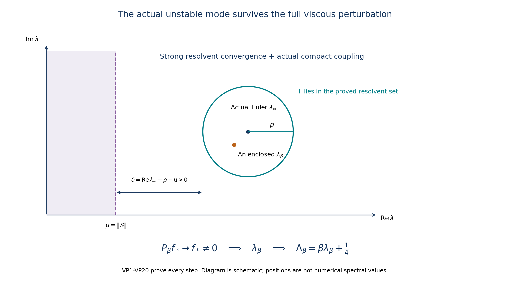
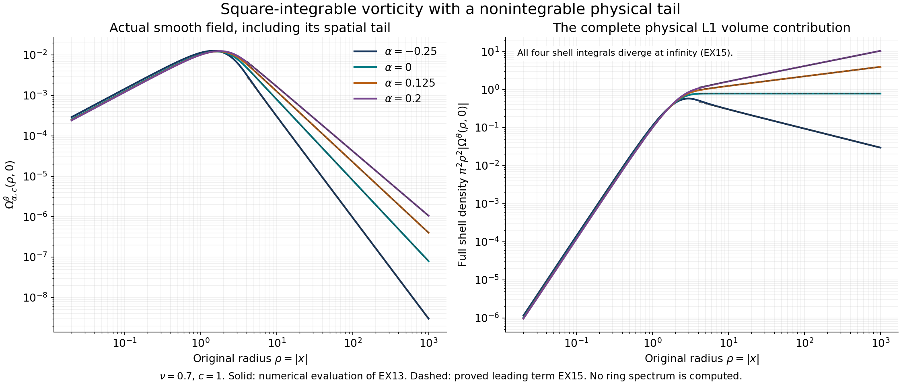

# The original viscous instability and full velocity receiver

[Lesson32](the-original-ring-kernel-and-its-unstable-spectral-space.md)
constructed an actual unstable Euler ring.
[Lesson33](the-physical-ring-and-full-viscous-dilation-domain.md), PT1–PT21
and VD1–VD21, supplied its complete physical operators and the exact
heat-and-dilation domain. This lesson proves that an actual unstable
mode survives the original viscosity, then constructs its full velocity
and pressure with the same eigenvalue.

We first build the entire perturbed generator, its evolution and its
right-half-plane inverse. A quantitative smooth-input estimate gives
strong resolvent convergence. The actual compact coupling converts
that convergence into the contour estimate needed to preserve a
nonzero spectral space. Every occurrence of the physical viscosity,
background amplitude, spatial drift and quarter shift remains explicit.

We then prove integrability of the eigenvorticity, including the exact
endpoint, and give an explicit family that fails integrability below
that endpoint for the general compact-right-side class. The complete
Biot–Savart and drift maps place the actual mode in the full velocity
domain. Its pressure includes its arbitrary additive constant.

The human source is Dallas Albritton, Elia Brué and Maria Colombo,
[*Non-uniqueness of Leray solutions of the forced Navier–Stokes equations*,
arXiv:2112.03116v1](https://arxiv.org/abs/2112.03116v1), original
main.tex1741–1745,1788–1880,2040–2074,2217–2222 and2262–2293.
The source uses viscosity one; setting that parameter to one in the
formulas here recovers its case. The source corrections and stronger
integrability statement are identified beside their complete arguments.

Five solved exercises construct the full velocity generator, retain the
real mode's entire nonlinear residual, optimize the proved velocity and
pressure bounds, calculate the counterexample's physical tail, and prove
the exact heat-semigroup norm. The nonlinear correction remains the next
construction. Author self-check only; no independent review or novelty
claim is asserted.

## VP1. Define the sum on its full original candidate domain

Fix the actual physical ring radius and background from PT17, with its actual Euler eigenpair \((\lambda_\infty,f_*)\), \(f_*\ne0\), and \(\operatorname{Re}\lambda_\infty>\mu\), where \(\mu=\|\mathcal S\|\). All norms and operators in this proof act on the original physical space \(H=\mathcal H_{\rm aps}\). Put

\[
\begin{gathered}
X=\{f\in H\cap H^2(\mathbb R^3):x\cdot\nabla f\in L^2\},\\
G_\beta=\frac1\beta\left(\nu\Delta+\frac12x\cdot\nabla+\frac34\right),\qquad
N_\beta=G_\beta+\mathcal M+\mathcal S\quad\hbox{on }X,\\
N_\infty=\mathcal M+\mathcal S\quad\hbox{on }D(\mathcal M),\qquad
T_\beta=N_\beta+\mathcal K\quad\hbox{on }X,\qquad
T_\infty=\mathcal E.
\end{gathered}
\tag{VP1}
\]

VD12–VD19 prove that \(G_\beta\) is closed with exactly domain \(X\); PT12 proves that \(X\subset D(\mathcal M)\). The symmetry-preserving compact smooth approximants in PT5 give density of \(X\) in \(H\). We now prove closedness, generation and the full inverse of the sum, rather than infer them from its formal expression.

For every \(\epsilon>0\), the original Fourier inequality \(|\eta|\leq\epsilon|\eta|^2+(4\epsilon)^{-1}\) gives \(\|\nabla f\|_2\leq\epsilon\|\Delta f\|_2+(4\epsilon)^{-1}\|f\|_2\), by the triangle inequality in Fourier \(L^2\). VD9 further gives \(\|\Delta f\|_2\leq\sqrt2\beta\|G_\beta f\|_2/\nu+\|f\|_2/\nu\). Thus, with \(U_0=\|\bar U_\ell\|_\infty\),

\[
\|\mathcal Mf\|_2\leq
\frac{\sqrt2\beta U_0\epsilon}{\nu}\|G_\beta f\|_2
+U_0\left(\frac\epsilon\nu+\frac1{4\epsilon}\right)\|f\|_2.
\tag{VP2}
\]

Choose \(\epsilon\) so the first coefficient is less than one; if \(U_0=0\), that condition is automatic. Since \(\mathcal S\) is bounded, VP2 shows that the graph norms of \(G_\beta\) and \(N_\beta\) on \(X\) are equivalent: one direction follows by the triangle inequality, and the other by moving that coefficient times \(\|G_\beta f\|\) to the left in \(G_\beta f=N_\beta f-\mathcal Mf-\mathcal Sf\). Completeness of the first graph norm therefore proves that \(N_\beta\) is closed with domain \(X\). All constants may depend on the actual \(\nu,\beta\); no assertion of a uniform graph-norm equivalence as \(\beta\to\infty\) is needed.

## VP2. Prove the complete right-half-plane inverse

VD3 and the physical skew-adjointness in PT12 give the exact energy identity and its consequence

\[
\operatorname{Re}\langle N_\beta f,f\rangle
=-\frac\nu\beta\|\nabla f\|_2^2+\operatorname{Re}\langle\mathcal Sf,f\rangle
\leq-\frac\nu\beta\|\nabla f\|_2^2+\mu\|f\|_2^2.
\tag{VP3}
\]

For real \(a>0\), let \(u=R_{G_\beta}(a)f\), which belongs to \(X\) by VD15. Taking the real inner product of its resolvent equation yields
\(a\|u\|^2+\nu\|\nabla u\|^2/\beta=\operatorname{Re}\langle f,u\rangle\). The scalar inequality \(\|f\|\|u\|-a\|u\|^2\leq\|f\|^2/(4a)\), obtained by completing the square, proves

\[
\|\nabla R_{G_\beta}(a)\|\leq\frac12\sqrt{\frac\beta{\nu a}},\qquad
\|(\mathcal M+\mathcal S)R_{G_\beta}(a)\|
\leq\frac{U_0}2\sqrt{\frac\beta{\nu a}}+\frac\mu a.
\tag{VP4}
\]

For a sufficiently large actual \(a\) the last bound is below one. The exact factorization
\(a-N_\beta=[I-(\mathcal M+\mathcal S)R_{G_\beta}(a)](a-G_\beta)\)
on \(X\) then proves a two-sided inverse
\(R_{N_\beta}(a)=R_{G_\beta}(a)[I-(\mathcal M+\mathcal S)R_{G_\beta}(a)]^{-1}\), with range exactly \(X\). The bounded factor is inverted by its geometric series, so both identities and the range assertion follow by multiplication, with the stated order.

For any \(\operatorname{Re}\lambda>\mu\), VP3 gives
\((\operatorname{Re}\lambda-\mu)\|u\|\leq\|(\lambda-N_\beta)u\|\) on \(X\). Starting at the large real inverse just constructed, the resolvent identity extends invertibility throughout that half-plane. Here are the details needed for surjectivity: join the initial real point to the chosen \(\lambda\) by a finite polygonal path within the half-plane and let \(\delta>0\) be its minimum real-part distance from \(\mu\). At every already reached inverse the preceding bound is at most \(1/\delta\). An increment of length below \(\delta/2\) gives another inverse by the geometric series for \(I+(\lambda'-\lambda)R_{N_\beta}(\lambda)\). Subdivide the finite path into such increments. Each reached inverse again has bound \(1/\delta\), so finitely many steps reach the endpoint. Consequently

\[
\{\operatorname{Re}\lambda>\mu\}\subset\rho(N_\beta),\qquad
\|R_{N_\beta}(\lambda)\|\leq\frac1{\operatorname{Re}\lambda-\mu},\qquad
\operatorname{ran}R_{N_\beta}(\lambda)=X.
\tag{VP5}
\]

The same inequality also proves injectivity at every step. This construction is on the full stated domain and does not assume a pre-existing viscous evolution.

## VP3. Construct that evolution from bounded operators

We give the semigroup construction to avoid making an unproved generation assertion. Set \(A=N_\beta-\mu I\). For \(h>0\) define

\[
J_h=(I-hA)^{-1},\qquad \|J_h\|\leq1,\qquad
A_h=\frac{J_h-I}{h}=AJ_h.
\tag{VP6}
\]

These inverses exist by VP5. The bounded operator \(A_h\) is dissipative, since \(\operatorname{Re}\langle J_hf,f\rangle\leq\|f\|^2\). Its ordinary exponential series therefore satisfies \(\|e^{tA_h}\|\leq1\), by differentiating its squared norm. The inverse identities give \(J_h f-f=hJ_hAf\) for \(f\in X\), so \(J_h\to I\) strongly there and, by density and its norm bound, on all of \(H\). They also give \(A_hf=J_hAf\to Af\) for \(f\in X\).

All these bounded approximants commute, as follows from the resolvent identity. Differentiating \(e^{(t-s)A_h}e^{sA_k}f\), integrating from zero to \(t\), and commuting \(A_k-A_h\) through the exponentials gives

\[
\|e^{tA_h}f-e^{tA_k}f\|\leq t\|(A_h-A_k)f\|\qquad(f\in X).
\tag{VP7}
\]

Thus the exponentials have a strong limit \(W(t)\), uniformly on every bounded time interval, first on \(X\) and then on all \(H\) by contraction and density. Their semigroup law passes to the limit, as does continuity at zero; hence \(W\) is a strongly continuous contraction semigroup. Passing to the limit in
\(e^{tA_h}f-f=\int_0^t e^{sA_h}A_hf\,ds\)
for \(f\in X\) proves that its generator extends \(A\). For real \(a>0\), the Laplace integral of \(W\) is the inverse of its generator shifted by \(a\), by the explicit difference-quotient and endpoint proof in VD5. But \(a-A\) is already bijective on \(X\) by VP5. If the generator had a further domain vector \(v\), solve \((a-A)u=(a-\operatorname{gen}W)v\) in \(X\); injectivity of the semigroup inverse gives \(u=v\). This proves equality of the two domains. Therefore

\[
V_\beta(t)=e^{\mu t}W(t)=e^{tN_\beta},\qquad
D(\operatorname{gen}V_\beta)=X,\qquad
\|V_\beta(t)\|\leq e^{\mu t},\qquad t\geq0.
\tag{VP8}
\]

Invariance of \(X\) and \(N_\beta V_\beta(t)f=V_\beta(t)N_\beta f\) for \(f\in X\) follow by applying the semigroup law to the defining difference quotient. Thus domain solutions are differentiable in \(H\), and VP3 yields

\[
\begin{aligned}
\|V_\beta(t)f\|_2^2+\frac{2\nu}\beta\int_0^t\|\nabla V_\beta(s)f\|_2^2ds
&=\|f\|_2^2+2\operatorname{Re}\int_0^t
 \langle\mathcal S V_\beta(s)f,V_\beta(s)f\rangle ds,\\
e^{-2\mu t}\|V_\beta(t)f\|_2^2+\frac{2\nu}\beta\int_0^te^{-2\mu s}\|\nabla V_\beta(s)f\|_2^2ds
&\leq\|f\|_2^2.
\end{aligned}
\tag{VP9}
\]

Both statements hold for every \(f\in H\). Indeed approximate by inputs in \(X\). The second inequality applied to differences proves convergence of their gradients in \(L^2\) over every finite time interval, while VP8 gives uniform convergence of the solutions in \(L^2\). Distributional differentiation identifies the gradient limit. Boundedness of \(\mathcal S\) passes the right side of the first identity to the limit, proving that identity as well. The original source integrating factor at main.tex1824 must therefore have negative exponent. The subsequent growth bound is exactly the positive exponent in VP8.

## VP4. Prove the actual smooth-input rate and strong resolvent convergence

Let \(f\) be a compact smooth member of \(H\), and let \(V_\infty(t)=e^{tN_\infty}\) from PT15. PT18–PT21 prove that \(V_\infty(t)f\) is continuous in \(X\), has fixed bounded spatial support on finite intervals, and that

\[
\sup_{0\leq s\leq T}\|\mathcal D_\nu V_\infty(s)f\|_2
\leq C_{f,T}:=\left(\nu+\frac J2+\frac34\right)
 P_2(T)e^{P_2(T)C_2T}\|f\|_{H^2,\Sigma}.
\tag{VP10}
\]

Here \(J\) is the actual physical support radius specified in PT21, and \(P_2,C_2\) retain every background derivative from PT18–PT19. The right side is independent of \(\beta\), with the background and original viscosity fixed. The inviscid curve is continuously differentiable in \(H\) with derivative \(N_\infty V_\infty(s)f\), by its generator identity.

Differentiate \(V_\beta(t-s)V_\infty(s)f\) in \(H\). The continuous full-domain bounds just established justify each term of the derivative; the two generators differ on these vectors by \(\beta^{-1}\mathcal D_\nu\). Integrating gives the exact variation identity and its bound

\[
\begin{aligned}
(V_\beta(t)-V_\infty(t))f
&=\frac1\beta\int_0^t V_\beta(t-s)\mathcal D_\nu V_\infty(s)f\,ds,\\
\|(V_\beta(t)-V_\infty(t))f\|_2
&\leq\frac{t e^{\mu t}}\beta C_{f,T},\qquad0\leq t\leq T.
\end{aligned}
\tag{VP11}
\]

This proves the source's desired norm rate by an actual \(L^2\) forcing estimate. The displayed \(H^{-1}\) energy estimate at source1861 alone gives a squared norm of order \(\beta^{-1}\), hence a norm of order \(\beta^{-1/2}\); it cannot by itself establish source1869. VP10–VP11 supply the missing stronger argument, retaining all coefficients.

Compact smooth pure-swirl inputs are dense in \(H\), as proved in PT5. Both evolutions have norm at most \(e^{\mu t}\). Approximating any \(f\in H\) by such an input \(g\) bounds the remaining difference by \(2e^{\mu T}\|f-g\|\); VP11 then proves strong convergence uniformly for \(0\leq t\leq T\) on every input.

Both resolvents are the complete Laplace integrals of their evolutions, with bound VP5. For \(\operatorname{Re}\lambda\geq\mu+\delta\), \(\delta>0\), split at \(T\). On compact smooth inputs this gives the explicit full estimate

\[
\begin{aligned}
\|(R_{N_\beta}(\lambda)-R_{N_\infty}(\lambda))f\|
&\leq W_{\beta,T,\delta}(f),\\
W_{\beta,T,\delta}(f)
&=\frac{C_{f,T}}{\beta\delta^2}
 \left(1-e^{-\delta T}(1+\delta T)\right)
 +\frac{2e^{-\delta T}}\delta\|f\|.
\end{aligned}
\tag{VP12}
\]

Indeed the first coefficient is exactly \(\int_0^Tte^{-\delta t}dt\); the tail is the integral of \(2e^{-\delta t}\|f\|\). Thus the full original input norm and inverse real-part margin, both needed in source1875–1877, remain present. Choose \(T\) and then \(\beta\) to make this bound small. For an arbitrary input the two resolvent bounds add at most \(2\|f-g\|/\delta\), so the same density argument proves

\[
\sup_{\operatorname{Re}\lambda\geq\mu+\delta}
\|(R_{N_\beta}(\lambda)-R_{N_\infty}(\lambda))f\|\longrightarrow0
\quad\hbox{for every }f\in H.
\tag{VP13}
\]

This is uniform on the entire indicated half-plane, and in particular on every compact subset required by the source. It is strong convergence; no operator-norm convergence of the free resolvents is assumed.

## VP5. Receive the compact coupling with the exact domain and factor order

The operator \(\mathcal K\) in PT11 is compact. Its image of the unit ball is totally bounded. Approximate a finite net in that image by compact smooth pure-swirl vectors, let their finite span be \(F\), and let \(\Pi_F\) be its orthogonal projection. Then \(\|\mathcal K-\Pi_F\mathcal K\|\leq\eta\), with arbitrary \(\eta>0\) after choosing the approximations sufficiently small. Choosing an orthonormal basis \(g_1,\ldots,g_m\) of that span keeps each vector compact and smooth. Write \(\Pi_F\mathcal K=\sum_j g_j\alpha_j\) with bounded functionals \(\alpha_j\). Equations VP5 and VP12 give

\[
\begin{aligned}
\sup_{\operatorname{Re}\lambda\geq\mu+\delta}
\|(R_{N_\beta}(\lambda)-R_{N_\infty}(\lambda))\mathcal K\|
&\leq\Delta_\beta,\\
\Delta_\beta&=\frac{2\eta}\delta+\sum_{j=1}^m
 \|\alpha_j\|W_{\beta,T,\delta}(g_j).
\end{aligned}
\tag{VP14}
\]

For any tolerance, first choose \(\eta\), then the finite set of vectors, then \(T\), and finally \(\beta\). This proves convergence to zero of the operator norm on the first line. The finite formula on the second line denotes a chosen valid bound; its auxiliary finite set and cutoffs may change when the tolerance changes.

Since \(\mathcal K\) is bounded, the convergent perturbation series used in PT14, now based on \(V_\beta(t)\), constructs a semigroup for \(T_\beta=N_\beta+\mathcal K\) of norm at most \(e^{(\mu+\|\mathcal K\|)t}\). The same Laplace-range argument proves its domain is exactly \(X\). It is also closed directly because a bounded perturbation preserves its complete graph norm.

Choose a small circle \(\Gamma=\{\lambda:|\lambda-\lambda_\infty|=\rho\}\) enclosing no other spectral point of \(T_\infty\), with \(0<\rho<\operatorname{Re}\lambda_\infty-\mu\). Such a circle exists by PT17. Put

\[
\delta=\operatorname{Re}\lambda_\infty-\rho-\mu>0,\qquad
L_\Gamma=\sup_{\lambda\in\Gamma}\|R_{T_\infty}(\lambda)\|,\qquad
H_\Gamma=1+L_\Gamma\|\mathcal K\|.
\tag{VP15}
\]

These are finite original constants. Define \(D_j(\lambda)=I-R_{N_j}(\lambda)\mathcal K\) for \(j=\beta,\infty\). The exact source factorization and inverse are

\[
\lambda-T_j=(\lambda-N_j)D_j(\lambda),\qquad
R_{T_j}(\lambda)=D_j(\lambda)^{-1}R_{N_j}(\lambda),\qquad
D_\infty(\lambda)^{-1}=I+R_{T_\infty}(\lambda)\mathcal K.
\tag{VP16}
\]

The first equality is on \(D(N_j)\). The map \(D_j\) preserves this domain, because its difference from the identity has range in that domain. If \(D_j\) is invertible on \(H\) and \(y\in D(N_j)\), then \(x=D_j^{-1}y\) satisfies \(x=y+R_{N_j}\mathcal Kx\), proving that its inverse preserves the domain too. Multiplication of the two resolvent identities verifies the last formula with its correct order. Thus VP16 does not use a bounded inverse as a substitute for checking the unbounded domain.

By VP14 choose \(\beta\) large enough that \(H_\Gamma\Delta_\beta<1/2\). The geometric inverse then gives, uniformly on \(\Gamma\),

\[
\begin{gathered}
\|D_\beta^{-1}\|\leq2H_\Gamma,\qquad
\|R_{T_\beta}\|\leq\frac{2H_\Gamma}\delta,\\
\|(R_{T_\beta}-R_{T_\infty})f\|
\leq2H_\Gamma\|(R_{N_\beta}-R_{N_\infty})f\|
 +\frac{2H_\Gamma^2\Delta_\beta}\delta\|f\|.
\end{gathered}
\tag{VP17}
\]

For the last line subtract the middle expression in VP16 twice, once for the free resolvent and once for the inverse factor; use \(D_\beta^{-1}-D_\infty^{-1}=D_\beta^{-1}(D_\infty-D_\beta)D_\infty^{-1}\). This proves strong uniform convergence of the full resolvents on the circle. It also corrects the wording at source2042: the invertible operator for a specified parameter is \(\lambda-T_\beta\).

## VP6. Transfer an actual eigenvalue with the full original quarter shift

For each fixed \(\beta\), the analytic compact factor \(I-R_{N_\beta}(\lambda)\mathcal K\) has an inverse at every sufficiently large positive real \(\lambda\), by VP5. The complete finite-rank determinant argument in lesson32 RT24–RT26, with this exact base inverse, shows that spectrum in \(\operatorname{Re}\lambda>\mu\) consists of isolated eigenvalues of finite algebraic multiplicity. The connected-half-plane continuation, two kernel maps and finite-rank principal part proved there apply with precisely the domains checked in VP16; no compactness of an unbounded generator is asserted.

Define the counterclockwise contour projections

\[
P_j=\frac1{2\pi i}\int_\Gamma R_{T_j}(\lambda)\,d\lambda,
\qquad j\in\{\beta,\infty\}.
\tag{VP18}
\]

The full resolvent identity proves idempotence by integration over two nearby nested contours, as in RT6. Their ranges are finite-dimensional: subtract the holomorphic base resolvent in the integral and use
\(R_{T_j}-R_{N_j}=D_j^{-1}R_{N_j}\mathcal K R_{N_j}\), whose value is compact on the contour. The integral is a norm limit of compact Riemann sums and hence compact. A compact idempotent has finite-dimensional range, because otherwise the unit ball of its range would contain an infinite orthonormal sequence, on which that idempotent is the identity.

Let \(N=\|f_*\|>0\) be the actual incoming eigenmode amplitude. The eigen-equation gives \(R_{T_\infty}(\lambda)f_*=(\lambda-\lambda_\infty)^{-1}f_*\); hence \(P_\infty f_*=f_*\). VP13 and VP17 give

\[
\|(P_\beta-P_\infty)f_*\|
\leq\rho\left(
2H_\Gamma\sup_{\lambda\in\Gamma}\|(R_{N_\beta}(\lambda)-R_{N_\infty}(\lambda))f_*\|
+\frac{2H_\Gamma^2\Delta_\beta N}\delta\right)\longrightarrow0.
\tag{VP19}
\]

The input \(f_*\) need not be smooth: the all-input convergence in VP13 is what is used here. Choose \(\beta\) large enough that the displayed bound is below \(N/2\). Then \(P_\beta f_*\ne0\). If the circle enclosed no spectrum, its entire interior would be in the resolvent set and Cauchy's theorem would make this integral zero. Thus it encloses spectrum, and the previously proved compact factor argument makes at least one enclosed point an actual eigenvalue \(\lambda_\beta\), with eigenvector in \(X\). This establishes the nonzero spectral space; equality of its whole algebraic dimension with that of the inviscid space is not inferred from strong convergence alone.

Because \(\rho\) can be chosen smaller than any prescribed positive tolerance, this proves: for every \(\varepsilon>0\), choose the circle radius smaller than both that tolerance and the positive distance to the half-plane boundary; then all sufficiently large \(\beta\) admit an actual eigenvalue with \(|\lambda_\beta-\lambda_\infty|<\varepsilon\). On the exact common domain \(X\), the original vorticity operator and eigenvalue are

\[
\begin{gathered}
\mathcal L_{\rm vor}^{(\beta,\nu)}=\beta T_\beta+\frac14I,
\qquad D(\mathcal L_{\rm vor}^{(\beta,\nu)})=X,\\
\Lambda_\beta=\beta\lambda_\beta+\frac14,\qquad
\operatorname{Re}\Lambda_\beta>
 \beta(\operatorname{Re}\lambda_\infty-\rho)+\frac14>\frac14.
\end{gathered}
\tag{VP20}
\]

The same nonzero eigenvector realizes this eigenvalue by direct substitution. This proves the complete original viscous vorticity instability for each fixed physical \(\nu>0\), with every occurrence of \(\nu\) and \(\beta\) retained in its construction. Setting \(\nu=1\) gives the source case without replacing the working coordinates or time. The following VC1–VC15 prove integrability of this eigenvorticity, its full velocity-domain membership and the pressure map before it is used in the nonlinear forced Leray construction.

## VC1. Keep the entire eigen-equation and compact physical force

Let \(\Omega\ne0\) be the actual eigenvector from VP20, with eigenvalue \(\Lambda\), in the original domain
\(X=H^2\cap\mathcal H_{\rm aps}\cap\{x\cdot\nabla\Omega\in L^2\}\).
In particular \(\operatorname{Re}\Lambda>1/4\). The argument in VC2 also covers the endpoint \(\operatorname{Re}\Lambda=1/4\) for any vector in this same domain solving the displayed equation. Set \(U=\mathcal B\Omega\) as in PT5, and retain

\[
\begin{aligned}
F&=-\beta[\bar U_\ell,\Omega]-\beta[U,\bar\Omega_\ell],\\
\left(\Lambda-1-\frac12x\cdot\nabla-\nu\Delta\right)\Omega&=F,\\
\left(\Lambda-\frac14-\mathcal D_\nu\right)\Omega&=F,
\qquad \mathcal D_\nu=\nu\Delta+\frac12x\cdot\nabla+\frac34.
\end{aligned}
\tag{VC1}
\]

The first expression has all four original transport and stretching terms. It belongs to \(L^2\) and has compact support in the fixed torus: the background coefficients are compact and smooth, \(\nabla\Omega\in L^2\), \(U\in L^6\cap H^3_{\rm loc}\), and \(\nabla U\in H^2\) by PT5–PT6. These same facts show that

\[
B=\bar U_\ell\cdot\nabla U+U\cdot\nabla\bar U_\ell
\in H^2(\mathbb R^3),\qquad
\operatorname{supp}B\subset\overline Q_\ell,\qquad
F=-\beta\operatorname{curl}B.
\tag{VC2}
\]

Indeed every derivative of \(B\) through order two is a sum of a bounded compact coefficient times a derivative of \(U\) through order three. The zeroth derivative of \(U\) is controlled locally by PT6; all positive derivatives are controlled globally by that same formula. The vector identity EX11–EX12 in lesson33 therefore extends to these Sobolev fields by local convolution and proves the last equality. In particular \(F\) is divergence-free, \(F\in L^1\cap L^2\), and
\(\|F\|_1\leq(2\pi^2\ell R^2)^{1/2}\|F\|_2\).
No force term or support contribution has been discarded.

## VC2. Prove vorticity integrability, including the endpoint

Let \(H_\nu(t)=e^{t\mathcal D_\nu}\), whose complete physical semigroup and domain were proved in VD4–VD15. This is that formula with its auxiliary denominator parameter set to one; the original background amplitude \(\beta\) remains unchanged in VC1–VC2. In the original spatial coordinates,

\[
H_\nu(t)f(x)=e^{3t/4}
 \left(e^{\nu(e^t-1)\Delta}f\right)(e^{t/2}x),\qquad
\|H_\nu(t)f\|_1\leq e^{-3t/4}\|f\|_1.
\tag{VC3}
\]

The inequality retains the full physical Jacobian \(e^{-3t/2}\), the original amplitude \(e^{3t/4}\), and the heat kernel's \(L^1\) contraction. That contraction follows directly from its nonnegative Gaussian of integral one and Fubini applied to the absolute value.

Put \(z=\Lambda-1/4\). Since \(\Omega\) is in the full domain and \((z-\mathcal D_\nu)\Omega=F\), differentiating \(e^{-zt}H_\nu(t)\Omega\) and retaining both endpoints gives

\[
\Omega=e^{-zT}H_\nu(T)\Omega+\int_0^T e^{-zt}H_\nu(t)F\,dt.
\tag{VC4}
\]

If \(\operatorname{Re}z>0\), the first term tends to zero in \(L^2\) by contraction. If \(\operatorname{Re}z=0\), it still tends to zero. Indeed VD6 gives
\(\|H_\nu(T)\Omega\|_2=\|e^{\nu(e^T-1)\Delta}\Omega\|_2\), and the latter norm tends to zero by dominated convergence of its Fourier squared norm, since \(e^{-2\nu(e^T-1)|\eta|^2}\to0\) off the measure-zero point \(\eta=0\).

The integral in VC4 converges absolutely in \(L^1\) when \(\operatorname{Re}\Lambda\geq1/4\), because its integrand is bounded by \(e^{-(\operatorname{Re}\Lambda+1/2)t}\|F\|_1\) there. Its finite-interval values belong to both \(L^1\) and \(L^2\), and the two Bochner integrals agree as distributions, by pairing against compact smooth functions. The \(L^2\) limit from VC4 and the \(L^1\) limit are therefore the same distribution. This proves

\[
\operatorname{Re}\Lambda\geq\frac14
\quad\Longrightarrow\quad
\Omega\in L^1,\qquad
\|\Omega\|_1\leq\frac{\|F\|_1}{\operatorname{Re}\Lambda+1/2}.
\tag{VC5}
\]

This argument includes the endpoint rather than assume the zero initial \(L^2\) trace used in the source's change of variables. At that endpoint the source expression \(t^{\Lambda-1}\Omega(x/\sqrt t)\) has constant nonzero \(L^2\) norm, so its strong zero trace does not hold. The actual large-time semigroup endpoint in VC4 supplies the required proof instead.

## VC3. Prove the exact limit of this general integrability statement

For each real \(-1/2<\alpha<1/4\), physical \(\nu>0\), and real amplitude \(c\ne0\), define the field by its full Fourier transform

\[
\widehat\Omega_{\alpha,c}(\eta)=
 ci(\eta\times e_3)|\eta|^{-2-2\alpha}e^{-\nu|\eta|^2},
\qquad \eta\ne0.
\tag{VC6}
\]

The transform is imaginary and odd, so the physical field is real. It is perpendicular to \(\eta\), rotation-equivariant about the third axis, and odd under the polar-vector reflection used in PT5; Fourier inversion preserves these symmetries. Thus it is an actual pure-swirl divergence-free field. The exact squared norm is

\[
\begin{aligned}
\|\Omega_{\alpha,c}\|_2^2
&=\frac{c^2}{(2\pi)^3}\frac{8\pi}{3}
 \int_0^\infty\rho^{-4\alpha}e^{-2\nu\rho^2}\,d\rho\\
&=\frac{c^2}{6\pi^2}(2\nu)^{2\alpha-1/2}
 \Gamma\left(\frac12-2\alpha\right)<\infty.
\end{aligned}
\tag{VC7}
\]

The first equality integrates the full angular \(\sin^2\vartheta\) factor. For the second, substitute \(q=2\nu\rho^2\); it gives exactly the defining Gamma integral with its displayed power and factor one-half. Near zero integrability holds precisely because \(\alpha<1/4\). Multiplication by any nonnegative power of \(|\eta|\) remains square-integrable, because the original Gaussian controls infinity and improves zero integrability. Hence the physical field is in every nonnegative integer Sobolev space.

Its non-Gaussian Fourier factor is homogeneous of degree \(-1-2\alpha\), so distributional differentiation gives

\[
\eta\cdot\nabla_\eta\widehat\Omega_{\alpha,c}
=(-1-2\alpha-2\nu|\eta|^2)\widehat\Omega_{\alpha,c},\qquad
\left(\nu\Delta+\frac12x\cdot\nabla+1\right)\Omega_{\alpha,c}
=\alpha\Omega_{\alpha,c}.
\tag{VC8}
\]

There is no extra point distribution at zero: on a sphere of radius \(\epsilon\), the boundary contribution in integration by parts for \(\eta\cdot\nabla\) is bounded by a constant times \(\epsilon^{2-2\alpha}\), which tends to zero in the indicated range. The first identity and the Fourier formula \(\widehat{x\cdot\nabla f}=-3\widehat f-\eta\cdot\nabla\widehat f\) show that the drift is also in \(L^2\). Substituting those terms proves the second identity, so this is a member of the exact domain \(X\), with compact right side \(F=0\).

Nevertheless this vorticity is not integrable. Along directions perpendicular to \(e_3\), its transform has size \(|c||\eta|^{-1-2\alpha}e^{-\nu|\eta|^2}\), unbounded at zero because \(\alpha>-1/2\). The same lower divergence holds on a cone of positive angular measure. The Fourier transform of an \(L^1\) field has norm bounded everywhere by its \(L^1\) norm, by its defining integral; hence it cannot agree almost everywhere with VC6. This is a proved family of counterexamples immediately below the endpoint in VC5. It establishes sharpness of the general compact-right-side, physical-domain integrability threshold. It does not assert such a counterexample for the particular nonzero ring background fixed in VP1.

## VC4. Construct the global square-integrable velocity

Return to the actual mode from VC1. It satisfies VC5. For every actual Fourier radius \(a>0\), the complete receiver and Plancherel give

\[
\|U\|_2^2\leq
\frac{a}{2\pi^2}\|\Omega\|_1^2+a^{-2}\|\Omega\|_2^2.
\tag{VC9}
\]

For the first term use \(|\widehat\Omega|\leq\|\Omega\|_1\) on \(|\eta|\leq a\) and integrate \((2\pi)^{-3}|\eta|^{-2}\) over the whole three-dimensional ball; its value is \(a/(2\pi^2)\). On the complement keep the actual factor \(|\eta|^{-2}\leq a^{-2}\) and use Plancherel. This proves \(U\in L^2\). Together with PT6 and \(\Omega\in H^2\), it proves \(U\in H^3\), retaining all derivative tensors. It is divergence-free and has no swirl by PT5. No decay estimate stronger than the proved integrability is needed.

## VC5. Prove the drift commutator and full velocity-domain membership

The exact receiver identity is

\[
\mathcal B(x\cdot\nabla\Omega)=x\cdot\nabla U-U,
\qquad
\mathcal B\Delta\Omega=\Delta U.
\tag{VC10}
\]

These are distributional identities before drift integrability for \(U\) has been proved. To justify their domains, approximate \(\Omega\) by the full cutoff and convolution construction in VD4, using radial three-dimensional cutoffs and radial mollifiers. These preserve pure swirl and divergence-free symmetry. Because \(\Omega\in L^1\cap X\), they converge also in \(L^1\), while retaining convergence of the complete \(X\) graph terms. The first convergence follows by the \(L^1\) tail for the cutoff and the \(L^1\) approximate identity; the latter graph convergence was proved in VD10–VD12.

For a smooth compact approximation \(\Omega_n\), differentiate the original homogeneous Fourier multiplier \(b(\eta)=i\eta\times/|\eta|^2\), whose degree is \(-1\). Its Euler derivative is \(\eta\cdot\nabla b=-b\). The complete product rule gives
\(-3b\widehat\Omega_n-\eta\cdot\nabla(b\widehat\Omega_n)
=b(-3\widehat\Omega_n-\eta\cdot\nabla\widehat\Omega_n)+b\widehat\Omega_n\), which is exactly the first identity in VC10. The multiplier and its first derivatives are locally integrable at zero, and integration on an excluded sphere has boundary bound proportional to \(\epsilon^2\sup|\widehat\Omega_n|\); it tends to zero. Thus this calculation is valid distributionally, including the origin of Fourier space. The second identity follows by multiplication by \(-|\eta|^2\).

The receivers \(\mathcal B\Omega_n\) converge in \(L^2\) by VC9 applied to their difference, and in \(L^6\) by PT5. The receivers of \(x\cdot\nabla\Omega_n\) converge in \(L^6\) by PT5 and graph convergence; these inputs remain divergence-free because \(\operatorname{div}(x\cdot\nabla\Omega_n)=0\). The same holds for their Laplacians. Multiplication and distributional differentiation of the convergent velocities therefore pass both identities to the original field. This proves VC10 with no assumption of the velocity drift that it is about to establish.

From VC2 the full Fourier cross product also gives

\[
\mathcal BF=-\beta\mathbb PB\in L^2,\qquad
\left(\Lambda-\nu\Delta-\frac12-\frac12x\cdot\nabla\right)U
=-\beta\mathbb PB.
\tag{VC11}
\]

For the first identity apply the receiver to \(\operatorname{curl}B\); the multiplier is \(i\eta\times i\eta\times/|\eta|^2=I-\eta\otimes\eta/|\eta|^2\). It is bounded on \(L^2\), so the identity includes low frequency without introducing a constant harmonic vector. Applying VC10 to VC1 gives the second identity, retaining both halves of the original vorticity coefficient one. Every other term there is in \(L^2\), by VC9 and \(U\in H^3\). Rearranging consequently proves

\[
\frac12x\cdot\nabla U=
\left(\Lambda-\frac12\right)U-\nu\Delta U+\beta\mathbb PB\in L^2.
\tag{VC12}
\]

Thus \(U\) lies in the entire source velocity domain \(H^2\cap\mathcal H_\sigma\cap\{x\cdot\nabla U\in L^2\}\), and in fact has the additional proved \(H^3\) regularity. This conclusion has been obtained from the actual vorticity domain, not by transferring a formal eigen-equation between unspecified spaces.

## VC6. Retain the full pressure and receive the actual eigenvalue

Define \(\pi=\pi_0+C\), with arbitrary additive constant \(C\), by

\[
\widehat{\pi_0}(\eta)=\beta\frac{i\eta\cdot\widehat B(\eta)}{|\eta|^2},\qquad
\Delta\pi=-\beta\operatorname{div}B,\qquad
-\beta\mathbb PB=-\beta B-\nabla\pi.
\tag{VC13}
\]

The compact \(H^2\) field \(B\) is also in \(L^1\). The same low- and high-frequency integrals as VC9 show \(\pi_0\in L^2\); its gradient is in \(L^2\) by the full bounded projection. Hence every displayed distribution is defined, including zero frequency; the arbitrary pressure constant remains explicit. Substitution into VC11 proves the actual eigen-equation

\[
\begin{aligned}
\mathcal L_{\rm vel}^{(\beta,\nu)}U
&=\nu\Delta U+\frac12U+\frac12x\cdot\nabla U
 -\beta(\bar U_\ell\cdot\nabla U+U\cdot\nabla\bar U_\ell)-\nabla\pi\\
&=\Lambda U.
\end{aligned}
\tag{VC14}
\]

The vector \(U\) is nonzero because its curl is the nonzero original \(\Omega\). All terms are in \(L^2\) on the full stated domain. This completes the original viscous velocity eigenmode receiver with the same \(\Lambda=\beta\lambda_\beta+1/4\). The amplitude missing from source1741 is restored throughout both convection terms and the pressure.

For clarity, the corresponding original physical-time perturbation is

\[
\begin{gathered}
v(x,t)=t^{\Lambda-1/2}U(x/\sqrt t),\qquad
p_v(x,t)=t^{\Lambda-1}\pi(x/\sqrt t),\\
u_b(x,t)=\beta t^{-1/2}\bar U_\ell(x/\sqrt t),\quad t>0,\\
\partial_t v-\nu\Delta v+u_b\cdot\nabla v+v\cdot\nabla u_b+\nabla p_v=0,
\qquad\operatorname{div}v=0,\\
\|v(t)\|_2=t^{\operatorname{Re}\Lambda+1/4}\|U\|_2,
\qquad\|\nabla v(t)\|_2=t^{\operatorname{Re}\Lambda-1/4}\|\nabla U\|_2.
\end{gathered}
\tag{VC15}
\]

Here \(t^\Lambda=\exp(\Lambda\log t)\) uses the real logarithm for positive physical time. Direct differentiation gives the common full factor \(t^{\Lambda-3/2}\) in the equation, and VC14 cancels its remaining bracket. The norm identities retain the volume factor \(t^{3/2}\) before taking the square root. For the actual \(\operatorname{Re}\Lambda>1/4\), this perturbation has zero strong initial velocity trace and square-integrable spatial gradient in time near zero. It is an exact linearized solution. The quadratic term \(v\cdot\nabla v\) of the nonlinear equation has not been removed or solved by this identity; that is the next construction.

## Two pictures of the spectral transfer and physical tail

VP1–VP20 prove the entire construction shown here. The circle encloses
the actual inviscid eigenvalue, lies inside the proved half-plane, and
retains a nonzero viscous spectral projection for sufficiently large
original amplitude. Its radius and boundary margin are the actual
constants in VP15. The diagram is schematic: the positions are not
computed eigenvalues. Human comparison: Albritton–Brué–Colombo, original
main.tex1788–1880,2040–2074 and2217–2222. The
[reproducible figure source](../assets/original-viscous-spectrum-and-tail.py)
is included.

VC6–VC8 and Exercise4 construct these actual smooth pure-swirl fields.
The figure evaluates EX13 with original viscosity 0.7 and amplitude 1
at four stated exponents. Solid curves are numerical evaluations; dashed
curves are the proved leading terms in EX15. The second panel includes
the entire angular volume: the spherical integral of the polar sine
is exactly the factor shown. Each resulting radial integral diverges,
including the decreasing first curve. The fields remain square-integrable.
This family tests the general compact-right-side integrability threshold;
it does not compute a spectrum for the fixed ring background.
[Source and numerical method](../assets/original-viscous-spectrum-and-tail.py)
and [all 720 profile samples](../assets/original-vorticity-tail-data.json)
are included. Human comparison: original main.tex2262–2293; the explicit
counterexample and its tail are proved in this lesson.

## Five solved exercises

### Exercise 1. Prove the full velocity generator, including its domain

On the entire solenoidal space \(H_\sigma\subset L^2(\mathbb R^3;\mathbb C^3)\), prove that the original velocity expression from VC14 is a closed semigroup generator with precisely the source's full domain. Retain the actual \(\beta\) and \(\nu\).

**Solution.** Keep \(U_0=\|\bar U_\ell\|_\infty\), \(U_1=\|D\bar U_\ell\|_\infty\), and define

\[
\begin{gathered}
X_\sigma=\{u\in H_\sigma\cap H^2:x\cdot\nabla u\in L^2\},\\
L_0=\mathcal D_\nu-\frac14I,\qquad
Lu=L_0u-\beta\mathbb P(\bar U_\ell\cdot\nabla u)
                  -\beta\mathbb P(u\cdot\nabla\bar U_\ell),\\
\omega_0=\beta U_1-\frac14.
\end{gathered}
\tag{EX1}
\]

VD19 and its solenoidal extension prove the full domain of \(L_0\) is \(X_\sigma\). It is dense: approximate a Fourier \(L^2\) solenoidal field by smooth compact Fourier fields away from zero, then apply the smooth multiplier \(\mathbb P(\eta)\) there. The results remain smooth with compact Fourier support and their inverses are solenoidal Schwartz fields in \(X_\sigma\). Boundedness of that projection proves convergence. Thus no density of compactly supported solenoidal velocities is assumed without proof.

The last term in \(L\) has norm at most \(\beta U_1\|u\|_2\). The first transport term has norm at most \(\beta U_0\|\nabla u\|_2\), since \(\mathbb P\) is an orthogonal projection. The complete graph estimate VD9 and the Fourier interpolation in VP2 therefore make its relative bound with respect to \(\mathcal D_\nu\), and hence \(L_0\), arbitrarily small. The graph-norm argument of VP1 proves closedness on exactly \(X_\sigma\).

For real \(a>-1/4\), the free inverse is \(R_{L_0}(a)=R_{\mathcal D_\nu}(a+1/4)\), with its entire domain as range. The energy square from VP4 gives

\[
\|\nabla R_{L_0}(a)\|\leq\frac1{2\sqrt{\nu(a+1/4)}},\qquad
\|(L-L_0)R_{L_0}(a)\|
\leq\frac{\beta U_0}{2\sqrt{\nu(a+1/4)}}+\frac{\beta U_1}{a+1/4}.
\tag{EX2}
\]

Choosing a sufficiently large \(a\) gives an inverse for \(a-L\) by the complete factorization \([I-(L-L_0)R_{L_0}(a)](a-L_0)\). The exact physical energy computation is

\[
\operatorname{Re}\langle Lu,u\rangle
=-\nu\|\nabla u\|_2^2-\frac14\|u\|_2^2
 -\beta\operatorname{Re}\int_{\mathbb R^3}
 u_j\partial_j\bar U_{\ell,i}\,\overline{u_i}\,dx
\leq-\nu\|\nabla u\|_2^2+\omega_0\|u\|_2^2.
\tag{EX3}
\]

Indeed the projection can be removed inside the inner product because \(u\) is solenoidal. The transport real part vanishes by the background's zero divergence and compact support. The original spatial drift contributes \(-3/4\), and the displayed velocity coefficient contributes \(+1/2\), leaving the retained \(-1/4\). Approximation in the free graph norm justifies this integration by parts throughout \(X_\sigma\).

The finite-path resolvent argument of VP2 now applies with \(\omega_0\) in place of \(\mu\); all its prerequisites are the closedness, large real inverse and energy bound just proved. It gives the full inverse throughout \(\operatorname{Re}\lambda>\omega_0\), with bound \((\operatorname{Re}\lambda-\omega_0)^{-1}\). The bounded approximants VP6–VP8, now for \(A=L-\omega_0I\), construct the semigroup and identify its entire domain by the same inverse ranges. Consequently

\[
D(\operatorname{gen}e^{tL})=X_\sigma,\qquad
\|e^{tL}\|\leq e^{\omega_0t},\qquad
e^{-2\omega_0t}\|e^{tL}u\|_2^2
 +2\nu\int_0^te^{-2\omega_0s}\|\nabla e^{sL}u\|_2^2ds\leq\|u\|_2^2.
\tag{EX4}
\]

The all-input energy inequality follows by approximating in \(X_\sigma\) exactly as in VP9. This proves that the actual eigenvector received in VC14 belongs to the complete closed velocity generator, including its true domain. The bound \(\omega_0\) is a sufficient energy bound; it has not been identified with the spectral abscissa.

### Exercise 2. Keep the exact initial trace and the nonlinear remainder

For the complex mode in VC15 write \(\Lambda=a+ib\). Compute its physical-time energy norms and the full quadratic term left when a real linearized mode is inserted into the nonlinear equation.

**Solution.** The original scaling identities VC15 give, for \(a>-1/4\),

\[
\sup_{0<t\leq T}\|v(t)\|_2=T^{a+1/4}\|U\|_2,\qquad
\nu\int_0^T\|\nabla v(t)\|_2^2dt
=\frac{\nu T^{2a+1/2}}{2a+1/2}\|\nabla U\|_2^2.
\tag{EX5}
\]

The first norm tends to zero as \(T\downarrow0\). The second is the exact integral of \(\nu t^{2a-1/2}\|\nabla U\|_2^2\), including its denominator. The actual constructed mode has \(a>1/4\), so both statements apply.

Write \(U=A+iB\) with real vector fields \(A,B\), let \(\theta(t)=b\log t\), and put \(\xi=x/\sqrt t\). The real velocity and its complete quadratic residual are

\[
\begin{aligned}
v_R(x,t)&=t^{a-1/2}\bigl(\cos\theta(t)A(\xi)-\sin\theta(t)B(\xi)\bigr),\\
v_R\cdot\nabla_xv_R
&=t^{2a-3/2}\bigl[
\cos^2\theta\,A\cdot\nabla A+\sin^2\theta\,B\cdot\nabla B\\
&\hspace{36mm}-\sin\theta\cos\theta
 (A\cdot\nabla B+B\cdot\nabla A)\bigr](\xi).
\end{aligned}
\tag{EX6}
\]

This retains both mixed terms and their signs; taking a real part of the complex quadratic expression would not give this formula. All products belong to \(L^2\), because VC9 gives \(A,B\in H^3\subset L^\infty\) and their first derivatives are in \(L^2\). For a direct bound for the embedding, Fourier inversion and Cauchy–Schwarz give \(\|f\|_\infty\leq(2\pi)^{-3/2}(\int(1+|\eta|^2)^{-2}d\eta)^{1/2}\|(1-\Delta)f\|_2\). The integral is \(\pi^2\): in spherical coordinates substitute \(r=\tan\vartheta\) in \(4\pi\int_0^\infty r^2(1+r^2)^{-2}dr\). Thus the embedding used here has a finite explicit constant and applies to these original fields.

With their actual norms retained, put
\(C_U=(\|A\|_\infty+\|B\|_\infty)(\|\nabla A\|_2+\|\nabla B\|_2)\). The full physical volume then gives

\[
\|v_R\cdot\nabla v_R\|_2\leq C_U t^{2a-3/4},\qquad
\int_0^T\|v_R\cdot\nabla v_R\|_2dt
\leq\frac{C_U T^{2a+1/4}}{2a+1/4}\quad(a>-1/8).
\tag{EX7}
\]

The same bound holds after applying the physical Leray projection. These estimates prove that the residual is integrable near zero for the actual mode. They do not set it to zero: its cancellation by a nonlinear correction is the substantive next construction.

### Exercise 3. Optimize the actual velocity bound and keep the pressure

Optimize the free Fourier cutoff in VC9, then give explicit bounds for the original velocity drift and pressure without absorbing the torus volume or amplitude.

**Solution.** Set \(N_1=\|\Omega\|_1>0\), \(N_2=\|\Omega\|_2>0\). The bound is \(aN_1^2/(2\pi^2)+a^{-2}N_2^2\). Its derivative vanishes precisely at

\[
a_*^3=\frac{4\pi^2N_2^2}{N_1^2},\qquad
\|U\|_2^2\leq\frac3{(4\pi^2)^{2/3}}N_1^{4/3}N_2^{2/3},\qquad
\|U\|_2\leq\frac{\sqrt3}{(4\pi^2)^{1/3}}N_1^{2/3}N_2^{1/3}.
\tag{EX8}
\]

The second derivative is positive everywhere, and the original bound diverges at both ends, so this is its global minimum. This optimizes the proved cutoff estimate; it is not a claim of a sharp norm for the Biot–Savart operator. VC5 allows the additional explicit substitution \(N_1\leq\|F\|_1/(\operatorname{Re}\Lambda+1/2)\), retaining the original force and spectral margin.

For the same \(B\) as VC2, PT5–PT6 give

\[
\|B\|_2\leq C_B\|\Omega\|_2,\qquad
C_B=\|\bar U_\ell\|_\infty
 +C_{\rm S}(2\pi^2\ell R^2)^{1/3}\|D\bar U_\ell\|_\infty,
\quad C_{\rm S}=\frac4{\sqrt3}.
\tag{EX9}
\]

Use the full global gradient isometry for the first product and the actual local volume bound for the second. Equation VC12 and the orthogonal projection estimate therefore give

\[
\|x\cdot\nabla U\|_2\leq
2|\Lambda-1/2|\|U\|_2+2\nu\|\nabla\Omega\|_2
 +2\beta C_B\|\Omega\|_2.
\tag{EX10}
\]

Here \(\|\Delta U\|_2=\|\nabla\Omega\|_2\) is the full ordered-derivative identity PT6. For \(\pi=\pi_0+C\) in VC13, repeat the low- and high-frequency argument and its optimization with \(B\) in place of \(\Omega\). It yields

\[
\|\nabla\pi\|_2\leq\beta\|B\|_2,
\qquad
\|\pi_0\|_2\leq\frac{\sqrt3\beta}{(4\pi^2)^{1/3}}
 \|B\|_1^{2/3}\|B\|_2^{1/3}
\leq\frac{\sqrt3\beta(2\pi^2\ell R^2)^{1/3}}{(4\pi^2)^{1/3}}\|B\|_2.
\tag{EX11}
\]

The last step uses the complete support volume in \(\|B\|_1\leq(2\pi^2\ell R^2)^{1/2}\|B\|_2\). If \(B=0\), all these bounds hold directly with zero right side. The arbitrary pressure constant remains in \(\pi\); only its specified \(L^2\) representative \(\pi_0\) enters that norm.

### Exercise 4. See the endpoint counterexample in physical space

Recover the actual pure-swirl field VC6 in physical coordinates, retaining \(\nu\), and derive its full large-radius leading coefficient. Use it to identify the spatial reason for failure of \(L^1\).

**Solution.** Keep the original \(-1/2<\alpha<1/4\) and real amplitude \(c\ne0\). The Gamma integral gives, for \(r>0\),
\(r^{-2-2\alpha}=\Gamma(1+\alpha)^{-1}\int_0^\infty t^\alpha e^{-tr^2}dt\).
Consequently the radial potential with Fourier transform \(c|\eta|^{-2-2\alpha}e^{-\nu|\eta|^2}\) is

\[
\phi(x)=\frac c{\Gamma(1+\alpha)}\int_0^\infty
t^\alpha(4\pi(\nu+t))^{-3/2}
\exp\left(-\frac{|x|^2}{4(\nu+t)}\right)dt.
\tag{EX12}
\]

The integral and its differentiated kernels converge absolutely: near zero \(t^\alpha\) is integrable, and at infinity the undifferentiated bound is \(t^{\alpha-3/2}\), integrable in the stated range. On the Fourier side, the joint absolute integral is the integral of \(|\eta|^{-2-2\alpha}e^{-\nu|\eta|^2}\), finite near zero because \(\alpha<1/2\). Fubini and the full inverse Gaussian formula therefore prove EX12, not merely a formal integral representation.

Now \(\Omega_{\alpha,c}=\nabla\phi\times e_3\). Write \(s=\sqrt{x_1^2+x_2^2}\), \(z=x_3\), and \(\rho=\sqrt{s^2+z^2}\). Differentiating every factor that depends on \(x\) gives

\[
\Omega_{\alpha,c}^\theta(s,z)=
\frac{cs}{2\Gamma(1+\alpha)(4\pi)^{3/2}}
\int_0^\infty t^\alpha(\nu+t)^{-5/2}
\exp\left(-\frac{s^2+z^2}{4(\nu+t)}\right)dt.
\tag{EX13}
\]

The sign is positive for \(c>0\): \(x\times e_3=-s e_\theta\), which cancels the negative derivative of the Gaussian. The factor \(s\) also proves smooth vanishing on the axis directly. The full original viscosity remains inside the integral.

For \(\rho>0\), substitute \(t=\rho^2v\) in this auxiliary integral and keep \(e=\nu/\rho^2\). The integral becomes \(\rho^{2\alpha-3}J(e)\), where

\[
J(e)=\int_0^\infty v^\alpha(v+e)^{-5/2}e^{-1/(4(v+e))}dv,
\qquad
J(0)=4^{3/2-\alpha}\Gamma(3/2-\alpha).
\tag{EX14}
\]

To justify its limit, on \(v\geq e\) dominate the integrand by \(v^{\alpha-5/2}e^{-1/(8v)}\), which is integrable at both ends for \(\alpha<3/2\). On \(0<v<e\), its integral is at most \(e^{\alpha-3/2}e^{-1/(8e)}/(\alpha+1)\), which tends to zero. Dominated convergence on the first portion proves \(J(e)\to J(0)\). Substitution \(w=1/(4v)\) evaluates the last Gamma integral exactly.

Thus for any fixed polar angle \(\vartheta\) away from the axis,

\[
\Omega_{\alpha,c}^\theta(\rho\sin\vartheta,\rho\cos\vartheta)
\sim C_{\alpha,c}\sin\vartheta\,\rho^{2\alpha-2},\qquad
C_{\alpha,c}=\frac{c\,4^{-\alpha}\Gamma(3/2-\alpha)}
 {2\pi^{3/2}\Gamma(1+\alpha)}.
\tag{EX15}
\]

The ratio limit is uniform on any fixed angular region with \(\sin\vartheta\) bounded below, because the only remaining limit is the radial scalar \(J(e)\). The coefficient is nonzero. The full three-dimensional \(L^1\) radial tail therefore contains a positive multiple of \(\int^\infty\rho^{2\alpha}d\rho\), which diverges for the stated \(\alpha>-1/2\). Its squared radial tail behaves as \(\rho^{4\alpha-2}\), integrable precisely for \(\alpha<1/4\); regularity at the origin follows from EX13 or VC7. These physical coordinates exhibit exactly the space of fields defined by the integrability obstruction in VC6–VC8.

### Exercise 5. Distinguish strong heat decay from a uniform decay rate

Use the actual family VC6 to calculate its full gradient energy and the exact norm of the dissipative semigroup \(H_\nu(t)\). Decide whether the strong decay used at the endpoint VC5 can have a uniform positive exponential rate on all of \(L^2\).

**Solution.** Multiplying the full VC7 Fourier integral by \(\rho^2\) gives

\[
\|\nabla\Omega_{\alpha,c}\|_2^2
=\frac{c^2}{6\pi^2}(2\nu)^{2\alpha-3/2}\Gamma(3/2-2\alpha),
\qquad
\frac{\nu\|\nabla\Omega_{\alpha,c}\|_2^2}{\|\Omega_{\alpha,c}\|_2^2}
=\frac14-\alpha.
\tag{EX16}
\]

The ratio follows from \(\Gamma(q+1)=q\Gamma(q)\), proved by integration by parts in its defining integral. Both actual norms and the amplitude remain displayed. From VC8 the eigenvalue of \(\mathcal D_\nu\) is \(\alpha-1/4\). The semigroup difference-quotient identity, or direct substitution in VC3, proves

\[
H_\nu(t)\Omega_{\alpha,c}=e^{(\alpha-1/4)t}\Omega_{\alpha,c},\qquad
\|H_\nu(t)\Omega_{\alpha,c}\|_2^2
=e^{(2\alpha-1/2)t}\|\Omega_{\alpha,c}\|_2^2.
\tag{EX17}
\]

The energy identity agrees exactly with EX16. The original norm in VC7 may grow as \(\alpha\uparrow1/4\); we have not replaced these fields by rescaled versions. For each fixed \(t\), their norm ratios in EX17 tend to one. The contraction bound VD6 supplies the opposite inequality, so

\[
\|H_\nu(t)\|_{L^2\to L^2}=1\qquad(t\geq0).
\tag{EX18}
\]

The same equality holds on the pure-swirl subspace because all the testing fields lie there. Therefore no constants \(C<\infty\), \(\gamma>0\) can bound these operator norms by \(Ce^{-\gamma t}\) for all \(t\geq0\). Yet VC4 proves strong decay on every individual \(L^2\) input. This distinction explains why the endpoint proof uses the actual input's heat decay, and why its vanishing endpoint is not a uniform resolvent bound at the boundary.

## Continue to the nonlinear forced Leray construction

The actual viscous unstable mode now has its complete original vorticity
and velocity domains, physical pressure, zero initial velocity trace and
finite gradient energy. The full velocity generator is constructed on
the entire solenoidal space. Its growth bound is proved, without assuming
that this energy bound equals its spectral abscissa.

The real mode leaves the exact quadratic residual in Exercise2. The next
step is to construct a nonlinear correction that cancels that residual
and prove the resulting forced Leray solutions with every original force,
viscosity, pressure and time endpoint. The later Alpöge–Buckmaster, OpenAI
and workbench lessons remain part of the assigned series.
