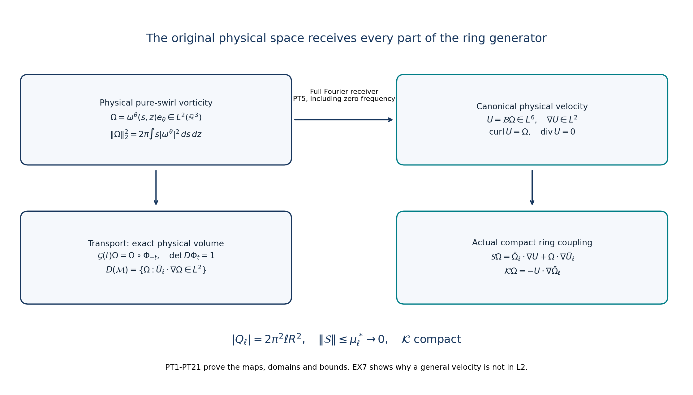
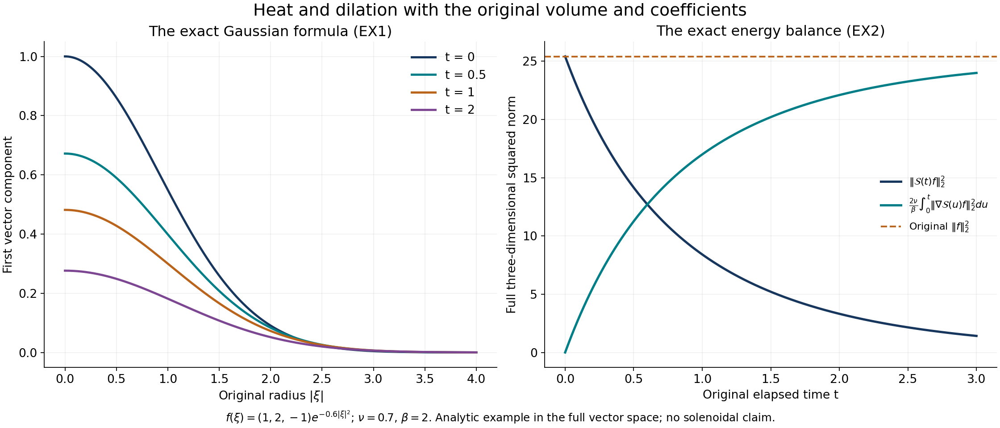

# The physical ring and the full viscous dilation domain

[Lesson32](the-original-ring-kernel-and-its-unstable-spectral-space.md)
constructed an actual unstable Euler ring. To bring that mode into the
viscous problem, we need the original three-dimensional space, the exact
domains of its operators, and the complete heat and dilation evolution.
This lesson proves those foundations with every physical coefficient.

The first part constructs the velocity receiver for arbitrary
square-integrable pure-swirl vorticity. It retains the full cylindrical
volume, proves the small stretching bound and compact coupling, and
receives the already constructed ring eigenmode in the exact transport
domain. A quantitative smooth-input estimate supplies the forcing bound
needed for the next viscous comparison.

The second part derives the full heat-and-dilation semigroup. Its graph
identity and complete cutoff and convolution arguments prove precisely
the required domain: both second derivatives and the original spatial
drift must be square-integrable. Energy, smoothing, symmetry restrictions
and the source's quarter shift are proved with the actual viscosity and
amplitude. Neither parameter is removed by a change of variables.

The human source is Dallas Albritton, Elia Brué and Maria Colombo,
[*Non-uniqueness of Leray solutions of the forced Navier–Stokes equations*,
arXiv:2112.03116v1](https://arxiv.org/abs/2112.03116v1), original
main.tex1633–1880. The source uses viscosity one; substitution of that
value in the formulas below gives its operator. The original ring
coordinate and the velocity amplitude receive explicit corrections,
with complete replacement maps rather than only error reports.

Five solved exercises calculate a full Gaussian, an explicit radius
threshold, the low-frequency velocity obstruction, a field outside the
dilation domain, and the exact velocity-to-curl and pressure map.
This is the foundation for the viscous spectral transfer; the full
perturbed viscous generator and its unstable eigenvalue remain the next
construction. Author self-check only; no independent review or novelty
claim is asserted.

## PT1. Fix the original coordinates, support and physical norm

Keep the actual compact meridian stream function \(\Psi\), radius \(R\geq4\), and radial vorticity \(g_R=\partial_r^2\Psi+\partial_z^2\Psi\) from lessons31–32. They are smooth and supported in the original meridian disk \(B_R\). For \(\ell\geq2R\), put

\[
\begin{gathered}
s=\sqrt{x_1^2+x_2^2},\qquad r=s-\ell,\qquad z=x_3,\qquad \\
Q_\ell=\{x:(s-\ell)^2+z^2<R^2\},\qquad b_\ell=\ell-R>0.
\end{gathered}
\tag{PT1}
\]

The background, in these unchanged physical coordinates, is

\[
\begin{aligned}
\bar U_\ell(x)&=-\Psi_z(s-\ell,z)e_s+
 \left(\Psi_r(s-\ell,z)+\frac{\Psi(s-\ell,z)}s\right)e_z,\\
\bar\Omega_\ell(x)&=\operatorname{curl}\bar U_\ell(x)
=-\left(g_R(s-\ell,z)+\frac{\Psi_r(s-\ell,z)}s
                  -\frac{\Psi(s-\ell,z)}{s^2}\right)e_\theta.
\end{aligned}
\tag{PT2}
\]

Both fields vanish in a neighborhood of the axis and extend smoothly by zero there. The divergence is zero: differentiating the radial component gives \(-\Psi_{rz}-\Psi_z/s\), while differentiating the axial component gives \(\Psi_{rz}+\Psi_z/s\). The curl formula follows by differentiating both displayed velocity terms. Thus neither the curvature correction nor either of its derivatives is suppressed. The source's printed evaluation at main.tex1638 must use the meridian argument \(s-\ell\), as in PT2; evaluating at \(s+\ell\) would not place this background on its stated torus.

Let \(\mathcal H_{\rm aps}\) be the closed subspace of \(L^2(\mathbb R^3;\mathbb C^3)\) consisting of fields \(\Omega=\omega^\theta(s,z)e_\theta\). Its norm and the full containing volume are exactly

\[
\|\Omega\|_2^2=2\pi\int_0^\infty\int_{\mathbb R}s|\omega^\theta(s,z)|^2\,dz\,ds,
\qquad
|Q_\ell|=2\pi\int_{B_R}(\ell+r)\,dr\,dz=2\pi^2\ell R^2.
\tag{PT3}
\]

The last identity retains the integral of \(r\), which is zero by reflection of the full disk. The actual support can be smaller than this containing set. Closure follows from the isometry of the indicated scalar space onto its image. Every such field has distributional divergence zero: against a compact smooth test function the divergence pairing is the integral of \(\omega^\theta\partial_\theta\phi\) over a full angular period, which is zero. Local integrability and Fubini follow from the original three-dimensional \(L^2\) norm. No trace at \(s=0\) is imposed.

## PT2. Prove the complete velocity map on this physical space

We first prove a Sobolev bound with an explicit sufficient constant. If \(h\) is compact and continuously differentiable, the fundamental theorem along each coordinate line gives \(|h(x)|\leq A_i\), where \(A_i\) is the integral of \(|\partial_i h|\) along that line and depends on the other two coordinates. Hence \(|h|^{3/2}\leq(A_1A_2A_3)^{1/2}\). To integrate this product, first apply Cauchy–Schwarz in \(x_1\) to the factors involving \(A_2,A_3\). If \(B(x_3)=\int A_2(x_1,x_3)dx_1\) and \(C(x_2)=\int A_3(x_1,x_2)dx_1\), the remaining integral is at most \(\int A_1(x_2,x_3)^{1/2}B(x_3)^{1/2}C(x_2)^{1/2}dx_2dx_3\). Cauchy–Schwarz in the remaining pair of variables bounds it by \((\int A_1\int B\int C)^{1/2}\). Consequently

\[
\|h\|_{3/2}\leq\prod_{i=1}^3\|\partial_i h\|_1^{1/3},
\qquad
\|v\|_6\leq C_{\rm S}\|\nabla v\|_2,
\qquad C_{\rm S}=\frac4{\sqrt3}.
\tag{PT4}
\]

For the second inequality apply the first to \(h=|v|^4\), including complex vector fields. Its derivatives satisfy \(|\partial_i h|\leq4|v|^3|\partial_i v|\), so Hölder gives \(\|v\|_6^4\leq4\|v\|_6^3\prod_i\|\partial_i v\|_2^{1/3}\). If the left norm is nonzero, divide by its cube; the arithmetic–geometric mean inequality for the three squared derivative norms gives PT4. The zero case satisfies it directly. Cutoff and convolution approximation extend the inequality to every \(H^1\) field. This extension can be checked without assuming an embedding: the compact smooth approximants are Cauchy in \(L^6\) by the proved inequality, and their \(L^2\) limit identifies the same function locally.

Use the Fourier convention \(\widehat f(\eta)=\int e^{-ix\cdot\eta}f(x)dx\), with inverse factor \((2\pi)^{-3}\). For any divergence-free \(\Omega\in L^2\), define

\[
\widehat{\mathcal B\Omega}(\eta)=\frac{i\eta\times\widehat\Omega(\eta)}{|\eta|^2},
\qquad
\|\nabla\mathcal B\Omega\|_2=\|\Omega\|_2,
\qquad
\|\mathcal B\Omega\|_6\leq C_{\rm S}\|\Omega\|_2.
\tag{PT5}
\]

Here is the construction at the origin of Fourier space. Multiply \(\widehat\Omega\) by cutoffs supported in finite annuli and tending to one off zero. Their velocity transforms are in \(H^1\). Plancherel and \(\eta\cdot\widehat\Omega=0\) show that their gradients are Cauchy, with norm identity PT5 in the limit. Inequality PT4 makes the velocities Cauchy in \(L^6\). Their Fourier expressions converge distributionally to the displayed multiplier: locally near zero use Cauchy–Schwarz with \(|\eta|^{-1}\), whose square is integrable in three dimensions; away from zero use the ordinary multiplier bound. This proves PT5 with its precise full domain and codomain. The multiplier calculation gives \(\operatorname{div}\mathcal B\Omega=0\) and \(\operatorname{curl}\mathcal B\Omega=\Omega\).

This is the unique velocity in \(L^6\) with those two properties. The difference of two such fields is distributionally harmonic componentwise. Convolve it with a compact smooth approximate identity. The convolution is smooth, harmonic and in \(L^6\). Its mean-value formula on a ball of radius \(L\), followed by Hölder, bounds its value by \(|B_L|^{-1/6}\) times its full \(L^6\) norm, which tends to zero as \(L\to\infty\). The convolution is therefore zero; convergence of the approximate identity proves uniqueness. The mean-value formula used here follows by differentiating the spherical mean, applying the divergence theorem to its derivative, and using the zero Laplacian.

For all integers \(j\geq0\) for which the right side is finite, the same multiplier gives

\[
\|\nabla^{j+1}\mathcal B\Omega\|_2=\|\nabla^j\Omega\|_2,
\qquad
\|\mathcal B\Omega\|_{L^2(A)}\leq |A|^{1/3}C_{\rm S}\|\Omega\|_2
\quad (|A|<\infty).
\tag{PT6}
\]

The derivative tensors in this identity include every ordered Cartesian derivative, so their squared Fourier norms are exactly \(|\eta|^{2j}\). The second bound is Hölder with exponents three and three-halves applied to \(|\mathcal B\Omega|^2\). Arbitrary \(L^2\) vorticity need not give a global \(L^2\) velocity; PT5–PT6 state the spaces actually proved.

For pure-swirl input, \(U=\mathcal B\Omega\) is axisymmetric with no swirl. To prove this, the multiplier commutes with proper rotations. Under the reflection \(J=\operatorname{diag}(1,-1,1)\), writing \((\mathcal J f)(x)=Jf(Jx)\), the cross product gives \(\mathcal B\mathcal J=-\mathcal J\mathcal B\). A pure-swirl input is rotation-equivariant and satisfies \(\mathcal J\Omega=-\Omega\). Its velocity is rotation-equivariant and satisfies \(\mathcal J U=U\). At angle zero the latter identity makes the second component vanish; rotation gives the assertion at every angle. These identities hold first distributionally from the multiplier and then for the \(L^6\) representative. Thus PT5 is precisely the physical Biot–Savart receiver for the symmetry class used below.

## PT3. Derive both stretching terms and their full smallness bound

For this fixed background define, on \(\mathcal H_{\rm aps}\),

\[
\begin{aligned}
\mathcal M\Omega&=-\bar U_\ell\cdot\nabla\Omega,\\
\mathcal S\Omega&=\bar\Omega_\ell\cdot\nabla U+\Omega\cdot\nabla\bar U_\ell,\\
\mathcal K\Omega&=-U\cdot\nabla\bar\Omega_\ell,
\qquad U=\mathcal B\Omega.
\end{aligned}
\tag{PT7}
\]

Only \(\mathcal M\) requires an unbounded domain. The complete angular differentiation, using \(\partial_\theta e_s=e_\theta\) and \(\partial_\theta e_z=0\), gives

\[
\mathcal S\Omega=
\left(\frac{\bar\Omega_\ell^\theta U^s}s
      +\frac{\omega^\theta\bar U_\ell^s}s\right)e_\theta,
\qquad
\mathcal K\Omega=-\left(U^s\partial_s\bar\Omega_\ell^\theta
                         +U^z\partial_z\bar\Omega_\ell^\theta\right)e_\theta.
\tag{PT8}
\]

In particular both outputs belong to \(\mathcal H_{\rm aps}\) and are supported in \(\overline Q_\ell\). Approximation and PT5–PT6 justify these formulas for every input in that space. Put

\[
A_\ell=\|g_R\|_\infty+\frac{\|\Psi_r\|_\infty}{b_\ell}
                         +\frac{\|\Psi\|_\infty}{b_\ell^2},
\qquad
\mu_\ell^*=\frac{C_{\rm S}(2\pi^2\ell R^2)^{1/3}A_\ell
                         +\|\Psi_z\|_\infty}{b_\ell}.
\tag{PT9}
\]

Hölder, retaining the original three-dimensional measure in all factors, proves

\[
\begin{aligned}
\|\mathcal S\Omega\|_2
&\leq\left\|\frac{\bar\Omega_\ell^\theta}s\right\|_3\|U\|_6
 +\left\|\frac{\bar U_\ell^s}s\right\|_\infty\|\Omega\|_2\\
&\leq\mu_\ell^*\|\Omega\|_2,
\qquad \mu_\ell:=\|\mathcal S\|\leq\mu_\ell^*\longrightarrow0.
\end{aligned}
\tag{PT10}
\]

All background seminorms in PT9 are those of the original fixed meridian construction and are independent of \(\ell\). Since \(b_\ell\geq\ell/2\), its first term has an explicit \(\ell^{-2/3}\) bound and its second has an explicit \(\ell^{-1}\) bound. This is a physical \(L^2\) estimate with the full \(2\pi\) factor. It follows from PT3–PT6 directly and does not import a norm bound from a different weighted space.

## PT4. Prove compactness of the actual coupling

The immediate boundedness estimate is

\[
\|\mathcal K\Omega\|_2\leq
 \|\nabla\bar\Omega_\ell\|_\infty
 (2\pi^2\ell R^2)^{1/3}C_{\rm S}\|\Omega\|_2.
\tag{PT11}
\]

To prove compactness, take a smooth compact cutoff \(\chi\) equal to one near \(\overline Q_\ell\). Formula PT6 and the product rule bound \(\chi\mathcal B\Omega\) in \(H^1\) for every bounded set of inputs. These cut-off velocities have a common bounded support. Here is the needed compactness argument: the Fourier projection onto \(|\eta|\leq N\), acting on fields supported in that fixed bounded set, is compact, because its Fourier kernel is \(e^{-ix\cdot\eta}\) on a product of two finite-volume sets and hence is square-integrable. Approximation of that kernel by finite sums of products proves compactness without any assertion about an infinite-dimensional bounded ball. The complementary Fourier part has norm at most \(N^{-1}\|\nabla(\chi\mathcal B\Omega)\|_2\). Finite-frequency compactness and this uniform vanishing tail give a convergent subsequence in \(L^2\). Multiplication by the smooth bounded tensor \(\nabla\bar\Omega_\ell\) then gives convergence of \(\mathcal K\Omega\). Thus the actual operator in PT7 is compact on \(\mathcal H_{\rm aps}\).

## PT5. Prove the physical transport group and its entire domain

Let \(\Phi_t\) be the flow of \(\bar U_\ell\) on the original \(\mathbb R^3\). The smooth compact field is globally Lipschitz and bounded. Successive approximation on short intervals, followed by iteration, gives a unique complete flow, with inverse \(\Phi_{-t}\). Differentiating its spatial equation gives
\(\partial_t\det D\Phi_t=(\operatorname{div}\bar U_\ell)(\Phi_t)\det D\Phi_t=0\), so its physical Jacobian is exactly one. It preserves the angle because the background has no swirl; trajectories outside its support are stationary, and uniqueness prevents an interior trajectory from crossing a stationary exterior point at finite time.

The resulting group and domain are

\[
\mathcal G(t)\Omega=\Omega\circ\Phi_{-t},\qquad
\|\mathcal G(t)\Omega\|_2=\|\Omega\|_2,\qquad
D(\mathcal M)=\{\Omega\in\mathcal H_{\rm aps}:\bar U_\ell\cdot\nabla\Omega\in L^2\}.
\tag{PT12}
\]

Composition here acts on Cartesian components. Since the angle is unchanged, it preserves the pure-swirl basis as well. Strong continuity follows first for compact smooth fields by the actual flow and then by density and unitarity.

For completeness that density can preserve the symmetry even at the axis. Average the operators \(f(x)\mapsto R^{-1}f(Rx)\) over all rotations about the axis, and then apply \((I-\mathcal J)/2\). The two operations commute, have norm at most one on every Cartesian \(H^m\), preserve smoothness and compact support, and their combined image is exactly the pure-swirl space. Applying them to ordinary compact smooth approximants proves the required density. Invariance of the Sobolev norms follows because each rotation or reflection is orthogonal on both the spatial and vector indices.

If a group difference quotient converges in \(L^2\), pairing it against compact smooth test fields and changing variables by \(\Phi_t\) shows its limit is \(-\bar U_\ell\cdot\nabla\Omega\). Conversely, if this distribution belongs to \(L^2\), differentiate the same test pairing along the flow and integrate in time. It gives the \(L^2\) identity

\[
\mathcal G(t)\Omega-\Omega=\int_0^t\mathcal G(u)\mathcal M\Omega\,du.
\tag{PT13}
\]

To check the differentiated pairing, use \(\bar U_\ell(\Phi_u x)=D\Phi_u(x)\bar U_\ell(x)\), obtained by differentiating the flow's group law, and use the unit Jacobian. All test functions retain compact support over a finite time interval. Dividing PT13 by \(t\) proves the reverse domain inclusion. This proves the entire domain in PT12. Closedness follows by passing to the limit in PT13. Both positive- and negative-time Laplace integrals provide the two half-plane inverses with bound \(|\operatorname{Re}\lambda|^{-1}\); differentiation under the integral and its two endpoints prove both inverse identities. The group is unitary, and differentiation of its inner product identity gives \(\mathcal M^*=-\mathcal M\), with equality of domains obtained from the two inverse ranges.

## PT6. Construct the bounded perturbations on their exact domains

For \(B=\mathcal S\) or \(B=\mathcal S+\mathcal K\), construct the series

\[
V_0(t)=\mathcal G(t),\qquad
V_{n+1}(t)f=\int_0^t\mathcal G(t-u)B V_n(u)f\,du,
\qquad V_B(t)=\sum_{n=0}^\infty V_n(t),\qquad t\geq0.
\tag{PT14}
\]

Iteration bounds \(\|V_n(t)\|\leq\|B\|^nt^n/n!\). Thus the series converges uniformly on bounded time intervals and solves its integral equation. Iterating the difference of two possible solutions gives the same factorial bound with arbitrary order, proving uniqueness. Splitting the integral at a time \(s\) and using that uniqueness proves \(V_B(t+s)=V_B(t)V_B(s)\). The series also proves strong continuity and \(\|V_B(t)\|\leq e^{\|B\|t}\).

To identify its entire generator domain, take real \(\lambda>\|B\|\). Laplace transformation of PT14 gives
\(R_B=(I-R_{\mathcal M}B)^{-1}R_{\mathcal M}\), where all resolvents have argument \(\lambda\). The inverse is the convergent geometric series. If \(x=R_B f\), the equality \(x=R_{\mathcal M}f+R_{\mathcal M}Bx\) proves \(x\in D(\mathcal M)\) and \((\lambda-\mathcal M-B)x=f\). Conversely this equation for \(x\in D(\mathcal M)\) yields that same bounded inverse. The Laplace difference-quotient argument proves that its range is exactly the generator domain of \(V_B\). Consequently

\[
\begin{gathered}
\mathcal N_\infty=\mathcal M+\mathcal S,\qquad
\mathcal E=\mathcal M+\mathcal S+\mathcal K,\qquad
D(\mathcal N_\infty)=D(\mathcal E)=D(\mathcal M),\\
\|e^{t\mathcal N_\infty}\|\leq e^{\mu_\ell t},\qquad
\|R_{\mathcal N_\infty}(\lambda)\|\leq
 \frac1{\operatorname{Re}\lambda-\mu_\ell}\quad
(\operatorname{Re}\lambda>\mu_\ell).
\end{gathered}
\tag{PT15}
\]

For the last bound use the Laplace integral with the proved growth estimate. Its inverse identities follow from the semigroup law and endpoints, just as in PT13. This also proves existence throughout the displayed half-plane, beyond the initially large real parameter. The operators and domains here are in the original physical space throughout.

## PT7. Receive the already constructed unstable ring in this exact domain

Lesson32 gives, for all sufficiently large \(\ell\), a nonzero meridian eigenvorticity \(\omega_\ell\), supported in \(\overline B_R\), with eigenvalue \(\lambda_\ell\) inside a fixed small circle about the actual unstable planar eigenvalue. Write the lower bound for the real part on that circle as \(a_0>0\). Define its physical field by

\[
\Omega_\ell(x)=-\omega_\ell(s-\ell,z)e_\theta.
\tag{PT16}
\]

The full PT3 norm is finite and positive: on this support \(b_\ell\leq s\leq\ell+R\), and the meridian weight equals one. The incoming transport-domain statement says \(V_\ell\cdot\nabla\omega_\ell\in L^2(B_R)\). Multiplying its squared integral by the full bounded weight \(2\pi s\) proves \(\Omega_\ell\in D(\mathcal M)\), with no claim that the mode is smooth.

Its velocity from RK is the same as \(\mathcal B\Omega_\ell\): the former lies in \(H^1\), hence in \(L^6\) by PT4, and has the same divergence and curl, so the uniqueness proved after PT5 applies. Substituting PT2, PT7 and PT8 now gives exactly the full original meridian eigen-equation from RT29. In particular the half-divergence correction introduced for the weighted transport cancels with its explicitly retained partner in that equation. Thus

\[
\mathcal E\Omega_\ell=\lambda_\ell\Omega_\ell,
\qquad \operatorname{Re}\lambda_\ell\geq a_0>0.
\tag{PT17}
\]

Choose \(\ell\) large enough both for this actual incoming construction and for \(\mu_\ell^*<a_0/2\), which is possible by PT9–PT10. Fix that physical \(\ell\) and background henceforth. Then the actual eigenvalue satisfies \(\operatorname{Re}\lambda_\ell>\mu_\ell\); it has not been assumed as an abstract input.

It is isolated with finite algebraic multiplicity in the half-plane \(\operatorname{Re}\lambda>\mu_\ell\). Indeed
\(\lambda-\mathcal E=(\lambda-\mathcal N_\infty)(I-R_{\mathcal N_\infty}(\lambda)\mathcal K)\) on the exact domain PT15. The second factor preserves that domain because its difference from the identity maps the whole space into it. The compact analytic factor has an inverse at real \(\lambda>\mu_\ell+\|\mathcal K\|\). The finite-rank reduction and contour proof in lesson32, section RT6 and equations RT24–RT26, apply to this specified compact operator and half-plane: approximate the compact factor uniformly near a point by finite rank, invert the remaining operator by its norm-convergent geometric series, and reduce the failure of invertibility to a finite-dimensional analytic determinant. Propagating through the connected half-plane from the given inverse excludes an identically zero determinant; zeros are isolated. The resolvent has finite-rank principal part, and the contour projection therefore has finite-dimensional range. These are the exact prerequisites proved there, now checked for PT15. No assertion about a maximizing eigenvalue is required here.

## PT8. Prove the smooth-input estimate needed by the viscous comparison

We need an actual \(L^2\) bound for the dissipative expression along the inviscid \(\mathcal N_\infty\) flow. Write \(\|f\|_{H^m,\Sigma}=\sum_{j=0}^m\|\nabla^j f\|_2\), an explicitly specified equivalent Sobolev norm, with all ordered derivative tensors retained. Cartesian product differentiation in PT7 and the exact PT6 identities give

\[
\begin{gathered}
\|\mathcal Sf\|_{H^m,\Sigma}\leq C_m\|f\|_{H^m,\Sigma},\\
C_m=\sum_{j=0}^m\sum_{a=0}^j\binom ja
 \left(\|\nabla^a\bar\Omega_\ell\|_\infty
       +\|\nabla^{a+1}\bar U_\ell\|_\infty\right),
\qquad m\in\{0,1,2,\ldots\}.
\end{gathered}
\tag{PT18}
\]

Each product in \(\nabla^j(\bar\Omega_\ell\cdot\nabla\mathcal Bf)\) is bounded by \(\binom ja\|\nabla^a\bar\Omega_\ell\|_\infty\|\nabla^{j-a+1}\mathcal Bf\|_2\); PT6 identifies the latter norm with \(\|\nabla^{j-a}f\|_2\). The second product has \(\nabla^{a+1}\bar U_\ell\) and \(\nabla^{j-a}f\). Summing gives exactly the sufficient constant displayed. Approximation by the symmetry-preserving compact smooth sequence from PT5 proves the estimate for every input in the indicated Sobolev space.

Let \(L=\|D\bar U_\ell\|_\infty\) and \(B_2=\|D^2\bar U_\ell\|_\infty\), using Euclidean tensor norms. Differentiating the flow equation and using its integral form gives \(\|D\Phi_{-t}\|_\infty\leq e^{Lt}\) and \(\|D^2\Phi_{-t}\|_\infty\leq B_2te^{2Lt}\) for \(t\geq0\). For the second bound, its inhomogeneous term is at most \(B_2e^{2Ls}\), and propagation from \(s\) to \(t\) costs at most \(e^{L(t-s)}\); integrate and bound the resulting integral by \(te^{2Lt}\). The full Cartesian chain rule and the unit Jacobian then give, for \(0\leq t\leq T\),

\[
\|\mathcal G(t)f\|_{H^2,\Sigma}\leq P_2(T)\|f\|_{H^2,\Sigma},
\qquad
P_2(T)=1+e^{LT}+e^{2LT}(1+B_2T).
\tag{PT19}
\]

The three original terms are the unchanged \(L^2\) norm, the first derivative multiplied by \(D\Phi\), and the two second-derivative contributions \((D^2f)(D\Phi,D\Phi)\) and \((Df)D^2\Phi\). Thus PT19 accounts for every derivative of the actual flow. Applying the series PT14 with the bounded \(H^2\) operator from PT18 now yields

\[
\|e^{t\mathcal N_\infty}f\|_{H^2,\Sigma}
\leq P_2(T)e^{P_2(T)C_2t}\|f\|_{H^2,\Sigma},
\qquad 0\leq t\leq T.
\tag{PT20}
\]

The series converges in this Sobolev norm and agrees with the \(L^2\) solution by uniqueness. It is continuous in \(H^2\), since composition by the smooth volume-preserving flow is continuous first on compact smooth functions and then by PT19 and density.

If \(f\) is compactly supported, choose a physical radius \(J>\ell+R\) that also contains its support. The flow fixes every point outside \(B_J\), and \(\mathcal S\) always has support in \(\overline Q_\ell\). Every summand of PT14 is therefore supported in \(\overline B_J\); so is the limit. With the original viscosity \(\nu>0\), this proves the quantitative bound

\[
\begin{aligned}
\mathcal D_\nu&=\nu\Delta+\tfrac12 x\cdot\nabla+\tfrac34,\\
\sup_{0\leq t\leq T}\|\mathcal D_\nu e^{t\mathcal N_\infty}f\|_2
&\leq\left(\nu+\frac J2+\frac34\right)
 P_2(T)e^{P_2(T)C_2T}\|f\|_{H^2,\Sigma}.
\end{aligned}
\tag{PT21}
\]

For the diffusion term use the exact Cartesian Fourier identity \(\|\Delta v\|_2=\|\nabla^2v\|_2\); the drift term costs \(J\|\nabla v\|_2/2\), and the last term costs \(3\|v\|_2/4\). The support and \(H^2\) continuity also prove continuity of this whole expression in \(L^2\) as time varies. This supplies the stronger smooth-input forcing bound needed for an order \(\beta^{-1}\) inviscid comparison. That rate itself requires construction of the viscous perturbed semigroup and will be proved only after that construction; an \(H^{-1}\) energy estimate by itself does not establish it.

## VD1. Keep the exact operator and full physical space

On \(\mathcal H=L^2(\mathbb R^3;\mathbb C^3)\), with the original Lebesgue volume, define

\[
\mathcal A f=\frac12\xi\cdot\nabla_\xi f+\frac34f,
\qquad
\mathcal D_\nu f=\nu\Delta f+\mathcal A f,
\qquad
\mathcal G_{\nu,\beta}=\frac1\beta\mathcal D_\nu,
\quad \nu>0,\quad\beta>0.
\tag{VD1}
\]

The proposed domain, which will be proved to be the full generator domain, is

\[
\mathcal X=\{f\in H^2(\mathbb R^3;\mathbb C^3):\xi\cdot\nabla f\in L^2(\mathbb R^3;\mathbb C^3)\}.
\tag{VD2}
\]

All derivatives are distributional. The separate conditions in VD2 retain both the diffusion and dilation contributions. They will not be replaced by the weaker-looking condition that their sum alone belongs to \(L^2\).

For compact smooth fields, integration by parts gives

\[
\operatorname{Re}\langle\xi\cdot\nabla f,f\rangle=-\frac32\|f\|_2^2,
\qquad\operatorname{Re}\langle\mathcal Af,f\rangle=0,
\qquad\operatorname{Re}\langle\mathcal D_\nu f,f\rangle=-\nu\|\nabla f\|_2^2.
\tag{VD3}
\]

Indeed integrate \(\xi\cdot\nabla|f|^2\), retaining \(\operatorname{div}\xi=3\). The resulting \(-3/4\) contribution in the real inner product cancels precisely the displayed \(+3/4\); both terms remain explicit in VD1. This establishes dissipativity in the original volume.

## VD2. Derive the whole heat-and-dilation semigroup

For the actual elapsed time \(t\geq0\), set

\[
\kappa_t=e^{t/(2\beta)},\qquad q_t=\nu(e^{t/\beta}-1),\qquad
\mathcal S_{\nu,\beta}(t)f(\xi)
=e^{3t/(4\beta)}(e^{q_t\Delta}f)(\kappa_t\xi).
\tag{VD4}
\]

For \(q>0\), the heat operator in this formula is the full physical convolution

\[
(e^{q\Delta}f)(x)=(4\pi q)^{-3/2}\int_{\mathbb R^3}
\exp\left(-\frac{|x-y|^2}{4q}\right)f(y)\,dy.
\tag{VD5}
\]

At \(q=0\) it is the identity. Thus no spatial coordinate, time variable or original amplitude is replaced by a new working object: VD4 is an explicit operator on the original \(\xi\)-space.

For a compact smooth input differentiate all factors. The prefactor gives \(3/(4\beta)\), the spatial argument gives \(\xi\cdot\nabla/(2\beta)\), and \(q_t'=\nu e^{t/\beta}/\beta=\nu\kappa_t^2/\beta\) gives exactly \(\nu\Delta_\xi/\beta\). Hence the derivative at every positive time, and at zero on such an input, is \(\mathcal G_{\nu,\beta}\mathcal S_{\nu,\beta}(t)f\).

The exact heat scaling identity is
\(e^{q\Delta}[g(\kappa\cdot)](x)=(e^{q\kappa^2\Delta}g)(\kappa x)\), proved by substituting \(y\mapsto\kappa y\) in VD5 and retaining its factor \(\kappa^{-3}\). Together with
\(q_{t+u}=q_u+\kappa_u^2q_t\), it proves the semigroup law in VD4. For its norm, change variables \(x=\kappa_t\xi\) and retain both volume and amplitude:

\[
\|\mathcal S_{\nu,\beta}(t)f\|_2^2
=e^{3t/(2\beta)}\kappa_t^{-3}\|e^{q_t\Delta}f\|_2^2
=\|e^{q_t\Delta}f\|_2^2\leq\|f\|_2^2.
\tag{VD6}
\]

The final inequality follows from the heat multiplier \(e^{-q_t|\eta|^2}\), with the unchanged Plancherel convention. Strong continuity on compact smooth inputs follows from the Gaussian approximate identity and ordinary dilation continuity; density and VD6 extend it to all of \(\mathcal H\).

With \(\widehat f(\eta)=\int e^{-i\xi\cdot\eta}f(\xi)d\xi\) and inverse prefactor \((2\pi)^{-3}\), the exact Fourier formula is

\[
\widehat{\mathcal S_{\nu,\beta}(t)f}(\eta)
=e^{-3t/(4\beta)}
e^{-\nu(1-e^{-t/\beta})|\eta|^2}
\widehat f(e^{-t/(2\beta)}\eta).
\tag{VD7}
\]

This follows from the same physical volume change; the heat argument and amplitude are both retained. In particular there is no loss of the original coefficient \(\nu\).

## VD3. Prove a graph estimate that separates both original contributions

For compact smooth fields, the commutator is
\([\Delta,\mathcal A]=\Delta\). Since \(\Delta\) is symmetric and \(\mathcal A\) is skew-symmetric on that class, integration by parts gives

\[
2\operatorname{Re}\langle\Delta f,\mathcal Af\rangle
=\langle f,[\Delta,\mathcal A]f\rangle=-\|\nabla f\|_2^2.
\]

Consequently the full squared norm is

\[
\|\mathcal D_\nu f\|_2^2
=\nu^2\|\Delta f\|_2^2+\|\mathcal Af\|_2^2-\nu\|\nabla f\|_2^2.
\tag{VD8}
\]

Every sign in the cross term matters. The Fourier inequality
\(\nu|\eta|^2\leq\nu^2|\eta|^4/2+1/2\) proves

\[
\frac{\nu^2}{2}\|\Delta f\|_2^2+\|\mathcal Af\|_2^2
\leq\|\mathcal D_\nu f\|_2^2+\frac12\|f\|_2^2,
\qquad
\|\xi\cdot\nabla f\|_2\leq2\|\mathcal Af\|_2+\frac32\|f\|_2.
\tag{VD9}
\]

These retain the complete drift coefficient and give control of each term of VD2. The Fourier identity \(\sum_{i,j}\|\partial_i\partial_jf\|_2^2=\|\Delta f\|_2^2\), along with the first-derivative interpolation above, controls the complete \(H^2\) norm. Thus the full graph norm is equivalent to \(\|f\|_{H^2}+\|\xi\cdot\nabla f\|_2\), with constants depending on the actual fixed \(\nu\), which has not been absorbed.

## VD4. Prove that compact smooth fields are a core for the full domain

Take a fixed smooth cutoff \(\chi\), equal to one on the unit ball and zero outside the ball of radius two, and put \(\chi_R(\xi)=\chi(\xi/R)\). For \(f\in\mathcal X\), the complete cutoff commutator is

\[
\mathcal D_\nu(\chi_Rf)-\chi_R\mathcal D_\nu f
=2\nu\nabla\chi_R\cdot\nabla f+\nu(\Delta\chi_R)f
+\frac12(\xi\cdot\nabla\chi_R)f.
\tag{VD10}
\]

The first two terms have the original \(R^{-1}\) and \(R^{-2}\) derivative factors. The last coefficient is bounded uniformly in \(R\) and supported in the escaping annulus; its product tends to zero in \(L^2\) by the full tail of \(f\). The same product rules for first and second derivatives show \(\chi_Rf\to f\) in \(H^2\). Directly, \(\xi\cdot\nabla(\chi_Rf)=\chi_R\xi\cdot\nabla f+(\xi\cdot\nabla\chi_R)f\) converges to the original drift in \(L^2\). Thus cutoff convergence holds in the complete domain norm, not only locally.

Mollify a compactly supported member with a smooth compact approximate identity \(\eta_\epsilon\). Diffusion commutes with convolution. The full dilation commutator is

\[
\xi\cdot\nabla(f*\eta_\epsilon)
-(\xi\cdot\nabla f)*\eta_\epsilon
=f*(3\eta_\epsilon+y\cdot\nabla\eta_\epsilon).
\tag{VD11}
\]

To verify it, integrate \((\xi_j-y_j)\partial_jf(y)\eta_\epsilon(\xi-y)\) by parts in \(y_j\) and sum over all three coordinates. The kernel on the right has integral zero, since \(\int y\cdot\nabla\eta_\epsilon=-3\). Its \(L^1\) norm is bounded independently of \(\epsilon\) and its support shrinks to zero. Therefore its convolution tends to zero in \(L^2\): write it as the integral of \(f(\cdot-y)-f\) against that kernel and use translation continuity and its bounded norm. All other terms converge by the approximate identity. The approximants are compact and smooth and converge in the full VD2 norm.

Let \(\overline{\mathcal D_\nu}\) denote the closure from compact smooth fields. The approximation proves \(\mathcal X\subset D(\overline{\mathcal D_\nu})\). Conversely, a Cauchy sequence in the initial graph norm is Cauchy in \(H^2\) and in the drift norm by VD9. The distributional limit identifies both derivatives and lies in \(\mathcal X\). Thus

\[
D(\overline{\mathcal D_\nu})=\mathcal X,
\qquad\overline{\mathcal D_\nu}f=\nu\Delta f+\tfrac12\xi\cdot\nabla f+\tfrac34f.
\tag{VD12}
\]

This proves closedness and extends VD3, VD8 and VD9 to the entire domain by graph approximation.

## VD5. Identify the semigroup generator and both inverse identities

Let \(G\) be the generator defined by the strong difference quotient of the contraction semigroup VD4. It is closed: the exact identity \(\mathcal S(t)f-f=\int_0^t\mathcal S(u)Gf\,du\) for generator inputs passes to the limit whenever \(f_n\to f\) and \(Gf_n\to g\); dividing the resulting identity by \(t\) and using strong continuity gives \(Gf=g\). It contains \(\beta^{-1}\mathcal D_\nu\) on compact smooth fields by the actual derivative calculation, and therefore contains its closed extension on \(\mathcal X\). To prove equality, first construct the resolvent and its domain explicitly. For \(\operatorname{Re}\lambda>0\), put

\[
R_{\nu,\beta}(\lambda)f=\int_0^\infty e^{-\lambda t}\mathcal S_{\nu,\beta}(t)f\,dt,
\qquad\|R_{\nu,\beta}(\lambda)\|\leq(\operatorname{Re}\lambda)^{-1}.
\tag{VD13}
\]

For compact smooth \(f\), restrict the integral to \([\epsilon,T]\). Every field \(\mathcal S(t)f\) there is rapidly decreasing with all derivatives, by the full Gaussian formula, so that restricted integral belongs to \(\mathcal X\). Differentiating in time gives the complete identity

\[
\left(\lambda-\frac1\beta\mathcal D_\nu\right)
\int_\epsilon^T e^{-\lambda t}\mathcal S(t)f\,dt
=e^{-\lambda\epsilon}\mathcal S(\epsilon)f-e^{-\lambda T}\mathcal S(T)f.
\tag{VD14}
\]

As \(\epsilon\downarrow0\) and \(T\to\infty\), the integrals converge in \(L^2\), and the right side converges to \(f\). Hence their \(\mathcal D_\nu\) images converge to \(\beta(\lambda Rf-f)\); the closedness in VD12 proves \(Rf\in\mathcal X\) with that image. Approximate any \(f\in\mathcal H\) by compact smooth inputs; VD13 and the same image identity give convergence in the graph norm, so the statement holds for every input. Thus VD13 is a right inverse of \(\lambda-\beta^{-1}\mathcal D_\nu\) onto its full domain. Dissipativity VD3 proves injectivity, since a vector in its nullspace would satisfy \(\operatorname{Re}\lambda\|f\|^2+\nu\|\nabla f\|^2/\beta=0\). It follows that this is a two-sided inverse.

The Laplace integral is also the two-sided inverse of \(\lambda-G\). For the right inverse compute the difference quotient after translating the integral in time, using the semigroup law and its two endpoints. For a domain input, integrate the derivative of \(e^{-\lambda t}\mathcal S(t)f\) to get the other identity; its infinite endpoint vanishes by contraction. These computations give \(GRf=\lambda Rf-f\) and \(R(\lambda-G)f=f\). Since both inverses have the same range, their domains agree. Therefore

\[
G=\mathcal G_{\nu,\beta},\qquad D(G)=\mathcal X.
\tag{VD15}
\]

In particular the source's separate \(H^2\) and original dilation conditions are established as the entire generator domain, not assumed from a formal differential expression.

The exact energy identity is, for every \(f\in\mathcal H\),

\[
\|\mathcal S_{\nu,\beta}(t)f\|_2^2
+\frac{2\nu}{\beta}\int_0^t\|\nabla\mathcal S_{\nu,\beta}(u)f\|_2^2\,du
=\|f\|_2^2.
\tag{VD16}
\]

For compact smooth inputs this follows from VD3 and time differentiation. For general inputs it also follows directly from VD6 and the heat Fourier identity, using \(q_u'=\nu e^{u/\beta}/\beta\) and
\(\|\nabla\mathcal S(u)f\|_2^2=e^{u/\beta}\|\nabla e^{q_u\Delta}f\|_2^2\). Changing variables from \(u\) to \(q_u\) in the nonnegative integral proves VD16 by Tonelli, retaining both endpoint norms. No initial differentiability is required.

## VD6. Prove the exact smoothing estimates with the source prefactor

The original heat Fourier multiplier obeys
\(\sup_{\eta}|\eta|e^{-q|\eta|^2}=(2eq)^{-1/2}\), by differentiating the scalar function of \(|\eta|\). Formula VD4 therefore gives

\[
\|\nabla\mathcal S_{\nu,\beta}(t)f\|_2
\leq\frac{\|f\|_2}{\sqrt{2e\nu(1-e^{-t/\beta})}},\qquad t>0.
\tag{VD17}
\]

For a square-integrable matrix field \(F\), with divergence in its first spatial index, the exact commutation rule is
\(\mathcal S(t)\operatorname{div}F=\kappa_t^{-1}\operatorname{div}\mathcal S(t)F\), with the operator applied componentwise. This follows by differentiating the original dilated argument, or from VD7. The divergence multiplier has norm at most \(|\eta|\) relative to the full matrix norm. Consequently

\[
\|\mathcal S_{\nu,\beta}(t)\operatorname{div}F\|_2
\leq\frac{\|F\|_2}{\sqrt{2e\nu(e^{t/\beta}-1)}}
\leq\sqrt{\frac\beta{2e\nu t}}\,\|F\|_2.
\tag{VD18}
\]

This is a map from all \(L^2\) matrix fields, defined by the bounded multiplier even when their distributional divergence is not itself in \(L^2\). The difference between the two denominators in VD17 and VD18 is the exact dilation factor, not a convention to suppress. These estimates provide the integrable time singularity needed for the original compact background transport perturbation.

## VD7. Preserve the physical symmetry spaces and the source quarter shift

Let \(\mathcal H_{\rm aps}\) be the closed subspace of axisymmetric pure-swirl fields \(f=f^\theta(s,z)e_\theta\) in the original three-dimensional \(L^2\) space. It is closed because its scalar norm is exactly \(2\pi\int_0^\infty\int_{\mathbb R}s|f^\theta|^2\,dz\,ds\), and the corresponding scalar-to-vector map is an isometry onto that subspace. Such fields are distributionally divergence-free by full angular integration, as in RK2, without imposing an axis trace.

Both heat and dilation preserve this subspace. Dilation keeps the original angle and rescales the actual positive radius and axial coordinate. For heat, evaluate at \((s,0,z)\). The azimuthal input is proportional to \((-\sin\vartheta,\cos\vartheta,0)\), while its scalar Gaussian kernel depends on the angle only through \(\cos\vartheta\). The radial sine integral vanishes and the axial component is zero, leaving only the azimuthal direction. Rotation recovers this at every angle. First perform the calculation for compact smooth meridian inputs away from the axis; their density in the full weighted scalar norm and heat contraction extend it to every field in the subspace.

Thus VD4 and VD13 restrict to \(\mathcal H_{\rm aps}\), with precisely

\[
D(\mathcal G_{\nu,\beta}|_{\mathcal H_{\rm aps}})
=\mathcal X\cap\mathcal H_{\rm aps}.
\tag{VD19}
\]

Indeed convergence of a difference quotient in the closed subspace is equivalent to its convergence in the ambient space for an input in that subspace; the limit remains there. This proves the exact restricted domain. Similarly VD7 preserves the full divergence-free space \(\mathcal H_\sigma\), since \(\eta\cdot\widehat f(e^{-t/(2\beta)}\eta)=0\) whenever the original Fourier input is orthogonal to its own argument. No axisymmetric restriction is needed for that statement.

For any smooth compact divergence-free original background \(\bar U\), write the complete Euler vorticity expression as
\(\mathcal E\Omega=-[\bar U,\Omega]-[\mathrm{BS}_{3d}\Omega,\bar\Omega]\), where \([V,W]=V\cdot\nabla W-W\cdot\nabla V\) and \(\bar\Omega=\operatorname{curl}\bar U\). This line defines the original differential expression; the closed perturbed domain and its spectrum are not claimed by this definition. The source self-similar vorticity expression, with the original amplitude and viscosity, is exactly

\[
\mathcal L_{\rm vor}^{(\beta,\nu)}\Omega
=\nu\Delta\Omega+\frac12\xi\cdot\nabla\Omega+\Omega+\beta\mathcal E\Omega
=\mathcal D_\nu\Omega+\beta\mathcal E\Omega+\frac14\Omega.
\tag{VD20}
\]

The equality retains \(1=3/4+1/4\) as two explicit contributions. Thus the source auxiliary expression \(\mathcal T_{\beta,\nu}=\beta^{-1}\mathcal D_\nu+\mathcal E\) satisfies

\[
\mathcal L_{\rm vor}^{(\beta,\nu)}=\beta\mathcal T_{\beta,\nu}+\frac14I,
\tag{VD21}
\]

on any common domain where the complete displayed operations are defined. The original source case is obtained by substituting \(\nu=1\), not by changing the physical variables. PT1–PT21 have supplied the physical background coupling, stretching bounds and inviscid domain. The next work must prove the full perturbed viscous domain and resolvent convergence, and transfer the actual ring eigenvalue. It must also prove the complete velocity/curl map with its amplitude prefactor and the original pressure. Equations VD20–VD21 alone are algebraic identities and do not assert that unfinished spectral result.

## Two pictures of the physical operators and exact evolution

PT1–PT21 prove every map, norm and domain in this diagram. In particular,
the velocity belongs to the displayed physical spaces for every input,
and the full torus volume enters the stretching estimate. The existing
[ring geometry in lesson31](compact-vortices-and-the-full-weighted-euler-generator.md)
shows the original compact meridian disk and its three-dimensional torus.
The [reproducible diagram source](../assets/original-physical-flow-and-dilation.py)
is included. Human comparison: Albritton–Brué–Colombo, original
main.tex1633–1716, with the coordinate correction proved in PT1–PT2.

VD4–VD16 and Exercise1 prove these exact analytic formulas. The original
example is \(f(\xi)=(1,2,-1)e^{-0.6|\xi|^2}\), with
\(\nu=0.7\) and \(\beta=2\). The left panel shows its first component;
the right panel retains the full three-dimensional squared norm and
dissipated energy. This example uses the full vector space and makes no
divergence-free assertion. The [figure source](../assets/original-physical-flow-and-dilation.py)
and [parameter values](../assets/original-heat-dilation-data.json) are
included. These are evaluations of proved formulas, not a computed
spectrum. Human comparison: the original dissipative operator at
main.tex1655 and energy calculation1819, with the full proof here.

## Five solved exercises

### Exercise 1. Follow an original Gaussian through the whole semigroup

Take the full vector-space input \(f(\xi)=b e^{-a|\xi|^2}\), where \(a>0\) and \(b\in\mathbb C^3\) is retained with its actual amplitude. Keep \(\nu>0\) and \(\beta>0\). Calculate the solution, its squared norm, and the exact dissipated energy.

**Solution.** Complete the square in each coordinate of the full Gaussian convolution VD5. With the unchanged \(q_t=\nu(e^{t/\beta}-1)\) and \(\kappa_t=e^{t/(2\beta)}\), the integral in each coordinate contributes \((1+4aq_t)^{-1/2}\). Thus

\[
\mathcal S_{\nu,\beta}(t)f(\xi)=
b e^{3t/(4\beta)}(1+4aq_t)^{-3/2}
\exp\left(-\frac{a\kappa_t^2|\xi|^2}{1+4aq_t}\right).
\tag{EX1}
\]

The exact squared norm and gradient norm are

\[
\begin{aligned}
N(t)&=|b|^2\left(\frac\pi{2a}\right)^{3/2}(1+4aq_t)^{-3/2},\\
\|\nabla\mathcal S(t)f\|_2^2
&=\frac{3a\kappa_t^2}{1+4aq_t}N(t),\\
N(t)+\frac{2\nu}\beta\int_0^t\|\nabla\mathcal S(u)f\|_2^2du&=N(0).
\end{aligned}
\tag{EX2}
\]

For the second line, differentiating the Gaussian multiplies it by \(-2a\kappa_t^2\xi/(1+4aq_t)\). The Gaussian second moment is \(3(1+4aq_t)/(4a\kappa_t^2)\) times its squared norm. Multiplying proves the formula. Differentiating the first line and using \(q_t'=\nu\kappa_t^2/\beta\) gives the last line, including both endpoints. This example is in the full vector space of VD1; it does not assert that this Gaussian is divergence-free or pure-swirl.

### Exercise 2. Choose an actual ring radius for a prescribed stretching margin

Given \(\varepsilon>0\), give a sufficient explicit radius threshold using the original meridian seminorms that guarantees \(\|\mathcal S\|<\varepsilon\). Keep the full torus volume.

**Solution.** For \(\ell\geq2R\), set

\[
A_* =\|g_R\|_\infty+R^{-1}\|\Psi_r\|_\infty+R^{-2}\|\Psi\|_\infty,
\qquad H=\|\Psi_z\|_\infty.
\tag{EX3}
\]

Since \(b_\ell\geq R\) and \(b_\ell\geq\ell/2\), PT9 gives the full bound

\[
\mu_\ell\leq2C_{\rm S}(2\pi^2R^2)^{1/3}A_*\ell^{-2/3}
                      +2H\ell^{-1}.
\tag{EX4}
\]

The first term is strictly below \(\varepsilon/2\) and the second is at most \(\varepsilon/2\) whenever

\[
\ell>
\max\left\{2R,
 \left(\frac{4C_{\rm S}(2\pi^2R^2)^{1/3}A_*}{\varepsilon}\right)^{3/2},
 \frac{4H}{\varepsilon}\right\}.
\tag{EX5}
\]

If either coefficient vanishes, its corresponding term is zero and the other strict threshold suffices. If both vanish, the operator is zero by PT10. To receive the actual unstable ring, impose in addition the finite radius threshold already constructed in lesson32 and take \(\varepsilon=a_0/2\). This proves the needed common choice without changing the original background or its positive spectral margin.

### Exercise 3. Show why the physical velocity receiver has an \(L^6\) codomain

Construct a real pure-swirl \(L^2\) vorticity whose canonical velocity does not belong to \(L^2\). Calculate its vorticity norm with the original Fourier prefactor.

**Solution.** Let \(e_3=(0,0,1)\) and specify

\[
\widehat\Omega(\eta)=
 i\,\frac{\eta\times e_3}{|\eta|^2}\,\mathbf1_{0<|\eta|<1},
\qquad
\widehat U(\eta)=
 \frac{e_3-\eta\eta_3/|\eta|^2}{|\eta|^2}\,
 \mathbf1_{0<|\eta|<1}.
\tag{EX6}
\]

The first transform is imaginary and odd, giving a real inverse transform; it is orthogonal to \(\eta\). It is also the transform of \(\nabla\phi\times e_3\), where \(\widehat\phi=|\eta|^{-2}\mathbf1_{0<|\eta|<1}\). The latter is an integrable radial function, so its inverse is radial and has every classical derivative, obtained by multiplying its compact Fourier support by powers of \(\eta\). Its gradient crossed with \(e_3\) is pure-swirl. This verifies the symmetry directly in physical coordinates.

Writing \(\vartheta\) for the polar angle from \(e_3\), the angular integral of \(\sin^2\vartheta\) on the unit sphere is \(8\pi/3\): integrate \(2\pi\sin^3\vartheta\) from zero to \(\pi\). Therefore

\[
\|\Omega\|_2^2=(2\pi)^{-3}\frac{8\pi}{3}\int_0^1d\rho
=\frac1{3\pi^2},
\qquad
(2\pi)^{-3}\int|\widehat U|^2d\eta
=(2\pi)^{-3}\frac{8\pi}{3}\int_0^1\rho^{-2}d\rho=+\infty.
\tag{EX7}
\]

The cross-product multiplier PT5 applied to the first expression in EX6 gives exactly the second, including its sign. PT5 proves that its canonical inverse nevertheless belongs to \(L^6\) with square-integrable gradient. If it belonged to \(L^2\), Plancherel would identify its distributional Fourier transform with an \(L^2\) function, contradicting EX7. Thus the general physical receiver must use the precise codomain PT5; extra low-frequency information is needed for a global \(L^2\) velocity.

### Exercise 4. Exhibit the separate dilation requirement in the generator domain

Find an \(H^2(\mathbb R^3)\) field outside the domain \(\mathcal X\) of VD2. Keep the original diffusion and unbounded spatial drift.

**Solution.** Choose a nonzero smooth scalar \(\phi\) supported in the unit ball with \(\partial_1\phi\ne0\), and a fixed unit vector \(v\). Put

\[
a_n=2^{3n}e_1,\qquad
f(x)=\sum_{n=1}^\infty2^{-n}\phi(x-a_n)v.
\tag{EX8}
\]

The supports are disjoint and locally finite. For each derivative of order at most two its squared norm is the corresponding squared norm of \(\phi\) multiplied by \(\sum_{n\geq1}4^{-n}=1/3\). Hence \(f\in H^2\) and \(\nu\Delta f\in L^2\) for every actual \(\nu>0\). On the \(n\)-th support write \(y=x-a_n\); then the exact drift is

\[
x\cdot\nabla f(x)=2^{-n}
 \left(2^{3n}\partial_1\phi(y)+y\cdot\nabla\phi(y)\right)v.
\tag{EX9}
\]

Let \(c=\|\partial_1\phi\|_2>0\) and \(d=\|y\cdot\nabla\phi\|_2\). For all sufficiently large \(n\), its norm on that support is at least \(2^{-n}(2^{3n}c-d)\geq(c/2)2^{2n}\). The sum of their squared norms diverges. Thus \(x\cdot\nabla f\notin L^2\) and \(f\notin\mathcal X\). In this example diffusion and the zeroth-order term are already in \(L^2\), so they cannot cancel the nonintegrable drift. VD8–VD15 prove the more general exact-domain statement, including cases where that direct observation alone would not identify the domain.

### Exercise 5. Retain the amplitude in the exact velocity-to-curl map

For a smooth compact divergence-free test velocity \(u\), let \(\Omega=\operatorname{curl}u\). Derive the full velocity expression whose curl is VD20, with the actual background amplitude \(\beta\), and identify the pressure. This exercise concerns an exact test-field identity; it does not presume a viscous eigenvector or its eventual velocity domain.

**Solution.** The canonical receiver of \(\Omega\) is \(u\): it is an \(L^6\) velocity with the prescribed curl and divergence, so PT5 uniqueness applies. Define

\[
B(u)=\bar U_\ell\cdot\nabla u+u\cdot\nabla\bar U_\ell,
\qquad
\mathcal L_{\rm vel}^{(\beta,\nu)}u
=\nu\Delta u+\frac12u+\frac12x\cdot\nabla u-\beta\mathbb P B(u).
\tag{EX10}
\]

The Leray map is the full original Fourier multiplier \(\mathbb P(\eta)=I-\eta\otimes\eta/|\eta|^2\) from lesson2. Both products in \(B(u)\) are smooth and compact. The vector identity, proved by expanding the Levi-Civita symbols, is

\[
B(u)=\nabla(\bar U_\ell\cdot u)-\bar U_\ell\times\Omega-u\times\bar\Omega_\ell.
\tag{EX11}
\]

In detail the \(i\)-th component of \((V\times\operatorname{curl}W)\) is \(V_j\partial_iW_j-V_j\partial_jW_i\). Applying it to both products cancels the two derivatives of the scalar product and proves EX11. All four fields whose cross products occur are divergence-free, so expansion of the curl of each cross product gives

\[
\operatorname{curl}B(u)=[\bar U_\ell,\Omega]+[u,\bar\Omega_\ell],
\quad [V,W]=V\cdot\nabla W-W\cdot\nabla V,
\quad
\operatorname{curl}(x\cdot\nabla u)=\Omega+x\cdot\nabla\Omega.
\tag{EX12}
\]

The last extra \(\Omega\) is the derivative falling on the original coordinate \(x\); it cannot be discarded. Curl commutes with diffusion and removes the gradient part of the Leray map. Therefore, retaining both halves of the dilation contribution,

\[
\begin{aligned}
\operatorname{curl}\mathcal L_{\rm vel}^{(\beta,\nu)}u
&=\nu\Delta\Omega+\frac12\Omega
 +\frac12(\Omega+x\cdot\nabla\Omega)
 -\beta\bigl([\bar U_\ell,\Omega]+[u,\bar\Omega_\ell]\bigr)\\
&=\mathcal L_{\rm vor}^{(\beta,\nu)}\Omega.
\end{aligned}
\tag{EX13}
\]

The pressure gradient is supplied by

\[
\pi=-\beta\Delta^{-1}\operatorname{div}B(u),\qquad
\widehat\pi(\eta)=\beta\frac{i\eta\cdot\widehat{B(u)}(\eta)}{|\eta|^2},
\qquad -\beta\mathbb PB(u)=-\beta B(u)-\nabla\pi.
\tag{EX14}
\]

The pressure transform is locally integrable at zero because \(B(u)\) is integrable, and grows at most polynomially at infinity; thus it defines a distribution without suppressing the low-frequency contribution. Its gradient is in \(L^2\) by the bounded Fourier projection. Direct multiplication gives \(\Delta\pi=-\beta\operatorname{div}B(u)\) and the last identity. Pressure remains determined up to an additive constant, which does not enter that gradient. This proves the exact correction to the omitted amplitude in original main.tex1741: the same \(\beta\) as in its vorticity operator1647 must multiply the velocity interaction. If it is omitted, the curl identity has the explicit defect \((\beta-1)([\bar U_\ell,\Omega]+[u,\bar\Omega_\ell])\).

## Continue to the complete viscous spectral transfer

The actual Euler ring now lies in the original physical transport domain,
and its stretching norm has an explicit small bound. The heat and
dilation generator has its entire domain, exact semigroup and all needed
smoothing estimates. The smooth inviscid input has a quantitative bound
for the complete dissipative expression. The velocity-to-curl identity
also retains the original amplitude and pressure.

Next construct the sum of diffusion, dilation, transport and stretching
on its full domain. Use that construction to prove resolvent convergence,
transfer the actual unstable spectral space, and receive the viscous
eigenmode in the full velocity domain. The nonlinear forced Leray
construction and later Alpöge–Buckmaster, OpenAI and workbench lessons
remain part of the assigned series.
