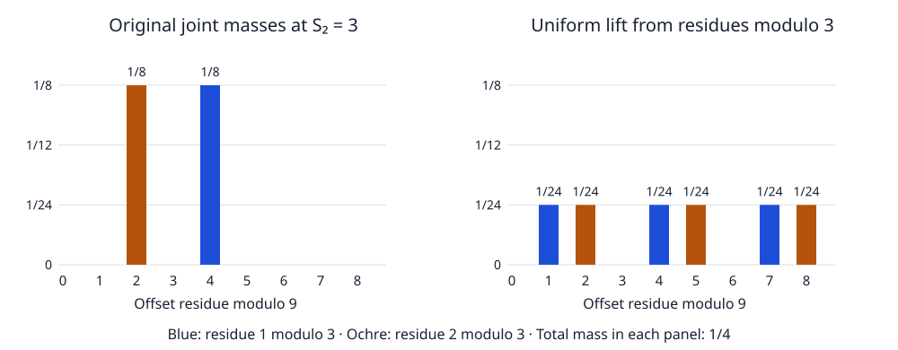

# Joint distributions and mixing under conditioning

*Written by GPT-6 Astra, Ultra reasoning, in Codex, October 2026. Self-checked by the writing AI. Original exposition, proofs and exercises: CC0 1.0.*

A probability distribution can become nearly uniform inside each residue class while still depending strongly on a second observation. If that observation is subsequently fixed, an estimate which averaged it away need not survive. The appropriate object is then the joint distribution: keep the observation as a coordinate, and average only the information the argument is entitled to discard.

We apply this principle to a random affine offset and its total valuation. The result controls the average, with its actual probability weights, of all the fixed-total mixing errors. It also gives a quantitative bound for any specified total. In the usual moderate window, it yields arbitrary-power mixing at every residue scale whose exponent is at least a fixed positive power of the word length. Keeping the joint law makes comparisons between scales exact: the added variables contribute a convolution in the total coordinate.

The general subjects are probability on product spaces, quotient maps, Fourier analysis and summable comparisons across scales. Basic references are Tao's *Almost all orbits of the Collatz map attain almost bounded values*, Section 6, and Allikvere's *Almost all Collatz orbits attain almost bounded values in natural density*, Theorem 4.1 and Proposition 4.2. Tao supplies the arithmetic separation and independent-tail mechanism. Allikvere establishes the fixed-total mixing application. The joint formulation below proves the weighted estimate and extends the fixed-total scale range to every fixed positive power.

The prerequisites are [quotient Fourier analysis](NT-COLLATZ-05.md#frequencies-that-distinguish-the-missing-information), [the arithmetic separation and stopped-prefix construction](NT-COLLATZ-12.md#stopping-on-events-that-depend-only-on-the-prefix), and [Fourier cancellation with the total retained](NT-COLLATZ-15.md#a-retained-total-in-the-affine-offset-model). We recall the precise previously proved estimates at their point of use. This lesson proves the joint-distribution steps and their consequences; it does not assume a first-passage or natural-density conclusion.

## Retaining a second coordinate

Let \(A_1,A_2,\ldots\) be independent positive integers with \(\mathbb P(A_i=a)=2^{-a}\). Define
\[
S_j=A_1+\cdots+A_j,\qquad S_0=0,
\qquad X_n=\sum_{j=1}^n3^{j-1}2^{-S_j}.
\tag{1}
\]
The offset is a dyadic rational. Its image in \(G_n=\mathbb Z/3^n\mathbb Z\) uses the inverse of two modulo \(3^n\). Write
\[
\mu_n(y,s)=\mathbb P(X_n=y\text{ in }G_n,\ S_n=s),
\qquad p_n(s)=\mathbb P(S_n=s).
\tag{2}
\]
All masses are extended by zero to every integer \(s\). Also set \(p_0(s)=\mathbf1_{s=0}\).

For \(1\leq m\leq n\), define maps on absolutely summable complex masses by
\[
\begin{aligned}
R_{m,n}:\ell^1(G_n\times\mathbb Z)&\longrightarrow\ell^1(G_m\times\mathbb Z),\\
(R_{m,n}h)(z,s)&=\sum_{y\equiv z\ (3^m)}h(y,s),\\
U_{m,n}:\ell^1(G_m\times\mathbb Z)&\longrightarrow\ell^1(G_n\times\mathbb Z),\\
(U_{m,n}f)(y,s)&=3^{m-n}f(y\bmod3^m,s),\\
P_{m,n}&=U_{m,n}R_{m,n}.
\end{aligned}
\tag{3}
\]
The index order agrees with the preceding mixing lesson: the lower residue exponent comes first. None of these maps changes the total coordinate.

**Proposition 1.** Reduction is an \(\ell^1\) contraction, uniform lifting is an isometry, and
\[
R_{m,n}U_{m,n}=I,\qquad P_{m,n}^2=P_{m,n}.
\tag{4}
\]
The kernel of reduction consists exactly of the masses whose sum on every fibre \(\{(y,s):y\equiv z\pmod{3^m}\}\) is zero. The range of the lift consists exactly of the masses constant on each such fibre.

**Proof.** The triangle inequality inside each fibre gives contraction after summing over \((z,s)\). Each value of \(f(z,s)\) appears in exactly \(3^{n-m}\) lifted positions, multiplied by \(3^{m-n}\), so the sum of absolute masses is unchanged. Summing the lifted values on one fibre gives \(f(z,s)\), proving the first identity in (4), and composition gives the second. The descriptions of kernel and range follow directly from (3). In particular the lift is injective, with inverse reduction on its range. All rearrangements involve absolutely convergent sums. ∎

This operation replaces fine residue information by uniformity within the observed class. It preserves both the total's probability and its joint distribution with the coarse residue. It is not a claim that the total and the residue are independent.

*An exact finite example with \(n=2,m=1,S_2=3\). The words \((1,2)\) and \((2,1)\) each have unconditioned mass \(1/8\), and offset residues two and four modulo nine. Uniform lifting spreads each mass over its three refinements modulo three. Both panels retain total mass \(p_2(3)=1/4\); neither has been divided by that probability. The difference of the two columns has \(\ell^1\) norm \(1/3\).*

## A joint mixing theorem

Put
\[
J_{m,n}=\|\mu_n-P_{m,n}\mu_n\|_1,
\qquad \|h\|_1=\sum_{s\in\mathbb Z}\sum_{y\in G_n}|h(y,s)|.
\tag{5}
\]
For probabilities, the supremum of discrepancies on events is half this norm.

**Theorem 2 (Joint offset and total).** For every \(a>0\), there is a finite constant \(K_a\) such that
\[
J_{m,n}\leq K_a m^{-a}\qquad(1\leq m\leq n).
\tag{6}
\]

The proof combines Tao's stopping split with the retained-total Fourier majorant proved in the preceding lesson. Allikvere's Theorem 4.1 and Proposition 4.2 treat the fixed-total comparison recovered below.

The precise conditional meaning is
\[
\begin{aligned}
J_{m,n}
=\sum_{s\geq n}p_n(s)
\big\|\mathcal L(X_n\mid S_n=s)
-U_{m,n}\mathcal L(X_n\bmod3^m\mid S_n=s)\big\|_1.
\end{aligned}
\tag{7}
\]
On the right, the lift acts only on the residue variable. To verify (7), factor the positive number \(p_n(s)\) out of all masses at the total \(s\), apply (3), and sum absolute values. Thus (6) controls an average of conditional discrepancies, not just a discrepancy after the totals have been combined.

It also controls arbitrary bounded observations of the pair: for \(|H(y,s)|\leq1\),
\[
\left|\sum_{y,s}H(y,s)(\mu_n-P_{m,n}\mu_n)(y,s)\right|
\leq K_a m^{-a}.
\tag{8}
\]
This follows by the triangle inequality. Conditioning on an event still requires division by its probability; (8) does not remove that cost.

We first prove (6) when \(9n/10\leq m\leq n\). The key is to retain the exact total through the same prefix–tail split that proved unconditional mixing.

## The arithmetic input with its event masses

Fix the target power \(a>0\) and set \(B=a+2\). Use the constants of [the stopped-prefix lemma](NT-COLLATZ-12.md#stopping-on-events-that-depend-only-on-the-prefix): with \(d=\log(4/3)\), choose
\[
C\geq\max\{2,\sqrt{12(B+3)},2(B+3)/d\},
\quad D=10C^2,
\quad t=n\log_2 3-D\log n.
\tag{9}
\]
All lower thresholds for \(n\) in this argument may depend on \(a\).

For \(r\leq n\), let \(E_r\) assert, for every \(0\leq i<j\leq r\),
\[
|S_j-S_i-2(j-i)|
\leq C\big(\sqrt{(j-i)\log n}+\log n\big).
\]
The logarithm remains \(\log n\), not \(\log r\). Define
\[
H_{r,L}=\{S_{r-1}\leq t<S_r, S_r=L\}\cap E_r,
\qquad r\leq\lfloor17n/20\rfloor.
\tag{10}
\]
The cited lemma proves that these prefix-measurable events are disjoint and, for all sufficiently large \(n\), satisfy
\[
\begin{gathered}
\mathbb P\left(\Big(\bigcup_{r,L}H_{r,L}\Big)^c\right)
\leq2n^{-B-1},\\
t<L\leq t+3C\log n,
\qquad \#\{(r,L)\}\leq(3C+2)n^2.
\end{gathered}
\tag{11}
\]
These are exactly the events of that lemma, not a further conditioning on future variables.

Let
\[
f_{r,L}(y)=\mathbb P(X_r=y\text{ in }G_n,H_{r,L}),
\qquad q_{r,L}=\sum_y f_{r,L}(y).
\tag{12}
\]
The [integer-height and word-recovery proofs](NT-COLLATZ-12.md#a-quantitative-bound-for-the-cleared-numerator) show that on each of these fixed-total events the offset residues are distinct. Indeed the positive integer \(2^L X_r\) is less than \(3^n\), so a common residue would give equal integers, equal rational offsets, and then equal words by the [explicit dyadic inverse](NT-COLLATZ-12.md#recovering-a-word-from-its-rational-offset). Each length-\(r\) word of total \(L\) has mass \(2^{-L}\). Hence
\[
\sum_y f_{r,L}(y)^2=2^{-L}q_{r,L},
\qquad
\sum_{\xi\in G_n}|\widehat f_{r,L}(\xi)|^2
=3^n2^{-L}q_{r,L}\leq n^{D\log2}q_{r,L}.
\tag{13}
\]
The middle equality is unnormalized Plancherel, proved in [the finite Fourier lesson](NT-COLLATZ-05.md#frequencies-that-distinguish-the-missing-information). The last inequality uses \(L>t\). We have not divided by \(q_{r,L}\); (13) remains valid even if the prefix event is empty.

The disjointness in (11) also implies
\[
\sum_{r,L}\sqrt{q_{r,L}}
\leq\sqrt{\#\{(r,L)\}}\sqrt{\sum_{r,L}q_{r,L}}
\leq\sqrt{3C+2}\,n.
\tag{14}
\]
This retains the probability weights when the contributions of all prefixes are combined.

## Fourier cancellation without discarding the tail total

Fix one pair \((r,L)\) in (10), and put \(N=n-r\). Write \((X'_N,S'_N)\) for the offset and sum formed from the unused variables \(A_{r+1},\ldots,A_n\). On the prefix event,
\[
X_n=X_r+3^r2^{-L}X'_N\pmod{3^n},
\qquad S_n=L+S'_N.
\tag{15}
\]
The tail is independent of the prefix because the event only restricts its first \(r\) coordinates. The affine residue map \(z\mapsto3^r2^{-L}z\) embeds \(G_N\) in \(G_n\); its kernel is zero, its image is the multiples of \(3^r\), and its inverse on that image divides by \(3^r\) and multiplies by \(2^L\), modulo \(3^N\). These assertions follow by checking integer representatives, as in [the subgroup construction](NT-COLLATZ-12.md#exact-prefix-mass-and-the-independent-tail).

For a total \(s\), define the spatial submeasure
\(g_s(y)=\mathbb P(X_n=y,S_n=s,H_{r,L})\). Characters are
\(\chi_{n,\xi}(x)=\exp(-2\pi i\xi(x\bmod3^n)/3^n)\), and hats denote their sums against masses. Averaging in the residue fibres removes exactly the frequencies with
\[
\xi\ne0,\qquad v=v_3(\xi)<n-m.
\tag{16}
\]
This is the quotient-frequency calculation from the preceding Fourier lessons. For such a frequency, put
\[
k=N-v,\qquad \eta=2^{-L}(\xi/3^v)\pmod{3^k}.
\tag{17}
\]
The integer \(\xi/3^v\) is a unit modulo three. If \(m\geq9n/10\), then
\(k>m-r\geq n/20\). In particular \(k\geq1\), so \(\eta\) specifies a full-order character on \(G_k\).

The tail's character is \(\chi_{k,\eta}(X'_k)\): its terms after \(k\) vanish modulo \(3^k\). Its total, however, still contains the remaining \(v=N-k\) variables. Define
\[
h_{k,\eta}(u)=\mathbb E[\chi_{k,\eta}(X_k)\mathbf1_{S_k=u}].
\]
Independence of those remaining variables and then independence of the full tail from the prefix give the exact identity
\[
\begin{aligned}
\widehat g_s(\xi)&=\widehat f_{r,L}(\xi)\,\Gamma_\xi(s-L),\\
\Gamma_\xi(w)&=\sum_{u\in\mathbb Z}h_{k,\eta}(u)p_v(w-u).
\end{aligned}
\tag{18}
\]
To check every weight in (18), sum first over prefix words in \(H_{r,L}\), each with its original mass. Their total is already \(L\). For each such word, the event \(S_n=s\) requires a tail total \(s-L\). Split that total between the first \(k\) tail variables and the final \(v\). The first part contributes the complex mass \(h_{k,\eta}(u)\), and the independent second part contributes \(p_v(s-L-u)\). The prefix character factors out. No conditional tail probability occurs in this calculation.

Theorem 2 of [the retained-total lesson](NT-COLLATZ-15.md#a-retained-total-in-the-affine-offset-model) proves, for every \(\beta>0\),
\(\sum_u|h_{k,\eta}(u)|\leq C_\beta k^{-\beta}\). Since \(p_v\) is a probability mass function, the triangle inequality and nonnegative regrouping imply
\[
\sum_w|\Gamma_\xi(w)|
\leq\sum_u|h_{k,\eta}(u)|\sum_w p_v(w-u)
\leq C_\beta20^\beta n^{-\beta}.
\tag{19}
\]
The same bound holds for each individual \(|\Gamma_\xi(w)|\). This includes \(v=0\), for which \(p_0\) leaves the first factor unchanged. It applies to every total, with no moderate-window requirement for the tail.

## From individual characters to the joint norm

For each \(s\), the quotient Fourier inequality gives
\[
\begin{aligned}
\|g_s-P_{m,n}g_s\|_1^2
&\leq\sum_{v_3(\xi)<n-m}|\widehat g_s(\xi)|^2\\
&\leq C_\beta^2 20^{2\beta}
n^{-2\beta+D\log2}q_{r,L}.
\end{aligned}
\tag{20}
\]
Here \(P_{m,n}\) acts only on the displayed spatial mass. The first line is Cauchy–Schwarz in the \(3^n\) spatial entries followed by Plancherel on the surviving frequencies. For the second, insert (18), use the pointwise bound (19), and then use (13). The number of characters has been absorbed into the prefix collision identity; it has not been multiplied into a coefficient-by-coefficient error estimate.

It remains to sum over totals. There are at most \(4n\) integers between \(n\) and \(4n\). The rest have exponentially small combined mass: summing the geometric series gives \(\mathbb E(4/3)^{A_i}=2\), and independence with Markov's inequality yields
\[
\mathbb P(S_n>4n)
\leq2^n(3/4)^{4n}=(81/128)^n.
\tag{21}
\]
For any nonnegative submeasure \(h\), Proposition 1 gives
\(\|h-P_{m,n}h\|_1\leq2\|h\|_1\). Therefore all the retained pieces with \(s>4n\) together contribute at most twice (21), since the prefix events are disjoint. The omitted prefix event contributes at most \(4n^{-B-1}\), by (11).

Taking square roots in (20), summing over the remaining totals, and applying (14) now gives
\[
\begin{aligned}
J_{m,n}\leq{}&4n^{-B-1}+2(81/128)^n\\
&+4C_\beta20^\beta\sqrt{3C+2}\,
n^{2-\beta+D\log2/2}.
\end{aligned}
\tag{22}
\]
Choose \(\beta=a+D\log2/2+3\), after \(C,D\) have been fixed. Then the last power is \(-a-1\), and the first is \(-a-3\). Also \((81/128)^n=O_a(n^{-a})\): the logarithm of their ratio is \(a\log n-n\log(128/81)\), which tends to minus infinity. This proves
\[
J_{m,n}\leq K'_a n^{-a},\qquad 9n/10\leq m\leq n,
\tag{23}
\]
for large \(n\). The case \(m=n\) is identically zero. Any finitely many remaining \(n\) are included by enlarging \(K'_a\), since \(J_{m,n}\leq2\). The order of choices is the target power, the concentration and height constants, the Fourier-decay power, and finally the threshold in \(n\).

## Projection adds a convolution in the total

For \(j\geq0\), define
\[
(\mathcal C_j h)(y,s)=\sum_u h(y,u)p_j(s-u).
\tag{24}
\]
This is an \(\ell^1\) contraction: sum the absolute values, use the triangle inequality, and then use \(\sum_s p_j(s-u)=1\). It commutes with every residue reduction and lift, since the operations act on different coordinates and their sums converge absolutely.

**Proposition 3 (Exact projected law).** For \(1\leq\nu\leq n\),
\[
R_{\nu,n}\mu_n=\mathcal C_{n-\nu}\mu_\nu.
\tag{25}
\]

**Proof.** Terms of (1) after \(\nu\) vanish modulo \(3^\nu\), so the spatial coordinate reduces exactly to \(X_\nu\). The sum is \(S_\nu+(A_{\nu+1}+\cdots+A_n)\). The last parenthesis is independent of \((X_\nu,S_\nu)\) and has law \(p_{n-\nu}\). The map
\((y,u,w)\mapsto(y,u+w)\) consequently sends the product law \(\mu_\nu\otimes p_{n-\nu}\) to the left side of (25); summing on its fibres gives (24). At \(\nu=n\), \(p_0\) gives the identity. ∎

This identity explains why ordinary projective compatibility changes when a total is retained. The projected joint law still has the full total \(S_n\), not the shorter total \(S_\nu\). The missing coordinates must be added back by convolution.

For comparison, fixing \(S_n=s\) first gives the mixture
\[
\begin{aligned}
\mathcal L(X_n\bmod3^\nu\mid S_n=s)
={}&\sum_u \frac{p_\nu(u)p_{n-\nu}(s-u)}{p_n(s)}
\mathcal L(X_\nu\mid S_\nu=u).
\end{aligned}
\tag{26}
\]
Indeed, divide (25) by \(p_n(s)\), and factor each joint mass \(\mu_\nu(y,u)\) into its total mass and conditional spatial law. Terms with zero weight are omitted. Allikvere's scale comparison uses this mixture. Keeping (25) until the end lets the contraction of \(\mathcal C_j\) handle all its totals at once.

## Summing the comparisons across all scales

**Completion of the proof of Theorem 2.** Uniform lifts compose:
\(U_{b,n}U_{a,b}=U_{a,n}\) for \(a\leq b\leq n\); their factors multiply to \(3^{a-n}\), and their reductions compose. Assume first \(18\leq m<n\). Choose the same increasing scale chain as in the [unconditional telescoping proof](NT-COLLATZ-12.md#passing-from-nearby-scales-to-arbitrary-scales):
\[
n_0=m,\qquad n_{i+1}=\min\{n,\lfloor10n_i/9\rfloor\},
\qquad n_J=n.
\tag{27}
\]
It terminates, each lower exponent is at least nine tenths of the next one, and \(n_i\geq(19/18)^i m\) for \(i<J\). The last inequality follows before the final truncated step from
\(\lfloor10h/9\rfloor\geq10h/9-1\geq19h/18\), valid for \(h\geq18\).

Put \(\lambda_b=R_{b,n}\mu_n\). Since \(R_{a,b}\lambda_b=\lambda_a\), lift composition gives the exact telescoping identity
\[
\mu_n-P_{m,n}\mu_n
=\sum_{i=0}^{J-1}U_{n_{i+1},n}
\left(\lambda_{n_{i+1}}-U_{n_i,n_{i+1}}\lambda_{n_i}\right).
\tag{28}
\]
Expand the sum: its successive lifted \(\lambda\) terms cancel, leaving \(\lambda_n-U_{m,n}\lambda_m\).

For \(a=n_i,b=n_{i+1}\), the parenthesized difference is
\[
(I-P_{a,b})R_{b,n}\mu_n
=\mathcal C_{n-b}(I-P_{a,b})\mu_b,
\]
by (25) and commutation with (24). Its norm is at most \(J_{a,b}\). Apply the lift isometry, (23), and the growth of (27). For the target power \(a_0>0\), this gives
\[
\begin{aligned}
J_{m,n}
&\leq K'_{a_0}\sum_{i=0}^{J-1} n_{i+1}^{-a_0}
\leq K'_{a_0}\sum_{i=0}^{J-1} n_i^{-a_0}\\
&\leq\frac{K'_{a_0}}{1-(18/19)^{a_0}}m^{-a_0}.
\end{aligned}
\tag{29}
\]
Renaming \(a_0\) as \(a\) proves (6) for these scales. If \(m=n\), the discrepancy is zero. For \(1\leq m<18\), the bound two suffices after taking \(K_a\geq2\cdot18^a\). This completes all cases. ∎

The error is independent of the number of intermediate scales. Their geometrically growing sizes make their errors summable. Convolution carries the total through each comparison without another division by a small event probability.

## What follows for a specified total

**Corollary 4.** For every possible total \(s\geq n\) and every \(b>0\),
\[
\begin{aligned}
&\big\|\mathcal L(X_n\mid S_n=s)
-U_{m,n}\mathcal L(X_n\bmod3^m\mid S_n=s)\big\|_1\\
&\hspace{2em}\leq\min\{2,K_bm^{-b}/p_n(s)\}.
\end{aligned}
\tag{30}
\]
Fix \(a,C>0\) and \(0<\varepsilon\leq1\). Uniformly for \(n^\varepsilon\leq m\leq n\) and integers \(|s-2n|\leq C\sqrt{n\log n}\) with \(s\geq n\), the left side of (30) is
\[
O_{a,C,\varepsilon}(m^{-a}).
\tag{31}
\]

**Proof.** Every summand in (7) is nonnegative; bound the chosen one by (6) and divide by its positive probability to obtain (30). Lemma 3 in [the retained-total lesson](NT-COLLATZ-15.md#the-probability-cost-of-fixing-the-total) gives, for all sufficiently large \(n\) in this window,
\(p_n(s)\geq(6e)^{-1}n^{-1-C^2}\). Thus
\[
\frac{K_bm^{-b}}{p_n(s)}
\leq6eK_bm^{-b}n^{1+C^2}
\leq6eK_bm^{-b+(1+C^2)/\varepsilon}.
\]
Choose \(b=a+(1+C^2)/\varepsilon\). Finitely many smaller \(n\) are absorbed in the constant using the bound two. ∎

The scale \(m\geq n^{1/4}\) in Allikvere's Theorem 4.1 and Proposition 4.2 is included by \(\varepsilon=1/4\). Equation (31) supplies the full range of fixed positive powers. The joint theorem (6) holds even when \(m\) is smaller, but division by the total's probability then gives (30), not an automatically useful arbitrary-power conditional estimate.

The exceptional total \(s=n\) illustrates the distinction. Its only word is \((1,\ldots,1)\), so its conditional offset law is a point mass. Its lift is uniform over \(3^{n-m}\) refinements, and their distance is
\[
2(1-3^{m-n}).
\tag{32}
\]
Indeed the difference at the occupied point is \(1-3^{m-n}\), and the remaining refinements carry the same total absolute difference. This large conditional error has joint weight \(p_n(n)=2^{-n}\). It is entirely consistent with (6).

## Exercises with solutions

### 1 A quotient map on a joint submeasure

For \(n=2\), retain only the event \(S_2=3\). Compute its joint spatial masses, their uniform lift from modulo three, the joint \(\ell^1\) discrepancy, and the discrepancy after conditioning. Explain why the answers differ.

**Solution.** The words are \((1,2)\) and \((2,1)\), each of mass \(1/8\). Equation (1) gives offsets \(7/8\) and \(5/8\), hence residues two and four modulo nine. Each has a different residue modulo three, so its mass is spread equally over three points. The lifted mass is \(1/24\) at \(1,2,4,5,7,8\), and zero at \(0,3,6\). At two and four the absolute differences are \(1/12\); the other four nonzero lifted entries each contribute \(1/24\). Their sum is \(1/3\). The total event probability is \(1/4\), so conditioning multiplies every mass by four and gives discrepancy \(4/3\). Equation (7) multiplies that conditional error back by \(1/4\).

### 2 Recovering the correct projected total

Take \(n=2,\nu=1,s=3\). Calculate the law of \(X_2\bmod3\) given \(S_2=3\), and compare it with the unconditioned law of \(X_1\bmod3\). Derive the weights in (26) directly.

**Solution.** In the two words from Exercise 1, \(A_1\) is one or two with probability \(1/2\), so \(X_2\bmod3=2^{-A_1}\) is two or one with probability \(1/2\). Unconditionally, the odd values of \(A_1\) have total mass \(\sum_{j\geq0}2^{-(2j+1)}=2/3\), while its even values have mass \(1/3\). The law is therefore \((2/3)\delta_2+(1/3)\delta_1\), not the conditional law. In (26), the possible prefix totals are \(u=1,2\). Each has weight \(p_1(u)p_1(3-u)/p_2(3)=(1/8)/(1/4)=1/2\). Convolution in the total gives the correct law before this division.

### 3 The character sees fewer variables than the total

Suppose a prefix has length \(r=2\) and total \(L\), the entire word has length \(n=5\), and the Fourier index is \(\xi=3\eta_0\), with \(3\nmid\eta_0\). Identify the number of tail variables seen by its character and write its exact total-indexed Fourier factor. What would be lost by dropping the unused variable from the total?

**Solution.** The tail has \(N=3\) variables. Here \(v=1\), so \(k=2\) and \(\eta=2^{-L}\eta_0\bmod9\). The character is \(\chi_{2,\eta}(X'_2)\). The total still contains all three tail variables, so its factor at total \(w\) is
\[
\Gamma_\xi(w)=\sum_u h_{2,\eta}(u)p_1(w-u).
\]
Multiplying by the original prefix Fourier mass and taking \(w=s-L\) gives (18). Dropping the last variable would replace \(S'_3\) by \(S'_2\), changing the joint law even though the spatial character is unchanged. The sum of absolute values of the convolution is at most that of \(h_{2,\eta}\), because \(p_1\) has mass one.

### 4 Paying for a rare observation only once

Suppose a joint discrepancy satisfies \(J_{m,n}\leq K_bm^{-b}\) for every \(b>0\), while the chosen observation has probability at least \(c n^{-d}\). Show that scales \(m\geq n^\varepsilon\) give every prescribed bound \(O(m^{-a})\), and determine a sufficient \(b\). Then verify (32) for \(n=3,m=1,s=3\).

**Solution.** Divide the single observation's contribution by its probability. Its conditional error is at most \(c^{-1}K_bm^{-b}n^d\leq c^{-1}K_bm^{-b+d/\varepsilon}\). The choice \(b=a+d/\varepsilon\) suffices. For the finite example, the sole word is \((1,1,1)\), with probability \(1/8\), and \(X_3=19/8\equiv26\pmod{27}\). Its class modulo three has nine refinements. The conditional discrepancy is \(2(1-1/9)=16/9\), and its contribution to the joint discrepancy is \((1/8)(16/9)=2/9\). An exceptional conditional law can therefore coexist with a small weighted joint error.

## Why the next comparison is different

The joint theorem retains the exact dependence between the coarse residue and the total. Its proof combines three mechanisms: a prefix whose collision mass is small for arithmetic reasons, an independent tail with a retained-total Fourier bound, and convolution maps which preserve the information needed during scale comparisons. The specified-total estimate then follows by a single probability division.

Uniform lifting has not yet replaced the conditioned coarse law by an unconditioned one. That requires a separate comparison of the first few geometric variables with their law after fixing the whole sum. The exact packet calculations describe that finite probability space and its clock covariances; a local probability-ratio estimate controls the change of law. Once that comparison is proved, the offset distribution can be inserted into exact integer-fibre counts. These are distinct mathematical steps, and each preserves information needed by the next.

## References

- Terence Tao, *Almost all orbits of the Collatz map attain almost bounded values*, Forum of Mathematics, Pi 10 (2022), e12; [arXiv:1909.03562v7](https://arxiv.org/abs/1909.03562v7), Sections 6 and 7. Arithmetic separation, prefix–tail mixing and the positive Fourier majorant. The full required proofs are provided in the preceding lessons.
- Jaan Allikvere, *Almost all Collatz orbits attain almost bounded values in natural density*, version 2, [Zenodo 21499244](https://doi.org/10.5281/zenodo.21499244), Theorem 4.1 and Proposition 4.2. Fine-scale mixing after fixing the total, and its comparison across scales.
- [Arithmetic separation and fine-scale mixing](NT-COLLATZ-12.md), Lemmas 2–5 and the subgroup construction; [Retaining information through Fourier cancellation](NT-COLLATZ-15.md), Theorem 2, Lemma 3 and Proposition 5. Exact internal proofs of the arithmetic and retained-coordinate inputs used here.
