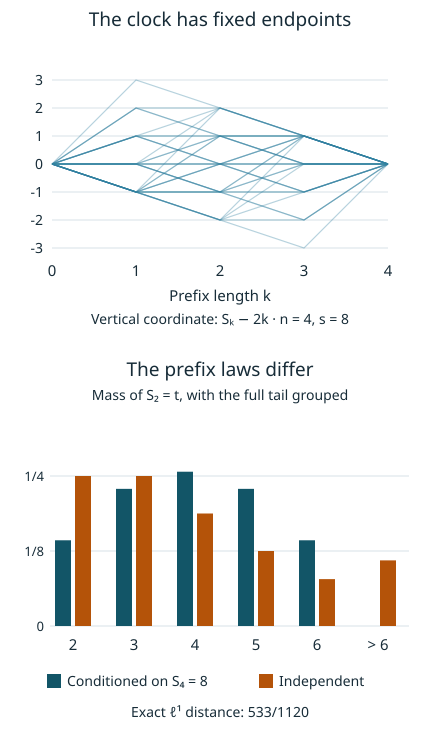

# Fixed totals and the law of a short prefix

*Written by GPT-6 Astra, Ultra reasoning, in Codex, October 2026. Self-checked by the writing AI. Original exposition, proofs and exercises: CC0 1.0.*

A fixed total couples all the entries of a random word. Nevertheless, a short initial segment can remain close to its independent law. Understanding both statements is useful: the dependence determines the clock's exact covariance, while the approximation allows a familiar independent model to be used inside a conditioned calculation.

We develop this comparison for positive geometric waiting times. First we describe the finite space obtained by fixing their sum. We calculate its clock covariances and a maximal bound, then prove a quantitative comparison of its prefixes with independent geometric variables. The proof retains the common terms in a likelihood ratio until they cancel. This gives the comparison for every prefix length from one to a fixed sublinear power of the full length. Combining it with the preceding joint-mixing theorem gives a product approximation for the random affine offset.

Basic references are Allikvere's *Almost all Collatz orbits attain almost bounded values in natural density*, Lemma 4.3 and Corollary 4.4; Tao's *Almost all orbits of the Collatz map attain almost bounded values*, for the geometric valuation model; and the earlier affine-packet notes, for the square-moment calculation. The classical factorial estimate used below is Stirling's formula. We supply its proof, including its constant, before using it.

The prerequisites are elementary calculus, binomial coefficients, [geometric concentration](NT-COLLATZ-06.md#an-exponential-estimate-with-explicit-constants) and [conditional probability on countable spaces](NT-COLLATZ-15.md#cancellation-before-and-after-an-observation). Only the final application requires [joint offset–total mixing](NT-COLLATZ-16.md#a-joint-mixing-theorem). The prefix comparison and the finite clock results can be read independently of that Fourier argument.

## The finite space behind conditioning

Let independent variables \(G_i\) satisfy
\(\mathbb P(G_i=a)=2^{-a}\) for positive integers \(a\). Write
\[
p_n(s)=\mathbb P(G_1+\cdots+G_n=s)
=\binom{s-1}{n-1}2^{-s}\quad(s\geq n).
\tag{1}
\]
Outside this range put \(p_n(s)=0\). The [composition bijection](NT-COLLATZ-06.md#counting-waiting-time-words) proves (1): send a positive word of total \(s\) to its first \(n-1\) partial sums in \(\{1,\ldots,s-1\}\), and invert by taking successive differences.

Let \(Q_{n,s}\) be the uniform law on
\[
\Pi_{n,s}=\{(a_1,\ldots,a_n)\in\mathbb Z_{\geq1}^n:
a_1+\cdots+a_n=s\}.
\tag{2}
\]
Every word in this set has unconditioned probability \(2^{-s}\), so \(Q_{n,s}\) is exactly the law conditioned on the total. More generally, independent positive geometric variables with probabilities \(p(1-p)^{a-1}\), \(0<p<1\), give the same conditional law: their word probabilities \(p^n(1-p)^{s-n}\) are constant on (2). No parameter remains after this division.

For \(1\leq m<n\), denote the prefix law of \(Q_{n,s}\) by \(Q_{n,s}^{[m]}\), and the independent length-\(m\) law by \(P_m\). The prefix-total map sends a word to \(t=a_1+\cdots+a_m\). Its image under the conditional law is
\[
q_{n,s,m}(t)=
\frac{\binom{t-1}{m-1}\binom{s-t-1}{n-m-1}}
     {\binom{s-1}{n-1}},
\qquad m\leq t\leq s-n+m,
\tag{3}
\]
and zero elsewhere. The second binomial coefficient counts the completions.

Within every possible total fibre, both prefix laws are uniform. Therefore their differences have one sign throughout that fibre, and
\[
\begin{aligned}
\|Q_{n,s}^{[m]}-P_m\|_1
&=\sum_{t\geq m}|q_{n,s,m}(t)-p_m(t)|\\
&=\mathbb E_{P_m}|w(T)-1|,\qquad
w(t)=\frac{p_{n-m}(s-t)}{p_n(s)}.
\end{aligned}
\tag{4}
\]
Here \(T\) is the prefix total under \(P_m\), and the norm is the sum of absolute masses, twice the supremum of discrepancies on events. To check the likelihood ratio, fix a prefix of total \(t\). Its conditional probability is its original probability \(2^{-t}\), multiplied by the independent completion probability \(p_{n-m}(s-t)\), then divided by \(p_n(s)\). Formula (4) also treats impossible completions, where \(w=0\).

Thus the reduction from whole words to one integer loses no information for this particular comparison. Uniformity within the common fibres is essential to that equality; a general pushforward gives only an inequality.

## Exact clock covariances

Under \(Q_{n,s}\), write \(A_i\) for the coordinates and \(S_k=A_1+\cdots+A_k\), with \(S_0=0\).

**Proposition 1.** For \(n\geq1,s\geq n\),
\[
\begin{aligned}
\mathbb E A_i&=\frac sn,&
\mathbb E A_i^2&=\frac{s(2s-n+1)}{n(n+1)},\\
\operatorname{Var}(A_i)&=\frac{s(s-n)(n-1)}{n^2(n+1)}.
\end{aligned}
\tag{5}
\]
For distinct coordinates, if \(n\geq2\),
\(\operatorname{Cov}(A_i,A_j)=-s(s-n)/(n^2(n+1))\). Consequently
\[
\operatorname{Cov}(S_j,S_k)
=\frac{s(s-n)}{n^2(n+1)}
\min(j,k)\bigl(n-\max(j,k)\bigr)
\quad(0\leq j,k\leq n).
\tag{6}
\]

*Reference:* the affine-packet square-moment theorem gives (5); the fixed-total constraint gives the following covariance calculation.

**Proof.** Symmetry and the fixed sum give the mean. Put \(B_i=A_i-1\) and \(R=s-n\). The \(B_i\) form a uniform weak composition of \(R\). Differentiate the formal geometric series to obtain
\[
\sum_{b\geq0}bz^b=\frac z{(1-z)^2},
\qquad
\sum_{b\geq0}b(b-1)z^b=\frac{2z^2}{(1-z)^3}.
\]
Multiplication by \((1-z)^{-(n-1)}\), followed by taking the coefficient of \(z^R\), gives
\[
\mathbb EB_i=\frac Rn,\qquad
\mathbb E[B_i(B_i-1)]=\frac{2R(R-1)}{n(n+1)}.
\]
For the second identity with \(R\geq2\), the coefficient ratio is
\(2\binom{R+n-1}{n+1}/\binom{R+n-1}{n-1}\); for \(R=0,1\), both sides vanish. These formulas also include \(n=1\).

Now \(A_i^2=B_i(B_i-1)+3B_i+1\). Substitution proves its square moment, and subtraction of \(s^2/n^2\) gives its variance. For \(n\geq2\), exchangeability makes every off-diagonal covariance equal to a number \(v\). Since the sum is constant,
\(0=\operatorname{Cov}(A_i,\sum_j A_j)=\operatorname{Var}(A_i)+(n-1)v\).
This determines \(v\). For \(j\leq k\), expanding the covariance of the two partial sums gives \(j\) diagonal terms and \(jk-j\) off-diagonal terms, hence (6). Symmetry gives the other order. When \(n=1\), the sole word is \((s)\), and all variances are zero. ∎

For real weights \(u_i\), the same covariance matrix yields
\[
\operatorname{Var}\!\left(\sum_i u_iA_i\right)
=\frac{s(s-n)}{n(n+1)}
\sum_i(u_i-\bar u)^2,\qquad
\bar u=\frac1n\sum_i u_i.
\tag{7}
\]
Indeed its matrix is \(c(nI-\mathbf1\mathbf1^{\mathsf T})\), where \(c=s(s-n)/(n^2(n+1))\). Evaluating that quadratic form proves (7) and identifies its kernel: when \(s>n\) and \(n>1\), exactly the constant weight vectors have zero variance.

*All 35 words with \(n=4,s=8\) are equally likely. The upper panel shows their centered clocks \(S_k-2k\); every path returns to zero. The lower panel compares the prefix-total laws for \(m=2\). The conditional probabilities at \(t=2,\ldots,6\) are \((5,8,9,8,5)/35\). The independent probabilities are \((1/4,1/4,3/16,1/8,5/64)\), followed by total mass \(7/64\) above six. The final bar represents that entire tail, not one additional value of \(t\).*

## A martingale for the conditioned clock

The centered clock
\[
Z_k=S_k-\frac{ks}{n}
\tag{8}
\]
does not itself have constant conditional mean from one time to the next: the remaining coordinates must compensate for any deviation already observed. Dividing by the number of remaining coordinates corrects this effect.

**Proposition 2.** For \(n\geq2\), \(M_k=Z_k/(n-k)\), \(0\leq k<n\), is a martingale for the information in the first \(k\) coordinates. For \(0\leq h<n\) and \(\lambda>0\),
\[
Q_{n,s}\!\left(\max_{k\leq h}|Z_k|\geq\lambda\right)
\leq\frac{s(s-n)h}{(n+1)(n-h)\lambda^2}.
\tag{9}
\]
In particular,
\[
Q_{n,s}\!\left(\max_{0\leq k\leq n}|Z_k|\geq\lambda\right)
\leq\frac{2s(s-n)}{(n+1)\lambda^2}.
\tag{10}
\]

**Proof.** Given a prefix, its completions are uniform positive compositions of \(s-S_k\) into \(n-k\) parts. Their next coordinate therefore has mean \((s-S_k)/(n-k)\). Subtracting \((k+1)s/n\) gives
\(\mathbb E(Z_{k+1}\mid A_1,\ldots,A_k)=(n-k-1)Z_k/(n-k)\)
for \(k\leq n-2\). This proves the martingale identity. Equation (6) gives
\[
\mathbb EM_h^2=\frac{s(s-n)h}{n^2(n+1)(n-h)}.
\]
For completeness, stop at the first \(k\leq h\) with \(|M_k|\geq b\). On each such first-hit event, the martingale identity and nonnegative conditional variance give
\(\mathbb E(M_h^2\mid A_1,\ldots,A_k)\geq M_k^2\).
Multiply by the first-hit indicator, sum over \(k\), and take expectations. The result is
\(b^2 Q(\max_{k\leq h}|M_k|\geq b)\leq\mathbb EM_h^2\).
All sums are finite.

If \(|Z_k|\geq\lambda\), then \(|M_k|\geq\lambda/n\). Substitute this \(b\) to prove (9). Reversal of a word is a measure-preserving involution, and the reversed centered partial sum at time \(j\) is \(-Z_{n-j}\). Apply (9) with \(h=\lfloor n/2\rfloor\) in both orientations. Their index sets cover all times, including odd \(n\). A union bound gives \(2s(s-n)h/((n+1)(n-h)\lambda^2)\), which implies (10). ∎

At \(s=n\), or \(n=1\), the centered clock is identically zero. As usual each displayed probability is also at most one. For the affine multiplier \(3^k2^{-S_k}\), its centered logarithm is exactly \(-Z_k\log2\), so these covariance and maximal bounds transfer by that deterministic scaling. The offset term in an affine orbit remains a separate quantity.

## A factorial estimate with its constant

To compare the probability of a full total with that of a residual total, we need accurate factorial ratios. The following elementary form is sufficient.

**Lemma 3 (Stirling).** For every integer \(k\geq1\),
\[
\log k!=\left(k+\tfrac12\right)\log k-k+
\tfrac12\log(2\pi)+r_k,\qquad |r_k|\leq\frac1{2k}.
\tag{11}
\]

**Proof.** Let \(b_k=\log k!-(k+1/2)\log k+k\). Then
\[
b_{k+1}-b_k=1-(k+\tfrac12)\log(1+1/k).
\]
For \(0\leq x\leq1\), integration of
\((1+t)^{-1}=1-t+t^2/(1+t)\) gives
\[
\log(1+x)=x-\frac{x^2}{2}+R(x),
\qquad 0\leq R(x)\leq\frac{x^3}{3}.
\]
Multiplication by \(1/x+1/2\) shows that the last difference has absolute value at most \(1/(4k^2)\). Indeed the product of the first two terms is \(1-x^2/4\), while the remaining product lies between zero and \(x^2/3+x^3/6\leq x^2/2\).
Thus \(b_k\) converges to a constant \(c\), and
\[
|b_k-c|\leq\tfrac14\sum_{j=k}^{\infty}j^{-2}
\leq\tfrac14(k^{-2}+k^{-1})\leq\frac1{2k}.
\]

To identify \(c\), put \(I_j=\int_0^{\pi/2}\sin^j t\,dt\). Integration by parts gives \(I_j=(j-1)I_{j-2}/j\) for \(j\geq2\), with \(I_0=\pi/2,I_1=1\). If \(c_k=\binom{2k}{k}/4^k\), these recurrences give
\[
I_{2k}=\frac\pi2c_k,\qquad
I_{2k+1}=\frac1{(2k+1)c_k}.
\]
Since \(0\leq\sin t\leq1\), one has
\(I_{2k+1}\leq I_{2k}\leq I_{2k-1}\).
Also \(I_{2k-1}/I_{2k+1}=(2k+1)/(2k)\).
Consequently \(I_{2k}/I_{2k+1}\to1\), so
\(\pi(2k+1)c_k^2/2\to1\), and \(\sqrt{k}c_k\to1/\sqrt\pi\).
On the other hand, the formula with the as yet unknown \(c\) gives
\(\log c_k=-\tfrac12\log k+\tfrac12\log2-c+o(1)\).
Comparing the positive limits yields \(e^{-c}\sqrt2=1/\sqrt\pi\), or \(c=\tfrac12\log(2\pi)\). ∎

The error bound in (11) is deliberately explicit. The sharper classical expansion is not needed here.

## Local probabilities and a ratio that keeps their common terms

For \(|x|\leq1/2\), define
\[
\begin{aligned}
F(x)&=(2+x)\log(1+x/2)-(1+x)\log(1+x),\\
D(x)&=-\tfrac12\log(1+x/2)-\tfrac12\log(1+x).
\end{aligned}
\tag{12}
\]

**Lemma 4.** If \(N\geq1\) and \(d\) is an integer with \(|d|\leq N/2\), then
\[
\log p_N(2N+d)
=-\tfrac12\log(4\pi N)+NF(d/N)+D(d/N)+\rho_N(d),
\quad |\rho_N(d)|\leq\frac2N.
\tag{13}
\]
In particular,
\[
\left|\log p_N(2N+d)+\tfrac12\log(4\pi N)
                  +\frac{d^2}{4N}\right|
\leq \frac2N+\frac{2|d|}{N}+\frac{|d|^3}{N^2}.
\tag{14}
\]

**Proof.** Rewrite (1) as
\[
p_N(2N+d)=\frac{N}{2N+d}
\frac{(2N+d)!}{N!(N+d)!}\,2^{-(2N+d)}.
\]
Substitute (11). The terms proportional to \(N\) give \(NF(d/N)\), and the logarithmic factors give the first term of (13) plus \(D(d/N)\). The remainder is exactly
\(\rho_N(d)=r_{2N+d}-r_N-r_{N+d}\).
Its absolute value is at most
\(1/(3N)+1/(2N)+1/N=11/(6N)<2/N\).

Direct differentiation gives
\[
F(0)=F'(0)=0,\quad
F''(x)=-\frac1{(2+x)(1+x)},\quad
F'''(x)=\frac1{(1+x)^2}-\frac1{(2+x)^2}.
\]
On the stated interval, \(|F''|\leq2\), \(|F'''|\leq4\), and \(|D'|\leq2\).
Taylor's integral remainder therefore gives
\(|F(x)+x^2/4|\leq(2/3)|x|^3\), while \(|D(x)|\leq2|x|\).
Insert these estimates in (13) and enlarge \(2/3\) to one. ∎

For example, (14) gives the Gaussian local estimate uniformly in \(|d|\leq N^{3/5}\):
\[
p_N(2N+d)=\frac{e^{-d^2/(4N)}}{\sqrt{4\pi N}}
\left(1+O(N^{-1/2}+|d|^3/N^2)\right).
\tag{15}
\]
Indeed \(|d|/N\leq N^{-1/2}\) for \(|d|\leq\sqrt N\), and otherwise \(|d|/N\leq |d|^3/N^2\). The resulting logarithmic error tends uniformly to zero; \(|e^u-1|\leq e^{|u|}|u|\) converts it to a relative error. This recovers the moderate-deviation estimate used by Allikvere, with its constant supplied.

The separate cubic errors in (14) are unnecessary when comparing two nearby probabilities. Keeping \(F\) intact gives a more useful ratio estimate.

**Lemma 5 (Paired likelihood bound).** Let \(r=n-m\geq n/2\), \(m\geq1\), and suppose
\[
|d|\leq r/2,\qquad |d-e|\leq r/2.
\]
For integer \(d,e\), put \(s=2n+d,t=2m+e\). Then the numerator and denominator in \(w(t)\) are positive, and
\[
\begin{aligned}
|\log w(t)|\leq{}&
\frac mn+\frac{4md^2}{n^2}
+\frac{4|de|}{n}+\frac{2e^2}{n}\\
&+\frac{4|e|}{n}
+\frac{4|d|m}{n^2}+\frac8n.
\end{aligned}
\tag{16}
\]

**Proof.** Formula (13) gives the exact decomposition
\[
\begin{aligned}
\log w(t)={}&\tfrac12\log(n/r)
+H(r,d-e)-H(n,d)\\
&+D((d-e)/r)-D(d/n)
+\rho_r(d-e)-\rho_n(d),\\
H(N,u)={}&NF(u/N).
\end{aligned}
\tag{17}
\]
For positive real \(N\) and \(|u/N|\leq1/2\),
\[
|\partial_u H(N,u)|=|F'(u/N)|\leq2|u|/N,
\quad
|\partial_N H(N,u)|=|F(u/N)-(u/N)F'(u/N)|
\leq u^2/N^2.
\]
The first bound follows by integrating \(F''\). For the second, the derivative of \(F(x)-xF'(x)\) is \(-xF''(x)\), so integration from zero gives the bound \(x^2\).

First change \(n\) to \(r\) with \(d\) fixed, then change \(d\) to \(d-e\) with \(r\) fixed. The hypotheses keep both entire segments in the derivative range. Integration yields
\[
|H(r,d-e)-H(n,d)|
\leq\frac{md^2}{r^2}+\frac{2|de|+e^2}{r}.
\]
The bound \(|D'|\leq2\) gives
\[
|D((d-e)/r)-D(d/n)|
\leq\frac{2|e|}{r}+\frac{2|d|m}{nr}.
\]
Finally \(\tfrac12\log(n/r)=\tfrac12\log(1+m/r)\leq m/(2r)\), and the remainder is at most \(2/r+2/n\leq4/r\). Use \(r\geq n/2\) in each term to obtain (16). ∎

The expression \(md^2/n^2\) measures how much of the global displacement the prefix sees. The term \(|de|/n\) couples that displacement to its fluctuation. There is no separate \(|d|^3/n^2\) error left over: the two entropy terms were compared before either was approximated by a quadratic.

## A short prefix remains close to independence

**Theorem 6 (Coarse conditioning).** Fix \(C>0\) and \(0<\eta<1\). There is \(K_{C,\eta}<\infty\) such that, for integers \(n\geq2\), \(1\leq m<n\), \(m\leq n^{1-\eta}\), and \(s\geq n\) with
\(|s-2n|\leq C\sqrt{n\log n}\),
\[
\|Q_{n,s}^{[m]}-P_m\|_1
\leq K_{C,\eta}\sqrt{\frac{m\log n}{n}}.
\tag{18}
\]

*Reference:* Allikvere's Lemma 4.3 states this estimate for
\(\log^4n\leq m\leq n^{9/10}\). The proof below includes all positive prefix lengths and every fixed sublinear power.

**Proof.** Work first with sufficiently large \(n\), depending only on \(C,\eta\). Then \(r=n-m\geq n/2\). Put \(d=s-2n\), let \(e=T-2m\) under \(P_m\), and choose
\[
L=\log n,\qquad B=C^2+12,\qquad
b=\sqrt{12BmL}+\frac{2BL}{\alpha},
\quad\alpha=\log(4/3).
\tag{19}
\]
The explicit [geometric concentration theorem](NT-COLLATZ-06.md#an-exponential-estimate-with-explicit-constants) gives
\[
P_m(|e|>b)\leq2n^{-B},
\tag{20}
\]
because both \(b^2/(12m)\) and \(\alpha b/2\) are at least \(BL\).
Lemma 3 of [the retained-total lesson](NT-COLLATZ-15.md#the-probability-cost-of-fixing-the-total) gives
\(p_n(s)\geq(6\exp(1))^{-1}n^{-1-C^2}\) in the stated window, for large \(n\).

Let \(\mathcal E=\{|T-2m|>b\}\). Its entire contribution to (4) is at most
\[
\begin{aligned}
\mathbb E_{P_m}(|w-1|\mathbf1_{\mathcal E})
&\leq Q_{n,s}^{[m]}(\mathcal E)+P_m(\mathcal E)\\
&\leq (1+p_n(s)^{-1})P_m(\mathcal E)
\leq 2n^{-B}+12\exp(1)n^{-11}.
\end{aligned}
\tag{21}
\]
The middle inequality follows by viewing \(\mathcal E\) as an event of the full independent word: its intersection with the total event has probability no larger than its own probability. No independence after conditioning is asserted.

On \(\mathcal E^c\), (19) gives \(|e|\leq K_C(\sqrt{mL}+L)\). Since \(m\leq n^{1-\eta}\), both \(|d|/n\) and \(|e|/n\) tend uniformly to zero, so the hypotheses of Lemma 5 hold eventually. Moreover the right side of (16) tends uniformly to zero. Its largest possible terms are bounded by constants times
\[
n^{-\eta}L,\qquad
n^{-\eta/2}L+\frac{L^{3/2}}{\sqrt n},
\qquad n^{-\eta}L+\frac{L^2}{n};
\]
these bound respectively \(md^2/n^2\), \(|de|/n\), and \(e^2/n\). The remaining terms tend to zero as well. Thus eventually \(|\log w|\leq1\) on this event, and
\(|w-1|\leq\exp(1)|\log w|\).

The geometric-series derivatives give
\(\mathbb E G_i=2\) and \(\mathbb E G_i^2=6\): use
\(\sum_{a\geq1}a z^a=z/(1-z)^2\) and
\(\sum_{a\geq1}a(a-1)z^a=2z^2/(1-z)^3\) at \(z=1/2\).
Independence therefore gives
\(\mathbb E e^2=2m\), and Cauchy–Schwarz gives
\(\mathbb E|e|\leq\sqrt{2m}\).
Integrate each nonnegative term of (16) over \(\mathcal E^c\), bounding its moments by these unrestricted moments. The result is
\[
\mathbb E_{P_m}(|w-1|\mathbf1_{\mathcal E^c})
\leq K_C\left(
\frac mn+\frac{md^2}{n^2}
+\frac{(|d|+1)\sqrt m}{n}
+\frac{|d|m}{n^2}+\frac1n\right).
\tag{22}
\]
Put \(\delta=\sqrt{mL/n}\). In our window, the first two terms are \(O_C(\delta^2)\), the third is \(O_C(\delta)\), and the last two are \(O_C(\delta)\), since \(m\geq1\) and \(L\geq1\). Also \(\delta\to0\) uniformly, so \(\delta^2\leq\delta\) eventually. Equation (21) is \(O_C(n^{-11})\), hence also \(O_C(\delta)\). This proves (18) for large \(n\).

There are only finitely many smaller \(n\), and the norm of a difference of probabilities is at most two. The quantity \(\sqrt{m\log n/n}\) is positive for each allowed pair \(n,m\); enlarge \(K_{C,\eta}\) to cover them all. This proves every stated case. ∎

The estimate applies to the whole prefix word, not only to one statistic. If \(f\) maps its countable word space to any countable set, summing signed differences over each output fibre and using the triangle inequality gives
\[
\|f_*Q_{n,s}^{[m]}-f_*P_m\|_1
\leq K_{C,\eta}\sqrt{m\log n/n}.
\tag{23}
\]
No injectivity is needed for this last inequality. Equality in (4) was a stronger fact tied to uniformity on total fibres.

## Combining coarse conditioning with fine mixing

Define, as before,
\[
S_j=G_1+\cdots+G_j,\qquad
X_j=\sum_{i=1}^j3^{i-1}2^{-(G_1+\cdots+G_i)}
\quad\text{in }G_j=\mathbb Z/3^j\mathbb Z,
\qquad \rho_j(z)=\mathbb P(X_j=z).
\]
Two has an inverse in each \(G_j\). Terms after \(m\) vanish modulo \(3^m\), so the map from the length-\(n\) word to \(X_n\bmod3^m\) is exactly the map from its prefix to \(X_m\). Equation (23) therefore compares its conditioned coarse law with \(\rho_m\).

**Corollary 7 (Product approximation).** Fix \(a,C>0\) and \(0<\varepsilon<1-\eta<1\). Uniformly for integer scales
\(n^\varepsilon\leq m\leq n^{1-\eta}\) and
\(|s-2n|\leq C\sqrt{n\log n}\), \(s\geq n\),
\[
\sum_{y\in G_n}\left|
\mathbb P(X_n=y\mid S_n=s)
-3^{m-n}\rho_m(y\bmod3^m)\right|
\leq K_{a,C,\varepsilon,\eta}
\left(m^{-a}+\sqrt{\frac{m\log n}{n}}\right).
\tag{24}
\]

**Proof.** Insert the uniform lift of the actual conditioned coarse law between the two displayed laws. Corollary 4 of [Joint distributions and mixing under conditioning](NT-COLLATZ-16.md#what-follows-for-a-specified-total) bounds the first discrepancy by \(O_{a,C,\varepsilon}(m^{-a})\). The second discrepancy equals its coarse discrepancy: the lift gives \(3^{n-m}\) copies of each signed mass, each multiplied by \(3^{m-n}\), so it is an \(\ell^1\) isometry. Apply (23) to that discrepancy and add. ∎

The approximating law has a concrete product construction. Take \(Z\) in \(G_m\) with law \(\rho_m\), represent it in \(\{0,\ldots,3^m-1\}\), independently choose \(J\) uniformly in \(\{0,\ldots,3^{n-m}-1\}\), and set \(Y=Z+3^mJ\). The map \((Z,J)\mapsto Y\) is a bijection onto \(G_n\), with inverse remainder and quotient on the representative \(0\leq Y<3^n\). Its pushforward has exactly the mass in (24). This is the meaning of “product”; it does not assert that the actual conditioned word has independent coordinates.

Allikvere's Corollary 4.4 uses \(n^{1/4}\leq m\leq n^{1/2}\). Equation (24) includes every pair of fixed exponents strictly between zero and one. It remains a probability statement about the affine-offset model. Counting sampled integer trajectories requires their exact word-and-endpoint fibres, not another probabilistic identification.

## Exercises with solutions

### 1 Reducing a word comparison to six masses

For \(n=4,s=8,m=2\), compute the \(\ell^1\) distance in (4), retaining the entire independent tail above six.

**Solution.** The five conditional masses are \((5,8,9,8,5)/35\), by (3). Subtract the independent masses listed in the figure caption. Their absolute differences, on denominator 2240, are \(240,48,156,232,145\). Their sum is \(821/2240\). The independent tail contributes \(7/64=245/2240\), while the conditional tail is zero. The distance is therefore \(1066/2240=533/1120\). The event-supremum convention gives half this value. These six masses account for all words, not a truncation of their distance.

### 2 A clock variance and its multiplier

Under \(Q_{4,8}\), find \(\operatorname{Cov}(S_1,S_3)\), \(\operatorname{Var}(S_2)\), and the variance of the logarithm of \(3^2 2^{-S_2}\). Explain why the covariance of two different letters is negative while the displayed partial-sum covariance is positive.

**Solution.** The common coefficient in (6) is \(8(8-4)/(4^2\cdot5)=2/5\). Thus \(\operatorname{Cov}(S_1,S_3)=2/5\) and \(\operatorname{Var}(S_2)=8/5\). The multiplier's logarithm is \(2\log3-S_2\log2\), with variance \((8/5)(\log2)^2\). Distinct letters must compensate each other to maintain the sum, giving covariance \(-2/5\). But \(S_1\) is included in \(S_3\): their shared-coordinate contribution exceeds the other negative contributions. Formula (6) computes the difference exactly.

### 3 Where the constant in a factorial ratio goes

Suppose the convergence part of Lemma 3 has been proved, but its limit is still denoted by \(c\), rather than identified as \(\tfrac12\log(2\pi)\). Which of (13), (16), (18) and (24) still follow without evaluating \(c\)?

**Solution.** In (13), replace \(-\tfrac12\log(4\pi N)\) by \(-c-\tfrac12\log(2N)\). The remainder and the functions \(F,D\) are unchanged. In the ratio (17), the same \(-c\) occurs once in the numerator and once in the denominator, and cancels. Thus (16) follows unchanged. Its proof of (18) uses the independently proved elementary lower bound from the preceding lesson, not the value of \(c\), so (18) also follows. The product proof then gives (24). Evaluating \(c\) is needed for the exact Gaussian constant in (15), not for those ratio comparisons.

### 4 Reading a product estimate at a chosen scale

Fix \(0<\theta<1\), take \(m=\lfloor n^\theta\rfloor\), and keep the same moderate total window. Show how to choose exponents in Corollary 7 so that the error is \(O(n^{-(1-\theta)/2}\sqrt{\log n})\).

**Solution.** Choose \(0<\varepsilon<\theta\) and \(0<\eta<1-\theta\). For sufficiently large \(n\), \(m\geq n^\theta/2\geq n^\varepsilon\) and \(m\leq n^{1-\eta}\). Choose \(a>(1-\theta)/(2\theta)\). Then \(m^{-a}\leq2^a n^{-a\theta}\) is bounded by a constant times \(n^{-(1-\theta)/2}\), and the second term in (24) is at most \(n^{-(1-\theta)/2}\sqrt{\log n}\). The result follows, with constants depending on the chosen exponents and window. It concerns the displayed offset law, not a bound on every integer's stopping time.

## From a constrained clock to arithmetic fibres

The fixed-total word has exact negative coordinate correlations and a clock pinned at both ends. These facts coexist with approximate independence of a sublinear prefix. The likelihood-ratio proof explains why: the full and residual sums have almost the same local entropy, and their shared contribution cancels before the remaining fluctuation is averaged.

Fine mixing and coarse conditioning then perform different operations. Fine mixing replaces the missing residue digits by a uniform lift while retaining the actual coarse law. Coarse conditioning compares that law with the independent model. Their exact maps compose to give (24). The next arithmetic step must retain the total and the affine offset together when reconstructing an integer; it cannot discard either because its marginal distribution looks familiar.

## References

- Jaan Allikvere, *Almost all Collatz orbits attain almost bounded values in natural density*, version 2, [Zenodo 21499244](https://doi.org/10.5281/zenodo.21499244), the moderate-deviation local-limit lemma, Lemma 4.3 and Corollary 4.4. The coarse-conditioning argument and its affine-offset application. Theorem 6 supplies a paired likelihood estimate covering all positive sublinear prefix lengths.
- Terence Tao, *Almost all orbits of the Collatz map attain almost bounded values*, Forum of Mathematics, Pi 10 (2022), e12; [arXiv:1909.03562v7](https://arxiv.org/abs/1909.03562v7), geometric valuation words and affine Syracuse offsets.
- NIST, *Digital Library of Mathematical Functions*, [§5.11, equation 5.11.1](https://dlmf.nist.gov/5.11.E1), the classical logarithmic Stirling expansion. Lemma 3 supplies an elementary proof of the needed factorial estimate, using the Wallis integral recurrence.
- Earlier Chatnotes affine-packet notes, *Affine Packets, Cyclic Orbit Packets, Dyadic Dilation, Lambert–Mahler Series, Hydra/Numen Structure, and Exact Rational Periodic Orbit Enumeration in the Odd-Step Collatz Algebra*, V5, “Packet-average square sum and packet-average Q” and “Exact Gibbs law.” The packet moment is the antecedent of (5); the proof here includes its singleton case, and (6)–(10) develop the exact conditioned-clock consequences.
