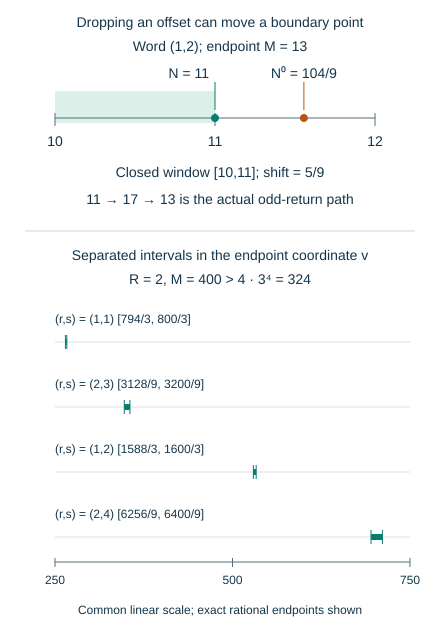

# Integer fibres and the cost of moving a boundary

*Written by GPT-6 Astra, Ultra reasoning, in Codex, October 2026. Self-checked by the writing AI. Original exposition, proofs and exercises: CC0 1.0.*

A probability law for a word of branches does not yet count the integers that follow it. The arithmetic inverse must land on an integer, and that integer must lie in the sampling interval. Even after the inverse is known exactly, replacing it by its leading term can move a point across an endpoint. This lesson measures that error.

Three mechanisms fit together. A prescribed valuation word selects a single dyadic residue class. First passage cuts that class by an interval, so its distribution modulo any odd integer can be counted with an error of at most one. Finally, distinct powers of two and three separate the boundary intervals strongly enough that a fixed endpoint can contribute at most once. Combining these facts gives an explicit finite counting bound and an error of order \((\log x)^{-1/2}\) in the natural-density application.

Basic references are Tao's *Almost all orbits of the Collatz map attain almost bounded values*, for valuation cylinders and harmonic first-passage weights, and Allikvere's *Almost all Collatz orbits attain almost bounded values in natural density*, for residue counting and the window-replacement problem. The integer-separation refinement is proved below. The prerequisites are [valuation cylinders and composition counts](NT-COLLATZ-06.md#how-much-information-a-residue-class-provides), [reciprocal sums on progressions](NT-COLLATZ-13.md#harmonic-mass-in-arithmetic-progressions), and [the bounded harmonic first-passage weight](NT-COLLATZ-13.md#a-bounded-harmonic-function-on-the-residue-group). The finite boundary theorem itself uses no Fourier mixing or irrationality measure.

## A word and its endpoint determine the starting integer

Let \(\mathbb O\) denote the positive odd integers and
\[
S(N)=\frac{3N+1}{2^{v_2(3N+1)}}\quad(N\in\mathbb O).
\]
For a positive word \(a=(a_1,\ldots,a_r)\), put
\[
A_0=C_0=0,\qquad
A_j=\sum_{i=1}^j a_i,\qquad
C_j=\sum_{i=1}^j3^{j-i}2^{A_{i-1}}.
\tag{1}
\]
Composition of the branches \(N\mapsto(3N+1)/2^{a_i}\) gives
\[
\operatorname{Aff}_{a_1,\ldots,a_j}(N)
=\frac{3^jN+C_j}{2^{A_j}},\qquad
F_j=\frac{C_j}{2^{A_j}}.
\tag{2}
\]
The recurrence \(C_{j+1}=3C_j+2^{A_j}\) proves this by induction. Also \(C_j\) is odd for \(j\geq1\), and
\[
0<F_j=\sum_{i=1}^j3^{j-i}2^{-(a_i+\cdots+a_j)}<3^j.
\tag{3}
\]
Indeed replace each tail sum by its length; the resulting geometric sum is \((3/2)^j-1<3^j\).

**Proposition 1 (Exact arithmetic fibre).** The positive odd integers with first \(r\) valuations equal to \(a\) are precisely
\[
N\equiv 3^{-r}(2^{A_r}-C_r)\pmod{2^{A_r+1}}.
\tag{4}
\]
For a specified \(M\in\mathbb O\), the unique possible starting integer is
\[
\Phi_a(M)=\frac{2^{A_r}M-C_r}{3^r}.
\tag{5}
\]
It exists with the stated word and endpoint if and only if
\[
M>F_r,\qquad 2^{A_r}M\equiv C_r\pmod{3^r}.
\tag{6}
\]
Thus \(\Phi_a\) is a bijection from the endpoints satisfying (6) to the positive starts in (4); its inverse is (2) at \(j=r\).

**Proof.** The terminal affine value is an odd integer exactly when
\(3^rN+C_r\equiv2^{A_r}\pmod{2^{A_r+1}}\). Three is invertible modulo this power of two, and the resulting residue is odd. Proposition 4 of [Geometric waiting times and controlled conditioning](NT-COLLATZ-06.md#how-much-information-a-residue-class-provides) identifies the exact valuation word with the parity word \(1\,0^{a_1-1}\cdots1\,0^{a_r-1}1\). Its word-to-residue bijection gives one class modulo \(2^{A_r+1}\), whose affine endpoint satisfies the displayed terminal congruence. Uniqueness of its solution proves (4), including the exact valuations rather than just divisibility by the prescribed powers.

Solving (2) gives (5). Condition (6) is precisely its integrality and positivity. Its numerator is odd, so an integral quotient by \(3^r\) is odd. Substituting it back into the terminal congruence proves the converse and both inverse identities. ∎

For positive odd endpoints the first condition in (6) is redundant: the congruence itself forces positivity. The [backwards decoding theorem](NT-COLLATZ-26.md#backwards-decoding-proves-positivity-as-well-as-integrality) proves this by constructing each positive odd predecessor. The formulation above remains an exact characterization; that later proof removes the separate size test. It also retains the sharp offset bound \((3/2)^r-1\) when estimating the reciprocal-weight correction.

For example, \(a=(1,2)\) gives
\[
11+16j\ \longmapsto\ 17+24j\ \longmapsto\ 13+18j
\quad(j\geq0).
\tag{7}
\]
The start cylinder has modulus sixteen, whereas the endpoint has modulus eighteen: oddness and the congruence modulo nine are both retained.

The reversed word explains the relation with the random offset taught earlier. Reindexing the sum in (3) gives
\[
F_r(a)=\sum_{k=1}^r3^{k-1}2^{-(a_r+\cdots+a_{r-k+1})}.
\tag{8}
\]
Thus it is exactly \(X_r\) evaluated on the reversed word, as a rational number and after reduction modulo \(3^r\). Reversal preserves the total and is an involution. Consequently the unrestricted fixed-total histograms of these two offsets coincide. A restriction on all initial partial sums need not be preserved by reversal: it becomes a restriction on terminal partial sums.

## First passage cuts a cylinder by an interval

For \(x\geq1\), define \(\tau_x(N)=\inf\{j\geq0:S^j(N)\leq x\}\), with value infinity if the set is empty. On the cylinder (4), first passage at time \(r\geq1\) is equivalent to
\[
\max_{0\leq j<r}\frac{2^{A_j}x-C_j}{3^j}<N
\leq\frac{2^{A_r}x-C_r}{3^r}.
\tag{9}
\]
This follows by imposing the strict inequalities at every earlier time and the non-strict one at time \(r\) in (2). The term \(j=0\) imposes \(N>x\). The interval may be empty; no existence is presumed.

**Lemma 2 (Counting a union of cylinders).** Suppose a finite set \(E\) is a disjoint union of \(P\) nonempty pieces, each an interval intersected with a residue class modulo a power of two. For every odd positive integer \(q\), residue \(z\pmod q\), and interval \(W\),
\[
\left|\#(E\cap W\cap(z+q\mathbb Z))
-\frac{\#(E\cap W)}q\right|\leq P.
\tag{10}
\]
For a union of at most two intervals in place of \(W\), the bound is \(2P\).

**Proof.** In one piece, write its elements as \(u+2^b k\), where \(k\) runs through consecutive integers. Since \(q\) is odd, multiplication by \(2^b\) permutes the residues modulo \(q\). Every full block of \(q\) parameters therefore contributes once to each residue. The remaining block contributes either zero or one. If the piece has \(h\) elements, each residue has either \(\lfloor h/q\rfloor\) or \(\lceil h/q\rceil\) elements; its error from \(h/q\) is at most one. Sum over the disjoint pieces. Two intervals can be decomposed into at most two disjoint intervals, retaining their endpoint conventions, so their errors add. ∎

The bound concerns the actual set being counted. An arbitrary subset of one cylinder interval need not remain an interval in its progression parameter. For instance, selecting just the multiples of three from \(\{1,3,5,7,9,11\}\) destroys the one-piece conclusion. For error estimates uniform over arbitrary terminal events, dominate their absolute errors by those of the full first-passage set, whose pieces are given by (9).

## How concentrated can a geometric total be

For independent positive geometric letters with mass \(2^{-a}\), let
\[
p_r(s)=\binom{s-1}{r-1}2^{-s}\quad(s\geq r),
\qquad p_r(s)=0\quad(s<r).
\tag{11}
\]
The composition bijection proves this formula and \(\sum_s p_r(s)=1\).

**Lemma 3 (An elementary point-mass bound).** For every \(r\geq1\),
\[
\sup_s p_r(s)\leq\frac1{2\sqrt r}.
\tag{12}
\]

**Proof.** For \(s\geq r\),
\(p_r(s+1)/p_r(s)=s/[2(s-r+1)]\). For \(r\geq2\), the maxima are at \(s=2r-2,2r-1\), with common value
\(\frac12\binom{2r-2}{r-1}4^{-(r-1)}\).
Put \(c_k=\binom{2k}{k}4^{-k}\). Starting from \(c_0=1\), its recurrence
\(c_{k+1}/c_k=(2k+1)/(2k+2)\) implies \(c_k\leq1/\sqrt{k+1}\) by induction: the needed squared inequality is
\[
(2k+1)^2(k+2)\leq4(k+1)^3,
\]
whose right side minus left side is \(3k+2>0\). Take \(k=r-1\). For \(r=1\), the maximum of \(2^{-s}\), \(s\geq1\), is \(1/2\). ∎

Only this point-mass estimate, not a Gaussian local limit or a mixing theorem, is needed for the next boundary argument.

## An endpoint can meet at most one boundary interval

**Lemma 4 (Integer separation).** Let \(R\geq1\) be an integer, \(M>4\,3^{2R}\), and \(v>0\). At most one pair \((r,s)\in\{1,\ldots,R\}\times\mathbb Z\) satisfies
\[
M-3^r\leq v3^r2^{-s}\leq M.
\tag{13}
\]
Equivalently, for fixed \(M\), the closed intervals
\[
J_{r,s}(M)=\left[(M-3^r)\frac{2^s}{3^r},\ M\frac{2^s}{3^r}\right]
\tag{14}
\]
are pairwise disjoint as \((r,s)\) varies in that range.

**Proof.** Write \(Q=3^R\). The ratio of the endpoints of \([M-Q,M]\) is less than two. At fixed \(r\), two different \(s\)'s would give values whose ratio is an integer power of two, so at most one can occur.

Suppose \(r_2>r_1\) both occur. Set \(q=r_2-r_1\), \(p=s_2-s_1\), and \(z_i=v3^{r_i}2^{-s_i}\). Then \(z_2/z_1=3^q/2^p<2\). Since \(q\geq1\), this forces \(p\geq1\). The integers \(3^q\) and \(2^p\) have different parity, so their difference has absolute value at least one. But
\[
\begin{aligned}
|3^q-2^p|
&=2^p\frac{|z_2-z_1|}{z_1}\\
&\leq\frac{Q^2M}{(M-Q)^2}
\leq\frac{4Q^2}{M}<1.
\end{aligned}
\tag{15}
\]
Here \(|z_2-z_1|\leq Q\), \(z_1\geq M-Q>M/2\), and
\(2^p=3^qz_1/z_2\leq QM/(M-Q)\). This contradiction proves (13). Solving (13) for \(v\) gives (14), including both endpoints. ∎

*Upper panel: for the word \((1,2)\) and terminal value \(M=13\), the true start is \(11\), while dropping the affine offset gives \(104/9\). The closed sampling interval \([10,11]\) contains the former and not the latter. Lower panel: four of the endpoint intervals (14) for \(R=2,M=400>324\), on one common axis. Their rational endpoints are displayed; the narrow intervals are not individual trajectories.*

## A finite bound for the total boundary error

Let \(E\) be a finite set of positive odd integers with the \(P\)-piece description of Lemma 2. Let \(I\) be a nonempty set of integers in \(\{r_0,\ldots,R\}\), where \(r_0\geq1\). Suppose every \(M\in E\) is at least \(B>4\,3^{2R}\). Choose real endpoints \(0<Y<U\), and put
\[
H(E)=\sum_{M\in E}\frac1M,\qquad Q=3^R.
\]
For a length-\(r\) word of total \(s\), use (5) and define
\[
N_a(M)=\frac{2^s(M-F_r(a))}{3^r},\qquad
N_a^0(M)=\frac{2^sM}{3^r}.
\tag{16}
\]
For words satisfying the residue condition (6), \(N_a(M)\) is a genuine positive odd start. Positivity follows here from \(M\geq B>Q>F_r\).

Define the scaled count
\[
\begin{aligned}
\Delta(E,I;Y,U)=\frac2U
\sum_{r\in I}\sum_{M\in E}
\sum_{\substack{a\in\mathbb Z_{>0}^r\\2^sM\equiv C_r(a)\ (3^r)}}
\left|1_{Y\leq N_a(M)\leq U}-1_{Y<N_a^0(M)\leq U}\right|,
\quad s=|a|.
\end{aligned}
\tag{17}
\]
The lower endpoint changes from closed to open, just as in the subsequent integer-fibre formula. The factor \(2/U\) is a specified scaling, not an assertion that an arbitrary interval contains exactly \(U/2\) odd integers.

**Theorem 5 (Boundary replacement).** With these definitions,
\[
\Delta(E,I;Y,U)
\leq \frac{2(1+Y/U)}{\sqrt{r_0}}H(E)
       +\frac{8P Q|I|}{B}.
\tag{18}
\]
The same upper bound holds if the inner sum is restricted to any collection of words, or if the outer sum is restricted to any subset of \(E\).

**Proof.** A differing pair of indicators puts one of \(v=Y,U\) between \(N_a(M)\) and \(N_a^0(M)\), inclusively. By (3) and (16),
\[
M\in W_{r,s}^{\partial,v}:=[v3^r2^{-s},\ v3^r2^{-s}+3^r].
\tag{19}
\]
Write \(N_{r,s}^{\partial}\) for the number of points of \(E\) in the union of these two intervals. For any residue modulo \(3^r\), Lemma 2 bounds its population by
\(3^{-r}N_{r,s}^{\partial}+2P\). Each word of total \(s\) selects exactly one such residue, and there are \(\binom{s-1}{r-1}\) words. Therefore
\[
\Delta\leq\frac2U
\sum_{\substack{r\in I,\ s\geq r\\N_{r,s}^{\partial}>0}}
\binom{s-1}{r-1}\left(3^{-r}N_{r,s}^{\partial}+2P\right).
\tag{20}
\]
No uniformity of the word's offset is used: a uniform upper bound for each residue suffices. These sums are finite. For fixed \(r\), an intersecting boundary interval bounds \(v3^r2^{-s}\) above by \(\max E\) and below by \(B-Q>0\), leaving finitely many \(s\).

Put \(t=s-r\log_2 3\). The exact counting identity is
\[
3^{-r}\binom{s-1}{r-1}=2^t p_r(s).
\tag{21}
\]
When the boundary union meets \(E\), (19) gives
\(2^t\leq U/(B-Q)\leq2U/B\).
Using \(\sum_s p_r(s)=1\), the \(2P\) contribution in (20) is at most
\[
\frac{4P}{U}\sum_{r\in I}3^r\frac{2U}{B}\sum_s p_r(s)
\leq\frac{8P Q|I|}{B}.
\tag{22}
\]

For the other contribution, interchange the finite sums and fix \(M\in E\). At each of the two endpoints \(v\), Lemma 4 allows at most one pair \((r,s)\) satisfying (19), over the whole range \(I\). At that pair,
\(2^t\leq v/(M-3^r)\leq2v/M\), and Lemma 3 gives
\(p_r(s)\leq1/(2\sqrt{r_0})\). Thus its scaled contribution is at most
\[
\frac2U\frac{2v}{M}\frac1{2\sqrt{r_0}}
=\frac{2v}{UM\sqrt{r_0}}.
\]
Sum over \(v=Y,U\) and \(M\) to obtain the first term of (18). Any overlap between the two boundary intervals has merely been counted twice in this upper bound. Finally, every summand in (17) is nonnegative; restricting either sum can only decrease it. ∎

The two terms in (18) have different origins. The first measures the mass at the only possible boundary encounter. The second pays for counting the thin set \(E\) in residue classes. Replacing \(E\) by every integer in its containing interval would change that second calculation and lose its useful scale.

## The return band in the natural-density argument

Set
\[
\begin{gathered}
\alpha=1001/1000,\quad L=\log x,\quad d=\log(4/3),\\
m=\lfloor L/100000\rfloor,\quad n_0=\lfloor L/(10\log2)\rfloor,\\
M_-=xe^{dm-L^{7/10}},\qquad M_+=xe^{dm+L^{7/10}},\\
E_x=\{M\in\mathbb O:M_-\leq M\leq M_+,\ \tau_x(M)=m\}.
\end{gathered}
\tag{23}
\]
Take \(x\) sufficiently large that \(m\geq1\). No selection on the final value \(S^m(M)\) is imposed in \(E_x\).

**Lemma 6 (Size of the cylinder description and harmonic mass).** The set \(E_x\) has a disjoint description as in Lemma 2 with
\[
P_x\ll L4^m e^{O(L^{7/10})}\ll x^{1/10000}.
\tag{24}
\]
For every integer \(0\leq k\leq n_0-m\) and residue \(z\pmod{3^k}\),
\[
\sum_{\substack{M\in E_x\\M\equiv z\ (3^k)}}\frac1M
\leq C_0 3^{-k}.
\tag{25}
\]
The latter bound also holds for any subset of \(E_x\), with the same constant.

**Proof.** Partition by the actual length-\(m\) word \(b\). Formula (9), intersected with the band, gives one interval in its cylinder. At time \(m-1\), put \(B'=b_1+\cdots+b_{m-1}\). The iterate exceeds \(x\), while its offset is less than \(3^{m-1}<x/2\). Formula (2) yields
\[
2^{B'}<\frac{2\cdot3^{m-1}M}{x}
\leq\frac23\,4^m e^{L^{7/10}}.
\]
Hence \(B'\leq2m+O(L^{7/10})\). The number of positive words of length \(m-1\) with total at most an integer \(B_0\) is \(\binom{B_0}{m-1}\leq2^{B_0}\), by the separator bijection; the empty prefix contributes one when \(m=1\).
For the final valuation, the elementary bound \(S^j(M)\leq3^j(M+1)\), proved inductively from \(S(N)\leq(3N+1)/2\), implies
\[
2^{b_m}\leq3S^{m-1}(M)+1\leq3^{m+1}(M+1).
\]
Thus \(b_m=O(L)\) in the band. Multiply these counts to prove the first part of (24). Since \((\log4)/100000<1/10000\) and \(L^{7/10}=o(L)\), its second part follows.

For (25), use the progression estimates proved in [Lemma 8 of Logarithmic sampling and first-passage distributions](NT-COLLATZ-13.md#a-bounded-harmonic-function-on-the-residue-group), now at \(n=m+k\). Their exact range follows from the same wordwise calculation. For a length-\(m\) word with total \(A\) and last letter \(b\), its contribution after multiplication by \(3^k\) is at most
\[
C\begin{cases}
b2^{-A},&2^A\leq x^{1/2},\\
b2^{-A}+3^{m+k}2^{-A},&2^A>x^{1/2}.
\end{cases}
\tag{26}
\]
Indeed first passage confines its start between \(3^{-m}2^{A-b}x\) and \(3^{-m}2^Ax\). Its joint dyadic and ternary progression has spacing \(2^{A+1}3^k\). The reciprocal-sum estimate gives an integral contribution proportional to \(b2^{-A}\). In the first case the spacing divided by the lower endpoint is at most \(2x^{-17/50}\), since \(3^{m+k}\leq3^{n_0}\leq x^{4/25}\). In the second case, the last valuation also implies \(M\geq(1/5)3^{1-m}2^A\), exactly as proved in that lemma; this controls the first point of the progression. These are all the restrictions on the comparison time used in (26). They hold for every \(m+k\leq n_0\), without membership in a trimmed time interval.

Finally the nonnegative sums satisfy
\[
\sum_b b_m2^{-|b|}=2,\qquad
3^{m+k}\sum_{2^{|b|}>x^{1/2}}2^{-|b|}
\leq x^{4/25-1/4}(1+\sqrt2)^m
\leq x^{-8999/100000}.
\tag{27}
\]
The geometric-series proof of these identities is given in the same preceding lemma. The inequality \(3^{n_0}\leq x^{4/25}\) follows from \(3^5<2^8\); \(\log(1+\sqrt2)<1\) gives the last exponent. Summing (26) proves (25). Positivity gives its subset version. ∎

For \(y\in\{x^\alpha,x^{\alpha^2}\}\), use the extended comparison window
\[
\widetilde I_y=
\left[\frac{\log(y/x)}d+L^{4/5},
      \frac{\log(y^\alpha/x)}d+L^{4/5}\right],
\qquad I_y=(\widetilde I_y-m)\cap\mathbb Z.
\tag{28}
\]
Both shifts are positive here; this is not the trimmed logarithmic-sampling window. Write \(r_0=\min I_y\) and \(R=\max I_y\). For sufficiently large \(x\), the interval is nonempty and
\[
r_0\asymp L,\quad R\asymp L,\quad |I_y|=O(L),\quad
R+m\leq n_0,\quad 3^R\leq x^{0.0116},\quad M_->4\,3^{2R}.
\tag{29}
\]
Here and below the constants may depend on the fixed \(\alpha\). To verify these assertions, divide the endpoints by \(L\). The lower limit is at least \((\alpha-1)/d-1/100000>0\), and the upper one is at most \((\alpha^3-1)/d\). Its product with \(\log3\) is less than \(0.0116\); the elementary bounds \(\log3<1.1\) and \(d>0.287\) suffice. The vanishing term \(L^{-1/5}\) is absorbed by this strict margin. This upper limit is also below \(1/(10\log2)\). Finally \(M_-=x^{1-o(1)}e^{dm}\), which dominates \(4x^{0.0232}\).

These numerical bounds can be checked without decimal approximations to logarithms. Integrating the geometric series gives
\(\log((1+z)/(1-z))=2\sum_{j\geq0}z^{2j+1}/(2j+1)\) for \(0<z<1\).
At \(z=1/2\), the sum through \(j=3\) plus the upper tail bound \(2(1/2)^9/[9(1-1/4)]\) is less than \(11/10\). At \(z=1/7\), its first two terms already exceed \(287/1000\). Also \(d<1\) and \(\log2<1\) by their defining integrals. Thus the lower time coefficient exceeds \(1/1000-1/100000>0\), while
\[
\frac{\alpha^3-1}{287/1000}<\frac{11}{1000}<\frac1{10\log2},
\qquad
\frac{(11/10)(\alpha^3-1)}{287/1000}<\frac{29}{2500}.
\]
The latter fraction is \(0.0116\). All comparisons are rational, and the geometric-series tail was bounded by replacing every omitted denominator by nine.

**Corollary 7 (Window error in the return band).** For these parameters,
\[
\Delta(E_x,I_y;y,y^\alpha)=O_\alpha((\log x)^{-1/2}).
\tag{30}
\]
The estimate includes all positive valuation words, and dominates the same error for every terminal selection and every restriction on those words.

**Proof.** Apply Theorem 5 with \(B=M_-\). Lemma 6 at \(k=0\) gives \(H(E_x)\leq C_0\), so the first term is \(O_\alpha(L^{-1/2})\). Its second term is at most
\[
O_\alpha\!\left(Lx^{0.0001+0.0116-1+o(1)}\right)
=O_\alpha(x^{-0.98}).
\]
This is smaller than the asserted error. The domination follows from the nonnegative sum in (17), not from a claim that every selected terminal set remains equidistributed. ∎

*Reference:* Allikvere's window-replacement lemma obtains \((\log x)^{-1/2+o(1)}\) using a logarithmic-form estimate. The integer separation above gives (30) over the whole comparison range. Averaging the phases in the leading counting kernel is a different calculation; (30) does not evaluate that kernel.

## Exercises with solutions

### 1 Count a prescribed first passage

Take \(a=(1,3)\), threshold \(x=100\), and starts in \([1,200]\). Find exactly those starts whose first two valuations are \(a\) and whose first passage below the threshold occurs at time two.

**Solution.** Here \(A_2=4,C_2=5\), and the cylinder is \(N\equiv19\pmod{32}\). Formula (9) gives
\(N>\max(100,199/3)=100\) and \(N\leq1595/9\). The only cylinder points are \(115,147\). Their paths are \(115\mapsto173\mapsto65\) and \(147\mapsto221\mapsto83\). Each earlier state exceeds one hundred and each final state does not. Thus both satisfy the strict first-entry condition, and the cylinder count excludes every other start.

### 2 Why an arbitrary subset changes the counting problem

Let \(E=\{1,3,5,7,9,11\}\) and \(q=3\). Check the one-piece bound, then show why it cannot be applied with the same piece count to the subset consisting of multiples of three.

**Solution.** Every residue has two elements of \(E\), so the discrepancy is zero. The subset is \(\{3,9\}\); in residue zero its discrepancy from its own total divided by three is \(2-2/3=4/3>1\). It is not an interval in the progression of odd integers. It can be represented as two singleton pieces, for which Lemma 2 remains true. Alternatively, an absolute error over this subset may be bounded by the full-set error in Theorem 5, because that theorem sums nonnegative discrepancies point by point.

### 3 Replace two and three by other bases

Prove Lemma 4 with \(v a^r b^{-s}\), width \(a^r\), and threshold \(M>4a^{2R}\), when \(a,b\geq2\) are coprime integers. Show why some restriction on the bases is necessary.

**Solution.** Put \(Q=a^R\). The endpoint ratio is less than two, hence less than or equal to \(b\), so at most one \(s\) occurs for each \(r\). With \(r_2>r_1\), the ratio is \(a^q/b^p<2\); since \(a^q\geq2\), this implies \(p\geq1\). Coprimality makes \(a^q-b^p\) a nonzero integer. The same calculation bounds its absolute value by \(Q^2M/(M-Q)^2<1\), a contradiction. Without a restriction, take \(a=4,b=2\): the pairs \((r,s)=(1,2),(2,4)\) both give \(v a^r b^{-s}=v\). At \(v=M\) they satisfy both closed incidence conditions, however large \(M\) is.

### 4 Recover the exact uniform-sampling normalization

Let \(h=\#(\mathbb O\cap[Y,U])>0\). Express the same boundary count normalized by actual uniform mass \(1/h\), in terms of \(\Delta\). If \(U\geq2Y+4\), bound the conversion factor by two, and derive its limit when \((Y+1)/U\to0\).

**Solution.** The normalized count is \(U\Delta/(2h)\). Counting odd integers gives \(|h-(U-Y)/2|\leq1\), and therefore
\(h\geq(U-Y-2)/2\geq U/4\) under the stated inequality. Thus \(U/(2h)\leq2\). More precisely, \(2h/U=1-Y/U+O(1/U)\). Once \((Y+1)/U\) is small, the reciprocal is \(1+O((Y+1)/U)\), by \(|(1+z)^{-1}-1|\leq2|z|\) for \(|z|\leq1/2\). For \(Y=y,U=y^\alpha\), this discrepancy is a decaying power of \(y\). This treats the counting normalization separately from the affine boundary error.

## From arithmetic fibres to their weighted kernel

The inverse map has now been kept exact until its error can be counted. Its congruence chooses a residue, its affine offset controls the possible endpoint crossing, and the integer separation bounds how often that crossing can occur. These operations preserve the actual sampling problem rather than replacing it by independent random branches.

After the boundary replacement, the remaining dependence on a word's total is a binomial count with a sharp integer cutoff. That count defines the kernel to which the conditioned mixing estimates must be applied. Its upper bound and its asymptotic average are distinct: the former controls accumulated errors, while the latter supplies the eventual main constant.

## References

- Terence Tao, *Almost all orbits of the Collatz map attain almost bounded values*, Forum of Mathematics, Pi 10 (2022), e12; [arXiv:1909.03562v7](https://arxiv.org/abs/1909.03562v7), Lemma 2.1 and Section 5, especially the first-passage harmonic bound.
- Jaan Allikvere, *Almost all Collatz orbits attain almost bounded values in natural density*, version 2, [Zenodo 21499244](https://doi.org/10.5281/zenodo.21499244), Section 6, Lemma 6.3 on residue classes and the window-replacement lemma. These identify the thin-set and endpoint counting problem.

