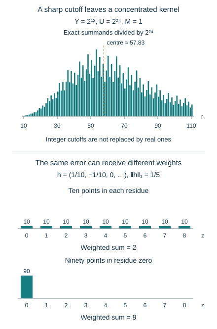

# Counting kernels and weighted probability errors

*Written by GPT-6 Astra, Ultra reasoning, in Codex, October 2026. Self-checked by the writing AI. Original exposition, proofs and exercises: CC0 1.0.*

A small error between two probability laws need not remain small after the outcomes acquire unequal weights. In an arithmetic counting problem, the weight of a residue is the number of integers occupying it. Controlling those populations is therefore part of applying a mixing theorem, not an optional estimate afterward.

We now complete that passage for uniform sampling of odd integers. The exact inverse from the preceding lesson produces a binomial counting kernel. We first bound that kernel without evaluating its leading constant. We then use the actual residue populations to carry the conditioned mixing error, the exceptional words and the tails of the total valuation through the count. The result is an absolute error estimate for the full arithmetic fibre formula. Keeping the coarse residue scale free also gives its dependence on that choice.

Basic references are Allikvere's *Almost all Collatz orbits attain almost bounded values in natural density*, Section 6, for the uniform-fibre calculation, and Tao's *Almost all orbits of the Collatz map attain almost bounded values*, for the valuation model and harmonic first-passage weights. The upper-bound and error-transfer arguments are proved below. We use [the factorial estimate](NT-COLLATZ-17.md#a-factorial-estimate-with-its-constant), [conditioned offset mixing](NT-COLLATZ-17.md#combining-coarse-conditioning-with-fine-mixing), and [the exact fibres and return band](NT-COLLATZ-18.md#the-return-band-in-the-natural-density-argument). The kernel estimate and finite weighted-counting lemma are also reusable outside the Collatz application.

## A sharp cutoff produces a binomial kernel

Let \(G_i\) be independent positive geometric variables with
\(\mathbb P(G_i=a)=2^{-a}\). Write
\[
p_r(s)=\mathbb P(G_1+\cdots+G_r=s)
       =\binom{s-1}{r-1}2^{-s}\quad(s\geq r),
\tag{1}
\]
and zero otherwise. The binomial coefficient counts positive compositions of \(s\) into \(r\) parts.

For real \(0<Y<U\), \(M>0\), and a finite set \(I\) of positive integers, define
\[
D_I(M;Y,U)=\sum_{r\in I}3^{-r}
 \sum_{\substack{s\geq r\\Y<2^sM/3^r\leq U}}
       \binom{s-1}{r-1}.
\tag{2}
\]
For each \(r\), the upper bound on \(2^s\) makes the inner sum finite. Put
\[
\lambda=\log_2 3,\qquad u=\log_2(U/M),\qquad u_0=\log_2(Y/M).
\]
The condition is exactly \(r\lambda+u_0<s\leq r\lambda+u\), including its strict lower endpoint.

**Proposition 1 (Exact cutoff identity).** Put \(h_r=\lfloor r\lambda+u\rfloor\) and \(k_r=\lfloor r\lambda+u_0\rfloor\). With the convention \(\binom{k}{r}=0\) for integers \(k<r\),
\[
D_I(M;Y,U)=
 \sum_{r\in I}3^{-r}
 \left(\binom{h_r}{r}-\binom{k_r}{r}\right).
\tag{3}
\]
For \(h\geq r\), its upper-truncated summand is
\[
3^{-r}\binom h r
=2^{h-r\lambda}\frac hr\,p_r(h).
\tag{4}
\]

**Proof.** Count the \(r\)-element subsets of \(\{1,\ldots,h\}\) by their largest element \(s\). There are \(\binom{s-1}{r-1}\) with that largest element. Thus their sum over \(r\leq s\leq h\) is \(\binom h r\); both sides are zero when \(h<r\). Subtract the sum through \(k_r\) from the sum through \(h_r\). Finally \(\binom h r=(h/r)\binom{h-1}{r-1}\) and \(3^{-r}=2^{-r\lambda}\) give (4). ∎

For instance, with \(Y=100,U=1000,M=13,I=\{1,2\}\), the permitted totals are \(5,6,7\) at \(r=1\) and \(7,8,9\) at \(r=2\). The contributions are \(1\) and \(7/3\), so \(D_I=10/3\). These are kernel weights, not probabilities of two disjoint events.

The factor \(2^{s-r\lambda}\) favours the largest permitted total. Formula (4) sums that preference exactly. The remaining mass is concentrated near the lengths for which \(h_r\) is close to the mean \(2r\).

## A uniform bound before averaging the phases

**Lemma 2 (A Gaussian upper bound on compact slope ranges).** If \(1<b_0<b_1<\infty\), there are constants \(C,c>0\) such that
\[
p_r(s)\leq C r^{-1/2}
 \exp\!\left(-c\frac{(s-2r)^2}{r}\right)
\tag{5}
\]
for all positive integers \(r,s\) with \(b_0\leq s/r\leq b_1\).

**Proof.** Write \(b=s/r\). The exact factorial identity is
\[
p_r(s)=\frac rs\,\frac{s!}{r!(s-r)!}\,2^{-s}.
\]
The [proved Stirling estimate](NT-COLLATZ-17.md#a-factorial-estimate-with-its-constant) gives
\[
p_r(s)=\frac{\exp(rH(b)+\epsilon_{r,s})}
             {\sqrt{2\pi r\,b(b-1)}},
\quad
H(b)=b\log b-(b-1)\log(b-1)-b\log2,
\tag{6}
\]
where
\[
|\epsilon_{r,s}|\leq
 \frac1{2s}+\frac1{2r}+\frac1{2(s-r)}
 \leq C_{b_0,b_1}/r.
\]
All factorial arguments are positive, since \(s>r\).

Now \(H(2)=H'(2)=0\) and \(H''(b)=-1/[b(b-1)]\). Enlarge the compact interval to include two. On it, \(H''\leq-\kappa<0\). Integrating this bound twice from two gives
\(H(b)\leq-\kappa(b-2)^2/2\), on either side of two. The remaining factors in (6) are bounded by a constant times \(r^{-1/2}\). This proves (5). ∎

The following statement separates the analytic estimate from the particular arithmetic bases. The constants may depend on its fixed parameters.

**Theorem 3 (Kernel mass on a linear time band).** Fix \(1<\lambda<2\) and positive constants \(a,b,c,C\), with \(a\leq b,c\leq C\). For all sufficiently large \(L\), every
\[
I\subseteq[cL,CL]\cap\mathbb Z,\qquad aL\leq u\leq bL,\qquad u_0<u
\]
satisfies
\[
\sum_{r\in I}2^{-r\lambda}
 \sum_{\substack{s\geq r\\r\lambda+u_0<s\leq r\lambda+u}}
 \binom{s-1}{r-1}
\leq K\,2^u.
\tag{7}
\]
The constant is independent of \(u_0,u,I,L\). In particular, at \(\lambda=\log_2 3\), this bounds (2).

**Proof.** Removing the lower cutoff can only increase the sum. Put
\(h_r=\lfloor r\lambda+u\rfloor\) and \(z=u/(2-\lambda)\). For large \(L\),
\[
\frac{1+\lambda}{2}\leq h_r/r\leq \lambda+b/c.
\]
The left endpoint is greater than one. The exact identity (4), with \(3^{-r}\) replaced by \(2^{-r\lambda}\), and Lemma 2 give
\[
2^{-r\lambda}\binom{h_r}{r}
 \leq 2^u(h_r/r)p_r(h_r).
\]
Writing \(\vartheta_r=\{r\lambda+u\}\), one has
\[
h_r-2r=-(2-\lambda)(r-z)-\vartheta_r.
\tag{8}
\]
For real \(A,B\), \((A+B)^2\geq A^2/2-B^2\). Since \(0\leq\vartheta_r<1\) and \(cL\leq r\leq CL\), (5) therefore implies
\[
(h_r/r)p_r(h_r)\leq
 \frac{K_1}{\sqrt L}
 \exp\!\left(-k_1\frac{(r-z)^2}{L}\right).
\tag{9}
\]
All constant factors caused by the bounded \(\vartheta_r\) have been retained in \(K_1\).

This Gaussian sum is \(O(\sqrt L)\), uniformly in the real centre \(z\). Indeed, for each integer \(j\geq0\), there are at most two integers with \(j\leq|r-z|<j+1\). Summing a decreasing function by unit intervals gives the bound
\[
\sum_{r\in\mathbb Z}e^{-k_1(r-z)^2/L}
 \leq 2+2\int_0^\infty e^{-k_1 t^2/L}\,dt=O(\sqrt L).
\]
Only finiteness of the rescaled integral is needed: split at one and use \(e^{-k_1 t^2}\leq e^{-k_1 t}\) afterward. Summing (9) and multiplying by \(2^u\) proves (7). ∎

*Upper panel: the exact summands of (2), divided by \(2^{24}\), for \(Y=2^{12},U=2^{24},M=1\) and \(10\leq r\leq110\). The integer cutoffs and weights are computed exactly; only the drawn coordinates and the marked centre \(24/(2-\log_2 3)\) are approximate. Lower panel: the same signed error \(h=(1/10,-1/10,0,\ldots,0)\), of norm \(1/5\), has weighted absolute sum two in a population of ten points per residue, but nine when all ninety points occupy residue zero. A norm estimate needs the actual counting weights.*

## Transferring an error through residue populations

Return to \(\lambda=\log_2 3\). Suppose \(E\) is a finite set of positive odd integers, all at least \(B>0\), with the \(P\)-piece description from [the preceding counting lemma](NT-COLLATZ-18.md#first-passage-cuts-a-cylinder-by-an-interval). Let \(I\subseteq\{1,\ldots,R\}\) be finite, and \(0<Y<U\). Define
\[
\begin{aligned}
V_{r,s}&=(3^r2^{-s}Y,\ 3^r2^{-s}U],\\
N_{r,s}&=\#(E\cap V_{r,s}),\\
\nu_{r,s}(z)&=\#(E\cap V_{r,s}\cap(z+3^r\mathbb Z)),\\
C_{r,s}&=\binom{s-1}{r-1}\quad(s\geq r).
\end{aligned}
\tag{10}
\]
The \(M\)-interval is half-open, exactly as in (2). We sum only pairs with \(r\in I,s\geq r,N_{r,s}>0\). That set of pairs is finite.

There are two natural counting quantities:
\[
\begin{aligned}
\mathcal K&=\frac2U\sum_{M\in E}D_I(M;Y,U),\\
\mathcal P&=\frac{2P}{U}
 \sum_{\substack{r\in I,\ s\geq r\\N_{r,s}>0}}C_{r,s}
 \leq\frac{2P3^R|I|}{B}.
\end{aligned}
\tag{11}
\]
For the inequality, an intersecting interval gives \(2^{s-r\lambda}\leq U/B\). Use
\(C_{r,s}=3^r2^{s-r\lambda}p_r(s)\), sum \(p_r(s)\) first, and then sum over \(r\).

**Lemma 4 (Finite weighted transfer).** For each contributing pair, let
\(h_{r,s}:\mathbb Z/3^r\mathbb Z\to\mathbb C\) satisfy
\(\sum_z|h_{r,s}(z)|\leq\varepsilon\). Then
\[
\frac2U\sum_{r,s}C_{r,s}
 \sum_z\nu_{r,s}(z)|h_{r,s}(z)|
 \leq \varepsilon(\mathcal K+\mathcal P).
\tag{12}
\]
The same bound holds with \(\varepsilon=\delta\) when the left side instead counts any subcollection of words containing at most a fraction \(\delta\) of the \(C_{r,s}\) words for each pair, each word counted with its own residue population.

**Proof.** The interval-progression count gives
\(\nu_{r,s}(z)\leq3^{-r}N_{r,s}+P\), uniformly in \(z\). Multiply by \(|h_{r,s}(z)|\) and sum. For the part containing \(N_{r,s}\), finite rearrangement gives the exact identity
\[
\frac2U\sum_{r,s}C_{r,s}3^{-r}N_{r,s}
 =\frac2U\sum_{M\in E}D_I(M;Y,U)=\mathcal K.
\tag{13}
\]
The other part is \(\mathcal P\). For a collection of words, use the same upper bound for each word's selected residue and multiply by its number, at most \(\delta C_{r,s}\). No independence between membership in that collection and the selected residue is needed. ∎

The lemma also applies to any subset of the contributing pairs by keeping the full \(\mathcal K,\mathcal P\) on the right. To control the norm of a *sum* of signed errors, first apply the triangle inequality at each \(M\), and then (12). The population of the full band is retained throughout; its containing interval need not have comparable mass.

## The arithmetic return band and its two counting bounds

Use the odd-return map \(S(N)=(3N+1)/2^{v_2(3N+1)}\) and its first-passage time \(\tau_x\), as before. Fix
\[
\begin{gathered}
\alpha=1001/1000,\quad L=\log x,\quad d=\log(4/3),\\
m_0=\lfloor L/100000\rfloor,\quad
M_\pm=x e^{dm_0\pm L^{7/10}},\\
E_x=\{M\text{ positive odd}:M_-\leq M\leq M_+,\ \tau_x(M)=m_0\},\\
y\in\{x^\alpha,x^{\alpha^2}\},\quad Y=y,\quad U=y^\alpha,\\
I_y=\left(
 \left[\frac{\log(y/x)}d+L^{4/5},
       \frac{\log(y^\alpha/x)}d+L^{4/5}\right]-m_0
 \right)\cap\mathbb Z.
\end{gathered}
\tag{14}
\]
Write \(D_y(M)=D_{I_y}(M;y,y^\alpha)\). These definitions impose no extra selection on the terminal value \(S^{m_0}(M)\).

[The return-band lemma and its proof](NT-COLLATZ-18.md#the-return-band-in-the-natural-density-argument) give, for sufficiently large \(x\),
\[
\begin{gathered}
r\asymp_\alpha L\ (r\in I_y),\quad R:=\max I_y=O_\alpha(L),
\quad3^R\leq x^{0.0116},\\
P_x\ll x^{0.0001},\qquad
H(E_x):=\sum_{M\in E_x}M^{-1}\leq C_0.
\end{gathered}
\tag{15}
\]
They also give the stronger residue-weighted estimate
\[
\sum_{\substack{M\in E_x\\M\equiv z\ (3^k)}}\frac1M
 \leq C_0 3^{-k}
\quad
\left(0\leq k\leq
 \left\lfloor\frac{L}{10\log2}\right\rfloor-m_0\right).
\tag{16}
\]

For \(M=x e^{dm_0+\sigma}\), \(|\sigma|\leq L^{7/10}\),
\[
u=\log_2(U/M)
 =\frac{\log(U/x)-dm_0-\sigma}{\log2}\asymp_\alpha L.
\]
Its lower linear coefficient is positive: \(\log(U/x)/L\geq\alpha^2-1\), while \(d/100000<1/100000<\alpha^2-1\). Thus Theorem 3 applies uniformly, and
\[
D_y(M)\leq K_\alpha\,\frac{y^\alpha}{M}.
\tag{17}
\]
This proves the required upper bound without any average of the fractional parts \(\{r\lambda+u\}\).

Equations (11), (15) and (17) now give
\[
\mathcal K\leq 2K_\alpha H(E_x)=O_\alpha(1),
\qquad
\mathcal P\leq
 \frac{2P_x3^R|I_y|}{M_-}=O_\alpha(x^{-0.98}).
\tag{18}
\]
The two bounds have different roles. The first controls the mass of the kernel against the actual thin band. The second controls the additive error of the residue count. Neither is the length of the containing interval \([M_-,M_+]\).

## Exceptional words and totals

For a length-\(r\) positive word \(a\), set \(A_j=a_1+\cdots+a_j\), and retain
\[
\mathcal A_r=\{a: |A_j-2j|<L^{3/5}\text{ for every }0\leq j\leq r\}.
\tag{19}
\]
Call a pair \((r,s)\) central if
\[
|s-2r|\leq C\sqrt{r\log r},
\tag{20}
\]
where \(C\) is a fixed constant chosen as large as the following estimates require.

**Lemma 5.** Uniformly for \(r\in I_y\), the independent geometric word satisfies
\[
\mathbb P(a\notin\mathcal A_r)\leq K L e^{-cL^{1/5}}.
\tag{21}
\]
For central pairs its conditional bad fraction is \(O(e^{-c'L^{1/5}})\). For any fixed \(A>0\), choosing \(C\) sufficiently large gives
\[
\sum_{|s-2r|>C\sqrt{r\log r}}p_r(s)\ll_{\alpha,A}L^{-A-1}.
\tag{22}
\]

**Proof.** Apply [geometric concentration](NT-COLLATZ-06.md#an-exponential-estimate-with-explicit-constants) to each prefix of length \(j\leq r\). At \(t=L^{3/5}\), its two exponents are
\(t^2/(12j)\geq c L^{1/5}\) and \(dt/2\geq c L^{1/5}\).
Sum over \(O_\alpha(L)\) prefixes to obtain (21). The strict inequality in (19) means that its complement is covered by the non-strict tail events of that concentration theorem.

For (20), the [moderate-window lower bound](NT-COLLATZ-15.md#the-probability-cost-of-fixing-the-total) gives
\(p_r(s)\geq (6e)^{-1}r^{-1-C^2}\) for large \(r\). Divide (21) by this probability. The polynomial factor is absorbed into half of the exponential, proving the conditional estimate; \(C\) remains fixed.

At \(t=C\sqrt{r\log r}\), the two concentration exponents are \(C^2\log r/12\) and \(dC\sqrt{r\log r}/2\). The second eventually exceeds the first. Choose \(C^2/12>A+2\), use \(r\asymp_\alpha L\), and enlarge the constant for a finite initial range. This proves (22). ∎

In particular, for each \(M\in E_x\), the noncentral part of the kernel obeys
\[
D_y^{\mathrm{tail}}(M)
 \ll_{\alpha,A}\frac{y^\alpha}{M}L^{-A}.
\tag{23}
\]
Indeed \(3^{-r}C_{r,s}=2^{s-r\lambda}p_r(s)\leq(y^\alpha/M)p_r(s)\) on the sampling window. Apply (22) and sum over \(O_\alpha(L)\) lengths.

Reversal converts the forward offset to the random offset \(X_r\) while preserving the total. It does not generally preserve the event (19). The conditional bad fraction above refers to the original words. Lemma 4 counts them without changing their event.

## The uniform fibre formula with a variable coarse scale

For a positive word \(a\), let \(F_r(a)\) be its forward affine offset:
\[
\operatorname{Aff}_a(N)=3^r2^{-|a|}N+F_r(a).
\]
Let \(\widetilde N_y\) be uniformly distributed on the positive odd integers in \([y,y^\alpha]\), and define the actual arithmetic weight
\[
W_y(M)=\sum_{r\in I_y}\sum_{a\in\mathcal A_r}
 \mathbb P(\operatorname{Aff}_a(\widetilde N_y)=M),
\qquad M\in E_x.
\tag{24}
\]
Whenever the displayed affine value is a positive odd integer, the exact cylinder theorem ensures that the word is the actual valuation word of the input. In particular, for each fixed \(r\), one input contributes to at most one summand.

For independent geometric letters, put
\[
X_k=\sum_{j=1}^k3^{j-1}2^{-(G_1+\cdots+G_j)}
 \quad\text{in }\mathbb Z/3^k\mathbb Z,
\qquad \rho_k(z)=\mathbb P(X_k=z).
\tag{25}
\]
The denominators are invertible modulo \(3^k\). These are random-offset laws, distinct from the uniform integer-input law in (24).

**Theorem 6 (Absolute error in the arithmetic fibre formula).** Fix \(0<\theta<1\) and put \(k=\lfloor L^\theta\rfloor\). For the parameters (14), sufficiently large \(x\), and either choice of \(y\),
\[
W_y(M)=\frac2{y^\alpha}\,3^k
 \rho_k(M\bmod3^k)D_y(M)+R_y(M),
\tag{26}
\]
where
\[
\sum_{M\in E_x}|R_y(M)|
 \ll_{\alpha,\theta}
 L^{-(1-\theta)/2}\sqrt{\log L}.
\tag{27}
\]
The norm bound remains true on every subset of \(E_x\). Here \(\theta\) is fixed independently of \(x\); no uniform estimate as \(\theta\) approaches zero or one is asserted.

**Proof.** We account separately for normalization, the affine boundary, central mixing, exceptional words and noncentral totals.

Let \(h_y\) be the number of odd inputs in \([Y,U]=[y,y^\alpha]\). The [exact fibre inverse](NT-COLLATZ-18.md#a-word-and-its-endpoint-determine-the-starting-integer) gives the input
\[
N_a(M)=2^{|a|}(M-F_r(a))/3^r
\]
when \(F_r(a)\equiv M\pmod{3^r}\). It has mass \(1/h_y\) exactly when it lies in the closed sampling interval. Since
\(|2h_y-(U-Y)|\leq2\), replacing \(1/h_y\) by \(2/U\) changes the sum of absolute weights by at most
\[
|I_y|\left|1-\frac{2h_y}{U}\right|
 \leq |I_y|\frac{Y+2}{U}=O_\alpha(Lx^{-c_\alpha}).
\tag{28}
\]
We used the disjointness for each fixed \(r\), not a claim that \(W_y\) is itself a probability law.

The [proved boundary theorem](NT-COLLATZ-18.md#a-finite-bound-for-the-total-boundary-error) then replaces the exact window by \(Y<2^{|a|}M/3^r\leq U\), with absolute cost \(O_\alpha(L^{-1/2})\). Its nonnegative full-word bound dominates the restriction to \(\mathcal A_r\).

For central pairs, use the [conditioned product approximation](NT-COLLATZ-17.md#combining-coarse-conditioning-with-fine-mixing). Since \(r\asymp_\alpha L\), choose, for example, the exponent parameters
\(\varepsilon=\theta/2,\eta=(1-\theta)/2\). Then
\(r^\varepsilon\leq k\leq r^{1-\eta}\) for all large \(x\).
For any fixed \(D>0\), that theorem gives
\[
\sum_{z\bmod3^r}
 \left|\mathbb P(F_r(a)\equiv z\mid |a|=s)
       -3^{k-r}\rho_k(z\bmod3^k)\right|
 \leq K\left(L^{-D\theta}
       +L^{-(1-\theta)/2}\sqrt{\log L}\right)
 =:\epsilon_L.
\tag{29}
\]
Only the unrestricted conditioned histogram has been reversed here. Every positive composition of \(s\) has the same probability, so multiplying the two laws by \(C_{r,s}\) converts them to counts. Lemma 4 and (18) make the total error \(O_\alpha(\epsilon_L)\).

Before this comparison the central sum retained only the words in \(\mathcal A_r\). Lemma 5 bounds their removed fraction by \(O(e^{-c'L^{1/5}})\), pair by pair. The word-count version of Lemma 4 and (18) therefore bound this change by the same order. There is no independence assumption between the bad event and its residue.

For the noncentral *actual* words, enlarge to all words. Each residue count is at most \(3^{-r}N_{r,s}+P_x\). The first contribution is bounded by (23) summed over \(M\), after multiplication by \(2/y^\alpha\); it is \(O_\alpha(L^{-A})\) by (15). The second is at most \(\mathcal P=O_\alpha(x^{-0.98})\).

The main term in (26) also contains noncentral totals. Its added contribution is bounded using (23) and
\[
3^k\sum_{M\in E_x}\frac{\rho_k(M\bmod3^k)}M\leq C_0.
\tag{30}
\]
For this inequality, \(k\leq\lfloor L/(10\log2)\rfloor-m_0\) eventually because \(\theta<1\). Group the sum by its residue \(z\bmod3^k\), apply (16), and use \(\sum_z\rho_k(z)=1\). Thus these main-term tails also cost \(O_{\alpha,A}(L^{-A})\).

After extending the main term to every total, the count for a fixed \(M\) is exactly
\[
\frac2U\sum_{r\in I_y}\sum_{\substack{s\geq r\\M\in V_{r,s}}}
 C_{r,s}3^{k-r}\rho_k(M\bmod3^k)
 =\frac2U3^k\rho_k(M\bmod3^k)D_y(M).
\tag{31}
\]
Choose \(D\theta>(1-\theta)/2\) and \(A>1\). Every error above is bounded by (27); in particular \(L^{-1/2}\) is smaller than its right side for fixed \(\theta>0\). The triangle inequality proves (26)–(27). Restriction to any subset only decreases the sum of \(|R_y(M)|\). ∎

*Reference:* Allikvere's Section 6 uses \(k=\lfloor L^{2/5}\rfloor\) and states a summed remainder \(O(L^{-1/4})\). At that scale, (27) retains the sharper \(O(L^{-3/10}\sqrt{\log L})\) error. Its extension to every fixed \(0<\theta<1\) uses the broader product comparison proved in the preceding lessons. This improves this component estimate; the leading kernel average and the final orbit conclusions require their separate arguments.

## Exercises with solutions

### 1 Keep both integer cutoffs

Compute (2) for \(Y=100,U=1000,M=13,I=\{1,2\}\), both by listing totals and by (3). Explain how an endpoint equality is treated.

**Solution.** At \(r=1\), \(300/13<2^s\leq3000/13\), so \(s=5,6,7\), and the contribution is \(3/3=1\). At \(r=2\), \(900/13<2^s\leq9000/13\), so \(s=7,8,9\), contributing \((6+7+8)/9=7/3\). Thus \(D_I=10/3\). The two pairs \((h_r,k_r)\) are \((7,4)\) and \((9,6)\), giving \((7-4)/3+(\binom92-\binom62)/9=10/3\). A total exactly at the lower cutoff is subtracted through \(k_r\), while one exactly at the upper cutoff remains through \(h_r\). These conventions also hold when either logarithm is an integer.

### 2 A small norm with a large counting weight

Take \(q=9\), \(E=\{9,27,\ldots,171\}\), and the signed residue function \(h(0)=1/10,h(1)=-1/10\), zero elsewhere. Compute its norm and the weighted absolute sum. Compare with replacing every residue population by \(\#E/q\).

**Solution.** The set has ten odd multiples of nine, so \(\nu(0)=10\) and every other population is zero. Hence \(\|h\|_1=1/5\) and \(\sum_z\nu(z)|h(z)|=1\). The proposed average-population answer is \((10/9)(1/5)=2/9\), which is too small. The signed function is a difference of probability laws, for example \((1/2,1/2,0,\ldots)\) and \((2/5,3/5,0,\ldots)\). An exact description by ten singleton dyadic pieces gives \(P=10\); the valid bound \((10/9+10)/5=20/9\) includes the discrepancy term. Better counting descriptions may reduce \(P\), but it cannot simply be omitted.

### 3 Reversal and a prefix condition

Among the six positive words of length three and total five, impose \(|A_j-2j|<2\) at every prefix. Find the bad words. Show explicitly that reversing a good word need not preserve the event, while the offset identity still holds.

**Solution.** The words are
\((1,1,3),(1,2,2),(1,3,1),(2,1,2),(2,2,1),(3,1,1)\).
Only \((1,1,3)\) fails, at its second prefix, where the deviation is \(-2\). The word \((3,1,1)\) has deviations \(1,0,-1\) and is good, but its reverse is bad. Thus the conditional bad fraction is \(1/6\), without reversal invariance. For \(a=(3,1,1)\), \(F_3(a)=49/32=X_3(a^{\mathrm{rev}})\); for its reverse, \(F_3(a^{\mathrm{rev}})=19/32=X_3(a)\), directly from the affine sum. The unrestricted offset histograms agree because reversal permutes all six words, not because it preserves the good subset.

### 4 Choose a coarse scale for a desired remainder

Given \(0<\gamma<1/2\), choose a fixed coarse exponent so that Theorem 6 gives \(O(L^{-\gamma})\). Does this evaluate the leading constant of the kernel?

**Solution.** Choose \(0<\theta<1-2\gamma\), so \(a=(1-\theta)/2>\gamma\). Since \(\sqrt{\log L}=O(L^{a-\gamma})\), (27) is \(O(L^{-\gamma})\). For example \(\gamma=2/5,\theta=1/10\) gives the stronger intermediate bound \(L^{-9/20}\sqrt{\log L}\). The main expression still contains \(D_y(M)\) and the coarse law at \(k=\lfloor L^\theta\rfloor\). Neither this choice nor the upper bound (17) determines the kernel's leading constant. The constants depend on the fixed choice of \(\theta\); this argument does not set \(\theta=0\) or choose a varying exponent without new estimates.

## What remains after the counting comparison

The uniform arithmetic count has now been reduced to a coarse residue law multiplied by a positive, explicitly defined kernel, with a controlled absolute remainder. Every passage between words and integers keeps its sampling law and endpoint conventions. The harmonic and residue estimates explain why the thin return band, rather than its much larger containing interval, is the correct measure of the accumulated error.

To identify the leading constant, one must average the fractional-part factor left in (4) while retaining the varying Gaussian weight in (9). That is a problem in quantitative equidistribution and summation by parts. The present upper bound is what allows that later asymptotic calculation to be used without circularly depending on it to control the earlier errors.

## References

- Jaan Allikvere, *Almost all Collatz orbits attain almost bounded values in natural density*, version 2, [Zenodo 21499244](https://doi.org/10.5281/zenodo.21499244), Section 6, the fibre computation, Lemma 6.3, the master formula and the evaluation of the counting kernel.
- Terence Tao, *Almost all orbits of the Collatz map attain almost bounded values*, Forum of Mathematics, Pi 10 (2022), e12; [arXiv:1909.03562v7](https://arxiv.org/abs/1909.03562v7), Sections 4–5 on valuation words, arithmetic fibres and harmonic first-passage weights.

