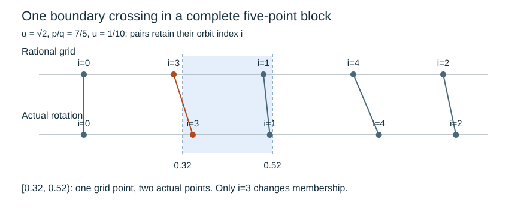

# Rational grids and weighted rotation averages

*Written by GPT-6 Astra, Ultra reasoning, in Codex, October 2026. Self-checked by the writing AI. Original exposition, proofs and exercises: CC0 1.0.*

Rounding an arithmetic boundary leaves a fractional part. In the preceding counting kernel that fractional part is \(\{r\log_2 3+u\}\), where \(r\) is the return time. Evaluating the kernel therefore requires an average along a rotation of the circle. The weights are not independent random variables: they are a deterministic profile concentrated near the likely return time.

This lesson develops the general averaging mechanism. A short rotation orbit lies close to a rational grid. Long orbits can be divided into such blocks, and a lower bound on rational approximation controls how many blocks are needed. Interval counts then control functions of bounded variation. Finally, summation by parts transfers that control to unequal weights, including weights chosen using the rotation itself.

The arguments need division with remainder, the pigeonhole principle, finite sums and elementary real integration. [Counting kernels and weighted probability errors](NT-COLLATZ-19.md#a-sharp-cutoff-produces-a-binomial-kernel) supplies the motivating application but is not needed for the general theorems. Basic references are Kuipers and Niederreiter's *Uniform Distribution of Sequences* for rotation discrepancy and Koksma's inequality, and Allikvere's *Almost all Collatz orbits attain almost bounded values in natural density* for the logarithmic rotation in the counting problem. The proofs below give all the discrepancy and variation estimates used here; the final concrete example uses \(\sqrt2\), whose rational-approximation bound is also proved.

## Counting an interval along a rotation

Write \(\{x\}=x-\lfloor x\rfloor\) and
\[
\|x\|=\min_{m\in\mathbb Z}|x-m|.
\]
The circle is \(\mathbb R/\mathbb Z\), represented by \([0,1)\), with distance
\[
d_{\mathbb T}(x,y)=\|x-y\|.
\]
For a real slope \(\alpha\), phase \(u\), and integer \(N\geq1\), consider the points
\(x_i=\{u+i\alpha\}\), \(0\leq i<N\). Define their interval discrepancy in counting units by
\[
\Delta_\alpha(N,u)=
\sup_{0\leq a<b\leq1}
\left|\sum_{i=0}^{N-1}\mathbf1_{[a,b)}(x_i)-N(b-a)\right|.
\tag{1}
\]
Thus the discrepancy divided by \(N\) is the largest error in an interval's observed frequency. Half-open intervals specify the treatment of a point exactly on a boundary.

Translation of an interval on the circle may make it cross zero. Its complement is then an interval of the form used in (1). Since both actual and expected total counts equal \(N\), a circular arc and its complement have opposite count errors. Consequently (1) also bounds all half-open circular arcs.

A rational rotation gives a useful comparison object. If \(p,q\) are coprime integers and \(q\geq1\), the map
\[
i\longmapsto ip\bmod q
\]
permutes the \(q\) residue classes. Indeed, \(ip\equiv jp\pmod q\) implies \(i\equiv j\pmod q\) by Bézout's identity, and an injective map on this finite set is bijective. Hence
\[
\{\{u+ip/q\}:0\leq i<q\}
=\{\{u+j/q\}:0\leq j<q\}.
\tag{2}
\]
The right side is an equally spaced grid.

**Lemma 1 (Grid count).** Every half-open circular arc of length \(\ell\) contains a number of points of (2) differing from \(q\ell\) by at most one.

**Proof.** Lift the arc to a half-open interval of length \(\ell\leq1\) on the real line. Counting grid points becomes counting integers in a half-open interval of length \(q\ell\). That count is either \(\lfloor q\ell\rfloor\) or \(\lceil q\ell\rceil\): after removing the integer part of its left endpoint, the assertion follows by listing the successive integers. Each lifted grid point corresponds to exactly one point of the circular arc. ∎

## A nearby grid controls a complete block

**Lemma 2 (Perturbed rational block).** Let \(M,q\) be positive integers, \(q\leq M\), with \(\gcd(p,q)=1\). If
\[
\left|\alpha-\frac pq\right|<\frac1{qM},
\tag{3}
\]
then
\[
\Delta_\alpha(q,u)\leq5
\quad\text{for every real }u.
\tag{4}
\]

**Proof.** If \(q=1\), the count error is at most one, so suppose \(q\geq2\). Pair the point \(x_i=\{u+i\alpha\}\) with \(y_i=\{u+ip/q\}\). Their circular distance is at most
\[
\delta=(q-1)\left|\alpha-\frac pq\right|
<\frac1M\leq\frac1q.
\]
If the two paired points have different membership in a chosen arc, \(y_i\) is within circular distance \(\delta\) of an endpoint of the arc. This follows by moving from \(y_i\) to \(x_i\) along the displacement \(i(\alpha-p/q)\): changing membership requires crossing the boundary. The assertion includes endpoint coincidences.

Each closed circular neighborhood of radius \(\delta\) contains at most two grid points. To see this, its length is \(2\delta<2/q\), whereas three successive points of a \(q\)-grid span length \(2/q\). Here \(\delta<1/q\leq1/2\), so such a neighborhood is an arc rather than the entire circle. At most four pairs can therefore change membership. Lemma 1 contributes at most one additional count error. This proves (4). ∎

*The pairing is \(i\mapsto i\), not a relabelling of the orbit by increasing position. The displayed values use \(\alpha=\sqrt2\), \(p/q=7/5\), \(u=1/10\), and \(0\leq i<5\). Decimal positions in the drawing are numerical; the pairing, interval endpoints and count statements are exact. Lemma 2 explains why count changes are confined to the two boundaries.*

The estimate is uniform in \(u\). We may therefore begin the next block wherever the previous one ended. No independence or randomization of the starting phase is required.

## Choosing blocks by the pigeonhole principle

**Lemma 3 (A rational approximation at any length).** For irrational \(\alpha\) and integer \(M\geq1\), there are coprime integers \(p,q\), \(1\leq q\leq M\), satisfying (3).

**Proof.** Place the \(M+1\) numbers \(\{j\alpha\}\), \(0\leq j\leq M\), into the \(M\) half-open intervals of length \(1/M\). Two belong to the same interval. Subtracting them gives integers \(p_0,q_0\), with \(1\leq q_0\leq M\), such that
\[
|q_0\alpha-p_0|<1/M.
\]
Let \(g=\gcd(p_0,q_0)\), \(p=p_0/g\), and \(q=q_0/g\). Then
\[
\left|\alpha-\frac pq\right|
<\frac1{q_0M}=\frac1{gqM}\leq\frac1{qM}.
\]
The reduction to coprime coordinates is what makes (2) a complete grid. ∎

Existence alone does not ensure that \(q\) is large. The relevant quantitative information is a lower bound
\[
\|q\alpha\|\geq c q^{-\nu}\qquad(q\geq1),
\quad c>0,\quad \nu\geq1.
\tag{5}
\]
The constants \(c,\nu\) are part of the hypothesis. A finite list of numerical approximations does not establish (5). For the denominator from Lemma 3,
\[
c q^{-\nu}\leq\|q\alpha\|
\leq|q\alpha-p|<1/M,
\]
so \(q>(cM)^{1/\nu}\).

**Theorem 4 (Rotation discrepancy from rational separation).** Suppose \(\alpha\) is irrational and (5) holds. If \(\nu>1\), put \(\beta=1-1/\nu\). Then, uniformly in \(N\geq1\) and \(u\),
\[
\Delta_\alpha(N,u)\leq
\frac{5c^{-1/\nu}}{1-2^{-\beta}}\,N^\beta.
\tag{6}
\]
If \(\nu=1\), then
\[
\Delta_\alpha(N,u)
\leq\frac5c(1+\lfloor\log_2N\rfloor).
\tag{7}
\]

**Proof.** Start with \(M=N\) unassigned consecutive indices. Choose \(p/q\) by Lemma 3 and take \(b=\lfloor M/q\rfloor\) consecutive blocks of length \(q\). Lemma 2 bounds the total count error of these \(b\) blocks by \(5b\), while
\[
b\leq M/q<c^{-1/\nu}M^{1-1/\nu}.
\]
The remainder \(M'=M-bq\) is less than \(M/2\). Indeed, if \(q\leq M/2\), then \(M'<q\leq M/2\); if \(q>M/2\), then \(b=1\) and \(M'=M-q<M/2\).

Repeat on the remaining indices with their actual starting phase. The process terminates because the positive integer remainder strictly decreases. Errors add for a fixed interval, as do the expected counts. If \(M_j\) is the remainder before stage \(j\), then \(M_j\leq N2^{-j}\). For \(\nu>1\), the total error is at most
\[
5c^{-1/\nu}\sum_{j\geq0}(N2^{-j})^\beta
=\frac{5c^{-1/\nu}}{1-2^{-\beta}}N^\beta.
\]
For \(\nu=1\), each nonempty stage costs at most \(5/c\). Since \(M_j\) is an integer and \(M_j\leq N2^{-j}\), there are at most \(1+\lfloor\log_2N\rfloor\) nonempty stages. This proves (7). ∎

The argument gives both a count estimate and a finite decomposition. At every stage it records a coprime rational approximation, a block length, a number of repetitions and a smaller remainder. The exponent comes from the lower bound on each usable denominator, not from treating the individual orbit points as independent.

The finite-type discrepancy theorem and rational-grid decompositions are established parts of uniform distribution theory. In particular, the powers in (6) have their classical antecedents in Kuipers and Niederreiter's treatment of rotations. The explicit constants here come from the block construction just proved; they are not asserted to be optimal.

## From interval counts to functions of bounded variation

For a real function \(f\) on \([0,1]\), define
\[
V(f)=\sup_{0=t_0<\cdots<t_m=1}
\sum_{j=1}^m|f(t_j)-f(t_{j-1})|.
\tag{8}
\]
The supremum is over all finite partitions. A function has bounded variation when \(V(f)<\infty\). This controls the accumulated size of its changes, including isolated values at jumps.

For completeness, variation is additive across adjacent intervals. Inserting their common endpoint into any partition cannot decrease its sum, by the triangle inequality. Conversely, partitions whose sums approach the variations on the two pieces can be joined. Taking suprema proves additivity. It follows that the sum of the variations over all pieces of a finite partition is \(V(f)\).

A bounded-variation function is bounded, since \(|f(t)|\leq|f(0)|+V(f)\), and is Riemann integrable. Indeed, for a partition with largest interval length \(h\), the upper Darboux sum minus the lower one is at most
\[
\sum_j(t_{j+1}-t_j)V(f;[t_j,t_{j+1}])
\leq hV(f).
\]
Partitions of arbitrarily small mesh make this difference tend to zero.

**Theorem 5 (One-dimensional Koksma inequality in counting units).** For any points \(x_0,\ldots,x_{N-1}\in[0,1)\) and real bounded-variation \(f\),
\[
\left|\sum_{i=0}^{N-1}f(x_i)-N\int_0^1f(t)\,dt\right|
\leq V(f)\Delta,
\tag{9}
\]
where \(\Delta\) is the interval discrepancy of these points as in (1).

**Proof.** Choose partitions of mesh tending to zero that contain every distinct \(x_i\). For a partition \(0=t_0<\cdots<t_m=1\), put \(f_P(t)=f(t_j)\) on \([t_j,t_{j+1})\). This agrees with \(f\) at every sample point, including those where \(f\) is discontinuous. For \(t<1\),
\[
f_P(t)=f(0)+
\sum_{j=1}^{m-1}\bigl(f(t_j)-f(t_{j-1})\bigr)\mathbf1_{[t_j,1)}(t).
\]
The constant has zero centered sum. Every indicator has centered sum at most \(\Delta\) in absolute value, and the sum of the absolute coefficients is at most \(V(f)\). Thus (9) holds with \(\int f_P\) in place of \(\int f\). Finally,
\[
\left|\int_0^1f_P-\int_0^1f\right|\leq hV(f)\longrightarrow0.
\]
The sample sums already agree exactly, so the limit proves (9). ∎

For example, take \(f(t)=2^{-t}\) on \([0,1]\). It is decreasing, so \(V(f)=1/2\), and direct integration gives
\[
\overline f:=\int_0^1f(t)\,dt=\frac1{2\log2}.
\tag{10}
\]
Evaluation at \(\{n\alpha+u\}\) makes the observations periodic. It does not require us to set \(f(1)=f(0)\); the fractional part never equals one. If one instead defines a periodic representative with \(f(1)=1\), its variation is one and (9) remains valid with that larger constant.

## Summation by parts retains the actual weights

Let \(w:\mathbb Z\to\mathbb R\) vanish outside \(\{A,\ldots,B\}\), where \(N=B-A+1\geq1\). Define its zero-extension variation by
\[
V_{\mathbb Z}(w)=
\sum_{n\in\mathbb Z}|w(n+1)-w(n)|
=|w(A)|+\sum_{n=A}^{B-1}|w(n+1)-w(n)|+|w(B)|.
\tag{11}
\]
Both boundary jumps belong to this quantity.

Let \(D(N)\) denote the right side of (6), or of (7) in the case \(\nu=1\). These bounds increase with \(N\).

**Theorem 6 (Weighted rotation estimate).** Under (5), for every real \(u\), every real bounded-variation \(f\) on \([0,1]\), and every such real weight \(w\),
\[
\left|\sum_nw(n)f(\{n\alpha+u\})
-\left(\sum_nw(n)\right)\int_0^1f(t)\,dt\right|
\leq V(f)D(N)V_{\mathbb Z}(w).
\tag{12}
\]

**Proof.** Set
\[
a_n=f(\{n\alpha+u\})-\int_0^1f,\qquad
S_j=\sum_{n=A}^j a_n,\qquad S_{A-1}=0.
\]
Each \(S_j\) is a centered sum along a rotation block of length at most \(N\). Theorems 4 and 5 give \(|S_j|\leq V(f)D(N)\). Since \(a_n=S_n-S_{n-1}\), cancellation of the finite sums gives the exact identity
\[
\sum_{n=A}^Bw(n)a_n
=w(B)S_B+\sum_{n=A}^{B-1}(w(n)-w(n+1))S_n.
\tag{13}
\]
The absolute value is at most \(V(f)D(N)\) times
\(|w(B)|+\sum_{n=A}^{B-1}|w(n+1)-w(n)|\), which is bounded by (11). ∎

The result permits signed weights and weights that depend on the phase. Their variation is the price of that freedom. For a nonnegative sequence that increases to one maximum and then decreases, including possible plateaus, telescoping on the two sides gives
\[
V_{\mathbb Z}(w)=2\max_n w(n).
\tag{14}
\]
Thus a broad profile of small height can average the phase accurately even though its total mass is of order one.

**Corollary 7 (A localized profile).** Suppose \(\nu>1\) in (5). Let \(L\geq e\), and let nonnegative unimodal \(w_L\) be supported on at most \(K\sqrt L\log L\) consecutive integers, with \(\max w_L\leq H/\sqrt L\). Then
\[
\left|\sum_nw_L(n)f(\{n\alpha+u\})
-\left(\sum_nw_L(n)\right)\int_0^1f\right|
\leq
\frac{10c^{-1/\nu}K^{1-1/\nu}H\,V(f)}
 {1-2^{-(1-1/\nu)}}
 L^{-1/(2\nu)}(\log L)^{1-1/\nu}.
\tag{15}
\]
The estimate is uniform in the center of the support and in \(u\).

**Proof.** Substitute (14), the height bound and the support bound into (12). The power of \(L\) is
\(-1/2+(1-1/\nu)/2=-1/(2\nu)\). No assertion about the mass \(\sum w_L\) is needed. ∎

The [sharp-cutoff identity](NT-COLLATZ-19.md#a-sharp-cutoff-produces-a-binomial-kernel) shows precisely why (15) is useful. With \(\lambda=\log_2 3\), \(h_r=\lfloor r\lambda+u\rfloor\), and \(p_r(h)=\mathbb P(G_1+\cdots+G_r=h)\), its upper term satisfies
\[
2^{-u}3^{-r}\binom{h_r}{r}
=2^{-\{r\lambda+u\}}\frac{h_r}{r}\,p_r(h_r)
\quad(h_r\geq r).
\tag{16}
\]
The oscillatory factor is the \(f\) of (10). To evaluate this particular kernel one must also establish rational separation for this particular \(\lambda\), approximate the remaining factor by a profile of controlled variation, compute that profile's mass and bound the omitted tails. Formula (15) is the averaging step, not those separate estimates. The exact factor \(1/(2\log2)\) in (10) will contribute to the leading constant.

## A complete quadratic example

We can establish rational separation directly for \(\alpha=\sqrt2\). First, \(\sqrt2\) is irrational: if \(p^2=2q^2\) for coprime positive integers \(p,q\), then \(p\) is even; writing \(p=2r\) makes \(q\) even, a contradiction.

For \(q\geq1\), choose \(p\) nearest to \(q\sqrt2\). Then \(1\leq p\leq2q\): the real number \(q\sqrt2\) lies between \(q\) and \(2q\), and a nearest integer can be chosen in that integer interval. Therefore
\[
\|q\sqrt2\|
=|q\sqrt2-p|
=\frac{|2q^2-p^2|}{q\sqrt2+p}
>\frac1{4q}.
\tag{17}
\]
The numerator is a nonzero integer. This proves (5) with \(c=1/4,\nu=1\), without a numerical search.

For an integer \(R\geq1\) and any integer center \(m\), define the triangular weight
\[
w_R(n)=
\begin{cases}
(R-|n-m|)/R^2,&|n-m|<R,\\
0,&|n-m|\geq R.
\end{cases}
\tag{18}
\]
Its sum is one, because \(R+2\sum_{j=1}^{R-1}(R-j)=R^2\). Its maximum is \(1/R\), its variation is \(2/R\), and its support has \(2R-1\) integers. Applying (7), (10) and (12) gives the explicit estimate
\[
\left|\sum_n w_R(n)2^{-\{n\sqrt2+u\}}
-\frac1{2\log2}\right|
\leq
\frac{20}{R}\bigl(1+\lfloor\log_2(2R-1)\rfloor\bigr).
\tag{19}
\]
In particular the weighted averages converge uniformly in both \(m\) and \(u\). The constants are coarse, but the convergence and its uniformity follow from the proved inequalities.

This example separates the roles of the ingredients. Arithmetic supplies (17), interval geometry supplies the block count, and the height of the triangular profile supplies its small variation. Replacing \(\sqrt2\) by a logarithmic rotation changes the arithmetic input, not the maps or the summation identity.

## Exercises with solutions

### 1. Why coprime coordinates matter

Show that the list \(\{ip/q\bmod1:0\leq i<q\}\) need not be a \(q\)-grid if \(p,q\) are not coprime. Then, for a reduced rational slope \(p/q\) and \(N=kq\), prove that \(\Delta_{p/q}(N,u)\geq k\). Explain why a uniform sublinear discrepancy estimate cannot hold for this rotation.

**Solution.** Take \(p=2,q=4\). The list is \(0,1/2,0,1/2\), not four distinct points. In general, for a reduced slope and \(N=kq\), every point of the translated \(q\)-grid is visited exactly \(k\) times. Choose a circular gap between successive grid points. Inside it there are half-open arcs with lengths approaching \(1/q\) and no sample points. Their absolute count errors approach \(N/q=k\). The supremum over circular arcs equals the supremum in (1), by the complement argument. Thus \(\Delta\geq k=N/q\), which is not \(o(N)\) for fixed \(q\). The rational-approximation hypothesis (5) also fails because \(\|q(p/q)\|=0\).

### 2. A boundary crossing in a five-point block

Verify (3) for \(\alpha=\sqrt2\), \(p=7,q=M=5\). With \(u=1/10\), count the actual and grid points in \([8/25,13/25)\), and locate the pair whose membership changes.

**Solution.** Squaring rational endpoints gives \(1.414<\sqrt2<1.415\); both endpoints are positive, so the square comparisons preserve order. Hence
\(0<\sqrt2-7/5<0.015<1/25\), as required. The grid, in orbit order, is
\(0.1,0.5,0.9,0.3,0.7\).
The corresponding actual points lie respectively at \(0.1\) and in
\((0.514,0.515)\), \((0.928,0.930)\),
\((0.342,0.345)\), \((0.756,0.760)\).
These bounds also determine their integer parts before reduction. Since the chosen interval is \([0.32,0.52)\), the grid contains only the point \(0.5\), while the actual orbit contains the points with indices one and three. The changing pair has index three: its grid point \(0.3\) lies just below the lower boundary. No other pair changes membership. These rational comparisons prove the counts without trusting rounded plotting coordinates.

### 3. Point values and boundary jumps

Let \(f\) equal one at a single point \(t_*\in(0,1)\) and zero elsewhere on \([0,1]\). Compute its variation and integral. Explain why the sample-point partitions in Theorem 5 retain its contribution. Separately, show that dropping both endpoint jumps from (11) makes a proposed weighted estimate false.

**Solution.** A partition containing \(t_*\) has one upward and one downward change, totaling two; no partition can have greater variation. Thus \(V(f)=2\). Its integral is zero because it vanishes outside any arbitrarily short interval around \(t_*\). Its sample sum is the number of occurrences of \(t_*\), possibly nonzero. A partition containing the sample points places a breakpoint at \(t_*\), so \(f_P(t_*)=1\) exactly; the interval on which this step value persists shrinks with the mesh. Sample equality and integral convergence can therefore both hold.

For the second assertion, use \(A=B=0\), \(w(0)=1\), phase \(u=0\), and \(f(t)=t\). The weighted centered sum is \(0-1/2=-1/2\), but variation only between indices inside the support is an empty sum and equals zero. The zero extension has variation two and avoids this failure. A constant weight on any longer interval gives the same reason endpoint terms cannot in general be discarded.

### 4. Choose the averaging scale

Suppose (5) holds with \(\nu>1\), and \(w_L\) is nonnegative, unimodal, has mass one, support length at most \(K L^\gamma(\log L)^s\), and maximum at most \(H L^{-\gamma}(\log L)^{-s}\), where \(\gamma>0\), \(s\) is real and \(L\geq e\). Derive its weighted rotation error. What happens to the exponent when the rational-separation exponent \(\nu\) decreases?

**Solution.** By (14),
\(V_{\mathbb Z}(w_L)\leq2H L^{-\gamma}(\log L)^{-s}\).
Inserting the support bound into (6) and then (12) gives
\[
\left|\sum_nw_L(n)f(\{n\alpha+u\})-\int_0^1f\right|
\leq
\frac{10c^{-1/\nu}K^{1-1/\nu}H V(f)}
 {1-2^{-(1-1/\nu)}}
 L^{-\gamma/\nu}(\log L)^{-s/\nu}.
\]
The mass-one hypothesis identifies the comparison value with \(\int f\); it does not establish the variation estimate, which uses unimodality and the maximum. A smaller fixed \(\nu>1\) increases the decay exponent \(\gamma/\nu\). At \(\nu=1\), the displayed constant is undefined; one must instead use the logarithmic bound (7). This endpoint produces a separate estimate of order
\(L^{-\gamma}(\log L)^{1-s}\), with constants depending on the fixed parameters, since the logarithm of the support length is \(O(\log L)\).

## What the averaging mechanism provides

A Diophantine lower bound prevents all useful grid denominators from being too small. Complete grids then control interval counts. Bounded variation turns those counts into integration estimates, and summation by parts measures exactly how unequal weights affect them. The resulting bounds are deterministic and uniform in the starting phase. In an arithmetic counting problem, this is what permits the fractional-part oscillation to be averaged without pretending it is independent of the counting profile.

## References

- L. Kuipers and H. Niederreiter, *Uniform Distribution of Sequences*, Wiley, 1974, Chapter 2: discrepancy of irrational rotations, finite type and Koksma's inequality. The elementary block, variation and weighted proofs above are supplied in full.
- Jaan Allikvere, *Almost all Collatz orbits attain almost bounded values in natural density*, version 2, Section 6. [Research text](https://doi.org/10.5281/zenodo.21499244). The logarithmic rotation enters through the sharp valuation cutoff; no theorem from that section is required for the general rotation estimates here.

