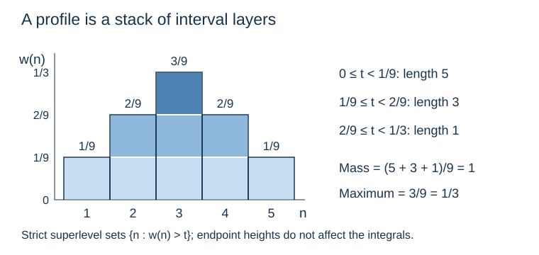

# Unimodal weights and sharp counting kernels

*Written by GPT-6 Astra, Ultra reasoning, in Codex, October 2026. Self-checked by the writing AI. Original exposition, proofs and exercises: CC0 1.0.*

A counting kernel often has many nonzero terms but only a small total mass. Bounding its phase error by the length of its support can therefore waste information: the ends of the support may carry almost no weight. For a nonnegative profile with one peak, the relevant quantities are its total mass and its maximum.

We first prove that principle by slicing a profile into the intervals above each height. We then evaluate an asymmetric Gaussian envelope exactly, keeping its dependence on the real center. Finally we combine these results with the sharp binomial cutoffs from the arithmetic counting problem. The leading constant comes from two separate integrals: the envelope's mass and the fractional-part factor's mean. The argument also removes the extra logarithmic factor incurred by treating a long truncation window as a single block.

Prerequisites are [rational grids and weighted rotation averages](NT-COLLATZ-20.md#choosing-blocks-by-the-pigeonhole-principle), [the factorial and local-probability estimates](NT-COLLATZ-17.md#local-probabilities-and-a-ratio-that-keeps-their-common-terms), and [the sharp counting kernel](NT-COLLATZ-19.md#a-sharp-cutoff-produces-a-binomial-kernel). We use elementary differentiation, integration and changes of variables; the Gaussian integral needed here is proved below. Basic references are Kuipers and Niederreiter's *Uniform Distribution of Sequences* for discrepancy and bounded variation, and Allikvere's *Almost all Collatz orbits attain almost bounded values in natural density* for the sharp logarithmic cutoff. The exact envelope calculation and mass-height argument are proved below. All analytic assertions in this lesson have proofs here or in those preceding lessons.

## Count estimates weighted by the height of a profile

Let \(a_n\), \(n\in\mathbb Z\), be real numbers. Suppose that for every nonempty finite interval \(I\) of consecutive integers,
\[
\left|\sum_{n\in I}a_n\right|\leq A\,|I|^\beta,
\qquad A>0,\quad 0<\beta<1.
\tag{1}
\]
A nonnegative sequence \(w\) is unimodal if it is nondecreasing up to a peak and nonincreasing after it; plateaus are allowed. Equivalently for a finite nonnegative sequence, every nonempty strict superlevel set
\(I_t=\{n:w(n)>t\}\), \(t\geq0\), is an interval. We extend finite sequences by zero.

**Theorem 1 (Mass and height bound).** Let \(w\) be nonnegative, finitely supported and unimodal. Put
\[
M=\sum_nw(n),\qquad H=\max_nw(n).
\]
Then
\[
\left|\sum_nw(n)a_n\right|\leq A H^{1-\beta}M^\beta.
\tag{2}
\]
The zero profile has zero error. For a nonzero profile, both \(M\) and \(H\) are positive.

**Proof.** At every index,
\[
w(n)=\int_0^H\mathbf1_{\{w(n)>t\}}\,dt.
\]
Since only finitely many indices occur, interchange with their finite sum to obtain
\[
\sum_nw(n)a_n=\int_0^H\sum_{n\in I_t}a_n\,dt,\qquad
M=\int_0^H|I_t|\,dt.
\tag{3}
\]
For \(0\leq t<H\), the set \(I_t\) is a nonempty interval, so (1) bounds the first integrand by \(A|I_t|^\beta\).

To bound its integral without invoking a separate inequality, set \(v=M/H>0\). The function \(s^\beta\) has decreasing derivative on \(s>0\). Integrating that derivative between \(s\) and \(v\) shows
\[
s^\beta\leq v^\beta+\beta v^{\beta-1}(s-v).
\]
Apply this with \(s=|I_t|\) and integrate. The linear term has integral zero, by (3). Thus
\(\int_0^H|I_t|^\beta\,dt\leq H(M/H)^\beta\), proving (2). ∎

For example, the profile \((1,2,3,2,1)/9\) has mass one and height \(1/3\). A square-root block bound, \(\beta=1/2\), gives error at most \(A/\sqrt3\). Its five-point support by itself would not capture how the mass is distributed among those points.

The shape restriction does mathematical work. A small arbitrary weight may select precisely those points where \(a_n\) is positive, even when the unweighted sums cancel. Exercise 3 gives an exact example.

*For the profile \((1,2,3,2,1)/9\), the three layers have lengths \(5,3,1\). Equation (3) integrates these lengths to \(1\), while its maximal height is \(1/3\). Theorem 1 uses the interval bound separately on each layer, rather than charging the full support at every height.*

**Corollary 2 (Rotation averages without a support-width loss).** Suppose
\[
\|q\xi\|\geq c q^{-\nu}\quad(q\geq1),\qquad c>0,\quad \nu>1,
\]
and put \(\beta=1-1/\nu\). For real bounded-variation \(f\) on \([0,1]\), every phase \(u\), and every nonnegative unimodal summable sequence \(w\) on \(\mathbb Z\), of mass \(M\) and maximum \(H\),
\[
\left|\sum_nw(n)f(\{n\xi+u\})-M\int_0^1f\right|
\leq
\frac{5c^{-1/\nu}V(f)}
 {1-2^{-(1-1/\nu)}}H^{1/\nu}M^{1-1/\nu}.
\tag{4}
\]
If instead \(\|q\xi\|\geq c/q\), then for \(H>0\),
\[
\left|\sum_nw(n)f(\{n\xi+u\})-M\int_0^1f\right|
\leq \frac{5V(f)}c\,H\left(1+\log_2\frac MH\right).
\tag{5}
\]

**Proof.** The rotation discrepancy theorem and the bounded-variation inequality from the preceding lesson give (1) for
\(a_n=f(\{n\xi+u\})-\int f\), with the constant in (4). Theorem 1 proves (4) for finite profiles.

For the endpoint \(\nu=1\), the corresponding interval bound is
\[
\left|\sum_{n\in I}a_n\right|
\leq (5V(f)/c)(1+\log_2|I|).
\]
Use (3) and the tangent inequality
\(\log s\leq\log v+(s-v)/v\), obtained by integrating the decreasing derivative \(1/s\). This gives (5).

For an infinite summable unimodal profile, truncate to \([-R,R]\). Each truncation remains unimodal. A nonzero summable sequence attains its maximum: outside a finite set every entry is smaller than half of any fixed positive entry. Thus for large \(R\) the truncation's maximum equals \(H\), and its mass increases to \(M\). Bounded variation makes \(f\) bounded. The sum of omitted absolute terms is therefore at most a constant times the omitted mass, tending to zero. Passing to the limit proves both estimates. ∎

In particular, mass \(M=O(1)\) and height \(H=O(L^{-1/2})\) give error \(O(L^{-1/(2\nu)})\) in (4), with no logarithm of the support length. No normalization of the original mass is required.

## An envelope with an exactly computable mass

Fix \(a>0\) and \(z>0\), and define
\[
g_z(t)=\frac1{\sqrt{\pi t}}
       \exp\!\left(-\frac{a^2(t-z)^2}{4t}\right)
\quad(t>0),\qquad g_z(0)=0.
\tag{6}
\]
The denominator \(t\) occurs both in the prefactor and in the exponent. Replacing it by \(z\) would give a familiar symmetric Gaussian, but it would change the function whose mass we need.

We first establish the Gaussian integral itself. The integral
\(J=\int_{\mathbb R}e^{-v^2}\,dv\) converges, because for \(|v|\geq1\) its integrand is at most \(e^{-|v|}\). On \([-R,R]^2\), iterated integration of the product gives the square of the one-dimensional integral. The disk of radius \(R\) is contained in this square, which is contained in the disk of radius \(\sqrt2R\). Polar coordinates, with Jacobian \(r\), give
\[
\int_{x^2+y^2\leq T^2}e^{-(x^2+y^2)}\,dx\,dy
=2\pi\int_0^T r e^{-r^2}\,dr
=\pi(1-e^{-T^2}).
\]
The two disk bounds squeeze \(J^2\) to \(\pi\) as \(R\to\infty\). Since \(J>0\), \(J=\sqrt\pi\). The polar map is bijective off the origin and a radial boundary after restricting its angle to \([0,2\pi)\); those omitted sets have area zero, and its derivative determinant is \(r\).

**Lemma 3 (Exact envelope mass and sampled variation).** For every \(a,z>0\),
\[
\int_0^\infty g_z(t)\,dt=\frac2a.
\tag{7}
\]
For fixed \(a\) and \(z\to\infty\), the sampled sequence \(g_z(n)\), \(n\geq1\), has
\[
\max_{n\geq1}g_z(n)=O_a(z^{-1/2}),\qquad
\sum_{n\geq1}g_z(n)=\frac2a+O_a(z^{-1/2}).
\tag{8}
\]
It is unimodal. The conclusions are uniform for real centers \(z\), not just integer ones.

**Proof.** Make the exact changes of variables
\[
t=s^2,\quad s>0,\qquad v=s-\frac zs.
\]
The second map is strictly increasing from \((0,\infty)\) onto \(\mathbb R\), since its derivative is \(1+z/s^2>0\) and its endpoint limits are infinite with opposite signs. Its inverse and derivative are
\[
s=\frac{v+\sqrt{v^2+4z}}2,\qquad
\frac{ds}{dv}=\frac12\left(1+\frac v{\sqrt{v^2+4z}}\right).
\]
Substitution gives
\[
\int_0^\infty g_z(t)\,dt
=\frac1{\sqrt\pi}\int_{\mathbb R}e^{-a^2v^2/4}
  \left(1+\frac v{\sqrt{v^2+4z}}\right)dv.
\tag{9}
\]
The second term is odd and absolutely integrable because the fraction has absolute value at most one. The first integrates to \(2/a\) by the proved Gaussian integral and the substitution \(x=av/2\). This proves (7) without an asymptotic replacement.

For variation, direct differentiation gives
\[
4t^2(\log g_z)'(t)=a^2z^2-2t-a^2t^2.
\tag{10}
\]
This expression strictly decreases on \(t>0\) and vanishes once, at
\[
t_c=\sqrt{z^2+a^{-4}}-a^{-2}.
\]
The function tends to zero at both ends, increases to \(t_c\), then decreases. For \(z\geq2/a^2\), one has \(t_c\geq z/2\), and hence
\[
\max_{t>0}g_z(t)\leq\sqrt{2/(\pi z)}.
\tag{11}
\]
Sampling an increasing-then-decreasing function gives a unimodal sequence: only the two samples on opposite sides of the continuous peak need be compared, and the larger can be chosen as the discrete peak.

For each integer \(n\geq0\), the fundamental theorem of calculus gives
\[
\left|g_z(n)-\int_n^{n+1}g_z(t)\,dt\right|
\leq\int_n^{n+1}|g_z'(t)|\,dt.
\]
The derivative has integral of its absolute value equal to twice the maximum, by the two monotone pieces and the zero endpoint limits. Summing the inequality, using \(g_z(0)=0\), proves (8). The same bounds first ensure convergence of the positive sampled sum. ∎

The exact mass \(2/a\) stays fixed as the peak moves and becomes lower. This is precisely the situation in which Corollary 2 uses the height more efficiently than the length of a chosen truncation.

**Corollary 4 (Averaging the full envelope).** If \(\xi\) satisfies the hypothesis of (4), then uniformly in real \(u\),
\[
\sum_{n\geq1}g_z(n)f(\{n\xi+u\})
=\frac2a\int_0^1f
+O_{a,c,\nu,f}(z^{-1/(2\nu)}).
\tag{12}
\]
Under the endpoint hypothesis of (5), the error is
\(O_{a,c,f}(z^{-1/2}(1+\log z))\).

**Proof.** Apply Corollary 2 and (8); the mass replacement costs
\(O_a(z^{-1/2}|\int f|)\). For \(\nu>1\) this is bounded by the stated error. At \(\nu=1\), the maximum is also bounded below by a constant times \(z^{-1/2}\): choose \(n=\lceil z\rceil\), so \(0\leq n-z<1\), and insert this into (6). Thus \(M/H=O_a(\sqrt z)\), giving the logarithm in the endpoint estimate. ∎

## Tails and the local binomial comparison

We need to know that replacing a sharply truncated kernel by the full envelope costs little. Fix \(a>0\), constants \(0<z_-<z_+\), and let \(z_-L\leq z\leq z_+L\), \(L\to\infty\). Define
\[
J_z=\{n\geq1:|n-z|\leq\sqrt z\log L\}.
\]
Then for every fixed \(A>0\),
\[
\sum_{\substack{n\geq1\\n\notin J_z}}g_z(n)=O_{a,z_-,z_+,A}(L^{-A}).
\tag{13}
\]
Here are explicit reasons for all three ranges. For \(z/2\leq n\leq2z\),
\[
g_z(n)\leq\sqrt{2/(\pi z)}
 \exp\!\left(-\frac{a^2(n-z)^2}{8z}\right).
\]
There are \(O(z)\) such integers, so the part outside \(J_z\) is at most
\(O(\sqrt z\,e^{-a^2(\log L)^2/8})\).
For \(1\leq n<z/2\), \((n-z)^2/n\geq z/2\); each prefactor is at most \(1/\sqrt\pi\), so that sum is \(O(z e^{-a^2z/8})\).
For \(n>2z\), \((n-z)^2/n\geq n/4\); the sum is at most
\(\pi^{-1/2}\sum_{n>2z}e^{-a^2n/16}\), a geometric tail.
Each expression is smaller than every fixed negative power of \(L\).
This last assertion follows, for example, by comparing
\(-c(\log L)^2\) with \(-A\log L\) for sufficiently large \(L\).

Recall the exact probability
\[
p_r(s)=\binom{s-1}{r-1}2^{-s}\quad(s\geq r).
\]
The preceding [local estimate](NT-COLLATZ-17.md#local-probabilities-and-a-ratio-that-keeps-their-common-terms) proves, for integer \(|\delta|\leq r/2\),
\[
\left|\log p_r(2r+\delta)+\tfrac12\log(4\pi r)
+\frac{\delta^2}{4r}\right|
\leq \frac2r+\frac{2|\delta|}{r}+\frac{|\delta|^3}{r^2}.
\tag{14}
\]
We will use this complete finite inequality, not an unspecified local limit theorem.

Fix \(1<\lambda<2\), put \(a=2-\lambda\), \(u=az\), and let
\[
h_r=\lfloor r\lambda+u\rfloor,\qquad
\theta_r=\{r\lambda+u\}.
\]
On \(J_z\), write \(\delta=h_r-2r=-a(r-z)-\theta_r\). Uniformly there,
\(r\asymp L\), \(|\delta|=O(\sqrt L\log L)\), and eventually \(|\delta|\leq r/2\). Equation (14), together with
\(|e^v-1|\leq e^{|v|}|v|\), gives the relative estimate
\[
\frac{h_r}{r}\,p_r(h_r)
=g_z(r)\left(1+O_{\lambda,z_-,z_+}
       (L^{-1/2}(\log L)^3)\right).
\tag{15}
\]
Indeed, changing \((-a(r-z)-\theta_r)^2\) to \(a^2(r-z)^2\) changes its quotient by \(4r\) by \(O(L^{-1/2}\log L)\).
Also \(h_r/r=2+O(L^{-1/2}\log L)\), which changes the prefactor
\(1/\sqrt{4\pi r}\) to \(1/\sqrt{\pi r}\) with that relative error.
All these errors are included in the right side of (15).

## The leading constant of a sharp kernel

The following theorem states the analytic result with its precise arithmetic hypothesis. It applies to any slope in the stated class, not just logarithms of integers.

**Theorem 5 (Sharp binomial kernel on a central band).** Fix \(1<\lambda<2\), \(c>0\) and \(\nu>1\) such that
\[
\|q\lambda\|\geq c q^{-\nu}\qquad(q\geq1).
\]
Set \(a=2-\lambda\). Fix constants \(0<r_-<r_+\), \(0<v_-\leq v_+\) and \(K,\kappa>0\). For sufficiently large \(L\), suppose
\[
v_-L\leq u\leq v_+L,\qquad |u_0|\leq KL,\qquad u-u_0\geq\kappa L.
\]
Let \(I\) be an interval of positive integers contained in
\([r_-L,r_+L]\), and require that it contain
\[
\{r\geq1:|r-u/a|\leq\sqrt{u/a}\log L\}.
\]
With \(\binom{k}{r}=0\) for integer \(k<r\), define
\[
\mathcal K_I(u,u_0)=
\sum_{r\in I}2^{-r\lambda}
\left[\binom{\lfloor r\lambda+u\rfloor}{r}
-\binom{\lfloor r\lambda+u_0\rfloor}{r}\right].
\tag{16}
\]
Then, uniformly over these choices,
\[
2^{-u}\mathcal K_I(u,u_0)
=\frac1{(2-\lambda)\log2}
+O\!\left(L^{-1/(2\nu)}+L^{-1/2}(\log L)^3\right).
\tag{17}
\]
The constant depends only on the fixed parameters displayed above. If the rational-separation hypothesis instead holds with \(\nu=1\), the error in (17) can be replaced by
\(O(L^{-1/2}(\log L)^3)\).

**Proof.** For \(h\geq r\), the exact identity
\[
2^{-r\lambda}\binom hr
=2^{h-r\lambda}\frac hr p_r(h)
\tag{18}
\]
was proved in the preceding kernel lesson. For the lower cutoff
\(k_r=\lfloor r\lambda+u_0\rfloor\), the term is zero if \(k_r<r\). Otherwise \(k_r/r\leq\lambda+K/r_-\) and \(p_r(k_r)\leq1\), so the sum of all lower terms, divided by \(2^u\), is
\[
O(L2^{u_0-u})=O(L2^{-\kappa L}).
\tag{19}
\]
This estimate does not discard the lower boundary before paying for it.

For the upper terms put \(z=u/a\). The ratios \(h_r/r\) stay in a fixed compact subinterval of \((1,\infty)\) for large \(L\): they are at least \(\lambda-1/(r_-L)>1\), and at most \(\lambda+v_+/r_-\). The [proved compact-slope Gaussian upper bound](NT-COLLATZ-19.md#a-uniform-bound-before-averaging-the-phases) therefore bounds the relative sum outside \(J_z\) by
\[
O\!\left(L^{-1/2}\sum_{r\in I\setminus J_z}
 \exp\!\left(-c_1\frac{(r-z)^2}{L}\right)\right)
=O_A(L^{-A})
\tag{20}
\]
for every fixed \(A\). To justify the exponent, use
\(|h_r-2r|\geq a|r-z|-1\geq a|r-z|/2\) outside \(J_z\) once \(L\) is large. There are \(O(L)\) summands, and \(z\) is bounded above and below by fixed multiples of \(L\).

On \(J_z\), (18) becomes
\[
2^{-u}2^{-r\lambda}\binom{h_r}{r}
=2^{-\theta_r}\frac{h_r}{r}p_r(h_r).
\]
Use (15), \(0<2^{-\theta_r}\leq1\), and the bounded total mass (8) to sum its relative errors. Then use (13) to extend the envelope back to all positive indices. Together with (19) and (20), this proves
\[
2^{-u}\mathcal K_I(u,u_0)
=\sum_{r\geq1}g_z(r)2^{-\{r\lambda+u\}}
+O(L^{-1/2}(\log L)^3).
\tag{21}
\]
For \(f(t)=2^{-t}\), the preceding lesson proved
\(V(f)=1/2\) and \(\int_0^1f=1/(2\log2)\).
Corollary 4 therefore supplies the main constant
\[
\frac2a\cdot\frac1{2\log2}=\frac1{(2-\lambda)\log2}
\]
and the first error in (17). At \(\nu=1\), the averaging error
\(O(L^{-1/2}(1+\log L))\) is dominated by the remaining error in (21). ∎

For a fully specified example take \(\lambda=\sqrt2\), \(u=(2-\sqrt2)L\), \(u_0=u-L\), and \(I=[L/2,2L]\cap\mathbb Z\). The preceding lesson proves
\(\|q\sqrt2\|\geq1/(4q)\). The center is exactly \(z=L\); for sufficiently large \(L\), the required window lies inside \(I\). Thus the kernel in (16) converges after multiplication by \(2^{-u}\) to
\(1/((2-\sqrt2)\log2)\), with the endpoint error stated in the theorem. This example supplies every arithmetic and analytic premise.

## The logarithmic return band

The geometry of the arithmetic band can be checked without changing a cutoff. Use the [return-band definitions](NT-COLLATZ-18.md#the-return-band-in-the-natural-density-argument): \(\alpha=1001/1000\), \(L=\log x\), \(d=\log(4/3)\), \(m=\lfloor L/100000\rfloor\), and \(y\in\{x^\alpha,x^{\alpha^2}\}\). Write
\[
M=xe^{dm+\sigma},\quad |\sigma|\leq L^{7/10},\qquad
u=\log_2(y^\alpha/M),\quad u_0=\log_2(y/M).
\tag{22}
\]
For \(\lambda=\log_2 3\), put \(a=2-\lambda=d/\log2\). The center is exactly
\[
z=\frac{u}{a}=\frac{\log(y^\alpha/x)}d-m-\frac{\sigma}{d}.
\tag{23}
\]
The real endpoints of the shifted comparison interval are
\[
\ell=\frac{\log(y/x)}d+L^{4/5}-m,\qquad
b=\frac{\log(y^\alpha/x)}d+L^{4/5}-m.
\]
Consequently
\[
b-z=L^{4/5}+\sigma/d,\qquad
z-\ell=\frac{(\alpha-1)\log y}{d}-L^{4/5}-\sigma/d.
\tag{24}
\]
The first is at least \(L^{4/5}/2\) for large \(L\), because \(L^{7/10}/d=o(L^{4/5})\). The second is bounded below by a positive fixed multiple of \(L\), since \(\log y\geq\alpha L\) and both subtracted terms are \(o(L)\). Also \(z\asymp L\), by (23) and the positive endpoint constants proved in the preceding return-band lesson. Thus both margins exceed \(\sqrt z\log L\), and the required integer window lies in \([\ell,b]\cap\mathbb Z\). Its endpoints are bounded above and below by fixed positive multiples of \(L\). Finally \(|u_0|=O(L)\) and \(u-u_0=(\alpha-1)\log_2y\gg L\). These verify every geometric and lower-cutoff hypothesis of Theorem 5.

The arithmetic input for this slope is a bound \(\|q\log_2 3\|\geq c q^{-\nu}\) for all \(q\geq1\). [Integer polynomials and separation of logarithms](NT-COLLATZ-22.md#from-logarithmic-separation-to-a-counting-constant) supplies the complete polynomial construction, determinant argument and transference proof, following Rhin. It proves this bound with \(\nu=38822969/5097587<7.616\), then applies Theorem 5 with the precise band hypotheses verified above. The leading constant is \(1/(a\log2)=1/\log(4/3)\). Irrationality alone, or a finite list of convergents, would not supply that uniform arithmetic bound.

## Exercises with solutions

### 1. Compute the layers exactly

For \(w=(1,2,3,2,1)/9\), compute \(\int_0^H|I_t|^\beta\,dt\). Compare it with \(H^{1-\beta}M^\beta\), and determine whether equality holds when \(0<\beta<1\).

**Solution.** The lengths are five on \(0\leq t<1/9\), three on \(1/9\leq t<2/9\), and one on \(2/9\leq t<3/9\), apart from endpoints irrelevant to integration. Therefore the integral is
\((5^\beta+3^\beta+1)/9\). Since \(H=1/3\), \(M=1\), the bound is \(3^{\beta-1}\). The inequality is strict: \(s^\beta\) is strictly concave and the three lengths are different on intervals of positive length. A constant-height rectangular profile instead has one superlevel length almost everywhere and attains equality in this concavity step.

### 2. Keep the Gaussian coordinate map exact

For \(z>0\), verify the inverse of \(v=s-z/s\), its derivative and its endpoint limits. Explain why omitting the derivative factor \(1+v/\sqrt{v^2+4z}\) from (9) is not an equality of integrands, even though the integral is unchanged.

**Solution.** The equation is \(s^2-vs-z=0\). Its two roots have product \(-z<0\), so exactly one is positive, namely \((v+\sqrt{v^2+4z})/2\). Differentiation gives the stated derivative; it is positive because \(|v|<\sqrt{v^2+4z}\). Directly from \(s-z/s\), its limits as \(s\downarrow0\) and \(s\uparrow\infty\) are \(-\infty\) and \(+\infty\). The factor containing \(v\) is generally nonzero. Its integral vanishes because it is odd, while the Gaussian is even and the product is absolutely integrable. The cancellation belongs to the integral, not to a pointwise identification.

### 3. Why one peak cannot be discarded

Let \(a_n=(-1)^n\). Show that every interval sum has absolute value at most one. Construct profiles of mass one and maximum tending to zero whose weighted sum against \(a_n\) remains one. Which hypothesis of Theorem 1 fails?

**Solution.** Pair successive even and odd integers in an interval; all pairs cancel and at most one term remains. For \(R\geq2\), set \(w_R(2j)=1/R\) for \(1\leq j\leq R\), and zero elsewhere. Its mass is one, maximum \(1/R\), and weighted sum is exactly one. It is not unimodal: every nonempty superlevel set is the separated set \(\{2,4,\ldots,2R\}\), not an interval. If unimodality could be omitted, the valid interval bound with \(A=1\) and any fixed \(0<\beta<1\) would incorrectly bound this sum by \(R^{-(1-\beta)}\), tending to zero.

### 4. Propagate all error terms

Suppose a counting comparison has an absolute error bounded by
\[
A L^{-\rho}+B L^{-\sigma}(\log L)^m+C e^{-\eta L},
\quad A,B,C,\rho,\sigma,\eta>0,\quad m\geq0.
\]
Prove a single power estimate when \(\rho<\sigma\). Then add a term \(D L^{-\tau}\), \(\tau>0\), and determine the resulting exponent. Explain the distinction between improving a kernel estimate and improving the whole comparison.

**Solution.** If \(\delta=\sigma-\rho>0\), then \(L^{-\delta}(\log L)^m\) is bounded for \(L\geq e\) and tends to zero. Write \(t=\log L\); the expression is \(t^m e^{-\delta t}\), which is bounded by differentiating or by the exponential series. Similarly \(e^{-\eta L}L^\rho\) is bounded and tends to zero. The original sum is therefore \(O(L^{-\rho})\). After adding the extra term the bound becomes \(O(L^{-\min(\rho,\tau)})\), with no claim that this upper bound is an exact error asymptotic. Increasing \(\rho\) past \(\tau\) leaves the extra term dominant in the proved bound. A sharper kernel can improve the complete comparison only after all its other contributions are included.

## From a kernel constant to a counting law

The exact binomial identity handles the integer cutoff. The local probability estimate supplies its envelope, and the coordinate change evaluates that envelope's mass without altering the center. Rotation discrepancy averages the remaining fractional part. Slicing by height makes that final step depend on mass and peak height rather than an artificially long support.

These are pointwise kernel statements. The [weighted probability-transfer estimate](NT-COLLATZ-19.md#transferring-an-error-through-residue-populations) explains how a uniform kernel error can subsequently be summed against the actual arithmetic fibres. That summation must retain the original residue populations and the other absolute errors; an improved phase estimate alone is not a universal orbit theorem.

## References

- L. Kuipers and H. Niederreiter, *Uniform Distribution of Sequences*, Wiley, 1974. The needed rational-grid, discrepancy and variation proofs are supplied in the preceding lesson.
- Georges Rhin, *Approximants de Padé et mesures effectives d'irrationalité*, Séminaire de Théorie des Nombres, Paris 1985–86, Progress in Mathematics 71, 1987. [Publisher reference](https://doi.org/10.1007/978-1-4757-4267-1_11), proposition (8). The arithmetic prerequisite for the logarithmic slope, distinct from the analytic kernel theorem proved here.
- Jaan Allikvere, *Almost all Collatz orbits attain almost bounded values in natural density*, version 2, Section 6. [Research text](https://doi.org/10.5281/zenodo.21499244).

