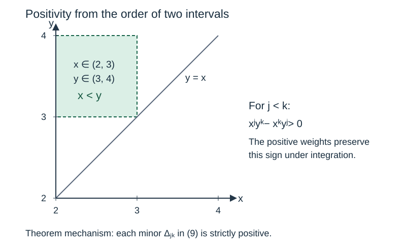

# Integer polynomials and separation of logarithms

*Written by GPT-6 Astra, Ultra reasoning, in Codex, October 2026. Self-checked by the writing AI. Original exposition, proofs and exercises: CC0 1.0.*

An irrational rotation eventually visits every interval, but a useful error bound needs more than irrationality. It needs a lower bound on how closely the rotation number can approach rational numbers. For the slope \(\lambda=\log3/\log2\), unique factorization proves that no multiple is an integer. It does not by itself give the polynomial lower bound needed for the weighted averages of the preceding lessons.

We construct that bound from integer polynomials. Integrating a polynomial divided by a power of \(x\) produces a logarithm and a rational number. The polynomial must be small on the integration intervals, while its coefficients and the rational denominators remain controlled. A positivity argument makes three such approximations linearly independent. These ingredients turn small integral remainders into a lower bound valid for every integer linear form in two logarithms. The construction is Rhin's; the presentation below proves its arithmetic, analytic and transference steps explicitly.

Basic references are Rhin's *Approximants de Padé et mesures effectives d'irrationalité* and Zudilin's *An essay on irrationality measures of π and other logarithms*. We use finite-dimensional linear algebra, prime factorization, elementary calculus and the prime number theorem in the form \(\psi(x)/x\to1\). A complete internal proof of that last result is [Newman's analytic theorem and its prime-counting application](https://github.com/KokunoYumeto/open-math-courses-public-public/blob/main/docs/courses/NT-ZETA/src/NT-ZETA-09.md), Theorem 5.1 and Corollary 5.2. The application at the end uses [rational grids and rotation averages](NT-COLLATZ-20.md) and [unimodal weights and sharp counting kernels](NT-COLLATZ-21.md). The polynomial construction can be studied independently of the Collatz case study.

## A nonzero integer turns approximation into separation

The central mechanism is an integer that cannot be small unless it is zero. We first state it without logarithms.

**Lemma 1 (Transfer from simultaneous approximations).** Fix real numbers \(\omega_1,\omega_2\), positive constants \(a,b,C_R,C_Q\), and positive integers \(N,n_0\). For every positive multiple \(n\) of \(N\) with \(n\geq n_0\), suppose that three integer rows
\[
(q_{n,j},p_{n,j,1},p_{n,j,2}),\qquad j=0,1,2,
\]
form a nonsingular matrix and satisfy
\[
|q_{n,j}|\leq C_Qe^{bn},\qquad
|q_{n,j}\omega_i+p_{n,j,i}|\leq C_Re^{-an}
\quad(i=1,2).
\tag{1}
\]
Put \(\rho=b/a\) and \(K=\max(1,4C_R)\). Every nonzero integer triple \(u=(u_0,u_1,u_2)\), of height \(H=\max(1,|u_0|,|u_1|,|u_2|)\), satisfies
\[
|u_0+u_1\omega_1+u_2\omega_2|
\geq c_0H^{-\rho},\qquad
c_0=\frac{e^{-b(n_0+N)}}{2C_QK^\rho}>0.
\tag{2}
\]

**Proof.** Choose
\[
n=N\left\lceil \frac{\max(n_0,a^{-1}\log(KH))}{N}\right\rceil.
\]
Then \(n\geq n_0\), \(2HC_Re^{-an}\leq1/2\), and
\(n\leq n_0+N+a^{-1}\log(KH)\).
Nonsingularity implies that at least one row has
\[
\ell_j=q_{n,j}u_0-p_{n,j,1}u_1-p_{n,j,2}u_2\ne0.
\]
Indeed, otherwise the nonsingular matrix would annihilate
\((u_0,-u_1,-u_2)^\mathsf{T}\). Since \(\ell_j\) is an integer, \(|\ell_j|\geq1\). Write \(\Lambda=u_0+u_1\omega_1+u_2\omega_2\). The exact identity
\[
q_{n,j}\Lambda
=\ell_j+\sum_{i=1}^2u_i(q_{n,j}\omega_i+p_{n,j,i})
\]
gives \(|q_{n,j}\Lambda|\geq1/2\). In particular this \(q_{n,j}\) is nonzero. Its upper bound in (1) yields
\[
|\Lambda|\geq(2C_Q)^{-1}e^{-bn}
\geq(2C_Q)^{-1}e^{-b(n_0+N)}(KH)^{-b/a}.
\]
This is (2). All heights \(H\geq1\) are included in the same argument. ∎

The exponent is the coefficient growth rate divided by the remainder decay rate. Replacing all positive integers \(n\) by a fixed arithmetic subsequence changes the constant through \(N\), not that ratio. The nonsingularity hypothesis is equally essential: one excellent approximation gives no separation for vectors in its integer kernel.

## Two integrals from one integer polynomial

Let \(n\geq2\) be even, and write
\[
P(x)=\sum_{k=0}^{2n}C_kx^k\in\mathbb Z[x].
\]
Assume that \(P\) has positive leading coefficient, all its roots lie in \([2,4]\), every root has even multiplicity, and
\[
12^{\,n-k}\mid C_k\qquad(0\leq k\leq n).
\tag{3}
\]
The root assumptions imply \(P(x)\geq0\) for real \(x\), with strict positivity away from finitely many roots. They also imply
\[
(-1)^kC_k>0\qquad(0\leq k\leq2n).
\tag{4}
\]
To see this, expand the product of the \(2n\) factors \(x-r\). Every elementary symmetric sum of the positive roots is strictly positive, and \(2n\) is even.

For \(j=0,1,2\), define
\[
I_{L,j}=\int_2^3P(x)x^{j-n-1}\,dx,\qquad
I_{R,j}=\int_3^4P(x)x^{j-n-1}\,dx,
\quad D_n=\operatorname{lcm}(1,\ldots,n+2).
\tag{5}
\]
Put \(\omega_L=\log(3/2)\) and \(\omega_R=\log(4/3)\).

**Proposition 2 (Integral rows).** There are integers \(A_{L,j},A_{R,j}\) such that
\[
D_nI_{L,j}=D_nC_{n-j}\omega_L+A_{L,j},\qquad
D_nI_{R,j}=D_nC_{n-j}\omega_R+A_{R,j}.
\tag{6}
\]
The three rows
\[
(D_nC_{n-j},A_{L,j},A_{R,j}),\qquad j=0,1,2,
\tag{7}
\]
form a matrix with strictly positive determinant.

**Proof of integrality.** In termwise integration, put \(e=k+j-n\). If \(e=0\), the term is exactly \(C_{n-j}\log(v/u)\) on \([u,v]\). If \(e\ne0\), its integral is
\[
C_k\frac{v^e-u^e}{e}.
\tag{8}
\]
We have \(1\leq|e|\leq n+2\), so \(D_n/e\) is an integer. Positive \(e\) leaves integer endpoint powers. If \(e=-m<0\), then \(k<n-j\) and \(n-k=m+j\). Divisibility (3) makes \(C_k\) a multiple of \(12^{m+j}\). Thus it is divisible by each of \(2^m,3^m,4^m\), and \(C_k(v^{-m}-u^{-m})\) is an integer at both pairs of endpoints. Multiplication by \(D_n\) therefore clears every denominator in (8), proving (6).

**Proof of the determinant assertion.** Write \(w(x)=P(x)x^{-n-1}\). For \(j<k\), the two-by-two integral minor is
\[
\begin{aligned}
\Delta_{jk}
&=I_{L,j}I_{R,k}-I_{R,j}I_{L,k}\\
&=\int_2^3\int_3^4w(x)w(y)
  \bigl(x^jy^k-x^ky^j\bigr)\,dy\,dx>0.
\end{aligned}
\tag{9}
\]
On the interior \(x<y\), the last factor equals
\(x^jy^j(y^{k-j}-x^{k-j})>0\). The weights are positive except on finitely many horizontal and vertical lines. Consequently the integrand is nonnegative everywhere and strictly positive on a rectangle of positive area. All functions are continuous on the compact rectangle, so the displayed product integration is justified.

Let \(M_n\) denote the matrix whose rows are (7). Add \(\omega_L\) times its first column to the second and \(\omega_R\) times its first column to the third. These column operations preserve the determinant. Equation (6) then gives
\[
\det M_n
=D_n^3\bigl(C_n\Delta_{12}
-C_{n-1}\Delta_{02}+C_{n-2}\Delta_{01}\bigr)>0.
\tag{10}
\]
Since \(n\) is even, (4) gives the signs \(+,-,+\) for the three displayed coefficients. Every term in the parentheses is positive. ∎

*The ordered integration intervals make the minors in (9) positive. The determinant in (10) combines those minors with alternating coefficient signs, so its terms reinforce one another. This establishes full rank for every polynomial satisfying the hypotheses, not only for a computed example.*

As a small example, take \(n=6\) and
\[
P(x)=12^6(x-2)^4(x-3)^4(x-4)^4.
\]
Condition (3) follows immediately from its prefactor, and \(D_6=840\). Termwise integration gives determinant
\(6679261853508489990635520\), agreeing with the general positive-sign proof. The example illustrates the integer rows. It is not the polynomial used for the sharp exponent below.

## Coefficient divisibility without expanding a large polynomial

Rhin's six factors and weights are
\[
\begin{array}{c|r}
Q_i(x)&10^6b_i\\ \hline
x-3&704324\\
x-2&552418\\
x-4&447582\\
5x-12&109072\\
17x^2-102x+144&38934\\
19x^2-108x+144&54368
\end{array}
\tag{11}
\]
Every decimal implicit in this table is rational. For positive multiples \(n\) of \(N=10^6\), put
\[
P_n(x)=\prod_{i=1}^6Q_i(x)^{b_i n}.
\tag{12}
\]
All exponents are positive even integers, and
\(\sum_i b_i\deg Q_i=2\), so \(P_n\) has degree \(2n\).
The four linear roots are \(2,12/5,3,4\). Sign changes put the two roots of \(Q_5\) in \((2.27,2.28)\) and \((3.72,3.73)\), and those of \(Q_6\) in \((2.13,2.14)\) and \((3.54,3.55)\). The two intervals for each quadratic are disjoint, so they account for both roots. In particular every root is positive and belongs to \([2,4]\).

We still need (3). For a prime \(p\), let \(v_p(c)\) be the exponent of \(p\) in a nonzero integer \(c\), and put \(v_p(0)=+\infty\). For \(h\geq0\) define
\[
\mu_{p,h}\left(\sum_ka_kx^k\right)
=\min_k\bigl(v_p(a_k)+hk\bigr).
\tag{13}
\]
Coefficient multiplication and \(v_p(a+b)\geq\min(v_p(a),v_p(b))\) show
\[
\mu_{p,h}(AB)\geq\mu_{p,h}(A)+\mu_{p,h}(B).
\tag{14}
\]
Indeed, the coefficient of \(x^k\) is a sum of products \(a_\ell b_{k-\ell}\), each of weighted valuation at least the right side. The valuation inequality follows by factoring out the smaller common power of \(p\); cancellation can only increase it.

For the six factors, direct integer arithmetic gives
\[
\begin{array}{c|rrrrrr}
 &Q_1&Q_2&Q_3&Q_4&Q_5&Q_6\\ \hline
\mu_{2,2}&0&1&2&2&3&4\\
\mu_{3,1}&1&0&0&1&2&2
\end{array}
\tag{15}
\]
Their weighted sums are respectively \(2\) and \(1\). Iterating (14) therefore proves
\[
v_2(C_k)+2k\geq2n,\qquad
v_3(C_k)+k\geq n.
\]
For \(k\leq n\), these say exactly that \(2^{2(n-k)}3^{n-k}=12^{n-k}\) divides \(C_k\). Thus all the hypotheses of Proposition 2 hold for (12), however large \(n\) becomes. No expansion of its degree-\(2n\) product is needed.

## Certifying decay on an interval and growth of coefficients

Define the nonnegative function
\[
\begin{gathered}
F(x)=\frac{\prod_{i=1}^6|Q_i(x)|^{b_i}}{|x|}
\quad(x\ne0),\\
A=-1.5097597,\quad B=2.8822959,\\
r=2.80967.
\end{gathered}
\tag{16}
\]
The two numerical inequalities we need are
\[
F(x)\leq e^A\quad(2\leq x\leq4),\qquad
F(-r)\leq e^B.
\tag{17}
\]
Here is a finite rational procedure establishing them, including the reason it bounds the entire interval.

List the eight distinct roots in increasing order. On each gap between consecutive roots,
\[
(\log F)'(x)=\sum_i b_i\frac{Q_i'(x)}{Q_i(x)}-\frac1x.
\tag{18}
\]
Writing each factor in terms of its roots gives
\[
(\log F)''(x)=-\sum_{\alpha}\frac{w_\alpha}{(x-\alpha)^2}
                  +\frac1{x^2}<0.
\tag{19}
\]
Here \(w_\alpha>0\) is the weight attached to the root and
\(\sum_\alpha w_\alpha=2\). On \(2<x<4\), every distance to a root is smaller than \(2\); the negative sum is therefore strictly less than \(-1/2\), while \(1/x^2<1/4\). At the left and right ends of each root gap, (18) tends to \(+\infty\) and \(-\infty\). It has exactly one zero there, and that zero is the gap's maximum of \(F\). At the roots themselves \(F=0\).

The following table encloses the seven zeros of (18). Its first column is the left endpoint \(s\); the right endpoint is always \(s+10^{-13}\). The second column is a rational upper bound for \(\log F\) throughout that interval.

| \(s\) | Upper bound |
|---:|---:|
| \(2.1150812642910\) | \(-1.6810334\) |
| \(2.2235747063921\) | \(-1.50975979\) |
| \(2.3126333050452\) | \(-1.5248443\) |
| \(2.5213404705578\) | \(-1.5098172\) |
| \(3.4746769173151\) | \(-1.5624371\) |
| \(3.6528489275443\) | \(-1.5097670\) |
| \(3.7811725725010\) | \(-1.5340925\) |

These bounds are obtained as follows. Evaluate (18) at each endpoint using rational arithmetic; the signs are positive on the left and negative on the right. Evaluate each polynomial over the interval by Horner's rule, using interval addition and the minimum and maximum of the four endpoint products for interval multiplication. None of the resulting polynomial intervals contains zero. Taking the absolute value therefore preserves a positive lower endpoint.

For a positive rational \(t\), multiply by powers of \(2\) until \(t=2^kv\) with \(1\leq v<2\). Set \(z=(v-1)/(v+1)\), so \(0\leq z<1/3\). Integrating the geometric series for \(1/(1-z^2)\) gives
\[
0\leq \log v-2\sum_{\ell=0}^{23}\frac{z^{2\ell+1}}{2\ell+1}
\leq \frac{2z^{49}}{49(1-z^2)}.
\tag{20}
\]
The same formula at \(z=1/3\) bounds \(\log2\). Thus \(\log t=k\log2+\log v\) has a rational enclosure, with the endpoints interchanged when multiplying an interval by a negative \(k\). For a positive interval \([l,h]\), monotonicity bounds its logarithm between the lower enclosure for \(\log l\) and the upper enclosure for \(\log h\). Summing these enclosures with the rational weights in (16) proves every entry in the table. The same calculation at \(-r\) gives
\[
\log F(-r)\leq 2.882295812974<B.
\]
Every upper bound in the table is smaller than \(A\). Equations (18)–(19) and the zero values at the roots then prove (17) on all of \([2,4]\).

The rational calculation implements exactly these interval operations, endpoint signs and comparisons. Its decisions use integers and fractions only. It verifies the finitely many inequalities in (17); the argument above explains why those inequalities apply to every polynomial in (12).

**Lemma 3 (Size of integrals and coefficients).** For \(P_n\) in (12) and \(j=0,1,2\),
\[
0<I_{L,j},I_{R,j}\leq4e^{An},\qquad
|C_{n-j}|\leq r^j e^{Bn}\leq r^2e^{Bn}.
\tag{21}
\]

**Proof.** Since \(P_n(x)/x^n=F(x)^n\) for \(2\leq x\leq4\), the integral in (5) has integrand \(F(x)^nx^{j-1}\). The factor \(x^{j-1}\) is at most \(4\); each interval has length one. Positivity and (17) give the integral bounds.

By the alternating signs (4), all terms \(C_k(-r)^k\) are positive. Hence
\[
|C_{n-j}|r^{n-j}\leq P_n(-r)
=r^nF(-r)^n\leq r^ne^{Bn}.
\]
Divide by \(r^{n-j}\). Since \(r>1\), this proves both coefficient inequalities. ∎

The negative real evaluation replaces a contour estimate for this construction. Its validity depends on the coefficient signs, which were proved from the locations of all the roots.

## The prime number theorem controls the denominator

For an integer \(m\geq1\), prime factorization gives the exact identity
\[
\log\operatorname{lcm}(1,\ldots,m)
=\sum_{\substack{p\ \mathrm{prime}\\p^k\leq m}}\log p
=\psi(m).
\tag{22}
\]
For each prime \(p\), the highest power dividing the least common multiple is precisely the largest \(p^k\leq m\); taking logarithms proves the identity. The prime number theorem consequently gives
\[
\frac{\log D_n}{n}=\frac{\psi(n+2)}{n+2}\frac{n+2}{n}\longrightarrow1.
\tag{23}
\]
Fix \(\varepsilon=10^{-6}\). There is an integer \(n_0\geq2\) such that
\(D_n\leq e^{(1+\varepsilon)n}\) for all \(n\geq n_0\).
Combining (6) and (21), the integer rows in (7) satisfy Lemma 1 with
\[
\begin{aligned}
a&=-1-\varepsilon-A=0.5097587, & C_R&=4,\\
b&= 1+\varepsilon+B=3.8822969, & C_Q&=r^2.
\end{aligned}
\tag{24}
\]
Both \(a\) and \(b\) are positive. The ratio obeys the exact rational comparison
\[
\rho=\frac{38822969}{5097587}<\frac{952}{125}=7.616.
\tag{25}
\]

**Theorem 4 (Uniform separation of two logarithms).** There is a constant \(c>0\) such that every nonzero integer triple \((u_0,u_1,u_2)\), with \(H=\max(1,|u_0|,|u_1|,|u_2|)\), satisfies
\[
|u_0+u_1\log2+u_2\log3|\geq cH^{-\rho}
\geq cH^{-7.616}.
\tag{26}
\]
Here \(\rho\) is the rational number in (25).

**Proof.** Lemma 1 applies to (7), using the nonsingularity proved in Proposition 2 and bounds (24). This proves (26) first for \(\omega_L,\omega_R\), with the constant \(c_0\) in (2) and \(K=16\).

The exact change of coordinates is
\[
\log2=\omega_L+\omega_R,\qquad
\log3=2\omega_L+\omega_R.
\]
Thus
\[
u_1\log2+u_2\log3
=(u_1+2u_2)\omega_L+(u_1+u_2)\omega_R.
\tag{27}
\]
The integer matrix \(\begin{pmatrix}1&2\\1&1\end{pmatrix}\) has determinant \(-1\); its inverse sends \((v_L,v_R)\) to
\((2v_R-v_L,v_L-v_R)\). The transformation is bijective on \(\mathbb Z^2\), preserves nonzero triples when \(u_0\) is retained, and increases the maximum height by at most a factor \(3\). Therefore \(c=c_0\,3^{-\rho}\) works. Since \(H\geq1\) and \(\rho<7.616\), the second inequality follows. ∎

*Reference:* Rhin's Proposition (8) gives the exponent \(7.616\); his six auxiliary factors are the ones in (11). The rational value \(\rho\) here is a retained intermediate bound in that construction, not a claim of a new best exponent.

The height can also omit the constant coefficient, as in Rhin's statement. Put \(H_1=\max(1,|u_1|,|u_2|)\). If \(|u_0|\leq4H_1\), then \(H\leq4H_1\), so (26) gives \(c4^{-\rho}H_1^{-\rho}\). If \(|u_0|>4H_1\), then \(\log2<1\) and \(\log3<2\), directly by integrating \(1/x\) from \(1\), give
\[
|\Lambda|\geq |u_0|-H_1(\log2+\log3)>H_1\geq1.
\]
Consequently \(|\Lambda|\geq c_1H_1^{-\rho}\) for every nonzero triple, with \(c_1=\min(1,c4^{-\rho})>0\), independently of \(u_0\). Since \(\rho<7.616\), this also gives the eventual coefficient-one estimate \(|\Lambda|>H_1^{-7.616}\): take \(H_1>c_1^{-1/(7.616-\rho)}\). This last threshold, like \(c_1\), depends on the prime-counting threshold used in the proof.

The proof provides a positive constant in terms of the threshold \(n_0\) in (23). It does not compute that threshold numerically. Thus (26) is a uniform existence statement with an explicit exponent, not a numerical lower bound ready for a finite search. Rhin also gives separate effective finite-height estimates; they are not required for the asymptotic application here.

## From logarithmic separation to a counting constant

Put \(\lambda=\log3/\log2\). Since \(2<3<4\), \(1<\lambda<2\). For \(q\geq1\), choose an integer \(p\) nearest to \(q\lambda\). Then
\(|p|\leq2q+1/2\leq(5/2)q\), and the nonzero coefficient triple \((0,-p,q)\) has height at most \(3q\). Theorem 4 gives
\[
\|q\lambda\|
=\frac{|q\log3-p\log2|}{\log2}
\geq c_*q^{-\rho},\qquad
c_*=\frac{c\,3^{-\rho}}{\log2}>0.
\tag{28}
\]
This proves the arithmetic input for the earlier rotation theorem for all \(q\), rather than only for a finite list of continued-fraction denominators.

For example, [the mass and height bound](NT-COLLATZ-21.md#count-estimates-weighted-by-the-height-of-a-profile) now implies: for every nonnegative summable unimodal sequence \(w\) of mass \(M\) and maximum \(H_w\), every real phase \(u\), and every real function \(f\) of bounded variation,
\[
\left|\sum_nw(n)f(\{n\lambda+u\})-M\int_0^1f(t)\,dt\right|
\leq \frac{5c_*^{-1/\rho}V(f)}
 {1-2^{-(1-1/\rho)}}H_w^{1/\rho}M^{1-1/\rho}.
\tag{29}
\]
No additional distributional assumption on \(\lambda\) remains: (28) supplies the precise premise of that theorem.

For the sharp kernel
\[
\mathcal K_I(u,u_0)=
\sum_{r\in I}2^{-r\lambda}
\left[\binom{\lfloor r\lambda+u\rfloor}{r}
-\binom{\lfloor r\lambda+u_0\rfloor}{r}\right],
\tag{30}
\]
retain exactly the central-band, endpoint and size hypotheses of [the sharp binomial kernel theorem](NT-COLLATZ-21.md#the-leading-constant-of-a-sharp-kernel), Theorem 5. Substitution of (28) into that proved theorem yields
\[
2^{-u}\mathcal K_I(u,u_0)
=\frac1{\log(4/3)}+O(L^{-\tau}),\qquad
\tau=\frac1{2\rho}=\frac{5097587}{77645938}>\frac1{15.232}.
\tag{31}
\]
Indeed, its other error is \(O(L^{-1/2}(\log L)^3)\), which is absorbed by \(O(L^{-\tau})\) because \(\tau<1/2\). The leading constant follows from
\((2-\lambda)\log2=\log(4/3)\). The preceding lesson proves the required band hypotheses explicitly for the logarithmic return band. This completes that particular arithmetic input while leaving unchanged all of the kernel's stated geometric conditions.

The distinction between the kernel and the complete arithmetic count still matters. If a subsequent comparison also has an error \(O(L^{-1/16})\), then \(\tau>1/16\) makes the latter the slower term. Its combined bound is \(O(L^{-1/16})\), not \(O(L^{-\tau})\). A sharper component yields a sharper final theorem only when the remaining components permit it.

## Exercises with solutions

### 1. Weighted divisibility of a product

Compute \(\mu_{2,2}\) and \(\mu_{3,1}\) for \(17x^2-102x+144\). Prove (14) directly, including the possibility of cancellation in a coefficient.

**Solution.** The \(2\)-adic weighted valuations of its coefficients are \(4,3,4\), so the minimum is \(3\). The \(3\)-adic weighted valuations are \(2,2,2\), so the minimum is \(2\). For polynomials \(A,B\), every summand \(a_\ell b_{k-\ell}\) of the coefficient at \(k\) has valuation plus \(hk\) at least \(\mu_{p,h}(A)+\mu_{p,h}(B)\). Summing cannot decrease that lower bound: a common power of \(p\) divides every summand and hence their sum. If the sum is zero its valuation is \(+\infty\), so the same inequality still holds.

### 2. Recover the two by two minor

Replace \(w(x)\) in (9) by \(1\), retain the intervals \([2,3]\) and \([3,4]\), and take \(j=0,k=1\). Compute the minor both from one-dimensional moments and from the double integral. Explain which part of the determinant argument would fail if the intervals were interchanged.

**Solution.** The zeroth moments are both \(1\), and the first moments are \(5/2\) and \(7/2\). Thus the minor is \(1\cdot7/2-1\cdot5/2=1\). The double integral of \(y-x\) gives the same answer. Interchanging the intervals reverses the sign of every minor; the positive-determinant statement in (10) would become a negative-determinant statement. Nonsingularity would survive. Using intervals whose interiors overlap, however, would remove the pointwise sign justification and require a different argument.

### 3. Separate a ratio from a fixed linear combination

Deduce from (28) that
\[
\left|\lambda-\frac pq\right|\geq c_*q^{-(\rho+1)}
\quad(p\in\mathbb Z,\ q\geq1).
\]
Then fix integers \(a,b\), not both zero, and prove that \(a\log2+b\log3\) is irrational with an approximation bound of the same exponent \(\rho+1\), whose constant may depend on \(a,b\).

**Solution.** For every \(p\), \(|q\lambda-p|\geq\|q\lambda\|\); divide (28) by \(q\). For \(\gamma=a\log2+b\log3\), first consider \(|\gamma-p/q|\leq1\). Then \(|p|\leq q(|\gamma|+1)\), so the height of \((-p,qa,qb)\) is at most \(C_{a,b}q\) for a fixed positive \(C_{a,b}\). Equation (26), divided by \(q\), gives \(cC_{a,b}^{-\rho}q^{-\rho-1}\). If the distance exceeds \(1\), the same conclusion holds after replacing the constant by its minimum with \(1\). No rational \(p/q\) can equal \(\gamma\). The ratio conclusion used the uniform two-logarithm theorem; an approximation bound for one fixed \(\gamma\) would not on its own justify changing \(a,b\) with \(q\).

### 4. Follow the denominator through the exponent

Suppose the same integral construction supplied only \(D_n\leq e^{\kappa n}\) eventually. Determine the condition on \(\kappa\) under which Lemma 1 applies, and its resulting exponent. Compare \(\kappa=1+\varepsilon\) with \(\kappa=2\log2\).

**Solution.** The remainder bound becomes \(4e^{(A+\kappa)n}\), so decay requires \(A+\kappa<0\). The coefficient growth is \(r^2e^{(B+\kappa)n}\). When \(B+\kappa>0\), Lemma 1 therefore gives exponent
\((B+\kappa)/(-A-\kappa)\). At \(1+\varepsilon\) this is (25). At \(2\log2\), decay is still positive, but much smaller: the ratio is approximately \(34.57\). The derivative of this ratio with respect to \(\kappa\) is
\((B-A)/(-A-\kappa)^2>0\). Thus a larger denominator estimate weakens the separation exponent. The prime number theorem improves the arithmetic approximation rate through a concrete denominator, not through a formal analogy between the subjects.

## What the construction connects

Coefficient divisibility makes the integral rows integer-valued after one controlled multiplier. Positivity proves their full rank. Polynomial decay and coefficient growth set the separation exponent, and prime counting controls the cost of clearing denominators. Finally, rational separation controls discrepancy and hence weighted counting.

These connections are useful independently of an orbit problem. They explain how approximation theory, elementary arithmetic, analytic number theory and uniform distribution can form one proof. In the running application, they turn the previously proved analytic kernel formula into its actual logarithmic-slope version. The remaining arithmetic comparisons must still be assembled with their own hypotheses and error terms.

## References

- Wadim Zudilin, [*An essay on irrationality measures of π and other logarithms*](https://arxiv.org/abs/math/0404523v2), §§3.3–3.4. Discussion of the polynomial method and Rhin's construction.
- Georges Rhin, [*Approximants de Padé et mesures effectives d'irrationalité*](https://doi.org/10.1007/978-1-4757-4267-1_11), in *Séminaire de Théorie des Nombres, Paris 1985–86*, Progress in Mathematics 71, 1987, Proposition (8) and Appendix 2. The two-logarithm estimate and the six polynomial factors used here.
- Donald J. Newman, *Simple analytic proof of the prime number theorem*, American Mathematical Monthly 87 (1980), 693–696; Don Zagier, [*Newman's Short Proof of the Prime Number Theorem*](https://people.mpim-bonn.mpg.de/zagier/files/doi/10.2307/2975232/fulltext.pdf), American Mathematical Monthly 104 (1997), 705–708. The exact internal prerequisite is the linked prime-counting lesson, Theorem 5.1 and Corollary 5.2.
