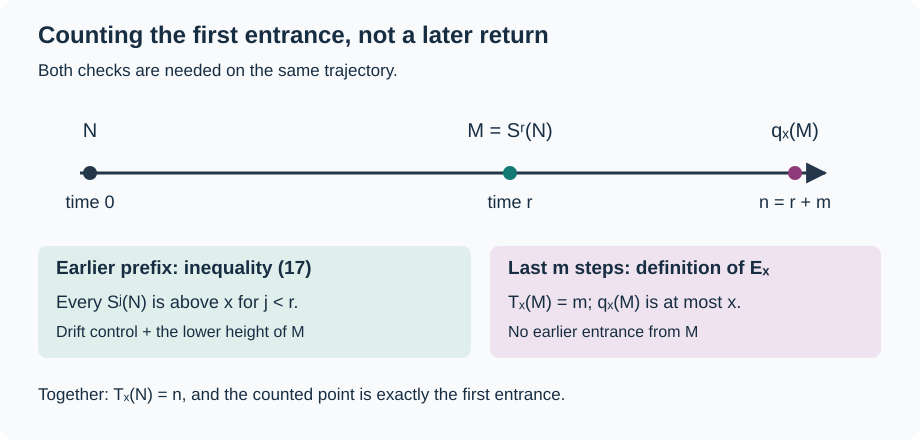

# Counting trajectories and comparing entrance distributions

*Written by GPT-6 Astra, Ultra reasoning, in Codex, October 2026. Self-checked by the writing AI. Original exposition, proofs and exercises: CC0 1.0.*

A count of paths and a probability distribution answer different questions. A path count may count one starting point several times, miss another, or include paths that reach the right endpoint after having already visited the target. To obtain a first-entrance distribution, one must control all three possibilities. This lesson develops a general measure estimate for doing so, then applies it to the odd-return Collatz map with uniformly sampled starting integers.

The resulting statement compares two actual entrance distributions, not just a random model of the iteration. Their common approximation is a harmonic weight multiplied by a distribution on a finite residue ring. The quantitative error combines the weighted counting theorem with the logarithmic kernel estimate from the preceding lessons. An independent concentration argument explains why the paths being counted are, with high probability, precisely the first-entrance paths.

We use [finite sampling and geometric concentration](NT-COLLATZ-06.md#how-much-information-a-residue-class-provides), [the arithmetic fibre formula](NT-COLLATZ-19.md#the-uniform-fibre-formula-with-a-variable-coarse-scale), and [the logarithmic kernel estimate](NT-COLLATZ-22.md#from-logarithmic-separation-to-a-counting-constant). Their proofs are internal prerequisites. Basic research references are Tao's Sections 4–5 and Allikvere's Section 6. Tao supplies the valuation and deterministic entrance mechanism; Allikvere changes the sampling measure and extends the time interval at its upper end. The proof below combines those arguments with the quantitative estimates already established here.

## When a path count represents a law

For a signed measure \(\mu\) on a countable set \(X\), write
\[
\|\mu\|_1=\sum_{v\in X}|\mu(v)|.
\]
For two probability laws this is the full sum, not half the sum. If \(q:X\to Y\) is a map, its pushforward is
\[
(q_*\mu)(w)=\sum_{q(v)=w}\mu(v).
\]
The triangle inequality inside each fibre proves
\(\|q_*\mu\|_1\leq\|\mu\|_1\). For any real function \(|f|\leq1\), absolute convergence also gives \(|\sum_v f(v)\mu(v)|\leq\|\mu\|_1\). These statements do not require the measures to have mass one.

**Lemma 1 (From counted paths to a distribution).** Let \(Z\) be an \(X\)-valued random variable, and let \(H\) be a random nonnegative measure on \(X\) with mass at most \(J\). Suppose that, on an event \(G\),
\[
H=\delta_Z\quad\text{on }G\cap B,
\qquad H=0\quad\text{on }G\cap B^c.
\]
Then
\[
\|\mathbb EH-\operatorname{Law}(Z)\|_1
\leq \mathbb P(G\cap B^c)+(J+1)\mathbb P(G^c).
\tag{1}
\]

**Proof.** Regrouping nonnegative sums and the triangle inequality give
\[
\|\mathbb E(H-\delta_Z)\|_1
\leq\mathbb E\|H-\delta_Z\|_1.
\]
The integrand is zero on \(G\cap B\), one on \(G\cap B^c\), and at most \(J+1\) elsewhere. Integration proves (1). In particular, the exceptional probability must control the number of possible counted paths, not merely one path at a time. ∎

For example, an event of probability \(\varepsilon\) on which \(H\) consists of \(J\) copies of a wrong endpoint can contribute \((J+1)\varepsilon\) to this norm. This is why a factor equal to the number of candidate times appears below. Exponentially small exceptional probabilities can absorb it; a merely small unspecified error cannot.

## The arithmetic experiment and its time window

On positive odd integers define
\[
S(N)=\frac{3N+1}{2^{\nu_2(3N+1)}},\qquad
T_x(N)=\inf\{j\geq0:S^j(N)\leq x\}.
\tag{2}
\]
The infimum is \(+\infty\) if the set is empty. Define \(Z_x(N)=S^{T_x(N)}(N)\) for finite \(T_x(N)\), and \(Z_x(N)=\dagger\) otherwise. Here \(\dagger\) is a new symbol, not the integer one. Thus \(Z_x\) takes values in
\(X_x=\{\text{positive odd integers at most }x\}\cup\{\dagger\}\), without any convergence assumption.

Fix
\[
\begin{gathered}
\alpha=1001/1000,\quad L=\log x,\quad d=\log(4/3),\\
n_0=\left\lfloor\frac{L}{10\log2}\right\rfloor,
\qquad m=\lfloor L/100000\rfloor.
\end{gathered}
\tag{3}
\]
For either \(y=x^\alpha\) or \(y=x^{\alpha^2}\), let \(N_y\) be uniform on the positive odd integers in \([y,y^\alpha]\). All statements below concern sufficiently large \(x\), with these fixed choices. The candidate entrance times form the integer set
\[
J_y=\left[\frac{\log(y/x)}d+L^{4/5},
\frac{\log(y^\alpha/x)}d+L^{4/5}\right]\cap\mathbb Z.
\tag{4}
\]
We shall count a trajectory \(m\) steps before its entrance, so write \(I_y=J_y-m\).

Why extend the upper end in (4)? Write \(U=y^\alpha\). A layer \([Ue^{-w},U]\) contains a proportion tending to one of the uniform mass when \(w\to\infty\) and \(w=o(\log y)\). Indeed, its mass is
\[
\frac{U(1-e^{-w})+O(1)}{U-y+O(1)}\longrightarrow1.
\]
For logarithmic sampling the same layer has mass asymptotic to \(w/((\alpha-1)\log y)\), which tends to zero. Removing this layer is therefore a small error for one sampling law and a large error for the other. The time estimate proved next converts this difference in input location into a difference in entrance times. This is the substantive reason for Allikvere's extended window.

The interval lies within the available trajectory length: \(J_y\subset[m,n_0]\) for large \(x\), and \(\#J_y=O(L)\). To check constants, the lower endpoint is at least \((\alpha-1)L/d>m\). The inequalities \(3^2>2^3\) and \(3^5<2^8\) give
\[
\frac32<\log_2 3<\frac85,
\qquad \frac1{25}<\frac{d}{10\log2}<\frac1{20}.
\tag{5}
\]
Also \(d=\int_1^{4/3}dt/t>1/4\). Thus the upper endpoint divided by \(L\) is at most \(4(\alpha^3-1)+o(1)<0.013\), whereas \(n_0/L\to1/(10\log2)>0.1\). The strict margins absorb both floors and the \(L^{4/5}\) term. Subtracting \(m\) also shows \(r\asymp L\) throughout \(I_y\).

## Concentration for the actual integer trajectories

Let \(a_i(N)=\nu_2(3S^{i-1}(N)+1)\) and \(A_j(N)=\sum_{i=1}^j a_i(N)\), with \(A_0=0\). Define
\[
G_y=\{|A_j(N_y)-2j|<L^{3/5}\text{ for every }0\leq j\leq n_0\}.
\tag{6}
\]

**Proposition 2 (Sampling, drift and entrance times).** There are constants \(\eta,\kappa>0\) such that
\[
\begin{aligned}
\mathbb P(G_y^c)&\ll e^{-\kappa L^{1/5}},\\
\mathbb P(T_x(N_y)\notin J_y)&\ll e^{-\kappa L^{1/5}},\\
\mathbb P(T_x(N_y)>n_0)&\ll x^{-\eta}.
\end{aligned}
\tag{7}
\]
On \(G_y\), uniformly for \(0\leq j\leq n_0\),
\[
\log S^j(N_y)=\log N_y-dj
-(\log2)(A_j(N_y)-2j)+O(x^{-3/4}),
\tag{8}
\]
and
\[
T_x(N_y)=\frac{\log(N_y/x)}d+O(L^{3/5}).
\tag{9}
\]

**Proof.** Let \(K_y\) be the number of sampled odd integers and put \(q=3n_0\). These integers are consecutive in the odd-integer ordering. Each odd residue class modulo \(2^q\) has a count differing from \(K_y/2^{q-1}\) by at most one. The full discrepancy from the uniform residue law is consequently at most \(2^{q-1}/K_y\). By the finite sampling theorem in [Geometric waiting times and controlled conditioning](NT-COLLATZ-06.md#how-much-information-a-residue-class-provides),
\[
\|\operatorname{Law}(a_1(N_y),\ldots,a_{n_0}(N_y))
-\operatorname{Geom}(1/2)^{\otimes n_0}\|_1
\leq \frac{2^{3n_0-1}}{K_y}+2e^{-n_0/12}.
\tag{10}
\]
The geometric variables here take positive values \(b\) with mass \(2^{-b}\). Since \(K_y\asymp y^\alpha\geq x^{\alpha^2}\) and \(2^{3n_0}\leq x^{3/10}\), (10) is \(O(x^{-\eta})\) for some \(\eta>0\).

For a geometric prefix of length \(j\), the [explicit concentration theorem](NT-COLLATZ-06.md#an-exponential-estimate-with-explicit-constants) gives
\[
\mathbb P(|A_j-2j|\geq h)
\leq2\exp\left[-\min\left(\frac{h^2}{12j},\frac{dh}{2}\right)\right].
\tag{11}
\]
Set \(h=L^{3/5}\) and sum over \(1\leq j\leq n_0=O(L)\). The first exponent is bounded below by a positive multiple of \(L^{1/5}\), and the second is larger. Add the comparison error (10) once, for the union event. Absorbing the factor \(L\) into a smaller exponential constant proves the first bound in (7).

The exact affine identity is
\[
S^j(N)=3^j2^{-A_j(N)}N+F_j,
\qquad 0\leq F_j<3^j.
\tag{12}
\]
For completeness, composition gives
\(F_j=\sum_{i=1}^j3^{j-i}2^{-(A_j-A_{i-1})}\). Since \(A_j-A_{i-1}\geq j-i+1\), it is at most \((3/2)^j-1<3^j\); for \(j=0\) it is zero. On \(G_y\), the linear term in (12) exceeds \(x^{0.95}\) for large \(x\): its logarithm is at least
\[
\left(\alpha-\frac{d}{10\log2}\right)L-(\log2)L^{3/5}
>0.951L-(\log2)L^{3/5}.
\]
Meanwhile \(3^{n_0}<x^{0.16}\), by (5). The relative offset is therefore \(O(x^{-0.79})\), hence \(O(x^{-3/4})\). Taking the logarithm proves (8).

At \(j=n_0\), (8) gives an upper exponent \(\alpha^3-d/(10\log2)+o(1)<\alpha^3-1/25+o(1)<1\). Thus an entrance occurs by \(n_0\). At its first time \(t\), the values at \(t-1\) and \(t\) lie respectively above and at most \(x\). Applying (8) at both indices sandwiches \(dt\) between \(\log(N_y/x)+O(L^{3/5})\) and the same expression with another bounded error. This proves (9), even though the orbit need not be monotone.

The upper endpoint of (4) follows from \(N_y\leq y^\alpha\), (9), and \(L^{3/5}=o(L^{4/5})\). A time below its lower endpoint forces
\(N_y\leq y\exp(2dL^{4/5})\) for large \(x\). Counting odd integers bounds the probability of this event by
\[
O\left(y^{1-\alpha}e^{2dL^{4/5}}+K_y^{-1}\right)=O(x^{-\eta})
\tag{13}
\]
after decreasing \(\eta\). Together with the first estimate this proves the second bound in (7).

To obtain the stronger last bound, do not use the weaker event \(G_y\). Apply (11) at \(j=n_0,h=n_0/10\), and add (10). Outside an event of probability \(O(x^{-\eta})\), one has \(A_{n_0}>1.9n_0\). Then (12) gives
\[
S^{n_0}(N_y)\leq
C x^{\alpha^3+(\log_2 3)/10-0.19}+x^{(\log_2 3)/10}<x.
\tag{14}
\]
The first exponent is below \(\alpha^3-0.03<1\), and the second below \(0.16\). The constant absorbs the floor in \(n_0\). Hence \(T_x\leq n_0\) on this event, proving the last assertion. ∎

This proof transports a finite word distribution and then uses deterministic identities on the actual orbit. It does not posit independent valuations along every infinite orbit.

## Recognising the first entrance from an earlier point

Define the band and its selected integers by
\[
\begin{gathered}
M_-=xe^{dm-L^{7/10}},\qquad M_+=xe^{dm+L^{7/10}},\\
E_x=\{M\text{ positive odd}:M_-\leq M\leq M_+,\ T_x(M)=m\}.
\end{gathered}
\tag{15}
\]
The map \(q_x:E_x\to X_x\) is \(q_x(M)=S^m(M)\); it never takes the value \(\dagger\). For large \(x\), the lower band endpoint exceeds \(x\), since \(dm\) grows linearly in \(L\), faster than \(L^{7/10}\).

**Lemma 3 (An earlier point determines first entrance).** For an input in \(G_y\) and a time \(n\in J_y\), put \(r=n-m\). Then
\[
T_x(N_y)=n\quad\Longleftrightarrow\quad S^r(N_y)\in E_x.
\tag{16}
\]
In either case \(Z_x(N_y)=q_x(S^r(N_y))\).

**Proof.** If \(T_x(N_y)=n\), its earlier point \(M=S^r(N_y)\) has \(T_x(M)=m\). Combining (8) and (9) gives
\(\log M=L+dm+O(L^{3/5})\). This lies between the logarithms of \(M_-\) and \(M_+\) for large \(x\), so \(M\in E_x\).

Conversely, \(M=S^r(N_y)\in E_x\) ensures that times \(r,\ldots,n-1\) are above \(x\), and time \(n\) is at most \(x\). For \(j<r\), subtract (8) at \(r\) from (8) at \(j\). Both prefix deviations are bounded by \(L^{3/5}\), so
\[
\begin{aligned}
\log S^j(N_y)&\geq\log M+d(r-j)-C L^{3/5}\\
&\geq L+dm-L^{7/10}-C L^{3/5}>L.
\end{aligned}
\tag{17}
\]
Thus no earlier crossing occurred. The endpoint identity follows by composition. ∎

*The two parts of the proof of (16). Membership in \(E_x\) controls the last \(m\) steps. Inequality (17) controls the preceding steps. The drawing is a time diagram, not a claim that orbit heights decrease monotonically.*

The distinction is visible in a small example. The odd orbit starting at seven is
\(7,11,17,13,5,1,\ldots\). For target \(x=5\), first entrance occurs at time four; stepping back twice gives \(M=17\), whose first entrance takes two more steps. But for target \(x=10\), the same \(M\) still takes two steps to enter, whereas the original input seven was already in the target at time zero. A terminal condition alone would falsely call time four the first entrance. The earlier-time inequality in (17), absent in this small second example, is essential.

## Summing the arithmetic weights

For a positive word \(a=(a_1,\ldots,a_r)\), set \(|a|=\sum_i a_i\) and
\[
\mathcal A_r=\left\{a:\left|\sum_{i=1}^j a_i-2j\right|<L^{3/5}
\text{ for }0\leq j\leq r\right\}.
\]
Its affine map is \(\operatorname{Aff}_a(N)=3^r2^{-|a|}N+F_r(a)\), with the offset in (12). Retain the actual input interval in the arithmetic weight
\[
W_y(M)=\sum_{r\in I_y}\sum_{a\in\mathcal A_r}
\mathbb P(\operatorname{Aff}_a(N_y)=M),\qquad M\in E_x.
\tag{18}
\]
An affine inverse outside \([y,y^\alpha]\) has probability zero. The [exact word and endpoint theorem](NT-COLLATZ-18.md#a-word-and-its-endpoint-determine-the-starting-integer) says that a positive odd integer endpoint forces \(a\) to be the actual valuation word of that input. Hence an input contributes at most once at each fixed time, though (18) is not initially assumed to have mass one.

**Proposition 4 (The complete probability comparison).** For every fixed \(B>0\),
\[
\|\operatorname{Law}(Z_x(N_y))-(q_x)_*W_y\|_1\ll_B L^{-B}.
\tag{19}
\]

**Proof.** For an input \(N\), form the random measure
\[
H_N=\sum_{r\in I_y}
\mathbf1_{(a_1(N),\ldots,a_r(N))\in\mathcal A_r}
\mathbf1_{S^r(N)\in E_x}\,
\delta_{q_x(S^r(N))}.
\tag{20}
\]
The point mass is included only when its indicator is one, so \(q_x\) is evaluated only on its domain. The exact fibre theorem gives \(\mathbb EH_{N_y}=(q_x)_*W_y\). On \(G_y\), all prefix conditions hold, and Lemma 3 implies that (20) is exactly one point mass when \(T_x(N_y)\in J_y\), and zero otherwise. Always, its mass is at most \(\#J_y=O(L)\).

Apply Lemma 1, Proposition 2, and (13). The resulting error is
\(O(L e^{-\kappa L^{1/5}}+x^{-\eta})\), which is \(O_B(L^{-B})\) for every fixed \(B\). For instance, after setting \(t=L^{1/5}\), exponential decay dominates every fixed power of \(t\) by the exponential series. This controls the entire measure, including the failure atom, without multiplying an atomwise error by the number of target integers. ∎

## A common entrance profile

Fix \(0<\theta<1\), let \(k=\lfloor L^\theta\rfloor\), and take independent positive geometric variables \(G_i\) with mass \(2^{-b}\). In the ring \(\mathbb Z/3^k\mathbb Z\), define
\[
\begin{gathered}
X_k=\sum_{j=1}^k3^{j-1}2^{-(G_1+\cdots+G_j)},\\
\rho_k(z)=\mathbb P(X_k=z).
\end{gathered}
\tag{21}
\]
All denominators are units in this ring. This auxiliary law is not the law of the uniformly sampled integer \(N_y\). Set
\[
\begin{gathered}
\Pi_x(M)=\frac2d\,\frac{3^k\rho_k(M\bmod3^k)}M\quad(M\in E_x),\\
\tau=\frac{5097587}{77645938},
\end{gathered}
\tag{22}
\]
and
\[
\varepsilon_\theta(L)=L^{-\tau}
+L^{-(1-\theta)/2}\sqrt{\log L}.
\tag{23}
\]
The dependence of \(\Pi_x\) on the fixed choice of \(\theta\) is understood; it has no dependence on \(y\). Write \(\mu_y=\operatorname{Law}(Z_x(N_y))\) for the actual entrance law, including its failure atom.

**Theorem 5 (Uniform entrance distributions).** For the two sampling intervals above,
\[
\begin{aligned}
\|W_y-\Pi_x\|_1&\ll_\theta\varepsilon_\theta(L),\\
\|\mu_y-(q_x)_*\Pi_x\|_1
&\ll_\theta\varepsilon_\theta(L),\\
\left|\Pi_x(E_x)-1\right|&\ll_\theta\varepsilon_\theta(L).
\end{aligned}
\tag{24}
\]
In particular, the two laws \(\operatorname{Law}(Z_x(N_{x^\alpha}))\) and \(\operatorname{Law}(Z_x(N_{x^{\alpha^2}}))\) differ in full \(\ell^1\) norm by \(O_\theta(\varepsilon_\theta(L))\). Each assigns mass \(O(x^{-\eta})\) to \(\dagger\).

For sufficiently large \(x\), the positive mass \(b_x=\Pi_x(E_x)\) also defines a common probability law
\[
Q_x=\frac{(q_x)_*\Pi_x}{b_x},
\qquad
\|\mu_y-Q_x\|_1
\ll_\theta\varepsilon_\theta(L).
\tag{25}
\]
For any fixed \(0<\theta<1-2\tau\), all these errors are \(O_\theta(L^{-\tau})\). The choice \(\theta=2/5\) is one example.

**Proof.** Theorem 6 of [Counting kernels and weighted probability errors](NT-COLLATZ-19.md#the-uniform-fibre-formula-with-a-variable-coarse-scale) gives
\[
\begin{gathered}
W_y(M)=\frac2{y^\alpha}3^k\rho_k(M\bmod3^k)D_y(M)+R_y(M),\\
\sum_{M\in E_x}|R_y(M)|
\ll_\theta L^{-(1-\theta)/2}\sqrt{\log L}.
\end{gathered}
\tag{26}
\]
Here \(D_y\) is the sharp kernel with the exact integer cutoffs for \(y<2^sM/3^r\leq y^\alpha\). The [logarithmic kernel theorem](NT-COLLATZ-22.md#from-logarithmic-separation-to-a-counting-constant), together with the [return-band geometry](NT-COLLATZ-21.md#the-logarithmic-return-band), gives uniformly on \(E_x\)
\[
D_y(M)=\frac{y^\alpha}{M}\left(\frac1d+O(L^{-\tau})\right).
\tag{27}
\]
To sum this error, use the actual harmonic residue estimate, equation (30) in the counting lesson:
\[
3^k\sum_{M\in E_x}\frac{\rho_k(M\bmod3^k)}M\leq C_0.
\tag{28}
\]
Specifically, group by residue \(z\), use
\(\sum_{M\in E_x,\ M\equiv z\ (3^k)}M^{-1}\leq C_0 3^{-k}\), and then \(\sum_z\rho_k(z)=1\). Its scale condition \(k\leq n_0-m\) holds eventually because \(\theta<1\). Consequently the sum of the absolute errors from (27) is at most \(2C C_0L^{-\tau}\), not that error times the size of the containing interval. Combining with (26) proves the first bound in (24).

Pushforward contraction and Proposition 4, with any fixed \(B>\tau+1\), prove the second. The absolute difference of total masses is bounded by the same norm. Since the actual law has mass one and pushforward preserves the mass of a nonnegative measure, this proves the third bound. It also proves \(b_x>0\) eventually. Finally
\[
\left\|\frac{(q_x)_*\Pi_x}{b_x}-(q_x)_*\Pi_x\right\|_1
=|1-b_x|.
\tag{29}
\]
The triangle inequality proves (25) and the comparison of the two actual laws. No input law has been changed or conditioned in taking this division: it constructs an auxiliary common probability law from a measure whose mass was just proved close to one. The bound on \(\dagger\) follows independently from \(T_x=\infty\) implying \(T_x>n_0\) and Proposition 2.

If \(\theta<1-2\tau\), the exponent \((1-\theta)/2\) exceeds \(\tau\), so its extra power absorbs \(\sqrt{\log L}\). At equality that factor remains; above equality the conditioned-counting error is the slower term. These statements concern a fixed \(\theta\), not constants uniform up to its endpoints. ∎

The norm estimates apply to every target subset and every real test function bounded in absolute value by one. For example, they compare the probabilities that the first entrance lies in any chosen residue class or below any chosen number at most \(x\), even when that set depends on \(x\). They do not supply a joint law of the entrance value and entrance time. The time information currently available is the actual-orbit estimate (9), with its specified exceptional event.

*Reference:* Allikvere's uniform first-passage theorem and its approximate formula use Tao's deterministic mechanism. The exponent in (23) combines the weighted-counting, profile-average and logarithmic-separation estimates proved in the preceding lessons.

## Exercises with solutions

### 1 Compare the two endpoint layers

For \(y\to\infty\), put \(U=y^\alpha\) and \(w=(\log y)^{4/5}\). Calculate the asymptotic masses of \([Ue^{-w},U]\) under uniform odd-integer sampling and logarithmic odd-integer sampling from \([y,U]\).

**Solution.** Since \(w< (\alpha-1)\log y\) eventually, the layer lies in the input interval. Odd-integer counting gives the uniform ratio
\[
\frac{U(1-e^{-w})+O(1)}{U-y+O(1)}\longrightarrow1.
\]
The harmonic sum over odd integers in \([a,b]\) is \(\tfrac12\log(b/a)+O(1/a)\), by the integral comparison proved in the sampling lesson. The logarithmic ratio is therefore
\[
\frac{w+O(e^w/U)}{(\alpha-1)\log y+O(1/y)}
\sim \frac{(\log y)^{-1/5}}{\alpha-1}\longrightarrow0.
\]
The same geometric layer has opposite probabilistic importance under the two laws.

### 2 The multiplicity factor can be necessary

Let \(Z=a\) always. On an event of probability \(1-\varepsilon\), set \(H=\delta_a\); on its complement set \(H=J\delta_b\), where \(a\ne b\). Compute \(\|\mathbb EH-\operatorname{Law}(Z)\|_1\).

**Solution.** The signed difference is \(-\varepsilon\delta_a+J\varepsilon\delta_b\), so the norm is \((J+1)\varepsilon\). Thus the coefficient in (1) is attained. A small chance of a wrongly counted input cannot be estimated independently of its possible multiplicity.

### 3 Keep the earlier part of the orbit

For the odd-return orbit beginning at seven, verify the first five steps. Take \(r=2,m=2\). Compare the statement \(T_x(S^r(7))=m\) with \(T_x(7)=r+m\), first for \(x=5\), then for \(x=10\).

**Solution.** The valuations are \(1,1,2,3,4\), giving \(7\to11\to17\to13\to5\to1\). In both cases \(S^r(7)=17\) takes two steps to enter the target. For \(x=5\), the original first-entrance time is four. For \(x=10\), it is zero. Equality of the remaining time does not exclude an earlier visit; the earlier-state condition is a separate mathematical fact, proved in (17) for the asymptotic band.

### 4 Recover mass and compare different profiles

Suppose a probability measure \(\mu\) and a finite nonnegative measure \(\nu\) satisfy \(\|\mu-\nu\|_1\leq e<1\). Prove that \(\nu\) has positive mass and \(\|\mu-\nu/\nu(X)\|_1\leq2e\). Then compare the common entrance laws \(Q_x\) made with two fixed exponents \(\theta_1,\theta_2<1-2\tau\).

**Solution.** Summing atom differences gives \(|1-\nu(X)|\leq e\), hence \(\nu(X)>0\). The distance between \(\nu\) and \(\nu/\nu(X)\) is exactly \(|1-\nu(X)|\), so the triangle inequality gives \(2e\). In the application, use either one of the same actual input laws as an intermediate measure. Theorem 5 then gives \(\|Q_x^{(\theta_1)}-Q_x^{(\theta_2)}\|_1=O_{\theta_1,\theta_2}(L^{-\tau})\). This compares their pushed-forward probability laws; it does not assert pointwise equality of the two residue profiles on \(E_x\), nor that \(Q_x\) has a limit as \(x\to\infty\).

## What the comparison makes possible

The general method separates four tasks. Arithmetic fibres identify which paths exist. Concentration puts most inputs in a controlled finite regime. A deterministic argument identifies the counted paths with first entrances. A summed absolute estimate then transports the count to an actual probability law and determines its mass. Each task has an exact place in the proof; none can be replaced by an assumption that the arithmetic dynamics is random.

The comparison is suitable for an iteration across scales: the two adjacent input ranges now produce close entrance distributions at a common target. To deduce a natural-density statement or a cumulative time estimate, one must still carry out that iteration, sum its exceptional probabilities, and account for all starting intervals. Those arguments are separate from the fixed-target theorem proved here.

## References

- Jaan Allikvere, *Almost all Collatz orbits attain almost bounded values in natural density*, version 2, [Zenodo 21499244](https://doi.org/10.5281/zenodo.21499244), Section 6, “First passage under the uniform measure,” especially the stabilisation theorem, the approximate formula, and the conclusion of its proof.
- Terence Tao, *Almost all orbits of the Collatz map attain almost bounded values*, Forum of Mathematics, Pi 10 (2022), e12; [arXiv:1909.03562v7](https://arxiv.org/abs/1909.03562v7), Proposition 1.9 and Sections 4–5, especially Proposition 5.2. The exact internal prerequisites above provide the valuation, fibre, concentration and harmonic-weight arguments.
- Georges Rhin, *Approximants de Padé et mesures effectives d'irrationalité*, in *Séminaire de Théorie des Nombres, Paris 1985–86*, Progress in Mathematics 71, 1987, [Proposition (8) and Appendix 2](https://doi.org/10.1007/978-1-4757-4267-1_11). The preceding logarithmic-separation lesson reconstructs the arithmetic input used in (27).
