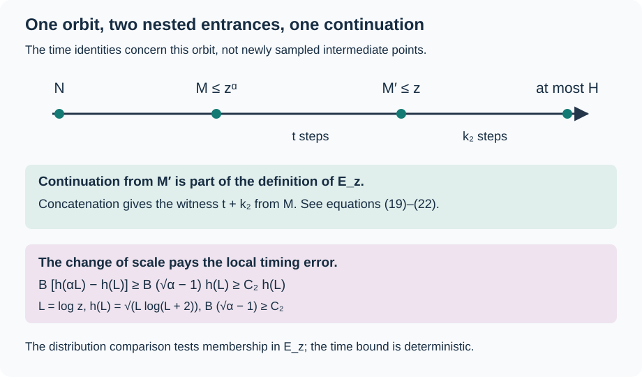

# Summable scale comparisons and timed orbit bounds

*Written by GPT-6 Astra, Ultra reasoning, in Codex, October 2026. Self-checked by the writing AI. Original exposition, proofs and exercises: CC0 1.0.*

An estimate at one scale can describe arbitrarily large inputs when its errors remain summable as the scale changes. There is a second question when the estimate concerns a trajectory: can we retain how long the trajectory takes? Closeness of two endpoint distributions alone says nothing about their travel times. To retain time, we will compare sets of endpoints from which a suitable continuation can be completed within a stated budget.

This lesson joins three methods. A geometric series controls repeated distributional comparisons. A concentration estimate determines a suitable time allowance. Disjoint intervals turn local probability bounds into a count of all starting integers. The combination gives a quantitative natural-density conclusion for the odd-return Collatz map, with an explicit leading time coefficient and an error allowance of order \(\sqrt{\log N\,\log\log N}\).

We use [nested first-passage maps and finite-chain transport](NT-COLLATZ-04.md#nested-targets-compose-exactly), [geometric concentration](NT-COLLATZ-06.md#an-exponential-estimate-with-explicit-constants), and the complete [uniform-input entrance comparison](NT-COLLATZ-23.md#a-common-entrance-profile). These internal lessons provide the required proofs. Basic references are Tao's Section 3 on scale iteration and Allikvere's Sections 7–8 on uniform sampling and timed target sets. The sharper time allowance below follows by keeping the explicit concentration estimate rather than replacing it by a fixed power such as \((\log N)^{4/5}\).

## The entrance estimate on a geometric sequence of scales

Let \(S\) be the odd-return map on positive odd integers,
\[
S(N)=\frac{3N+1}{2^{\nu_2(3N+1)}}.
\]
Write \(T_z(N)\) for the first time \(S^j(N)\leq z\), including time zero, and \(p_z(N)\) for that first value. If the orbit never enters, set \(T_z(N)=\infty\) and \(p_z(N)=\dagger\), where \(\dagger\) is distinct from every integer. For sufficiently large \(y\), let \(U_y\) be uniform on the positive odd integers in \([y,y^\alpha]\), where
\[
\alpha=1001/1000,\qquad d=\log(4/3),
\qquad \tau=\frac{5097587}{77645938}.
\tag{1}
\]
All constants in this lesson may depend on this fixed \(\alpha\). No uniform estimate as \(\alpha\downarrow1\) is asserted.

The preceding entrance theorem, with coarse exponent \(2/5\), supplies constants \(A,D,b>0\) and \(z_*\) such that
\[
\begin{aligned}
\|\operatorname{Law}_{U_{z^\alpha}}(p_z)
-\operatorname{Law}_{U_{z^{\alpha^2}}}(p_z)\|_1
&\leq A(\log z)^{-\tau},\\
U_{z^\alpha}\{T_z=\infty\}&\leq Dz^{-b}
\qquad(z\geq z_*).
\end{aligned}
\tag{2}
\]
The norm is the full sum of absolute atom differences. Both laws include the failure state. In particular, the first inequality applies to every fixed subset of possible entrance values.

For comparison errors of size \((\log z)^{-\tau}\), the sequence
\(z_j=u^{\alpha^j}\) has
\[
\sum_{j=0}^{\infty}(\log z_j)^{-\tau}
=\frac{(\log u)^{-\tau}}{1-\alpha^{-\tau}}.
\tag{3}
\]
Indeed \(\log z_j=\alpha^j\log u\), so the finite sums are geometric sums with ratio \(\alpha^{-\tau}<1\), and their omitted last powers tend to zero. A fixed error at each step would accumulate indefinitely; an error decreasing on this sequence does not.

An immediate application of [the summable transport theorem](NT-COLLATZ-04.md#geometrically-separated-logarithmic-scales), Theorem 3, is
\[
U_y\{N:S^j(N)>H\text{ for every }j\geq0\}
\leq D H^{-b/\alpha^3}
+\frac{A\alpha^{3\tau}}{1-\alpha^{-\tau}}(\log H)^{-\tau}
\tag{4}
\]
for \(H\geq z_*^{\alpha^3}\) and every defined block law \(U_y\). To match the theorem exactly, its chosen law is \(\nu_z=(p_z)_*U_{z^\alpha}\). Nested passage gives
\((p_z)_*\nu_{z^\alpha}=(p_z)_*U_{z^{\alpha^2}}\), so its comparison error is precisely the first quantity in (2). Its initial failure mass is the second quantity. Formula (3) evaluates the bound in that theorem. Thus the distribution of the orbit minimum is uniformly tight under these uniform block laws. We now retain a time bound as well.

## Choosing a time allowance from concentration

Define, for \(t\geq0\),
\[
h(t)=\sqrt{t\log(t+2)}.
\tag{5}
\]
It is increasing, vanishes at zero, and satisfies \(h(t)=o(t)\). Moreover
\[
h(\alpha t)-h(t)\geq(\sqrt\alpha-1)h(t),
\qquad h(\alpha t)\leq2h(t).
\tag{6}
\]
For the first inequality, use \(\log(\alpha t+2)\geq\log(t+2)\) and take square roots. For the second, \(\alpha<2\) and
\(\log(\alpha t+2)\leq\log(2(t+2))\leq2\log(t+2)\).
Finally \(h(t)/t=\sqrt{\log(t+2)/t}\to0\). For example, the integral expression for the logarithm, split at \(\sqrt t\), proves \(\log t=O(\sqrt t)\), which suffices for this limit. The same argument with any positive power in place of \(1/2\) shows \(h(t)=o(t^p)\) for every \(p>1/2\).

The first inequality in (6) is especially useful. Increasing the scale from \(z\) to \(z^\alpha\) creates a definite additional time allowance proportional to \(h(\log z)\), exactly the size of the local timing error we will obtain.

**Lemma 1 (A smaller simultaneous timing error).** Put \(L=\log x\) and \(n_0=\lfloor L/(10\log2)\rfloor\). For either uniform input law \(U_{x^\alpha}\) or \(U_{x^{\alpha^2}}\), there is an event \(G_x\) with
\[
\mathbb P(G_x^c)\ll L^{-20}
\tag{7}
\]
such that, on \(G_x\), the first entrance below \(x\) exists by time \(n_0\),
\[
\left|T_x(N)-\frac{\log(N/x)}d\right|\leq C h(L),
\tag{8}
\]
and uniformly for \(0\leq j\leq n_0\),
\[
\log S^j(N)=\log N-dj+O(h(L)).
\tag{9}
\]
The constants are independent of \(x\) and the chosen input value.

**Proof.** Let \(A_j\) be the sum of the first \(j\) valuations. Use the event
\[
|A_j-2j|<8h(L)\qquad(0\leq j\leq n_0).
\tag{10}
\]
The actual valuation-vector law differs in full norm from independent positive geometric variables by \(O(x^{-\eta})\), as proved in Proposition 2 of [Counting trajectories and comparing entrance distributions](NT-COLLATZ-23.md#concentration-for-the-actual-integer-trajectories). This estimate is for the whole vector, so it is added only once.

For an independent prefix of length \(j\), the geometric concentration theorem bounds failure at height \(v\) by
\[
2\exp\left[-\min\left(\frac{v^2}{12j},\frac{dv}{2}\right)\right].
\]
Since \(\log2>1/2\), one has \(n_0\leq L/5\). At \(v=8h(L)\), the quadratic exponent is therefore at least
\(\tfrac{80}{3}\log(L+2)\). The linear exponent is \(4dh(L)\), which eventually also exceeds that quantity, because \(h(L)/\log(L+2)\to\infty\). Summing over at most \(L/5\) prefixes gives
\[
\mathbb P(G_x^c)\leq
C L(L+2)^{-80/3}+O(x^{-\eta})=O(L^{-20}).
\tag{11}
\]

The exact affine formula from the preceding lesson is
\(S^j(N)=3^j2^{-A_j}N+F_j\), with \(0\leq F_j<3^j\). On (10), its linear term is at least
\(\exp[(\alpha-d/(10\log2))L-8(\log2)h(L)]\).
The coefficient of \(L\) exceeds \(0.951\), and \(h(L)=o(L)\), so this term exceeds \(x^{0.95}\) eventually. The offset is less than \(x^{0.16}\). Consequently the logarithmic offset error is \(O(x^{-3/4})\), and
\[
\log S^j(N)=\log N-dj-(\log2)(A_j-2j)+O(x^{-3/4}),
\]
which proves (9). The strict coefficient inequalities follow from \(3^2>2^3\) and \(3^5<2^8\), as in that lesson; they are unchanged by this smaller deviation allowance.

At \(j=n_0\), the upper linear coefficient is
\(\alpha^3-d/(10\log2)<\alpha^3-1/25<1\). Thus \(S^{n_0}(N)<x\) for large \(x\). Since the input is above \(x\), its first time \(t\) is positive. Apply (9) at \(t-1\), where the value exceeds \(x\), and at \(t\), where it is at most \(x\). The two inequalities give (8), absorbing the bounded difference of one step into \(C h(L)\). ∎

The argument did not alter the entrance-distribution theorem (2), whose proof retains its original bands and cutoffs. It improved the separate timing event. The two facts can be used together because both concern the same actual input law.

## Putting the continuation time into a target set

Fix an integer target \(H\geq2\). The letter \(H\) now denotes a target height; the lower-case function \(h\) remains the allowance (5). Set
\[
\Delta_H=(1-\alpha^{-3})\frac{\log H}{d}.
\tag{12}
\]
For a constant \(B>0\) to be fixed, define \(E_z\) to consist of positive odd \(M\leq z\) for which there exists an integer \(k\geq0\) such that
\[
S^k(M)\leq H,\qquad
k\leq\frac{(\log(M/H))_+}{d}+\Delta_H+B h(\log z).
\tag{13}
\]
Here \(u_+=\max(u,0)\). In particular every \(M\leq H\) belongs to \(E_z\) when \(M\leq z\), with witness \(k=0\). The set depends on \(z\) and \(H\), but not on the random input used to sample it. It is therefore a valid target set in (2).

Let \(\mathcal B_z\) be the following event under the input law \(U_{z^\alpha}\):
\[
T_z(N)<\infty,\qquad
T_z(N)\leq\frac{\log(N/z)}d+B h(\log z),
\qquad p_z(N)\in E_z.
\tag{14}
\]
This event combines a bounded first leg with a bounded continuation. It does not assert independence of those two parts.

**Proposition 2 (A timed comparison step).** Constants \(B,z_*\) can be chosen independently of \(H\) so that
\[
\mathbb P(\mathcal B_z)\geq1-C(\log z)^{-20}
\quad(z_*\leq z\leq H),
\tag{15}
\]
and
\[
\mathbb P(\mathcal B_{z^\alpha})
\geq\mathbb P(\mathcal B_z)-C'(\log z)^{-\tau}
\quad(z\geq\max(z_*,H^{1/\alpha^3})).
\tag{16}
\]

**Proof.** If \(z\leq H\), every successful entrance value is at most \(H\), so its continuation witness is zero. Lemma 1 gives the time clause of (14) on its event once \(B\) is large enough. This proves (15).

For the step, use one common input \(N\sim U_{z^{\alpha^2}}\). It is an allowed input of Lemma 1 both at target \(z\) and at target \(z^\alpha\). Let \(G\) be the intersection of the two events, so
\(\mathbb P(G^c)=O((\log z)^{-20})\). On \(G\), put
\[
M=p_{z^\alpha}(N),\qquad M'=p_z(N),\qquad
t=T_z(M)=T_z(N)-T_{z^\alpha}(N).
\tag{17}
\]
The time identity is the exact nested-passage theorem; in particular \(M'=S^t(M)\). Subtracting the upper estimate at target \(z\) and the lower estimate at target \(z^\alpha\) gives
\[
t\leq\frac{\log(z^\alpha/z)}d+C h(\log z).
\tag{18}
\]
Both errors are of this size because \(h(\alpha\log z)\leq2h(\log z)\).

Apply (9) at the actual time \(T_{z^\alpha}(N)\), and use (8) for that time. It follows that
\(\log M\geq\log(z^\alpha)-C h(\log z)\). Combining with (18) gives the useful same-orbit estimate
\[
t\leq\frac{\log(M/z)}d+C_2 h(\log z).
\tag{19}
\]
No uniform sampling assertion at the intermediate point \(M\) is used.

Suppose \(G\) holds and \(M'\in E_z\). If \(M\leq H\), then \(M\in E_{z^\alpha}\) with witness zero. Suppose instead that \(M>H\). If \(z\geq H\), concatenate the leg of length \(t\) with a witness \(k_2\) for \(M'\) in (13). Since \(M'\leq z\),
\[
\begin{aligned}
t+k_2
&\leq\frac{\log(M/z)}d+
\frac{\log(z/H)}d+\Delta_H+B h(\log z)+C_2h(\log z)\\
&=\frac{\log(M/H)}d+\Delta_H+(B+C_2)h(\log z).
\end{aligned}
\tag{20}
\]
If \(z<H\), then \(M'\leq H\), so use \(k_2=0\). The scale restriction gives
\(\log(H/z)/d\leq\Delta_H\). Equation (19) then gives the same upper bound in (20), with its nonnegative \(B h\) term unnecessary.

Choose \(B\) large enough that
\[
C_2\leq B(\sqrt\alpha-1).
\tag{21}
\]
By (6), \((B+C_2)h(\log z)\leq B h(\log z^\alpha)\). Thus (20) is the required witness bound for \(M\in E_{z^\alpha}\). The direct upper estimate from Lemma 1 at target \(z^\alpha\) also supplies the first-leg time clause in \(\mathcal B_{z^\alpha}\), after increasing \(B\) if needed. We have proved the inclusion
\[
G\cap\{p_z(N)\in E_z\}\subseteq\mathcal B_{z^\alpha}.
\tag{22}
\]

Compare the probabilities of the fixed set \(E_z\) under the two laws in (2). The event \(\mathcal B_z\) is contained in \(\{p_z\in E_z\}\) for the smaller input law. Therefore (22) implies
\[
\mathbb P(\mathcal B_{z^\alpha})
\geq\mathbb P(\mathcal B_z)
-A(\log z)^{-\tau}-C(\log z)^{-20}.
\]
Since \(\tau<20\), this is (16). The constants and the enlargement of \(z_*\) depend on the concentration and entrance estimates, not on \(H\). ∎

*The timed inclusion (22). The distribution comparison is applied only to membership of \(M'\) in the fixed set \(E_z\). The trajectory identities and inequality (21) then transfer a time-bounded witness to \(M\). This is a schematic sequence: either later leg may have length zero. No joint distributional limit for location and time is asserted.*

For perspective, a power allowance \(B(\log z)^p\), with \(p>1/2\), could also dominate the error in Lemma 1 for sufficiently large \(z\). The function \(h\) keeps the smaller concentration scale itself. Its growth from one scale to the next has the definite factor in (6), which is why no larger power is required.

## The time bound on every input interval

**Theorem 3 (A target-independent clock for odd returns).** There are constants \(C_K,C_0\) such that, with
\[
K(N)=\frac{\log N}{d}+C_K h(\log(N+2)),
\tag{23}
\]
let \(\mathcal A_H\) be the set of positive odd inputs \(N\) for which no integer time \(0\leq k\leq K(N)\) satisfies \(S^k(N)\leq H\). Then for every integer \(H\geq2\) and every sufficiently large \(y\),
\[
U_y(\mathcal A_H)\leq C_0(\log H)^{-\tau}.
\tag{24}
\]
The clock \(K\) does not depend on \(H\).

**Proof.** First take \(H\) large enough that \(H^{1/\alpha^3}\geq z_*\). If \(y^\alpha\leq H\), every input has witness zero. Otherwise let \(J\geq1\) be the least integer such that
\(v=y^{\alpha^{-J}}<H^{1/\alpha}\). Then
\[
H^{1/\alpha^2}\leq v<H^{1/\alpha},\qquad
z_j=v^{\alpha^{j-1}}\quad(0\leq j\leq J).
\tag{25}
\]
These satisfy \(z_{j+1}=z_j^\alpha\), \(z_0\geq H^{1/\alpha^3}\), \(z_0<H\), and \(z_J=y^{1/\alpha}\). In particular the source law at the last step is exactly \(U_y\).

Start with (15) at \(z_0\), and apply (16) up the sequence. By (3),
\[
\begin{aligned}
1-\mathbb P(\mathcal B_{z_J})
&\leq C(\log z_0)^{-20}
+\frac{C'}{1-\alpha^{-\tau}}(\log z_0)^{-\tau}\\
&\ll (\log H)^{-\tau}.
\end{aligned}
\tag{26}
\]
The potentially large fixed factor \((1-\alpha^{-\tau})^{-1}\) is part of the constant, not omitted from the argument.

For an input in \(\mathcal B_{z_J}\), abbreviate \(z=z_J\). If \(N\leq H\), use time zero. If \(N>H\) and \(z\geq H\), concatenate the first leg with the witness for \(p_z(N)\in E_z\); since \(p_z(N)\leq z\), the resulting time is at most
\[
\frac{\log(N/H)}d+\Delta_H+2B h(\log z).
\tag{27}
\]
If \(N>H\) and \(z<H\), the first passage itself suffices. The inequality \(z\geq H^{1/\alpha^3}\) bounds \(\log(H/z)/d\) by \(\Delta_H\), giving (27) again. Thus mixed intervals containing inputs on both sides of \(H\) are included.

By the exact choice in (12), (27) equals
\[
\frac{\log N}{d}-\frac{\alpha^{-3}\log H}{d}
+2B h(\log z)
\leq\frac{\log N}{d}+2B h(\log(N+2)).
\tag{28}
\]
Here \(N\geq y=z^\alpha>z\), and \(h\) is increasing. We may therefore take \(C_K=2B\), independently of \(H\).

The remaining targets lie in a fixed bounded range. Increase \(C_0\) so that \(C_0(\log H)^{-\tau}\geq1\) on that range. The probability bound is then automatic. No probability on an empty short interval has been used: throughout the statement \(y\) is beyond one fixed threshold, where its odd-input interval is nonempty. ∎

*Reference:* Allikvere's timed target-set iteration gives the same leading coefficient with a \((\log N)^{4/5}\) allowance. Lemma 1 and inequality (6) replace that allowance here by \(h(\log(N+2))\), while the preceding entrance synthesis supplies the exponent \(\tau\) in (24). This is a deduction from those arguments, not an assertion of an optimal second-order term or a numerical value for the first valid asymptotic threshold.

## Counting every starting interval

A local probability theorem gives a proportion inside \([y,y^\alpha]\). Keeping only the largest such interval below \(X\) would leave the lower integers untreated. The following elementary count uses all intervals and keeps their boundary conventions exact.

**Lemma 4 (Disjoint intervals from closed-interval bounds).** Let \(\alpha>1\), \(H\geq1\), and suppose \(t^\alpha-t>2\) for every \(t\geq H^{1/\alpha}\). Let \(A\) be a set of positive odd integers with no element at most \(H\). If
\[
\#(A\cap[t,t^\alpha])
\leq\varepsilon\,\#\{N\text{ odd}:t\leq N\leq t^\alpha\}
\tag{29}
\]
for every \(t\geq H^{1/\alpha}\), then for every real \(X\geq1\),
\[
\#(A\cap[1,X])
\leq2\varepsilon\,\#\{N\text{ positive odd}:N\leq X\}.
\tag{30}
\]

**Proof.** If \(X\leq H\), there is nothing to count. Otherwise set \(t_j=X^{\alpha^{-j}}\), and let \(J\) be the first index for which \(t_J\leq H\). The intervals \((t_{j+1},t_j]\), \(0\leq j<J\), are disjoint and cover \((t_J,X]\). Moreover \(t_{j+1}>H^{1/\alpha}\) and \(t_j=t_{j+1}^\alpha\). Each interval has length greater than two and therefore contains at least one odd integer. Closing its lower endpoint adds at most one odd integer, so its closed odd count is at most twice its half-open odd count. Bound each contribution of \(A\) by (29), and sum the disjoint half-open counts. Below \(t_J\leq H\) there are no members of \(A\). This proves (30), including integer endpoint coincidences. ∎

For example, at \(\alpha=2,H=9,X=81\), the single interval is \((9,81]\). It contains 36 odd integers. Its closed version has 37, with the additional integer nine not in \(A\). Ignoring the distinction would overcount at shared boundaries in a longer sequence; the factor two handles every interval uniformly.

**Corollary 5 (A uniform timed count).** With the clock (23), for every real \(X\geq2\) and every integer \(H\geq2\),
\[
\frac{\#(\mathcal A_H\cap[1,X])}{X}\ll(\log H)^{-\tau}.
\tag{31}
\]

**Proof.** Take the failure set in (24). It contains no integer at most \(H\), because zero is an allowed time. For sufficiently large \(H\), every interval with \(t\geq H^{1/\alpha}\) is in the range of Theorem 3. Also \(t^\alpha-t\) increases to infinity on \([1,\infty)\): its derivative is \(\alpha t^{\alpha-1}-1>0\). Thus the width hypothesis of Lemma 4 holds after increasing one fixed lower bound on \(H\).

Apply that lemma with \(\varepsilon=C_0(\log H)^{-\tau}\). Since twice the odd population below \(X\) is at most \(X+1\leq3X/2\) for \(X\geq2\), (31) follows. Bounded targets are absorbed into the implied constant as before. There is no remaining error depending on a discarded lower segment of \([1,X]\). ∎

## From fixed targets to arbitrary diverging targets

**Corollary 6 (Natural density with one clock).** Let \(f\) be any function from the positive odd integers to \(\mathbb R\) with \(f(N)\to\infty\). Let \(\mathcal A_f\) consist of those inputs \(N\) for which no integer time \(0\leq k\leq K(N)\) satisfies the strict inequality \(S^k(N)<f(N)\). Then
\[
\#(\mathcal A_f\cap[1,X])=o(X).
\tag{32}
\]
The time \(k\) is an integer. The same \(K\) works for every \(f\); the exceptional set may depend on \(f\).

**Proof.** Define
\[
b(X)=\inf\{f(N):N\text{ positive odd},\ N\geq\sqrt X\}.
\]
For large \(X\), this is finite and exceeds three. It tends to infinity by the definition of \(f(N)\to\infty\); finiteness follows by evaluating \(f\) at any one odd integer in the nonempty tail. Put \(H(X)=\lceil b(X)\rceil-1\). Then \(2\leq H(X)<b(X)\), and \(H(X)\to\infty\).

For \(N\geq\sqrt X\), any iterate at most \(H(X)\) is strictly below \(f(N)\). Formula (31) bounds the exceptions above \(\sqrt X\), while the omitted lower segment contains at most \(\sqrt X\) integers. The failure proportion is therefore at most
\[
X^{-1/2}+C(\log H(X))^{-\tau}\longrightarrow0.
\]
This proves (32). No monotonicity of \(f\), or rate at which it tends to infinity, has been assumed. ∎

The conclusion concerns natural counting density among odd starting integers. It supplies an actual orbit witness within the stated odd-return clock. Passing to all positive integers and to the unaccelerated Collatz clock is a further exact change of coordinates and elapsed time, not a change of the meaning of (32).

## Exercises with solutions

### 1 Why the logarithmic scale is geometric

For \(\alpha>1,c>0,u>1\), sum \(\sum_{j=0}^{J-1}(\log(u^{\alpha^j}))^{-c}\). Contrast it with using the scales \(u\alpha^j\) when \(0<c\leq1\).

**Solution.** The first sum is \((\log u)^{-c}(1-\alpha^{-cJ})/(1-\alpha^{-c})\), bounded independently of \(J\). The second is \(\sum_{j<J}(\log u+j\log\alpha)^{-c}\). Its terms form a decreasing sequence. Comparison with \(\int_0^J(\log u+t\log\alpha)^{-c}\,dt\) shows divergence as \(J\to\infty\) for \(c\leq1\): logarithmically at \(c=1\), and as a positive power at \(c<1\). The choice of scales is part of the summability argument.

### 2 Select the coefficient of the time allowance

Suppose the intervening-leg error in (19) is at most \(17h(\log z)\). Give an exact sufficient choice of \(B\) for (21), and show directly why it absorbs that error at every scale. Compare with an allowance \(B\log\log z\).

**Solution.** Take \(B=17/(\sqrt\alpha-1)\). Equation (6) gives \(B[h(\alpha\log z)-h(\log z)]\geq17h(\log z)\). For \(B\log\log z\), the increment is only \(B\log\alpha\), independent of \(z\), whereas \(h(\log z)\to\infty\). No fixed \(B\) of that form absorbs the stated error. This is a comparison of available bounds, not a proof that no better timing theorem exists.

### 3 The target margin has a precise role

Assume \(z\geq H^{1/\alpha^3}\) but \(z<H\). Prove the inequality used to concatenate a first leg when the next landing is already below \(H\). Then explain why the target-dependent term disappears from the final clock.

**Solution.** Taking logarithms gives \(\log z\geq\alpha^{-3}\log H\). Hence \(\log(H/z)/d\leq(1-\alpha^{-3})\log H/d=\Delta_H\). Thus \(\log(M/z)/d\leq\log(M/H)/d+\Delta_H\), exactly the needed comparison. At the final concatenation,
\[
\begin{aligned}
\frac{\log(N/H)}d+\Delta_H
&=\frac{\log N}d-\frac{\alpha^{-3}\log H}d\\
&\leq\frac{\log N}d.
\end{aligned}
\]
The disappearance is an inequality with a known nonpositive term, not a replacement of the target by a constant.

### 4 Keep endpoint counts and strict thresholds

List the odd integers in \((3,9]\) and \([3,9]\). Explain the factor-two comparison when every half-open interval contains at least one odd integer. If a diverging lower bound \(b(X)\) happens to be an integer, which choice of integer target guarantees a strict final inequality below \(b(X)\)?

**Solution.** The sets are \(\{5,7,9\}\) and \(\{3,5,7,9\}\). In general the closed count is at most the half-open count plus one. If the latter is at least one, this is at most twice that count. The choice \(\lceil b(X)\rceil-1\) is strictly below \(b(X)\) both when \(b(X)\) is integral and when it is not. Choosing \(\lfloor b(X)\rfloor\) would not guarantee strictness in the integral case.

## The reusable mechanism

The endpoint comparison is applied to a set with an explicit continuation property. A deterministic inclusion carries that property to the preceding scale, and a growing allowance pays for its local timing error. Summable distributional errors then permit arbitrarily many comparisons. Finally, disjoint counting intervals retain every starting integer and make the fixed-target estimate uniform in the outer cutoff.

These are useful techniques for induced dynamics and quantitative probability transport beyond this example. In the Collatz application, the concentration scale sharpens the time allowance, while the weighted arithmetic and approximation estimates determine the exceptional-set exponent. The two improvements enter at different places and have been carried through the complete argument separately.

## References

- Terence Tao, *Almost all orbits of the Collatz map attain almost bounded values*, Forum of Mathematics, Pi 10 (2022), e12; [arXiv:1909.03562v7](https://arxiv.org/abs/1909.03562v7), Sections 1.3 and 3 on summable scale iteration and Section 5 on valuation drift and passage times. The general transport argument is proved in the linked earlier lesson.
- Jaan Allikvere, *Almost all Collatz orbits attain almost bounded values in natural density*, version 2, [Zenodo 21499244](https://doi.org/10.5281/zenodo.21499244), Section 7, “Proof of the main theorem,” and Section 8, “A time budget and an explicit rate.” The timed target-set mechanism is attributed to this work; the smaller allowance and disjoint-interval count are proved above.
