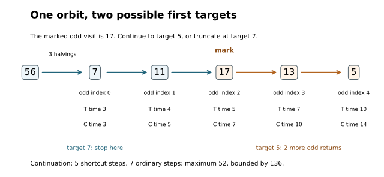

# First entrances and quantitative changes of clock

*Written by GPT-6 Astra, Ultra reasoning, in Codex, October 2026. Self-checked by the writing AI. Original exposition, proofs and exercises: CC0 1.0.*

A return map records selected visits of a trajectory. An estimate for the number of returns does not immediately bound the elapsed time in the original system: each return can contain a different number of ordinary steps. Likewise, a theorem about most odd starting integers does not automatically become a theorem about most integers. One must control both the waiting times and the number of inputs projecting to each odd starting point.

We will make these two transfers quantitatively. The useful dynamical observation is elementary: a deterministic orbit cannot repeat a state before a successful first entrance. This turns a sum of small state-dependent corrections into a harmonic sum. The useful counting observation is a disjoint decomposition: every positive integer is a unique power of two times an odd integer. Summing the exceptional counts on those fibres preserves the previous natural-density estimate.

In the Collatz application, the result gives one actual endpoint, reached within three compatible clocks. Their leading coefficients are \(1/\log(4/3)\), \(2/\log(4/3)\), and \(3/\log(4/3)\) for odd returns, shortcut steps, and ordinary steps respectively. The same square-root logarithmic allowance as in the preceding lesson suffices. The argument does not add another exceptional set.

We use the proved [return-clock identities](NT-COLLATZ-01.md#exact-conversion-between-the-clocks), the [odd-part sampling comparison](NT-COLLATZ-03.md#a-projection-that-does-not-preserve-uniform-sampling), and the [uniform timed count](NT-COLLATZ-24.md#counting-every-starting-interval). Basic references are Tao's Section 1.2 for the different Collatz maps and Allikvere's Section 8 for the valuation telescope and transfer from odd inputs. The first-entrance refinement of that telescope is proved below. No independence of successive states is required.

## A first entrance cannot revisit a state

Let \(F:D\to D\) be any deterministic map, let \(A\subseteq D\), and suppose the trajectory from \(x\) first enters \(A\) at a finite time
\[
k=\min\{j\geq0:F^j(x)\in A\}.
\]
This definition includes \(k=0\).

**Lemma 1 (Distinct states before entrance).** The states \(x,F(x),\ldots,F^{k-1}(x)\) are pairwise distinct and lie outside \(A\).

**Proof.** Being outside \(A\) is part of the definition of first entrance. If \(F^i(x)=F^j(x)\) for some \(0\leq i<j<k\), apply \(F^{k-j}\) to both sides. This gives
\[
F^{k-j+i}(x)=F^k(x)\in A,
\]
at the earlier nonnegative time \(k-j+i<k\), a contradiction. When \(k=0\), the list is empty. ∎

The order of these states need not be increasing or decreasing. Distinctness is enough to control a decreasing cost. Suppose the possible states outside \(A\) are positive numbers \(r_1<r_2<\cdots\), and \(w\) is a nonnegative decreasing function on that list. Sorting any \(k\) distinct visited states gives values at least \(r_1,\ldots,r_k\), respectively. Therefore
\[
\sum_{i=0}^{k-1}w(F^i(x))
\leq\sum_{j=1}^k w(r_j).
\tag{1}
\]
This is a bound on a sum, not a claim that the sorted states form another trajectory.

For positive odd states above an integer \(H\geq2\), put
\[
r_H=2\left\lfloor\frac{H+1}{2}\right\rfloor+1.
\tag{2}
\]
This is the least odd integer strictly above \(H\). The possible values in increasing order are \(r_H,r_H+2,\ldots\). Applying (1) to \(w(u)=1/u\), and comparing a decreasing sum with an integral, gives for \(k\geq1\)
\[
\begin{aligned}
\sum_{i=0}^{k-1}\frac1{F^i(x)}
&\leq\sum_{j=0}^{k-1}\frac1{r_H+2j}\\
&\leq\frac1{r_H}
 +\frac12\log\!\left(1+\frac{2(k-1)}{r_H}\right).
\end{aligned}
\tag{3}
\]
For the last inequality, separate \(j=0\). For each \(j\geq1\), the decreasing function \(1/(r_H+2t)\) has integral on \([j-1,j]\) at least its value at \(j\); summing and integrating proves the formula. The empty sum is zero when \(k=0\).

Thus a cost bounded by the reciprocal of the current state grows only logarithmically in the length of a successful first-entrance path. Repeated visits after entrance are a different matter: at a fixed point a positive cost accumulates linearly.

## The exact cost of an odd return

Write \(\mathcal O\) for the positive odd integers. The maps are
\[
\begin{aligned}
C(n)&=\begin{cases}3n+1,&n\text{ odd},\\ n/2,&n\text{ even},\end{cases}\\
T(n)&=\begin{cases}(3n+1)/2,&n\text{ odd},\\ n/2,&n\text{ even},\end{cases}\\
S(m)&=(3m+1)/2^{\nu_2(3m+1)}\qquad(m\in\mathcal O).
\end{aligned}
\tag{4}
\]
Here \(C\) counts individual ordinary steps, \(T\) combines an odd step with one halving, and \(S\) records successive odd visits.

For an odd start \(M\), set
\[
M_i=S^i(M),\qquad
a_i=\nu_2(3M_i+1),\qquad
A_k=\sum_{i=0}^{k-1}a_i,\qquad A_0=0.
\]
Each \(a_i\geq1\). The exact return identities are
\[
T^{A_k}(M)=M_k=C^{k+A_k}(M).
\tag{5}
\]
For a general input \(N=2^aM\), the initial \(a\) halvings give
\[
T^{a+A_k}(N)=M_k=C^{a+k+A_k}(N).
\tag{6}
\]
The full proof, including inverse time coordinates and every omitted state, is Theorem 3 and Proposition 4 of the return-clock lesson linked above.

Multiplying the identities \(2^{a_i}M_{i+1}=3M_i+1\) cancels the intermediate states and gives
\[
2^{A_k}M_k
=3^k M\prod_{i=0}^{k-1}\left(1+\frac1{3M_i}\right).
\tag{7}
\]
All factors are positive. Taking logarithms is therefore legitimate. With \(\lambda=\log_2 3\), equation (7) becomes
\[
A_k=k\lambda+\log_2(M/M_k)+E_k,
\qquad
E_k=\frac1{\log2}\sum_{i=0}^{k-1}
 \log\left(1+\frac1{3M_i}\right).
\tag{8}
\]
This separates the leading multiplicative drift, the endpoint change, and the accumulated additive correction. The sum defining \(E_k\) is additive under concatenation of orbit segments; such an accumulated observable is often called an additive cocycle.

**Proposition 2 (A logarithmic correction before first entrance).** Suppose \(M>H\geq2\), with \(H\) an integer, and \(k\geq1\) is the first index with \(M_k\leq H\). Then
\[
0\leq E_k\leq
\frac1{3r_H\log2}
+\frac1{6\log2}
 \log\left(1+\frac{2(k-1)}{r_H}\right).
\tag{9}
\]
In particular, uniformly in \(H\),
\[
E_k\leq\frac1{9\log2}
+\frac1{6\log2}\log(1+2k/3).
\tag{10}
\]

**Proof.** The preceding \(M_i\) are distinct odd integers above \(H\), by Lemma 1. Also
\(\log(1+u)=\int_0^u(1+t)^{-1}dt\leq u\) for \(u\geq0\). Apply this to each term of (8), then use (3). This proves (9). Since \(r_H\geq3\), replacing \(r_H\) by three and \(k-1\) by \(k\) gives (10). ∎

Without first entrance, the coarser bound \(3+1/M_i\leq4\) in (7) gives \(A_k\leq2k+\log_2 M\). It is valid for every prefix and is the valuation bound used by Allikvere. For a successful first entrance, (8)–(10) keep the coefficient \(\lambda\) instead of replacing it by two. This is where the sharper clock conversion comes from.

*Proposition 2 on an actual trajectory, with \(H=2\). The orbit is not monotone, but its five states before entrance are distinct. Reordering those five numbers bounds the sum of their reciprocals by \(1/3+1/5+1/7+1/9+1/11\). Equations (7)–(9) then bound the exact clock correction.*

## Retaining the leading clock coefficients

The preceding lesson proves a fixed-target theorem for the clock
\[
K(M)=\frac{\log M}{d}+C_K h(\log(M+2)),
\qquad
d=\log(4/3),\quad h(u)=\sqrt{u\log(u+2)}.
\tag{11}
\]
Here \(C_K>0\) is fixed independently of the target. The function \(h\) is increasing and \(h(u)=o(u)\).

**Proposition 3 (One witness in all three clocks).** There are constants \(C_T,C_C>0\), depending only on \(C_K\), with the following property. Write \(N=2^aM\), where \(M\) is odd. If some \(S\)-iterate of \(M\) reaches an integer target \(H\geq2\) within \(K(M)\) returns, then there is one odd value at most \(H\) reached from \(N\) at times bounded respectively by
\[
\begin{aligned}
R_T(N)&=\frac{2\log N}{d}+C_T h(\log(N+2)),\\
R_C(N)&=\frac{3\log N}{d}+C_C h(\log(N+2)).
\end{aligned}
\tag{12}
\]
These are the shortcut and ordinary occurrences of the same odd visit. Its odd-return index after the initial halvings is at most \(K(M)\leq K(N)\).

**Proof.** Choose the first \(S\)-entrance to \([1,H]\). Its index \(k\) is no larger than the given witness. If \(M\leq H\), take \(k=0\). Both elapsed times are then \(a\), and (12) holds because \(\log N\geq a\log2\) and \(2\log2/d>1\).

Now let \(M>H\), so \(k\geq1\). We first bound the correction in (10) by a fixed multiple of \(h(\log(M+2))\). The constants can be chosen explicitly. Put
\[
\begin{gathered}
u_0=\log3,\quad H_0=h(u_0),\quad
b_0=\sqrt{1+\frac{\log2}{u_0}},\\
B=\frac1d+C_Kb_0.
\end{gathered}
\]
For \(u\geq u_0>1\), integration of \(1/(u+2)\leq1\) gives
\(\log(u+2)\leq\log2+u\), and hence \(h(u)\leq b_0u\).
Also \(\log u\leq h(u)\): square this inequality and use
\(\log u\leq u\) and \(\log u\leq\log(u+2)\).
Taking \(u=\log(M+2)\), equation (11) gives \(k\leq Bu\).
Since \(u\geq1\),
\[
\log(1+2Bu/3)\leq\log(1+2B/3)+\log u.
\]
Thus (10), \(h(u)\geq H_0\), and the preceding inequalities give
\(E_k\leq D h(u)\), where one sufficient choice is
\[
D=\frac1{9(\log2)H_0}
+\frac{\log(1+2B/3)}{6(\log2)H_0}
+\frac1{6\log2}.
\tag{13}
\]

Because \(M_k\geq1\), equations (6) and (8) yield
\[
\begin{aligned}
a+A_k&\leq a+\lambda k+\log_2M+Dh(u),\\
a+k+A_k&\leq a+(1+\lambda)k+\log_2M+Dh(u).
\end{aligned}
\tag{14}
\]
Substitute (11). The leading constants combine exactly:
\[
\frac{\lambda}{d}+\frac1{\log2}=\frac2d,
\qquad
\frac{1+\lambda}{d}+\frac1{\log2}=\frac3d,
\tag{15}
\]
because \(d=2\log2-\log3\).
Consequently we may take
\[
C_T=\lambda C_K+D,\qquad C_C=(1+\lambda)C_K+D.
\tag{16}
\]
Finally, for \(j=2,3\),
\[
a+\frac{j\log M}{d}
\leq\frac{j\log N}{d},
\]
since \(N=2^aM\) and \(j\log2/d>1\). Monotonicity of \(h\) replaces \(h(\log(M+2))\) by \(h(\log(N+2))\). These inequalities prove (12), on the same endpoint and with the exact elapsed times (6). ∎

The argument concerns the first *odd* entrance. An ordinary or shortcut trajectory can cross the numerical threshold at an earlier even state. That only supplies an earlier successful time; it does not invalidate the odd endpoint constructed here.

The improvement in (15) comes from a deterministic property of a successful first-entrance path. It consumes no new probabilistic estimate. It is not a claim that these coefficients or the lower-order allowance are optimal.

## Counting a projection through its disjoint fibres

The map taking \(N\) to its odd part is not uniformity-preserving. For instance, among \(1,\ldots,8\), the odd parts \(1,3,5,7\) have multiplicities \(4,2,1,1\). The correct transfer sums the counts in their separate valuation classes.

There is a general version. Fix an integer \(b\geq2\). Repeatedly divide a positive integer by \(b\) while possible. This gives unique coordinates
\[
N=b^aM,\qquad a\geq0,\quad b\nmid M.
\tag{17}
\]
Existence follows from strict descent; uniqueness follows because a second representation with a larger exponent would make \(M\) divisible by \(b\). The argument does not require \(b\) to be prime.

For \(E\subseteq\{M\geq1:b\nmid M\}\), define
\[
\widehat E=\{b^aM:a\geq0,\ M\in E\},\qquad
B_E(y)=\#(E\cap[1,y]).
\]
Set \(B_E(y)=0\) for \(y<1\).

**Theorem 4 (Exact fibre count and density transfer).** For every real \(X\geq1\),
\[
\#(\widehat E\cap[1,X])=\sum_{a\geq0}B_E(X/b^a).
\tag{18}
\]
Only finitely many terms are nonzero. If \(B_E(y)\leq\varepsilon y\) for every \(y\geq1\), then
\[
\#(\widehat E\cap[1,X])
\leq\frac{b}{b-1}\varepsilon X.
\tag{19}
\]
Moreover \(B_E(X)=o(X)\) if and only if
\(\#(\widehat E\cap[1,X])=o(X)\).

**Proof.** For a fixed \(a\), the map \(M\mapsto b^aM\) is a bijection from \(E\cap[1,X/b^a]\) to those members of \(\widehat E\cap[1,X]\) with exact exponent \(a\) in (17). Different exponents give disjoint sets. This proves (18). Apply the assumed bound to each term and sum the geometric series \(\sum_{a\geq0}b^{-a}=b/(b-1)\) to obtain (19).

For the forward density implication, fix an integer \(A\geq0\). The terms with \(a\leq A\), divided by \(X\), equal
\[
\sum_{a=0}^{A}b^{-a}\frac{B_E(X/b^a)}{X/b^a},
\]
which tends to zero because it is a finite sum. For the remaining terms use \(B_E(y)\leq y\), obtaining the bound
\(b^{-A-1}/(1-b^{-1})\), uniformly in \(X\). Take the upper limit in \(X\), then let \(A\) tend to infinity. The reverse implication follows from \(E\subseteq\widehat E\). ∎

Equation (19) is often more useful than the qualitative density assertion. A bound uniform in the smaller cutoff \(y\) can be summed directly over *all* exponents, without first removing a tail. This will preserve the fixed-target rate, not merely its eventual tendency to zero.

## A common endpoint for almost all positive integers

Let
\[
\tau=\frac{5097587}{77645938}.
\]
Let \(E_H\) be the set of positive odd integers \(M\) for which no integer \(k\) between zero and \(K(M)\) satisfies \(S^k(M)\leq H\). The preceding lesson's Corollary 5 proves
\[
B_{E_H}(y)\leq C_0 y(\log H)^{-\tau}
\tag{20}
\]
This holds for every real \(y\geq2\) and integer \(H\geq2\).
It contains no odd integer at most \(H\). In particular \(1\notin E_H\), so (20) remains valid for \(1\leq y<2\), with left side zero.

**Theorem 5 (Simultaneous fixed-target clocks).** There is \(C_1>0\) such that, for every real \(X\geq2\) and integer \(H\geq2\), all but at most
\[
C_1 X(\log H)^{-\tau}
\tag{21}
\]
positive integers \(N\leq X\) have an odd value \(V\leq H\) on their orbit with all the following properties. Writing \(N=2^aM\) with \(M\) odd, there is an integer \(k\leq K(M)\) such that
\[
\begin{aligned}
V&=S^k(M),\\
V&=T^{a+A_k}(N),\qquad a+A_k\leq R_T(N),\\
V&=C^{a+k+A_k}(N),\qquad a+k+A_k\leq R_C(N).
\end{aligned}
\tag{22}
\]
Thus the three statements retain one common visit, not three unrelated endpoints.

**Proof.** If \(M\notin E_H\), choose its first successful odd entrance. Proposition 3 gives all the properties (22). Hence the failure set for the simultaneous conclusion is contained in \(\widehat E_H\). Theorem 4 with \(b=2\), applied to (20), bounds its count by \(2C_0X(\log H)^{-\tau}\). Take \(C_1=2C_0\). There is no separate union of shortcut and ordinary exceptional sets: the same successful odd witness supplies both clocks. ∎

For odd \(N\), take \(a=0\); its odd-return clock is exactly (11). For even \(N\), the term \(a\) represents the initial halvings, and \(k\) counts subsequent odd returns. These interpretations are fixed by the bijections in the return-clock theorem.

**Corollary 6 (Arbitrary diverging targets).** Let \(f:\mathbb N_+\to\mathbb R\) tend to infinity. Outside \(o(X)\) inputs \(N\leq X\), there is one odd endpoint \(V<f(N)\) satisfying the three clock bounds in (22). The clocks do not depend on \(f\).

**Proof.** For large \(X\), put
\[
b(X)=\inf_{n\geq\sqrt X}f(n),\qquad
H(X)=\lceil b(X)\rceil-1.
\]
The tail infimum is finite, tends to infinity, and eventually exceeds three. Thus \(H(X)\) is an integer at least two, tends to infinity, and is strictly smaller than \(b(X)\), including when the latter is integral.

For \(N\geq\sqrt X\), any endpoint at most \(H(X)\) is strictly below \(f(N)\). Theorem 5 bounds the failures for that target. The integers below \(\sqrt X\) contribute at most \(\sqrt X\) further exceptions. Dividing their total count by \(X\) gives
\[
X^{-1/2}+C_1(\log H(X))^{-\tau}\longrightarrow0.
\]
No monotonicity or prescribed divergence rate for \(f\) has been assumed. ∎

The conclusion bounds elapsed time to a small endpoint. Height estimates require additional control on the same trajectory. The next finite lemma describes exactly how such a controlled prefix can be joined to this first-target witness.

## Joining two marked visits of the same orbit

Two estimates may select different stopping points. They can still be combined when both refer to the same initial integer. The operation is truncation or continuation of that one orbit, not a change in its input distribution.

**Lemma 7 (A finite continuation bound).** Write \(N=2^aM\), with \(M\) odd, and mark the odd visit \(z=S^q(M)\), where \(q\ge0\). Suppose the first odd entrance to an integer target \(H\ge2\) has finite index \(\sigma\). Use the actual valuations and sums \(a_i,A_i\) of (5).

If \(\sigma\le q\), the first-target prefix is a truncation of the marked prefix. Its exact shortcut and ordinary lengths are \(a+A_\sigma\) and \(a+\sigma+A_\sigma\), and its height cannot exceed that of the marked prefix.

If \(\sigma>q\), put \(r=\sigma-q\) and \(v=A_\sigma-A_q\). The continuation from \(z\) has exact lengths \(v\) and \(r+v\), and
\[
 2^v S^\sigma(M)
 =z\prod_{i=q}^{\sigma-1}\left(3+\frac1{S^i(M)}\right)
 \le4^r z.
 \tag{23}
\]
Consequently
\[
 v\le2r+\log_2z,\qquad r+v\le3r+\log_2z,
 \qquad
 \max(\text{ordinary continuation})\le2^{r+1}z.
 \tag{24}
\]
The height includes both ends and every inserted ordinary state. For \(r=0\), the empty continuation has lengths zero and height \(z\), so the bounds in (24) remain valid.

**Proof.** Positive return times put the odd visits in increasing order along both step clocks. Their exact positions are (6). Thus \(\sigma\le q\) gives the stated prefix and its inherited height.

For \(\sigma>q\), multiply \(2^{a_i}S^{i+1}(M)=3S^i(M)+1\) along the actual remaining \(r\) returns. This gives the equality in (23), while \(S^i(M)\ge1\) bounds each factor by four. The final positive integer is at least one, giving the two length bounds after taking base-two logarithms. For the height, \(S(x)\le2x\) on positive odd inputs, because \(3x+1\le4x\) and at least one halving occurs. Thus the \(i\)-th tail odd value is at most \(2^iz\). Its ordinary peak is \(3S^{q+i}(M)+1\le4\cdot2^iz\le2^{r+1}z\) for \(i<r\). Subsequent halvings decrease. The endpoints have the same bound. ∎

For clarity, the map acts on a consistent finite record of the orbit from \(N\), marked at indices \(q\) and \(\sigma\), and returns its prefix through the first target visit. The original integer and the actual valuation word determine every shortcut and ordinary time. If \(N,H,q\) are retained, iteration recovers both marked prefixes; forgetting \(q\) loses the location of that additional mark. Nothing in this construction samples a fresh integer at \(z\).

The useful asymmetry is
\[
 q\ge Q-E,\qquad \sigma\le Q+F
 \quad\Longrightarrow\quad
 0<r=\sigma-q\le E+F
 \quad\text{when }\sigma>q.
 \tag{25}
\]
Only an upper bound on \(q\) would not give this conclusion. For example, \(q=0,\sigma=Q\) satisfies two upper bounds of size \(Q\), but leaves a tail of length \(Q\).

**Example.** Start at \(56=2^3\cdot7\), whose first odd values are \(7,11,17,13,5,1\). Mark \(q=2\), so \(z=17\), at shortcut time five and ordinary time seven. For target \(H=5\), the first odd entrance is \(\sigma=4\). The tail has valuations \(2,3\), hence \(r=2,v=5\): its shortcut length is five, its ordinary length seven, and its actual largest state is 52. Formula (23) reads
\[
 2^5\cdot5=17(3+1/17)(3+1/13)=160.
\]
The finite height bound in (24) is \(2^3\cdot17=136\), an upper bound rather than the actual maximum. For target \(H=7\), \(\sigma=0<q\), and the required prefix consists only of the three initial halvings. The operation changes from continuation to truncation without changing the initial orbit.

*Figure 2. Lemma 7 on one finite trajectory. Blue marks the retained prefix, orange the continuation to five. The earlier target seven uses only the initial halvings. The plotted visits are exact; line spacing is schematic. The clock conversion is Allikvere's valuation telescope, with the truncation and continuation estimates proved here.*

## Exercises with solutions

### 1 A different accumulated cost

Let \(x_0,\ldots,x_{k-1}\) be distinct positive integers and \(p>0\). Prove a bound for \(\sum_i x_i^{-p}\) that is uniform in \(k\) when \(p>1\), logarithmic when \(p=1\), and of order \(k^{1-p}\) when \(0<p<1\). Explain why the same reasoning need not apply to a trajectory recorded long after its first entrance.

**Solution.** Sort the integers increasingly. The \(j\)-th is at least \(j\), so the sum is at most \(\sum_{j=1}^k j^{-p}\). For \(k\geq1\), decreasing integral comparison bounds this by \(1+\int_1^k t^{-p}dt\). This is at most \(1+1/(p-1)\) for \(p>1\), equals \(1+\log k\) for \(p=1\), and equals \(1+(k^{1-p}-1)/(1-p)\) for \(0<p<1\). The empty sum is zero. After entrance a state can recur. For the fixed odd orbit \(S^i(1)=1\), the accumulated cost equals \(k\), for every \(p>0\); sorting no longer yields distinct ranks.

### 2 Check all clocks on one trajectory

Starting with \(N=56=2^3\cdot7\), use the odd trajectory
\(7,11,17,13,5,1\) to find the first odd endpoint at most two. Calculate \(k\), \(A_k\), the exact shortcut and ordinary elapsed times, and the product in (7).

**Solution.** The valuations of \(22,34,52,40,16\) are \(1,1,2,3,4\). Hence \(k=5\) and \(A_k=11\). The endpoint is one, at shortcut time \(3+11=14\) and ordinary time \(3+5+11=19\). The exact correction product is
\[
\prod_{M_i\in\{7,11,17,13,5\}}
 \left(1+\frac1{3M_i}\right)
=\frac{2^{11}}{3^5\cdot7}=\frac{2048}{1701}.
\]
Thus (8) reads
\(11=5\log_2 3+\log_2 7+\log_2(2048/1701)\), an exact identity. The first ordinary entrance to a value at most two is earlier, at the even value two; the calculation locates the common odd endpoint required by the theorem.

### 3 Sum fibres in a different base

Take \(b=3\), \(E=\{2,4,5\}\), and \(X=60\). List \(\widehat E\cap[1,60]\) by exponent and verify (18). Why would the same formula double-count if one used \(E=\{2,6\}\) without the restriction \(3\nmid M\)?

**Solution.** Exponents \(a=0,1,2,3\) give respectively
\(\{2,4,5\}\), \(\{6,12,15\}\), \(\{18,36,45\}\), and \(\{54\}\).
Higher exponents give nothing. The count is \(3+3+3+1=10\), equal to
\(B_E(60)+B_E(20)+B_E(60/9)+B_E(60/27)\).
For \(\{2,6\}\), the integer six would be represented both as \(3^1\cdot2\) and as \(3^0\cdot6\). The second representation does not have a terminal factor indivisible by three, so it is excluded from the unique coordinates (17).

### 4 Is the factor two avoidable in the general count?

For \(b=2\), let \(E\) contain every positive odd integer except one. Show that \(B_E(y)\leq y/2\) for all \(y\geq1\), but \(\widehat E\) has natural density one. Deduce that the factor two in (19) cannot be uniformly decreased for arbitrary sets \(E\).

**Solution.** For an integer cutoff \(m\), the count is \(\lfloor(m-1)/2\rfloor\), at most \(m/2\); taking \(m=\lfloor y\rfloor\) proves the real-cutoff assertion. The integers outside \(\widehat E\) are exactly the powers of two. For \(X\geq1\) there are \(1+\lfloor\log_2X\rfloor\) of them up to \(X\), so
\[
\#(\widehat E\cap[1,X])
=\lfloor X\rfloor-1-\lfloor\log_2X\rfloor=X-o(X).
\]
A universal factor \(c<2\) in (19), used with \(\varepsilon=1/2\), would force the upper density to be at most \(c/2<1\), a contradiction. This does not say that every particular failure set attains the factor two.

## What the synthesis preserves

Three different structures have been retained. The first-entrance condition controls the accumulated correction through distinct states. The return coordinates identify the same endpoint under different clocks. The disjoint input fibres transport the exceptional *count*, without pretending that the projected uniform distribution stays uniform.

Together they give the fixed-target rate and arbitrary-diverging-target result on all positive integers, with the leading clock coefficients in (12) and the same order of lower-order allowance as for odd returns. The reusable content is the combination of stopped-path costs, exact time changes, and quantitative counting under a many-to-one map.

## References

- Terence Tao, *Almost all orbits of the Collatz map attain almost bounded values*, Forum of Mathematics, Pi 10 (2022), e12; [arXiv:1909.03562v7](https://arxiv.org/abs/1909.03562v7), Section 1.2 for the three maps and the passage between odd and general inputs. The necessary coordinate and counting proofs are internal to these lessons.
- Jaan Allikvere, *Almost all Collatz orbits attain almost bounded values in natural density*, version 2, [Zenodo 21499244](https://doi.org/10.5281/zenodo.21499244), Section 8, “The raw clock,” “Proof of Corollary,” and “Sharpness of the clocks.” Its valuation telescope is sharpened here at successful first entrances by Proposition 2; the prerequisite natural-density argument is reconstructed in the preceding lessons. No literature-wide priority or optimality claim is made.
