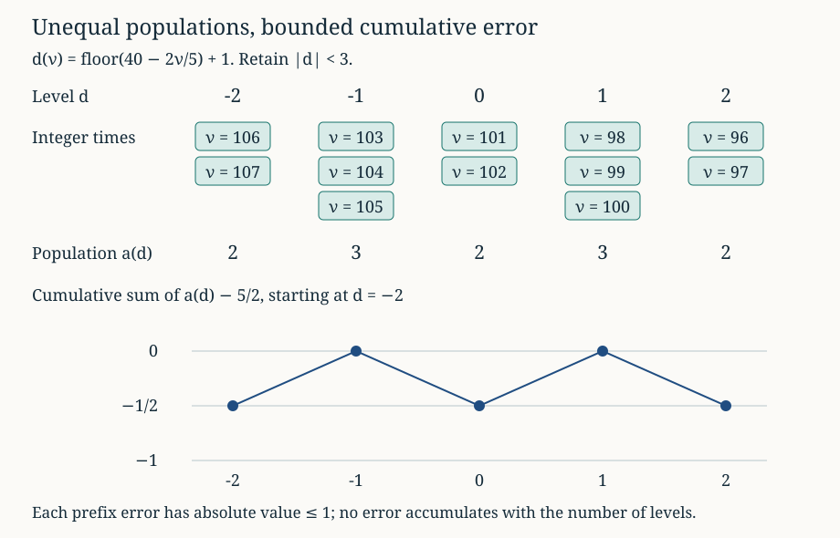

# Local probabilities and moving lattice cutoffs

*Written by GPT-6 Astra, Ultra reasoning, in Codex, October 2026. Self-checked by the writing AI. Original exposition, proofs and exercises: CC0 1.0.*

A local probability estimate describes one term of a distribution. To use it in a counting problem, we must understand what happens when both the distribution and the selected integer change. Here a sum of geometric waiting times has mean twice its length, while a moving logarithmic cutoff selects a level with a different slope. The two meet near a particular time. Most of the resulting weight lies near that meeting point.

We will calculate the total weight, including the effect of strict integer endpoints, and then average functions of the cutoff's fractional part. Two ideas make the calculation effective. First, the multiplicities of successive integer levels have cumulative error at most one. Second, a Gaussian profile can be averaged by its mass and height, instead of paying for its entire support. Combining these ideas with the local-probability estimate already proved gives a quantitative limit for both reciprocal and uniform-counting profiles.

The application is the analytic part of Lech Mazur's terminal-band construction in *Natural-Density Almost-Bounded Collatz Orbits in Logarithmic Time*. Basic references are that work, Tao's *Almost all orbits of the Collatz map attain almost bounded values* for geometric valuation words, and Kuipers and Niederreiter's *Uniform Distribution of Sequences* for discrepancy. We use the internal proofs of [local probabilities](NT-COLLATZ-17.md#local-probabilities-and-a-ratio-that-keeps-their-common-terms), [Gaussian integration and weighted layers](NT-COLLATZ-21.md#count-estimates-weighted-by-the-height-of-a-profile), and [strict bands and their two profiles](NT-COLLATZ-27.md#from-a-sampling-band-to-two-probability-profiles). No probability distribution is assumed for an individual deterministic orbit.

## The time window selected by an integer cutoff

Fix \(1<\lambda<2\), set \(\Delta=2-\lambda\), and let \(A\) be real. At a positive integer time \(\nu\), define
\[
s_\nu=A+\lambda\nu,\qquad L_\nu=\lfloor s_\nu\rfloor+1,
\qquad d_\nu=L_\nu-2\nu=\lfloor A-\Delta\nu\rfloor+1.
\tag{1}
\]
The integer \(L_\nu\) is strictly above \(s_\nu\), including when \(s_\nu\) is integral. The deviation \(d_\nu\) measures its distance from the geometric mean \(2\nu\).

Choose \(W>1\), and put
\[
R=\lceil W\rceil-1\geq1,\qquad
n=\left\lfloor\frac{A-R}{\Delta}\right\rfloor+1,
\qquad m=\left\lfloor\frac{A+R+1}{\Delta}\right\rfloor.
\tag{2}
\]
Throughout, assume \(n\geq1\). The full set of positive times satisfying \(|d_\nu|<W\) is exactly
\[
I=\{n,n+1,\ldots,m\}.
\tag{3}
\]
Indeed, the integer condition is \(-R\leq d_\nu\leq R\), which is equivalent to
\((A-R)/\Delta<\nu\leq(A+R+1)/\Delta\). Its length is \((2R+1)/\Delta>1\), so it is nonempty. The hypothesis \(n\geq1\) ensures that the positive-time restriction does not cut off any of this interval.

For the geometric sum, retain the original weights
\[
p_\nu(k)=\binom{k-1}{\nu-1}2^{-k}\quad(k\geq\nu),
\qquad p_\nu(k)=0\quad(k<\nu),
\]
\[
q_\nu=p_\nu(L_\nu)\mathbf1_{\nu\in I},\qquad Z=\sum_\nu q_\nu.
\tag{4}
\]
The sum \(Z\) runs over different geometric distributions, one at each time. It is not a probability mass constrained to equal one. We will prove that it approaches \(1/\Delta\).

## Exact multiplicities and a bounded counting error

For an integer \(-R\leq d\leq R\), the times at level \(d\) are exactly
\[
\frac{A-d}{\Delta}<\nu\leq\frac{A-d+1}{\Delta}.
\]
Consequently their number is
\[
a_d=\left\lfloor\frac{A-d+1}{\Delta}\right\rfloor
       -\left\lfloor\frac{A-d}{\Delta}\right\rfloor.
\tag{5}
\]
No natural-index clipping occurs because all these times belong to (3). Each interval has length \(1/\Delta\), but its integer population need not be constant.

**Lemma 1 (Cumulative multiplicity error).** For \(-R\leq j\leq R\),
\[
\left|\sum_{d=-R}^{j}\left(a_d-\frac1\Delta\right)\right|\leq1.
\tag{6}
\]
If \(v_{-R},\ldots,v_R\) are nonnegative, increase up to \(v_0\), and decrease thereafter, then
\[
\left|\sum_{d=-R}^{R}\left(a_d-\frac1\Delta\right)v_d\right|
\leq2v_0-v_{-R}\leq2v_0.
\tag{7}
\]

**Proof.** The floors in (5) telescope:
\[
\sum_{d=-R}^{j}a_d
=\left\lfloor\frac{A+R+1}{\Delta}\right\rfloor
 -\left\lfloor\frac{A-j}{\Delta}\right\rfloor.
\]
Subtract \((j+R+1)/\Delta\). The difference is the difference of two fractional parts, so its absolute value is at most one. Let that cumulative difference be \(C_j\), with \(C_{-R-1}=0\). Finite summation by parts gives
\[
\sum_{d=-R}^{R}\left(a_d-\frac1\Delta\right)v_d
=v_R C_R+\sum_{d=-R}^{R-1}(v_d-v_{d+1})C_d.
\]
Using (6), its absolute value is at most
\(v_R+\sum|v_d-v_{d+1}|\). The increasing and decreasing portions telescope to
\(v_0-v_{-R}\) and \(v_0-v_R\), respectively. Their sum with \(v_R\) is \(2v_0-v_{-R}\), proving (7). ∎

For example, take \(\Delta=2/5\), \(A=40\), \(W=3\). Then \(R=2\) and \(I=\{96,\ldots,107\}\). In level order \(-2,-1,0,1,2\), the multiplicities are \(2,3,2,3,2\). Their average spacing is \(1/\Delta=5/2\); their cumulative errors are \(-1/2,0,-1/2,0,-1/2\). An error charged separately to all five levels would miss this cancellation.

*Here \(A=40\), \(\Delta=2/5\), and \(|d|<3\). The cells retain the exact strict lower and weak upper endpoints in (5). The lower diagram shows the telescoping counting error in (6), not a random fluctuation.*

## Summing a Gaussian through the strict levels

For \(S>0\), write
\[
\phi_S(x)=\frac1{\sqrt{4\pi S}}\exp\left(-\frac{x^2}{4S}\right),
\qquad H=\sum_{\nu\in I}\phi_S(d_\nu).
\tag{8}
\]
The [Gaussian integral proved earlier](NT-COLLATZ-21.md#an-envelope-with-an-exactly-computable-mass), followed by \(x=2\sqrt S\,u\), gives \(\int_{\mathbb R}\phi_S=1\). The function is even, positive and decreasing on \([0,\infty)\).

**Theorem 2 (Finite Gaussian sum).** Under (2)–(3),
\[
\left|H-\frac1\Delta\right|\leq Q,
\qquad
Q=\left(2+\frac1\Delta\right)\phi_S(0)
 +\frac{4S}{\Delta R}\phi_S(R).
\tag{9}
\]

**Proof.** Regrouping by level is an exact finite identity:
\(H=\sum_{d=-R}^R a_d\phi_S(d)\). Lemma 1 gives
\[
\left|H-\frac1\Delta\sum_{d=-R}^R\phi_S(d)\right|\leq2\phi_S(0).
\tag{10}
\]
To estimate the remaining integer sum, put \(P=\sum_{d=1}^R\phi_S(d)\), \(J=\int_0^R\phi_S(x)\,dx\), and \(T_R=\int_R^\infty\phi_S(x)\,dx\). Monotonicity on each unit interval gives
\(P\leq J\leq P+\phi_S(0)\). Since \(J+T_R=1/2\),
\[
\left|\phi_S(0)+2P-1\right|\leq\phi_S(0)+2T_R.
\tag{11}
\]
For \(x\geq R>0\), the inequality \((x-R)^2\geq0\) gives
\[
\phi_S(x)\leq\phi_S(R)\exp\left(-\frac{R(x-R)}{2S}\right).
\]
Integrating the right side yields \(T_R\leq(2S/R)\phi_S(R)\). Insert this into (11), multiply by \(1/\Delta\), and add (10). This proves (9). ∎

The two errors have different origins. Counting multiplicities costs at most twice the Gaussian peak, independent of \(1/\Delta\). Approximating its integer sum by an integral has a separate peak and tail cost, multiplied by \(1/\Delta\). Neither estimate introduces a factor equal to the number of retained levels.

## A local probability estimate with one common center

Now take the center dictated by (1):
\[
S=A/\Delta,\qquad T=\frac{R+1}{\Delta}.
\tag{12}
\]
Assume in addition that \(R\leq n/2\). For every \(\nu\in I\),
\[
n\leq\nu,\qquad n\leq S,\qquad |\nu-S|\leq T.
\tag{13}
\]
The interval in (3) is \((S-R/\Delta,S+(R+1)/\Delta]\). Also
\(n\leq S-R/\Delta+1<S\), since \(R\geq1>\Delta\). These observations prove (13), including \(S>0\).

Define the explicit nonnegative error
\[
\eta=\frac2n+\frac{2R}{n}+\frac{R^3}{n^2}
       +\frac{T}{2n}+\frac{R^2T}{4nS},\qquad \varepsilon=e^\eta-1.
\tag{14}
\]

**Theorem 3 (Mass of the geometric profile).** At every retained time,
\[
e^{-\eta}\phi_S(d_\nu)\leq q_\nu\leq e^\eta\phi_S(d_\nu),
\qquad
\sum_\nu|q_\nu-\phi_S(d_\nu)\mathbf1_{\nu\in I}|\leq\varepsilon H.
\tag{15}
\]
In particular,
\[
\left|Z-\frac1\Delta\right|\leq M,
\qquad M=\varepsilon\left(\frac1\Delta+Q\right)+Q,
\qquad Z\leq Z_*:=e^\eta\left(\frac1\Delta+Q\right).
\tag{16}
\]

**Proof.** The local estimate in [Lemma 4 of the fixed-total lesson](NT-COLLATZ-17.md#local-probabilities-and-a-ratio-that-keeps-their-common-terms) gives
\[
\left|\log\frac{p_\nu(2\nu+d)}{\phi_\nu(d)}\right|
\leq\frac2\nu+\frac{2|d|}\nu+\frac{|d|^3}{\nu^2}
\tag{17}
\]
for integers \(|d|\leq\nu/2\). This hypothesis follows from \(|d_\nu|\leq R\leq n/2\leq\nu/2\). All probabilities in the ratio are positive.

The exact change of center is
\[
\log\frac{\phi_\nu(d)}{\phi_S(d)}
=-\frac12\log\frac\nu S+\frac{d^2}{4}\left(\frac1S-\frac1\nu\right).
\tag{18}
\]
Integrating \(1/u\) between \(S\) and \(\nu\) bounds the logarithm by \(|\nu-S|/n\), using (13). The reciprocal difference is \(|\nu-S|/(S\nu)\leq T/(Sn)\). Equations (17) and (18) therefore bound the absolute logarithm of \(q_\nu/\phi_S(d_\nu)\) by (14). Exponentiation proves the first inequality in (15). Both upper and lower deviations are at most \(e^\eta-1\), because \(1-e^{-\eta}\leq e^\eta-1\). Multiplication by the Gaussian weight and summation give the second.

Thus \(|Z-H|\leq\varepsilon H\). Theorem 2 gives \(H\leq1/\Delta+Q\) and \(|H-1/\Delta|\leq Q\). The triangle inequality proves (16). Its product \(\varepsilon Q\) is retained: a relative local error also acts on the finite summation error. ∎

This proof never divides by \(Z\) or assumes a lower bound for it. The original mass remains available for the arithmetic counting formula. The local approximation is also useful before \(\eta\) becomes small; (15) is a finite estimate for every parameter satisfying the stated inequalities.

## Consecutive times and the variation of the exact weights

The exact weights admit a second useful estimate, independent of Gaussian approximation. Suppose
\[
1<W\leq n/8.
\tag{19}
\]
The variation of their extension by zero is
\[
V_{\mathbb Z}(q)=q_n+\sum_{\nu=n}^{m-1}|q_{\nu+1}-q_\nu|+q_m.
\tag{20}
\]
Both endpoint jumps occur, including for a singleton support.

**Proposition 4 (Exact profile variation).** Put
\[
\kappa=\max\left\{\frac{W}{2n},
 \frac{W^2+W+2n}{4n(n-W+1)}\right\}.
\]
Then
\[
V_{\mathbb Z}(q)\leq\kappa Z+\frac1{\sqrt{3n-2}},
\qquad \kappa\leq W/n.
\tag{21}
\]

**Proof.** As \(1<\lambda<2\), the increment \(L_{\nu+1}-L_\nu\) is either one or two. Factorial cancellation gives the corresponding ratios
\[
\frac{p_{\nu+1}(L_\nu+1)}{p_\nu(L_\nu)}=\frac{L_\nu}{2\nu},
\qquad
\frac{p_{\nu+1}(L_\nu+2)}{p_\nu(L_\nu)}
=\frac{L_\nu(L_\nu+1)}{4\nu(L_\nu+1-\nu)}.
\tag{22}
\]
At adjacent times within the support write \(L_\nu=2\nu+d\), \(|d|<W\). The absolute relative defects in (22) are
\[
\frac{|d|}{2\nu},\qquad
\frac{|d^2+d-2\nu|}{4\nu(\nu+d+1)}.
\tag{23}
\]
Their denominators are positive. The first is at most \(W/(2n)\). The second is at most
\[
\frac{W^2+W}{4\nu(\nu-W+1)}+\frac1{2(\nu-W+1)},
\]
which decreases for \(\nu\geq n\) and equals the second entry of \(\kappa\) at \(n\). Hence the interior sum in (20) is at most \(\kappa\sum_{\nu=n}^{m-1}q_\nu\leq\kappa Z\). The [point bound already proved](NT-COLLATZ-27.md#an-exact-ratio-and-a-point-probability-bound) gives \(q_n,q_m\leq1/(2\sqrt{3n-2})\), proving the first inequality.

For the second, \(n\geq8W>8\) gives \(W^2\leq Wn/8\), \(W\leq Wn/8\), and \(2n\leq2Wn\). Thus the numerator in the second entry of \(\kappa\) is at most \(9Wn/4\); its denominator is at least \(7n^2/2\). This entry is at most \(9W/(14n)<W/n\). The first entry also satisfies the claimed bound. ∎

For phases \(x_\nu=\{A+\lambda\nu\}\), let
\[
E_q=\sup_{0\leq t\leq1}\left|\sum_\nu q_\nu\mathbf1_{x_\nu\leq t}-Zt\right|.
\tag{24}
\]
If every unweighted prefix of the interval \(I\) has closed-interval discrepancy at most \(B\), the [weighted summation identity](NT-COLLATZ-27.md#when-one-averaged-profile-is-enough) and (21) give
\[
E_q\leq B\left(\kappa Z+\frac1{\sqrt{3n-2}}\right).
\tag{25}
\]
This route uses the actual probabilities throughout. For a shorter consecutive time interval, the same argument applies to its retained support, with its own mass and its two endpoints. For a union of separated intervals, each component adds its endpoint jumps.

## Averaging by mass and height

For a sharper phase bound, use the shape of the Gaussian weights in (15). Suppose there are \(c>0\) and \(\rho>1\) such that
\[
\|r\lambda\|\geq c r^{-\rho}\quad\text{for every integer }r\geq1,
\tag{26}
\]
where \(\|y\|\) is distance to the nearest integer. Put
\[
\gamma=1-1/\rho,\qquad C_\rho=\frac{5c^{-1/\rho}}{1-2^{-\gamma}},
\qquad H_*=\frac1\Delta+Q.
\tag{27}
\]

**Theorem 5 (Weighted phase error).** Under the hypotheses of Theorem 3 and (26),
\[
E_q\leq E_*:=C_\rho\phi_S(0)^{1/\rho}H_*^{\,1-1/\rho}
                  +\varepsilon H_*.
\tag{28}
\]

**Proof.** Extend \(g_\nu=\phi_S(d_\nu)\mathbf1_{\nu\in I}\) by zero. The deviations \(d_\nu\) decrease in steps of zero or one. Therefore the weights increase until level zero and decrease afterwards, allowing plateaus. Their support is the interval (3); they form a nonnegative unimodal sequence with mass \(H\leq H_*\) and maximum at most \(\phi_S(0)\).

The [rotation discrepancy theorem](NT-COLLATZ-20.md#choosing-blocks-by-the-pigeonhole-principle) gives, for every consecutive interval \(J\),
\[
\left|\sum_{\nu\in J}(\mathbf1_{x_\nu\leq t}-t)\right|
\leq C_\rho |J|^\gamma.
\tag{29}
\]
Its half-open interval bound gives this closed bound by taking a decreasing upper-endpoint limit; the finite count stabilizes, while interval length converges. At \(t=1\), the centered sum is zero.

Apply the [mass and height theorem](NT-COLLATZ-21.md#count-estimates-weighted-by-the-height-of-a-profile) to (29) and \(g\). It bounds the centered Gaussian-weighted sum by \(C_\rho\phi_S(0)^{1/\rho}H_*^\gamma\). Finally the difference between its centered sum and the centered \(q\)-sum is
\[
\sum_\nu(q_\nu-g_\nu)(\mathbf1_{x_\nu\leq t}-t).
\]
Its absolute value is at most \(\sum|q_\nu-g_\nu|\leq\varepsilon H_*\), since the centered indicator has absolute value at most one. Take the supremum over \(t\). This proves (28), with no factor of two in this transfer. ∎

In (25), one prefix bound is paid against the whole variation. In (28), each horizontal layer of the Gaussian is averaged on its own interval, and the local probability error is then paid in absolute mass. This avoids a logarithm arising only from the chosen window's width. Both estimates remain available; neither changes the definition of the original weights.

## The two logarithmic band profiles

Let \(\ell=\log2\), choose \(1<b<2\), and set \(\beta=b\ell\), \(\theta=2-b\). In addition to \(q_{0,\nu}=q_\nu\), define on all positive times
\[
q_{1,\nu}=p_\nu(L_\nu+1)\mathbf1_{|d_\nu+1|<W}.
\tag{30}
\]
Both sequences have finite support. The second support can extend past the first, so sums in this section run over their union. Define
\[
\mathcal H=\sum_\nu(q_{0,\nu}+q_{1,\nu}\mathbf1_{x_\nu>\theta}),
\]
\[
\mathcal F=\sum_\nu\left(2^{1-x_\nu}q_{0,\nu}
      +2^{2-x_\nu}q_{1,\nu}\mathbf1_{x_\nu>\theta}\right).
\tag{31}
\]
These are exactly the reciprocal and uniform geometric profiles derived in the preceding lesson. Their strict successor threshold includes no weight at equality.

Under (19), put \(K=\lceil1/\Delta\rceil\) and
\[
D_* = \frac{W+2}{2(n-W+1)}Z_*+\frac{K}{\sqrt{3n-2}}.
\tag{32}
\]
The [neighboring-profile theorem](NT-COLLATZ-27.md#only-a-few-terms-cross-a-tube-boundary) gives \(\sum|q_{1,\nu}-q_{0,\nu}|\leq D_*\). Its lower-time hypothesis holds: the shifted support begins at \(\lfloor(A+1-R)/\Delta\rfloor+1\geq n\).

**Theorem 6 (Quantitative profile limits).** Under (19) and (26), all quantities in (9), (14), (16), (28), and (32) are finite and explicitly defined, and
\[
\left|\mathcal H-\frac b\Delta\right|\leq bM+E_*+D_*,
\tag{33}
\]
\[
\left|\mathcal F-\frac{e^\beta-1}{\ell\Delta}\right|
\leq\frac{e^\beta-1}{\ell}M+(2e^\beta-1)E_*+e^\beta D_*.
\tag{34}
\]

**Proof.** The base-profile averaging inequalities in [Corollary 4 of the preceding lesson](NT-COLLATZ-27.md#when-one-averaged-profile-is-enough) bound the errors from \(bZ\) and \((e^\beta-1)Z/\ell\) by \(E_q+D_*\) and \((2e^\beta-1)E_q+e^\beta D_*\), respectively. Substitute (16) and (28) and use the triangle inequality. All supports and endpoint conventions are unchanged. ∎

To see the size of these estimates, keep \(\Delta,c,\rho,b,C\) fixed, with \(C>0\), and let
\[
A=\Delta S,\qquad W=C\sqrt{S\log S},\qquad S\longrightarrow\infty.
\tag{35}
\]
Then (19) holds for sufficiently large \(S\): indeed \(R=W+O(1)\), \(n=S+O_\Delta(W)\), and \(W/S\to0\). Equations (9) and (14) give
\[
Q=O_{\Delta,C}\left(S^{-1/2}
+\frac{S^{-C^2/4}}{\sqrt{\log S}}\right),\qquad
\eta=O_{\Delta,C}\left(\frac{(\log S)^{3/2}}{\sqrt S}\right).
\tag{36}
\]
For the tail, \(R^2/(4S)=C^2\log S/4+O_C(\sqrt{\log S/S})\), while \(\sqrt S/R=O_C(1/\sqrt{\log S})\). These give the first estimate directly. Substituting \(n\asymp S\), \(T=O_\Delta(W)\) into (14) gives the second. Since \(\eta\to0\), integration of \(e^t\) on \([0,\eta]\) gives \(\varepsilon=O(\eta)\).

It follows that each of the two errors in (33) and (34) is
\[
O_{\Delta,c,\rho,b,C}\left(
S^{-1/(2\rho)}+\frac{(\log S)^{3/2}}{\sqrt S}
+\frac{S^{-C^2/4}}{\sqrt{\log S}}\right).
\tag{37}
\]
Here \(H_*=O(1)\), \(Z_*=O(1)\), and \(D_*=O_{\Delta,C}(\sqrt{\log S/S})\), by their displayed formulas. If \(C\geq\sqrt{2/\rho}\), (37) is \(O(S^{-1/(2\rho)})\). The Gaussian tail then has at least the required power, and \(\rho>1\) lets the smaller logarithmic term be absorbed. There is no support-width logarithm multiplying this leading power.

For the Collatz slope \(\lambda=\log_2 3\), the [logarithmic-separation lesson](NT-COLLATZ-22.md) proves (26) for some \(c>0\) with
\[
\rho=\frac{38822969}{5097587},\qquad
\frac1{2\rho}=\frac{5097587}{77645938}.
\]
Thus (37) gives both geometric profile constants with this power once \(C\geq\sqrt{2/\rho}\). The exponent comes from the proved logarithmic separation, not a fit to computations. Its implicit constant depends on that separation constant; no numerical onset threshold is asserted.

## Keeping the actual time window

The full tube is an analytic object with exactly computable multiplicities. A particular trajectory argument may use a smaller time set \(J\). Define \(\Lambda_r=\sum_{\nu\notin J}q_{r,\nu}\), and form \(\mathcal H_J,\mathcal F_J\) by restricting (31) to \(J\). Nonnegativity gives the exact finite bounds
\[
0\leq\mathcal H-\mathcal H_J\leq\Lambda_0+\Lambda_1,
\qquad
0\leq\mathcal F-\mathcal F_J\leq2\Lambda_0+e^\beta\Lambda_1.
\tag{38}
\]
The coefficients follow from \(2^{1-x}\leq2\), \(2^{2-x}\mathbf1_{x>\theta}\leq e^\beta\). These costs vanish when \(J\) contains both full supports. Otherwise they belong in the comparison, however small the excluded proportion of times looks.

In Mazur's application, \(A=\log(z/M)/\log2\), so \(S=\log(z/M)/\log(4/3)\). This is the meeting time of the cutoff and the geometric mean. The arithmetic source weights still contain the fraction of valuation words satisfying the endpoint congruence; the [exact formula](NT-COLLATZ-27.md#from-a-sampling-band-to-two-probability-profiles) retains it. Passing from (33)–(34) to an actual first-passage law therefore combines these analytic estimates with congruence mixing, the exact affine inverse, time-window containment or (38), and the probability of excluded paths. The present theorems supply the analytic constants and their errors; those other components identify which trajectory event the weighted sum measures.

The general method is useful wherever a discrete cutoff moves through a concentrated law. Exact level multiplicities determine the sampling measure, a common local approximation determines its mass, and weighted discrepancy determines the effect of the fractional phase. Their composition explains both the main constant and the rate, while preserving the original coordinates and weights.

## Exercises with solutions

### 1. Count before approximating

For \(A=40\), \(\Delta=2/5\), \(W=3\), calculate each level's time interval and population. Verify (6) directly, including the strict endpoint at time \(100\).

**Solution.** In increasing level order, the intervals are \((105,215/2]\), \((205/2,105]\), \((100,205/2]\), \((195/2,100]\), and \((95,195/2]\). Their integer populations are \(2,3,2,3,2\). Time \(100\) belongs to level one, not zero: \(A-\Delta100=0\), so (1) gives \(d_{100}=1\). Subtracting \(5/2\) from each population gives \((-1/2,1/2,-1/2,1/2,-1/2)\); the cumulative sums alternate between \(-1/2\) and zero. This verifies all five prefixes of (6).

### 2. Changing time is not changing only the total

Take \(\lambda=3/2\) and \(\nu=40\). For \(A=19\) and \(A=39/2\), compute \(L_{40},L_{41}\) and the probability ratio \(p_{41}(L_{41})/p_{40}(L_{40})\). Why does the fixed-time neighbor ratio from the preceding lesson not apply?

**Solution.** If \(A=19\), the cutoffs are \(79\) and \(161/2\), so \(L_{40}=80,L_{41}=81\). The first ratio in (22) gives \(1\). If \(A=39/2\), the cutoffs are \(159/2\) and \(81\), hence \(L_{40}=80,L_{41}=82\); the second ratio gives \(80\cdot81/(4\cdot40\cdot41)=81/82\). The fixed-time ratio compares \(p_{40}(k+1)\) with \(p_{40}(k)\), whereas here the number of geometric variables increases from forty to forty-one. Retaining that coordinate change is what produces (22).

### 3. Transfer an approximation without changing its mass

Let finite nonnegative sequences \(q,g\) have masses \(Z,H\), let \(c>0\), and suppose \(\sum|q-g|\leq\varepsilon H\), \(|H-c|\leq Q\). Prove (16) with \(c\) in place of \(1/\Delta\). Prove that the centered weighted interval errors of \(q\) and \(g\) differ by at most \(\varepsilon H\). Give an equality example showing why the product \(\varepsilon Q\) cannot be omitted in general.

**Solution.** The triangle inequality gives \(|Z-c|\leq|Z-H|+|H-c|\leq\varepsilon(c+Q)+Q\). For any threshold \(t\), subtract the two centered sums to obtain \(\sum(q-g)(\mathbf1_{x\leq t}-t)\). Each factor in parentheses has absolute value at most one, so this difference is at most \(\varepsilon H\); taking suprema in both directions proves the assertion. On a single index take \(g=c+Q\), \(q=(1+\varepsilon)(c+Q)\). Then \(Z-c=\varepsilon(c+Q)+Q\). If \(\varepsilon,Q>0\), dropping their product makes the bound false.

### 4. A mass estimate does not imply phase averaging

Take \(\lambda=3/2\), positive integer \(A\to\infty\), \(b=3/2\), and \(W=2\sqrt{S\log S}\), where \(S=A/(2-\lambda)=2A\). Show that \(Z\to2\), but \(\mathcal H\) does not approach \(b/(2-\lambda)=3\). Identify exactly which hypothesis of Theorem 6 fails.

**Solution.** Here \(\Delta=1/2\). Theorem 3 and (36) apply without any irrationality hypothesis and give \(Z\to1/\Delta=2\). However \(x_\nu=\{A+3\nu/2\}\) is always zero or \(1/2\). The strict gate is \(x_\nu>2-b=1/2\), so it is never open. Thus \(\mathcal H=Z\to2\), not three. Condition (26) fails already at \(r=2\), since \(\|2\lambda\|=0\). The example separates the analytic mass calculation from the arithmetic equidistribution needed to average the band.

## References

- Lech Mazur, [*Natural-Density Almost-Bounded Collatz Orbits in Logarithmic Time*](https://www.proofatlas.ai/formalizations/natural-density-log-time-collatz/), version 2, 21 July 2026, Appendix C and accompanying strict-level multiplicity, Gaussian summation, local-probability and time-regularity arguments. The exact multiplicity and finite Gaussian mechanism in Lemma 1 and Theorem 2 are reconstructed here. The common-center estimate is derived from the earlier factorial proof; its composition with the mass and height theorem yields (28)–(37).
- Terence Tao, [*Almost all orbits of the Collatz map attain almost bounded values*](https://arxiv.org/abs/1909.03562v7), Sections 4 and 5. Geometric valuation words and their role in the arithmetic passage problem.
- Georges Rhin, *Approximants de Padé et mesures effectives d'irrationalité*, in *Séminaire de Théorie des Nombres, Paris 1985–86*, Progress in Mathematics 71, 1987, Proposition (8) and Appendix 2. [DOI](https://doi.org/10.1007/978-1-4757-4267-1_11). The logarithmic-separation lesson supplies the full construction used in (26).
- L. Kuipers and H. Niederreiter, *Uniform Distribution of Sequences*, Wiley, 1974, Chapter 2. The necessary rotation and weighted-layer proofs are internal prerequisites of this lesson.

The [reproducible checks](../build/check_lattice_profiles.py) distinguish exact rational endpoint, multiplicity, recurrence and variation checks from high-precision numerical diagnostics of Gaussian and phase estimates. The general results follow from the written proofs.
