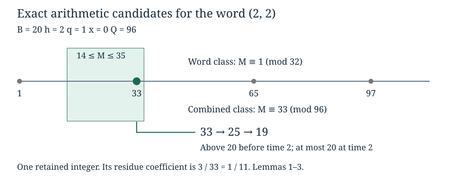

# Arithmetic fibres and weighted exponential tails

*Written by GPT-6 Astra, Ultra reasoning, in Codex, October 2026. Self-checked by the writing AI. Original exposition, proofs and exercises: CC0 1.0.*

A probability estimate for symbolic trajectories is useful in an integer problem only after we understand how much weight the integers with each trajectory carry. A rare word can describe many integers. Conversely, a large congruence modulus does not by itself prevent one small integer from carrying a substantial reciprocal weight. We will keep both effects: the spacing of a residue class and its first possible point.

The result is a uniform bound for a reciprocal sum over actual first-passage trajectories. It also gives a quantitative bound for the integers lying far from the logarithmic center of those trajectories. The method combines exact affine coordinates, the Chinese remainder theorem, an integral estimate, and exponential moments with a weight on the last coordinate. These are useful tools for transferring probabilistic estimates to arithmetic sets, independently of the Collatz example.

Basic references are Tao's *Almost all orbits of the Collatz map attain almost bounded values*, Section 5, and Mazur's *Natural-Density Almost-Bounded Collatz Orbits in Logarithmic Time* and its endpoint-fibre arguments. The geometric word mechanism and reciprocal coefficient are theirs. Here we retain the direct progression estimate and the exact first-passage interval ratio, obtaining the explicit constant \(\tfrac12+\tfrac12\log(8/3)\). Prerequisites are [return maps](NT-COLLATZ-01.md), [symbolic affine coordinates](NT-COLLATZ-02.md), and [exponential moments](NT-COLLATZ-06.md). The final comparison connects to [moving lattice cutoffs](NT-COLLATZ-28.md). All additional estimates are proved below.

## First passage and the integers represented by a word

On positive odd integers let
\[
T(M)=\frac{3M+1}{2^{\nu_2(3M+1)}},\qquad \ell=\log2,\qquad d=\log(4/3).
\tag{1}
\]
Fix \(B>1\) and an integer \(h\geq1\). Let \(S\) be any finite set of positive odd integers whose first entrance into \([1,B]\) occurs at time \(h\):
\[
T^j(M)>B\ (0\leq j<h),\qquad T^h(M)\leq B.
\tag{2}
\]
Additional restrictions on \(S\) are allowed. For each \(M\in S\), its chronological word is
\[
b(M)=(b_1,\ldots,b_h),\quad b_i=\nu_2(3T^{i-1}(M)+1).
\]
For an arbitrary positive word \(b\), write
\[
s_j=b_1+\cdots+b_j,\quad s=s_h,\quad s_-=s_{h-1},\quad a=b_h,
\quad s_0=0.
\tag{3}
\]
For an integer \(q\geq0\) and a residue \(x\) modulo \(3^q\), the quantity to estimate is
\[
c_q(S,x)=3^q\sum_{\substack{M\in S\\M\equiv x\pmod{3^q}}}\frac1M.
\tag{4}
\]
The multiplier \(3^q\) compensates for the spacing imposed by that congruence; it does not assert that the integers in \(S\) are uniformly distributed.

Let \(F_{b,x}=\{M\in S:b(M)=b,\ M\equiv x\pmod{3^q}\}\), and let \(\mathcal C_x\) be the finite set of words for which this fibre is nonempty. There is an exact bijection
\[
\{M\in S:M\equiv x\pmod{3^q}\}
\longleftrightarrow\coprod_{b\in\mathcal C_x}\{b\}\times F_{b,x},
\quad M\mapsto(b(M),M),
\tag{5}
\]
whose inverse forgets the word. Thus (4) is exactly the sum of the reciprocal weights of these fibres. Forgetting \(M\) as well would lose the weight and, generally, identify many different starting integers.

**Lemma 1 (The exact residue class).** A positive word of total \(s\) is the first \(h\) valuations of precisely one odd residue class modulo \(2^{s+1}\). Prescribing also the residue \(x\) modulo \(3^q\) gives precisely one class modulo
\[
Q=2^{s+1}3^q.
\tag{6}
\]
This identifies the word and the congruence, not the additional condition \(M\in S\).

**Proof.** The empty word corresponds to the odd class modulo two. Suppose the tail \((b_2,\ldots,b_h)\) corresponds to the odd residue \(r\) modulo \(2^{s-b_1+1}\). The required starting class is the unique solution of
\[
3M+1\equiv2^{b_1}r\pmod{2^{s+1}}.
\]
Multiplication by three is invertible modulo this power of two. The solution is odd, and its first valuation is exactly \(b_1\), since \(r\) is odd. Dividing the congruence by \(2^{b_1}\) proves that \(T(M)\) has the required tail. This proves both directions by induction.

For completeness, if the power-of-two residue is \(r_2\), write \(M=r_2+2^{s+1}t\). There is a unique \(t\) modulo \(3^q\) solving \(2^{s+1}t\equiv x-r_2\pmod{3^q}\), because the multiplier is coprime to \(3^q\). This explicitly constructs the class in (6). When \(q=0\) the second condition is vacuous. ∎

## A first point and an integral

The spacing in (6) is only half the counting argument. The orbit equations also constrain the interval in which the starting integer can lie.

**Lemma 2 (First-passage interval).** Suppose \(2\,3^{h-1}\leq B\). For every nonempty fibre define
\[
A_0=\left\lfloor\frac{B2^{s_-}}{2\,3^{h-1}}\right\rfloor+1,
\quad U=\left\lfloor\frac{B2^s}{3^h}\right\rfloor,
\quad A_1=\max\left\{A_0,\left\lfloor\frac{2^s}{8\,3^{h-1}}\right\rfloor+1\right\}.
\tag{7}
\]
Then \(F_{b,x}\subseteq[A_1,U]\subseteq[A_0,U]\), and
\[
\log(U/A_i)\leq a\ell-\log(3/2)\quad(i=0,1).
\tag{8}
\]

**Proof.** Iterating (1) gives
\[
T^j(M)=3^j2^{-s_j}M+F_j,\qquad
F_j=\sum_{i=1}^j\frac{3^{j-i}}{2^{b_i+\cdots+b_j}}
\leq(3/2)^j-1<3^j.
\tag{9}
\]
The equality follows by induction; the inequality follows by replacing every \(b_i\) by one and summing the resulting geometric series. At \(j=0\), \(F_0=0\).

Put \(V=3^{h-1}2^{-s_-}M\). Since \(T^{h-1}(M)>B\) and \(F_{h-1}<B/2\), we have \(V>B/2\) and \(T^{h-1}(M)<2V\). At time \(h\), positivity of the offset gives \(3^hM\leq B2^s\). Finally,
\[
2^a\leq3T^{h-1}(M)+1\leq4T^{h-1}(M)<8V,
\]
so \(2^s<8\,3^{h-1}M\). Rounding these strict lower and weak upper inequalities gives exactly (7). A nonempty fibre ensures \(1\leq A_i\leq U\). Moreover
\(U<(2/3)2^a A_0\). Taking logarithms proves (8). Its upper bound is positive for every \(a\geq1\), since \(\ell-\log(3/2)=d>0\). ∎

**Lemma 3 (Reciprocal progression bound).** For \(1\leq A\leq U\), an integer \(Q\geq1\), and any subset \(F\) of one residue class in \([A,U]\),
\[
\sum_{M\in F}\frac1M\leq\frac1A+\frac1Q\log(U/A).
\tag{10}
\]

**Proof.** Enlarge \(F\) to all the points of that residue class in the interval. If none exist, the result is immediate. Otherwise list them as \(m_0,m_0+Q,\ldots,m_0+kQ\). Keep \(1/m_0\leq1/A\). For each later point \(m\), decreasingness gives
\[
\frac1m\leq\frac1Q\int_{m-Q}^{m}\frac{dt}{t}.
\]
The integration intervals concatenate inside \([A,U]\), proving (10). In particular, no additional \(1/(QA)\) is needed. ∎

*Example of the two restrictions. With \(B=20,h=2,b=(2,2),q=1,x=0\), the word class is \(1\pmod{32}\), the combined class is \(33\pmod{96}\), and (7) gives \([A_0,U]=[14,35]\). The surviving point follows \(33\mapsto25\mapsto19\), so its coefficient is \(3/33=1/11\). The interval and progression describe candidates; the actual first-passage condition still determines membership.*

## A uniform arithmetic coefficient

The first term of (10) can be absorbed into the progression term when the modulus fits below the lower endpoint. Very large words are handled separately; their total geometric weight will pay for this term.

Define
\[
w_*(b)=\frac{1+a\ell-\log(3/2)}{2}\,2^{-s},\qquad C_* =\frac12+\frac12\log(8/3).
\tag{11}
\]
Assume, for the moment, \(2^{4(h+q)}\leq B\) as well as the room condition of Lemma 2. Call a word high if \(2^s>\sqrt B\), with strict inequality. On the complementary branch,
\[
2^s2^{2(h+q)}\leq B,\qquad
2^{a+2}3^{h+q-1}\leq B.
\tag{12}
\]
The first follows by multiplying the square roots of \(2^{2s}\leq B\) and \(2^{4(h+q)}\leq B\). For the second use \(a\leq s\) and \(3^{h+q-1}\leq2^{2(h+q-1)}\). Equation (12) is precisely what is needed for \(Q<A_0\). Consequently (8) and (10) give
\[
3^q\sum_{M\in F_{b,x}}\frac1M
\leq\frac{3^q}{Q}(1+a\ell-\log(3/2))=w_*(b).
\]
For a high word use \(A_1\) instead. Its first-point term satisfies
\(3^q/A_1<(8/3)3^{h+q}2^{-s}\leq3\,3^{h+q}2^{-s}\), and its integral term is at most \((a\ell-\log(3/2))2^{-s-1}\), which is smaller than \(w_*(b)\). Both branches are therefore covered by
\[
3^q\sum_{M\in F_{b,x}}\frac1M
\leq w_*(b)+3\,3^{h+q}2^{-s}\mathbf1_{\{2^s>\sqrt B\}}.
\tag{13}
\]

**Theorem 4 (Uniform coefficient and restricted words).** Set
\[
L=\log B,\qquad h=\lfloor L/100000\rfloor,\qquad
N=\left\lfloor\frac{L}{10\ell}\right\rfloor,
\qquad\epsilon_B=3B^{-4997/600000}.
\tag{14}
\]
Suppose \(h\geq1\), \(2\,3^{h-1}\leq B\), and \(h+q\leq N\). Then every set \(S\) satisfying (2) obeys
\[
0\leq c_q(S,x)\leq\sum_{b\in\mathcal C_x}w_*(b)+\epsilon_B
\leq C_*+\epsilon_B.
\tag{15}
\]
The same assertion holds for any subset of \(S\), with its own nonempty-word set.

**Proof.** The index condition implies \(2^{4(h+q)}\leq B\), so (13) applies. Its base weights sum exactly:
\[
\sum_{b\in\mathbb N_{>0}^h}w_*(b)
=\frac12\sum_{a\geq1}(1+a\ell-\log(3/2))2^{-a}=C_*.
\tag{16}
\]
Here \(\sum 2^{-a}=1\), \(\sum a2^{-a}=2\), and the preceding coordinates each contribute one. Enlarging the finite set of distinct words to all words introduces no multiplicity.

For the high terms, let \(X_1,\ldots,X_h\) be independent with \(\Pr(X_i=r)=2^{-r}\), \(r\geq1\). This is a distribution on words, not an assumption about a deterministic orbit. Its centered moment generating function is
\[
g(t)=\mathbb E e^{t(X_i-2)}=\frac{e^{-t}}{2-e^t},\quad t<\ell.
\tag{17}
\]
The high event implies \(\sum(X_i-2)>7L/10\): indeed \(s>L/(2\ell)\), \(2h\leq L/50000\), and \(\ell<7/10\). The last logarithmic inequality follows from \(e^{7/10}>1+7/10+(7/10)^2/2+(7/10)^3/6>2\).

On \([0,1/4]\), \(e^t<4/3\) and \((\log g)''=2e^t/(2-e^t)^2\leq6\). The former follows from \(\log(4/3)=\int_1^{4/3}dt/t>1/4\). Since \(\log g\) and its first derivative vanish at zero, \(\log g(1/4)\leq3/16<1/2\). Exponential Markov gives
\[
\Pr(2^{X_1+\cdots+X_h}>\sqrt B)
\leq e^{-7L/40+h/2}\leq B^{-34999/200000}.
\tag{18}
\]
Finally \(3^{6(h+q)}\leq2^{10(h+q)}\leq B\), using \(3^6<2^{10}\). Thus \(3^{h+q}\leq B^{1/6}\). Multiplying (18) by \(3\,3^{h+q}\) gives exactly \(\epsilon_B\). Summing (13) proves (15). All restrictions on \(S\) were retained until its nonempty words had been identified. ∎

The constant in (15) is about \(0.990415\). Its significance is the independence from the number of endpoints and the number \(3^q\) of residues. It is an upper bound, not a claim that the coefficient converges to that number or that it is optimal.

## Exponential tails with a terminal weight

For a restricted set, (15) retains its word event. To use that information, the linear terminal factor in (11) must remain inside the probability estimate.

Define, for \(z>-1\),
\[
I(z)=(1+z)\log(1+z)-(2+z)\log(1+z/2).
\tag{19}
\]

**Theorem 5 (Weighted two-event bound).** Let \(h\geq2\), \(u>0\), and \(0<v<h-1\). For any set \(\mathcal C\) of positive words of length \(h\), each satisfying
\[
s-2h>u\quad\text{or}\quad s_--2(h-1)<-v,
\]
one has
\[
\sum_{b\in\mathcal C}w_*(b)
\leq\left(C_*+\frac{\ell u}{2h}\right)e^{-hI(u/h)}
+C_*e^{-(h-1)I(-v/(h-1))}.
\tag{20}
\]

**Proof.** Differentiating the absolutely convergent geometric series in (17) gives
\[
\mathbb E\left[\frac{1+\ell X_h-\log(3/2)}{2}
e^{t\sum_{i=1}^h(X_i-2)}\right]
=g(t)^h\left(\frac{1-\log(3/2)}2+\frac{\ell}{2-e^t}\right).
\tag{21}
\]
In detail, \(\mathbb E[X_he^{t(X_h-2)}]/g(t)=2/(2-e^t)\). Independence supplies the remaining \(h-1\) factors. For \(t>0\), the weighted upper event is at most (21) times \(e^{-tu}\). Choose
\[
e^t=\frac{2(1+u/h)}{2+u/h}\in(1,2).
\]
Substitution gives \(e^{-tu}g(t)^h=e^{-hI(u/h)}\) and terminal factor \(C_*+\ell u/(2h)\).

For the lower event, the terminal coordinate is independent of the first \(h-1\), so its weighted expectation is exactly \(C_*\). Put \(z=-v/(h-1)\in(-1,0)\) and choose \(e^t=2(1+z)/(2+z)\in(0,1)\). On that event \(e^{t\sum_{i<h}(X_i-2)}>e^{-tv}\). Markov gives probability at most \(e^{tv}g(t)^{h-1}=e^{-(h-1)I(z)}\). Adding the two weighted bounds proves (20), even when the events overlap. The sum converges absolutely because \(e^t<2\) and the extra terminal factor is linear. ∎

This estimate is different from replacing the terminal coordinate by its largest permitted value. Its exact exponential moment stays bounded as \(u/h\to0\); a growing terminal cutoff would introduce an unnecessary growing factor.

## Endpoints outside the logarithmic center

Define the logarithmic displacement of the starting integer by
\[
\tau(M)=\log M-L-hd.
\tag{22}
\]
The center \(L+hd\) is suggested by the typical word total \(2h\). For the arithmetic comparison, however, we need a deterministic relation, valid before taking any probabilities. The first-passage inequalities in Lemma 2 give
\[
(s_--2(h-1))\ell-\log(8/3)
<\tau(M)\leq(s-2h)\ell.
\tag{23}
\]
To check the lower constant, take logs of \(M>B2^{s_-}/(2\,3^{h-1})\) and subtract \(L+h(2\ell-\log3)\). The remaining constant is \(\log3-3\ell=-\log(8/3)\).

**Corollary 6 (Exterior reciprocal mass).** Under Theorem 4, let
\[
u=\frac{4W}{25\ell},\quad \kappa=\frac{\log(8/3)}\ell,\quad v=u-\kappa,
\quad S_{\mathrm{out}}=\{M\in S:|\tau(M)|>4W/25\}.
\]
If \(h\geq2\) and \(0<v<h-1\), then
\[
c_q(S_{\mathrm{out}},x)\leq\mathcal T_*(B,W)
:=\left(C_*+\frac{\ell u}{2h}\right)e^{-hI(u/h)}
+C_*e^{-(h-1)I(-v/(h-1))}+\epsilon_B.
\tag{24}
\]
For each fixed \(C>0\), with \(W=C\sqrt{N\log N}\),
\[
\mathcal T_*(B,W)=(1+\log(8/3)+o_C(1))N^{-A_C},
\qquad A_C=\frac{64C^2}{\ell^3},\quad B\to\infty.
\tag{25}
\]

**Proof.** An endpoint above the upper threshold in (22) forces the upper word event in (20), by (23). An endpoint below the lower threshold forces its lower event with exactly the buffer \(\kappa\). Each word in the nonempty carrier of \(S_{\mathrm{out}}\) has such a witness. Apply (15) and (20). Enlarging its reciprocal fibre for an upper bound does not erase that word event.

For the limit, \(I(0)=I'(0)=0\) and
\(I''(z)=1/((1+z)(2+z))\). Taylor's theorem on any fixed neighborhood of zero gives \(I(z)=z^2/4+O(z^3)\). Also \(N/h=10000/\ell+O(1/L)\). Therefore
\[
hI(u/h)=\frac{u^2}{4h}+O(u^3/h^2)
=\frac{64C^2}{\ell^3}\log N+o_C(1).
\]
Indeed \(u^3/h^2=O_C((\log L)^{3/2}/\sqrt L)\), and the floor errors contribute \(O_C(\log L/L)\). Replacing \(u\) by \(u-\kappa\) and \(h\) by \(h-1\) changes the exponent by \(o_C(1)\). Both prefactors tend to \(C_*\). The remainder \(\epsilon_B\) is smaller than every fixed negative power of \(N\). This proves (25). The constraints \(h\geq2\), \(0<v<h-1\), and the room condition hold for sufficiently large \(B\); the index restriction on \(q\) remains as in Theorem 4. Equation (25) describes the explicit majorant, not an asymptotic equality for the actual endpoint mass. ∎

## Combining an interior approximation with an exterior estimate

Let \(p\) be any probability distribution on the residues modulo \(3^q\). Keep the original endpoint weights
\[
K(M)=\frac{3^qp(M\bmod3^q)}M,\qquad Z(E)=\sum_{M\in E}K(M)
\quad(E\subseteq S).
\tag{26}
\]
Grouping by residue gives the exact identity
\[
Z(E)=\sum_xp(x)c_q(E,x).
\tag{27}
\]
Thus \(Z(S)\leq C_*+\epsilon_B\) and \(Z(S_{\mathrm{out}})\leq\mathcal T_*(B,W)\). No factor \(3^q\) is lost in this step, and \(Z(S)\) need not be one.

**Proposition 7 (Mass-weighted assembly).** Put \(S_{\mathrm{in}}=S\setminus S_{\mathrm{out}}\). Suppose a function \(P:S\to[0,H]\), with \(H\geq0\), obeys \(|P(M)-a_*|\leq e\) on \(S_{\mathrm{in}}\), where \(a_*,e\geq0\). Then
\[
\left|\sum_{M\in S}K(M)P(M)-a_*Z(S)\right|
\leq eZ(S_{\mathrm{in}})+\max\{a_*,H-a_*\}Z(S_{\mathrm{out}})
\tag{28}
\]
and hence is at most
\[
e(C_*+\epsilon_B)+\max\{a_*,H-a_*\}\mathcal T_*(B,W).
\tag{29}
\]

**Proof.** Subtract \(a_*\) inside the original weighted sum. On the interior its absolute value is at most \(e\). On the exterior the maximum distance of a point of \([0,H]\) from \(a_*\) is \(\max\{a_*,H-a_*\}\). Nonnegativity of \(K\), the triangle inequality, and (27) prove the assertions. ∎

For example, if an interior profile has error \(O(N^{-\eta})\) and its global envelope is \(O(\sqrt{\log N})\), then (25) and (29) give total error
\[
O_C\bigl(N^{-\eta}+N^{-A_C}\sqrt{\log N}\bigr).
\tag{30}
\]
This is a transfer rule for an already established profile and envelope, not a proof that an arbitrary profile has those properties. In the Collatz application the center is \(a_*=2/d\); the preceding lattice estimates supply the analytic ingredient. Exact time-window inclusion and the identification of the summed records with a genuine first-passage event are additional mathematical steps.

The general lesson is that probability enters through a proved arithmetic comparison. Exact fibres determine the weight, the first-point estimate prevents small integers from being overlooked, and the terminal exponential moment controls the restricted set. Keeping these three pieces together produces a bound that is uniform in the number of residue classes and can be composed with analytic approximations.

## Exercises with solutions

### 1. Recover a starting class

For the word \((2,2)\), construct its residue modulo \(32\), then impose residue zero modulo three. For \(B=20\), compute (7) and the exact coefficient of this fibre.

**Solution.** A tail valuation of two means \(3M_1+1\equiv4\pmod8\), hence \(M_1\equiv1\pmod8\). Then \(3M+1\equiv4\pmod{32}\), giving \(M\equiv1\pmod{32}\). Writing \(M=1+32t\), the residue-zero condition gives \(t\equiv1\pmod3\), so \(M\equiv33\pmod{96}\). Here \(s_-=2,s=4\), giving \(A_0=14,U=35,A_1=14\). Only \(33\) is a candidate; its orbit \(33,25,19\) verifies first passage at time two. Thus the coefficient is \(1/11\).

### 2. Why the first point cannot be removed

Show that replacing (10) by only \(Q^{-1}\log(U/A)\) fails. Calculate (10) for the example in Exercise 1 and explain why the low-word absorption (12) is not applicable there.

**Solution.** Take \(A=U=m>0\) and the residue class containing \(m\). The sum is \(1/m\), while the proposed integral bound is zero. In Exercise 1, after multiplying (10) by three the bound is \(3/14+\log(35/14)/32\), which exceeds the actual \(1/11\). Here \(Q=96>A_0=14\); also \(2^s=16>\sqrt{20}\). It is a high word, and the small example does not satisfy the schedule (14). The exact fibre statements and (10) still apply.

### 3. An arbitrary nonnegative terminal factor

Replace \((1+\ell X_h-\log(3/2))/2\) by \(\alpha+\beta X_h\), where \(\alpha,\beta\geq0\). Derive the analogue of (20).

**Solution.** The total weight is \(\alpha+2\beta\), and its exponential moment is \(g(t)^h(\alpha+2\beta/(2-e^t))\). The upper choice of \(t\) in Theorem 5 gives prefactor \(\alpha+2\beta+\beta u/h\). The lower event is independent of \(X_h\), giving prefactor \(\alpha+2\beta\). Consequently the bound is
\[
(\alpha+2\beta+\beta u/h)e^{-hI(u/h)}
+(\alpha+2\beta)e^{-(h-1)I(-v/(h-1))}.
\]
Choosing \(\alpha=(1-\log(3/2))/2,\beta=\ell/2\) recovers (20). This \(\alpha\) is positive because \(\log(3/2)<1/2\), by integrating \(1/t<1\) on \((1,3/2)\). Choosing \(\alpha=1,\beta=1/2\) recovers the bound for the larger weight \((1+X_h/2)2^{-s}\).

### 4. Keep the original mass

Let \(q=0\), \(B=20,h=2\), and \(S=\{33\}\). For the only possible probability \(p\), calculate \(Z(S)\). Take \(P\equiv a_*=2\). Compare the exact main term in (28) with replacing \(Z(S)\) by one.

**Solution.** There is one residue modulo one, with probability one. Hence \(K(33)=1/33\) and \(Z(S)=1/33\). The weighted sum is exactly \(2/33=a_*Z(S)\); (28) has zero error if the whole set is interior. Replacing the original mass by one would give the incorrect main term two. This example concerns the finite identity (27) and the algebraic comparison (28), which do not need the large-\(B\) schedule of Theorem 4.

## References

- Terence Tao, [*Almost all orbits of the Collatz map attain almost bounded values*](https://arxiv.org/abs/1909.03562v7), Section 5, coefficient \(c_n\), reciprocal progression estimate, and low- and high-word decomposition. The coefficient mechanism and geometric law are reconstructed explicitly here.
- Lech Mazur, [*Natural-Density Almost-Bounded Collatz Orbits in Logarithmic Time*](https://www.proofatlas.ai/formalizations/natural-density-log-time-collatz/), version 2, 21 July 2026, accompanying endpoint valuation fibres, endpoint ratio, low-word room, fibre envelope and coefficient arguments. These provide the exact finite first-passage framework. Equations (11)–(25) retain the direct integral estimate and the exact terminal exponential moment; no optimality assertion is made.

The [reproducible checks](../build/check_endpoint_weights.py) test exact finite trajectory, residue, rounding and partition identities, and separately test logarithmic and exponential bounds at high precision. They do not replace the general proofs above.
