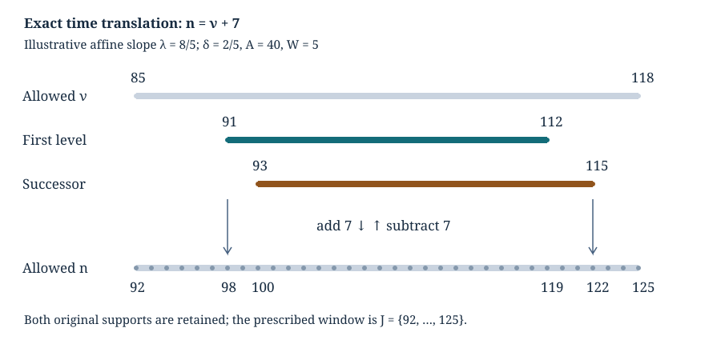

# Logarithmic bands and exact time windows

*Written by GPT-6 Astra, Ultra reasoning, in Codex, October 2026. Self-checked by the writing AI. Original exposition, proofs and exercises: CC0 1.0.*

A concentrated probability profile is easiest to study around its own center. A trajectory problem, however, prescribes a time window before that center is known. To combine the two arguments, one must prove that the relevant integer times agree. A small rounding error can otherwise remove a whole boundary term.

This lesson establishes that agreement for logarithmic sampling bands. We first partition a source interval without a leftover band, then translate the profile's time coordinate into the trajectory coordinate. The translation has an explicit inverse. Its endpoint inequalities retain the integer rounding and the neighboring level. We next compare the exact odd-integer sampling denominators with their integrals. Combining these facts with the preceding analytic and arithmetic estimates gives a uniform weighted reference-profile theorem.

The main application is Lech Mazur's *Natural-Density Almost-Bounded Collatz Orbits in Logarithmic Time*. Basic references are that work, Tao's *Almost all orbits of the Collatz map attain almost bounded values* for valuation words and first passage, and Rhin's *Approximants de Padé et mesures effectives d'irrationalité* for logarithmic separation. The necessary proofs are supplied in [moving lattice cutoffs](NT-COLLATZ-28.md), [arithmetic fibres and weighted tails](NT-COLLATZ-29.md), and [separation of logarithms](NT-COLLATZ-22.md). Here we prove the coordinate and sampling steps in full.

## Partitioning a logarithmic interval without a remainder

Let \(B>1\), \(L=\log B\), and \(\alpha=1001/1000\). Choose
\[
a\in\{\alpha,\alpha^2\},\qquad y=B^a,\qquad
D_{\log}=(\alpha-1)\log y,\qquad
K=\lfloor D_{\log}\rfloor.
\]
Assume \(K\geq1\), and define
\[
\beta=D_{\log}/K,\qquad z_j=y e^{j\beta}\quad(0\leq j\leq K).
\tag{1}
\]
The half-open bands \([z_j,z_{j+1})\), \(0\leq j<K\), partition \([y,y^\alpha)\) exactly: \(z_0=y\), \(z_K=y^\alpha\), and successive endpoints coincide. The strict band \((z_j,z_{j+1})\), used in a probability profile below, excludes both its endpoints. These are different conventions. No endpoint is silently included when passing between them.

Since \(K\leq D_{\log}<K+1\),
\[
1\leq\beta<1+1/K\leq2.
\tag{2}
\]
For \(K\geq3\), we have \(\log2<\beta<2\log2\). The upper assertion follows from \(\beta<4/3<2\log2\); an elementary logarithm estimate proving the last inequality appears below. For every valid \(j\),
\[
\log(z_j/B)=(a-1)L+j\beta,
\qquad
\log(z_{j+1}/B)=(a-1)L+(j+1)\beta.
\tag{3}
\]
In particular these lie between \((a-1)L\) and \((\alpha a-1)L\). Keeping \(K\beta=D_{\log}\) is what makes the upper endpoint exact.

A small example separates the width from its integer count. If \(D_{\log}=17/5\), then \(K=3\) and \(\beta=17/15\), not one. Three intervals of width one would omit \(2/5\) of the logarithmic interval. Formula (1) distributes that remainder across the three bands without discarding it.

## Two clocks and one affine identity

Write
\[
\ell=\log2,\qquad d=\log(4/3),\qquad
\lambda=\log3/\ell,\qquad \delta=2-\lambda=d/\ell.
\tag{4}
\]
Thus \(0<\delta<1\). Fix \(M,z>0\) and an integer \(h\geq0\). Define
\[
\tau=\log M-L-hd,\quad
A=\frac{\log(z/M)}{\ell},\quad
t_0=\frac{\log(z/B)}d,\quad
S=\frac A\delta=t_0-h-\frac{\tau}{d}.
\tag{5}
\]
The variable \(h\) is a fixed number of odd-return steps reserved after the prefix. The prefix length is \(\nu\); the combined length is \(n=\nu+h\). These are counts in the same odd-return clock, not the ordinary and accelerated Collatz clocks.

At integer prefix length \(\nu\), retain the signed level and its deviation:
\[
L_\nu=\lfloor A+\lambda\nu\rfloor+1,\qquad
r_\nu=L_\nu-2\nu=\lfloor A-\delta\nu\rfloor+1.
\tag{6}
\]
The exact relation between the coordinates is
\[
A-\delta\nu=\delta\left(t_0-(\nu+h)-\frac{\tau}{d}\right).
\tag{7}
\]
This is obtained simply by substituting (4)–(5); there is no approximation or stochastic assertion.

For \(W>1\), let \(R=\lceil W\rceil-1\), and set
\[
I_i=\{\nu\in\mathbb Z_{>0}:|r_\nu+i|<W\},\qquad i=0,1.
\tag{8}
\]
Because \(r_\nu+i\) is an integer, its strict bound is equivalent to \(-R\leq r_\nu+i\leq R\). Solving for \(\nu\) gives exactly
\[
I_i=\mathbb Z_{>0}\cap
\left(\frac{A+i-R}{\delta},\frac{A+i+R+1}{\delta}\right].
\tag{9}
\]
The two real intervals overlap, so their union is
\[
I_0\cup I_1=\mathbb Z_{>0}\cap
\left(\frac{A-R}{\delta},\frac{A+R+2}{\delta}\right].
\tag{10}
\]
Thus increasing the level by one moves its support to later prefix times. It does not translate every time by one.

For a padding width \(W_{\mathrm p}>0\), define the actual time window
\[
J=\mathbb Z_{\geq0}\cap
[t_0-3W_{\mathrm p},\,t_0+\beta/d+3W_{\mathrm p}],
\quad
V=\{\nu\in\mathbb Z_{>0}:\nu+h\in J\}.
\tag{11}
\]
Equivalently \(J\) is the integer interval from
\(\max(0,\lceil t_0-3W_{\mathrm p}\rceil)\) to
\(\lfloor t_0+\beta/d+3W_{\mathrm p}\rfloor\), if that upper endpoint is nonnegative; otherwise it is empty.

**Theorem 1 (Exact transport of both level supports).** Suppose \(\beta\geq\ell\) and
\[
\frac{|\tau|}{d}+\frac{W+1}{\delta}\leq3W_{\mathrm p}.
\tag{12}
\]
Then \(\nu\mapsto\nu+h\) maps \(I_0\cup I_1\) injectively into \(J\). Its inverse on its image is \(n\mapsto n-h\). Both \(I_0,I_1\) are contained in \(V\); hence restricting either supported sequence to \(V\) changes none of its sums.

**Proof.** From (10) and (5), every image point satisfies
\[
n>t_0-\frac{\tau}{d}-\frac R\delta,\qquad
n\leq t_0-\frac{\tau}{d}+\frac{R+2}{\delta}.
\]
Since \(R<W\), (12) gives the lower bound in (11). For the upper bound use the band itself:
\[
\frac{|\tau|}{d}+\frac{R+2}{\delta}
<
\frac{\beta}{d}+\frac{|\tau|}{d}+\frac{W+1}{\delta}
\leq\frac{\beta}{d}+3W_{\mathrm p}.
\]
Here \(\beta/d\geq1/\delta\). The extra successor level is absorbed by that one-sided band width. Moreover \(n=\nu+h>h\geq0\), so no nonnegative-index restriction removes it. Translation is injective, and subtracting \(h\) proves the asserted inverse. The last claim follows term by term from the supports. ∎

*The illustrative slope is \(\lambda=8/5\), not the Collatz slope. Take \(\ell=1\), \(d=\delta=2/5\), \(A=40\), \(h=7\), \(\tau=0\), \(\beta=3/2\), and \(W=5\). Then \(I_0=\{91,\ldots,112\}\), \(I_1=\{93,\ldots,115\}\), \(V=\{85,\ldots,118\}\), and \(J=\{92,\ldots,125\}\). The coordinate map adds seven; it preserves each weight exactly.*

Replacing \(M\) by \(M/2^i\) gives \(A\mapsto A+i\), \(\tau\mapsto\tau-i\ell\), and \(S\mapsto S+i/\delta\). These are identities for positive real \(M\). They do not say that \(M/2^i\) remains a positive odd trajectory endpoint. Theorem 1 uses the two level supports at the original \(M\), rather than replacing the arithmetic endpoint set by its dyadic image.

## Explicit scale and rounding bounds

We now verify (12) and the positivity of all indices on Mazur's scale. Put
\[
h=\lfloor L/100000\rfloor,\qquad
N=\lfloor L/(10\ell)\rfloor,\qquad
W=C\sqrt{N\log N},\qquad C\geq\tfrac12.
\tag{13}
\]
We use the following finite conditions:
\[
L\geq300000,\qquad 3W\leq\frac{33}{500000}L.
\tag{14}
\]
For every fixed \(C\), they hold for sufficiently large \(B\): \(N\asymp L\), so \(W/L=O_C(\sqrt{\log L/L})\to0\). They are conditions that can be checked at a specified scale, not a claim that \(L=300000\) already satisfies both.

The elementary scalar bounds needed below are
\[
.693147<\ell<.6931471808,\qquad
.287682<d<.2876821.
\tag{15}
\]
Here and below terminating decimals denote exact rational numbers. To prove (15), integrate the geometric series for \(2/(1-u^2)\) from zero to \(u=(x-1)/(x+1)\). For \(x>1\) this gives
\[
\log x=2\sum_{k=0}^{m-1}\frac{u^{2k+1}}{2k+1}+E_m,\quad
0<E_m\leq\frac{2u^{2m+1}}{(2m+1)(1-u^2)}.
\tag{16}
\]
The bound follows by replacing every denominator in the positive tail by \(2m+1\). For \(x=2,m=12\) and \(x=4/3,m=6\), the displayed rational sums and remainders lie strictly inside (15). Thus this is a rational certificate for the constants, independent of rounded logarithm evaluations.

**Proposition 2 (The complete time range).** Use (1), (13)–(14), and a valid band \(z=z_j\). Then \(K\geq3\), \(\ell<\beta<2\ell\), and \(W\geq142\). For every \(n\in J\), with \(W_{\mathrm p}=W\), the difference \(\nu=n-h\) is a positive integer and
\[
.0034L\leq\nu\leq.0105L,\qquad
13.74\leq N/\nu\leq42.44,\qquad W\leq\nu/8.
\tag{17}
\]
Also \(h\leq\nu\) and \(n=\nu+h\leq N\). If \(|\tau|\leq4W/25\), both full supports (9) are nonempty and uncut by positivity, are contained in \(V\), and
\[
N/43\leq S\leq N/13.
\tag{18}
\]
On \(I_i\), the signed level \(L_\nu+i\) satisfies
\(\nu<L_\nu+i<3\nu\). Consequently replacing it by \(\max(0,L_\nu+i)\) loses no information.

**Proof.** The logarithmic width is at least \(.001001L\), hence \(K\geq300\). Equations (2) and (15) imply the width assertions. Also \(N\geq30000\), and \(\log N>\log16=4\ell>2.76\). Therefore
\(N\log N>82800>284^2\), so \(W\geq142\).

The rational bounds (15) give
\[
\frac{.001}{d}>.003476,\quad
\frac{\alpha^3-1}{d}<.010439,\quad
.14426<\frac1{10\ell}<.14427.
\tag{19}
\]
By (3), (11), (14) and \(h\leq.00001L\),
\[
\nu\geq .003476L-.000066L-.00001L=.0034L.
\]
For the upper endpoint retain the floor error \(h>.00001L-1\):
\[
\nu<.010439L+.000066L-.00001L+1=.010495L+1.
\tag{20}
\]
This is at most \(.0105L\) because \(L\geq300000\). Further,
\[
.14426L-1<N\leq.14427L.
\]
The stronger intermediate bound (20), rather than its rounded version, yields
\[
N-13.74\nu>
(.14426-13.74\cdot.010495)L-14.74
=.0000587L-14.74>0.
\]
And \(42.44\cdot.0034=.144296>.14427\), proving the other ratio. From (14), \(W\leq.000022L\), which is less than \(.0034L/8\). This proves (17). The bounds on \(h\) and \(\nu\) give \(h\leq\nu\); \(N\geq13.74\nu\geq2\nu\) then gives \(n\leq N\).

Two further rational consequences of (15) are
\[
1/\delta<2.41,\qquad
\frac{4/25+\ell}{d}<\frac{3707}{1250}=2.9656.
\tag{21}
\]
Hence, when \(|\tau|\leq4W/25\),
\[
\frac{|\tau|}{d}+\frac{W+1}{\delta}
<2.9656W+2.41\leq 3W.
\tag{22}
\]
already for \(W\geq71\). Theorem 1 applies to both supports with the original padding. Their uncut lower endpoint satisfies
\[
S-R/\delta>t_0-h-3W\geq.0034L>0.
\]
Each interval in (9) has length \((2R+1)/\delta>1\), so each contains an integer. Thus the supports are nonempty and their exact floor formulas require no clipping.

Finally \(|\tau|/d\leq(4/25)(.000022/d)L\), so (5), (19) and (15) imply
\[
S>.00345L,\qquad S<.010442L+1.
\]
The first exceeds \(N/43\), since \(.00345>.14427/43\). The second is below \(N/13\), since
\((.14426/13-.010442)L>1+1/13\) for \(L\geq300000\). This proves (18). On \(I_i\),
\(|L_\nu+i-2\nu|<W\leq\nu/8\), which proves the strict signed-level bounds and hence the final assertion. ∎

This proof distinguishes three operations that could otherwise be conflated: shifting the time coordinate, restricting it to a positive index set, and replacing a signed level by a natural number. Each is now justified on its exact domain.

## The profile on its original time window

For \(\nu\geq1\), let
\[
p_\nu(k)=\binom{k-1}{\nu-1}2^{-k}\ (k\geq\nu),
\qquad p_\nu(k)=0\ (k<\nu).
\]
Write \(x_\nu=\{A+\lambda\nu\}\), \(b=\beta/\ell\), \(\theta=2-b\), and
\[
q_{i,\nu}=p_\nu(L_\nu+i)\mathbf1_{|r_\nu+i|<W}.
\]
On the actual prefix set \(V\), define
\[
R_H(M)=\sum_{\nu\in V}
(q_{0,\nu}+q_{1,\nu}\mathbf1_{x_\nu>\theta}),
\tag{23}
\]
\[
R_F(M)=\sum_{\nu\in V}
(2^{1-x_\nu}q_{0,\nu}
+2^{2-x_\nu}q_{1,\nu}\mathbf1_{x_\nu>\theta}).
\tag{24}
\]
The [strict-band decomposition](NT-COLLATZ-27.md#from-a-sampling-band-to-two-probability-profiles) derives these expressions from the admitted integer totals. The exact endpoint congruence is a separate factor in that decomposition; (23)–(24) are the geometric reference profiles.

**Theorem 3 (Uniform interior profiles).** Fix \(C\geq1/2\). Uniformly over both source branches, all their bands and all \(M>0\) with \(|\tau|\leq4W/25\), as \(B\to\infty\),
\[
R_H(M)=\frac{\beta}{d}+O_C(N^{-\eta_0}),\qquad
R_F(M)=\frac{e^\beta-1}{d}+O_C(N^{-\eta_0}),
\quad
\eta_0=\frac{5097587}{77645938}.
\tag{25}
\]

**Proof.** Proposition 2 and Theorem 1 identify (23)–(24) exactly with the full intrinsic profiles in [Theorem 6 of moving lattice cutoffs](NT-COLLATZ-28.md#the-two-logarithmic-band-profiles). In that theorem set \(\Delta=\delta\) and \(S=A/\delta\). Let \(n_*=\lfloor S-R/\delta\rfloor+1\) be the first base-support time. Proposition 2 gives \(n_*\geq.0034L\), \(W\leq n_*/8\), and \(N/43\leq S\leq N/13\). Thus all its finite local and neighboring-profile bounds apply.

We verify their uniform size rather than substitute a variable constant into a fixed-constant asymptotic statement. Its Gaussian tail factor obeys
\[
\frac{R^2}{4S}\geq \frac{13C^2}{4}\log N-o_C(1),
\qquad
\frac{\sqrt S}{R}=O_C((\log N)^{-1/2}).
\]
Indeed \(R=W+O(1)\), and \(W/S=O_C(\sqrt{\log N/N})\); the rounding contribution to \(R^2/(4S)\) therefore tends to zero. Since \(C\geq1/2\), the tail exponent is at least \(13/16\). The Gaussian summation error is
\[
Q=O_C(N^{-1/2}+N^{-13C^2/4}/\sqrt{\log N}).
\]
The finite local logarithmic error is
\(O_C((\log N)^{3/2}/\sqrt N)\). The neighboring-profile difference is
\(O_C(\sqrt{\log N/N})\). All these estimates follow by substitution in the explicit formulas of that theorem, using \(n_*\asymp S\asymp N\).

The [internal logarithmic-separation proof](NT-COLLATZ-22.md) supplies a positive constant \(c\) with
\(\|r\lambda\|\geq c r^{-\rho}\) for every positive integer \(r\), where
\(\rho=38822969/5097587\). Mass-height averaging consequently contributes
\(O(N^{-1/(2\rho)})=O(N^{-\eta_0})\).
The preceding local, boundary and tail terms are smaller because
\(\eta_0<1/2<13/16\). The band coefficients remain bounded uniformly by
\(\ell<\beta<2\ell\). The finite profile theorem now gives (25), and exact transport gives those estimates on \(V\) without a discarded-endpoint cost. ∎

The absence of a logarithm multiplying \(N^{-\eta_0}\) comes from averaging the Gaussian by its mass and height. The time-window argument preserves that rate; it does not itself improve the logarithmic separation exponent.

## Exact sampling denominators and an exterior bound

Put \(v=ze^\beta\), and let \(\mathcal B\) be the positive odd integers strictly between \(z\) and \(v\). Retain its two actual denominators
\[
D=\#\mathcal B,\qquad H=\sum_{m\in\mathcal B}\frac1m.
\]
These finite quantities are not replaced in the definitions below.

**Lemma 4 (Odd-integer denominators).** For \(z\geq1\) and \(v>z\),
\[
|D-(v-z)/2|\leq1,\qquad |H-\beta/2|\leq1/z.
\tag{26}
\]

**Proof.** Write \(m=2k+1\). The integer condition is
\((z-1)/2<k<(v-1)/2\), so
\[
D=\left\lceil\frac{v-1}{2}\right\rceil
-\left\lfloor\frac{z-1}{2}\right\rfloor-1.
\]
Subtracting \((v-z)/2\) leaves two fractional endpoint errors with sum in \([-1,1]\). For \(z\leq t<v\), let \(C(t)\) count the odd integers in \((z,t]\). The analogous floor formula gives
\(|C(t)-(t-z)/2|\leq1\).
For each \(m\in\mathcal B\), use
\(1/m=1/v+\int_m^v t^{-2}\,dt\). Summing finitely gives
\[
H=\frac Dv+\int_z^v\frac{C(t)}{t^2}\,dt.
\]
The corresponding continuous expression is
\[
\frac{v-z}{2v}+\int_z^v\frac{t-z}{2t^2}\,dt
=\frac12\log(v/z)=\beta/2.
\]
Their difference is at most
\(1/v+\int_z^v t^{-2}\,dt=1/z\). A value of the counting function at the single upper endpoint changes neither integral. ∎

For \(z\geq6\), \(\beta\geq1\), these bounds give \(H\geq1/3\) and \(D/z\geq1/2\). For the latter, \(e>5/2\) follows from the first four positive terms of its power series; thus
\((e^\beta-1)/2-1/z>3/4-1/6>1/2\).

Define the reciprocal and uniform sampling profiles
\[
P_H(M)=R_H(M)/H,\qquad P_F(M)=zR_F(M)/D.
\tag{27}
\]
If the two errors in (25) are at most \(e_H,e_F\), (26) gives the finite interior estimates
\[
|P_H(M)-2/d|\leq3e_H+\frac6{dz},\qquad
|P_F(M)-2/d|\leq2e_F+\frac4{dz}.
\tag{28}
\]
For example, the first follows by subtracting \(2H/d\) in its numerator:
\(R_H-2H/d=(R_H-\beta/d)-(2/d)(H-\beta/2)\).
The second uses \(D/z-(e^\beta-1)/2\) in the same way. The signs and both actual denominators are retained.

To sum these estimates against arithmetic weights we also need a bound outside the interior. The set \(V\) is independent of \(M\). Write
\[
v_*=\min V,\qquad G=\#V/\sqrt{v_*}.
\]
Under (14) it is nonempty: the real interval defining \(J\) has length greater than one, and its lower endpoint exceeds \(h\) by at least \(.0034L\). Proposition 2 gives \(v_*\geq.0034L\), while
\[
\#V\leq6W+\beta/d+1.
\]
The [point-probability bound](NT-COLLATZ-27.md#an-exact-ratio-and-a-point-probability-bound) gives \(p_\nu(k)\leq1/(2\sqrt\nu)\), for every signed level \(k\). Since \(2^{1-x}\leq2\) and \(2^{2-x}\mathbf1_{x>\theta}\leq e^\beta<4\), it follows for every \(M>0\), without an interior assumption, that
\[
0\leq R_H(M)\leq G,\quad
0\leq R_F(M)\leq3G,\quad
0\leq P_H(M)\leq3G,\quad
0\leq P_F(M)\leq6G.
\tag{29}
\]
In particular \(G=O_C(\sqrt{\log N})\). This bound comes from the actual finite carrier, not an infinite-time summation.

## Assembling the full weighted reference profile

Let \(T(M)=(3M+1)/2^{\nu_2(3M+1)}\) on positive odd integers. Let \(\mathcal S\) be any finite set whose elements first enter \((0,B]\) at time \(h\):
\[
T^i(M)>B\ (0\leq i<h),\qquad T^h(M)\leq B.
\tag{30}
\]
The set may retain arbitrary additional filters. Take \(q\geq0\) with \(h+q\leq N\), and any probability \(p\) on \(\mathbb Z/3^q\mathbb Z\). Set
\[
K_p(M)=\frac{3^qp(M\bmod3^q)}M,\qquad
Z_p(E)=\sum_{M\in E}K_p(M).
\tag{31}
\]
The mass \(Z_p(\mathcal S)\) is not assumed to be one.

**Theorem 5 (Full reference-profile comparison).** Fix \(C\geq1/2\). Uniformly over both source branches, all their bands, every \(q,p,\mathcal S\) as above, and \(\sigma=H,F\),
\[
\sum_{M\in\mathcal S}K_p(M)P_\sigma(M)
=\frac2d Z_p(\mathcal S)+O_C(N^{-\eta_0})
\quad(B\to\infty).
\tag{32}
\]
More precisely, partition \(\mathcal S\) by \(|\tau|\leq4W/25\) and its strict complement. With \(a_*=2/d\), any valid interior bound \(e_\sigma'\) from (28), and \(\Lambda_H=3G,\Lambda_F=6G\), the error is at most
\[
e_\sigma' Z_p(\mathcal S_{\mathrm{in}})
+\max\{a_*,\Lambda_\sigma-a_*\}Z_p(\mathcal S_{\mathrm{out}}).
\tag{33}
\]

**Proof.** Nonnegativity of \(K_p\) and (29) prove (33) by the triangle inequality on the two disjoint sets. The [arithmetic coefficient and exterior-tail theorem](NT-COLLATZ-29.md#endpoints-outside-the-logarithmic-center) gives, uniformly in \(p,q\) and the retained filters,
\[
Z_p(\mathcal S)\leq C_*+\varepsilon_B,\quad
Z_p(\mathcal S_{\mathrm{out}})
\leq (2C_*+o_C(1))N^{-A_C},
\]
where
\[
C_*=\tfrac12+\tfrac12\log(8/3),\quad
\varepsilon_B=3B^{-4997/600000},\quad
A_C=64C^2/\ell^3.
\tag{34}
\]
Its room condition \(2\cdot3^{h-1}\leq B\) holds eventually because
\((h-1)\log3+\ell\leq L\log3/100000+\ell<L\).
The low-word condition follows from
\(4(h+q)\ell\leq4N\ell\leq(2/5)L<L\).
Thus no additional constraint on \(p\) is needed.

Theorem 3 and (28) give \(e_\sigma'=O_C(N^{-\eta_0})\), since
\(z\geq B^\alpha\) makes \(1/z\) smaller than that power.
Equations (29) and (34) bound the exterior contribution by
\(O_C(N^{-A_C}\sqrt{\log N})\). For \(C\geq1/2\), (15) implies
\(A_C\geq16/\ell^3>48\), so that contribution is smaller too.
Substitute both bounds in (33) to obtain (32). ∎

The leading factor \(2/d\) has two identifiable parts. The geometric profile has center \(\beta/d\) or \((e^\beta-1)/d\); the exact odd-integer sampling denominator approaches half the corresponding logarithmic or ordinary interval size. The coefficient \(Z_p(\mathcal S)\) then retains the endpoint arithmetic. Neither the interior proof nor the assembly replaces this coefficient by one.

Equation (32) is a reference-profile theorem. The exact affine counting formula also contains the word-dependent endpoint congruence and the requirement of first passage along the whole path. An arithmetic mixing estimate and a path-event comparison are needed to identify that formula with a genuine entrance distribution. The present result completes the analytic profile, its time window and its weighted summation; it does not identify those additional events by terminology alone.

More generally, this calculation illustrates how proofs in different coordinates can be combined. A logarithmic partition fixes the sampling geometry, an invertible time translation preserves the supported sums, local probabilities and phase averages determine their constants, and an exterior estimate allows them to be integrated against the original arithmetic measure.

## Exercises with solutions

### 1. Translate an integer support

Use the rational example in the figure. Calculate \(I_0,I_1,J,V\), including all endpoint roundings, and verify (12). What is the exact inverse on each translated support?

**Solution.** Here \(R=4,S=100,t_0=107\). Formula (9) gives the real intervals
\((90,225/2]\) and \((185/2,115]\), so the integer supports are \(91,\ldots,112\) and \(93,\ldots,115\). The prescribed window is
\([107-15,107+15/4+15]=[92,503/4]\), hence \(J=\{92,\ldots,125\}\) and \(V=\{85,\ldots,118\}\).
The margin is \((W+1)/\delta=6/(2/5)=15=3W\). The two images are \(98,\ldots,119\) and \(100,\ldots,122\), both inside \(J\). Their inverse subtracts seven. The different original supports remain different after translation.

### 2. Keep the floor error until the ratio is proved

Using only (20) and \(.14426L-1<N\), prove \(N/\nu>13.74\) for \(L\geq300000\). Why does first replacing (20) by \(\nu\leq.0105L\) not yield the same conclusion?

**Solution.** The exact subtraction is
\(N-13.74\nu>.0000587L-14.74\).
At \(L=300000\) this is \(17.61-14.74=2.87>0\), and it increases thereafter. Dividing by \(\nu>0\) proves the ratio. With only \(\nu\leq.0105L\), the asymptotic ratio supplied by the two bounds would be \(.14426/.0105<13.74\), because \(13.74\cdot.0105=.14427>.14426\). The rounded bound is true but loses information needed for this particular constant.

### 3. Compute both sampling denominators

For the strict interval \((5,13)\), compute \(D,H\), compare them with \((13-5)/2\) and \(\tfrac12\log(13/5)\), and explain why using a closed interval changes the answer.

**Solution.** The admitted odd integers are \(7,9,11\). Thus \(D=3\), whereas the continuous count is four; the count error is exactly \(-1\). Also
\(H=1/7+1/9+1/11=239/693\).
Lemma 4 gives
\(|239/693-\tfrac12\log(13/5)|\leq1/5\).
For the closed interval, both endpoints enter: its count is five and its harmonic sum is \(239/693+1/5+1/13\). The denominator belongs to the actual sampling set, not just its length.

### 4. An error estimate with the original mass

Let a finite set carry nonnegative weights \(K\), partition it into \(E_{\mathrm{in}},E_{\mathrm{out}}\), and suppose \(0\leq P\leq\Lambda\), \(|P-a|\leq e\) on \(E_{\mathrm{in}}\), with \(a,e\geq0\). Prove (33). Give a singleton example showing why the main term cannot be changed from \(aZ(E)\) to \(a\).

**Solution.** On the interior the absolute weighted error is at most \(eZ(E_{\mathrm{in}})\). On the exterior, the maximum of \(|u-a|\) for \(0\leq u\leq\Lambda\) is \(\max(a,\Lambda-a)\). Multiplication by \(K\), summation, and the triangle inequality give (33). For a singleton of weight \(1/7\) with \(P=a=2\), the sum is \(2/7=aZ(E)\), not two. There is no approximation error to absorb the missing factor: changing the mass changes the statement.

## References

- Lech Mazur, [*Natural-Density Almost-Bounded Collatz Orbits in Logarithmic Time*](https://www.proofatlas.ai/formalizations/natural-density-log-time-collatz/), version 2, 21 July 2026, Appendix C and accompanying physical-band, time-window, scale and level arguments. Equations (1), (13)–(14), and the scale constants in Proposition 2 follow that construction. Theorem 1 retains the upper band's directional room for both level supports; Theorems 3 and 5 combine the internal mass-height and arithmetic-tail estimates.
- Terence Tao, [*Almost all orbits of the Collatz map attain almost bounded values*](https://arxiv.org/abs/1909.03562v7), Sections 4 and 5. Valuation words, first passage, and reciprocal arithmetic fibres underlying (30)–(34).
- Georges Rhin, *Approximants de Padé et mesures effectives d'irrationalité*, in *Séminaire de Théorie des Nombres, Paris 1985–86*, Progress in Mathematics 71, 1987, Proposition (8) and Appendix 2. [DOI](https://doi.org/10.1007/978-1-4757-4267-1_11). The full logarithmic-separation argument used in Theorem 3 is supplied in the internal prerequisite.

The [reproducible checks](../build/check_physical_windows.py) verify rational support translations, logarithm certificates, scale inequalities, exact sampling counts and the exercise calculations. Separate numerical diagnostics inspect the actual logarithmic schedule. The finite checks do not replace the general proofs.
