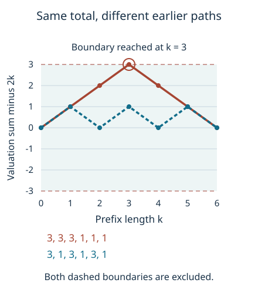

# Maximal deviations and exact first passage

*Written by GPT-6 Astra, Ultra reasoning, in Codex, October 2026. Self-checked by the writing AI. Original exposition, proofs and exercises: CC0 1.0.*

Knowing where a trajectory ends does not tell us when it first reached a target. It may have crossed the target much earlier, left it, and returned. A useful way to prevent this ambiguity is to control the cumulative branch data at every earlier time. The distinction is already visible in a random walk: a path can finish at its expected position after making a large excursion.

We first prove a maximal inequality for geometric waiting times. Stopping an exponential martingale at its first crossing controls every prefix without adding a factor equal to the number of times. Exact residue counting then transfers the estimate to uniformly or harmonically sampled integers. Finally, affine trajectory bounds turn that path control into an exact correspondence between first passages and finite word-and-endpoint records. The exceptional probability is charged once, after the events have been identified.

The general subjects are maximal inequalities, probability transport, and the recovery of path information from an endpoint. The arithmetic application continues Lech Mazur's *Natural-Density Almost-Bounded Collatz Orbits in Logarithmic Time*. Basic references are that work and Tao's *Almost all orbits of the Collatz map attain almost bounded values*, Sections 4 and 5. We use the preceding proofs of [valuation cylinders](NT-COLLATZ-06.md#how-much-information-a-residue-class-provides), [positive backwards decoding](NT-COLLATZ-26.md#backwards-decoding-proves-positivity-as-well-as-integrality), and [the exact logarithmic bands and finite time bounds](NT-COLLATZ-30.md#explicit-scale-and-rounding-bounds). The probabilistic and deterministic steps needed here are proved below.

## A final total does not control a path

Let \(A_1,A_2,\ldots\) be independent positive integers with
\[
\mathbb P(A_i=a)=2^{-a}\qquad(a\geq1).
\]
Write
\[
S_k=\sum_{i=1}^k A_i,\qquad U_k=S_k-2k,\qquad S_0=U_0=0.
\]
The mean of \(A_i\) is two: differentiating the convergent geometric series
\(\sum_{a\geq1}x^a=x/(1-x)\) at \(x=1/2\) gives this value.

For a horizon \(N\geq1\) and width \(W>0\), define
\[
\mathcal G_{N,W}=\{\lvert U_k\rvert<W\text{ for every }0\leq k\leq N\}.
\tag{1}
\]
This is a statement about the ordered word. Permuting a word preserves its total, but need not preserve (1). For example,
\[
(3,3,3,1,1,1),\qquad (3,1,3,1,3,1)
\]
both have total twelve. Their centered prefixes are respectively
\((1,2,3,2,1,0)\) and \((1,0,1,0,1,0)\).
At width \(W=3\), the first word fails (1), while the second satisfies it.

*The plotted quantities are valuation sums minus twice the prefix length, not the orbit values themselves. Both words finish at zero. The dashed boundaries are excluded because (1) is strict.*

Since every \(U_k\) is an integer, putting \(w=\lceil W\rceil\) gives the exact identity
\[
\mathcal G_{N,W}^{\,c}
=\left\{\max_{1\leq k\leq N}|U_k|\geq w\right\}.
\tag{2}
\]
For integral \(W\), hitting \(W\) is already a failure. For nonintegral \(W\), the first excluded integer is its ceiling.

## Stopping an exponential martingale

A martingale is a sequence whose conditional expected next value equals its current value. We only need this property for a finite horizon, and will prove the stopped identity directly.

For real \(t<\ell=\log2\), summing a geometric series gives
\[
h(t)=\log\mathbb E e^{t(A_1-2)}
=-t-\log(2-e^t).
\tag{3}
\]
In particular \(h(0)=h'(0)=0\), and
\[
h'(t)=\frac{2(e^t-1)}{2-e^t},\qquad
h''(t)=\frac{2e^t}{(2-e^t)^2}>0.
\]
Consequently \(h(t)\geq0\) throughout its domain. Independence shows that
\[
Z_k=\exp(tU_k-kh(t))
\]
is nonnegative, has mean one, and has conditional expected next value \(Z_k\).

**Theorem 1 (A maximal bound with the exact geometric rate).** For \(N\geq2\) and \(0<w<N\), let
\[
I(v)=(1+v)\log(1+v)-(2+v)\log(1+v/2),
\qquad -1<v<\infty.
\tag{4}
\]
Then
\[
\mathbb P\left(\max_{1\leq k\leq N}|U_k|\geq w\right)
\leq \Psi(N,w),
\quad
\Psi(N,w)=e^{-NI(w/N)}+e^{-NI(-w/N)}.
\tag{5}
\]

**Proof.** First take \(0<t<\ell\). Let \(\tau\) be the first time \(k\leq N\) with \(U_k\geq w\), or \(N\) when there is no crossing. The event \(\{\tau>k\}\) depends only on the first \(k\) variables. Thus
\[
Z_{(k+1)\wedge\tau}-Z_{k\wedge\tau}
=\mathbf1_{\{\tau>k\}}(Z_{k+1}-Z_k)
\]
has expectation zero. All variables are integrable; for instance
\(Z_\tau\leq\sum_{j=0}^N Z_j\). Summing the finite identity gives
\(\mathbb E Z_\tau=\mathbb E Z_0=1\).
On a crossing, \(Z_\tau\geq e^{tw-Nh(t)}\), since \(h(t)\geq0\).
Nonnegativity on the remaining event therefore gives
\[
\mathbb P(\max_{k\leq N}U_k\geq w)\leq e^{Nh(t)-tw}.
\tag{6}
\]
For \(t<0\), stop instead at the first \(U_k\leq-w\). The same proof gives
\[
\mathbb P(\min_{k\leq N}U_k\leq-w)\leq e^{Nh(t)+tw}.
\tag{7}
\]

Put \(r=w/N\). The choices
\[
t_+=\log\frac{2(1+r)}{2+r},\qquad
t_-=\log\frac{2(1-r)}{2-r}
\tag{8}
\]
lie respectively in \((0,\ell)\) and \((-\infty,0)\). They satisfy
\(h'(t_+)=r\) and \(h'(t_-)=-r\).
For \(v>-1\), substitution of \(e^t=2(1+v)/(2+v)\) gives
\[
vt-h(t)
=(1+v)\log(1+v)-(2+v)\log(1+v/2)=I(v).
\]
Use \(v=r\) in (6) and \(v=-r\) in (7), then add the two bounds. ∎

The proof bounds a first crossing. It does not bound every time separately and add those bounds. That is why (5) has two terms, rather than \(2N\) terms.

We can read its scale directly from its rate function:
\[
I(0)=I'(0)=0,\qquad
I''(v)=\frac1{(1+v)(2+v)}.
\]
Integrating twice and substituting \(x=uv\) gives
\[
I(v)=v^2\int_0^1
\frac{1-u}{(1+uv)(2+uv)}\,du.
\tag{9}
\]
For \(|v|\leq1/2\), the integrand and its derivative in \(v\) are bounded. Subtracting its value at zero and applying the mean value theorem inside the integral gives
\(I(v)=v^2/4+O(|v|^3)\), with an absolute constant.

Fix \(C>0\), set \(W=C\sqrt{N\log N}\), and take \(w=\lceil W\rceil\). Eventually \(0<w<N\). The ceiling contributes \(O(1)\) to \(w\), so (9) gives
\[
NI(\pm w/N)=\frac{C^2}{4}\log N+
O_C\left(\frac{(\log N)^{3/2}}{\sqrt N}\right).
\]
Hence
\[
\Psi(N,\lceil W\rceil)=(2+o_C(1))N^{-C^2/4}.
\tag{10}
\]
This is an asymptotic formula for the upper bound in (5), not for the actual crossing probability.

## Transferring the estimate to sampled integers

For an odd positive integer \(X\), let
\[
T(X)=\frac{3X+1}{2^{\nu_2(3X+1)}},\qquad
a_i(X)=\nu_2(3T^{i-1}(X)+1).
\]
The \(a_i(X)\) are actual valuations, not independent random variables. We will compare their law with the independent law by an exact finite map.

Take a nonempty half-open odd band
\[
\mathcal B=\{X\in\mathbb Z_{>0}:X\text{ odd},\ z\leq X<U\},
\qquad z\geq1.
\]
Set \(D=\#\mathcal B\), \(H=\sum_{X\in\mathcal B}1/X\), and retain the two actual probabilities
\[
p_F(X)=1/D,\qquad p_H(X)=1/(HX)\quad(X\in\mathcal B).
\tag{11}
\]
Throughout this section, \(\mathcal G_{N,W}\) for sampled integers means (1) with \(A_i=a_i(X)\).

**Lemma 2 (Residues and one overflow state).** Let \(m\geq1\), and let \(\nu_m\) be uniform on the odd residue classes modulo \(2^m\). If \(\pi_m(X)=X\bmod2^m\), then the full sum of absolute atom differences satisfies
\[
\Delta_F:=\|\pi_{m*}p_F-\nu_m\|_1\leq\frac{2^{m-1}}D,
\qquad
\Delta_H:=\|\pi_{m*}p_H-\nu_m\|_1
\leq\frac{2^{m-1}}{\lceil z\rceil H}.
\tag{12}
\]
For any probability \(p\) on positive odd integers, any \(N\geq1\), and any event \(A\) of positive words of length \(N\),
\[
\left|p\{(a_1,\ldots,a_N)\in A\}-\mathbb P\{(A_1,\ldots,A_N)\in A\}\right|
\leq\frac12\|\pi_{m*}p-\nu_m\|_1+\Theta(N,m),
\tag{13}
\]
where
\[
\Theta(N,m)=2^{-(m-1)}\sum_{j=0}^{N-1}\binom{m-1}{j},
\tag{14}
\]
and binomial coefficients outside their support are zero.

**Proof.** Enumerate the band as \(X_i=X_1+2(i-1)\), \(1\leq i\leq D\). For one odd residue \(b\), put
\[
d_i=\mathbf1_{X_i\bmod2^m=b}-2^{-(m-1)},\qquad
F_j=\sum_{i=1}^j d_i.
\]
There are \(q=2^{m-1}\) odd classes, visited cyclically. Writing \(j=kq+r\), with \(0\leq r<q\), shows \(|F_j|\leq1\). The uniform atom error is therefore at most \(1/D\). For reciprocal weights, finite summation by parts gives
\[
\sum_{i=1}^D\frac{d_i}{X_i}
=\frac{F_D}{X_D}
+\sum_{i=1}^{D-1}F_i\left(\frac1{X_i}-\frac1{X_{i+1}}\right).
\]
Its absolute value is at most \(1/X_1\leq1/\lceil z\rceil\). Divide by \(H\) and sum over the \(q\) classes to prove (12).

For (13), retain every word with total \(s<m\) and send every other word to one symbol \(\bot\). A retained word has a unique odd cylinder modulo \(2^{s+1}\), by the internal valuation-cylinder theorem. It therefore occupies exactly \(2^{m-s-1}\) odd classes modulo \(2^m\). Its uniform residue probability is \(2^{-s}\), exactly its independent geometric probability. Different retained cylinders are disjoint, since a positive lift cannot have two different actual valuation words.

Thus the map from odd residues to retained words and \(\bot\) agrees with truncating the actual valuation word. Pushing forward contracts the full \(\ell^1\) distance: sum the signed atom differences in each fibre and apply the triangle inequality. The distance of the two truncated laws is consequently at most \(\Delta=\|\pi_{m*}p-\nu_m\|_1\).

Let \(b_p,b_Q\) be their overflow masses. Restoring all the separate overflow words increases the distance by at most
\[
b_p+b_Q-|b_p-b_Q|=2\min(b_p,b_Q)\leq2b_Q.
\]
Hence the full untruncated word laws have distance at most \(\Delta+2b_Q\). Their difference has total mass zero, so its mass on any event has absolute value at most half that distance.

It remains to calculate \(b_Q\). Realize each \(A_i\) as the waiting time to the next success in independent fair Bernoulli trials. A prescribed word has probability \(2^{-s}\). Its total is at least \(m\) exactly when the first \(m-1\) trials contain at most \(N-1\) successes. Counting these strings gives (14), and proves (13). ∎

Only the ideal overflow mass was added. There was no separate assumption that actual trajectories had already satisfied a tail estimate.

At \(m=3N\), exponential Markov applied to (3) with \(t=\log(4/3)\) gives
\[
\Theta(N,3N)=\mathbb P(U_N\geq N)
\leq e^{N(h(t)-t)}=(27/32)^N,
\tag{15}
\]
because \(h(\log(4/3))=\log(9/8)\). Combining (2), (5), and (12)–(15), for \(w=\lceil W\rceil<N\), gives the finite estimates
\[
p_H(\mathcal G_{N,W}^{\,c})
\leq\Psi(N,w)+\frac{2^{3N-2}}{\lceil z\rceil H}+\Theta(N,3N),
\tag{16}
\]
\[
p_F(\mathcal G_{N,W}^{\,c})
\leq\Psi(N,w)+\frac{2^{3N-2}}D+\Theta(N,3N).
\tag{17}
\]
These bounds retain the real endpoints and exact finite denominators.

## The logarithmic schedule and its exceptional probability

Use the [exact bands of the preceding lesson](NT-COLLATZ-30.md#partitioning-a-logarithmic-interval-without-a-remainder):
\[
\begin{gathered}
L=\log B,\quad \alpha=1001/1000,\quad
a\in\{\alpha,\alpha^2\},\quad y=B^a,\\
K=\lfloor(\alpha-1)\log y\rfloor,\quad
\beta=(\alpha-1)\log y/K,\\
z=y e^{j\beta},\quad U=z e^\beta,\quad 0\leq j<K.
\end{gathered}
\tag{18}
\]
Set
\[
h=\lfloor L/100000\rfloor,\quad
N=\lfloor L/(10\ell)\rfloor,\quad
W=C\sqrt{N\log N},\quad C\geq\tfrac12,\quad
d=\log(4/3),\quad\delta=d/\ell.
\tag{19}
\]
For now assume the finite conditions
\[
L\geq300000,\qquad W\leq .000022L.
\tag{20}
\]
All terminating decimals denote exact rational numbers. These conditions hold eventually for each fixed \(C\), since \(W/L\to0\).

Here \(\beta\geq1\), \(z\geq B^\alpha\), and \(z\geq6\). Counting points spaced by two gives \(D\geq(U-z)/2-1\geq z/2\). For the harmonic sum, the intervals \([X,X+2]\) starting at successive odd points cover the interval from the first point to at least \(U\). Since \(1/t\) decreases and the first point is below \(z+2\),
\[
H\geq\tfrac12\log\frac{U}{z+2}
\geq\tfrac12(1-2/z)\geq\tfrac13.
\]
The middle inequality uses \(\log(1+u)\leq u\), obtained by integrating \(1/(1+u)\leq1\). Also \(2^{3N}\leq B^{3/10}\). Thus each residue term in (16)–(17) is at most \(B^{-701/1000}\). With (10) and (15), this proves, uniformly in the branch and band,
\[
p_\sigma(\mathcal G_{N,W}^{\,c})
\leq\Psi(N,\lceil W\rceil)+B^{-701/1000}+(27/32)^N
\leq(2+o_C(1))N^{-C^2/4},
\quad \sigma=H,F.
\tag{21}
\]
Indeed \(N\asymp\log B\); both additional terms decay exponentially in \(N\), faster than any fixed negative power. Conditions (20) also imply \(\lceil W\rceil<N\), using \(N\geq .14L\).

A convex combination of these band laws has the same bound: multiply (21) by the nonnegative band weights and sum, using that they total one. The number of bands does not multiply the exceptional probability.

## From a good path to its first crossing time

For an actual valuation word, write \(s_k=\sum_{i=1}^k a_i(X)\) and \(u_k=s_k-2k\). Affine composition gives
\[
T^k(X)=\frac{3^k}{2^{s_k}}X+F_k,\qquad 0\leq F_k<3^k.
\tag{22}
\]
For completeness, one step with valuation \(a\geq1\) sends an offset \(F\) to \((3F+1)/2^a\leq(3F+1)/2\). Starting from \(F_0=0\), induction gives the stronger bound \(F_k\leq(3/2)^k-1<3^k\). The same bound holds for any suffix, starting from its actual state.

Let
\[
\tau_B(X)=\min\{k\geq0:T^k(X)\leq B\},
\]
with value infinity if the set is empty. Here all times count odd-return steps.

**Proposition 3 (A first passage exists and lies in the prescribed window).** Under (18)–(20), every \(X\in\mathcal B\cap\mathcal G_{N,W}\) has a finite first passage \(n=\tau_B(X)\), with \(1\leq n\leq N\). Moreover, writing \(t_0=\log(z/B)/d\),
\[
\frac{\log(X/B)}d-\frac W\delta<n
<\frac{\log(X/B)}d+\frac{W+1}\delta+1,
\tag{23}
\]
and consequently
\[
n\in J:=\mathbb Z_{\geq0}\cap[t_0-3W,\ t_0+\beta/d+3W].
\tag{24}
\]

**Proof.** We first prove existence, rather than presume a crossing. The rational logarithm bounds in the preceding lesson give
\[
N\geq .14L,\qquad N\leq .14427L,\qquad
d>1/4,\quad \ell<1,\quad \log3<1.1.
\]
The lower bound follows from \(N>.14426L-1\) and (20).
Since \(X<U\leq B^{\alpha^3}\), \(s_N>2N-W\), and \(\alpha^3<1.004\), the logarithm of the main term in (22) is less than
\[
\alpha^3L-dN+\ell W
<(1.004-.035+.000022)L<.99L.
\]
Also \(N\log3<.158697L<.2L\). Therefore
\[
T^N(X)<B^{.99}+B^{.2}<B.
\]
For the last inequality divide by \(B\) and use
\(e^{-r}\leq1/(1+r)\): at \(L\geq300000\), the sum is at most
\(1/3001+1/240001<1\).
A first crossing thus exists by time \(N\). It is positive because \(X\geq z>B\). The same offset bound gives \(3^N<B/2\), since \(e^{.8L}>2\).

At the terminal time \(n\), the nonnegative offset and \(s_n<2n+W\) yield
\[
B\geq T^n(X)\geq3^n2^{-s_n}X
>X e^{-nd-\ell W}.
\]
Taking logarithms proves the lower inequality in (23).
At time \(n-1\), first passage and (22) imply
\[
B<T^{n-1}(X)<X e^{-(n-1)d+\ell W}+B/2.
\]
The bound on the main term uses \(s_{n-1}>2(n-1)-W\).
Hence \(B/2<Xe^{-(n-1)d+\ell W}\), and logarithms give the upper inequality in (23). The term \(1/\delta\) comes from the factor two, and the final \(+1\) from the preceding time.

The preceding finite scale proposition also gives \(W\geq142\) and \(1/\delta<2.41\). Thus
\[
W/\delta<3W,\qquad (W+1)/\delta+1<2.41W+3.41\leq3W.
\]
Finally \(z\leq X<ze^\beta\), so (23) implies (24). ∎

The same scale proposition supplies, for every \(n\in J\),
\[
\nu=n-h>0,\qquad h\leq\nu,\qquad
.0034L\leq\nu\leq.0105L,\qquad W\leq\nu/8,\qquad n\leq N.
\tag{25}
\]
Thus subtracting \(h\) is an actual time shift within the trajectory, not a formal subtraction that might produce a negative length.

## Stepping back from the target

Set \(G=L^{7/10}\), and define two real endpoint bounds
\[
M_-=B e^{hd-G},\qquad M_+=B e^{hd+G}.
\tag{26}
\]
In addition to (20), require
\[
2\ell W+\log(8/3)\leq G,\qquad
G+2\ell W+\ell<hd.
\tag{27}
\]
These are finite inequalities. They hold eventually for every fixed \(C\): \(W=O_C(\sqrt{L\log L})=o(L^{7/10})\), \(G=o(L)\), and
\(h/L\to1/100000\), with the floor loss bounded by one. The elementary fact \(\log L=o(L^\epsilon)\), used here, follows by putting \(L=e^t\) and bounding \(e^{\epsilon t}\) below by \((\epsilon t)^2/2\).

For any set \(E\) of positive odd integers at most \(B\), define
\[
E'=\{M\text{ positive odd}:
\lceil M_-\rceil\leq M\leq\lfloor M_+\rfloor,\
\tau_B(M)=h,\ T^h(M)\in E\}.
\tag{28}
\]
Both endpoints are included. This is a finite set, and its members carry a specified first-passage time.

**Proposition 4 (Forward and reverse path control).** Under (18)–(20) and (27):

(a) If \(X\in\mathcal B\cap\mathcal G_{N,W}\), \(n=\tau_B(X)\), and \(T^n(X)\in E\), then \(M=T^{n-h}(X)\) belongs to \(E'\).

(b) Suppose \(0\leq\nu\leq N\), the actual prefixes from a positive odd \(X\) satisfy \(|s_k-2k|<W\) for \(k\leq\nu\), and \(M=T^\nu(X)\geq M_-\). Then every \(T^j(X)\), \(j<\nu\), exceeds \(B\).

**Proof.** For (a), put \(\nu=n-h\). By (25) these are valid nonnegative times, and first passage immediately gives \(\tau_B(M)=h\) and \(T^h(M)=T^n(X)\in E\).
For any \(r\) with \(\nu+r\leq N\), the suffix valuation total obeys
\[
s_{\nu+r}-s_\nu
=2r+u_{\nu+r}-u_\nu,\qquad
|u_{\nu+r}-u_\nu|<2W.
\tag{29}
\]
At the terminal time \(h\) from \(M\), (22) and the upper bound in (29) show
\[
M\leq B e^{hd+2\ell W}.
\]
At the preceding time \(h-1\), its state exceeds \(B\), its offset is below \(3^{h-1}\leq3^N<B/2\), and (29) bounds its main coefficient above. Therefore
\[
M>\frac B2 e^{(h-1)d-2\ell W}
=B e^{hd-2\ell W-\log(8/3)}.
\tag{30}
\]
The first inequality in (27) places \(M\) between (26). Since \(M\) is an integer, it satisfies the ceiling and floor conditions in (28).

For (b), suppose instead that \(T^j(X)\leq B\) for some \(j<\nu\), and put \(q=\nu-j\). The suffix total is at least \(2q-2W\). Applying the upper affine bound to this suffix gives
\[
\begin{aligned}
M&\leq e^{2\ell W}(3/4)^qT^j(X)+3^q\\
&\leq e^{2\ell W}B+3^N\\
&\leq 2e^{2\ell W}B.
\end{aligned}
\]
But the second inequality in (27) says exactly
\(2e^{2\ell W}B<M_-\), a contradiction. When \(\nu=0\), there are no earlier indices and the conclusion is vacuous. ∎

The reverse argument uses an upper bound for the affine offset. Offset nonnegativity gives a lower bound for the endpoint and cannot exclude an earlier crossing. This direction matters whenever an endpoint description is used to reconstruct an event along a path.

## An exact correspondence with terminal records

For a positive word \(a=(a_1,\ldots,a_\nu)\), write
\[
s_k=\sum_{i=1}^k a_i,\quad
C_0=0,\quad C_k=3C_{k-1}+2^{s_{k-1}},\quad s=s_\nu.
\tag{31}
\]
A record consists of \(n\in J\), a word \(a\) of length \(\nu=n-h\), and \(M\in E'\), subject to
\[
\begin{gathered}
\nu\leq s\leq3\nu,\qquad |s-2\nu|<W,\\
2^sM\equiv C_\nu\pmod{3^\nu}.
\end{gathered}
\tag{32}
\]
Its decoded starting point is
\[
X(a,M)=\frac{2^sM-C_\nu}{3^\nu}.
\tag{33}
\]
Require in addition \(z\leq X(a,M)<U\). The positive backwards-decoding theorem proves that (33) is positive and odd, has exactly word \(a\), and has \(T^\nu(X)=M\). It is not merely an integral solution of an endpoint equation.

Let \(\mathcal A_E\subset\mathcal B\) be the union of the decoded points of these records. The records in this definition are not required to satisfy full-prefix control. Let
\[
\mathcal F_E=\{X\in\mathcal B:\tau_B(X)<\infty,\
T^{\tau_B(X)}(X)\in E\}.
\]

**Theorem 5 (The two descriptions agree on good paths).** Under (18)–(20) and (27),
\[
\mathcal F_E\cap\mathcal G_{N,W}
=\mathcal A_E\cap\mathcal G_{N,W}.
\tag{34}
\]
Moreover, the good points on either side are in bijection with the records whose decoded point lies in \(\mathcal G_{N,W}\). The maps are (33) and
\[
X\longmapsto
\bigl(\tau_B(X),\
(a_1(X),\ldots,a_{\tau_B(X)-h}(X)),\
T^{\tau_B(X)-h}(X)\bigr).
\tag{35}
\]

**Proof.** Given a good \(X\in\mathcal F_E\), Proposition 3 places its first time \(n\) in \(J\), and Proposition 4(a) puts its shifted endpoint in \(E'\). Its actual prefix supplies (31) and the congruence in (32). By (25), \(W\leq\nu/8\); hence \(|s-2\nu|<W\) implies \(\nu<s<3\nu\), and all of (32) holds. Equation (22), with the exact offset \(C_\nu/2^s\), gives (33). This constructs a record.

Conversely, decode a record whose point \(X\) is good. Exact decoding identifies its word with the actual first \(\nu\) valuations and its endpoint with \(T^\nu(X)\). Since \(\nu\leq N\), Proposition 4(b) excludes every crossing before \(\nu\). Membership \(M\in E'\) excludes crossings for the next \(h-1\) steps and gives a crossing at step \(h\), with endpoint in \(E\). Thus \(\tau_B(X)=\nu+h=n\) and \(X\in\mathcal F_E\).

These constructions undo each other. In particular, a good point cannot have two such records: its first time, actual prefix and shifted endpoint are unique. This proves both (34) and the stated bijection. ∎

One can also replace the positive word by its extra valuations
\(c_i=a_i-1\). These are nonnegative, sum to \(s-\nu\), and recover the word by \(a_i=c_i+1\). This coordinate change is bijective. Its stars-and-bars count is \(\binom{s-1}{\nu-1}\), as proved in the waiting-time lesson. It retains the ordered positions, and therefore does not justify permuting a prefix condition.

Since (34) is an equality of events,
\[
\mathcal F_E\mathbin{\triangle}\mathcal A_E
\subseteq\mathcal G_{N,W}^{\,c}.
\]
Consequently either actual band law satisfies
\[
|p_\sigma(\mathcal F_E)-p_\sigma(\mathcal A_E)|
\leq p_\sigma(\mathcal G_{N,W}^{\,c}),
\qquad \sigma=H,F.
\tag{36}
\]
This is one exceptional term, independent of the number of records or the choice of \(E\). Proposition 3 also shows that failure to enter by \(N\) has probability at most the same quantity.

Equation (36) connects a finite arithmetic description to a genuine trajectory event. The preceding lesson evaluates the analytic reference profile; arithmetic mixing and boundary estimates must still connect the record probabilities to that reference. When those comparisons are assembled, the all-prefix error is the explicit term (21). It must be kept alongside the other errors, rather than replaced by the final-total probability.

The reusable mechanism is broader than Collatz. A maximal estimate controls the path on one common set; exact arithmetic maps identify two descriptions on that set; and a symmetric-difference bound transfers probabilities at the cost of its complement. Each step preserves the information needed by the next.

## Exercises with solutions

### 1. Equal totals and unequal prefix events

For the two length-six words in the figure, compute their geometric probabilities and determine which satisfy (1) at \(W=3\). Does conditioning on total twelve remove the distinction?

**Solution.** Each word has probability \(2^{-12}\), because its probability is the product of \(2^{-a_i}\). The first centered path reaches three at time three and fails the strict inequality. The second only takes values zero and one and satisfies it. Conditioning on total twelve makes all positive compositions of twelve into six parts equally likely, but does not change either word's prefix values. The distinction remains.

### 2. Count a small maximal event exactly

For two independent geometric variables and \(W=2\), calculate the probability that both centered prefixes lie strictly between \(-2\) and \(2\). Compare it with the probability that only the final centered total lies in that interval.

**Solution.** At the first time, \(A_1\) must be one, two or three. The final total must be three, four or five. For \(A_1=1\), the permitted \(A_2\) are two, three, four, of total probability \(7/32\). For \(A_1=2\), they are one, two, three, again of total probability \(7/32\). For \(A_1=3\), they are one or two, of probability \(3/32\). Thus the all-prefix probability is \(17/32\), and its complement has mass \(15/32\).

A total \(s\) has \(s-1\) positive compositions and probability \((s-1)2^{-s}\). Summing at \(s=3,4,5\) gives \(18/32\). The additional word is \((4,1)\), of probability \(1/32\): its first deviation is two, although its final deviation is one.

### 3. Decode a first-passage record

Use threshold \(B=20\), \(h=1\), prefix word \(a=(2)\), and endpoint \(M=25\). Compute the starting point and its first-passage time. Which part of the calculation is arithmetic decoding, and which part checks first passage?

**Solution.** Here \(s=2\), \(C_1=1\), and \(4\cdot25\equiv1\pmod3\). Equation (33) gives \(X=33\). Exact arithmetic gives \(3\cdot33+1=100=4\cdot25\), so the prescribed valuation is two and the prefix endpoint is 25. Next \(3\cdot25+1=76=4\cdot19\). Thus
\(33\mapsto25\mapsto19\).
The first two states exceed twenty and the third does not, so the first-passage time is two. Decoding supplies the first arrow; the inequalities on both preceding states certify first passage. This small example illustrates the maps, not the large-\(B\) conditions (20) and (27).

### 4. Compare the two component rates

The previous lesson gives reference-profile error \(O_C(N^{-\eta_0})\), where \(\eta_0=5097587/77645938\). This lesson gives an event-comparison error \(O_C(N^{-C^2/4})\). What rate bounds their sum? What happens at \(C=1/2\), and when does the latter cease to be the slower of these two terms?

**Solution.** Their sum is
\(O_C(N^{-\min(\eta_0,C^2/4)})\).
At \(C=1/2\), the exponent is \(1/16\), since
\(16\cdot5097587=81561392>77645938\).
The event term ceases to be slower when \(C\geq2\sqrt{\eta_0}\).
This compares exactly these two components. It is not a final passage-law exponent: the arithmetic mixing and boundary errors must be included in that separate assembly. For each fixed \(C\), enlarging the lower scale so that (20) and (27) hold is legitimate because their eventual validity was proved.

## References

- Lech Mazur, [*Natural-Density Almost-Bounded Collatz Orbits in Logarithmic Time*](https://www.proofatlas.ai/formalizations/natural-density-log-time-collatz/), version 2, 21 July 2026, Appendix C and accompanying full-prefix, time-localization, shifted-endpoint and terminal-event arguments. The logarithmic schedule, endpoint set and deterministic correspondence follow that construction. The exponential stopping proof above controls its actual strict prefix event directly.
- Terence Tao, [*Almost all orbits of the Collatz map attain almost bounded values*](https://arxiv.org/abs/1909.03562v7), Sections 2, 4 and 5. Geometric valuation words, concentration, finite-residue sampling and the step-back first-passage mechanism. All needed finite maps and estimates are proved here or in the linked internal prerequisites.

The [reproducible calculations](../build/check_prefix_passage.py) check exact maximal-event probabilities, rational exponential bounds, finite residue transport and affine round trips. Numerical scale diagnostics are reported separately. These finite calculations illustrate and test the formulas; the general statements follow from the proofs.
