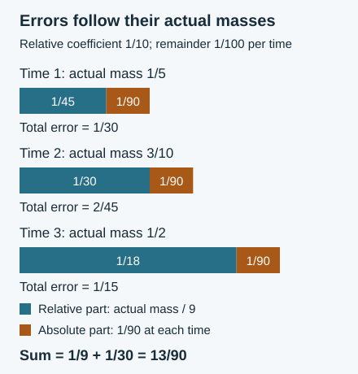

# Combining weighted estimates into a first-passage law

*Written by GPT-6 Astra, Ultra reasoning, in Codex, October 2026. Self-checked by the writing AI. Original exposition, proofs and exercises: CC0 1.0.*

A probability law can have several descriptions: a sum over starting integers, a sum over words and endpoints, or an average against a simpler reference distribution. Passing between them requires more than a collection of small errors. Each error must be measured in the right units. A relative error belongs with the mass it multiplies; an error in a boundary belongs with the points that cross that boundary.

We combine these ideas to obtain a first-passage law for actual Collatz trajectories, under both uniform and harmonic sampling. The argument joins conditional mixing to exact arithmetic coefficients, preserves the endpoint weights under projection, and sums relative errors against a bounded total mass. A common reference measure then compares different starting intervals and different sampling laws. Its mass is determined by the proof, not changed to make it a probability.

The reusable subjects are comparison of measures, conditional likelihoods, averaging over fibres, and accumulation of errors. Basic references are Lech Mazur's *Natural-Density Almost-Bounded Collatz Orbits in Logarithmic Time*, Appendix C; Jaan Allikvere's *Almost all Collatz orbits attain almost bounded values in natural density*, Sections 4 and 6; and Tao's *Almost all orbits of the Collatz map attain almost bounded values*, Sections 4 and 5. We use the internal proofs of [conditional fine mixing](NT-COLLATZ-16.md#what-follows-for-a-specified-total), [paired likelihood ratios](NT-COLLATZ-17.md#local-probabilities-and-a-ratio-that-keeps-their-common-terms), [arithmetic support comparison](NT-COLLATZ-26.md#moving-the-support-costs-boundary-mass), [reference profiles](NT-COLLATZ-30.md#assembling-the-full-weighted-reference-profile), and [the exact first-passage correspondence](NT-COLLATZ-31.md#an-exact-correspondence-with-terminal-records). The composition of those arguments is proved here.

## A bounded test under two probability laws

First isolate a finite comparison. Let \(\pi:G\to H\) be a surjection of finite sets, all of whose fibres have cardinality \(k\). For a probability \(\mu\) on \(G\), write \(\pi_*\mu\) for its image on \(H\). The uniform lift of a probability \(\zeta\) on \(H\) is
\[
(U\zeta)(v)=\zeta(\pi v)/k.
\]
For \(0\leq f\leq A\) on \(G\), define its fibre average by
\[
\bar f(x)=\frac1k\sum_{\pi(v)=x}f(v).
\tag{1}
\]
This is an average, not a selection of one representative. Directly interchanging the finite sums gives
\[
\mathbb E_{U\zeta}f=\mathbb E_\zeta\bar f,\qquad 0\leq\bar f\leq A.
\tag{2}
\]

Suppose a countable word space carries probabilities \(P,Q\), with \(Q=wP\), and a map \(g\) from words to \(H\) satisfies \(g_*Q=\pi_*\mu\). Let \(D\) be a set of words on which \(|w-1|\leq\gamma\). Put
\[
\delta=\|\mu-U\pi_*\mu\|_1,\quad
t=P(D^c)+Q(D^c),\quad
R=\mathbb E_P\bar f(g).
\tag{3}
\]
The norm is the full sum of absolute masses.

**Lemma 1 (A relative comparison with an absolute remainder).**
\[
\left|\mathbb E_\mu f-R\right|
\leq \gamma R+A(\delta/2+t).
\tag{4}
\]

**Proof.** The difference \(\mu-U\pi_*\mu\) has total mass zero. Subtracting the constant \(A/2\) from the test therefore gives
\[
\left|\mathbb E_\mu f-\mathbb E_{\pi_*\mu}\bar f\right|
\leq(A/2)\delta.
\]
For the other difference, use \(g_*Q=\pi_*\mu\) and \(Q=wP\). Its part over \(D\) has absolute value at most
\(\gamma\mathbb E_P[\bar f(g)1_D]\leq\gamma R\).
The part over \(D^c\) is at most \(A[P(D^c)+Q(D^c)]\). Adding proves (4). Every infinite sum is absolutely convergent because the test is bounded. ∎

The reference \(R\) can be very small. Replacing \(\gamma R\) by \(\gamma A\) would discard precisely the information that will allow us to sum many comparisons.

For later use, recall the [sharp absorption inequality](NT-COLLATZ-27.md#absorbing-an-error-against-the-actual-mass). If nonnegative \(Y_i,R_i,e_i\) satisfy
\[
|Y_i-R_i|\leq e_i+\gamma R_i,\qquad 0\leq\gamma<1,
\]
then, writing \(d_i=|Y_i-R_i|\) and using \(R_i\leq Y_i+d_i\),
\[
\sum_i d_i\leq
\frac{\sum_i e_i+\gamma\sum_iY_i}{1-\gamma}.
\tag{5}
\]
This proof also explains why the coefficient of the actual total mass, rather than the number of indices, is the relevant quantity.

## Arithmetic coefficients retain every endpoint

Let \(T\) be the odd-return map
\[
T(X)=\frac{3X+1}{2^{\nu_2(3X+1)}}\quad(X>0\text{ odd}).
\]
Fix a nonempty band \(\mathcal B=[z,U)\cap\mathbb O\), where \(\mathbb O\) denotes the positive odd integers, and set
\[
D=\#\mathcal B,\qquad H=\sum_{X\in\mathcal B}X^{-1},\qquad
\beta=\log(U/z).
\tag{6}
\]
The two starting laws are \(1/D\) and \(1/(HX)\).

Choose a prefix length \(\nu\geq1\), a total \(s\geq\nu\), and a finite endpoint set \(\mathcal E\subset\mathbb O\). Retain only the endpoints for which the multiplicative inverse point lies in the strict auxiliary band:
\[
\mathcal S_{\nu,s}=
\{M\in\mathcal E:z<X_0(M)<U\},
\qquad X_0(M)=2^sM/3^\nu.
\tag{7}
\]
On \(G_\nu=\mathbb Z/3^\nu\mathbb Z\), define
\[
f_H(v)=\sum_{\substack{M\in\mathcal S_{\nu,s}\\M\equiv v\ (3^\nu)}}
\frac{3^\nu}{MH},\qquad
f_F(v)=\sum_{\substack{M\in\mathcal S_{\nu,s}\\M\equiv v\ (3^\nu)}}
\frac{3^\nu X_0(M)}{MD}.
\tag{8}
\]
Distinct endpoints in the same residue class contribute distinct summands. Neither sum assumes that reduction modulo \(3^\nu\) is injective.

For \(m\leq\nu\), the reduction map \(G_\nu\to G_m\) has exactly \(3^{\nu-m}\) elements in each fibre. Representatives are
\(x+3^mj\), \(0\leq j<3^{\nu-m}\), with inverse given by remainder and quotient. Formula (1) therefore gives exactly
\[
\bar f_H(x)=
\sum_{\substack{M\in\mathcal S_{\nu,s}\\M\equiv x\ (3^m)}}
\frac{3^m}{MH},\qquad
\bar f_F(x)=
\sum_{\substack{M\in\mathcal S_{\nu,s}\\M\equiv x\ (3^m)}}
\frac{3^mX_0(M)}{MD}.
\tag{9}
\]
Each endpoint appears once in the sum over the fine fibre; the factor \(3^{m-\nu}\) changes \(3^\nu\) to \(3^m\). The endpoint itself, its band condition, and its weight are unchanged.

**Lemma 2 (Finite arithmetic bounds).** If every retained endpoint is at least \(M_->0\), then
\[
0\leq f_H\leq \frac{\beta}{2H}+\frac{3^\nu}{HM_-},
\qquad
0\leq f_F\leq\frac{U-z}{2D}+\frac{2^s}{D}.
\tag{10}
\]

**Proof.** In one residue class modulo the odd number \(Q=3^\nu\), successive positive odd endpoints are spaced by \(2Q\). All endpoints in (7) lie in
\((zQ/2^s,UQ/2^s)\). If its first admitted point is \(M_1\), summing the decreasing function \(1/(M_1+2Qt)\) by its first term and an integral gives
\[
Q\sum_M\frac1M
\leq \frac Q{M_1}+\frac12\log\frac{UQ/2^s}{M_1}
\leq \frac Q{M_-}+\frac\beta2.
\]
Removing endpoints only decreases the sum; the empty case is immediate. Division by \(H\) proves the first assertion.

The number of such points is at most \((U-z)/2^{s+1}+1\). Each summand in \(f_F\) equals \(2^s/D\), since \(X_0(M)/M=2^s/3^\nu\). Multiplication proves the second bound. ∎

These bounds use the actual strict band. They do not require that the endpoint first-passage set be uniformly distributed in residue classes.

## Why the conditional offset is the right law

Let \(P_\nu\) be the independent positive geometric word law, with letter probabilities \(2^{-a}\). Its total mass at \(s\) is
\[
q_{\nu,s}=\binom{s-1}{\nu-1}2^{-s}.
\tag{11}
\]
Conditioning on \(s\) gives the uniform law \(Q_{\nu,s}\) on positive compositions of \(s\).

For a word \(a\), let
\[
F(a)=\sum_{j=1}^{\nu}3^{\nu-j}2^{-(a_j+\cdots+a_\nu)}
\quad\text{in }\mathbb Z[1/2].
\tag{12}
\]
This is a positive rational number with a power-of-two denominator. Reduction modulo \(3^\nu\) is defined because two is invertible there. The affine endpoint condition is exactly \(M\equiv F(a)\pmod{3^\nu}\). By [positive backwards decoding](NT-COLLATZ-26.md#backwards-decoding-proves-positivity-as-well-as-integrality), it gives an actual positive odd source with precisely that word. Later, in the relative affine correction, \(F(a)\) means this rational number, not a chosen residue representative.

The mixing theorem uses
\[
X_\nu(b)=\sum_{i=1}^{\nu}3^{i-1}2^{-(b_1+\cdots+b_i)}.
\]
If \(b=(a_\nu,\ldots,a_1)\), then \(F(a)=X_\nu(b)\) term by term. Reversal is an involution of the fixed-total word set, so the two have the same conditioned distribution \(\mu_{\nu,s}\). This use of reversal does not reverse a path-good condition: the nominal records being summed here retain the total and the endpoint filter, not an ordered prefix event.

Let \(Y_{\sigma,\nu,s}\) be the sum over compatible words and endpoints in (7), assigning weight \(1/(HX_0)\) for \(\sigma=H\), or \(1/D\) for \(\sigma=F\). Counting the equally likely words gives the exact identity
\[
Y_{\sigma,\nu,s}=q_{\nu,s}\mathbb E_{\mu_{\nu,s}}f_\sigma.
\tag{13}
\]
Indeed multiplication by \(q_{\nu,s}\) converts the conditional fraction of words to their number times \(2^{-s}\). In (8) the resulting weights are \(2^{-s}3^\nu/(MH)=1/(HX_0)\) and \(2^{-s}3^\nu X_0/(MD)=1/D\).

For \(1\leq m<\nu\), terms after \(m\) in \(X_\nu\) vanish modulo \(3^m\). Thus its projection is exactly \(X_m\) of the first \(m\) letters. If \(P=P_m\), \(Q=Q_{\nu,s}^{[m]}\), and \(g=X_m\), then \(g_*Q\) is the projected conditional law. The likelihood is
\[
w(t)=\frac{p_{\nu-m}(s-t)}{p_\nu(s)},\qquad
p_r(t)=\binom{t-1}{r-1}2^{-t},
\tag{14}
\]
where \(t\) is the prefix total and impossible completions have probability zero. This is precisely the setting of Lemma 1.

Write \(\rho_m=\mathcal L_{P_m}(X_m)\). The reference in (4) becomes
\[
R_{\sigma,\nu,s}=\mathbb E_{\rho_m}\bar f_\sigma.
\tag{15}
\]
Multiplication of (4) by \(q_{\nu,s}\) compares the actual nominal cell (13) with \(q_{\nu,s}R_{\sigma,\nu,s}\). The total probability occurs once, not twice.

## One choice of scales for every cell

We now specify all scale choices. Let \(B>1\), \(L=\log B\), and use the [logarithmic bands and time window](NT-COLLATZ-30.md#partitioning-a-logarithmic-interval-without-a-remainder):
\[
\begin{gathered}
\alpha=1001/1000,\quad a\in\{\alpha,\alpha^2\},\quad y=B^a,\\
K=\lfloor(\alpha-1)\log y\rfloor,\quad
\beta=(\alpha-1)\log y/K,\quad z=ye^{j\beta},\quad U=ze^\beta,\quad 0\leq j<K,\\
\ell=\log2,\quad d=\log(4/3),\quad
h=\lfloor L/100000\rfloor,\quad N=\lfloor L/(10\ell)\rfloor,\\
W=C\sqrt{N\log N},\quad C\geq\tfrac12,\quad
J=\mathbb Z_{\geq0}\cap[\log(z/B)/d-3W,\ \log(U/B)/d+3W].
\end{gathered}
\tag{16}
\]
For \(n\in J\), put \(\nu=n-h\), and retain totals
\[
s\in\mathbb Z,\qquad \nu\leq s\leq3\nu,\qquad |s-2\nu|<W.
\tag{17}
\]
Choose, independently of the branch, band, time and total,
\[
m=\lceil hL^{-2/5}\rceil.
\tag{18}
\]
In particular \(m\sim10^{-5}L^{3/5}\). No reference level is selected separately after observing an endpoint.

Let \(E\subseteq\mathbb O\cap[1,B]\), and write \(\tau_B\) for the first entrance time under \(T\). The endpoint set is
\[
\begin{split}
E'=\{M\in\mathbb O:\;&
B e^{hd-L^{7/10}}\leq M\leq B e^{hd+L^{7/10}},\\
&\tau_B(M)=h,\quad T^h(M)\in E\}.
\end{split}
\tag{19}
\]
An inequality against an integer \(M\) includes the corresponding ceiling or floor automatically. This is the same finite set used in the preceding first-passage lesson, and is independent of \(C\).

For each fixed \(C\), all the following hold for sufficiently large \(B\), uniformly in the indices:
\[
\begin{gathered}
.0034L\leq\nu\leq.0105L,\quad \sqrt{\nu}\leq m\leq\nu/2,\quad m\leq h,\\
\#J\leq6W+\beta/d+1=O_C(\sqrt{L\log L}),\quad \operatorname{diam}J\leq h,\\
M\in E'\Longrightarrow M\geq B^{999/1000},\qquad
0\leq f_H,f_F\leq4.
\end{gathered}
\tag{20}
\]
Here and below terminating decimals are rational constants.

Here are the justifications. The finite scale bounds of the preceding two lessons apply once \(L\geq300000\) and \(W\leq.000022L\). They give the bounds on \(\nu\), \(n\leq N\), and \(h\leq\nu\). Formula (18), including its ceiling error at most one, gives \(m\asymp L^{3/5}\); hence \(m/\sqrt\nu\to\infty\), \(m/\nu\to0\), and \(m/h\to0\). The length of the interval defining \(J\) proves its cardinality bound; its diameter is at most \(6W+\beta/d=o(L)\), whereas \(h/L\to10^{-5}\). The lower endpoint in (19) exceeds \(B^{999/1000}\) eventually because \(L^{7/10}/L\to0\).

For the last bounds in (20), \(H\geq1/3\), \(D\geq z/2\), and \(\beta<4/3\), as in the [actual-band calculation](NT-COLLATZ-31.md#the-logarithmic-schedule-and-its-exceptional-probability). Also
\[
3^\nu/M_-\leq B^{.0105\log3-.999}\longrightarrow0,\qquad
2^s/D\leq2B^{.0315\log2-\alpha}\longrightarrow0.
\]
Both exponents are negative, using \(\log3<1.1\), \(\log2<1\).
The elementary count \(|D-(U-z)/2|\leq1\) now makes (10) at most four, eventually. The same bound holds for each averaged test (9).

We next retain a *relative* likelihood estimate, rather than insert a total-variation bound for the whole prefix. Put \(c_0=10C\), \(b_0=c_0^2+12\), and
\[
b_\nu=\sqrt{12b_0m\log\nu}+\frac{2b_0\log\nu}{d}.
\tag{21}
\]
Choose \(D_\nu=\{|t-2m|\leq b_\nu\}\) in Lemma 1. Since \(N/\nu\leq42.44\) and \(\log N/\log\nu\leq2\) eventually,
\[
W\leq c_0\sqrt{\nu\log\nu}.
\tag{22}
\]
The [geometric concentration estimate](NT-COLLATZ-06.md#an-exponential-estimate-with-explicit-constants) and the [moderate-total lower bound](NT-COLLATZ-15.md#the-probability-cost-of-fixing-the-total) give
\[
P_m(D_\nu^c)\leq2\nu^{-b_0},\qquad
Q_{\nu,s}^{[m]}(D_\nu^c)
\leq12e\,\nu^{-11}.
\tag{23}
\]
For the second inequality, the conditional probability is at most the unconditioned one divided by
\(p_\nu(s)\geq(6e)^{-1}\nu^{-1-c_0^2}\).
Thus \(t_\nu\leq2\nu^{-b_0}+12e\,\nu^{-11}\).

The [paired likelihood bound](NT-COLLATZ-17.md#local-probabilities-and-a-ratio-that-keeps-their-common-terms) applies with \(n=\nu\), displacement \(|s-2\nu|\leq W\), and prefix displacement at most \(b_\nu\). Its domain conditions hold eventually: \(m\leq\nu/2\) and \(W+b_\nu\leq(\nu-m)/2\). It yields on \(D_\nu\)
\[
\begin{split}
|\log w|\leq \Lambda_\nu:={}&
\frac m\nu+\frac{4mW^2}{\nu^2}
+\frac{4Wb_\nu}{\nu}+\frac{2b_\nu^2}{\nu}\\
&+\frac{4b_\nu}{\nu}
+\frac{4Wm}{\nu^2}+\frac8\nu.
\end{split}
\tag{24}
\]
Let \(\gamma_B=\max_{\nu}(e^{\Lambda_\nu}-1)\), where the maximum is over all integers in \([.0034L,.0105L]\), not just one band's time set. Then
\[
\gamma_B=O_C(L^{-1/5}\log L)\longrightarrow0.
\tag{25}
\]
Indeed \(W=O_C(L^{1/2}\sqrt{\log L})\) and
\(b_\nu=O_C(L^{3/10}\sqrt{\log L})\); their product divided by \(\nu\) is \(O_C(L^{-1/5}\log L)\). The other terms in (24) are of this or smaller order, uniformly. Since \(\Lambda_\nu\to0\), the inequality \(e^u-1\leq e^u u\) proves (25), as well as \(|w-1|\leq\gamma_B\). This verifies the complete likelihood estimate on its domain.

Conditional fine mixing, with coarse exponent at least \(1/2\) and prescribed decay power four, gives one constant \(K_C\) such that
\[
\delta_{\nu,s}\leq K_C m^{-4}
\tag{26}
\]
for all retained cells. Its constant is chosen after \(C\) and before \(B\) or any cell, by (20), (22), and the quantified theorem in the cited internal lesson.

Combining (4), (13), (23) and (26), define the common absolute remainder
\[
e_B=\max_{\nu\in[.0034L,.0105L]\cap\mathbb Z}
\left(2K_Cm^{-4}+4(2\nu^{-b_0}+12e\,\nu^{-11})\right).
\]
Then for both sampling laws and every retained cell,
\[
|Y_{\sigma,\nu,s}-q_{\nu,s}R_{\sigma,\nu,s}|
\leq q_{\nu,s}e_B+\gamma_Bq_{\nu,s}R_{\sigma,\nu,s}.
\tag{27}
\]
The factor two in the first term is \(A/2\), with \(A=4\); the factor four multiplies the two tail masses.

## Summing relative errors against the actual mass

Write \(I_\sigma=\sum_{\nu,s}Y_{\sigma,\nu,s}\) for the nominal terminal sum, and
\(\mathcal P_\sigma=\sum_{\nu,s}q_{\nu,s}R_{\sigma,\nu,s}\) for its reference. First bound \(I_\sigma\) without assuming it is a probability.

Take all records \((n,a,M)\) with (17), \(M\in E'\), and the exact affine congruence, before imposing either source-band selector. They form a finite set. By (20) and [short-window injectivity](NT-COLLATZ-26.md#when-terminal-descriptions-cannot-overlap), their actual positive odd sources are distinct. Let \(U_\sigma\) be the mass of the sources in \([z,U)\), so \(0\leq U_\sigma\leq1\).

For a record, the source is \(X=(1-\xi)X_0\), where \(\xi=F(a)/M>0\). The [exact affine-offset bound](NT-COLLATZ-26.md#how-the-word-length-controls-the-correction) and (20) give
\[
\xi\leq\rho_B:=B^{-198939/200000},\qquad
-\log(1-\xi)\leq\varepsilon_B:=B^{-9/10}
\tag{28}
\]
eventually. The positivity of the word length matters at the lower closed endpoint.

Define the explicit shell allowances
\[
\begin{aligned}
b_H^-&=\frac{\varepsilon_B/2+e^{\varepsilon_B}/z}{H},&
b_H&=\frac{\varepsilon_B+e^{\varepsilon_B}(z^{-1}+U^{-1})}{H},\\
b_F^-&=\frac{z(1-e^{-\varepsilon_B})/2+1}{D},&
b_F&=\frac{(z+U)(1-e^{-\varepsilon_B})/2+2}{D}.
\end{aligned}
\tag{29}
\]
The [support comparison theorem](NT-COLLATZ-26.md#moving-the-support-costs-boundary-mass), including its one-sided form, proves
\[
\begin{gathered}
|U_H-I_H|\leq\rho_BU_H+b_H,\qquad |U_F-I_F|\leq b_F,\\
I_H\leq1+b_H^-,\qquad I_F\leq1+b_F^-.
\end{gathered}
\tag{30}
\]
For clarity, the two source shells are \([ze^{-\varepsilon_B},z)\) and \([Ue^{-\varepsilon_B},U)\). Odd-point counts are at most half the length plus one; their reciprocal sums are at most the reciprocal lower endpoint plus half the logarithmic ratio. This gives precisely (29). Only the lower shell can increase the nominal sum, which gives the superscript-minus bounds. No multiplicity factor enters because the sources are injectively indexed, including those outside the sampling band. All the quantities in (29) are \(O(B^{-9/10})\) uniformly.

At each fixed \(\nu\), the retained total probabilities sum to at most one:
\(\sum_s q_{\nu,s}\leq1\). Applying (5) to (27) over *all* cells, for \(\gamma_B<1\), therefore proves the finite comparison
\[
|I_\sigma-\mathcal P_\sigma|
\leq
\frac{\gamma_B(1+b_\sigma^-)+\#J\,e_B}{1-\gamma_B}.
\tag{31}
\]
The cardinality of the time set occurs only with \(e_B\). It does not multiply \(\gamma_B\). In particular, (20), (25) and \(m\asymp L^{3/5}\) imply
\[
|I_\sigma-\mathcal P_\sigma|
=O_C(L^{-1/5}\log L).
\tag{32}
\]
The absolute remainder contributes only
\(O_C(L^{-19/10}\sqrt{\log L})\), because
\(\#J\,m^{-4}=O_C(L^{1/2-12/5}\sqrt{\log L})\).
This also shows directly that its dependence on the number of times is harmless.

*An equality case of (31) with three times, total actual mass one, relative coefficient \(1/10\), and absolute remainder \(1/100\) at each time. The summed error is \((1/10+3/100)/(1-1/10)=13/90\). Splitting a time slice into more total cells changes neither its mass nor its total error. Exercise 2 calculates the individual terms.*

## Identifying the common reference

The endpoint formula (9) identifies \(\mathcal P_\sigma\) without another approximation. Let
\[
K_m(M)=\frac{3^m\rho_m(M\bmod3^m)}{M},
\qquad
\mathcal Z_B(E)=\frac2d\sum_{M\in E'}K_m(M).
\tag{33}
\]
For a fixed \(M\), the strict auxiliary band permits exactly the two levels derived in [integer thresholds and weighted phase averages](NT-COLLATZ-27.md#from-a-sampling-band-to-two-probability-profiles). Interchanging the finite sums over \(s,\nu,M\) in (15) gives
\[
\mathcal P_H=\sum_{M\in E'}K_m(M)\frac{R_H(M)}H,\qquad
\mathcal P_F=\sum_{M\in E'}K_m(M)\frac{zR_F(M)}D.
\tag{34}
\]
Here \(R_H,R_F\) are exactly the geometric profiles (23)–(24) of the preceding time-window lesson, on \(\nu=n-h\), \(n\in J\). For the flat law, \(X_0/z=e^{(s-\log(z/M)/\ell-\nu\log3/\ell)\ell}\) remains inside its summand. This is why \(R_F\), rather than \(R_H\), occurs. The time map is the bijection \(n\leftrightarrow\nu=n-h\) proved in that lesson.

There is one endpoint convention to check before applying its reference theorem. There the sampling denominators were defined on the strict band \((z,U)\); here they are those of \([z,U)\). The latter adds exactly one point if \(z\) is odd, and none otherwise. Denote the strict denominators by \(H^\circ,D^\circ\). Then
\[
H=H^\circ+\iota/z,\qquad D=D^\circ+\iota,\qquad \iota\in\{0,1\}.
\tag{35}
\]
The geometric profiles and endpoint kernel are unchanged. Thus each expression in (34) is respectively \(H^\circ/H\) or \(D^\circ/D\) times its strict-denominator counterpart. These factors differ from one by at most \(3/z\) and \(2/z\), using \(H\geq1/3,D\geq z/2\).

The [full reference-profile theorem](NT-COLLATZ-30.md#assembling-the-full-weighted-reference-profile) applies with \(q=m\), \(p=\rho_m\), and endpoint set \(E'\): every endpoint first enters at time \(h\), and \(h+m\leq N\) eventually by (20). That theorem also bounds the original kernel mass uniformly, by \(C_*+o(1)\), where \(C_*=\tfrac12+\tfrac12\log(8/3)\). Consequently the strict-denominator reference is bounded, and the change (35) costs \(O(1/z)\). We have proved
\[
\mathcal P_\sigma=\mathcal Z_B(E)+O_C(N^{-\eta_0}),
\qquad
\eta_0=\frac{5097587}{77645938}.
\tag{36}
\]
This holds uniformly in \(E\), both branches and all bands. The same measure \(\mathcal Z_B\) occurs in every case: (18), (19), and (33) do not depend on the band or starting law.

## The first-passage theorem

Let
\[
G_{\sigma,j}(E)=p_{\sigma,j}
\{\tau_B(X)<\infty,\ T^{\tau_B(X)}(X)\in E\}
\]
for the actual starting law on band \(j\). The [path correspondence](NT-COLLATZ-31.md#an-exact-correspondence-with-terminal-records) gives
\[
|G_{\sigma,j}(E)-U_\sigma|\leq\chi_{\sigma,j},\qquad
\chi_{\sigma,j}\leq(2+o_C(1))N^{-C^2/4}.
\tag{37}
\]
Its finite sufficient conditions were \(L\geq300000\), \(W\leq.000022L\),
\[
2\ell W+\log(8/3)\leq L^{7/10},\qquad
L^{7/10}+2\ell W+\ell<hd.
\]
All hold eventually for each fixed \(C\), as proved there. The same exceptional bound controls failure to enter by time \(N\).

**Theorem 3 (A common law for actual band first passages).** With the definitions above, put \(\eta(C)=\min(\eta_0,C^2/4)\). For each fixed \(C\geq1/2\),
\[
\sup_{\sigma,j,E}|G_{\sigma,j}(E)-\mathcal Z_B(E)|
=O_C((\log B)^{-\eta(C)}),
\tag{38}
\]
uniformly over both branches. In particular, choosing \(C=1\) gives the exponent \(\eta_0\).

**Proof.** Insert \(U_\sigma,I_\sigma,\mathcal P_\sigma\), in that order, between the two sides. If \(Q_{\sigma,j}(E)\) denotes any valid finite reference error from (36), the explicit bound is
\[
\begin{split}
|G_{\sigma,j}(E)-\mathcal Z_B(E)|\leq{}&
\chi_{\sigma,j}+b_\sigma+\mathbf1_{\sigma=H}\rho_BU_H\\
&+\frac{\gamma_B(1+b_\sigma^-)+\#J e_B}{1-\gamma_B}
+Q_{\sigma,j}(E).
\end{split}
\tag{39}
\]
Each term has been proved for the actual maps and measures in this formula. Respectively they are an event error, a support/weight error, a conditional arithmetic comparison, and an analytic reference error.

Equations (28)–(32) make the middle terms
\(O_C(B^{-9/10}+L^{-1/5}\log L)\).
The last term is \(O_C(N^{-\eta_0})\), and (37) gives the first. Since \(N\asymp L\) and \(\eta_0<1/5\), their sum has the rate in (38). Every constant was chosen uniformly in the band and target. This proves the supremum, including target sets depending on \(B\).

At \(C=1\), \(C^2/4=1/4>\eta_0\). Neither the actual band law nor \(\mathcal Z_B\) depends on \(C\). The wider tube is a choice in the proof, not a change of the event or its reference. ∎

This is a synthesis of the already proved conditional-mixing and profile estimates with Mazur's terminal construction. It is not a claim that every orbit reaches the threshold, or that the error exponent is optimal. The power agrees with the earlier uniform-input route; the present construction supplies one common reference for both harmonic and uniform starting laws, with their exact arithmetic and endpoint comparisons.

## Whole intervals and the state for nonpassage

For \(y=B^\alpha\) or \(B^{\alpha^2}\), consider the closed source block
\[
\mathcal I_y=[y,y^\alpha]\cap\mathbb O.
\]
Let \(G_{\sigma,y}\) be its finite landing subprobability. The half-open bands partition \([y,y^\alpha)\). The only leftover point is \(y^\alpha\), if that number is odd.

Write \(H_y,D_y\) for the harmonic sum and count of the closed block. The band weights are exactly \(H_j/H_y\) or \(D_j/D_y\). The possible top-point weight is \(p_H=1/(y^\alpha H_y)\) or \(p_F=1/D_y\), and zero when there is no such point. Thus \(\sum_jw_{\sigma,j}+p_\sigma=1\). For any nonnegative common reference value \(Z\),
\[
\begin{split}
G_{\sigma,y}(E)-Z
&=\sum_jw_{\sigma,j}(G_{\sigma,j}(E)-Z)+t_\sigma(E)-p_\sigma Z,\\
|G_{\sigma,y}(E)-Z|
&\leq\sum_jw_{\sigma,j}|G_{\sigma,j}(E)-Z|
+p_\sigma\max\{Z,|1-Z|\},
\end{split}
\tag{40}
\]
where \(0\leq t_\sigma(E)\leq p_\sigma\). The first band gives \(H_y\geq1/3,D_y\geq y/2\); hence \(p_\sigma=O(B^{-1})\). The reference values in (33) are uniformly bounded. Applying (38) with \(C=1\) proves
\[
\sup_{\sigma,y,E}|G_{\sigma,y}(E)-\mathcal Z_B(E)|
=O((\log B)^{-\eta_0}).
\tag{41}
\]
The band count has not multiplied the error.

Complete the landing map by a single extra point \(\partial\):
\[
\Lambda_B(X)=
\begin{cases}
T^{\tau_B(X)}(X),&\tau_B(X)<\infty,\\
\partial,&\tau_B(X)=\infty.
\end{cases}
\tag{42}
\]
Its finite codomain is \(\mathcal Y_B=(\mathbb O\cap[1,B])\sqcup\{\partial\}\).
Each starting law now has an actual probability pushforward \(\widehat G\), without conditioning on successful passage.

**Corollary 4 (Completed laws and the original reference mass).** Any two of the four whole-source laws satisfy
\[
\|\widehat G_1-\widehat G_2\|_{\mathrm{TV}}
:=\sup_{A\subseteq\mathcal Y_B}|\widehat G_1(A)-\widehat G_2(A)|
=O((\log B)^{-\eta_0}).
\tag{43}
\]
The full \(\ell^1\) distance is twice this quantity. For real \(f\) on \(\mathcal Y_B\), the expectation difference is at most
\(\operatorname{osc}(f)\|\widehat G_1-\widehat G_2\|_{\mathrm{TV}}\), where
\(\operatorname{osc}(f)=\max f-\min f\). Moreover,
\[
\mathcal Z_B(\mathbb O\cap[1,B])=1+O((\log B)^{-\eta_0}),
\tag{44}
\]
and the unscaled sum in (33) equals \(d/2+O((\log B)^{-\eta_0})\).

**Proof.** A set containing \(\partial\) has complementary set entirely in the finite landing states. Since both completed laws have total mass one, their discrepancies on these complementary sets have equal absolute value. Therefore the supremum in (43) equals the supremum over finite landing sets \(E\). The triangle inequality through the *unchanged* measure \(\mathcal Z_B\) and (41) proves the rate. For a signed measure of total mass zero on a finite set, its positive and negative masses agree; taking the set of positive atoms proves that its full \(\ell^1\) norm is twice the event supremum.

Subtract \(\min f\) and write
\(f-\min f=\int_0^{\operatorname{osc}(f)}1_{\{f-\min f>t\}}\,dt\).
Finite summation and integration give the expectation bound.

Finally (37), mixed over the bands, bounds failure to enter by \(N\) by \(O(N^{-1/4})+O(B^{-1})\), at \(C=1\). Nonpassage is a subset of that failure event. Thus each finite landing subprobability has total mass \(1-O(N^{-1/4}+B^{-1})\). Apply (41) to all finite landing states to obtain (44). Multiplying by \(d/2\) gives the last statement. No division by the reference mass is used. ∎

The common reference is useful because it is independent of the starting band and sampling law, not because it was declared to have total mass one. Its approximate mass is a consequence of actual first passage. This distinction is useful whenever an arithmetic or analytic approximation is initially a positive measure rather than a probability.

## Exercises with solutions

### 1. Two endpoints in one residue class

Take \(\nu=2,m=1\), endpoints eleven and twenty-nine, and harmonic weights \(3^\nu/M\), omitting the common denominator \(H\). Compute the fine test, its coarse average, and its expectation under the independent one-letter offset law \(\rho_1\). What happens if the two endpoints are replaced by a single representative?

**Solution.** Both endpoints are congruent to two modulo nine. The fine test has value
\(9/11+9/29=360/319\) at that class and zero elsewhere. Each fibre over a class modulo three has three elements, so the coarse average at class two is \(120/319=3/11+3/29\), and is zero elsewhere. For one geometric letter, \(2^{-a}\bmod3\) is two when \(a\) is odd and one when it is even. Summing the geometric series gives \(\rho_1(2)=2/3\) and \(\rho_1(1)=1/3\). The expectation is \(80/319\). Keeping just one endpoint removes its other weight and changes the answer. Equal residues do not mean equal contributions.

### 2. Calculate a mass-weighted sum

There are three times, with actual total masses \(Y=(1/5,3/10,1/2)\). At each time take two total cells with probabilities \(q=(1/4,3/4)\), split that time's actual mass in these proportions, and define cell reference masses by
\(R_i=(Y_i+q_i/100)/(1-1/10)\).
Compute the discrepancy at each time and its total. Then split every cell into one hundred equal pieces.

**Solution.** In each cell \(R_i\geq Y_i\) and
\(R_i-Y_i=q_i/100+(1/10)R_i\), so absorption is an equality. At a time of total mass \(Y\), the discrepancy is
\((Y/10+1/100)/(9/10)\).
The three values are \(1/30,2/45,1/15\), whose sum is \(13/90\).
The reference masses total \(103/90\). Splitting divides \(Y_i,q_i,R_i\) by one hundred in each piece. Their sums, and hence every equality, are unchanged. There is an absolute cost for three times, not for six or six hundred descriptions.

### 3. Include the final point of a partition

Partition the odd points of \([5,15]\) into the bands \([5,9)\), \([9,15)\), and the top point fifteen. Give the exact mixture weights for uniform and harmonic sampling. If every band differs from a nonnegative reference value \(Z\) by at most \(r\), derive a whole-block bound.

**Solution.** The bands contain \(\{5,7\}\) and \(\{9,11,13\}\). Uniform weights are \(2/6,3/6,1/6\). Put
\(H=1/5+1/7+1/9+1/11+1/13+1/15\).
Harmonic weights are \((1/5+1/7)/H\), \((1/9+1/11+1/13)/H\), and \(1/(15H)\). In either law, writing \(p\) for the last weight, (40) gives
\((1-p)r+p\max\{Z,|1-Z|\}\).
The last term need not vanish: a closed source block is not just the union of its half-open bands.

### 4. Choose a proof parameter without changing the law

Compare the exponents supplied by (38) at \(C=1/2\) and \(C=1\). Explain why (43) can use the latter, and why a separate numerical threshold for \(B\) has not been obtained.

**Solution.** At \(C=1/2\), the exponent is \(1/16\), since \(\eta_0>1/16\). At \(C=1\), it is \(\eta_0<1/4\). The starting bands, genuine landing map, reference level (18), endpoint set (19), and common measure (33) do not depend on \(C\). It controls the auxiliary path width and the sufficiently-large threshold in the proof. Choosing one fixed value is therefore legitimate. A numerical threshold would additionally require numerical values for all constants and thresholds in the supplied Fourier and logarithmic-separation estimates; the proof establishes a uniform asymptotic theorem without claiming those values.

## References

- Lech Mazur, [*Natural-Density Almost-Bounded Collatz Orbits in Logarithmic Time*](https://www.proofatlas.ai/formalizations/natural-density-log-time-collatz/), version 2, 21 July 2026, Appendix C and the accompanying fixed-cell, reference-profile, absorption and terminal-aggregation arguments. The common terminal construction and its mass-weighted assembly are reconstructed here.
- Jaan Allikvere, [*Almost all Collatz orbits attain almost bounded values in natural density*](https://doi.org/10.5281/zenodo.21499244), version 2, Theorem 4.1, Proposition 4.2, Lemma 4.3 and Section 6. Conditional fine mixing and comparison of a fixed-total prefix with the independent word law. The exact internal likelihood proof is used in relative form in (24)–(27).
- Terence Tao, [*Almost all orbits of the Collatz map attain almost bounded values*](https://arxiv.org/abs/1909.03562v7), Sections 4 and 5. Geometric valuation words, affine inverse coordinates and the common-reference strategy for first passage.
- Georges Rhin, [*Approximants de Padé et mesures effectives d'irrationalité*](https://doi.org/10.1007/978-1-4757-4267-1_11), 1987, Proposition (8) and Appendix 2. The logarithmic-separation input behind \(\eta_0\) is proved in the linked internal lessons.

The [reproducible calculations](../build/check_weighted_assembly.py) check exact conditional laws, reversal, endpoint collisions, fibre averages, cell identities, absorption and interval mixtures. Finite tests do not replace the general arguments above.
