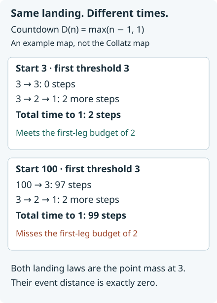

# Coarsening laws and preserving travel times

*Written by GPT-6 Astra, Ultra reasoning, in Codex, October 2026. Self-checked by the writing AI. Original exposition, proofs and exercises: CC0 1.0.*

Two trajectories can arrive at the same place after very different lengths of time. A theorem comparing their landing distributions therefore does not, by itself, compare their travel times. To obtain a time bound, the distributional comparison must be joined to an estimate for arriving within an actual integer budget.

We develop that connection through three general constructions. First, merging outcomes has an exactly measurable loss of information. Second, moving the set from which inputs are sampled changes the probability law by an exact overlap formula. Third, a deterministic inequality carries a remaining time budget through a passage map. Summing the resulting probability inequalities does not require independence between successive passages.

The Collatz application combines [the common first-passage law](NT-COLLATZ-32.md#the-first-passage-theorem) with this general finite-time argument. It gives a scheduled logarithmic clock under either uniform or harmonic sampling. The [earlier drift-based time bound](NT-COLLATZ-24.md#the-time-bound-on-every-input-interval) is sharper; the point here is to understand exactly what the more general scheduled method uses and what information it leaves unused. Basic references are Tao's Section 3 on passage between scales, Mazur's timed scale construction and real-source comparisons, and Allikvere's Sections 7–8 on timed target sets.

## What merging two outcomes loses

For probabilities \(\mu,\nu\) on a finite set \(\Omega\), write
\[
D(\mu,\nu)=\sup_{A\subseteq\Omega}|\mu(A)-\nu(A)|
=\frac12\sum_{\omega\in\Omega}|\mu(\omega)-\nu(\omega)|.
\tag{1}
\]
The equality follows by taking the set of positive coordinates of \(\mu-\nu\); its total mass is zero, so its positive and negative masses agree. We use \(D\) for the event-supremum convention throughout.

Let \(\mathbb O\) denote the positive odd integers. The odd-return Collatz map is \(T(n)=(3n+1)/2^{\nu_2(3n+1)}\), where \(\nu_2\) is the exponent of two in a positive integer. Let \(\tau_B(n)\) be its first entrance time into the positive odd integers at most \(B\). For \(B\geq1\), the completed landing map has codomain
\[
\mathcal Y_B=(\mathbb O\cap[1,B])\sqcup\{\partial\},
\]
where \(\partial\) records nonpassage. Consider the further map
\[
r_B:\mathcal Y_B\longrightarrow\mathbb O\cap[1,B],
\qquad r_B(s)=s\ (s\ne\partial),\qquad r_B(\partial)=1.
\tag{2}
\]
It merges precisely \(\{1,\partial\}\). Its other fibres are singletons. The resulting map from starting integers is
\[
F_B(n)=
\begin{cases}
T^{\tau_B(n)}(n),&\tau_B(n)<\infty,\\
1,&\tau_B(n)=\infty.
\end{cases}
\tag{3}
\]
The symbol one in the second line is a convention for representing an undefined landing, not a claim that the trajectory reaches one.

**Proposition 1 (Exact information loss).** For probabilities \(\mu,\nu\) on \(\mathcal Y_B\), put
\(u=\mu(1)-\nu(1)\), \(v=\mu(\partial)-\nu(\partial)\). Then
\[
\begin{split}
2D(\mu,\nu)-2D((r_B)_*\mu,(r_B)_*\nu)
&=|u|+|v|-|u+v|\\
&=
\begin{cases}
2\min(|u|,|v|),&uv<0,\\
0,&uv\geq0.
\end{cases}
\end{split}
\tag{4}
\]
The linear kernel of pushforward on signed measures is exactly
\[
\{t(\delta_1-\delta_\partial):t\in\mathbb R\}.
\tag{5}
\]

**Proof.** Pushforward leaves all other coordinates unchanged and replaces \(u,v\) by their sum. Subtract their contributions to the full norms in (1) to obtain the first equality. If \(u,v\) have the same sign there is no cancellation. If they have opposite signs, precisely twice the smaller absolute value is lost. This proves (4).

A signed measure in the kernel must vanish at every other point, and its two remaining coordinates must sum to zero. This proves (5). Conversely every measure in (5) maps to zero. ∎

There is therefore no inverse on all probabilities: \(\delta_1\) and \(\delta_\partial\) have the same image. There is an exact reconstruction when the nonpassage mass \(t\) is also given. Keep the other image coordinates, assign mass \(t\) to \(\partial\), and subtract \(t\) from the image mass at one. The admissible values are exactly \(0\leq t\leq(r_B)_*\mu(1)\). This describes both the missing information and all possible reconstructions.

More generally, for a map \(f:\Omega\to Z\), finite summation gives
\[
2D(f_*\mu,f_*\nu)=
\sum_{z\in f(\Omega)}
\left|\sum_{\omega:f(\omega)=z}(\mu(\omega)-\nu(\omega))\right|
\leq 2D(\mu,\nu).
\tag{6}
\]
Thus coarsening cannot increase event distance. It may nevertheless hide a particular event completely. In the application we retain the separate, genuine event \(\{\tau_B>N\}\) when estimating travel time.

## The exact cost of moving a sampling set

Let \(S,T\) be nonempty finite subsets of an ambient set, and let \(w>0\) on their union. Define
\[
W_A=\sum_{n\in A}w(n),\qquad
p_A(n)=\frac{w(n)\mathbf1_A(n)}{W_A}.
\]
These are the actual two sampling laws, with their own denominators.

**Proposition 2 (Weighted overlap).**
\[
D(p_S,p_T)
=1-\frac{W_{S\cap T}}{\max(W_S,W_T)}
=\frac{\max(W_{S\setminus T},W_{T\setminus S})}{\max(W_S,W_T)}.
\tag{7}
\]
For any common observation \(f:S\cup T\to Z\), its output distance is at most (7), with exact value given by (6).

**Proof.** For probability vectors,
\[
\frac12\sum_n|p(n)-q(n)|=1-\sum_n\min(p(n),q(n)).
\]
On \(S\cap T\), the smaller mass is \(w(n)/\max(W_S,W_T)\); outside the intersection it is zero. This proves the first equality. Writing each total as intersection mass plus its exclusive mass proves the second. Formula (6) proves the output assertion, without identifying the two source sets. ∎

For an injective observation there is equality in (6). For a many-to-one observation, cancellation within a fibre explains every strict loss.

Here is the arithmetic application. Put
\[
\alpha=\frac{1001}{1000},\qquad B=\lfloor x\rfloor,\qquad
\beta\in\{\alpha,\alpha^2\},\qquad q=\alpha\beta,
\]
and compare the original closed odd blocks
\[
S=[B^\beta,B^q]\cap\mathbb O,\qquad
T_x=[x^\beta,x^q]\cap\mathbb O.
\tag{8}
\]
Use \(w=1\) for uniform sampling and \(w(n)=1/n\) for harmonic sampling; write their exact distances as \(\epsilon_F,\epsilon_H\).

For every interval of positive endpoints \(u<v\), under any fixed choice of inclusion of its endpoints,
\[
\left|\#(\mathbb O\cap I)-\frac{v-u}{2}\right|\leq1,\qquad
\left|\sum_{n\in\mathbb O\cap I}\frac1n-\frac12\log(v/u)\right|\leq\frac1u.
\tag{9}
\]
For the count, write \(n=2k+1\) and compare the number of integers in the resulting interval with its length. For the reciprocal sum, let \(A(t)\) count the admitted odd points up to \(t\). The same count gives \(|A(t)-(t-u)/2|\leq1\) for \(u<t<v\). The exact finite identity
\[
\sum_{n\in\mathbb O\cap I}\frac1n
=\frac{A(v)}v+\int_u^v\frac{A(t)}{t^2}\,dt
\]
includes a possible atom at \(u\). Comparing with the same expression for \((t-u)/2\) gives error at most \(1/v+\int_u^v t^{-2}dt=1/u\). Changing the upper endpoint changes \(A(v)\) consistently; a value at one integration point has no effect.

Eventually, uniformly for \(B\leq x<B+1\), the blocks overlap because \((B+1)^\beta<B^q\). Their exclusive sets are exactly
\[
[B^\beta,x^\beta)\cap\mathbb O,\qquad
(B^q,x^q]\cap\mathbb O.
\]
The differences \(x^q-B^q\) dominate \(x^\beta-B^\beta\): the derivative of \(t^q-t^\beta\) is positive for \(t\geq1\). Substitution in (7) and (9) therefore gives
\[
\epsilon_F\leq
\frac{(x^q-B^q)/2+1}{(B^q-B^\beta)/2-1},
\tag{10}
\]
\[
\epsilon_H\leq
\frac{(q/2)\log(x/B)+B^{-\beta}}
{((q-\beta)/2)\log B-B^{-\beta}}.
\tag{11}
\]
The denominators are positive for sufficiently large \(B\). These are bounds on the unchanged laws, not definitions of replacement measures.

The mean-value theorem gives \(x^q-B^q\leq q(B+1)^{q-1}(x-B)\), while \(\log(x/B)\leq(x-B)/B\). Hence
\[
\begin{split}
\limsup_{B\to\infty}\sup_{B\leq x<B+1}B\epsilon_F&\leq q,\\
\limsup_{B\to\infty}\sup_{B\leq x<B+1}B\log B\,\epsilon_H
&\leq\frac q{q-\beta}=1001.
\end{split}
\tag{12}
\]
For the first limit divide numerator and denominator in (10) by \(B^q\); after multiplication by \(B\), the added counting error is \(O(B^{1-q})\). For the second use (11); the reciprocal endpoint error contributes \(O(B^{1-\beta})\). Both vanish. At \(x=B\), the exact distances (7) are zero, even though the upper bounds (10)–(11) can be positive.

## Keeping the actual scheduled failure event

The dynamics itself has no real-to-integer rounding error:
\[
T^j(n)\leq x\quad\Longleftrightarrow\quad T^j(n)\leq\lfloor x\rfloor.
\tag{13}
\]
First-hit times, nonpassage and landing values agree exactly. Only the sampling sets in (8) move.

Let \(\mu_{\sigma,y}\) be the uniform (\(\sigma=F\)) or harmonic (\(\sigma=H\)) law on the nonempty closed block \([y,y^\alpha]\cap\mathbb O\). Put
\[
\eta=\frac{5097587}{77645938},\qquad
n_x=\left\lfloor\frac{\log\lfloor x\rfloor}{10\log2}\right\rfloor.
\tag{14}
\]
By [the completed-law theorem](NT-COLLATZ-32.md#whole-intervals-and-the-state-for-nonpassage), there are constants \(A,S,x_*\) such that, for every real \(x\geq x_*\),
\[
D((F_x)_*\mu_{\sigma,x^\beta},
  (F_x)_*\mu_{\sigma',x^{\beta'}})
\leq A(\log x)^{-\eta},
\quad
\beta,\beta'\in\{\alpha,\alpha^2\},
\tag{15}
\]
\[
\mu_{\sigma,x^\beta}\{\tau_x>n_x\}
\leq S(\log x)^{-1/4}.
\tag{16}
\]
The constants precede all choices of branches and laws.

To verify these exact hypotheses from the integer-target form of that theorem, take its auxiliary path parameter \(C=1\). It bounds each genuine scheduled failure at \(B\) by \(O((\log B)^{-1/4})\), including the possible top atom of the closed block. Its completed laws have event distance \(O((\log B)^{-\eta})\). Apply (6) to \(r_B\), then (7) to the common passage map. For two real-source laws the event error is at most
\[
\epsilon_\sigma+D_B+\epsilon_{\sigma'},
\tag{17}
\]
where \(D_B\) is their integer-source output distance. For the single scheduled-failure event, the error is only \(\epsilon_\sigma\), not twice that number. Equations (12)–(13) and \(\log B/\log x\to1\) prove (15)–(16). Full \(\ell^1\) distance, if wanted, is twice the *whole* expression (17).

Nonpassage is contained in scheduled failure. But (16) says more: it controls trajectories which will eventually arrive but do not arrive by \(n_x\). That extra information is what the next argument needs.

## A deterministic inequality that carries time

The following step uses no Collatz-specific formula. It applies to any map from a subset of the positive integers containing one to itself. Define first passage below each threshold as before, and send nonpassage to one. Fix a target \(H\geq1\), and write
\[
A_{H,K}=\{n:\tau_H(n)>K\},\qquad K\in\mathbb Z_{\geq0}.
\]

**Lemma 3 (Remaining time after a passage).** For \(q\geq1\) and integers \(K,N\geq0\),
\[
\mathbf1_{A_{H,K}}(F_q(n))\leq\mathbf1_{A_{H,K}}(n),
\tag{18}
\]
\[
\mathbf1_{A_{H,K+N}}(n)
\leq\mathbf1_{A_{H,K}}(F_q(n))
+\mathbf1_{\{\tau_q>N\}}(n).
\tag{19}
\]

**Proof.** For (18), suppose \(n\) reaches at most \(H\) within \(K\) steps. At nonpassage to \(q\), \(F_q(n)=1\leq H\), so its time to \(H\) is zero. Otherwise let \(t=\tau_q(n)\), and let \(s\leq K\) be a time at which the orbit reaches at most \(H\). If \(t\leq s\), its remaining path from the landing has length \(s-t\leq K\). If \(t>s\), the earlier value at time \(s\) exceeds \(q\) but is at most \(H\); hence \(q<H\), and the later landing itself is at most \(H\). These cases prove (18), without an assumed ordering of \(q,H\).

For (19), if \(\tau_q>N\), the right side is already at least one. Otherwise, if \(F_q(n)\) reaches \(H\) within \(K\) more steps, concatenating the actual two legs gives a hit within \(N+K\). This proves (19). ∎

The first inequality is useful even when the auxiliary threshold lies below the final target. The second charges exactly the event which can make the proposed first-leg budget false.

**Theorem 4 (Finite accumulation of time and errors).** Let \(\mu_0,\ldots,\mu_J\) be probabilities on the state space. Choose thresholds \(q_j\geq1\), integer budgets \(N_j\geq0\), and set
\[
K_0=0,\quad K_{j+1}=K_j+N_j,\quad
d_j=D((F_{q_j})_*\mu_j,(F_{q_j})_*\mu_{j+1}),\quad
s_j=\mu_{j+1}\{\tau_{q_j}>N_j\}.
\tag{20}
\]
Then
\[
\mu_J(A_{H,K_J})
\leq\mu_0(A_{H,0})+\sum_{j=0}^{J-1}(d_j+s_j).
\tag{21}
\]

**Proof.** Integrate (19) under \(\mu_{j+1}\), using \(K=K_j,N=N_j\). Comparing the fixed output event \(A_{H,K_j}\) with its probability under \((F_{q_j})_*\mu_j\) costs at most \(d_j\). Integrating (18) under \(\mu_j\) therefore gives
\[
\mu_{j+1}(A_{H,K_{j+1}})
\leq\mu_j(A_{H,K_j})+d_j+s_j.
\]
Induction proves (21), including \(J=0\). Each output event is a definite subset of the landing state space, although its remaining budget changes with \(j\). No independent resampling at an intermediate point has been asserted. ∎

*The map in this diagram is \(D(n)=\max(n-1,1)\), not the Collatz map. The two landing laws at threshold three agree exactly. A first-leg budget of two succeeds for the upper input and fails for the lower one. Thus a distributional error of zero does not permit deleting the scheduled-failure term in (21). Exercise 3 gives the complete calculation.*

## The geometric schedule and its exact clock

Return to the odd-return map \(T\), with \(\alpha,\eta\) fixed above. Choose \(y_0>1\) and put
\[
y_j=y_0^{\alpha^j},\qquad q_j=y_j^{1/\alpha},\qquad
N_j=n_{q_j},\qquad K_J=\sum_{j<J}n_{q_j}.
\tag{22}
\]
The exact source identities are
\[
q_j^\alpha=y_j,\qquad q_j^{\alpha^2}=y_{j+1}.
\tag{23}
\]
Thus (15) compares the literal consecutive blocks needed in Theorem 4. At each \(j\), choose either law \(\mu_j=\mu_{\sigma_j,y_j}\). The sequence of choices may be arbitrary: all four pairings in (15) have the same bound. In particular, the whole argument can use uniform laws, with no extra harmonic-to-uniform passage at the end.

Assume \(q_0\geq x_*\) and \(y_0^\alpha\leq H\). The seed block then has no failure at time zero. If \(L=\log q_0\), Theorem 4, (15) and (16) give the explicit finite bound
\[
\begin{split}
\mu_J\{\tau_H>K_J\}\leq{}&
A L^{-\eta}\frac{1-\alpha^{-\eta J}}{1-\alpha^{-\eta}}\\
&+S L^{-1/4}\frac{1-\alpha^{-J/4}}{1-\alpha^{-1/4}}.
\end{split}
\tag{24}
\]
Each identity is the finite geometric sum, since \(\log q_j=\alpha^j L\). In particular the bound is \(O(L^{-\eta})\), uniformly in \(J\), because \(\eta<1/4\). The fixed factors in its denominators are retained.

The time budget also has an exact geometric upper bound:
\[
\begin{split}
K_J
&=\sum_{j<J}\left\lfloor\frac{\log\lfloor q_j\rfloor}{10\log2}\right\rfloor\\
&\leq\frac{\log q_0}{10\log2}
       \frac{\alpha^J-1}{\alpha-1}\\
&=\frac{\log y_J-\log y_0}{10\alpha(\alpha-1)\log2}.
\end{split}
\tag{25}
\]
Both floors are kept in the definition; the inequality uses their direction. The equality in the last line follows from \(q_0=y_0^{1/\alpha}\). No unused additional step is added to \(K_J\).

For any final block \(y>1\) with \(y^\alpha>H\), choose the least \(J\geq1\) such that \(y_0=y^{\alpha^{-J}}\) satisfies \(y_0^\alpha\leq H\). Existence follows from \(\alpha^{-J}\to0\). Minimality gives
\[
H^{1/\alpha^2}<y_0\leq H^{1/\alpha},\qquad
H^{1/\alpha^3}<q_0\leq H^{1/\alpha^2}.
\tag{26}
\]
For sufficiently large \(H\), one common threshold makes every block nonempty and every \(q_j\geq x_*\), independently of \(y,J\). Indeed \(q_j\geq q_0>H^{1/\alpha^3}\), and \(y_j\geq y_0>H^{1/\alpha^2}\). Their block lengths tend uniformly to infinity.

Substituting (26) in (24), and using (25), proves the following complete scheduled result.

**Corollary 5 (Uniformity in the final source block).** There are constants \(C,H_0\) such that for all \(H\geq H_0\), all nonempty closed odd blocks \([y,y^\alpha]\), and either sampling law,
\[
\mu_{\sigma,y}\{\tau_H>c_{\mathrm{sch}}\log y\}
\leq C(\log H)^{-\eta},\qquad
c_{\mathrm{sch}}=\frac1{10\alpha(\alpha-1)\log2}
=\frac{100}{\alpha\log2}.
\tag{27}
\]
Here \(y>1\). If \(y^\alpha\leq H\), the event is empty.

**Proof.** In the other case, the constructed final law is exactly \(\mu_{\sigma,y}\); choose the preceding \(\sigma_j\) arbitrarily. Formula (26) gives \(L^{-\eta}\leq\alpha^{3\eta}(\log H)^{-\eta}\) and the analogous inequality with exponent \(1/4\). Formula (25) gives \(K_J\leq c_{\mathrm{sch}}\log y\). The event in (27) is a subset of \(\{\tau_H>K_J\}\), proving the result. ∎

The natural-source arithmetic laws used in the proof have not been changed. The freedom to choose \(\sigma_j\) is a consequence of having proved the complete family of pairwise landing comparisons. It removes an unnecessary last change of source law inside this scheduled route.

## From a block law to a count and comparison with the drift clock

Let
\[
\mathcal A_H=\{n\in\mathbb O:\tau_H(n)>c_{\mathrm{sch}}\log n\}.
\]
For \(n\in[y,y^\alpha]\), \(\log n\geq\log y\), so \(\mathcal A_H\) is contained in the block event in (27). Use uniform sampling to obtain
\[
\#(\mathcal A_H\cap[y,y^\alpha])
\leq C(\log H)^{-\eta}\#([y,y^\alpha]\cap\mathbb O).
\tag{28}
\]
The [disjoint-interval counting lemma](NT-COLLATZ-24.md#counting-every-starting-interval), Lemma 4, applies: no member of \(\mathcal A_H\) lies at most \(H\); for sufficiently large \(H\), all the required block lengths exceed two. Its explicit partition retains every integer endpoint and gives
\[
\frac1X\#(\mathcal A_H\cap[1,X])
\leq C_1(\log H)^{-\eta}\qquad(X\geq2,\ H\geq2).
\tag{29}
\]
Bounded integer targets are absorbed by increasing \(C_1\), since the counted proportion is at most one. No lower segment of \([1,X]\) is discarded. For real \(H\), flooring the target gives the same dynamics and an equivalent logarithmic bound after an enlargement of the constant.

This also gives a clock for the ordinary map \(n\mapsto n/2\) on even inputs and \(n\mapsto3n+1\) on odd inputs. Write \(n=2^v u\) with \(u\) odd. If \(u=u_0,\ldots,u_t\) reaches at most \(H\), and \(a_i=\nu_2(3u_i+1)\), then
\[
2^{\sum_{i<t}a_i}u_t
=u\prod_{i<t}(3+1/u_i)\leq4^t u.
\]
Since \(u_t\geq1\), \(\sum a_i\leq2t+\log_2u\). The ordinary trajectory reaches the same endpoint after exactly \(v+t+\sum a_i\) steps. Thus a successful odd-return time \(t\leq c_{\mathrm{sch}}\log u\) supplies an ordinary time at most
\[
c_{\mathrm{raw}}\log n,\qquad
c_{\mathrm{raw}}=3c_{\mathrm{sch}}+\frac1{\log2}
=\frac{300/\alpha+1}{\log2}.
\tag{30}
\]
A raw-bad input must consequently have an odd part in \(\mathcal A_H\). Unique factorization into \(2^v u\), with no overlapping fibres, gives
\[
\#\{\text{raw-bad }n\leq X\}
\leq\sum_{v\geq0}\#(\mathcal A_H\cap[1,X/2^v])
\leq2C_1X(\log H)^{-\eta}.
\tag{31}
\]
Terms with \(X/2^v<2\) have zero count, so the actual sum is finite. This is the same exact fibre mechanism proved more generally in [changes of clock](NT-COLLATZ-25.md).

For any real-valued \(f(n)\to\infty\), these bounds imply that, outside a set of natural density zero, an ordinary iterate is strictly below \(f(n)\) by the time (30). Fix an integer \(H\geq2\); eventually \(f(n)>H\). A failure for the moving target is then contained in the fixed-\(H\) bad set plus finitely many inputs. First take upper density in \(X\), then let \(H\to\infty\) in (31). This proves the assertion without a monotonicity hypothesis on \(f\). The odd-input conclusion follows from (29) in the same way.

The scheduled clock is deliberately distinguished from the strongest clock already proved in the course. [The timed target-set theorem](NT-COLLATZ-24.md#the-time-bound-on-every-input-interval) gives
\[
\frac{\log n}{\log(4/3)}
+O\!\left(\sqrt{\log(n+2)\log(\log(n+2)+2)}\right)
\tag{32}
\]
in odd-return time, with the same exceptional-set exponent \(\eta\); [the exact clock-transfer theorem](NT-COLLATZ-25.md) gives leading ordinary coefficient \(3/\log(4/3)\). These are smaller leading coefficients than (27) and (30). For example \(\log(4/3)>1/4\), \(\alpha<2\), and \(\log2<1\) give
\[
1/\log(4/3)<4<50<c_{\mathrm{sch}},\qquad
3/\log(4/3)<12<151<c_{\mathrm{raw}}.
\]
The additional allowance in (32) is \(o(\log n)\), so the comparison of leading terms is meaningful.

The difference has a mathematical cause. The scheduled method pays a prescribed budget at each threshold and uses only whether the trajectory met it. The drift method also retains the relation between travel time and the actual logarithmic drop along the same orbit. Both arguments belong in a synthesis, but their conclusions should not be confused: (21) is the reusable coarse information theorem, while (32) uses additional trajectory information to obtain the sharper application.

## Exercises with solutions

### 1. Reconstruct a merged law

On \(\{1,3,\partial\}\), let \(\mu=(1/2,1/3,1/6)\) and \(\nu=(1/6,1/3,1/2)\). Calculate their event distance before and after merging \(\partial\) with one. Describe every probability with their common merged image.

**Solution.** Their difference is \((1/3,0,-1/3)\), so the full norm is \(2/3\) and event distance \(1/3\). Both merged laws have masses \(2/3,1/3\) at \(1,3\), so the output distance is zero. In (4), \(u=1/3,v=-1/3\), giving full-norm loss \(2/3\). All preimages are \((2/3-t,1/3,t)\) for \(0\leq t\leq2/3\). Supplying the value of \(t\) determines one of them exactly.

### 2. Change an actual finite sampling set

Take \(S=\{3,5,7\}\), \(T=\{5,7,9\}\). Compute the event distance for uniform sampling and for reciprocal weights. Then observe only whether the input belongs to the intersection.

**Solution.** Uniformly, each total is three and the overlap has two points, so the distance is \(1/3\). Both observed laws give the intersection probability \(2/3\), so their observed distance is zero: exclusive positive and negative differences cancel in the other fibre.

For reciprocal weights,
\[
W_S=71/105,\qquad W_T=143/315,\qquad W_{S\cap T}=12/35.
\]
The larger exclusive mass is \(1/3\), and the larger total is \(71/105\), so (7) gives \(35/71\). The probabilities of the intersection are \(36/71\) and \(108/143\). Their difference is
\[
108/143-36/71=2520/10153.
\]
Thus the two-point observation retains that smaller event distance. It is not enough merely to count how many points were added or removed; their weights and the two original denominators matter.

### 3. Equal landing laws do not give equal times

For \(D(n)=\max(n-1,1)\), take \(\mu_0=\delta_3,\mu_1=\delta_{100}\), auxiliary threshold \(q=3\), final target \(H=1\), initial budget \(K=2\), and added budget \(N=2\). Verify the one-step inequality behind Theorem 4, and show why the scheduled-failure term cannot be deleted.

**Solution.** Both inputs first land at three, so the landing distance is zero. The input three reaches one in two steps, so \(\mu_0(A_{1,2})=0\). The input one hundred reaches three after 97 steps and one after 99 steps, so its failure probability by time four is one. Its scheduled failure at \(q\) with budget two is also one. The inequality is \(1\leq0+0+1\), an equality. Deleting the last term would give the false inequality \(1\leq0\). The one-step proof allows an initial budget \(K\); the displayed theorem starts at zero and obtains later budgets by iteration.

### 4. Keep the exact final scale

For a finite illustration only, take \(\alpha=2\), \(q_0=4\), and schedule \(n_q=\lfloor\log_2q\rfloor\). Compute \(y_0,y_1,y_2\), both thresholds, and the two-step budget. If each comparison-plus-failure error is at most \((\log_2q_j)^{-2}\), compute the finite sum and its infinite geometric upper bound. Explain what changes when the source law is switched between the two steps.

**Solution.** Since \(y_0=q_0^\alpha=16\), the successive blocks start at \(16,256,65536\). The thresholds are \(q_0=4\) and \(q_1=16\), and their schedules are two and four. The exact budget is six; the geometric expression is \(2(2^2-1)/(2-1)=6\). The next threshold \(256\) is not used.

The two errors sum to \(2^{-2}+4^{-2}=5/16\); their infinite geometric sum is \((1/4)/(1-1/4)=1/3\). These are finite arithmetic examples of the mechanism, not the numerical asymptotic constants of the Collatz theorem. If the comparison estimate is uniform over all pairs of available source laws, switching a law does not add a third passage or another time budget. It changes which pair is compared in the same step.

## References

- Terence Tao, *Almost all orbits of the Collatz map attain almost bounded values*, Forum of Mathematics, Pi 10 (2022), e12; [arXiv:1909.03562v7](https://arxiv.org/abs/1909.03562v7), Sections 1.3 and 3. Passage between scales and summable comparison of landing distributions.
- Lech Mazur, [*Natural-Density Almost-Bounded Collatz Orbits in Logarithmic Time*](https://www.proofatlas.ai/formalizations/natural-density-log-time-collatz/), version 2, 21 July 2026. The accompanying passage totalizer, real/floor source comparisons, seed-forward time budget and logarithmic-clock construction motivate the scheduled route. The exact fibre loss, source overlap, geometric sum and direct choice of uniform laws are proved here.
- Jaan Allikvere, [*Almost all Collatz orbits attain almost bounded values in natural density*](https://doi.org/10.5281/zenodo.21499244), version 2, Sections 7–8. The timed target-set route retains more trajectory information. Its complete internal reconstruction and the concentration-scale allowance are in the linked earlier lessons.

The [reproducible calculations](../build/check_scheduled_transport.py) verify finite observation kernels, weighted overlaps, pointwise time inequalities, recurrence examples and exact schedule arithmetic. Finite calculations do not prove the asymptotic passage input (15); its full proof is the preceding lesson.
