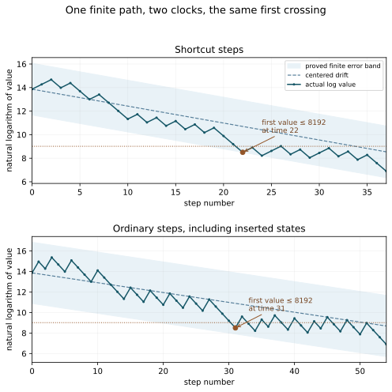
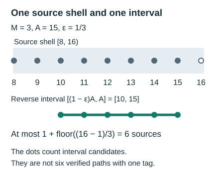

# Reverse maps and first passage fibres

*Figure 2. The finite segment has \(h=37\), \(s_h=17\), and \(\ell=54\). The shortcut band uses \(E=\log9\); its exact condition is \(3^jn^2\le81\,4^jx_j^2\) and \(4^jx_j^2\le81\,3^jn^2\) at each plotted shortcut time. The product satisfies \(P_h\ge999/1000\), giving \(a=\log(1000/999)\) and the ordinary radius (26). Coordinates are rounded only for drawing. This illustrates the finite theorem, not membership in an asymptotic density-one set.*

*Written by GPT-6 Astra, Ultra reasoning, in Codex, October 2026. Self-checked by the writing AI. Original exposition, proofs and exercises: CC0 1.0.*

Suppose a dynamical system carries many starting points to a much smaller set. A small set of landing points need not have a small set of starting points: the map may concentrate its inputs. One way to control that concentration is to bound each fibre, the set of inputs with the same recorded output. Counting fibres then turns information about a target set into information about its preimage.

Here the recorded output will be a first-passage time together with a landing value. For the Collatz shortcut map, reversing a finite path gives a product whose factors measure the effect of the added ones. A bound for this product confines all the starting integers in one fibre to a short interval. At decreasing thresholds, the earlier contributions to an additive bound acquire geometric weights. These facts give a finite transport estimate without any assumption that the landing values are independent or uniformly distributed.

The argument uses integer arithmetic, finite products, geometric series and elementary logarithmic bounds. The final section turns a bound on a whole shortcut path into quantitative bounds in the ordinary clock and at every intermediate level. [Return maps and exact changes of clock](NT-COLLATZ-01.md) and [Symbolic itineraries and affine composition](NT-COLLATZ-02.md) provide the surrounding dynamical context; all identities needed below are proved here. The principal reference is Idris Ali Shaik's *Polylogarithmic Descent for Almost All Collatz Orbits in Natural Density*, Sections 4–5. The reverse-product, fibre-counting and decreasing-threshold constructions are his. We retain the exact interval endpoints and odd-step denominators to sharpen their finite constants, and prove the connection with the other Collatz clocks.

## Reversing a finite path

Use \(T\) for the shortcut map on positive integers:
\[
T(x)=
\begin{cases}
x/2,&x\text{ even},\\
(3x+1)/2,&x\text{ odd}.
\end{cases}
\tag{1}
\]
It differs from both the ordinary Collatz map, which uses \(3x+1\) at an odd step, and the odd-return map, which removes every factor of two after an odd step.

Fix a real threshold \(Y>1\) and a positive integer \(n>Y\). A first passage of length \(h\) is an actual path
\[
x_0=n,\quad x_{j+1}=T(x_j),\quad
x_j>Y\ (0\le j<h),\quad y=x_h\le Y.
\tag{2}
\]
Throughout this lesson, a first-passage record includes a finite \(h\ge1\); no existence claim for every starting integer is needed to define the set of such records. Let \(p_j\) equal one for an odd \(x_j\), and zero otherwise. Set \(s=\sum_{j<h}p_j\). For this path define
\[
u_j=\frac{p_j}{2x_{j+1}},\qquad
L=\sum_{j<h}u_j,\qquad P=\prod_{j<h}(1-u_j),\qquad
E_Y=YL,\qquad G_Y=Y(1-P).
\tag{3}
\]
Even steps contribute zero to \(L\) and one to \(P\). The quantity \(G_Y\) is the exact scaled product defect. The quantity \(E_Y\) is an additive upper bound for it; the two will have different concatenation rules.

**Proposition 1.** Every first-passage record satisfies
\[
Y/2<y\le Y,\qquad
n=\frac{2^h y}{3^s}P,\qquad 0\le G_Y\le E_Y.
\tag{4}
\]
If \(o(Y)\) is the smallest odd integer strictly greater than \(Y\), then
\[
E_Y\le\frac{Ys}{3o(Y)+1}
\le\frac{Y(h-1)}{3o(Y)+1}<\frac h3.
\tag{5}
\]

**Proof.** An odd shortcut step increases its positive input. The step that crosses \(Y\) must therefore be even. Its preceding value is \(2y>Y\), proving the landing band and \(s\le h-1\).

The reverse identities at an even and an odd step, respectively, are
\[
x_j=2x_{j+1},\qquad
x_j=\frac23x_{j+1}\left(1-\frac1{2x_{j+1}}\right).
\]
Multiplication gives the middle identity in (4). Each \(u_j\) lies in \([0,1)\). To prove \(1-\prod(1-u_j)\le\sum u_j\), write the defect after \(k\) factors as \(d_k\). Adding the next factor gives
\[
d_{k+1}=d_k+u_k(1-d_k)\le d_k+u_k.
\]
The initial defect is zero, so induction proves the required inequality. The product lies in \((0,1]\), proving the other sign.

At an odd input before passage,
\[
u_j=\frac1{3x_j+1}\le\frac1{3o(Y)+1}.
\]
There are exactly \(s\) such inputs. This proves the first two bounds in (5). Since \(3o(Y)+1>3Y\), the last bound follows; it also holds when \(s=0\), because \(h\ge1\). \(\square\)

The distinction between \(E_Y\) and \(G_Y\) already occurs in the short path \(3,5,8,4,2,1\). Its two nontrivial factors are \(9/10\) and \(15/16\). Thus \(P=27/32\) and \(L=13/80\), whereas \(1-P=5/32\). An additive estimate is convenient, but it discards the negative cross term from multiplying the factors.

## Affine coordinates and exact composition

The product has an equivalent description in forward affine coordinates. Let \(s_i=\sum_{j<i}p_j\), so \(s_0=0\) and \(s_h=s\). Then
\[
y=\frac{3^s}{2^h}n+b,\qquad
b=\sum_{i=0}^{h-1}\frac{p_i3^{s-s_{i+1}}}{2^{h-i}}.
\tag{6}
\]
Indeed each step is \(x_{j+1}=(3^{p_j}x_j+p_j)/2\). The term \(p_i/2\) introduced at step \(i\) is multiplied at each later step by \(3^{p_j}/2\). Its final contribution is exactly the corresponding summand in (6); the original \(n\) receives the product of all the multipliers.

Comparison with (4) yields
\[
1-P=\frac by,\qquad G_Y=\frac{Yb}{y}.
\tag{7}
\]
For fixed \(Y>0\), replacing \(b\) by \(G_Y\) in an actual path record is an invertible coordinate change:
\[
(n,h,s,y,b)\longmapsto(n,h,s,y,G_Y),\qquad
b=\frac{yG_Y}{Y}.
\tag{8}
\]
Here \(y>0\), and both the domain and codomain consist of coordinates of actual finite paths. This is not an assertion that arbitrary numbers satisfying (7) define a path. If the path itself is retained as an additional coordinate, it is left unchanged. In contrast, retaining only the pair \((h,y)\) forgets the starting value and can identify distinct paths.

**Proposition 2.** Split any finite positive shortcut path into two consecutive segments. With subscripts \(1,2,12\) denoting the segments and their concatenation,
\[
L_{12}=L_1+L_2,\qquad P_{12}=P_1P_2.
\tag{9}
\]
For any positive reference thresholds \(Y_1,Y_2\),
\[
\begin{aligned}
E_{Y_2,12}
 &=\frac{Y_2}{Y_1}E_{Y_1,1}+E_{Y_2,2},\\
G_{Y_2,12}
 &=\frac{Y_2}{Y_1}G_{Y_1,1}+G_{Y_2,2}
   -\frac{G_{Y_1,1}G_{Y_2,2}}{Y_1}.
\end{aligned}
\tag{10}
\]

**Proof.** The two segments partition the factors and summands in (3), giving (9). Multiply the sum identity by \(Y_2\). For the second identity substitute
\(P_1=1-G_{Y_1,1}/Y_1\) and \(P_2=1-G_{Y_2,2}/Y_2\) in \(Y_2(1-P_1P_2)\), and expand. \(\square\)

The first identity in (10) explains why the additive bound is useful across scales. When \(Y_2<Y_1\), the old contribution is reduced by the ratio \(Y_2/Y_1\). The exact product defect has an additional negative term, so replacing it by the additive sum is an inequality, not a coordinate identification.

## A landing and a time force one odd count

For an integer \(M\ge1\), define the half-open shell
\[
I_M=[2^M,2^{M+1})\cap\mathbb Z.
\]
It contains \(2^M\) integers. Fix \(1<Y<2^M\), a positive time \(h\), a positive landing value \(y\), and \(0\le\varepsilon\le1/3\). Consider the fibre
\[
\mathcal F_{M,Y,\varepsilon}(h,y)=
\{n\in I_M:\tau_Y(n)=h,\ T^h(n)=y,\ 1-P(n,h)\le\varepsilon\},
\tag{11}
\]
where \(\tau_Y(n)=h\) means precisely (2).

**Theorem 3.** If this fibre is nonempty, all its paths have the same odd count \(s\). Put \(A=2^hy/3^s\). Then
\[
\begin{aligned}
|\mathcal F_{M,Y,\varepsilon}(h,y)|
\le\max\bigl\{0,\,
 &\min(2^{M+1}-1,\lfloor A\rfloor)\\
 &-\max(2^M,\lceil(1-\varepsilon)A\rceil)+1\bigr\}.
\end{aligned}
\tag{12}
\]
Whether or not the fibre is empty,
\[
|\mathcal F_{M,Y,\varepsilon}(h,y)|
\le1+\left\lfloor\varepsilon(2^{M+1}-1)\right\rfloor.
\tag{13}
\]

**Proof.** For two sources with odd counts \(s_1<s_2\), their reverse scales satisfy \(A_1\ge3A_2\). Equation (4) and the defect bound give
\[
n_1\ge(1-\varepsilon)A_1
\ge\tfrac23\,3A_2\ge2n_2.
\]
But both sources lie in \(I_M\), so \(n_1<2^{M+1}\le2n_2\), a contradiction. Interchanging the sources excludes the other strict ordering. Thus their odd counts, and hence their \(A\)'s, agree.

Each source is an integer in \([(1-\varepsilon)A,A]\cap I_M\). Counting the integers in that intersection gives (12). Notice that this is a containing interval: parity and first-passage conditions can exclude its integers.

For (13), let \(a,z\) be the least and greatest elements of a nonempty fibre. Since \(z\le A\) and \(1-\varepsilon\ge0\),
\[
a\ge(1-\varepsilon)A\ge(1-\varepsilon)z,
\qquad
z-a\le\varepsilon z\le\varepsilon(2^{M+1}-1).
\]
The integer \(z-a\) is at most the floor on the right. There are at most \(z-a+1\) integers between \(a\) and \(z\). The empty fibre satisfies (13) as well. \(\square\)

There are two distinct uses of the shell. Its ratio of upper to lower endpoint excludes differing odd counts, since changing that count changes the reverse scale by a factor of at least three. Its actual largest integer, \(2^{M+1}-1\), then bounds the span of the remaining sources.

*Figure 1. For \(M=3\), \(A=15\), and \(\varepsilon=1/3\), the containing interval is \([10,15]\). It contains six integers, equal to the bound in (13). The underlying reverse-fibre mechanism is Shaik's; Theorem 3 proves the shell-clipped estimate. The geometry illustrates interval containment alone.*

The bound in (13) cannot be improved using interval containment alone. Take \(A=2^{M+1}-1\). Since
\[
\tfrac23(2^{M+1}-1)-2^M=(2^M-2)/3\ge0,
\]
the entire interval \([(1-\varepsilon)A,A]\) remains inside the shell. Its integer count is
\(A-\lceil(1-\varepsilon)A\rceil+1=1+\lfloor\varepsilon A\rfloor\).
This proves sharpness of the interval bound, not the existence of a Collatz fibre attaining it.

## Counting preimages of an arbitrary landing set

Let \(S\) be a finite set of positive integer times and let \(B\subset(Y/2,Y]\cap\mathbb Z\). Retain any subset \(Q\subseteq I_M\) of sources. Define
\[
\mathcal A=\{n\in Q:\tau_Y(n)\in S,\ 
T^{\tau_Y(n)}(n)\in B,\ E_Y(n,\tau_Y(n))\le D\},
\qquad 0\le D/Y\le1/3.
\tag{14}
\]
The condition specifies a finite first passage; non-hitting sources do not enter \(\mathcal A\).

**Corollary 4.** For every such \(Q,S,B,D\),
\[
|\mathcal A|
\le |S|\,|B|
\left(1+\left\lfloor\frac D Y(2^{M+1}-1)\right\rfloor\right)
\le |S|\,|B|\left(1+\frac{2D\,2^M}{Y}\right).
\tag{15}
\]

**Proof.** By (4), \(E_Y\le D\) implies \(1-P\le D/Y\). The fibres of the map
\[
n\longmapsto(\tau_Y(n),T^{\tau_Y(n)}(n))
\]
on the retained set are disjoint, since first-passage time and value are unique. Apply (13) to every tag in \(S\times B\) and sum. Intersecting a fibre with \(Q\) only reduces its size. The second bound follows by dropping the floor and using \(2^{M+1}-1\le2^{M+1}\). \(\square\)

This is a statement about the original starting integers. It remains valid when \(Q\) is selected by earlier behaviour of the same trajectory. In particular, it does not introduce a new random starting point at a landing. It also pays for the number of allowed times, \(|S|\), rather than automatically for the largest time. Taking \(S=\{1,\ldots,H\}\) gives the familiar factor \(H\); a proved smaller time support gives its own cardinality.

Shaik's Proposition 4.3 uses the coefficient \(3\) in place of \(2\) in the last expression of (15). The retained shell gives the finite refinement above. The principal mechanism is unchanged: an estimate for a landing set can be pulled back through a controlled first-passage map.

## Decreasing thresholds suppress earlier loss

Suppose one actual trajectory has consecutive positive-length first-passage blocks through
\[
2^{q_0}>2^{q_1}>\cdots>2^{q_i}=2^q,\qquad
q_0>\cdots>q_i=q\ge1.
\]
Let \(h_j\ge1\) be the length and \(s_j\) the odd count of block \(j\). Assume that for one fixed \(r>0\) there are positive numbers \(m_j\) with
\[
h_j\le m_j<\frac{q_j+1}{r}.
\tag{16}
\]
This section proves the deterministic estimate for every finite chain satisfying these explicit length bounds. Obtaining such chains for most inputs is a separate use of trajectory estimates.

**Theorem 5.** The cumulative endpoint is the original source's first passage to \(2^q\). The additive loss at that endpoint satisfies
\[
E_{2^q}
\le\sum_{j=0}^i\frac{2^q s_j}{3\,2^{q_j}+4}
<\frac13\sum_{j=0}^i m_j2^{q-q_j}
<\frac{2(q+2)}{3r}.
\tag{17}
\]

**Proof.** Consider two consecutive blocks with thresholds \(Y_1>Y_2\). Before the first endpoint every state exceeds \(Y_1\), hence \(Y_2\). The second block exceeds \(Y_2\) until its own endpoint. Their concatenation is consequently the first passage to \(Y_2\). Induction gives the assertion for the full chain.

The smallest odd integer above \(2^{q_j}\) is \(2^{q_j}+1\). Proposition 1 therefore bounds the unscaled loss of block \(j\) by \(s_j/(3\,2^{q_j}+4)\). Add these losses and multiply by the final threshold \(2^q\). This proves the first inequality. Since \(s_j\le h_j-1<m_j\) and \(m_j>0\), each summand is strictly less than \(m_j2^{q-q_j}/3\).

The differences \(d_j=q_j-q\) are distinct nonnegative integers. By (16),
\[
\frac13\sum_j m_j2^{-d_j}
<\frac1{3r}\sum_{d=0}^{\infty}(q+d+1)2^{-d}
=\frac{2(q+2)}{3r}.
\]
For completeness, the partial sums are
\[
\sum_{d=0}^N2^{-d}=2-2^{-N},\qquad
\sum_{d=0}^Nd2^{-d}=2-(N+2)2^{-N}.
\tag{18}
\]
The first is a finite geometric sum. For the second, subtract half the sum, shifted by one index, from the original sum; the remaining geometric sum gives the displayed expression. Both remainder terms tend to zero. Substitution proves the last equality and (17). \(\square\)

The size of the loss depends on the final rank \(q\), rather than on the largest rank \(q_0\). A long earlier block is measured at its own high threshold, and its contribution at the final threshold is reduced by \(2^{q-q_j}\). Distinct integer ranks make the resulting sum geometric.

Set
\[
D_q=\frac{2(q+2)}{3r},\qquad Y=2^q.
\]
For chains beginning in \(I_M\), assume \(Y<2^M\), \(D_q/Y\le1/3\), and that their cumulative times belong to a finite set \(S\). If their landings are required to lie in \(B\subset(Y/2,Y]\cap\mathbb Z\), then (15) and (17) give
\[
\frac{\#\{\text{retained sources with these chains and landings}\}}{2^M}
\le |S|\,\frac{|B|}{2^q}
\left(2^{q-M}+\frac{4(q+2)}{3r}\right).
\tag{19}
\]
Indeed divide (15) by \(2^M\), factor out \(|B|/2^q\), and substitute \(2D_q=4(q+2)/(3r)\). The count remains valid if several choices of intermediate blocks are available: the original source's direct first-passage tag is still unique, so sources, not choices of certificates, are counted.

Shaik's additive bound \((q+2)/r\) and fibre coefficient \(3\) give rank-dependent coefficient \(3(q+2)/r\). The two finite refinements above give \(4(q+2)/(3r)\), which is \(4/9\) of that coefficient. The time support and the size of \(B\) are unchanged. Thus this calculation sharpens a finite transport constant; changing a final density exponent would require further information about those remaining quantities.

## Recovering the same passage in the other clocks

A shortcut landing can be even, whereas an odd-return landing is always odd. Equating the two without accounting for the last divisions by two would lose both the correct endpoint and its time.

Write
\[
U(u)=\frac{3u+1}{2^{\nu_2(3u+1)}}\quad(u\text{ positive and odd})
\]
for the odd-return map. Here \(\nu_2(v)\) is the largest integer \(a\ge0\) for which \(2^a\) divides the positive integer \(v\). Write \(C\) for the ordinary map, with \(C(x)=x/2\) at even inputs and \(C(x)=3x+1\) at odd inputs.

**Theorem 6.** Suppose \(n>Y>1\) is odd and its shortcut first passage has time \(h\), landing \(y\), and odd count \(s\). Put \(d=\nu_2(y)\) and \(u=y/2^d\). Then the first odd-return passage below \(Y\) has return number \(s\) and landing \(u\). For its actual valuations \(a_1,\ldots,a_s\),
\[
h+d=\sum_{\nu=1}^s a_\nu,\qquad
\tau_Y^C(n)=h+s,\qquad
\text{ordinary time of }u=\sum_{\nu=1}^s a_\nu+s.
\tag{20}
\]
Conversely, from the actual first odd-return record with landing \(u\), recover
\[
d=\max\{e\in\mathbb Z_{\ge0}:2^eu\le Y\},\qquad
y=2^du,\qquad h=\sum_{\nu=1}^sa_\nu-d.
\tag{21}
\]
The products and unscaled losses are unchanged by extending the shortcut passage to its odd landing. With odd states \(u_0=n,\ldots,u_s=u\),
\[
L=\sum_{\nu=0}^{s-1}\frac1{3u_\nu+1},\qquad
P=\prod_{\nu=0}^{s-1}\frac{3u_\nu}{3u_\nu+1},\qquad
n=\frac{2^{\sum a_\nu}}{3^s}uP.
\tag{22}
\]

**Proof.** One odd return with valuation \(a\ge1\) consists of one odd shortcut step and \(a-1\) even shortcut steps. Expanding each return in this manner gives its unique shortcut path; cutting at successive odd states is the inverse operation.

Before the shortcut crossing, all states exceed \(Y\). Extending the path from \(y\) through \(y/2,\ldots,y/2^d=u\) introduces no odd input. Hence \(u\) is the first odd state at most \(Y\), and exactly \(s\) returns have occurred. Their shortcut durations sum to \(h+d=\sum a_\nu\).

To obtain the ordinary trajectory, insert \(3x+1\) into each odd shortcut step from \(x\). Each insertion costs one step. Before the crossing, every such inserted value exceeds \(Y\), so no earlier ordinary crossing is introduced. This proves the two ordinary times in (20).

For the inverse, all earlier odd-return states exceed \(Y\). An odd shortcut step increases its input, so the crossing in the last return occurs along its descending sequence of powers of two times \(u\). The first value in that sequence at most \(Y\) is exactly the largest power \(2^du\le Y\). This proves (21), including the first-passage property, and shows that the two constructions are inverse on actual records.

Even steps contribute no loss. At an odd input \(u_\nu\), the summand in (3) is \(1/(3u_\nu+1)\), and its product factor is \(3u_\nu/(3u_\nu+1)\). These give (22), either by (4) or by multiplying the identities \(3u_\nu+1=2^{a_{\nu+1}}u_{\nu+1}\). \(\square\)

For \(n=7\) and \(Y=4\), the shortcut path is
\[
7,11,17,26,13,20,10,5,8,\underbrace{4}_{h=9},2,1.
\tag{23}
\]
The odd-return states are \(7,11,17,13,5,1\), with valuations \(1,1,2,3,4\). Thus \(s=5\), \(d=2\), the ordinary first-passage time is \(14\), and the ordinary time of the odd landing is \(16\). In particular, the two endpoint observations are \(4\) and \(1\), not the same integer.

These exact clock maps permit a theorem stated in one convention to be used in another without changing the underlying trajectory. They do not identify maxima: an ordinary odd step inserts the larger state \(3x+1\). Height estimates must account for those inserted states separately.

## A path bound controls every intermediate passage

Knowing the final time does not control the intervening trajectory. A stronger input is a bound at every shortcut time. The reverse product then transfers that bound to the parity count and the ordinary clock. This is a finite statement about one actual path; no probability assumption is involved.

Take a shortcut path \(x_0=n,\ldots,x_h=y\) with \(y\le n\), and let \(s_j\) count its odd inputs before time \(j\). Put
\[
 d=\log2-\tfrac12\log3>0,\qquad
 e_j=\log x_j-\log n+dj,\qquad
 A_j=\sum_{\substack{0\le i<j\\x_i\text{ odd}}}
          \log\left(1+\frac1{3x_i}\right).
 \tag{24}
\]
Here and below \(\log\) is the natural logarithm. The sum \(A_j\) is nonnegative and increasing. The product in (3), applied to each prefix, gives \(A_j=-\log P_j\).

**Theorem 7.** Suppose
\[
 |e_j|\le E\quad(0\le j\le h),\qquad A_h\le a,
 \qquad E,a\ge0.
 \tag{25}
\]
Define
\[
 B=\frac{E+a}{\log3},\qquad
 D=E+\frac{2d}{3}B+\log2-\frac{2d}{3}.
 \tag{26}
\]
At every shortcut time, and at every ordinary time up to \(\ell=h+s_h\), respectively,
\[
 -\frac{E+a}{\log3}\le s_j-\frac j2\le\frac E{\log3},
 \qquad
 \left|\log C^i(n)-\log n+\frac{2d}{3}i\right|\le D.
 \tag{27}
\]
For every real \(z\in[y,n]\), both first passages exist, reach the same state, and satisfy
\[
 \tau_z^C(n)=\tau_z^T(n)+s_{\tau_z^T(n)}.
 \tag{28}
\]
Their quantitative bounds are
\[
\begin{aligned}
 \left|\tau_z^T(n)-d^{-1}\log(n/z)\right|
 &\le\frac{E+\log2}{d},\\
 \left|\tau_z^C(n)-\frac3{2d}\log(n/z)\right|
 &\le\frac{3(E+\log2)}{2d}+B.
\end{aligned}
 \tag{29}
\]
All levels use the same path and the same constants.

**Proof.** At an odd step,
\[
 \log x_{i+1}-\log x_i
 =\log3-\log2+\log\left(1+\frac1{3x_i}\right);
\]
at an even step the difference is \(-\log2\). Summing, with no discarded term, yields
\[
 e_j=(s_j-j/2)\log3+A_j.
 \tag{30}
\]
Since \(0\le A_j\le A_h\le a\), (25) proves the two one-sided bounds in (27).

Expand each odd shortcut step by inserting the intermediate state \(3x_j+1\). The corresponding ordinary time is exactly \(i_j=j+s_j\); the states agree there. The inverse starts at the initial ordinary state: from an even state it advances one step, and from an odd state it advances two steps, grouping the increase with its following halving. At a corresponding time,
\[
 \log C^{i_j}(n)-\log n+\frac{2d}{3}i_j
 =e_j+\frac{2d}{3}(s_j-j/2).
 \tag{31}
\]
Its absolute value is at most \(E+2dB/3\). An inserted ordinary state is twice the next shortcut state and occurs one ordinary step earlier. Its expression on the left of (31) therefore differs from the next corresponding expression by
\(\log2-2d/3>0\). This proves the second bound in (27) with (26), including every inserted state.

If \(z<n\), let \(t=\tau_z^T(n)\). It exists because \(x_h=y\le z\). The crossing step is an even halving, since an odd shortcut step increases its input. Thus \(z/2<x_t\le z\). Put \(b_z=\log(z/x_t)\), so \(0\le b_z<\log2\). The identity
\[
 dt-\log(n/z)=e_t+b_z
\]
places its left side in \([-E,E+\log2)\), proving the shortcut bound. Before \(t\), every shortcut state exceeds \(z\), and every inserted ordinary state is larger than its preceding shortcut state. No inserted state can give an earlier downward crossing. The ordinary first passage is therefore exactly \(i_t=t+s_t\), proving (28). Subtract \(3\log(n/z)/(2d)\) and use
\[
 i_t-\frac3{2d}\log(n/z)
 =\frac32\left(t-\frac1d\log(n/z)\right)+(s_t-t/2).
\]
This proves (29). At \(z=n\), both first times are zero, so the same bounds hold. ∎

A product-defect estimate \(1-P_h\le\delta<1\) supplies the usable value
\(a=-\log(1-\delta)\). For \(0\le\delta\le1/3\), integration gives
\[
 -\log(1-\delta)=\int_0^\delta\frac{dt}{1-t}
 \le\frac{\delta}{1-\delta}\le\frac32\delta.
\]
This controls every prefix correction at once, not merely the final odd count. Also, every first-passage segment above is a prefix of the original segment. Any height bound already proved on that segment is inherited without enlargement.

*Reference:* Shaik's version 4.0.2 complete companion, Proposition 6.5, uses this pathwise mechanism in the critical shell construction. The finite constants, one-sided parity bounds and exact first-passage correspondence are displayed here so the argument can be applied independently of that construction.

## Exercises with solutions

### 1 Two different filters on one path

For the path \(3,5,8,4,2,1\), take \(Y=3/2\). Compute \(h,s,A,b,L,P,E_Y,G_Y\). With \(\varepsilon=51/320\), determine whether the exact-defect filter \(1-P\le\varepsilon\) and the additive filter \(L\le\varepsilon\) retain the path.

**Solution.** All states before the last exceed \(3/2\), so \(h=5\), \(s=2\), and \(y=1\). Thus \(A=32/9\), \(P=3/A=27/32\), and
\[
b=1-\frac{9\cdot3}{32}=\frac5{32},\quad
L=\frac1{10}+\frac1{16}=\frac{13}{80},\quad
E_Y=\frac{39}{160},\quad G_Y=\frac{15}{64}.
\]
The exact defect is \(5/32=50/320<51/320\), but \(L=52/320>51/320\). The exact-defect filter retains the path and the additive filter does not. This strict difference concerns finite path sets; it alone says nothing about their limiting density.

### 2 The interval bound and actual paths

For \(M=3\), \(A=15\), and \(\varepsilon=1/3\), evaluate both (12) and (13). Does equality of these bounds imply that \(10,11,\ldots,15\) share one first-passage tag?

**Solution.** The lower endpoint is \(\max(8,\lceil10\rceil)=10\), and the upper endpoint is \(\min(15,\lfloor15\rfloor)=15\). Equation (12) gives \(15-10+1=6\). Equation (13) gives \(1+\lfloor15/3\rfloor=6\). Neither equation supplies a time, landing, parity word, or actual path. Both count possible integers in a containing interval. Additional dynamical and arithmetic restrictions can remove candidates. Equality of the bounds is therefore not a construction of a six-element fibre.

### 3 Rescaling a product defect

Split the path in Exercise 1 after its first step. Use reference scales \(Y_1=5\) and \(Y_2=3/2\). These reference scales are for the composition formula, not first-passage assertions about the separate segments. Calculate the two scaled defects and verify the negative term in (10).

**Solution.** The first segment has \(P_1=9/10\), so \(G_{Y_1,1}=1/2\). The second has \(P_2=15/16\), so \(G_{Y_2,2}=3/32\). Therefore
\[
\frac{Y_2}{Y_1}G_{Y_1,1}+G_{Y_2,2}
-\frac{G_{Y_1,1}G_{Y_2,2}}{Y_1}
=\frac3{20}+\frac3{32}-\frac3{320}
=\frac{15}{64}.
\]
This agrees with Exercise 1. Omitting the last term instead gives \(39/160\), the additive scaled loss here. Thus even after the threshold change, the distinction between the sum and product remains exact.

### 4 Recovering a shortcut crossing from an odd landing

Suppose the actual odd-return path from \(7\) has states \(7,11,17,13,5,1\), and valuations \(1,1,2,3,4\). Recover its shortcut and ordinary first passages below \(Y=6\), and compare them with the first odd-return passage below that threshold.

**Solution.** The first odd state at most \(6\) is \(5\), reached after four returns. Use only the first four valuations, whose sum is \(7\). Since \(5\le6<10\), (21) gives \(d=0\), \(y=5\), \(h=7\). The ordinary first-passage time is \(h+s=11\). Expanding the returns gives the shortcut path \(7,11,17,26,13,20,10,5\), confirming that every preceding state exceeds \(6\). The later return to \(1\) is irrelevant to this threshold. This illustrates why a clock conversion must first identify the actual stopping record, not use the total time of a longer path.

## What the finite transport argument contributes

A reverse identity, an integer interval count and a weighted geometric sum now give a bound for the preimage of any specified landing set. The argument works for sources selected by their earlier histories, and the clock correspondence retains those same histories. These are reusable tools for deterministic dynamics: replace an unjustified assertion about the distribution of landings by a proved bound on how many sources each landing can represent.

To obtain an almost-everywhere descent theorem from this mechanism, the landing set, its size and the allowed time support must also be estimated. The [earlier probability-transport route](NT-COLLATZ-33.md) controls whole landing laws; the present route controls individual fibres and their unions. Both connect local passage information to global counts, but through different proved inputs.

## References

- Idris Ali Shaik, *Polylogarithmic Descent for Almost All Collatz Orbits in Natural Density*, version 4.0.2, complete companion, Proposition 6.5. [Article and companion](https://doi.org/10.5281/zenodo.23132901). The finite path-to-clock transfer above makes the constants explicit; no novelty claim is made.
- Idris Ali Shaik, *Polylogarithmic Descent for Almost All Collatz Orbits in Natural Density*, version 3.2.4, 27 August 2026, Sections 4–5, especially Lemmas 4.1–4.2, Proposition 4.3 and Lemmas 5.1–5.2. [Preprint](https://doi.org/10.5281/zenodo.22130385). The accompanying [first-passage formal source](https://github.com/shaikidris/FirstPassageLinearTransport/tree/ef3410843bf58d69f771f5ba2c0571d54b54da59/lean/FirstPassageLinearTransport) gives the reverse identities, loss-filtered transport and decreasing-rank construction. The proofs here are independently expressed; the sharper shell and denominator constants are derived in the text.
