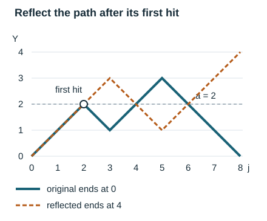

# Maximal parity deviations and orbit envelopes

*Written by GPT-6 Astra, Ultra reasoning, in Codex, October 2026. Self-checked by the writing AI. Original exposition, proofs and exercises: CC0 1.0.*

A terminal average can conceal a large excursion. A walk may climb for a long time and then return to its starting level. To control an entire trajectory, one needs an estimate for the largest deviation among all its prefixes. This lesson develops two ways to obtain such an estimate: a finite exponential potential, and a reflection that converts a first crossing into a terminal event. The second method retains the square-root factor in a binomial probability.

The application is to actual integer trajectories of the Collatz shortcut map. On a specified finite interval, parity words are exactly uniformly distributed. That arithmetic identity lets us apply the finite walk estimates without replacing the integer dynamics by a random model. The remaining issue is deterministic: the added ones in the iteration contribute an affine correction. We bound that correction and show how a small allowance for it preserves the full entropy rate.

The prerequisites are finite counting, induction, differentiation and elementary integration. The exact coding map is proved in [Symbolic itineraries and affine composition](NT-COLLATZ-02.md#the-arithmetic-domain-of-a-word). The fuller factorial asymptotic in [Fixed totals and the law of a short prefix](NT-COLLATZ-17.md#a-factorial-estimate-with-its-constant) is useful background; below, a short independent bound supplies the explicit constant needed here. The main application reference is Idris Ali Shaik's *Polylogarithmic Descent for Almost All Collatz Orbits in Natural Density*, Sections 2–3. His parity-barrier and affine-envelope arguments are the starting point. The logarithmic factorial argument also appears in Mathlib's treatment by Moritz Firsching, Fabian Kruse and Nikolas Kuhn. The rank-dependent allowance and the uniform parameter estimates are derived below from these ingredients.

## Exact sampling on a finite parity cube

Throughout, \(T\) denotes the shortcut map on positive integers:
\[
T(n)=
\begin{cases}n/2,&n\text{ even},\\(3n+1)/2,&n\text{ odd}.\end{cases}
\qquad
I_M=\{2^M,\ldots,2^{M+1}-1\}.
\tag{1}
\]
Here \(M\) is a nonnegative integer. For an input \(n\), write
\[
p_i(n)=T^i(n)\bmod2,\qquad
s_k=\sum_{i=0}^{k-1}p_i,\qquad
d_k=s_k-\frac{k}{2},\qquad
Y_k=2d_k,\qquad
H_M=\max_{0\le k\le M}|d_k|.
\tag{2}
\]
Thus \(Y\) has increments \(2p_i-1\), each equal to \(1\) or \(-1\). The maximum includes \(k=0\).

**Proposition 1.** The map
\[
I_M\longrightarrow\{0,1\}^M,\qquad
n\longmapsto(p_0(n),\ldots,p_{M-1}(n))
\tag{3}
\]
is a bijection. Consequently, under uniform counting on \(I_M\), every specified parity word has probability \(2^{-M}\).

**Proof.** Inputs differing by \(2^M t\) have identical first \(M\) parities. Indeed, as long as their first \(j\) parities agree, their time-\(j\) difference is
\(3^{s_j}2^{M-j}t\). For \(j<M\) this is even, so induction extends the agreement through the next parity.

A residue modulo \(2^j\) has two lifts modulo \(2^{j+1}\). Their time-\(j\) difference is \(3^{s_j}\), an odd integer, so their next parities are opposite. Starting with the unique empty word, choose the unique lift with the desired next parity at every step. This constructs the inverse from words to residues modulo \(2^M\). Finally, \(I_M\) contains exactly one representative of each such residue. This proves both directions of the bijection, including \(M=0\). ∎

In particular, any \(j\) specified coordinates have each assignment with probability \(2^{-j}\): the other \(M-j\) bits have \(2^{M-j}\) possible assignments. Independence here is a property of this finite counting experiment. It makes no assertion that successive bits of a fixed infinite orbit are random.

## A maximal estimate without a factor for the horizon

Let \(\log\) mean the natural logarithm. Define, for \(0\le t<1/2\),
\[
I(t)=\Bigl(\frac12+t\Bigr)\log(1+2t)
     +\Bigl(\frac12-t\Bigr)\log(1-2t).
\tag{4}
\]
This is the relative entropy of the probability pair
\((1/2+t,1/2-t)\) with respect to \((1/2,1/2)\). Direct differentiation gives
\[
I(0)=I'(0)=0,\qquad
I'(t)=\log\frac{1/2+t}{1/2-t},\qquad
I''(t)=\frac4{1-4t^2}.
\tag{5}
\]
Hence \(I(t)\ge2t^2\), strictly for \(t>0\), by integrating twice. Also \(0<I(t)<\log2\) for \(0<t<1/2\): writing \(p=1/2+t\), the difference \(\log2-I(t)=-p\log p-(1-p)\log(1-p)\) is positive.

**Theorem 2.** For \(M\ge1\) and \(0\le h<M/2\), uniform counting on the parity cube, or equivalently on \(I_M\), gives
\[
\Pr(H_M>h)
 \le 2\exp\{-M I(h/M)\}
 \le 2\exp\{-2h^2/M\}.
\tag{6}
\]

**Proof.** We first prove a finite counting inequality. For a real \(a\ge0\), an integer \(z\), and an integer \(r\ge0\), let \(B_a(r,z)\) count the \(r\)-step walks starting at \(z\) that have absolute value greater than \(a\) at some time from \(0\) through \(r\). The current position is included. If \(|z|>a\), the count is \(2^r\). Otherwise it is zero at \(r=0\), and splitting at the first increment gives
\[
B_a(r+1,z)=B_a(r,z-1)+B_a(r,z+1).
\]
For every \(\theta\ge0\), induction on \(r\) proves
\[
B_a(r,z)\cosh(\theta a)
 \le 2^r\cosh(\theta z)(\cosh\theta)^r.
\tag{7}
\]
At an already crossing position, use
\(\cosh(\theta a)\le\cosh(\theta z)\) and \(\cosh\theta\ge1\).
At a noncrossing position with \(r=0\), the left side is zero.
For the remaining induction step, add the estimates for \(z-1\) and \(z+1\), and use
\[
\cosh(\theta(z-1))+\cosh(\theta(z+1))
 =2\cosh(\theta z)\cosh\theta.
\]
This verifies the induction in every case.

Set \(z=0\), \(r=M\), and \(a=2h\). Since
\(\cosh(2\theta h)\ge e^{2\theta h}/2\), (7) implies
\[
\Pr(H_M>h)
 \le2\exp\{M\log\cosh\theta-2\theta h\}.
\tag{8}
\]
Put \(t=h/M\), \(p=1/2+t\), \(q=1/2-t\), and
\(\theta=\tfrac12\log(p/q)\). Then
\(\cosh\theta=(2\sqrt{pq})^{-1}\), so direct substitution gives
\[
2t\theta-\log\cosh\theta
 =\log2+p\log p+q\log q=I(t).
\]
This includes \(t=0\), where \(\theta=0\). Equation (8) proves the first bound; (5) proves the second. Proposition 1 transports the count to the integer inputs. ∎

The estimate controls every prefix at once. Applying a separate estimate at each time and adding those estimates would generally introduce a factor depending on \(M\). The counting induction avoids that loss by following first crossings through the same finite tree.

## Reflection retains the endpoint lattice

The exponential estimate does not retain all the information in a binomial tail. For that we need an exact map, including what happens to endpoints equal to the barrier.

For integers \(a\ge1\), write
\[
T(M,k)=\sum_{j=k}^{M}\binom Mj,\qquad
k=\left\lceil\frac{M+a}{2}\right\rceil,\qquad
k^+=\left\lfloor\frac{M+a}{2}\right\rfloor+1,
\tag{9}
\]
with an empty tail equal to zero.

**Proposition 3.** Among the \(2^M\) walks with increments \(\pm1\),
\[
\begin{aligned}
\#\{\max_{j\le M}Y_j\ge a\}
 &=T(M,k)+T(M,k^+),\\
\#\{\max_{j\le M}|Y_j|\ge a\}
 &\le2\{T(M,k)+T(M,k^+)\}\le4T(M,k).
\end{aligned}
\tag{10}
\]

**Proof.** Partition walks hitting \(a\) according to whether \(Y_M\ge a\) or \(Y_M<a\). The first part has \(T(M,k)\) elements. For a walk in the second part, let \(j_0\) be its first visit to \(a\). Keep the first \(j_0\) increments and negate all subsequent increments. Its new positions are
\[
Y'_j=
\begin{cases}
Y_j,&j\le j_0,\\
2a-Y_j,&j>j_0.
\end{cases}
\tag{11}
\]
The new endpoint exceeds \(a\). Conversely, every walk ending above \(a\) must visit \(a\), because each increment has magnitude one. Reflection after its first visit produces a walk ending below \(a\). The first visit and the prefix are unchanged; applying the transformation twice restores every increment. We therefore have a bijection between the second part and the walks ending above \(a\). The latter count is \(T(M,k^+)\).

Negating all increments gives the same count for reaching \(-a\). The two hitting sets may overlap, so their union has at most the sum of their cardinalities. Finally \(k^+\ge k\). These arguments also cover \(a>M\), when every relevant set is empty. ∎

*Reflection after the first hit of \(a=2\). The original heights are \(0,1,2,1,2,3,2,1,0\); the reflected heights are \(0,1,2,3,2,1,2,3,4\). Equation (11) specifies every coordinate and the inverse. The illustration concerns finite parity words, not a typical orbit. The reflection estimate used in the Collatz application is due to Shaik [S].*

When \(M+a\) is odd, \(k^+=k\), and the first count in (10) is exactly twice one tail. When \(M+a\) is even, \(k^+=k+1\); the layer ending exactly at \(a\) must not be counted twice. For \(M=4\), \(a=2\), the answer is \(T(4,3)+T(4,4)=5+1=6\), not \(10\).

## The binomial prefactor with an explicit constant

Above the midpoint, the whole upper tail is controlled by its first term:
\[
(2k-M)T(M,k)\le k\binom Mk
\qquad(M/2<k\le M).
\tag{12}
\]
To see this, sum the identity
\[
(2j-M)\binom Mj
 =j\binom Mj-(j+1)\binom M{j+1}
\]
from \(j=k\) to \(M\), with \(\binom M{M+1}=0\). The right side telescopes to \(k\binom Mk\); every left coefficient is at least \(2k-M\). This proof retains the distance from the midpoint instead of burying it in an unspecified constant.

We shall also need the following elementary factorial bounds.

**Lemma 4.** For every integer \(n\ge1\), putting \(c(n)=\sqrt{2n}(n/e)^n\), one has
\[
\frac{e^{3/4}}{\sqrt2}c(n)\le n!\le\frac e{\sqrt2}c(n).
\tag{13}
\]

**Proof.** Let \(s_n=n!/c(n)\). Subtracting logarithms gives
\[
\log s_n-\log s_{n+1}
 =\Bigl(n+\frac12\Bigr)\log(1+1/n)-1
 =\sum_{j=1}^{\infty}\frac{(2n+1)^{-2j}}{2j+1}.
\]
For completeness, the series follows by integrating
\((1-x^2)^{-1}=\sum_{j\ge0}x^{2j}\) on \([0,x]\), where \(0<x<1\), and multiplying by two:
\(\log((1+x)/(1-x))=2\sum_{j\ge0}x^{2j+1}/(2j+1)\).
The geometric series converges uniformly on that closed interval, so termwise integration is justified. Substitute \(x=(2n+1)^{-1}\).

Every term is positive, and replacing \(2j+1\) by one bounds the sum by
\[
\frac{(2n+1)^{-2}}{1-(2n+1)^{-2}}=\frac1{4n(n+1)}.
\]
Telescoping from \(1\) to \(n-1\) therefore gives
\(0\le\log s_1-\log s_n\le(1-1/n)/4\le1/4\).
Since \(s_1=e/\sqrt2\), exponentiation proves (13). ∎

The logarithmic-series method in this proof is also used by Firsching, Kruse and Kuhn [F]. It obtains the constants without evaluating the limiting Stirling constant.

For \(0<k<M\), let \(p=k/M\) and \(C_*=\sqrt{2/e}\). Applying (13) to the three factorials gives
\[
2^{-M}\binom Mk
 \le\frac{C_*}{\sqrt{2Mp(1-p)}}
       \exp\{-M I(p-1/2)\},
\qquad k>M/2.
\tag{14}
\]
Indeed, the constant ratio is
\((e/\sqrt2)/(e^{3/4}/\sqrt2)^2=\sqrt{2/e}\).
The square-root ratio is \(1/\sqrt{2Mp(1-p)}\).
The powers of \(e^{-1}\) cancel, and the logarithm of the remaining power ratio, after division by \(2^M\), is
\[
-M\log2-k\log(k/M)-(M-k)\log((M-k)/M)
 =-M I(p-1/2).
\]
No real threshold has replaced the integer \(k\).

For example, fix \(0<t_0\le t\le t_1<1/2\), and choose
\(a=\lfloor2tM\rfloor+1\), \(k=\lceil(M+a)/2\rceil\).
Then \(t<p-1/2\le t+1/M\). Once \(1/M\le(1/2-t_1)/2\), both factorial denominators are positive and \(1-p\) is bounded below. Combining (10), (12), and (14) proves
\[
\Pr(H_M>tM)\le C_{t_0,t_1}M^{-1/2}e^{-MI(t)}.
\tag{15}
\]
The finitely many smaller \(M\) are absorbed by increasing the constant. The factor \(M^{-1/2}\) comes from the local binomial probability, not from the exponential potential. Below we retain the parameter dependence needed when \(t\) itself decreases.

## From parity deviation to an actual orbit envelope

Set
\[
\lambda=\log_2 3,\qquad
a_0=\lambda/2,\qquad
\rho=\sqrt3/2=2^{a_0-1},\qquad K=2+\sqrt3.
\tag{16}
\]
Here \(0<\rho<1\). For a positive real tolerance \(\eta\), define
\[
n\in W_\eta
\quad\Longleftrightarrow\quad
\rho^k n^{1-\eta}\le T^k(n)\le\rho^k n^{1+\eta}
\quad(0\le k\le\lfloor\log_2 n\rfloor).
\tag{17}
\]
This bounds a whole initial trajectory by its central multiplicative scale, with a specified power allowance.

**Proposition 5.** Along an actual orbit, for every \(k\ge0\),
\[
T^k(n)=\rho^k n3^{d_k}
 +\frac12\sum_{i=0}^{k-1}p_i\rho^{k-i-1}3^{d_k-d_{i+1}}.
\tag{18}
\]
If \(H_M\le h\), the second term, for \(k\le M\), lies between zero and
\[
K(1-\rho^k)3^{2h}\le K3^{2h}.
\tag{19}
\]

**Proof.** Each step is \(x\mapsto(3^{p_i}x+p_i)/2\). Multiplying these affine maps gives slope \(3^{s_k}/2^k\) and constant
\(\sum_{i<k}p_i3^{s_k-s_{i+1}}/2^{k-i}\).
The slope is \(\rho^k3^{d_k}\); substituting \(s_j=d_j+j/2\) in each constant term gives (18). This also proves the formula inductively from the empty composition.

Under the barrier, \(d_k-d_{i+1}\le2h\). All summands are nonnegative, and \(p_i\le1\), so the constant is at most
\[
\frac{3^{2h}}2\sum_{j=0}^{k-1}\rho^j
 =\frac{1-\rho^k}{2(1-\rho)}3^{2h}
 =K(1-\rho^k)3^{2h}.
\]
The equality \(1/[2(1-\rho)]=2+\sqrt3\) follows by rationalizing the denominator. ∎

The absolute correction bound (19) is useful when the starting point is arbitrary: its right side does not grow with \(n\). For a full shell and prefixes of length at most its rank, the [exact affine extremum](NT-COLLATZ-02.md#the-largest-affine-correction) gives a second comparison:
\[
 \rho^k n3^{d_k}\le T^k(n)\le\frac76\rho^k n3^{d_k}
 \qquad(n\in I_M,\ 0\le k\le M).
\]
Indeed, write \(T^k(n)=F_k(n+Q_k)\), where \(F_k=3^{s_k}/2^k=\rho^k3^{d_k}\). For \(k\ge1\), that extremum gives
\(0\le Q_k/n\le2^{k-1}/(3n)\le1/6\); at \(k=0\), \(Q_0=0\). This comparison includes the additive term.

Set
\[
 \beta=\log_2(7/6),\qquad 0<\beta<\frac14.
\]
The last inequality is exact: \((7/6)^4=2401/1296<2\). Thus less than a quarter of one binary digit pays for the whole relative affine correction.

For \(M\ge1\), \(\eta>0\), and \(\eta M\ge\beta\), we obtain the deterministic implication
\[
 H_M\le\frac{\eta M-\beta}{\lambda}
 \quad\Longrightarrow\quad n\in W_\eta
 \qquad(n\in I_M).
 \tag{20}
\]
To prove it, put \(h=(\eta M-\beta)/\lambda\ge0\). Since \(n\ge2^M\),
\[
 (7/6)3^h=2^{\eta M}\le n^\eta,
 \qquad 3^{-h}\ge 2^{-\eta M}\ge n^{-\eta}.
\]
Apply these inequalities to the upper and lower comparisons at every \(k\le M\). This proves both sides of (17) on the same trajectory, without an additional startup condition involving \(a_0-\eta\).

*From a word barrier to an integer orbit envelope. The coordinates \(Q_k=A_k/3^{s_k}\) and the comparison \(Q_k/n\le1/6\) are proved in Symbolic itineraries and affine composition. Equation (20) applies at every prefix of every retained integer, not only at the final time. Shaik's parity-barrier method [S] supplies the counting step; this finite affine comparison gives the displayed allowance.*

## A bound uniform over all tolerances up to one

**Theorem 6.** Set \(c_0=1/(2\lambda^2)\) and \(C_0=2\). For every integer \(M\ge0\) and every \(0<\eta\le1\),
\[
\frac{|I_M\setminus W_\eta|}{2^M}
 \le C_0e^{-c_0\eta^2M}.
\tag{21}
\]

**Proof.** First assume \(\eta M\ge2\beta\). With \(h=\eta M/(2\lambda)\), one has
\(h\le(\eta M-\beta)/\lambda\), so (20) shows that failure of \(W_\eta\) implies \(H_M>h\). Here \(M\ge1\), and \(h<M/2\), because \(\eta\le1<\lambda\). Theorem 2 gives
\(2e^{-2h^2/M}=2e^{-c_0\eta^2M}\).

If \(\eta M<2\beta\), then \(\eta^2M\le\eta M<2\beta<1/2\). Since \(c_0<1/2\), its product with \(\eta^2M\) is less than \(1/4\). Also
\(\log2=\int_1^2 dx/x>1/2\). Therefore \(2e^{-c_0\eta^2M}>1\), which bounds the trivial failure proportion. This includes \(M=0\). ∎

A uniform estimate can safely be used with a tolerance depending on \(M\). A theorem whose unspecified constant depends on a fixed tolerance cannot automatically be used that way.

## A fixed affine allowance preserves the full entropy rate {#one-bit-of-allowance-preserves-the-full-entropy-rate}

The quadratic estimate uses half the available parity tolerance. To retain the full entropy rate, use (20) with the entire remaining tolerance after the fixed affine allowance \(\beta\). This changes the finite constant without losing any fixed fraction of the exponential rate.

For \(0<\eta<a_0\), define
\[
\begin{aligned}
u_\eta&=\eta/\lambda,&
b_\eta&=I(u_\eta),&
J_\eta&=\lambda^{-1}\log\frac{1/2+u_\eta}{1/2-u_\eta},\\
m_\eta&=\left\lceil\max\left\{
1,\beta/\eta
\right\}\right\rceil,&
C_\eta&=\max\{2e^{\beta J_\eta},e^{b_\eta(m_\eta-1)}\}.
\end{aligned}
\tag{22}
\]

**Theorem 7.** At every integer \(M\ge0\),
\[
\frac{|I_M\setminus W_\eta|}{2^M}
 \le C_\eta e^{-b_\eta M}.
\tag{23}
\]
For \(M\ge m_\eta\), the constant \(2e^{\beta J_\eta}\) suffices. Moreover,
\[
0<b_\eta<\log2,\qquad
b_\eta>2(\eta/\lambda)^2=4c_0\eta^2.
\tag{24}
\]

**Proof.** For \(M\ge m_\eta\), \(\eta M\ge\beta\), so (20) with
\(h_M=(\eta M-\beta)/\lambda\) applies. Put
\(v=h_M/M=u_\eta-\beta/(\lambda M)\), so \(0\le v<u_\eta<1/2\).
Since \(I'\) is increasing on this interval,
\[
M\{I(u_\eta)-I(v)\}
 =M\int_v^{u_\eta}I'(s)\,ds
 \le \beta I'(u_\eta)/\lambda=\beta J_\eta.
\]
Theorem 2 now gives the claimed bound with constant \(2e^{\beta J_\eta}\).
For \(M<m_\eta\), \(e^{b_\eta(m_\eta-1)}e^{-b_\eta M}\ge1\), which absorbs the trivial bound. Finally (5) proves (24). ∎

The barrier in (20) is chosen in a finite inequality at the same \(M\). This retains the endpoint exponent \(I(\eta/\lambda)\): division by \(M\) costs only \(\beta/(\lambda M)\), and the corresponding entropy loss is at most \(\beta J_\eta\). The improvement in (24) compares two proved upper bounds for the same exceptional set. It is not a claim about the exact frequency of failures.

## Retaining the prefactor uniformly as the tolerance shrinks

We can combine the same allowance with reflection and the explicit binomial bound. This keeps track of the factor that would otherwise be hidden in a tolerance-dependent constant.

Fix \(0<\tau<a_0\), and put
\[
\begin{aligned}
\delta_\tau&=(1/2-\tau/\lambda)/2,\\
N_\tau&=\left\lceil\max\left\{
1,
\frac{2}{1/2-\tau/\lambda}
\right\}\right\rceil,\\
K_\tau&=\frac{4\lambda C_*e^{\beta J_\tau}}{\sqrt{\delta_\tau}},
\qquad C_*=\sqrt{2/e}.
\end{aligned}
\tag{25}
\]

**Theorem 8.** If \(0<\eta\le\tau\), \(M\ge N_\tau\), and \(\eta M\ge2\beta\), then
\[
\frac{|I_M\setminus W_\eta|}{2^M}
 \le\frac{K_\tau}{\eta\sqrt M}
       e^{-MI(\eta/\lambda)}.
\tag{26}
\]

**Proof.** Apply (20), which is valid because \(\eta M\ge2\beta>\beta\). Write \(u=\eta/\lambda\), \(v=u-\beta/(\lambda M)\). Then \(v\ge u/2>0\). Failure implies \(\max|Y_j|>2vM\). Set
\(a=\lfloor2vM\rfloor+1\), \(k=\lceil(M+a)/2\rceil\), and \(p=k/M\).
The integer rounding gives
\[
v<p-\frac12\le v+\frac1M\le u+\frac1M,
\qquad
1-p\ge\frac12-\frac{\tau}{\lambda}-\frac1M\ge\delta_\tau.
\tag{27}
\]
For the upper rounding bound, \(a\le2vM+1\), and taking the ceiling of the half-integer \((M+a)/2\) adds at most \(1/2\). In particular \(0<k<M\).

By (12), since \(p\le1\) and \(p-1/2>v\),
\[
T(M,k)\le\frac{p}{2p-1}\binom Mk
 \le\frac1{2v}\binom Mk\le\frac1u\binom Mk.
\]
By (14), \(p\ge1/2\), (27), and the monotonicity of \(I\),
\[
2^{-M}\binom Mk
 \le\frac{C_*}{\sqrt{M\delta_\tau}}e^{-MI(v)}.
\]
Finally, \(M I(v)\ge M I(u)-\beta J_\tau\), by the same integral estimate as before, now uniformly on \(0\le u\le\tau/\lambda\). Reflection (10) supplies a factor four, and \(1/u=\lambda/\eta\). These estimates give exactly (26). ∎

For a fixed \(\eta\), choose \(\tau=\eta\), and define
\[
N_\eta^*=\max\{N_\eta,\lceil2\beta/\eta\rceil\},\qquad
C_\eta^*=\max\left\{
\frac{\sqrt2K_\eta}{\eta},
\sqrt{N_\eta^*}\,e^{b_\eta(N_\eta^*-1)}
\right\}.
\]
Then the bound valid for every \(M\ge0\) is
\[
|I_M\setminus W_\eta|
 \le C_\eta^*\,2^M(M+1)^{-1/2}e^{-b_\eta M}.
\tag{28}
\]
For \(M\ge N_\eta^*\), use \(M^{-1/2}\le\sqrt2(M+1)^{-1/2}\) in (26).
For smaller \(M\), the second term in \(C_\eta^*\) bounds
\(\sqrt{M+1}e^{b_\eta M}\). This proves (28), including the initial shell.

The uniform form (26) has a different use. For example, let
\(\eta_M=A\sqrt{\log M/M}\), with fixed \(A>0\).
For all sufficiently large \(M\), the three hypotheses hold, and (5) gives
\[
\frac{|I_M\setminus W_{\eta_M}|}{2^M}
 \le \frac{K_\tau}{A\sqrt{\log M}}\,
       M^{-2A^2/\lambda^2}.
\tag{29}
\]
Thus a decreasing power allowance can still control every prefix outside an explicitly bounded fraction of starting inputs. The parameter dependence in (26), not a substitution into a fixed-\(\eta\) statement, justifies this conclusion.

## Why a prefix estimate gives a finite descent

Here is the direct link to the reverse maps of the preceding lesson. Choose \(a_0<r<1\) and \(0<\eta<r-a_0\). Let \(n\in W_\eta\cap I_M\), put \(q=\lfloor rM\rfloor\), and assume
\[
q\ge1,\qquad (r-a_0-\eta)M\ge2+\eta.
\tag{30}
\]
At time \(M\),
\[
T^M(n)\le\rho^M n^{1+\eta}
 <2^{(a_0+\eta)M+1+\eta}
 \le2^{rM-1}\le2^q.
\]
Since \(q<M\), the starting value exceeds \(2^q\). A first passage below \(2^q\) therefore exists at some \(1\le h\le M\). The shortcut map satisfies \(T(x)\ge x/2\), so its landing value obeys
\(2^{q-1}<y\le2^q\). Every preceding state is at most \(n^{1+\eta}\), by (17) and \(\rho^k\le1\).

This supplies a genuine finite passage, its time bound, and a height bound. The [reverse fibre estimate](NT-COLLATZ-34.md#a-landing-and-a-time-force-one-odd-count) then controls how many original inputs can share a recorded time and landing. If one restarts at a landing, however, membership of that new input in an appropriate controlled-prefix set must be established separately. Uniform sampling on the original shell does not make the landing values uniform. The purpose of deterministic fibre transport is precisely to address that change of sampling.

The general pattern is now visible: an exact arithmetic code gives a finite probability space; a maximal estimate controls the whole code; an affine identity transfers that control to an actual trajectory; and a first-passage map provides the objects needed for further counting. Each step supplies information the next step genuinely needs.

## Exercises with solutions

### Reflection and the missing endpoint layer

For \(M=4\), count the words whose walk reaches \(2\). Count those whose absolute height reaches \(2\), and explain why simply doubling the tail \(\Pr(Y_4\ge2)\) gives the wrong one-sided count.

**Solution.** The one-sided count is
\(T(4,3)+T(4,4)=5+1=6\).
Reflection pairs walks that hit \(2\) but end below it with walks ending strictly above \(2\), not with all walks ending at or above it. The four words ending exactly at \(2\) belong only to the unreflected part. Doubling \(5\) would count that layer twice.

Negating every increment gives six words hitting \(-2\). No four-step walk can hit both barriers: reaching either from zero requires two steps and crossing from one to the other requires four more. Hence the two-sided count is twelve, and its probability is \(12/16=3/4\).

### A terminal count does not control a prefix

Give two words of length six with the same terminal value but different maximal deviations. Explain how the exact parity coding turns them into actual integer examples.

**Solution.** The increment words \(+++\!-\!-\!-\) and \(+-+-+-\) both end at zero. Their maximal absolute heights are \(3\) and \(1\), so their \(H_6\) values are \(3/2\) and \(1/2\). The corresponding parity words are \(111000\) and \(101010\).
In \(I_6=\{64,\ldots,127\}\), they correspond respectively to \(87\) and \(65\). Their actual paths are
\[
87,131,197,296,148,74,37,
\qquad
65,98,49,74,37,56,28.
\]
The first six input parities of these paths are exactly \(111000\) and \(101010\). Proposition 1 proves that these are the unique representatives. Both words have three odd inputs and therefore affine slope \(27/64\), but their affine constants are respectively \(19/64\) and \(37/64\). Thus the terminal parity sum determines neither the largest earlier deviation nor the additive part of the iterate.

### A weighted tail calculation

Verify (12) for \(M=8\), \(k=6\), and locate exactly where the inequality is strict.

**Solution.** The tail is
\(\binom86+\binom87+\binom88=28+8+1=37\).
Thus its left side is \(4\cdot37=148\), while the right side is \(6\cdot28=168\).
The telescoping identity gives the exact weighted sum
\(4\cdot28+6\cdot8+8\cdot1=168\).
Replacing each coefficient by the smallest coefficient \(4\) loses
\(2\cdot8+4\cdot1=20\), precisely the difference.

### A shrinking allowance

For a fixed \(A>0\), prove that \(\eta_M=A\sqrt{\log M/M}\) satisfies the hypotheses of Theorem 8 eventually. Express the upper multiplicative allowance \(n^{\eta_M}\), for \(n\in I_M\), on an exponential scale.

**Solution.** Since \(\log M/M\to0\), eventually \(0<\eta_M\le\tau\). Also \(M\ge N_\tau\) eventually, and
\(\eta_M M=A\sqrt{M\log M}\to\infty\), so eventually it is at least \(2\beta\). All constants in (26) depend on the fixed \(\tau\), not on \(M\). Substituting and using \(I(t)\ge2t^2\) gives (29).

For \(n\in I_M\), \(M\log2\le\log n<(M+1)\log2\). Therefore
\[
e^{A(\log2)\sqrt{M\log M}}
 \le n^{\eta_M}
 <e^{A(\log2)(1+1/M)\sqrt{M\log M}}.
\]
The allowed factor grows with \(M\), although its exponent relative to \(n\) tends to zero. This illustrates the difference between a small power allowance and a bounded multiplicative error.

## References

[S] Idris Ali Shaik, *Polylogarithmic Descent for Almost All Collatz Orbits in Natural Density*, version 3.2.4, 27 August 2026. [Paper and accompanying material](https://doi.org/10.5281/zenodo.22130385). Sections 2–3 supply the exact parity sampling, maximal deviation and affine-correction mechanism; Section 5 uses controlled prefixes for descent. The accompanying entropy and adjustable-envelope arguments provide the finite inequalities combined here. Equations (20)–(29) combine that mechanism with the exact affine extremum proved in the earlier coding lesson, deriving the fixed allowance and its uniform consequences explicitly.

[F] Moritz Firsching, Fabian Kruse and Nikolas Kuhn, [Stirling's formula in Mathlib](https://github.com/leanprover-community/mathlib4/blob/9837ca9d65d9de6fad1ef4381750ca688774e608/Mathlib/Analysis/SpecialFunctions/Stirling.lean). The logarithmic difference and its geometric majorant underlie Lemma 4. The source is Apache-2.0 licensed; no Lean source is reproduced here.

The [finite checks](../build/check_parity_envelopes.py) reproduce the parity bijections, reflection maps, rational potential inequalities, binomial identities and selected exact trajectory tests. Separately labelled high-precision diagnostics check the displayed analytic constants at finitely many inputs. The general conclusions follow from the written proofs.

