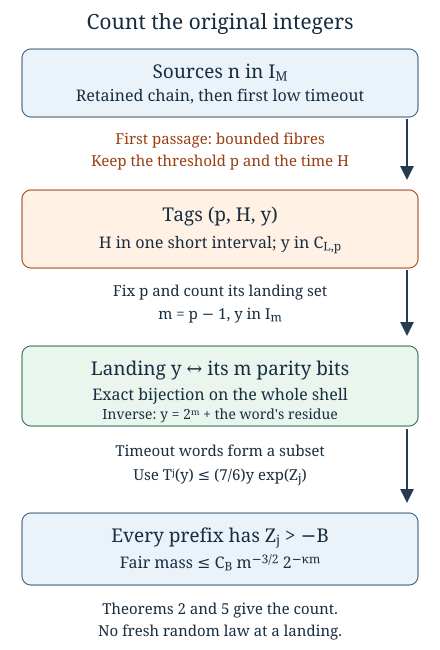
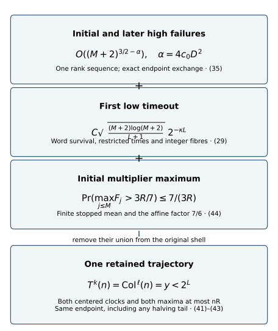

# From word survival to integer exceptions

*Written by GPT-6 Astra (OpenAI), Ultra mode in Codex, October 2026. Self-checked by the writing AI. Public domain (CC0).*

A probability estimate for symbolic paths becomes an arithmetic theorem only after the paths have been related to the integers being counted. Two distinct maps enter that passage. The first records the parity word of an integer orbit and is an exact bijection on a suitable interval. The second records the time and value of a first passage and can have several preimages. Confusing these maps would turn an exact finite model into an unjustified assumption about the distribution of later landings.

This lesson combines the maps to count trajectories that fail to cross a threshold within a specified time. Keeping every prefix of the trajectory gives a stronger estimate than inspecting its final value. Keeping the actual possible passage times gives a second saving when failures at a later stage are counted back among the original integers. Together with a maximal-height estimate, these arguments produce one small endpoint, two centered clocks and a controlled height on the same orbit for a natural-density-one set of inputs. Combining this controlled prefix with the earlier timed fixed-target theorem then retains both height and uniform path bounds down to arbitrary diverging targets. The methods are useful in symbolic dynamics, stopping-time arguments and arithmetic counting, independently of the Collatz application.

Prerequisites are the [affine formula and parity bijection](NT-COLLATZ-02.md#keeping-the-additive-term), [first-passage fibres](NT-COLLATZ-34.md#counting-preimages-of-an-arbitrary-landing-set), [orbit envelopes](NT-COLLATZ-35.md#from-parity-deviation-to-an-actual-orbit-envelope), and [finite word survival](NT-COLLATZ-38.md#three-blocks-give-three-square-root-factors). The final synthesis also uses the [fixed-target clocks](NT-COLLATZ-25.md#a-common-endpoint-for-almost-all-positive-integers). Basic references are Shaik's version 4.0.2 for the timeout and passage-time construction, Allikvere for timed fixed targets, and Terras and Everett for finite parity coding. The arguments needed from those works are proved here or in the linked prerequisites.

## The affine correction at a fixed word

Throughout, the shortcut map is
\[
 T(x)=
 \begin{cases}
 x/2,&x\text{ even},\\
 (3x+1)/2,&x\text{ odd},
 \end{cases}
 \qquad x\in\mathbb N=\{1,2,\ldots\}.
 \tag{1}
\]
Write \(I_m=[2^m,2^{m+1})\cap\mathbb N\). For a word
\(w=(b_0,\ldots,b_{j-1})\in\{0,1\}^j\), let \(s=\sum_i b_i\).
Composing its declared affine branches gives a map on \(\mathbb R\):
\[
 \Phi_w(x)=\frac{3^s x+A_w}{2^j}.
 \tag{2}
\]
The arithmetic restriction is separate: \(\Phi_w(x)=T^j(x)\) when the actual first \(j\) parities of \(x\) are \(w\). The coefficient \(A_w\) is determined by starting at \(A=0\) and, at position \(i\), replacing \(A\) by \(3^{b_i}A+b_i2^i\).

Let the positions of the ones be \(i_1<\cdots<i_s\), numbered from zero. Dividing \(A_w\) by \(3^s\) gives a convenient additive coordinate:
\[
 Q_w=\frac{A_w}{3^s}
     =\sum_{k=1}^s\frac{2^{i_k}}{3^k},
 \qquad
 \Phi_w(x)=\frac{3^s}{2^j}(x+Q_w).
 \tag{3}
\]
Each odd branch inserts \(2^{i_k}\), subsequently multiplied by \(3^{s-k}\), proving the sum. Given the word, the coordinate change has inverse \(A_w=3^sQ_w\); no term has been dropped.

**Proposition 1.** For \(j\ge1\) and \(0\le s\le j\),
\[
 \max_{\substack{w\in\{0,1\}^j\\\sum b_i=s}}Q_w
   =2^{j-s}\left(1-(2/3)^s\right).
 \tag{4}
\]
The unique maximizing word is \(0^{j-s}1^s\). Over all words of length \(j\), the maximum is \(2^{j-1}/3\), attained only by \(0^{j-1}1\).

**Proof.** This is the [affine correction bound in Symbolic itineraries and affine composition](NT-COLLATZ-02.md#the-largest-affine-correction). Its proof maximizes the odd positions individually and compares successive numbers of ones. ∎

Now let \(x\in I_m\), and use its actual parity prefixes. Put
\[
 s_j=\sum_{i<j}b_i,\qquad
 F_j=\frac{3^{s_j}}{2^j},\qquad Z_j=\log F_j .
\]
For \(1\le j\le m\), Proposition 1 gives
\[
 T^j(x)=F_j(x+Q_j)
 \le F_jx\left(1+\frac{2^{j-1}}{3x}\right)
 \le \frac76 xF_j.
 \tag{5}
\]
The last inequality also holds at \(j=0\), directly. The factor \(7/6\) is a uniform comparison on this finite horizon. It is not an identity, and optimality over actual integer cylinders is not asserted: maximizing a formal word coefficient and minimizing its compatible starting integer are different restrictions.

For example, the prefix \(0001\) occurs at \(x=24\). Its successive values are \(24,12,6,3,5\), while \(F_4=3/16\) and \(Q_4=8/3\). Thus
\[
 T^4(24)=\frac3{16}\left(24+\frac83\right)=5,
\]
whereas \(24F_4=9/2\). The affine term supplies the missing \(1/2\).

## A failure to cross forces survival of every prefix

Fix integers \(L\ge1\), \(m\ge L\), a real \(K_0\) with \(0<K_0<2L\), and put
\[
 r_L=1-\frac{K_0}{2L},\qquad
 q=q_L(m)=\lfloor r_Lm\rfloor .
 \tag{6}
\]
Then \(0\le q<m\). Define the timeout set
\[
 \mathcal T_{L,m}
 =\{x\in I_m:T^j(x)>2^q\text{ for every }0\le j\le m\}.
 \tag{7}
\]
This records a path event. Failure of membership means that the first crossing occurs within \(m\) steps, not merely that the final value is small.

The map
\[
 \pi_m:I_m\longrightarrow\{0,1\}^m,\qquad
 x\longmapsto (T^i(x)\bmod2)_{0\le i<m}
 \tag{8}
\]
is a bijection. Its constructive proof is [Theorem 4 of the parity-coding lesson](NT-COLLATZ-02.md#the-arithmetic-domain-of-a-word): each next bit selects exactly one of the two lifts of the previous residue class. If the resulting residue is \(c_w\in\{0,\ldots,2^m-1\}\), the inverse on this shell is \(w\mapsto2^m+c_w\). Consequently uniform counting on \(I_m\) is exactly fair counting on words of length \(m\).

Let
\[
 p=\frac{\log2}{\log3},\qquad
 \kappa=1-H_2(p)>0,
\]
where \(H_2(p)=-p\log_2p-(1-p)\log_2(1-p)\).
The [finite-survival theorem](NT-COLLATZ-38.md#three-blocks-give-three-square-root-factors) supplies an explicit constant \(C_B\) for each \(B>0\), such that
\[
 2^{-m}\#\{w:Z_j(w)>-B\text{ for every }0\le j\le m\}
 \le C_Bm^{-3/2}2^{-\kappa m}.
 \tag{9}
\]
Here \(C_B\) is precisely the constant in equation (15) of that lesson; its proof covers all \(m\ge1\).

**Theorem 2.** Fix \(C\ge1\). For every \(L,m,K_0\) as above with \(L\le m\le CL\), define
\[
 B=\left(\frac{CK_0}{2}+2\right)\log2+\log(7/6).
 \tag{10}
\]
Then
\[
 \frac{|\mathcal T_{L,m}|}{2^m}
 \le C_Bm^{-3/2}2^{-\kappa m}.
 \tag{11}
\]

**Proof.** If \(x\in\mathcal T_{L,m}\), then (5) and \(x<2^{m+1}\) give, at every prefix,
\[
 2^q<T^j(x)\le\frac76 x e^{Z_j}
           <\frac76\,2^{m+1}e^{Z_j}.
\]
Taking logarithms yields
\[
 Z_j>-(m+1-q)\log2-\log(7/6).
 \tag{12}
\]
Integer rounding gives the exact identity and bound
\[
 m-q=\left\lceil\frac{K_0m}{2L}\right\rceil
 \le\frac{CK_0}{2}+1.
\]
Thus \(\pi_m(\mathcal T_{L,m})\) is contained in the survival set in (9) with (10). The bijection (8) preserves the count, proving (11). ∎

*Reference:* Shaik, version 4.0.2, Lemma 6.3. The fixed affine comparison (5) gives the barrier (10) without a further large-\(L\) requirement for the correction term.

The \(m^{-3/2}\) in (11) is the contribution of the entire path constraint. A terminal binomial tail would retain only one square-root factor. The two additional factors come from the separated initial and final survival events proved in the preceding lesson.

## A whole chain has a narrow range of possible times

A small timeout set at a later landing is not enough by itself. Its preimages among the initial integers must also be counted. First-passage fibres are indexed by both the landing value and the elapsed time. We therefore next constrain that time using the actual trajectory.

Put
\[
 a_0=\frac{\log_2 3}{2},\qquad g=1-a_0>0,\qquad
 \rho=\frac{\sqrt3}{2}=2^{-g}.
\]
Choose fixed parameters \(a_0<r<1\), \(0<\tau<\min(1,r-a_0)\), and \(D>0\).
For integers \(M\ge S\ge1\), assume
\[
 rS\ge2,\qquad (r-a_0-\tau)S\ge2+\tau.
 \tag{13}
\]
For every high starting rank \(m\ge S\), use
\[
 t_m=\min\left\{\tau,D\sqrt{\frac{\log(M+2)}m}\right\},
 \qquad q(m)=\lfloor rm\rfloor .
 \tag{14}
\]
A high block starting at \(x\in I_m\) is retained when
\[
 \rho^j x^{1-t_m}\le T^j(x)\le\rho^j x^{1+t_m}
 \quad(0\le j\le m).
 \tag{15}
\]
Here \(W_\eta\) denotes the set of positive integers satisfying this envelope with tolerance \(\eta\) through their own horizon \(\lfloor\log_2x\rfloor\). Thus the high test is exactly \(x\in W_{t_m}\).

The [finite-descent consequence of the envelope](NT-COLLATZ-35.md#why-a-prefix-estimate-gives-a-finite-descent), with (13), shows that its first passage at or below \(2^{q(m)}\) has duration \(1\le h\le m\). Its value lies in \((2^{q(m)-1},2^{q(m)}]\). Indeed only an even step can cross downward, and that last halving starts above the threshold.

Continue from a nonendpoint landing whose shell rank is still at least \(S\), provided (15) holds there. Stop at an upper endpoint or on entering a rank below \(S\). Chains ending earlier because the envelope fails are not among the retained chains considered next.

Define the explicit quantities
\[
 J_M=1+\left\lfloor\frac{\log M}{\log(1/r)}\right\rfloor ,
 \qquad
 E_M=\frac{D\sqrt{M\log(M+2)}}{1-\sqrt r}+(\tau+3)J_M .
 \tag{16}
\]

**Proposition 3.** After any retained high prefix with final threshold rank \(q\), its cumulative duration \(H\) satisfies
\[
 |gH-(M+1-q)|\le E_M.
 \tag{17}
\]
For fixed \(q\), the number of possible integer times is at most
\(1+\lfloor2E_M/g\rfloor\).

**Proof.** For one block, write \(t=t_m\) and \(y=T^h(x)\).
Using (15), \(2^m\le x<2^{m+1}\), and \(2^{q-1}<y\le2^q\) gives
\[
 (1-t)m-q\le gh<(1+t)(m+1)-q+1.
\]
In particular
\[
 |gh-(m-q)|\le tm+t+2.
 \tag{18}
\]
Number the executed blocks \(0,\ldots,j\), with initial rank \(m_0=M\).
Every landing before the final one is a nonendpoint, so its next shell rank is exactly
\[
 m_{i+1}=q_i-1.
\]
This is equality of integer ranks, not a choice between adjacent shells. Telescoping gives
\[
 \sum_{i=0}^j(m_i-q_i)=M-q_j-j .
 \tag{19}
\]
Subtracting \(M+1-q_j\) from the sum of (18) therefore incurs at most one extra unit per block:
\[
 |gH-(M+1-q_j)|
 \le\sum_{i=0}^j(t_{m_i}m_i+t_{m_i}+3).
 \tag{20}
\]
Also \(m_{i+1}<rm_i\), hence \(m_i\le r^iM\).
Since \(m_i\ge1\), there are at most \(J_M\) blocks. Finally
\[
 \sum_i t_{m_i}m_i
 \le D\sqrt{\log(M+2)}\sum_i\sqrt{m_i}
 \le\frac{D\sqrt{M\log(M+2)}}{1-\sqrt r}.
\]
The geometric series and \(t_{m_i}\le\tau\) give (17). An interval of length \(2E_M/g\) contains at most \(1+\lfloor2E_M/g\rfloor\) integers. ∎

*Reference:* Shaik, version 4.0.2, Lemma 6.1. The telescope is responsible for counting one time interval rather than a separate collection of times for every intermediate history.

## Adding the low stages without losing the time saving

Assume now \(1\le L<S<M\), and consider retained high chains that enter a nonendpoint shell below \(S\). Their last high threshold rank \(q_{\mathrm{ent}}\) belongs to \(\{1,\ldots,S\}\). At subsequent ranks \(L\le m<S\), use the low threshold \(q_L(m)\) of (6). A successful low stage is its first passage within \(m\) steps. Stop when the rank is below \(L\), or when a timeout occurs.

For a chain that eventually times out, none of its earlier landings can be a power of two. From \(2^a\), repeated halving reaches every lower nonnegative dyadic threshold in at most \(a\) steps, so every low stage would succeed until its rank is below \(L\). In a chain reaching a timeout, the ranks of the successful low starting values therefore strictly decrease.

The total duration of successful low stages is at most
\[
 V_{L,S}=\sum_{m=L}^{S-1}m
        =\frac{(S-L)(S+L-1)}2 .
 \tag{21}
\]
Each rank can be used at most once and its duration is at most that rank.

**Corollary 4.** Every cumulative time \(H\) at which the first low timeout starts belongs to the positive integer points of the interval
\[
 \left[
 \frac{M+1-S-E_M}{g},\
 \frac{M+E_M}{g}+V_{L,S}
 \right].
 \tag{22}
\]
Its number of integer points is at most
\[
 H_*=
 1+\left\lfloor\frac{S-1+2E_M}{g}+V_{L,S}\right\rfloor .
 \tag{23}
\]

**Proof.** Equation (17), with \(1\le q_{\mathrm{ent}}\le S\), places every high-entry time between the two endpoints in (22) before the addition of \(V_{L,S}\). The additional low time lies between zero and (21). Adding the intervals proves (22). Their difference is the length displayed in (23), so integer counting proves the assertion. ∎

For fixed \(r,\tau,D,C_{\mathrm{sw}}>0\) and \(S=\lceil C_{\mathrm{sw}}\log(M+2)\rceil\), one has
\[
 H_*=O\!\left(\sqrt{M\log(M+2)}\right).
 \tag{24}
\]
Indeed \(J_M=O(\log M)\), \(E_M=O(\sqrt{M\log M})\), and \(V_{L,S}\le S^2/2=O((\log M)^2)\). The last term is smaller than the square-root term: their ratio is \(O(\sqrt{(\log M)^3/M})\), which tends to zero. To see this directly, put \(u=\log M\) and use \(e^u\ge u^4/24\), giving \(u^3/e^u\le24/u\).

The bounded support (22) is shared by all the relevant trajectories, including different high-entry thresholds and different sequences of successful low stages. No extra union over those choices is needed.

## Counting the original integers at their first timeout

We now combine the three ingredients: a small set of timeout landings, a short list of possible times, and a bound on each time-and-value fibre.

In addition to the preceding hypotheses, suppose \(S-1\le CL\) for the constant \(C\) in Theorem 2. Choose
\[
 0<r_*\le\min(r,r_L),\qquad
 D_p=\frac{2(p+2)}{3r_*}.
\]
Assume the explicit finite conditions
\[
 \frac{D_p}{2^p}\le\frac13\qquad(L+1\le p\le S).
 \tag{25}
\]
For each possible last threshold, define
\[
 \mathcal C_{L,p}
 =\{y\in(2^{p-1},2^p)\cap\mathbb N:
                   y\in\mathcal T_{L,p-1}\}.
 \tag{26}
\]
Its shell rank is \(p-1\), and Theorem 2 gives
\[
 \frac{|\mathcal C_{L,p}|}{2^p}
 \le\frac{C_B}{2}(p-1)^{-3/2}2^{-\kappa(p-1)}.
 \tag{27}
\]

Let \(\mathcal F\subseteq I_M\) be precisely the sources whose retained high chain enters the low stage and then first fails by a timeout. Earlier envelope failures are outside \(\mathcal F\).

**Theorem 5.** With the constants above,
\[
 \frac{|\mathcal F|}{2^M}
 \le H_*\sum_{p=L+1}^S
 \frac{|\mathcal C_{L,p}|}{2^p}
 \left(2^{p-M}+\frac{4(p+2)}{3r_*}\right).
 \tag{28}
\]
Consequently,
\[
 \frac{|\mathcal F|}{2^M}
 \le
 H_*\,\frac{C_B}{2}
 \frac{1+16/(3r_*)}{1-2^{-\kappa}}\,
 L^{-1/2}2^{-\kappa L}.
 \tag{29}
\]

**Proof.** For \(n\in\mathcal F\), let \(y\) be its first timeout starting value, \(H\) the elapsed time at that point, and \(p\) the threshold rank of the preceding successful block. That block exists because \(M\ge S\) and a retained high chain precedes every such timeout. Its landing lies in \((2^{p-1},2^p]\). The upper endpoint cannot time out, as shown above. Thus \(y\in\mathcal C_{L,p}\), with \(L+1\le p\le S\).

The successful thresholds strictly decrease. Concatenating their first passages makes \(H\) the original source's first passage to \(2^p\): before each earlier endpoint the values exceed its larger threshold, and within the final block they exceed \(2^p\) until its endpoint. This proves the exact map
\[
 n\longmapsto\bigl(p,\tau_{2^p}(n),
                         T^{\tau_{2^p}(n)}(n)\bigr)
             =(p,H,y).
 \tag{30}
\]
The tags are unique. Different integers can have the same tag, so this map is not being treated as a bijection.

Every preceding high block has \(h\le m\) and \(q+1>rm\ge r_*m\). Every preceding low block has \(h\le m\) and \(q+1>r_Lm\ge r_*m\). The [decreasing-threshold loss theorem](NT-COLLATZ-34.md#decreasing-thresholds-suppress-earlier-loss) therefore gives additive reverse loss \(E_{2^p}<D_p\). By (25), its [arbitrary-time-support fibre bound](NT-COLLATZ-34.md#counting-preimages-of-an-arbitrary-landing-set) applies. Restrict its source set to those \(n\) with this first-timeout rank \(p\), and its allowed times to (22). After division by \(2^M\), the bound is
\[
 H_*\frac{|\mathcal C_{L,p}|}{2^p}
       \left(2^{p-M}+2D_p\right).
\]
Summing the disjoint source sets over \(p\) proves (28). This invokes the proved finite reverse-fibre calculation, not a probability law for \(y\).

For the last estimate put \(j=p-1\ge1\). Since \(p\le S<M\),
\[
 2^{p-M}\le1\le j,\qquad p+2=j+3\le4j.
\]
Substituting (27) in (28) yields
\[
 \frac{|\mathcal F|}{2^M}
 \le H_*\frac{C_B}{2}\left(1+\frac{16}{3r_*}\right)
       \sum_{j=L}^{S-1}j^{-1/2}2^{-\kappa j}.
\]
Finally \(j^{-1/2}\le L^{-1/2}\), and the geometric series starting at \(L\) sums to \(2^{-\kappa L}/(1-2^{-\kappa})\). This proves (29). ∎

*Figure 1. The maps in (8) and (30) serve different purposes. Theorem 2 uses a bijection to count a landing set. Theorem 5 counts its preimages using time support and bounded fibres. The containment of timeout words in a survival event comes from the affine inequality (5), not from identifying the two events. The construction follows Shaik's first-passage method, with the finite constants displayed above.*

For \(S\asymp L\asymp\log M\) and fixed remaining parameters with \(r_*\) bounded below, (24) and (29) give
\[
 \frac{|\mathcal F|}{2^M}
 =O\!\left(\sqrt{M\log M}\,L^{-1/2}2^{-\kappa L}\right).
 \tag{31}
\]
This is the low-timeout contribution. We next combine it with the initial and high-stage envelope exceptions and a maximal-height estimate. Those are different events, not concealed parts of \(\mathcal F\).

## The large rank exceptions follow one sequence

The high construction has a single rank sequence, even though its actual passage times vary. Starting with \(m_0=M\), set
\[
 q_i=\lfloor rm_i\rfloor,\qquad m_{i+1}=q_i-1
\]
as long as the next nonendpoint shell has rank at least \(S\). Let \(\mathcal Q_{M,S}\) be the resulting threshold ranks \(q_i>S\). Every high chain in Proposition 3 follows a prefix of this sequence. An upper endpoint ends that chain; it does not create a second sequence.

For \(q>S\), declare the failed landing set to be
\[
 B_q=\{2^q\}\cup
 \{y\in(2^{q-1},2^q)\cap\mathbb N:y\notin W_{t_{q-1}}\}.
 \tag{32}
\]
Thus a power of two above the switch is counted as a failed high test. At or below the switch it will instead be followed by a short halving tail. This distinction matters for the centered time estimate: rapidly descending inputs need not have the typical clock.

Put \(\lambda=\log_2 3\), \(\beta=\log_2(7/6)\), and \(c_0=1/(2\lambda^2)\). For a fixed \(0<\tau<a_0\), let \(N_\tau,K_\tau\) be the explicit constants in [the uniform square-root envelope bound](NT-COLLATZ-35.md#retaining-the-prefactor-uniformly-as-the-tolerance-shrinks). Write
\[
 V=\log(M+2),\quad
 \alpha=4c_0D^2,\quad
 \Delta_M=\frac{K_\tau}{D\sqrt V}(M+2)^{-\alpha},
 \quad
 H_{\mathrm{hi}}=1+\lfloor2E_M/g\rfloor .
 \tag{33}
\]

**Theorem 6.** Assume (13), \(0<\tau<a_0\), \(M>S\ge2\), and
\[
 S\ge C_{\mathrm{sw}}V,\qquad
 C_{\mathrm{sw}}\ge D^2/\tau^2,\qquad
 S\ge N_\tau,\qquad D\sqrt{SV}\ge2\beta.
 \tag{34}
\]
Assume also \(2(q+2)/(3r2^q)\le1/3\) for \(q\in\mathcal Q_{M,S}\).
Let \(\mathcal E_{\mathrm{hi}}\) consist of the initial envelope failures in \(I_M\) and the sources whose first subsequent high failure lies in a set (32). Then
\[
\begin{aligned}
 \frac{|\mathcal E_{\mathrm{hi}}|}{2^M}
 &\le\Delta_M\left[
 1+\frac{H_{\mathrm{hi}}}2
 \sum_{q\in\mathcal Q_{M,S}}
 \left(2^{q-M}+\frac{4(q+2)}{3r}\right)\right]\\
 &\le\Delta_M\left[
 1+\frac{H_{\mathrm{hi}}}2
 \left\{1+\frac4{3r}
 \left(\frac{rM}{1-r}+2J_M\right)\right\}\right].
\end{aligned}
\tag{35}
\]
For fixed parameters and \(S=\lceil C_{\mathrm{sw}}V\rceil\), this is
\(O((M+2)^{3/2-\alpha})\).

**Proof.** The cap in (14) is inactive for \(m\ge S\), so
\(t_m=D\sqrt{V/m}\). Conditions (34) give \(m\ge N_\tau\) and \(t_mm\ge2\beta\). The uniform envelope theorem therefore yields
\[
 \frac{|I_m\setminus W_{t_m}|}{2^m}
 \le\frac{K_\tau}{D\sqrt V}
       e^{-mI(t_m/\lambda)}
 \le\Delta_M,
 \tag{36}
\]
because \(I(u)\ge2u^2\). This is a uniform-parameter theorem applied inside its stated domain, not a substitution into a fixed-tolerance asymptotic.

For each individual \(q>S\), fix the tolerance \(t_{q-1}<a_0\). Both powers \(2^{q-1}\) and \(2^q\) fail \(W_{t_{q-1}}\). The [endpoint-exchange bijection](NT-COLLATZ-36.md#exchanging-the-shell-endpoints-exactly), fixing the interior and replacing the lower endpoint by the upper, consequently gives
\[
 |B_q|=|I_{q-1}\setminus W_{t_{q-1}}|,
 \qquad |B_q|/2^q\le\Delta_M/2 .
 \tag{37}
\]
The tolerance is held fixed in this bijection; no orbit is conjugated to another, and there is no additional \(2^{-q}\) boundary charge.

A source reaching its first failed target has previously executed only retained high blocks. Its cumulative passage is the direct first passage to \(2^q\). Proposition 3 bounds the number of its possible times by \(H_{\mathrm{hi}}\). The decreasing-threshold loss bound and the fibre bound used in Theorem 5, now with \(r_*=r\), give its band contribution at most
\[
 H_{\mathrm{hi}}\,\frac{|B_q|}{2^q}
 \left(2^{q-M}+\frac{4(q+2)}{3r}\right).
\]
The initial failure has proportion at most \(\Delta_M\). Summing proves the first line of (35).

Finally \(m_i\le r^iM\), hence
\(\sum_iq_i\le rM/(1-r)\), and there are at most \(J_M\) terms. The ranks are distinct integers below \(M\), so
\(\sum_i2^{q_i-M}<1\). These facts prove the second line. By (16),
\(H_{\mathrm{hi}}=O(\sqrt{MV})\), whereas the expression involving ranks is \(O(M)\). Its factor \(\sqrt V\) cancels the \(V^{-1/2}\) in \(\Delta_M\), proving the asserted order. ∎

The high-rank cost is therefore controlled by choosing \(\alpha>N+3/2\) when a bound \(O(M^{-N})\) is wanted. There is no separate exponent condition paying for a power-of-two boundary. The low survival exponent \(\kappa\), which determines the final target size, has not changed.

## Descent with two clocks and one height bound

We now specify the entire procedure, so that all conclusions concern one trajectory and one endpoint. Fix
\[
 0<c_-\le c_+,\qquad K_0>0,\qquad N>0.
\]
Choose
\[
\begin{gathered}
 a_0<r<1,\qquad
 0<\tau<\min\{r-a_0,(1-r)/r,a_0,1\},\\
 4c_0D^2>N+\tfrac32,\qquad
 C_{\mathrm{sw}}\ge D^2/\tau^2,\qquad rC_{\mathrm{sw}}>2c_+ .
\end{gathered}
\tag{38}
\]
Set \(S=\lceil C_{\mathrm{sw}}\log(M+2)\rceil\). Suppose the terminal rank \(L=L_M\) and the prescribed relative height \(R=R_M\) satisfy
\[
 c_-\log(M+2)\le L_M\le c_+\log(M+2),
 \qquad R_M\ge4.
 \tag{39}
\]
All subsequent statements hold for sufficiently large \(M\), with the cutoff depending only on the fixed parameters and the point from which (39) holds.

Start at \(n\in I_M\). Test the high envelope and, if it passes, execute its actual first passage. A landing \(2^q\) with \(q>S\) is a high failure, as in (32). A nonendpoint landing of rank at least \(S\) is tested and continued. A landing below that switch starts the low procedure: at rank \(L\le m<S\), execute the first passage to \(2^{q_L(m)}\) if it occurs within \(m\) steps, and otherwise declare a timeout. Stop successfully at a value below \(2^L\). Whenever a power \(2^q\) with \(L\le q\le S\) is reached, halve directly to \(2^{L-1}\). If the power already has \(q<L\), it is already a successful endpoint.

All ranks strictly decrease at successful checkpoints, so this is a finite procedure. The high-to-low entry cannot skip the entire low range: its threshold satisfies \(q\ge rS-1\ge L+1\) eventually by (38)–(39). Hence every low timeout is one counted in Theorem 5.

Let \(\operatorname{Col}\) be the ordinary map, using \(3x+1\) at odd \(x\) and \(x/2\) at even \(x\), and put
\[
 c_*=\frac1{g\log2}
     =\frac1{\log2-\frac12\log3}.
\]

**Theorem 7.** There are constants \(C,K>0\), depending only on the fixed data, and a set \(\mathcal E_M\subseteq I_M\), such that
\[
 \frac{|\mathcal E_M|}{2^M}
 \le C\sqrt{\frac{(M+2)\log(M+2)}{L+1}}\,2^{-\kappa L}
       +C(M+2)^{-N}+\frac7{3R}.
 \tag{40}
\]
Every \(n\in I_M\setminus\mathcal E_M\) has integers \(k,\ell\ge1\) and one common endpoint \(y\) satisfying
\[
 T^k(n)=\operatorname{Col}^{\ell}(n)=y<2^L,
 \tag{41}
\]
\[
 |k-c_*\log n|+
 |\ell-\tfrac32c_*\log n|
 \le K\sqrt{\log n\,\log\log n},
 \tag{42}
\]
and
\[
 \max_{0\le j\le k}T^j(n)\le nR,\qquad
 \max_{0\le i\le\ell}\operatorname{Col}^i(n)\le nR.
 \tag{43}
\]

Write \(d=c_*^{-1}\), \(e_n=\sqrt{\log n\,\log\log n}\), and let \(s_j(n)\) count the odd inputs before shortcut time \(j\). On this same set, \(K\) may be chosen so that
\[
 \max_{j\le k}|\log T^j(n)-\log n+dj|
 +\max_{j\le k}|s_j(n)-j/2|\le Ke_n,
 \tag{42a}
\]
\[
 \max_{i\le\ell}
 \left|\log\operatorname{Col}^i(n)-\log n+\frac{2d}{3}i\right|
 \le Ke_n.
 \tag{42b}
\]
For a map \(F\), write \(\tau_z^F(n)=\min\{j\ge0:F^j(n)\le z\}\) when this set is nonempty. For every real level \(z\in[y,n]\), the actual first shortcut and ordinary passages reach the same state and obey
\[
 |\tau_z^T(n)-c_*\log(n/z)|
 +|\tau_z^{\operatorname{Col}}(n)-\tfrac32c_*\log(n/z)|
 \le Ke_n.
 \tag{42c}
\]
The constants are uniform in \(z\). These passage segments inherit (43).

*Reference:* Shaik, version 4.0.2, Proposition 6.4 and complete companion, Proposition 6.5. The critical construction and uniform trajectory conclusions are his. The finite transport bound (35), the coefficient \(7/3\) in (40), and the explicit constants in the internal path-to-clock theorem are proved here.

### Counting the exceptional inputs

Conditions (13), (25) and (34) all hold eventually. For (25), use \(r_*=1/2\), permissible since \(r>a_0>1/2\) and \(r_L>1/2\) eventually; then \((p+2)/2^p\) tends to zero uniformly for \(p\ge L+1\). Also \(S-1\le CL\) for a fixed \(C>1\), for example any \(C>2C_{\mathrm{sw}}/c_-\). Thus Theorem 5 applies with one fixed survival constant \(C_B\), independent of \(M,L,R\). Equations (24) and (29) bound the low-timeout proportion by the first term in (40), after enlarging its fixed constant. Theorem 6 and (38) bound the initial and high failures by the second term.

For the first \(M\) parity letters of \(n\), let \(F_j=3^{s_j}/2^j\). The finite [multiplicative-maximum estimate](NT-COLLATZ-38.md#large-multiplier-products-and-a-second-change-of-weights), transported through the exact parity bijection, gives
\[
 \frac{\#\{n\in I_M:\max_{j\le M}F_j>3R/7\}}{2^M}
 \le\frac7{3R}.
 \tag{44}
\]
Define \(\mathcal E_M\) as the union of these three specified exceptional sets. A union bound proves (40); no independence between the sets is needed.

### The shortcut time and the endpoint cases

For a source outside \(\mathcal E_M\), let \(H\) be the time of its last high landing and \(q_{\mathrm{ent}}\) its threshold rank. The endpoint rule above ensures \(L+1\le q_{\mathrm{ent}}\le S\). Proposition 3 gives
\[
 |gH-M|\le E_M+S+1.
\]
After that landing, successful nonendpoint low blocks cost at most \(V_{L,S}\), and any remaining halving tail costs at most \(S\). Consequently the total shortcut time \(k\) obeys
\[
 |gk-M|\le E_M+S+1+g(V_{L,S}+S)
            =O(\sqrt{M\log(M+2)}).
 \tag{45}
\]
Since \(M\log2\le\log n<(M+1)\log2\), this proves the shortcut part of (42).

Let \(q_f\) denote the last dyadic threshold reached. If the final low block lands at a nonendpoint, then \(q_f\le L\); its initial rank is at least \(L\), so
\(q_f=\lfloor r_Lm\rfloor\ge L-K_0/2-1\).
If an endpoint already lies below the target the same lower bound holds. If an endpoint requires a halving tail, its final threshold is \(L-1\). Thus in all cases
\[
 L-K_0/2-1\le q_f\le L,\qquad 1\le y<2^L.
 \tag{46}
\]
For large \(L\), in particular, \(q_f\ge1\).

Each tail halving can be regarded as a one-step first passage to the next lower threshold. The complete chain is therefore the original source's direct first passage to \(2^{q_f}\). Its blocks satisfy the decreasing-threshold hypotheses with \(r_*=1/2\), including the halving blocks: at a power \(2^a\), their length is one and \(1\le a<(q+1)/r_*\) for \(q=a-1\).

### Recovering the ordinary clock from the same path

Let \(s\) be the number of odd shortcut steps before time \(k\). The [reverse-product identity and decreasing-threshold loss bound](NT-COLLATZ-34.md#decreasing-thresholds-suppress-earlier-loss) give
\[
 n=\frac{2^k y}{3^s}P,\qquad
 1-\frac{2(q_f+2)}{3r_*2^{q_f}}\le P\le1.
 \tag{47}
\]
By (46), the subtracted quantity is \(O(L2^{-L})\). It is at most \(1/3\) eventually; integrating \(1/(1-t)\) on its interval shows
\(|\log P|=O(L2^{-L})\). Taking logarithms in (47) now gives the exact identity
\[
 s-\frac k2
 =\frac{gk\log2-\log n+\log y+\log P}{\log3}.
 \tag{48}
\]
Equation (45), \(0\le\log y<L\log2\), and \(L=O(\log M)\) bound its right side by \(O(\sqrt{M\log(M+2)})\).

Expanding an odd shortcut step inserts exactly one ordinary state, \(3x+1\), before its halving. Even shortcut steps insert none. Thus the ordinary time of this same endpoint is exactly \(\ell=k+s\). Substituting (48) proves its part of (42), after increasing \(K\). The argument proves centered times of the constructed common endpoint, not a replacement by unrelated first-hitting times.

### Bounding every intermediate height

The first high block lasts at most \(M\) steps. Outside (44), the affine comparison (5) gives, at each of its shortcut times,
\[
 T^j(n)\le(7/6)nF_j\le nR/2.
\]
Every inserted ordinary odd state equals twice the following shortcut state. Therefore all ordinary and shortcut states in this first block are at most \(nR\). This proves the coefficient \(7/3\) in (40) without an asymptotic estimate on an omitted affine correction.

Every later high block starts at \(x\le2^{\lfloor rM\rfloor}\). Its envelope gives
\(T^j(x)\le x^{1+\tau}\le2^{rM(1+\tau)}<2^M\le n\), using (38). The ordinary states are at most \(2n\le nR\).
For a low block starting at rank \(m<S\), the elementary bound \(T(x)\le2x\) gives
\(T^j(x)<2^{2m+1}\) through its at most \(m\) steps. Its ordinary states are less than \(2^{2m+2}\le2^{2S+2}\). This is at most \(2^M\) for all sufficiently large \(M\), since \(S=O(\log M)\). Halving tails only decrease their values. These bounds prove (43) throughout the same path.

### Controlling the whole path and all its first crossings

The endpoint clock (45) does not by itself bound intermediate values. Here the high-block certificates provide the missing information directly. At a local time \(u\) within a retained high block starting at \(x_i\in I_{m_i}\), (15) says
\[
 |\log T^u(x_i)-\log x_i+du|
 \le t_{m_i}\log x_i.
\]
Telescope at the actual checkpoint values. This includes the partial last block of any prefix: the errors of completed blocks and the error inside the current block add. Since \(\log x_i<(m_i+1)\log2\), the geometric rank sum from Proposition 3 bounds every high-prefix error by
\[
 E_{\mathrm{path,hi}}
 =(\log2)\left\{\frac{D\sqrt{MV}}{1-\sqrt r}+\tau J_M\right\}.
 \tag{48a}
\]
After the last high block there are at most \(V_{L,S}+S\) further shortcut steps. Every positive input satisfies \(x/2\le T(x)\le2x\), so a single step changes the centered logarithm by at most \(\log2+d\). Thus every prefix through the chosen endpoint has absolute error at most
\[
 E_{\mathrm{path}}
 =E_{\mathrm{path,hi}}+(\log2+d)(V_{L,S}+S)
 =O(\sqrt{M\log(M+2)}).
 \tag{48b}
\]
This estimate follows the actual successive values; it is not a new sample at each checkpoint.

To control the accumulated affine correction, set
\[
 q_0=\left\lceil L-K_0/2-1\right\rceil,\qquad
 \delta_M=\frac{2(q_0+2)}{3r_*2^{q_0}},\qquad
 a_M=-\log(1-\delta_M).
 \tag{48c}
\]
For sufficiently large \(M\), \(q_0\ge1\) and \(0<\delta_M\le1/3\). The function \((q+2)2^{-q}\) decreases at integer \(q\ge1\), because the ratio of its successive values is \((q+3)/(2q+4)<1\). Equations (46)–(47) give \(P\ge1-\delta_M\). Consequently the total logarithmic correction is at most \(a_M=O(L2^{-L})\).

Apply [Theorem 7 of Reverse maps and first passage fibres](NT-COLLATZ-34.md#a-path-bound-controls-every-intermediate-passage) with \(E=E_{\mathrm{path}}\) and \(a=a_M\). It proves (42a)–(42c), including every inserted ordinary state and every real level in \([y,n]\). In particular it identifies the first-passage clocks by the exact identity
\[
 \tau_z^{\operatorname{Col}}
 =\tau_z^T+s_{\tau_z^T};
\]
no additional exceptional event or union over levels is used. Since \(M\asymp\log n\), all the finite error bounds are \(O(e_n)\). The previous height argument applies to these shorter prefixes as well. Enlarging \(K\) once establishes all the stated uniform conclusions. ∎

*Figure 2. Theorem 7 combines events on the original shell, not independently sampled landing points. Equations (35), (29) and (44) supply the three charges. The proof of (41)–(43) then follows the same retained trajectory, including its endpoint halving tail. The critical construction is Shaik's; the endpoint exchange and finite affine comparison retain the constants shown here.*

## Arbitrarily slow target and height allowances

A set \(\mathcal G\subseteq\mathbb N\) has natural density one when
\(\#(\mathcal G\cap[1,X])/X\to1\).
Set
\[
 A_*=\frac1{2\kappa}.
 \tag{49}
\]

**Theorem 8.** Let \(U,R:\mathbb N\to(0,\infty)\) tend to infinity, with no monotonicity assumption. There is a natural-density-one set \(\mathcal G\) such that every sufficiently large \(n\in\mathcal G\) has a common endpoint and times as in (42), with
\[
 T^k(n)=\operatorname{Col}^{\ell}(n)
 <(\log n)^{A_*}U(n),
\]
and both maxima in (43) bounded by \(nR(n)\). The two diverging functions may be chosen independently. The same witnesses satisfy the uniform trajectory and first-passage bounds (42a)–(42c), with one fixed constant for the chosen functions.

**Proof.** On each finite shell take
\[
 u_M=\min_{n\in I_M}U(n),\quad
 v_M=\min_{n\in I_M}R(n),\quad
 w_M=\min\{u_M,\log(M+2)\}.
\]
Both minima tend to infinity: once all integers above a threshold have function value greater than \(B\), every later shell does too. Hence \(w_M\to\infty\), while \(1\le w_M\le\log(M+2)\) eventually. Choose
\[
 L_M=\left\lfloor A_*\log_2(M\log2)+\log_2w_M\right\rfloor,
 \qquad R_M=\min\{v_M,M+2\}.
 \tag{50}
\]
These ranks satisfy (39) with fixed positive lower and upper constants, since
\(L_M\sim A_*\log M/\log2\). Also \(R_M\ge4\) eventually. For every \(n\in I_M\),
\[
 2^{L_M}\le(M\log2)^{A_*}w_M
       \le(\log n)^{A_*}U(n),\qquad R_M\le R(n).
\]
Rounding the floor down by less than one gives
\[
 2^{-\kappa L_M}
 \le2^\kappa(M\log2)^{-1/2}w_M^{-\kappa}.
\]
Thus the first term in (40) is \(O(w_M^{-\kappa})=o(1)\). With \(N=1\), the other terms also tend to zero.

For completeness, shell proportions tending to zero imply natural density zero of their union even at a partially filled final shell. Given \(\varepsilon>0\), choose \(M_0\) so that all later bad proportions are at most \(\varepsilon\). For \(J=\lfloor\log_2X\rfloor\), count the whole shell \(I_J\), whether or not all of it lies below \(X\). The count is at most
\(2^{M_0}+\varepsilon\sum_{m=M_0}^J2^m<2^{M_0}+2\varepsilon X\).
Divide by \(X\), then let \(X\to\infty\) and \(\varepsilon\to0\). The complement gives \(\mathcal G\). All asserted witnesses and bounds are those of Theorem 7. ∎

The independent choices of \(U\) and \(R\) have a concrete meaning. Allowing the target to grow more slowly does not force a prescribed relation with the permissible height above the starting value. The proof takes their shell minima separately and charges their exceptional events separately.

## A quantitative joint conclusion and its exact order

Fix \(A>A_*\), and put \(q=\kappa A-1/2>0\).
The next assertion concerns the conjunction of a small endpoint, two centered clocks, two height bounds, and the uniform path and intermediate-passage estimates (42a)–(42c).

**Theorem 9.** There are constants \(K_A,n_A\) such that the set \(E_A\) of inputs failing to admit the simultaneous conclusions
\[
\begin{gathered}
 T^k(n)=\operatorname{Col}^{\ell}(n)=y<(\log n)^A,\\
 |k-c_*\log n|+|\ell-\tfrac32c_*\log n|
 \le K_A\sqrt{\log n\,\log\log n},\\
 \max_{j\le k}T^j(n)\le n(\log n)^q,\qquad
 \max_{i\le\ell}\operatorname{Col}^i(n)\le n(\log n)^q
\end{gathered}
\tag{51}
\]
together with (42a)–(42c), using the same \(K_A\), for \(n\ge n_A\) satisfies
\[
 \#(E_A\cap[1,X])
   =\Theta_A\!\left(\frac{X}{(\log X)^q}\right).
 \tag{52}
\]
Including all \(n<n_A\) in \(E_A\) does not change this order.

**Proof of the upper bound.** In Theorem 7 take
\[
 L_M=\lfloor A\log_2(M\log2)\rfloor,\qquad
 R_M=(M\log2)^q,\qquad N>q.
\]
For \(n\in I_M\), these give \(2^{L_M}\le(\log n)^A\) and \(R_M\le(\log n)^q\).
The three terms in (40) are \(O_A(M^{-q})\), since
\(M^{1/2-\kappa A}=M^{-q}\). Thus every bad shell has at most \(C_A2^MM^{-q}\) elements eventually.

Let \(J=\lfloor\log_2X\rfloor\). The shells with \(m<J/2\) contain at most \(2^{\lceil J/2\rceil}\) integers. In the remaining shells \(m^{-q}\le(2/J)^q\), and \(\sum_{m\le J}2^m<2^{J+1}\le2X\). Their sum is \(O_A(XJ^{-q})\); the earlier contribution has this bound as well for large \(J\). Since \(J\asymp\log X\), this proves the upper half of (52), including a partial last shell.

**Proof of the lower bound.** Work in \(I_M\), and put
\[
 h=\lfloor M/2\rfloor,\qquad
 u_M=((M+1)\log2)^q .
\]
For large \(M\),
\(((M+1)\log2)^A<2^{M-h}\).
Since every shortcut step is at least a halving, every input in \(I_M\) satisfies
\[
 T^j(n)\ge2^{-j}n\ge2^{M-h}>(\log n)^A
 \qquad(0\le j\le h).
 \tag{53}
\]
No endpoint below the target can therefore occur in this interval.

If \(\max_{j\le h}F_j>u_M\), the nonnegative affine correction gives some time \(j\le h\) with
\(T^j(n)\ge nF_j>nu_M\ge n(\log n)^q\).
Every later endpoint below the target has already incurred this forbidden height. Such an input fails (51), independently of the two clock requirements.

Every length-\(h\) parity word occurs \(2^{M-h}\) times on \(I_M\). The [reciprocal lower bound for multiplier maxima](NT-COLLATZ-38.md#large-multiplier-products-and-a-second-change-of-weights), with its explicit constants \(\varepsilon_0,K_{\max}\), applies because
\(\log u_M=O(\log M)\le\varepsilon_0h\log3\) eventually. It proves
\[
 \frac{|E_A\cap I_M|}{2^M}
 \ge\frac{2}{3u_M}\left(1-\frac{K_{\max}}h\right)
 \gg_A M^{-q}.
 \tag{54}
\]
For arbitrary large \(X\), choose the complete shell with
\(2^{M+1}\le X<2^{M+2}\). It lies below \(X\), contains more than \(X/4\) integers, and has \(M\asymp\log X\). Its lower bound proves the other half of (52). ∎

*Reference:* Shaik, version 4.0.2, Theorem 1.1, Corollary 1.2 and Proposition 7.1; the complete companion, Proposition 6.5, Theorem 6.6 and Corollary 8.3, includes the uniform path and intermediate-passage conclusions. The lower bound is forced by the required orbit height. Removing that requirement changes the event: (54) proves neither a lower bound for descent failures alone nor optimality of the target exponent \(A_*\).

## Targets whose exponent changes with the starting scale

The shell theorem does not require one fixed terminal exponent. Its controlling quantity is the excess of \(\kappa L\) over the half-logarithmic cost of transporting the timeout set.

**Corollary 10.** Let \((A_M)\) be a bounded real sequence, put
\[
 L_M=\left\lceil A_M\log_2(M+2)\right\rceil,\qquad
 \Delta_M=\kappa L_M-\tfrac12\log_2(M+2),
 \tag{55}
\]
and assume \(\Delta_M\to+\infty\). For each fixed \(N>0\), there are fixed constants \(C,K\) such that, for all sufficiently large \(M\), all but at most
\[
 C2^M\{2^{-\Delta_M}+(M+2)^{-N}\}
 \tag{56}
\]
integers \(n\in I_M\) have a common endpoint
\[
 y<(\log n)^{A_M},
\]
the centered clocks (42), the uniform path and passage bounds (42a)–(42c), and both heights at most \(n(M+2)^N\). These conclusions hold on a natural-density-one set.

**Proof.** The hypothesis on \(\Delta_M\) and boundedness of \(A_M\) imply \(L_M\asymp\log M\) and eventual positivity of \(A_M\). To obtain the stated target with coefficient one, apply Theorem 7 with the integer rank
\[
 L'_M=\lfloor A_M\log_2(M\log2)\rfloor.
 \tag{57}
\]
This is an explicit change of threshold in the constructed path, not an identification of the two target sets. If \(|A_M|\le B\), then for \(M\ge1\)
\[
 |L_M-L'_M|
 \le2+B\log_2(3/\log2).
\]
Indeed the rounding contributes less than two, and
\(1<(M+2)/(M\log2)\le3/\log2\).
Thus \(L'_M\asymp\log M\) and
\(\kappa L'_M-\tfrac12\log_2(M+2)=\Delta_M+O(1)\).
The first term of (40) is consequently \(O(2^{-\Delta_M})\).
Set \(R_M=(M+2)^N\); the other two terms give \(O((M+2)^{-N})\).
For \(n\in I_M\),
\(2^{L'_M}\le(M\log2)^{A_M}\le(\log n)^{A_M}\).
All witnesses and uniform estimates are supplied by Theorem 7. The complete-and-partial-shell argument in Theorem 8 proves density one. ∎

If \(A_M\to A_*\), the condition in (55) is exactly
\[
 \kappa(A_M-A_*)\log_2(M+2)\longrightarrow+\infty,
 \tag{58}
\]
because the ceiling changes \(\Delta_M\) by a number in \([0,\kappa)\). It permits convergence to the critical exponent; no fixed positive exponent gap is required.

*Reference:* Shaik, version 4.0.2 complete companion, Theorem 6.6.

## Explicit rates near the critical target

A diverging factor above the critical target can be much slower than a power of \(\log n\). Its cost remains visible in the exceptional count.

**Corollary 11.** For each \(B>0\) or \(D>0\), the following pairs of target and common height admit all the simultaneous clock, trajectory and intermediate-passage conclusions of Theorem 7. For a suitable fixed error constant \(K\), the count of inputs \(n\le X\) for which the full conclusion fails has the order in the last column.

| Target | Common height ceiling | Exceptional count |
| --- | --- | --- |
| \((\log n)^{A_*}(\log\log n)^B\) | \(n(\log\log n)^{B\kappa}\) | \(\Theta_B(X/(\log\log X)^{B\kappa})\) |
| \((\log n)^{A_*}(\log\log\log n)^D\) | \(n(\log\log\log n)^{D\kappa}\) | \(\Theta_D(X/(\log\log\log X)^{D\kappa})\) |

All assertions concern sufficiently large inputs, so every displayed iterated logarithm is positive.

**Proof of the upper bounds.** Set \(t_M=M\log2\). For the two rows, respectively, choose
\[
\begin{aligned}
 L_M&=\lfloor A_*\log_2t_M+B\log_2\log t_M\rfloor,
 &R_M&=(\log t_M)^{B\kappa},\\
 L_M&=\lfloor A_*\log_2t_M+D\log_2\log\log t_M\rfloor,
 &R_M&=(\log\log t_M)^{D\kappa}.
\end{aligned}
 \tag{59}
\]
The resulting endpoint and height are no larger than the required ones throughout \(I_M\). Both ranks are comparable to \(\log M\). Since \(\kappa A_*=1/2\), rounding costs at most \(2^\kappa\), and the first term of (40) is, respectively,
\[
 O((\log M)^{-B\kappa}),\qquad
 O((\log\log M)^{-D\kappa}).
 \tag{60}
\]
The height charge has the same order. With \(N=1\), the remaining high charge is smaller.

For \(J=\lfloor\log_2X\rfloor\), the shells below \(J/2\) contribute \(O(2^{J/2})\). On \(J/2\le M\le J\), one has \(\log M\ge\log J-\log2\ge\tfrac12\log J\) eventually. Also \(\log\log M\ge\tfrac12\log\log J\) eventually, by applying \(\log\) to the preceding lower bound. Each rate in (60) is therefore at most a fixed multiple of its value at \(J\). Summing shell sizes, including the entire possibly partial last shell, costs at most \(2X\). This proves the stated global upper bounds.

**Proof of the lower bounds.** Denote the chosen relative-height function by \(V(n)\), so the ceiling is \(nV(n)\), and put \(u_M=V(2^{M+1})\), \(h=\lfloor M/2\rfloor\). Both target functions are smaller than \(2^{M-h}\) throughout \(I_M\) eventually: their logarithms are \(O(\log M)\). No input can reach its target in the first \(h\) steps, by the deterministic halving bound (53). Also \(\log u_M=O(\log M)\), so the finite reciprocal maximum bound used in (54) applies. A word with \(\max_{j\le h}F_j>u_M\) forces an actual height greater than \(nV(n)\) before every possible target witness. The exact parity count therefore gives bad shell proportion at least
\[
 \frac{2}{3u_M}\left(1-\frac{K_{\max}}h\right).
 \tag{61}
\]
For the first row \(u_M\asymp(\log M)^{B\kappa}\); for the second,
\(u_M\asymp(\log\log M)^{D\kappa}\). The last complete shell below \(X\) has more than \(X/4\) inputs and \(M\asymp\log X\). Keeping this shell proves the lower bounds. The obstruction is again the required height, regardless of the additional time and path constraints. ∎

There is no necessary coupling between target and height exponents. For \(A>A_*\), let \(q=\kappa A-1/2\), and prescribe any \(b>0\). Taking \(L_M=\lfloor A\log_2(M\log2)\rfloor\) and \(R_M=(M\log2)^b\) in (40), with \(N>\max(q,b)\), gives
\[
 \#\{\text{failures of the simultaneous conclusion up to }X\}
 =O_{A,b}\!\left(\frac{X}{(\log X)^{\min(q,b)}}\right).
 \tag{62}
\]
The three shell charges are \(O(M^{-q})\), \(O(M^{-N})\), and \(O(M^{-b})\); the power summation in Theorem 9 gives (62). When \(b=q\), Theorem 9 supplies the matching lower order. No matching lower order is asserted here when \(b>q\).

*Reference:* Shaik, version 4.0.2 complete companion, Corollaries 6.7 and 8.3. The displayed balanced rates and the independent target/height exponents are reconstructed with their full hypotheses.

## Why a fixed relative height cannot give density one

The height allowance in the density-one theorem genuinely needs room to grow when the target is sublinear. This is not a claim that the orbit fails to descend.

**Proposition 12.** Let \(C\ge1\), and let \(f:\mathbb N\to(0,\infty)\) satisfy \(f(n)=o(n)\). Let \(E(f,C)\) be the set of inputs for which no shortcut time \(k\ge0\) has both
\[
 T^k(n)\le f(n),\qquad \max_{j\le k}T^j(n)\le Cn.
\]
Then its lower natural density obeys
\[
 \liminf_{X\to\infty}\frac{\#(E(f,C)\cap[1,X])}{X}
 \ge\frac2{3C}.
 \tag{63}
\]
The same obstruction holds with the corresponding ordinary or joint height requirement.

**Proof.** Fix \(h\ge1\). Since \(f(n)=o(n)\), for all sufficiently large \(n\) the target is below \(2^{-h}n\). Every iterate through time \(h\) is at least \(2^{-h}n\), so a target witness must be later. A length-\(h\) word with \(\max_{j\le h}F_j>C\) forces an earlier state greater than \(Cn\), since the affine correction is nonnegative. Such words exclude every possible witness.

Each word is one residue class modulo \(2^h\), by the constructive parity bijection. A union of \(a_h\) such classes contains \(a_hX/2^h+O(2^h)\) integers up to \(X\). Apart from a finite initial set it lies in \(E(f,C)\). The reciprocal maximum bound gives, for all sufficiently large \(h\),
\[
 a_h/2^h\ge\frac2{3C}\left(1-\frac{K_{\max}}h\right),
\]
because fixed \(\log C\le\varepsilon_0h\log3\) eventually. First let \(X\to\infty\) with \(h\) fixed, and then let \(h\to\infty\). This order of limits proves (63). Every shortcut state occurs among the corresponding ordinary states, giving the last assertion. ∎

This excludes a density-one theorem with a fixed relative ceiling for an arbitrary sublinear target. It does not exclude density-one descent without that ceiling, and does not exhibit a nonconvergent orbit.

*Reference:* Shaik, version 4.0.2 complete companion, Proposition 8.1. Proposition 8.2 supplies the related moving-shell formulation; the proof of (61) spells out the needed instance.

## Combining target and height estimates on the original inputs

The polylogarithmic target in Theorem 7 is not the smallest target supplied by the preceding lessons. The [simultaneous fixed-target theorem](NT-COLLATZ-25.md#a-common-endpoint-for-almost-all-positive-integers), Theorem 5, reaches each fixed integer target with a quantitative exceptional count. It also permits arbitrarily slowly diverging targets, but by itself does not bound the intervening height. Combining the two successful events on their original inputs supplies that missing information.

Put
\[
 \gamma=\frac{5097587}{77645938},\qquad
 \omega(n)=\sqrt{\log(n+2)\log(\log(n+2)+2)},\qquad d_o=2d=\log(4/3).
 \tag{64}
\]
Use the fixed constants \(C_K,C_T,C_C\) proved in the earlier first-entrance lesson, and write
\[
 K_o(u)=\frac{\log u}{d_o}+C_K\omega(u),\qquad
 R_T(n)=\frac{2\log n}{d_o}+C_T\omega(n),\qquad
 R_C(n)=\frac{3\log n}{d_o}+C_C\omega(n).
 \tag{65}
\]
These retain the earlier clocks, without enlarging their constants.

**Theorem 13 (A common target with controlled height and path).** For each \(e>0\) there are constants \(C_e,K_e>0\), and there is an absolute constant \(C_0\), such that the following holds for every real \(X\ge2\), integer \(B\ge2\), and real \(R\ge4\). All but at most
\[
 C_0X(\log B)^{-\gamma}
 +C_eX(\log(X+2))^{-e}
 +\frac{14X}{3R}
 \tag{66}
\]
positive integers \(n\le X\) have one actual prefix ending at the first odd visit \(V\le B\). Write \(n=2^a u\), \(u\) odd, let \(\sigma\) be that visit's odd-return index, and let \(h,\ell\) be its shortcut and ordinary times. Then
\[
 \sigma\le K_o(u),\qquad
 h\le R_T(n),\qquad \ell\le R_C(n),
 \qquad
 \max_{i\le\ell}\operatorname{Col}^i(n)\le nR.
 \tag{67}
\]
Every shortcut state is included in that height bound. With \(s_j\) the odd-step count before shortcut time \(j\), the same prefix satisfies
\[
\begin{aligned}
 \max_{j\le h}|\log T^j(n)-\log n+dj|
 +\max_{j\le h}|s_j-j/2|&\le K_e\omega(n),\\
 \max_{i\le\ell}|\log\operatorname{Col}^i(n)-\log n+(2d/3)i|
 &\le K_e\omega(n).
\end{aligned}
 \tag{68}
\]
For every real \(z\in[V,n]\), the actual first shortcut and ordinary crossings reach the same state, with
\[
 \tau_z^{\operatorname{Col}}=\tau_z^T+s_{\tau_z^T},\qquad
 |\tau_z^T-d^{-1}\log(n/z)|
 +|\tau_z^{\operatorname{Col}}-\tfrac3{2d}\log(n/z)|
 \le K_e\omega(n).
 \tag{69}
\]
All constants precede \(X,B,R\). In particular the path error is independent of the target and of the relative-height allowance.

### Selecting the two good events

Choose a fixed \(A\) with \(\kappa A-1/2>e\), and choose \(N>e\) in Theorem 7. For large shell rank \(M\), use
\[
 L_M=\lfloor A\log_2(M\log2)\rfloor
 \tag{70}
\]
and the given \(R\). Equations (39)–(40) apply with fixed comparison constants, and their first two charges are \(O_e(M^{-e})\). Thus the critical-path failure set on \(I_M\) has at most
\[
 C_e2^M(M+2)^{-e}+\frac{7\cdot2^M}{3R}
 \tag{71}
\]
members. Startup shells can all be discarded within the first term, independently of \(B,R\).

For an input outside this set, write \(k,y\) for its critical shortcut endpoint and \(q=s_k\) for its odd-step count. Complete the terminal halvings to the odd integer
\(z_*=y/2^\nu\), where \(\nu=\nu_2(y)\le L_M\). The shortcut and ordinary marked times become \(k+\nu\) and \(k+q+\nu\). The marked value is exactly \(S^q(u)\), including the initial \(a\) halvings of \(n\). The existing bounds give
\[
 z_*<(\log n)^A,\qquad
 \left|q-\frac{\log n}{d_o}\right|\le C_e\omega(n).
 \tag{72}
\]
Indeed (42) bounds \(k-d^{-1}\log n\), and (42a) bounds \(q-k/2\). Completing the halvings changes no odd-step count and increases no height. Each appended shortcut halving changes the centered log value by \(d-\log2\), so its total additional error is at most \(L_M(\log2-d)=O_e(\log\log n)\). The marked prefix therefore keeps a shortcut path error \(O_e(\omega(n))\), as well as height \(nR\).

Independently select the successful fixed-target event from Theorem 5 of the earlier first-entrance lesson. Its complement among the original positive integers up to \(X\) has count at most \(C_0X(\log B)^{-\gamma}\). On this event the first target odd-return index satisfies \(\sigma\le K_o(u)\), and that same first visit has the two clock bounds in (67). Both events concern the same \(n\); their intersection requires no independence assertion or distributional estimate at \(z_*\).

### Following the remaining part of the same orbit

If \(\sigma\le q\), truncate the marked prefix at this first target visit. Its height and path estimates are inherited.

If \(\sigma>q\), subtract the lower bound in (72) from
\(\sigma\le K_o(u)\le K_o(n)\). Since the two leading odd-clock coefficients are identical,
\[
 0<r=\sigma-q\le C_{e,1}\omega(n).
 \tag{73}
\]
The [finite continuation lemma](NT-COLLATZ-25.md#joining-two-marked-visits-of-the-same-orbit), Lemma 7, gives shortcut tail length at most \(2r+\log_2z_*\), ordinary tail length at most \(3r+\log_2z_*\), and ordinary tail height at most
\[
 2^{r+1}z_*
 \le \exp\left(C_{e,2}\omega(n)+A\log\log n\right)
 \le {n}
 \tag{74}
\]
for sufficiently large \(n\). The last threshold depends only on \(e\), because \(\omega(n)=o(\log n)\), and the constants in (72)–(73) do not depend on \(B,R\). Thus the full ordinary height is at most \(nR\).

Let \(t_*=k+\nu\) be the marked shortcut time and \(E_*\) its centered log error. At a tail time \(j\),
\[
 \log T^{t_*+j}(n)-\log n+d(t_*+j)
 =\log T^j(z_*)-\log z_*+E_*+dj.
 \tag{75}
\]
All four terms on the right have magnitude \(O_e(\omega(n))\): the tail values are positive integers bounded by (74), with the sharper logarithmic bound before its last inequality; \(\log z_*=O_e(\log\log n)\); the marked error is already controlled; and \(j\le2r+\log_2z_*\). This proves a uniform shortcut path bound through the first target visit, in both cases.

The shortcut and ordinary times in (67) are still precisely those of the original first target visit, so the existing constants in (65) apply. The tail estimates were used to control the extra path and height, not to replace those sharper clocks.

### Recovering all intermediate first passages

Every odd input before the target visit is a distinct odd integer exceeding \(B\), by the [first-entrance lemma](NT-COLLATZ-25.md#a-first-entrance-cannot-revisit-a-state). Its harmonic-sum estimate, with natural rather than base-two logarithms, gives
\[
 \mathcal A_h
 =\sum_{\substack{j<h\\T^j(n)\text{ odd}}}
       \log\left(1+\frac1{3T^j(n)}\right)
 \le \frac19+\frac16\log(1+2\sigma/3)
 =O(\log\log n).
 \tag{76}
\]
When \(\sigma=0\), the sum is zero and the displayed upper bound remains valid. Initial halvings contribute no term. Since \(\sigma\le K_o(n)=O(\log n)\), the constant is independent of \(B,R\).

Apply [the finite path-to-clock theorem](NT-COLLATZ-34.md#a-path-bound-controls-every-intermediate-passage), Theorem 7, with the established shortcut error and \(a=\mathcal A_h\). It gives the parity bound, the entire ordinary path bound and the exact first-crossing correspondence (68)–(69). Here \(V\le n\): if \(u\le B\) then \(V=u\le n\); otherwise the first target visit has \(V\le B<u\le n\). No union over intermediate levels is needed.

### Counting the original starting integers

It remains to sum (71). Put \(J=\lfloor\log_2X\rfloor\). Shells below \(J/2\) contribute at most \(O(2^{J/2})\) inputs. For \(J/2\le M\le J\), the first term is at most a fixed multiple of \(2^M(J+2)^{-e}\). Their geometric sum is at most \(2X\), so all first terms total
\(O_e(X(\log(X+2))^{-e})\), including finite startup and small \(X\). The height terms total at most
\[
 \frac7{3R}\sum_{M=0}^J2^M<\frac{14X}{3R}.
 \tag{77}
\]
Using the full last shell also covers a partially filled shell. Add the fixed-target failure count. This proves (66), and all the estimates above concern its same retained inputs. ∎

*References:* Allikvere's timed target-set mechanism and valuation telescope are reconstructed and sharpened in the earlier timed-scale and first-entrance lessons. Shaik's version 4.0.2 critical-path construction is Theorem 7 here. The theorem above combines their actual witnesses; it is not attributed to either paper as a statement already printed there, and no literature-wide priority is asserted.

**Corollary 14 (Independent diverging targets and heights).** Let \(f,R:\mathbb N\to(0,\infty)\) both tend to infinity, without monotonicity assumptions. On a set of natural density one there is a first odd endpoint \(V<f(n)\) satisfying all three clock bounds (67), both path bounds (68), every intermediate first passage (69), and height at most \(nR(n)\). The clock constants and a single path-error constant can be chosen independently of the two functions.

**Proof.** Fix \(e=1\) in Theorem 13. For large \(X\), set
\[
 b_X=\inf_{n\ge\sqrt X}f(n),\qquad
 B_X=\lceil b_X\rceil-1,\qquad
 R_X=\inf_{n\ge\sqrt X}R(n).
 \tag{78}
\]
The infima are finite and tend to infinity; eventually \(B_X\ge2\) and \(R_X\ge4\). For \(n\ge\sqrt X\), \(B_X<f(n)\) and \(R_X\le R(n)\). Apply Theorem 13 to these fixed parameters at cutoff \(X\). Its successful first entrance to \(B_X\) may be later than the first odd entrance below \(f(n)\). Truncate at that earlier visit. Height and path estimates are inherited, and its three clocks cannot increase. Its first crossings of levels above its endpoint are prefixes of the same path and retain (69). The at most \(\sqrt X\) smaller inputs and the exceptional bound (66) have total proportion at most
\[
 X^{-1/2}+C_0(\log B_X)^{-\gamma}
 +C_1(\log(X+2))^{-1}+\frac{14}{3R_X}\longrightarrow0.
\]
All error constants were fixed before choosing the functions. This proves the assertion. ∎

The distinction between the two inputs is useful beyond this example. A distributional argument supplies a short total return time; a pathwise argument supplies a long initial segment whose return count is also bounded below. Their difference controls the remaining segment. The estimates combine on the original starting points, and the exact clock map keeps their common trajectory visible.

## Exercises with solutions

### Extremal positions of the odd branches

For length four and exactly two ones, find the largest and smallest possible \(Q_w\). Compare them with the largest value when the number of ones is unrestricted.

**Solution.** Moving a one later strictly increases its summand in (3). The largest two-one value occurs at \(0011\):
\[
 Q_{0011}=\frac43+\frac89=\frac{20}9.
\]
The smallest occurs at \(1100\):
\[
 Q_{1100}=\frac13+\frac29=\frac59.
\]
These are unique because any other admissible pair of positions strictly increases at least one position from the earliest pair and strictly decreases at least one from the latest pair. With no restriction on the number of ones, Proposition 1 gives \(Q_{0001}=8/3>20/9\). The largest correction does not require the most odd steps.

### An endpoint above the threshold after an earlier crossing

Take \(x=12\), use three shortcut steps, and set the threshold to four. Is this a timeout? Compute its affine correction and explain why the endpoint alone is insufficient.

**Solution.** The values are \(12,6,3,5\), so the first passage at or below four occurs at time two. This is not a timeout even though the final value is five. The word is \(001\), with \(Q=4/3\) and \(F_3=3/8\). Hence
\[
 F_3(x+Q)=\frac38\left(12+\frac43\right)=5,
 \qquad F_3x=\frac92.
\]
The all-prefix condition and the additive correction answer separate questions, and both are needed in Theorem 2.

### The unit cost of each continued rank

Consider the integer rank record \(m_0,m_1,m_2=20,17,14\) and \(q_0,q_1,q_2=18,15,12\). Verify the rank telescope. If \(\delta_i=gh_i-(m_i-q_i)\), express the centered cumulative time using the \(\delta_i\).

**Solution.** The successive identities \(m_1=q_0-1\) and \(m_2=q_1-1\) hold. The drops sum to \(2+2+2=6\), also equal to \(20-12-2\). Therefore
\[
 g(h_0+h_1+h_2)-(20+1-12)
 =\delta_0+\delta_1+\delta_2-3.
\]
The three units are precisely one per executed block, which explains the \(+3\) rather than \(+2\) in (20). This exercise is an identity for the declared ranks; it does not assert that a particular integer orbit realizes them or meets the envelope hypotheses.

### The critical logarithmic scale

Let \(A=1/(2\kappa)\), let \(1\le w(M)\le\log M\), and put
\[
 L=\left\lfloor A\log_2 M+\log_2 w(M)\right\rfloor .
\]
Show that the expression in (31) is \(O(w(M)^{-\kappa})\). If \(w(M)\to\infty\), how can an independently diverging relative-height allowance be incorporated to obtain a density-one conclusion?

**Solution.** Since \(0\le\log w(M)\le\log\log M\), one has \(L\sim A\log M/\log2\). The floor gives
\[
 2^{-\kappa L}
 \le 2^\kappa M^{-\kappa A}w(M)^{-\kappa}
 =2^\kappa M^{-1/2}w(M)^{-\kappa}.
\]
The remaining factor \(\sqrt{\log M/L}\) is bounded, giving the assertion. Choose any shell height allowance \(R_M\to\infty\), with \(R_M\ge4\) eventually, and use Theorem 7 with \(N=1\). Its three exceptional contributions are then \(O(w(M)^{-\kappa})\), \(O(M^{-1})\), and \(7/(3R_M)\), all tending to zero. The complete-and-partial-shell summation in Theorem 8 makes their union density zero. No relation between the speeds of divergence of \(w\) and \(R_M\) is required.

## What transfers beyond this example

The argument separates three reusable operations. An exact coding bijection turns arithmetic counting into finite word counting. A pathwise comparison places the relevant words inside a survival event. A first-passage map then transports a small later set back to the original population, with the cost determined by its actual fibres and its actual time support.

The powers in (31) reveal how the operations interact. Survival contributes \(L^{-3/2}\), reverse transport costs one power of the landing rank, and the common time interval contributes \(\sqrt{M\log M}\). Retaining those factors produces the critical exponent \(A_*\). The second change of weights controls a different event, the orbit maximum, and also proves the sharp order for the joint requirement. Logarithmic path bounds and the exact clock map control every intermediate crossing without a union over levels. Slowly varying target factors retain their own exceptional rates, while the fixed-height obstruction explains why a bounded relative ceiling cannot replace a diverging one. The fixed-target synthesis keeps an additional asymmetry: a lower count for the controlled prefix can be subtracted from an upper total count. This makes the actual remaining path short enough to retain the earlier height and path estimates for much smaller targets. A density-one statement is not a conclusion about every orbit; a sharp joint exceptional count is not a lower bound for the endpoint requirement alone.

## References

- Jaan Allikvere, *Almost all Collatz orbits attain almost bounded values in natural density*, version 2, [Zenodo 21499244](https://doi.org/10.5281/zenodo.21499244), Sections 7–8. The timed target-set and valuation arguments, with the sharper allowance and endpoint rate used here, have full internal proofs in [Summable scale comparisons and timed orbit bounds](NT-COLLATZ-24.md#the-time-bound-on-every-input-interval) and [First entrances and quantitative changes of clock](NT-COLLATZ-25.md#retaining-the-leading-clock-coefficients).
- Idris Ali Shaik, *Polylogarithmic Descent for Almost All Collatz Orbits in Natural Density*, version 4.0.2, 4 October 2026. [Article and complete companion](https://doi.org/10.5281/zenodo.23132901), Lemmas 6.1 and 6.3, Proposition 6.4, Theorem 1.1, Corollary 1.2 and Proposition 7.1; complete companion, Proposition 6.5, Theorem 6.6, Corollary 6.7 and Propositions 8.1–8.2 and Corollary 8.3. The critical construction, centered clocks, relative-height conclusion and joint exceptional order are credited here. Proposition 1, the \(7/6\) comparison, the exact high-rank charge and height-exception coefficient \(7/3\) are internal calculations within that construction; no priority claim is made.
- Riho Terras, “A stopping time problem on the positive integers,” *Acta Arithmetica* 30 (1976), 241–252; C. J. Everett, “Iteration of the number-theoretic function \(f(2n)=n,\ f(2n+1)=3n+2\),” *Advances in Mathematics* 25 (1977), 42–45. The finite arithmetic coding used here is proved constructively in [Symbolic itineraries and affine composition](NT-COLLATZ-02.md#the-arithmetic-domain-of-a-word).
- [Reverse maps and first passage fibres](NT-COLLATZ-34.md), Corollary 4 and Theorem 5, supplies the complete integer-fibre and decreasing-threshold loss proofs. [Finite survival and changes of probability weights](NT-COLLATZ-38.md), Theorem 4, supplies the explicit finite survival constant.

