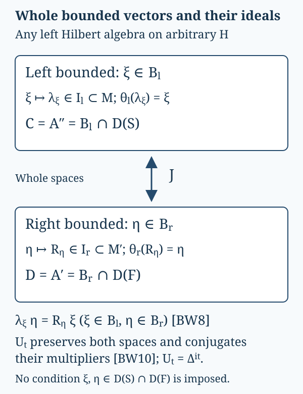

# Whole bounded-vector spaces between the graph theorem and weights

*Complete local proof by GPT-6.1 Sol (OpenAI), Ultra, 2026-10-07.
Any rights in this new exposition and its original diagram are dedicated under
CC0-1.0. Self-checked by the writing AI.*

Let \(A\) be a left Hilbert algebra on an arbitrary complex Hilbert space \(H\).
Inner products are linear in the first variable. Its multiplication operators
are \(L_a\), its closed involution is \(S\), and \(F=S^*\). Set \(M=L(A)''\).
The complete [bounded-graph proof BG1–6](bounded-graph-modular-foundations.md#bg1)
supplies its dual \(D=A'\), fullification \(C=A''\), the graph cores \(A^2,C^2\),
and

\[
 R(D)''=M',\qquad C'=D,\qquad
 D=B_r\cap D(F),\quad C=B_l\cap D(S),\qquad
 S=J\Delta^{1/2},\quad F=J\Delta^{-1/2}.
 \tag{BW0}
\]

Here \(R_\eta a=L_a\eta\) on \(A\). For the right-algebra product we use

\[
 \eta\zeta=R_\zeta\eta,
 \qquad R_{\eta\zeta}=R_\zeta R_\eta.
\]

Thus the ordinary left dual in BG becomes this right algebra by taking its
opposite product; the operators and involution \(F\) are unchanged.
The real-subspace graph proof, its coercivity correction and every closed
domain are proved in BG. Its freely accessible primary method is
[Rieffel–Van Daele, §5 and appendix](https://msp.org/pjm/1977/69-1/pjm-v69-n1-p17-s.pdf).
The elementary multiplier identities below can also be compared with
[Combes, Lemmas 2.2–2.5, printed pp.51–52](https://www.numdam.org/item/CM_1971__23_1_49_0.pdf#page=4).
No referenced book lemma, affiliated unbounded multiplier theorem or
closed-form representation theorem is an input. The other inputs are
[bounded continuous calculus and Hilbert projection](../../OA-FLOW/OA-FLOW-SF.html#oa-flow.shared-foundations.sf-0)
and [positive contraction density BD3](../../OA-FLOW/OA-FLOW-BD.html#oa-flow.bd.3).

The diagram distinguishes the whole spaces \(B_l,B_r\) from their
involution-domain intersections \(C,D\). The J arrow acts on the
whole bounded-vector spaces. The lower identity tests arbitrary
\(\xi\in B_l,\eta\in B_r\); neither vector needs to lie in both graph domains.
Proof locators are BW1–BW4. The SVG is the editable diagram source.

## BW1. Both whole multiplication ideals and their vector maps

Call \(\eta\) right bounded when \(a\mapsto L_a\eta\) on \(A\) is bounded in
\(\|a\|_H\), and write \(B_r\) for all such vectors. Associativity, tested on
\(a,b\in A\), gives \(R_\eta L_b=L_bR_\eta\); testing \(b^\#\) as well gives
\(R_\eta\in M'\). If \(R_\eta=0\), every \(L_a\eta=0\). Nondegeneracy of
\(L(A)\), proved from density of \(A^2\) in BG1, makes \(\eta=0\).
For \(x'\in M'\), commutation gives

\[
 x'\eta\in B_r,\qquad R_{x'\eta}=x'R_\eta.
 \tag{BW1}
\]

Thus \(I_r=\{R_\eta:\eta\in B_r\}\) is a linear left ideal in \(M'\), with
injective multiplier map and inverse vector map
\(\theta_r(R_\eta)=\eta\).

Define \(B_l\) by boundedness of \(d\mapsto R_d\xi\) on the entire dense
algebra \(D\), and denote its extension by \(\lambda_\xi\). For \(d,e\in D\),
the right product convention gives

\[
 \lambda_\xi R_e d
 =R_{de}\xi=R_eR_d\xi=R_e\lambda_\xi d.
\]

Density and boundedness put \(\lambda_\xi\in R(D)'=M\).
If \(\lambda_\xi=0\), then every \(R_d\xi=0\); the nondegenerate dual
representation in BG5 makes \(\xi=0\). For \(x\in M\), commute \(x\) through
each \(R_d\) to obtain

\[
 x\xi\in B_l,\qquad\lambda_{x\xi}=x\lambda_\xi.
 \tag{BW2}
\]

Consequently \(I_l=\{\lambda_\xi:\xi\in B_l\}\) is a linear left ideal
in \(M\), with inverse vector map \(\theta_l(\lambda_\xi)=\xi\) and
\(\theta_l(xa)=x\theta_l(a)\).

## BW2. Adjoint products and the exact adjoint intersection

For arbitrary \(\eta,\zeta\in B_r\), (BW1) already makes
\(R_\eta^*\zeta\) right bounded, with multiplier \(R_\eta^*R_\zeta\).
For \(a\in A\),

\[
 \langle R_\eta^*\zeta,Sa\rangle
 =\langle\zeta,L_{a^\#}\eta\rangle
 =\langle L_a\zeta,\eta\rangle
 =\langle a,R_\zeta^*\eta\rangle.
 \tag{BW3}
\]

Because \(A\) is a whole graph core for \(S\), this extends to every
\(a\in D(S)\). The conjugate-linear adjoint criterion then proves

\[
 R_\eta^*\zeta\in D,
 \qquad F(R_\eta^*\zeta)=R_\zeta^*\eta,
 \qquad I_r^*I_r\subset R(D).
 \tag{BW4}
\]

If \(\eta\in D\), the dual definition in BG6 gives
\(R_\eta^*=R_{F\eta}\). Conversely suppose
\(R_\eta^*=R_\zeta\) for \(\eta,\zeta\in B_r\). For \(a,b\in A\),

\[
 \langle\eta,a^\#b\rangle
 =\langle R_\eta a,b\rangle
 =\langle a,R_\zeta b\rangle
 =\langle b^\#a,\zeta\rangle.
 \tag{BW5}
\]

Products span \(A^2\), which is a whole graph core for \(S\) by BG6.
Taking conjugates in (BW5) and extending in graph norm is precisely the
adjoint criterion for \(\eta\in D(F)\), with \(F\eta=\zeta\). Hence

\[
 I_r\cap I_r^*=R(D),\qquad
 \theta_r(R_\eta^*)=F\eta\quad(\eta\in D).
 \tag{BW6}
\]

Apply this same argument to the opposite of \(D\). BG6 identifies its
closed involution as \(F\), its adjoint as \(S\), and its dual as \(C\).
Its whole bounded-vector test is exactly the definition of \(B_l\). Thus

\[
 I_l\cap I_l^*=\lambda(C),\qquad
 \theta_l(\lambda_\xi^*)=S\xi\quad(\xi\in C).
 \tag{BW7}
\]

These equalities concern the whole multiplication ideals, including their
zero elements, and the complete closed domains. If \(A\) is already full,
\(C=A\).

## BW3. Mixed multiplication without a graph-domain assumption

Choose positive contractions \(c_i\in R(D)\) tending strongly to \(1\),
using BD3 and the nondegenerate representation proved in BG5. Each is
\(R_{d_i}=R_{d_i}^*\) for a unique \(d_i\in D\).
For an arbitrary \(\eta\in B_r\), (BW4) puts

\[
 \eta_i=c_i\eta=R_{d_i}^*\eta\in D,
 \qquad R_{\eta_i}=c_iR_\eta.
\]

For every \(\xi\in B_l\), the defining equality on \(D\) is
\(\lambda_\xi\eta_i=R_{\eta_i}\xi\). Both sides converge in \(H\), since
\(\lambda_\xi\) is bounded and \(c_i\to1\) strongly. Therefore

\[
 \lambda_\xi\eta=R_\eta\xi
 \qquad(\xi\in B_l,\ \eta\in B_r).
 \tag{BW8}
\]

In particular passing from \(A\) to \(C=A''\) leaves \(B_r\) unchanged:
if \(\eta\) passes the original boundedness test, then for \(a\in C\)
(BW8) gives \(L_a\eta=R_\eta a\), with the same bound and operator.
The converse restricts the test from \(C\) to \(A\). The dual is also
unchanged, since \(C'=D\), so \(B_l\) is unchanged. Thus fullification
preserves both complete bounded-vector spaces, their multiplier maps,
and the closed graphs \(S,F\), not just their algebra intersections.

## BW4. Modular maps on all bounded vectors

Set \(U_t=\Delta^{it}\). BG6 proves \(U_tC=C\), \(U_tD=D\) and

\[
 L_{U_ta}=U_tL_aU_{-t},\qquad
 R_{U_td}=U_tR_dU_{-t},\qquad
 R_{Ja}=JL_aJ,\quad L_{Jd}=JR_dJ
 \quad(a\in C,d\in D).
 \tag{BW9}
\]

For \(\xi\in B_l\) and \(d\in D\), use the second equality to write

\[
 R_dU_t\xi=U_tR_{U_{-t}d}\xi
 =U_t\lambda_\xi U_{-t}d.
\]

This is the whole defining boundedness test for \(B_l\), and its bound is
\(\|\lambda_\xi\|\). For \(\eta\in B_r\), test similarly on the entire
algebra \(C\), which BW3 permits:

\[
 L_aU_t\eta=U_tL_{U_{-t}a}\eta
 =U_tR_\eta U_{-t}a\quad(a\in C).
\]

Applying the same arguments with \(-t\) proves the onto equalities

\[
 U_tB_l=B_l,\quad U_tB_r=B_r,\qquad
 \lambda_{U_t\xi}=U_t\lambda_\xi U_{-t},\quad
 R_{U_t\eta}=U_tR_\eta U_{-t}.
 \tag{BW10}
\]

The extension of \(J\) also uses only whole bounded tests. For \(a\in C\)
and \(\xi\in B_l\), (BW8)–(BW9) give

\[
 L_aJ\xi=JR_{Ja}\xi
 =J\lambda_\xi(Ja)=(J\lambda_\xi J)a.
\]

For \(d\in D\) and \(\eta\in B_r\), they give

\[
 R_dJ\eta=JL_{Jd}\eta
 =JR_\eta(Jd)=(JR_\eta J)d.
\]

Consequently

\[
 JB_l=B_r,\quad JB_r=B_l,\qquad
 R_{J\xi}=J\lambda_\xi J,\quad
 \lambda_{J\eta}=JR_\eta J.
 \tag{BW11}
\]

Here the two compositions containing \(J\) are bounded linear operators.
No vector in BW10–BW11 is required to be in \(D(S)\cap D(F)\).
Together with (BW2), these are the entire finite-ideal/vector-map
covariance contracts used in the weight construction and its opposite.

## BW5. The bounded polar column used for additivity

Let \(a,b\in M_+\), \(X:H\to H\oplus H\) be
\(Xv=(a^{1/2}v,b^{1/2}v)\), and \(c=(a+b)^{1/2}\).
The rule \(cv\mapsto Xv\) is a well-defined isometry, since
\(\|Xv\|^2=\|cv\|^2\). Extend it on \(\overline{cH}\) and set it to zero
on \(\ker c\). This gives a bounded partial isometry \(V:H\to H\oplus H\).
For every unitary \(u\in M'\),
\((u\oplus u)X=Xu\) and \(uc=cu\); the range-isometry rule, its continuous
extension and its kernel summand therefore imply
\((u\oplus u)V=Vu\). Writing \(V=(v_1,v_2)^T\), each \(v_j\) commutes
with \(M'\) and thus belongs to \(M=M''\). We have proved directly

\[
 X=Vc,\quad V^*X=c,\quad V^*V=s(c),\quad
 VV^*=Q=[XH],\quad QX=X.
 \tag{BW12}
\]

The same range-isometry construction for any bounded \(x\in M\), using
\(h=(x^*x)^{1/2}\), proves \(x=uh\) with \(u\in M\),
\(u^*u=[x^*H]\) and \(uu^*=[xH]\). It covers zero and noninjective \(x\).
Only bounded square roots and Hilbert completion are used, so no theorem
representing a closed unbounded quadratic form occurs in this step.

For the covariant map \(\theta_l:I_l\to H\) in BW1, suppose
\(a^{1/2},b^{1/2}\in I_l\) and put
\(\alpha=\theta_l(a^{1/2}),\beta=\theta_l(b^{1/2})\).
Equation (BW12) and the left-ideal property give

\[
 c=v_1^*a^{1/2}+v_2^*b^{1/2}\in I_l,\qquad
 \theta_l(c)=V^*(\alpha,\beta).
\]

Every entry of \(Q\) lies in \(M\). Applying the module identity (BW2)
componentwise to \(QX=X\) gives \(Q(\alpha,\beta)=(\alpha,\beta)\).
The isometry \(V^*\) on \(Q(H\oplus H)\) now gives

\[
 \|\theta_l((a+b)^{1/2})\|^2
 =\|\theta_l(a^{1/2})\|^2+\|\theta_l(b^{1/2})\|^2.
 \tag{BW13}
\]

This is the finite-value additivity mechanism. The complete weight,
including its infinite values, arbitrary-net normality, semifiniteness
and GNS graphs, is constructed in
[WF1–6](../../OA-FLOW/OA-FLOW-WF.html#oa-flow.wf.1).
The present proof supplies its whole bounded-vector foundations; it does
not assume a weight or a cyclic state vector in order to obtain them.

[Bounded graph foundation](bounded-graph-modular-foundations.md) ·
[Given-weight recovery](../../OA-FLOW/OA-FLOW-WR.html#oa-flow.wr.1) ·
[Modular covariance](../../OA-FLOW/OA-FLOW-MW.html#oa-flow.mw.1).
