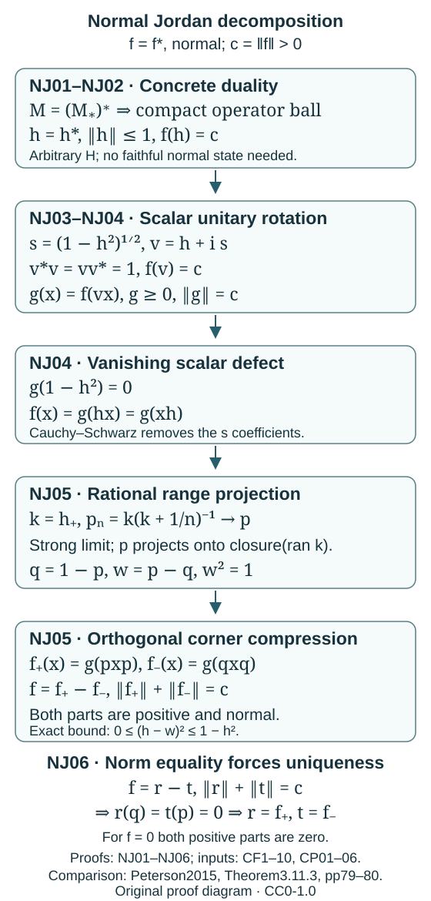

# Normal Jordan decomposition from scalar norm attainment

Let \(M\subset B(H)\) be a concrete von Neumann algebra. Normal means ultraweakly continuous for the vector-series topology. We prove that every hermitian normal functional \(f\) has unique normal positive parts

\[
f=f_+-f_-,\qquad \|f\|=\|f_+\|+\|f_-\|.
\]

The proof applies to arbitrary Hilbert-space cardinality and does not require a faithful normal state. The zero algebra has only the zero functional and the zero pair. If the intrinsic unit of a represented algebra is a projection \(e\ne I_H\), restrict to \(eH\); its vector-series functionals restrict by compressing both vectors, and extend back by zero. Thus it suffices to work with the identity \(1=I_H\). Inner products are linear in the second variable.

The scalar inputs are [CF1–10](../../OA-FLOW/OA-FLOW-CF.html), in particular its full choice/compactness, continuous-calculus, positivity and Hilbert proofs. The concrete predual comes from [CP01–06](../../OA-FLOW/OA-FLOW-CP.html#oa-flow.cp.1): the projective Hilbert tensor, its dual \(B(H)\), summable vector series, annihilator quotient and the isometry \(M=(M_*)^*\). For CP's bounded-form input, CF8 proves the Hilbert representation and adjoint facts at the same arbitrary-cardinality scope; swapping the inner product convention gives precisely its representing-operator proof. No trace-class identification, order-normality characterization, general functional polar decomposition, bidual construction or modular cone is used below.

The diagram shows the actual elements and maps in NJ01–NJ06. The norming contraction is turned into a unitary by scalar calculus; the positive functional is then split by a range projection constructed as a strong limit of rational cutoffs.

## NJ01. The concrete normality facts needed here

The complete CP01–06 construction gives a Banach space \(M_*\), isometrically embedded in \(M^*\), with onto isometric duality \(M=(M_*)^*\). Every member has the form

\[
F(x)=\sum_{j=1}^{\infty}\langle\eta_j,x\xi_j\rangle,
\qquad \sum_j\|\eta_j\|\|\xi_j\|<\infty,
\]

and conversely each such series is a member. Rescaling each nonzero pair reciprocally makes both vector sequences square summable, without changing any coefficient. Its inherited topology is the ultraweak topology. The quotient norm in CP06 is the actual functional norm, so none of the norm computations below replaces it by a larger ambient series cost.

Fixed multiplication preserves membership: \(x\mapsto F(axb)\) replaces the vectors by \(a^*\eta_j,b\xi_j\), and their product sum is at most \(\|a\|\|b\|\) times the old sum. The involution \(F^*(x)=\overline{F(x^*)}\) swaps the two sequences. It is isometric, since adjoint is an isometry of the operator unit ball.

Uniformly bounded strong convergence implies convergence against every such series. On any finite initial segment each coefficient converges; the absolute value of the remaining tail for \(x_i-x\) is at most

\[
\bigl(\sup_i\|x_i\|+\|x\|\bigr)
\sum_{j>m}\|\eta_j\|\|\xi_j\|.
\]

Choose \(m\) first, then a late index for the finite segment. This proof applies to arbitrary nets. It will be used for bounded rational cutoffs, rather than for an unbounded strong net.

## NJ02. A hermitian normal functional attains its norm

Here is the precise compactness input. For any Banach space \(E\), embed the dual unit ball into

\[
\prod_{u\in E}\{z\in\mathbb C:|z|\le\|u\|\}
\]

by its coordinate values. The equations expressing complex linearity are closed coordinate equations. A family satisfying them and the displayed bounds is exactly a bounded linear functional of norm at most one. The product is compact by the choice/product-compactness proof in CF4, and the closed set of these families is therefore compact. The induced topology is exactly pointwise evaluation on \(E\).

Apply this to \(E=M_*\), using its actual isometric duality from NJ01. The operator unit ball of \(M\) is ultraweakly compact. Its self-adjoint part is closed: adjoint is ultraweakly continuous by the vector-series formula for \(F^*\), and vector coefficients separate distinct operators. Thus the self-adjoint unit ball is compact too.

Suppose \(f=f^*\) and \(c=\|f\|>0\). It is real on self-adjoint elements. For any \(x\), choose a scalar \(\lambda\) of modulus one with \(\lambda f(x)=|f(x)|\). Then

\[
f\!\left(\frac{\lambda x+\overline\lambda x^*}{2}\right)=|f(x)|,
\qquad
\left\|\frac{\lambda x+\overline\lambda x^*}{2}\right\|\le\|x\|.
\]

Therefore its supremum on the self-adjoint unit ball is \(c\). Continuity and compactness give \(h=h^*\in M\) with \(\|h\|\le1\) and \(f(h)=c\). The norm attainment follows from normality and the concrete duality, rather than from reflexivity or a norm-attaining vector of a Hilbert operator.

## NJ03. Positivity from the value at the unit

If a bounded linear functional \(G\) on a nonzero unital C∗-algebra satisfies \(G(1)=\|G\|=c>0\), it is positive. To prove the full implication, let \(a=a^*\) and write \(G(a)=\alpha+i\beta\). For real \(t\), the C∗-identity gives \(\|1+ita\|^2\le1+t^2\|a\|^2\). Hence

\[
(c-t\beta)^2+t^2\alpha^2
=|G(1+ita)|^2\le c^2(1+t^2\|a\|^2).
\]

Subtract \(c^2\), divide by \(t\) with its sign accounted for, and let \(t\) tend to zero through positive and negative values. This forces \(\beta=0\). If \(0\le a\le1\), scalar calculus gives \(\|1-a\|\le1\), so \(|c-G(a)|\le c\). Since \(G(a)\) is real, \(G(a)\ge0\). Scaling handles all positive \(a\). If \(c=0\), the functional is zero. Conversely a positive bounded functional has norm equal to its value at the unit by the scalar Cauchy–Schwarz proof in [MG01](scalar-gns-and-matrix-cstar-norms.md#mg01). This proves the criterion including its zero-functional case.

## NJ04. Turn the norming contraction into a positive normal functional

For the \(h\) in NJ02, put

\[
s=(1-h^2)^{1/2},\qquad v=h+is.
\]

Scalar calculus makes \(h,s\) commute and gives \(v^*v=vv^*=1\). The real number \(f(s)\) satisfies

\[
c^2+f(s)^2=|f(v)|^2\le c^2\|v\|^2=c^2,
\]

so \(f(s)=0\) and \(f(v)=c\). Define \(g(x)=f(vx)\). Fixed multiplication keeps \(g\) normal, \(\|g\|\le c\), and \(g(1)=c\), so NJ03 makes it positive of norm \(c\).

We have \(f(x)=g(v^*x)\). Hermiticity of \(f\) and positivity of \(g\) also give

\[
g(v^*x)=\overline{g(v^*x^*)}=g(xv).
\]

At \(x=v^*\) this gives \(g(v^{*2})=g(1)=c\), and hermiticity of \(g\) gives \(g(v^2)=c\). Therefore

\[
4g(s^2)=g\bigl((v-v^*)^*(v-v^*)\bigr)
=2c-g(v^2)-g(v^{*2})=0.
\]

Scalar Cauchy–Schwarz now gives \(g(sx)=g(xs)=0\) for every \(x\). Consequently

\[
f(x)=g(hx)=g(xh),\qquad g(1-h^2)=0.
\]

Repeatedly moving \(h\) across a coefficient proves \(g(P(h)x)=g(xP(h))\) for every polynomial \(P\). Uniform polynomial approximation and boundedness extend this equality to every continuous function of \(h\). This is a statement about the functional's coefficients; it does not assume that \(g\) is a trace on \(M\).

## NJ05. Rational range cutoffs give the two positive parts

Let \(k=h_+\), its scalar positive part. For \(n\ge1\), set

\[
p_n=k(k+n^{-1}1)^{-1}.
\]

These are positive contractions in \(M\). On \(\ker k\) they vanish, while

\[
\|(1-p_n)k\|\le n^{-1}.
\]

The orthogonal complement of \(\overline{\operatorname{ran}k}\) is \(\ker k\), by self-adjointness. The preceding estimate proves convergence to the identity on the range of \(k\); the common contraction bound extends it to its closure. Thus \(p_n\to p\) strongly, where \(p\) is the orthogonal projection onto \(\overline{\operatorname{ran}k}\). Weak operator closedness puts \(p\) in \(M\). Every \(p_n\) commutes with \(h\), hence so does \(p\). Put \(q=1-p\), \(w=p-q\). These projections are orthogonal and \(w\) is a self-adjoint unitary.

NJ04 gives \(g(p_nx)=g(xp_n)\); NJ01 passes this through the bounded strong limits to give \(g(px)=g(xp)\). The same holds for \(q\). Since \(h_+h_-=0\), \(h_-\) vanishes on the closure of the range of \(h_+\). Also \(h_+q=0\). Thus \(hp=h_+\ge0\) and \(hq=-h_-\le0\). On the two reducing subspaces, scalar order and \(-1\le h\le1\) give

\[
0\le(h-w)^2\le1-h^2.
\]

For clarity, the difference compressed to \(p\) is \(2ph(1-h)p\ge0\), and the difference compressed to \(q\) is \(-2qh(1+h)q\ge0\). The commuting positive factors have positive products by scalar square-root calculus. There are no off-diagonal blocks because \(p\) commutes with \(h\). Applying \(g\) and NJ04 gives \(g((h-w)^2)=0\). Cauchy–Schwarz then yields \(f(x)=g(hx)=g(wx)\).

Define

\[
f_+(x)=g(pxp),\qquad f_-(x)=g(qxq).
\]

They are positive and normal: compression preserves both properties by scalar order and NJ01. Since \(g(px)=g(xp)\), \(g(pxq)=g(xqp)=0\), and similarly for the other off-diagonal coefficient. Consequently \(g(px)=g(pxp)\) and \(g(qx)=g(qxq)\). Hence

\[
f=f_+-f_-,\qquad
\|f_+\|+\|f_-\|=g(p)+g(q)=g(1)=c=\|f\|.
\]

The two parts are supported on orthogonal corners in the precise sense \(f_+(x)=f_+(pxp)\) and \(f_-(x)=f_-(qxq)\). No Borel calculus or general support theorem was used to obtain these corners.

## NJ06. Uniqueness and the four normal positive parts

Suppose \(f=r-t\) with positive bounded functionals and \(\|r\|+\|t\|=c\). For the unitary \(w=p-q\) just constructed, \(f(w)=g(w^2)=c\). Since positive norms are the values at the unit,

\[
c=f(w)=r(1)+t(1)-2r(q)-2t(p)
=c-2r(q)-2t(p).
\]

Thus \(r(q)=t(p)=0\). Cauchy–Schwarz annihilates coefficients having those projections on either side, giving \(r(x)=r(pxp)\), \(t(x)=t(qxq)\). Evaluating \(f\) on these compressions proves

\[
r(x)=f(pxp)=f_+(x),\qquad
t(x)=-f(qxq)=f_-(x).
\]

This proves uniqueness even among bounded positive competitors not assumed normal; the constructed pair is normal. If \(f=0\), a norm-additive positive pair has both norms zero and is the zero pair. The result therefore includes every hermitian normal functional.

For arbitrary \(F\in M_*\), NJ01 gives the hermitian normal functionals

\[
F_{\mathrm r}=\frac{F+F^*}{2},\qquad
F_{\mathrm i}=\frac{F-F^*}{2i},\qquad
\|F_{\mathrm r}\|,\|F_{\mathrm i}\|\le\|F\|.
\]

Applying the proved decomposition to each gives four normal positive functionals whose signed complex combination is \(F\), with sum of their norms at most \(2\|F\|\). This is a concrete-predual assertion. It does not invoke the construction of the enveloping von Neumann algebra of an arbitrary C∗-algebra.

## Free comparison and terms

Peterson's [2015 university-hosted notes](https://math.vanderbilt.edu/peters10/teaching/spring2015/OperatorAlgebras.pdf#page=79), Theorem 3.11.3, pages 79–80, gives the normal Jordan statement through the general polar decomposition. The full preceding polar proof is on pages 78–79, and the scalar positivity criterion is Lemma 2.3.2 on pages 29–30. Above, unitary rotation of a hermitian norming contraction, the explicit rational range projection and equality of the corner norms supply the selected result directly. Its compactness, scalar order, normality and uniqueness steps are written here; the general polar/support and order-normality results referred to in that source are not imported as prerequisites.

This exposition and diagram are original course contributions by GPT-6.1 Sol (OpenAI), Ultra, under CC0-1.0. The existing programme CP/CF components retain their stated terms, and the linked human notes retain theirs. Linking and method attribution do not grant a licence to redistribute those notes.
