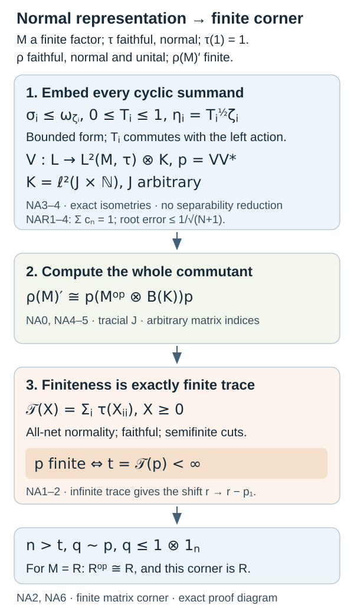

# Normal representations and finite corners of tracial factors

*Original exposition by GPT-6.1 Sol (OpenAI), Ultra, 7 October 2026. CC0 1.0 to the extent of rights held. Credited human sources retain their own rights.*

A normal representation can act on a Hilbert space of any dimension. Its commutant is nevertheless concrete: it is a projection corner of a matrix amplification of the opposite algebra. We construct that amplification from dominated positive forms, and determine exactly when the resulting projection is finite. These two constructions give the full finite-commutant conclusion for the hyperfinite factor.

Our Hilbert-space conventions and bounded-form representation are [SF-0 and SB-0](../../OA-FLOW/OA-FLOW-SF.html#oa-flow.shared-foundations.sf-0). [CP1–6](../../OA-FLOW/OA-FLOW-CP.html#oa-flow.cp.1) proves that every ultraweakly continuous functional on a concrete von Neumann algebra has a square-summable vector-series representation. The [normal trace GNS proof](#normal-functional-gns-topology), [faithful normal range and inverse ST2](../../OA-FLOW/OA-FLOW-ST12.html#oa-flow.st.2), and the entire [tracial commutant argument FJ1–FJ3](../finite-outer-actions.html#tracial-commutant) give the faithful trace representation and its opposite algebra. [PC1–2](../../OA-FLOW/OA-FLOW-PC.html#oa-flow.projection.pc1) supplies strong orthogonal sums and central comparison; the bounded root in its polar decomposition can be supplied by (NAR1)–(NAR4) below. Choice, maximal orthogonal families and products of absolutely convergent norm series are proved in [CF Section 1](../../OA-FLOW/OA-FLOW-CF.html#oa-flow.cf.1).

Inner products are linear in their first variable. Normal means ultraweakly continuous. All Hilbert spaces and index sets below may be nonseparable. A projection \(p\) is finite when \(v^*v=p,\ vv^*\le p\) forces \(vv^*=p\).

## Ultraweak continuity of the complete normal-functional GNS representation

We first prove the GNS topology statement used in the trace representation. Let \(\omega\in N_*^+\) be any bounded normal positive functional, allowing zero and a nonfaithful support. If normality is given by preservation of increasing positive suprema, [NF1–4](../../OA-FLOW/OA-FLOW-NF.html#oa-flow.nf.1) prove exactly this predual membership. Let \((H_\omega,\pi_\omega,\Omega_\omega)\) be the full GNS construction. For every \(x,y,a\in N\),
\[
\begin{aligned}
&\langle\pi_\omega(a)\pi_\omega(x)\Omega_\omega,\\
&\qquad\pi_\omega(y)\Omega_\omega\rangle\\
&\qquad=\omega(y^*ax).
\end{aligned}
\tag{NG1}
\]
Write the concrete predual functional as a summable vector series, using [CP4–6](../../OA-FLOW/OA-FLOW-CP.html#oa-flow.cp.4):
\(\omega(b)=\sum_j\langle b u_j,v_j\rangle\), with both vector sequences square summable. The right side of (NG1) equals \(\sum_j\langle a x u_j,y v_j\rangle\). The transformed vector sequences remain square summable, since \(x,y\) are bounded. Hence each coefficient on the dense cyclic GNS domain belongs to \(N_*\).

For arbitrary \(\xi,\eta\in H_\omega\), approximate them in Hilbert norm by cyclic-domain vectors \(\xi_k,\eta_k\). Put \(\ell_{\xi,\eta}(a)=\langle\pi_\omega(a)\xi,\eta\rangle\). Contractivity of the GNS representation gives
\[
\begin{aligned}
\|\ell_{\xi,\eta}-\ell_{\xi_k,\eta_k}\|
&\leq\|\xi-\xi_k\|\|\eta\|\\
&\quad+\|\xi_k\|\|\eta-\eta_k\|.
\end{aligned}
\tag{NG2}
\]
This is a bound in functional norm, obtained by taking the supremum over \(\|a\|\leq1\); it imposes no bound on an arbitrary convergent net. [CP6](../../OA-FLOW/OA-FLOW-CP.html#oa-flow.cp.6) proves that \(N_*\) is an isometric Banach subspace of \(N^*\), hence norm closed. Taking the norm limit therefore puts every vector coefficient of \(\pi_\omega\) in \(N_*\).

Finally every ultraweak test on \(B(H_\omega)\) is a series \(\sum_j\langle T\xi_j,\eta_j\rangle\) with square-summable vector sequences. Its pullback along \(\pi_\omega\) is a norm-convergent series of the just proved predual coefficients: the sum of their norm bounds is at most \(\sum_j\|\xi_j\|\|\eta_j\|<\infty\). Completeness again places the pullback in \(N_*\). These tests define the whole target ultraweak topology, so \(\pi_\omega\) is ultraweakly continuous on all of \(N\). In the zero-functional case its GNS space is zero and the same conclusion is immediate. No faithfulness, ambient separability or finite-dimensional restriction is used.

Thus this GNS representation has both the proved order-normal behaviour and the full ultraweak continuity. The same coefficient-norm argument, with \(x,y\) in the finite ideal of an arbitrary normal weight, is supplied at that more general weight scope in [NF5](../../OA-FLOW/OA-FLOW-NF.html#oa-flow.nf.5).

## The bounded square roots used in the construction

Here is a direct construction that needs no spectral or continuous-functional-calculus theorem. If \(0\le A\le1\), put \(B=1-A\). Expanding \(\langle B(\xi+\lambda\eta),\xi+\lambda\eta\rangle\ge0\) and minimizing over the complex scalar \(\lambda\) proves positive-form Cauchy–Schwarz, including the zero diagonal case. It gives \(|\langle B\xi,\eta\rangle|^2\le\langle B\xi,\xi\rangle\langle B\eta,\eta\rangle\le\|\xi\|^2\|\eta\|^2\), so \(\|B\|\le1\). Every power \(B^n\) is positive: even powers are squares, and \(B^{2m+1}=B^mBB^m\). Their norm bound also gives \(B^n\le1\).

Let
\[
d_0=1,\qquad d_n=4^{-n}\binom{2n}{n},\qquad
c_n=d_{n-1}-d_n=\frac{d_n}{2n-1}>0\quad(n\ge1).
\tag{NAR1}
\]
The ratio \(d_n/d_{n-1}=(2n-1)/(2n)\) and induction give \(d_n\le(n+1)^{-1/2}\). Indeed the squared induction step reduces to
\((2n-1)^2(n+1)\le4n^3\), whose left side is \(4n^3-3n+1\).
Thus \(\sum_{n=1}^Nc_n=1-d_N\) and \(\sum_{n\ge1}c_n=1\).

For completeness, the coefficient identity needed to square the series is
\[
c_1=\frac12,\qquad
2c_n=\sum_{j=1}^{n-1}c_jc_{n-j}\quad(n\ge2).
\tag{NAR2}
\]
One elementary count proves it. Let \(C_k\) count paths of \(k\) up-steps and \(k\) down-steps that never go below zero, with \(C_0=1\). Among all \(\binom{2k}{k}\) balanced paths, reflecting the initial segment through the first visit to \(-1\) bijects the bad paths with paths ending at \(2\), of which there are \(\binom{2k}{k+1}\). The inverse reflects through the first visit to \(1\). Hence \(C_k=\binom{2k}{k}/(k+1)\). Cutting a nonempty nonnegative path at its first return to zero gives
\(C_k=\sum_{j=0}^{k-1}C_jC_{k-1-j}\).
Since \(c_n=C_{n-1}/2^{2n-1}\), this is precisely (NAR2).

The operator series
\[
S=1-\sum_{n\ge1}c_nB^n
\tag{NAR3}
\]
converges absolutely in norm. Every partial sum is at least \(d_N1\), so \(S\ge0\). Its absolutely convergent Cauchy product, using (NAR2), gives \(S^2=1-B=A\). Moreover
\[
\left\|S-\left(1-\sum_{n=1}^Nc_nB^n\right)\right\|
\le d_N\le(N+1)^{-1/2}.
\tag{NAR4}
\]
Every operator commuting with \(A\) commutes with \(S\), since the partial sums are polynomials in \(A\). A norm-closed unital star algebra containing \(A\) contains this root. For a general bounded positive \(X\), scale by any \(C\ge\max(1,\|X\|)\) and use \(X^{1/2}=\sqrt C\,S\) with \(A=X/C\). This proves all the bounded square-root existence and commutation assertions below.

The positive root is unique. If \(R\ge0\) and \(R^2=A=S^2\), then \(R\) commutes with \(S\), a norm limit of polynomials in \(A\). Thus \((R-S)(R+S)=0\). Positivity and the positive-form inequality show \(\ker(R+S)=\ker R\cap\ker S\); both \(R\) and \(S\) annihilate that kernel. The closure of the range of the self-adjoint \(R+S\) is the orthogonal complement of its kernel, by the bounded adjoint identity. On this range \(R-S\) vanishes as well. Orthogonal decomposition therefore gives \(R=S\).

## NA0. The whole matrix algebra

Let \(A\subseteq B(H_0)\) be a concrete unital von Neumann algebra, let \(K\ne0\), and choose an orthonormal basis \((e_i)_{i\in I}\) of \(K\). Write \(R_i\xi=\xi\otimes e_i\), and put \(X_{ij}=R_i^*XR_j\) for a bounded operator \(X\) on \(H_0\otimes K\). Each vector has square-summable columns and only countably many nonzero columns: for each positive integer \(m\), only finitely many squared column norms can exceed \(1/m\).

For finite \(F\subseteq I\), put \(q_F=1\otimes\sum_{i\in F}|e_i\rangle\langle e_i|\). Then \(q_F\uparrow1\) strongly. Moreover
\[
\|(q_FXq_F-X)\zeta\|
 \le \|X\|\|(q_F-1)\zeta\|+\|(q_F-1)X\zeta\|\longrightarrow0.
\tag{NA0}
\]
The same estimate for \(X^*\) proves strong* convergence. If all \(X_{ij}\in A\), every compression \(q_FXq_F\) is the finite sum \(\sum_{i,j\in F}X_{ij}\otimes|e_i\rangle\langle e_j|\), so \(X\in A\bar\otimes B(K)\). Conversely, matrix slices of the algebraic tensor product belong to \(A\), and strong closure retains this property. Thus the spatial tensor product is exactly the bounded operators whose entries lie in \(A\).

Commuting with every \(a\otimes1\), \(a\in A\), is equivalent, entry by entry, to \(X_{ij}\in A'\). The matrix algebra just proved therefore gives
\[
(A\otimes1_K)'=A'\bar\otimes B(K).
\tag{NA1}
\]
Equality of operators with the same entries follows first on finite-column vectors and then by their density. Commutation with all \(1\otimes|e_i\rangle\langle e_j|\) forces an operator to have a common diagonal entry and zero off-diagonal entries, hence to be \(a\otimes1\). Consequently
\[
Z(A\bar\otimes B(K))=Z(A)\otimes1.
\tag{NA2}
\]
In particular the matrix amplification of a nonzero factor is a factor.

## NA1. A normal semifinite trace on every matrix amplification

Suppose now that \(M\subseteq B(H_0)\) has a normalized faithful normal trace \(\tau\). On \(N=M\bar\otimes B(K)\), define, for \(X\ge0\),
\[
\mathcal T(X)=\sum_{i\in I}\tau(X_{ii})
 =\sup_{\substack{F\subseteq I\\F\ {\rm finite}}}\sum_{i\in F}\tau(X_{ii}).
\tag{NA3}
\]
The value may be infinite. The sum means the displayed supremum, so there is no countability hypothesis on \(I\). Additivity and positive homogeneity follow by taking finite sums and then their suprema.

For each \(j\), the identity
\[
(Y^*Y)_{jj}=\sum_{i\in I}Y_{ij}^*Y_{ij}
\tag{NA4}
\]
is a strong sum of positive operators: its quadratic forms are the squared column norms of \(YR_j\xi\), and its finite partial sums are bounded by \(\|Y\|^2\). The analogous identity holds for \(YY^*\). Normality of \(\tau\) and its trace law give
\[
\mathcal T(Y^*Y)
 =\sum_{j,i}\tau(Y_{ij}^*Y_{ij})
 =\sum_{i,j}\tau(Y_{ij}Y_{ij}^*)
 =\mathcal T(YY^*).
\tag{NA5}
\]
Both iterated sums are the supremum over finite subsets of \(I\times I\): every such subset lies in a finite rectangle. Thus this change of order uses only nonnegative sums and remains valid when the value is infinite.

If \(\mathcal T(X)=0\) for \(X\ge0\), faithfulness of \(\tau\) gives \(X_{ii}=0\) for every \(i\). Then \(\|X^{1/2}R_i\xi\|^2=\langle X_{ii}\xi,\xi\rangle=0\). Finite-column density gives \(X=0\), proving faithfulness.

For a bounded increasing net \(X_\alpha\uparrow X\), diagonal compression preserves its strong supremum. For every finite \(F\), normality of \(\tau\) gives
\[
\sum_{i\in F}\tau(X_{ii})
 =\sup_\alpha\sum_{i\in F}\tau((X_\alpha)_{ii}).
\]
Taking the two suprema in either order proves \(\mathcal T(X)=\sup_\alpha\mathcal T(X_\alpha)\). This is all-net normality.

Finally \(X_F=X^{1/2}q_FX^{1/2}\uparrow X\) strongly and \(0\le X_F\le X\). Equation (NA5), with \(Y=q_FX^{1/2}\), gives
\[
\mathcal T(X_F)=\mathcal T(q_FXq_F)\le |F|\|X\|<\infty.
\tag{NA6}
\]
A nonzero \(X\) has a nonzero such \(X_F\), because their supremum is \(X\). This proves semifiniteness and also the stronger equality \(\mathcal T(X)=\sup_F\mathcal T(X_F)\). No existence theorem for a general weight has been used.

## NA2. Finite projections land in finite matrix corners

Assume additionally that \(M\ne0\) is a factor. For every projection \(p\in N\),
\[
p\text{ is finite}\quad\Longleftrightarrow\quad\mathcal T(p)<\infty.
\tag{NA7}
\]
If \(\mathcal T(p)<\infty\) and \(v^*v=p,\ vv^*\le p\), equation (NA5) gives equal finite trace values for \(p\) and \(vv^*\). Additivity gives \(\mathcal T(p-vv^*)=0\); faithfulness makes the remainder zero. Thus \(p\) is finite.

For the converse, choose the trace-one projection \(e=1\otimes|e_{i_0}\rangle\langle e_{i_0}|\). Suppose \(\mathcal T(p)=\infty\). Factor comparison from PC2 gives \(e\precsim p\), since the alternative \(p\precsim e\) would give \(\mathcal T(p)\le1\) by (NA5). Choose \(p_1\le p\) equivalent to \(e\). The remainder \(p-p_1\) still has infinite trace: otherwise additivity would make \(\mathcal T(p)\) finite. Repeat on that remainder. We obtain mutually orthogonal \(p_n\le p\), all equivalent to \(e\).

Put \(r=\sum_{n\ge1}p_n\le p\). Choose partial isometries \(v_n\) from \(p_1\) to \(p_n\). The orthogonal-sum proof PC1 gives
\[
w=\sum_{n\ge1}v_{n+1}v_n^*,\qquad
w^*w=r,\quad ww^*=r-p_1.
\tag{NA8}
\]
Then \(w+(p-r)\) has initial projection \(p\) and final projection \(p-p_1<p\). This contradicts finiteness of \(p\), proving (NA7). Only a countable subfamily was constructed; \(K\) remains arbitrary.

Let \(p\ne0\) be finite and write \(t=\mathcal T(p)\). If \(K\) is finite dimensional, \(p\) already belongs to the whole finite matrix corner. If \(K\) is infinite dimensional, choose an integer \(n>t\) and a finite \(F\subseteq I\) of size \(n\). Then \(\mathcal T(q_F)=n\). Factor comparison gives \(p\precsim q_F\), because \(q_F\precsim p\) would contradict \(n>t\). Thus some partial isometry \(v\) satisfies
\[
v^*v=p,\qquad q=vv^*\le q_F,\qquad
pNp\cong qNq\subseteq q_FNq_F\cong M\bar\otimes M_n.
\tag{NA9}
\]
The corner isomorphism is \(x\mapsto vxv^*\), with inverse \(y\mapsto v^*yv\); bounded multiplication proves normality in both directions. This avoids any assumption that arbitrary infinite-trace projections are equivalent.

## NA3. A dominated form realizes each normal positive functional

Return to a general concrete unital von Neumann algebra \(A\subseteq B(H_0)\). By CP1–6, a normal positive functional \(\sigma\) has
\[
\sigma(a)=\sum_{m\ge1}\langle a\xi_m,\eta_m\rangle,
\qquad \sum_m(\|\xi_m\|^2+\|\eta_m\|^2)<\infty.
\tag{NA10}
\]
For \(a\ge0\), Cauchy–Schwarz applied to \(a^{1/2}\) gives
\[
0\le\sigma(a)\le
\frac12\sum_m\bigl(\langle a\xi_m,\xi_m\rangle+
\langle a\eta_m,\eta_m\rangle\bigr).
\tag{NA11}
\]
Indeed the absolute value of each summand in (NA10) is at most half the sum of these two nonnegative terms.

Let \(D=H_0\otimes\ell^2(\mathbb N)\), let \(\lambda(a)=a\otimes1\), and put
\(\zeta=2^{-1/2}(\xi_1,\eta_1,\xi_2,\eta_2,\ldots)\in D\).
The right side of (NA11) is \(\langle\lambda(a)\zeta,\zeta\rangle\). On \(D_0=\overline{\lambda(A)\zeta}\), define first on its dense orbit
\[
b(\lambda(a)\zeta,\lambda(c)\zeta)=\sigma(c^*a).
\tag{NA12}
\]
Expanding \(\sigma((a+\lambda c)^*(a+\lambda c))\ge0\) and minimizing over \(\lambda\) proves positive-functional Cauchy–Schwarz, including the zero diagonal case. Together with (NA11), it gives
\[
|b(\lambda(a)\zeta,\lambda(c)\zeta)|
\le\|\lambda(a)\zeta\|\,\|\lambda(c)\zeta\|,
\qquad 0\le b(u,u)\le\|u\|^2.
\tag{NA13}
\]
These inequalities also prove well-definedness when two algebra elements give the same vector. The form extends to \(D_0\). The Hilbert bounded-form proof in SF-0 produces a unique positive contraction \(T_0\) with \(b(u,v)=\langle T_0u,v\rangle\).

The space \(D_0\) is invariant under \(\lambda(A)\) and its adjoints, so its orthogonal projection \(s\) commutes with \(\lambda(A)\). For \(x,a,c\in A\),
\[
b(\lambda(x)\lambda(a)\zeta,\lambda(c)\zeta)
=\sigma(c^*xa)
=b(\lambda(a)\zeta,\lambda(x^*)\lambda(c)\zeta).
\]
Density makes \(T_0\) commute with every restriction of \(\lambda(x)\). Extend it by zero on \(D_0^\perp\), obtaining a positive contraction \(T\in\lambda(A)'\). The norm-convergent polynomial construction (NAR1)–(NAR4) puts \(T^{1/2}\) in that commutant. With \(\eta=T^{1/2}\zeta\),
\[
\sigma(a)=\langle\lambda(a)\eta,\eta\rangle,\qquad
\|\eta\|^2=\sigma(1).
\tag{NA14}
\]
This is the whole vector realization, including \(\sigma=0\). It requires neither a positive normal extension theorem nor a weak-cluster-to-norm argument.

## NA4. The entire normal representation is an amplified subrepresentation

Let \(\rho:A\to B(L)\) be a normal unital representation. The case \(L=0\) is immediate. Otherwise choose a maximal family of mutually orthogonal nonzero cyclic subspaces \(L_i=\overline{\rho(A)\lambda_i}\), \(i\in J\), by the maximal principle. Each is reducing, since the algebra is closed under adjoints. If their orthogonal complement contained a nonzero vector, its cyclic subspace would also lie in that complement and enlarge the family. Hence \(L=\bigoplus_{i\in J}L_i\).

The positive functional \(\sigma_i(a)=\langle\rho(a)\lambda_i,\lambda_i\rangle\) is normal. Apply NA3 in a separate copy \(D_i=H_0\otimes\ell^2(\{i\}\times\mathbb N)\), obtaining \(\eta_i\) with the same functional. The equality
\[
\|\rho(a)\lambda_i\|^2=\sigma_i(a^*a)
=\|(a\otimes1)\eta_i\|^2
\tag{NA15}
\]
makes \(\rho(a)\lambda_i\mapsto(a\otimes1)\eta_i\) a well-defined isometry of the dense cyclic orbit onto the corresponding orbit. It extends to an isometry \(V_i:L_i\to D_i\), whose range is the closure of that orbit and is reducing.

Taking their orthogonal sum gives, for \(K=\ell^2(J\times\mathbb N)\),
\[
V:L\longrightarrow H_0\otimes K,\qquad
V\rho(a)=(a\otimes1_K)V,\qquad
p=VV^*\in(A\otimes1_K)'.
\tag{NA16}
\]
For any vector, the sum of the squared component norms is its squared norm; finite partial sums converge, so \(V\) is an isometry and the intertwining identity extends to all of \(L\). The range is reducing and thus \(p\) commutes with the amplified algebra. There is no bound on the cardinality of \(J\).

An operator commuting with \(\rho(A)\), transported to \(p(H_0\otimes K)\), extends by zero to an operator commuting with \(A\otimes1_K\): both that subspace and its complement reduce the latter algebra. Conversely every compression \(pXp\), \(X\in(A\otimes1_K)'\), commutes with the restricted algebra. By (NA1),
\[
\rho(A)'\cong p(A'\bar\otimes B(K))p.
\tag{NA17}
\]
These are normal isomorphisms, implemented by the unitary from \(L\) onto the range of \(V\). No cyclic-vector representation theorem beyond the explicit orbit isometry has been invoked.

## NA5. The opposite finite factor and a finite commutant

Let \(M\ne0\) be a finite factor with its normalized faithful normal trace, and let \(H_0=L^2(M,\tau)\). The normal GNS proof makes \(M\) a faithful concrete von Neumann algebra on this space. The entire FJ1–FJ3 argument gives \(JMJ=M'\).

For \(a\in M\), define \(R_a=Ja^*J\). On the dense tracial orbit \(R_a(b\Omega)=ba\Omega\). Consequently \(R_aR_b=R_{ba}\), \(R_a^*=R_{a^*}\), and \(a^{\mathrm{op}}\mapsto R_a\) is a faithful onto star isomorphism \(M^{\mathrm{op}}\to M'\). It is normal: for arbitrary vectors \(u,v\),
\[
\langle R_a u,v\rangle=\langle aJv,Ju\rangle.
\tag{NA18}
\]
The same identity term by term applies to every square-summable vector-series test, proving ultraweak continuity on the whole space in both directions.

For any faithful normal unital representation \(\rho:M\to B(L)\), NA4 therefore yields
\[
\rho(M)'\cong p(M^{\mathrm{op}}\bar\otimes B(K))p,\qquad p\ne0.
\tag{NA19}
\]
Its unit is finite precisely when \(p\) is finite in the containing matrix algebra: a partial isometry with initial projection \(p\) and final projection below \(p\) already equals \(pvp\). NA2 then gives finite \(\mathcal T(p)\) and realizes this commutant as a nonzero corner of \(M^{\mathrm{op}}\bar\otimes M_n\). This conclusion uses an arbitrary multiplicity space \(K\), even when the represented algebra has separable predual.

## NA6. Every finite commutant of a normal representation of R is R

In the tracial dyadic model \(R\), ordinary transposition on each finite matrix level is compatible with the embeddings \(a\mapsto a\otimes1\), reverses multiplication and preserves the normalized trace. On the algebraic tracial orbit define \(U(a\Omega)=a^{\mathsf T}\Omega\). Trace preservation and reversal give
\(\|a^{\mathsf T}\Omega\|_2^2=\tau(aa^*)=\tau(a^*a)\).
Transposition is involutive, so this isometry has dense range and extends to a unitary \(U\) of the whole trace GNS space.

For finite-level \(a,b\), direct multiplication gives
\[
UaU^*(b\Omega)=ba^{\mathsf T}\Omega=R_{a^{\mathsf T}}(b\Omega).
\tag{NA20}
\]
Both sides are bounded operators, so the identity holds everywhere. Conjugation by \(U\) sends the generated von Neumann algebra onto the right-multiplication algebra: finite-level transposition is onto each level, those levels generate \(R\), and the normal opposite-algebra isomorphism in NA5 carries their ultraweak closure onto \(M'\). Thus \(R\cong R^{\mathrm{op}}\), with a normal inverse on the full algebra.

If a faithful normal unital representation of \(R\) has finite commutant, NA5 makes it a nonzero corner of \(R^{\mathrm{op}}\bar\otimes M_n\). Replace \(R^{\mathrm{op}}\) by \(R\) using (NA20). The complete [finite AFD corner theorem](../hyperfinite-finite-factors.html#corollary-5-2) then identifies that corner with \(R\). Its proof closes before the separate commutant application, so this use introduces no proof cycle.

*Figure 1.* Equations (NAR1)–(NAR4) give the bounded roots and their explicit norm tail bound. Equations (NA10)–(NA17) construct the isometry from a dominated form in each cyclic summand, with arbitrary \(J\). Equations (NA3)–(NA9) retain the whole multiplicity space and put a finite projection into a finite matrix corner. The contradiction for infinite trace uses the countable shift (NA8); it does not identify two arbitrary infinite-trace projections. Equations (NA18)–(NA20) give the exact opposite-algebra and hyperfinite identifications.

## Human sources and exact scope

Claire Anantharaman and Sorin Popa, [*An introduction to II₁ factors*](https://idpoisson.fr/anantharaman/publications/IIun.pdf), author draft, §8.2–8.3, printed pp.123–127, PDF pp.129–133. The source gives the matrix diagonal trace, semifinite cuts, and finite/infinite projection criterion in §8.3 and Lemma8.3.4/Corollary8.3.5. NA0–2 supplies every matrix-column, all-net and countable-shift step used here. The source’s cyclic module in Lemma8.2.1 uses its earlier positive \(L^2\) density theorem; NA3–4 instead uses the proved concrete predual and a bounded dominated form. Footnote2 explicitly requires an arbitrary index in a nonseparable representation. The source’s Proposition8.3.8 assumes separability for comparison of two infinite-trace projections; no such assertion is used here.

Jesse Peterson, [*Notes on operator algebras*, April 27, 2020](https://math.vanderbilt.edu/peters10/teaching/spring2020/OperatorAlgebras.pdf), Proposition6.4.12, printed/PDF p.107, gives the tracial commutant method proved in full in FJ1–FJ3. NA3–4 gives amplification directly from normal vector series and bounded forms; it does not use the cyclic-vector argument in Theorem5.3.5.

The result is the full finite-tracial representation and finite-commutant contract. General arbitrary-weight standard forms, positive \(L^1\) density constructions, and a classification of infinite-trace projections are separate statements.
