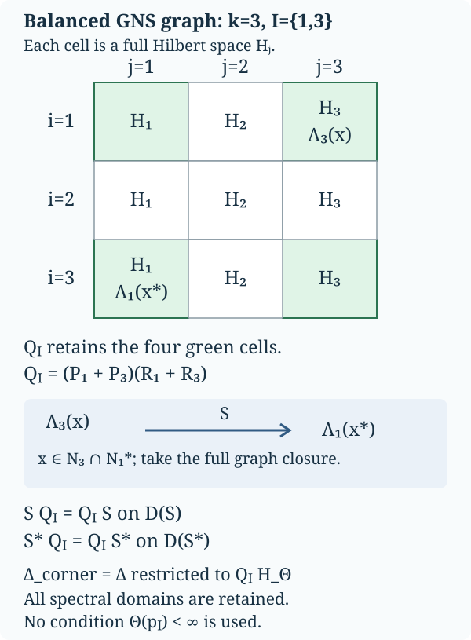

# Balanced weights: complete graph and cocycle identities

*CC0-1.0 to the extent of programme rights held. Separate human-source rights remain unchanged.*

Let \(\varphi_1,\ldots,\varphi_k\), \(1\leq k<\infty\), be faithful normal semifinite weights on the same arbitrary von Neumann algebra \(M\). No countability assumption is made. We construct their balanced weight on \(M_k(M)\), prove the complete finite-ideal and closed-involution domains, and derive its corner modular groups and canonical off-diagonal unitary cocycles. The chain identity uses \(k=3\). This construction does not assert that every abstract cocycle comes from a weight.

Actual earlier written proofs are [OA-FLOW.GW.1](../../OA-FLOW/src/OA-FLOW-GW.md#oa-flow.gw.1), [OA-FLOW.GW.2](../../OA-FLOW/src/OA-FLOW-GW.md#oa-flow.gw.2), [OA-FLOW.GW.3](../../OA-FLOW/src/OA-FLOW-GW.md#oa-flow.gw.3), [OA-FLOW.GW.4](../../OA-FLOW/src/OA-FLOW-GW.md#oa-flow.gw.4), [OA-FLOW.GW.5](../../OA-FLOW/src/OA-FLOW-GW.md#oa-flow.gw.5), [OA-FLOW.NF.5](../../OA-FLOW/src/OA-FLOW-NF.md#oa-flow.nf.5), [OA-FLOW.WR.3](../../OA-FLOW/src/OA-FLOW-WR.md#oa-flow.wr.3), [OA-FLOW.WR.4](../../OA-FLOW/src/OA-FLOW-WR.md#oa-flow.wr.4), [OA-FLOW.WR.5](../../OA-FLOW/src/OA-FLOW-WR.md#oa-flow.wr.5), [OA-FLOW.MW.4](../../OA-FLOW/src/OA-FLOW-MW.md#oa-flow.mw.4), [OA-FLOW.CI.1](../../OA-FLOW/src/OA-FLOW-CI.md#oa-flow.ci.1), [OA-FLOW.CI.2](../../OA-FLOW/src/OA-FLOW-CI.md#oa-flow.ci.2), [OA-FLOW.CI.3](../../OA-FLOW/src/OA-FLOW-CI.md#oa-flow.ci.3), [OA-FLOW.SF.SF0](../../OA-FLOW/src/OA-FLOW-SF.md#oa-flow.sf.sf0), [OA-FLOW.SF.SB0](../../OA-FLOW/src/OA-FLOW-SF.md#oa-flow.sf.sb0), [OA-FLOW.SF.SB1](../../OA-FLOW/src/OA-FLOW-SF.md#oa-flow.sf.sb1), [OA-FLOW.SF.SB2](../../OA-FLOW/src/OA-FLOW-SF.md#oa-flow.sf.sb2), [OA-FLOW.SF.SB3](../../OA-FLOW/src/OA-FLOW-SF.md#oa-flow.sf.sb3), [OA-FLOW.SF.SB4](../../OA-FLOW/src/OA-FLOW-SF.md#oa-flow.sf.sb4), [OA-FLOW.SF.SB5](../../OA-FLOW/src/OA-FLOW-SF.md#oa-flow.sf.sb5), [OA-FLOW.SF.SB6](../../OA-FLOW/src/OA-FLOW-SF.md#oa-flow.sf.sb6), [OA-FLOW.SF.SF1](../../OA-FLOW/src/OA-FLOW-SF.md#oa-flow.sf.sf1), [OA-FLOW.CP.1](../../OA-FLOW/src/OA-FLOW-CP.md#oa-flow.cp.1), [OA-FLOW.CP.2](../../OA-FLOW/src/OA-FLOW-CP.md#oa-flow.cp.2), [OA-FLOW.CP.3](../../OA-FLOW/src/OA-FLOW-CP.md#oa-flow.cp.3), [OA-FLOW.CP.4](../../OA-FLOW/src/OA-FLOW-CP.md#oa-flow.cp.4), [OA-FLOW.CP.5](../../OA-FLOW/src/OA-FLOW-CP.md#oa-flow.cp.5), [OA-FLOW.CP.6](../../OA-FLOW/src/OA-FLOW-CP.md#oa-flow.cp.6). These bind the finite ideals, GNS normality, full finite-star involution/recovery, arbitrary faithful-weight modular group, full closed graph and polar domains, spectral reductions, and concrete vector-series topologies. No normal-weight sum theorem or arbitrary-cocycle realization theorem is an input.

The free primary context for the balanced matrix method is [Hiai's author notes, Lemmas 7.4–7.5 and Theorem 7.6, printed pp.65–67](https://arxiv.org/pdf/2004.02383v1#page=65). The corner identifications, identical-weight normalization and isomorphism covariance below use complete GNS graph equalities. Relative-operator domain statements are derived from that full graph, not assumed from a block display. The original free primary construction and chain law are also in [Connes, Lemmas1.2.2–1.2.3(a), printed pp.144–147](https://numdam.org/article/ASENS_1973_4_6_2_133_0.pdf#page=13). Only those balanced-matrix conclusions are used here; the separate arbitrary-cocycle realization theorem is not an input.

## BC-1. The full balanced weight and every finite domain

Represent \(M_k(M)\) on the finite Hilbert sum \(K^k\) if \(M\subseteq B(K)\). Write \(E_{ij}\) for the scalar matrix units, \(p_i=E_{ii}\), and \(xE_{ij}\) for the matrix with sole entry \(x\) at \((i,j)\). The matrix algebra is a von Neumann algebra: adjoints and products are entrywise finite formulas, and weak-operator closedness follows by testing each pair of coordinate vectors. Entrywise ultraweak convergence is equivalent to matrix ultraweak convergence, since a vector series expands into finitely many entrywise vector series, each with square-summable factors; the converse is compression to two coordinates.

For \(X\geq0\), set
\[
\Theta(X)=\sum_{j=1}^k\varphi_j(x_{jj}).
\tag{BC1}
\]
The diagonal entries are positive, so this is an extended nonnegative number. Additivity and positive homogeneity follow entrywise, with \(0\cdot\infty=0\). It is normal: for a bounded increasing net \(X_\alpha\uparrow X\), each diagonal increases to the corresponding diagonal of \(X\), as follows from the strong supremum construction. Each \(\varphi_j\) preserves that supremum. A finite sum commutes with this increasing limit, including infinity; choose a common index above finitely many indices approximating the finite summands, or above an index making an infinite summand arbitrarily large.

Put \(N_j=\mathfrak n_{\varphi_j}\), \(m_j=\mathfrak m_{\varphi_j}\), and \(A_j=N_j\cap N_j^*\). Since
\[
\Theta(X^*X)=\sum_{j=1}^k\sum_{i=1}^k
 \varphi_j(x_{ij}^*x_{ij}),
\tag{BC2}
\]
the exact finite domains are
\[
\begin{aligned}
N_\Theta&=\{X:x_{ij}\in N_j\text{ for all }i,j\},\\
A_\Theta&=\{X:x_{ij}\in N_j\cap N_i^*\text{ for all }i,j\},\\
m_\Theta&=\{X:x_{ij}\in\operatorname{span}(N_i^*N_j)
                         \text{ for all }i,j\}.
\end{aligned}
\tag{BC3}
\]
The first assertion is (BC2), and the second applies it to \(X^*\). For the third, [GW](../../OA-FLOW/src/OA-FLOW-GW.md#oa-flow.gw.1) gives \(m_\Theta=\operatorname{span}N_\Theta^*N_\Theta\); each product has the stated entries. Conversely a matrix with sole entry \(y^*x\) at \((i,j)\), \(y\in N_i,x\in N_j\), is the product \((yE_{ri})^*(xE_{rj})\) for any row \(r\). Finite sums give every stated matrix.

The weight is faithful: if \(\Theta(X^*X)=0\), (BC2) and faithfulness of every \(\varphi_j\) give every \(x_{ij}=0\). This also proves faithfulness on arbitrary positive matrices by taking a bounded square root. For each \(j\), take [GW](../../OA-FLOW/src/OA-FLOW-GW.md#oa-flow.gw.1)'s increasing finite positive contractions \(u^{(j)}_{\alpha_j}\uparrow1\). The diagonal matrices
\[
U_\alpha=\operatorname{diag}(u^{(1)}_{\alpha_1},\ldots,
u^{(k)}_{\alpha_k})
\]
are finite positive contractions for \(\Theta\) and increase to \(I\), with the finite product directed set. [GW](../../OA-FLOW/src/OA-FLOW-GW.md#oa-flow.gw.1)'s semifiniteness criterion proves that \(\Theta\) is semifinite.

Its finite linear extension is
\[
\Theta_0(X)=\sum_j(\varphi_j)_0(x_{jj})\qquad(X\in m_\Theta).
\tag{BC4}
\]
Every diagonal belongs to \(m_j\) by (BC3). The displayed formula agrees with \(\Theta\) on the finite positive cone, so the uniqueness in [GW-2](../../OA-FLOW/src/OA-FLOW-GW.md#oa-flow.gw.2) proves the claim.

The exact GNS identification is
\[
H_\Theta=\bigoplus_{i,j=1}^k H_j,\qquad
\Lambda_\Theta(X)=(\Lambda_j(x_{ij}))_{i,j},
\tag{BC5}
\]
where the \((i,j)\) component is a copy of \(H_j=H_{\varphi_j}\). Norm equality is (BC2), and density follows by independently approximating each of the finitely many Hilbert coordinates with an element of \(N_j\). For \(B=(b_{ir})\), the representation is
\[
(\pi_\Theta(B)\xi)_{ij}
  =\sum_{r=1}^k\pi_j(b_{ir})\xi_{rj}.
\tag{BC6}
\]
This follows first on the dense GNS range from multiplication, then everywhere by boundedness. The representation is faithful and normal by [GW](../../OA-FLOW/src/OA-FLOW-GW.md#oa-flow.gw.1), [NF](../../OA-FLOW/src/OA-FLOW-NF.md#oa-flow.nf.5) and [WR](../../OA-FLOW/src/OA-FLOW-WR.md#oa-flow.wr.3), as already incorporated in [MW](../../OA-FLOW/src/OA-FLOW-MW.md#oa-flow.mw.4).

## BC-2. Row and column graph projections, with full closed domains

Let \(P_i=\pi_\Theta(p_i)\), the projection onto row \(i\), and let \(R_i\) be the projection onto column \(i\) in (BC5). Each \(R_i\) commutes with the representation in (BC6). Both projections preserve \(\Lambda_\Theta(A_\Theta)\), by the entrywise description in (BC3).

On this full initial finite-star domain, the involution \(S_0\) transposes the matrix and takes adjoints of its entries. Consequently
\[
S_0P_i=R_iS_0,\qquad S_0R_i=P_iS_0.
\tag{BC7}
\]
[WR](../../OA-FLOW/src/OA-FLOW-WR.md#oa-flow.wr.3) proves that \(S_0\) is closable and its closure \(S\) has this domain as a graph core. Approximating a vector in \(D(S)\) by core vectors in graph norm, boundedness of \(P_i,R_i\) and (BC7) give
\[
P_iD(S),R_iD(S)\subseteq D(S),\qquad
SP_i=R_iS,\quad SR_i=P_iS
\text{ on }D(S).
\tag{BC8}
\]
No domain equality is inferred from a merely formal block equation.

The adjoint identities have the full domains as well. For \(\eta\in D(S^*)\) and \(\xi\in D(S)\), the definition of the conjugate-linear adjoint and (BC8) give
\[
\langle S\xi,R_i\eta\rangle
=\langle R_iS\xi,\eta\rangle
=\langle SP_i\xi,\eta\rangle
=\langle P_iS^*\eta,\xi\rangle.
\]
Thus \(R_i\eta\in D(S^*)\) and \(S^*R_i\eta=P_iS^*\eta\). Interchanging \(P_i,R_i\) gives
\[
S^*R_i=P_iS^*,\qquad S^*P_i=R_iS^*
\text{ on }D(S^*).
\tag{BC9}
\]
For \(\Delta=S^*S\), (BC8)–(BC9) imply that \(P_i\) and \(R_i\) preserve \(D(\Delta)\) and commute there with \(\Delta\). For example, if \(\xi\in D(\Delta)\), then \(S\xi\in D(S^*)\), so \(SP_i\xi=R_iS\xi\in D(S^*)\), and
\(\Delta P_i\xi=P_i\Delta\xi\).
The same holds for the complementary projections. The resolvent, and hence the actual spectral calculus, therefore commutes with every \(P_i,R_i\). In particular
\[
\Delta^{it}P_i=P_i\Delta^{it},\qquad
\Delta^{it}R_i=R_i\Delta^{it}.
\tag{BC10}
\]
[MW](../../OA-FLOW/src/OA-FLOW-MW.md#oa-flow.mw.4)'s faithful implementation now proves \(\sigma_t^\Theta(p_i)=p_i\).

For precision, these projections also establish the exact relative closed operators. The coordinate projection \(C_{ij}=P_iR_j\) satisfies \(SC_{ij}=C_{ji}S\), with domain preservation. Core approximation followed by \(C_{ij}\) shows that the part of \(S\) from coordinate \((i,j)\) to coordinate \((j,i)\) is exactly the closure of
\[
\Lambda_j(x)\longmapsto\Lambda_i(x^*),
\qquad x\in N_j\cap N_i^*.
\tag{BC11}
\]
Its domain is dense in \(H_j\): project the dense initial domain \(\Lambda_\Theta(A_\Theta)\) onto this coordinate. It is closed by (BC8), and its graph is approximated by (BC11). Its inverse is the opposite coordinate part, since \(S^2=1\) with its exact domain from [CI](../../OA-FLOW/src/OA-FLOW-CI.md#oa-flow.ci.3).

Denote this closed anti-linear operator by \(S_{i,j}:H_j\supset D(S_{i,j})\to H_i\), and the part of \(\Delta\) on coordinate \((i,j)\) by \(\Delta_{i,j}\). Since this coordinate reduces \(\Delta\), the polar relation on it is
\[
S_{i,j}=J_{i,j}\Delta_{i,j}^{1/2},
\tag{BC12}
\]
where \(J_{i,j}\) is the restriction of the full \(J\) to those two coordinates. It is an antiunitary onto \(H_i\): from \(S=J\Delta^{1/2}\), the dense range of the injective positive square root on the coordinate, and \(SC_{ij}=C_{ji}S\), first obtain that \(J\) maps the \((i,j)\) coordinate into \((j,i)\); apply \(J^2=1\) for equality. All powers of \(\Delta_{i,j}\) have the restricted spectral domains. In particular \(S_{i,i}=S_{\varphi_i}\) and \(\Delta_{i,i}=\Delta_{\varphi_i}\), because (BC11) on the diagonal is precisely its whole original finite-star graph.

## BC-3. Every finite corner has its own recovered modular group

Let \(I\subseteq\{1,\ldots,k\}\) be nonempty, and \(p_I=\sum_{i\in I}p_i\). Equation (BC10) fixes this projection, so \(\sigma_t^\Theta\) restricts to a pointwise ultraweakly continuous normal automorphism group of \(p_I M_k(M)p_I\).

Identify that corner with \(M_{|I|}(M)\). The restriction of \(\Theta\) is exactly the balanced weight \(\Theta_I\) of the weights indexed by \(I\), including every infinite value. It is faithful normal semifinite by [BC-1](#bc-1). Its finite-star algebra is exactly the corner of (BC3), with zeros outside \(I\times I\). Let \(P_I=\sum_{i\in I}P_i\), \(R_I=\sum_{i\in I}R_i\), and \(Q_I=P_IR_I\). Thus \(Q_I\) keeps exactly the coordinates indexed by \(I\times I\) in the full Hilbert sum (BC5). The projections commute. Equations (BC8)–(BC9), applied to their finite sums and products, give
\[
 Q_ID(S)\subseteq D(S),\quad SQ_I=Q_IS,
 \qquad Q_ID(S^*)\subseteq D(S^*),\quad S^*Q_I=Q_IS^*.
 \tag{BC-GRAPH1}
\]
In particular \(Q_I\) reduces \(\Delta=S^*S\), its resolvent and all its spectral powers, with the exact restricted domains supplied in BC-2.

The zero-extension map identifies the complete GNS space of \(\Theta_I\) isometrically with \(Q_IH_\Theta\): (BC2) gives norm equality and (BC5) gives density in every retained coordinate. It intertwines the corner representation by (BC6). The entire finite-star domain for \(\Theta_I\) is exactly \(Q_I\Lambda_\Theta(A_\Theta)\), by (BC3). Transposition and adjoints on that domain give its initial involution. Since this domain is a graph core for the closed part of \(S\), its closure is precisely that part: project any approximating whole-core net by \(Q_I\), using (BC-GRAPH1), and conversely embed every corner-core graph pair in the whole graph. The same domain argument for the adjoint, or the orthogonal sum with \(1-Q_I\), gives the full adjoint part. Consequently
\[
 S_{\Theta_I}=S|_{Q_IH_\Theta},\qquad
 \Delta_{\Theta_I}=\Delta|_{Q_IH_\Theta},\qquad
 \Delta_{\Theta_I}^{it}=\Delta^{it}|_{Q_IH_\Theta}.
 \tag{BC-GRAPH2}
\]
These are unitary identifications of closed operators with their domains. For \(x\in p_IM_k(M)p_I\), the implementation of \(\sigma_t^\Theta(x)\) restricted to \(Q_IH_\Theta\) is therefore the implementation of \(\sigma_t^{\Theta_I}(x)\) in its full GNS representation. The ambient action fixes \(p_I\), and that corner representation is faithful. Equality of these represented elements proves
\[
\sigma_t^\Theta|_{p_I M_k(M)p_I}=\sigma_t^{\Theta_I}.
\tag{BC13}
\]
This proves independence from the ambient balanced matrix size. In a one-entry corner it becomes
\[
\sigma_t^\Theta(xE_{ii})=\sigma_t^{\varphi_i}(x)E_{ii}.
\tag{BC14}
\]
The statement does not require that the projection \(p_I\) itself have finite weight.

The diagram uses \(k=3\) and \(I=\{1,3\}\) to display the coordinate maps. A cell \((i,j)\) is a full copy of \(H_j\), rather than a one-dimensional matrix entry. On the initial graph, \(\Lambda_j(x)\) in that cell is sent to \(\Lambda_i(x^*)\) in cell \((j,i)\), for \(x\in N_j\cap N_i^*\). Projection onto the green \(I\times I\) cells commutes with this transposition on the complete closed domains by (BC-GRAPH1). Equations (BC-GRAPH1)–2 are proved for every finite \(k\) and every nonempty \(I\); no finite value of \(\Theta(p_I)\) is assumed. The SVG is the editable figure source.

For each \(i,j\), fixed support projections give a unique linear map \(\beta_t^{i,j}:M\to M\) such that
\[
\sigma_t^\Theta(xE_{ij})=\beta_t^{i,j}(x)E_{ij}.
\tag{BC15}
\]
It is a surjective isometry, since a single-entry matrix has norm \(\|x\|\) and the inverse map is obtained at \(-t\). It is pointwise strongly* continuous and ultraweakly continuous; matrix entries preserve those topologies, and [MW](../../OA-FLOW/src/OA-FLOW-MW.md#oa-flow.mw.4) supplies them for the ambient group. The group and adjoint laws are
\[
\beta_{s+t}^{i,j}=\beta_s^{i,j}\beta_t^{i,j},\qquad
\beta_t^{j,i}(x^*)=\beta_t^{i,j}(x)^*.
\tag{BC16}
\]
For each column \(\ell\), implementation in (BC5) and (BC10) gives the whole-Hilbert operator identity
\[
\pi_\ell(\beta_t^{i,j}(x))
=\Delta_{i,\ell}^{it}\pi_\ell(x)\Delta_{j,\ell}^{-it}.
\tag{BC17}
\]
All three operators here are bounded; the imaginary powers act on the full copy of \(H_\ell\). It follows by applying both sides of the implemented matrix equation to coordinate \((j,\ell)\). Thus (BC17) does not suppress an unbounded intermediate product domain.

## BC-4. Canonical unitary cocycles and the chain law

For two weights \(\varphi,\psi\), place them at indices \(1,2\), respectively, and define
\[
(D\psi:D\varphi)_t=u_t,\qquad
\sigma_t^{\Theta(\varphi,\psi)}(E_{21})=u_tE_{21}.
\tag{BC18}
\]
This is a definition through the already constructed balanced modular group; it does not presuppose any Radon–Nikodym theorem. Since \(E_{21}^*E_{21}=p_1\), \(E_{21}E_{21}^*=p_2\), and both projections are fixed, \(u_t^*u_t=u_tu_t^*=1\). The path is strongly* continuous, and \(u_0=1\).

The matrix identity
\(E_{21}(xE_{11})E_{12}=xE_{22}\),
after applying \(\sigma_t^\Theta\) and using (BC14), proves
\[
\sigma_t^\psi(x)=u_t\sigma_t^\varphi(x)u_t^*
\qquad(x\in M).
\tag{BC19}
\]
The identity \(u_tE_{21}=E_{21}(u_tE_{11})\) and the group law give
\[
u_{s+t}E_{21}
=\sigma_s^\Theta(E_{21})\sigma_s^\Theta(u_tE_{11})
=u_s\sigma_s^\varphi(u_t)E_{21}.
\]
Thus the full cocycle law is
\[
u_{s+t}=u_s\sigma_s^\varphi(u_t)\qquad(s,t\in\mathbb R).
\tag{BC20}
\]
More generally \(\beta_t^{2,1}(x)=u_t\sigma_t^\varphi(x)=\sigma_t^\psi(x)u_t\), by factoring \(xE_{21}\) through either diagonal corner.

For three weights \(\varphi,\psi,\chi\), use their balanced weight on \(M_3(M)\). Its two-entry restrictions agree with the corresponding two-weight constructions by (BC13). Applying its modular automorphism to \(E_{31}=E_{32}E_{21}\) gives the exact chain identity
\[
(D\chi:D\varphi)_t
=(D\chi:D\psi)_t(D\psi:D\varphi)_t.
\tag{BC21}
\]
No commutation of the two factors is asserted.

For identical weights, every coordinate in (BC5) is a copy of \(H_\varphi\). In (BC11), every initial relative graph is the original finite-star graph of \(S_\varphi\); its closure is that complete operator. Thus \(S_\Theta\) is transposition followed by \(S_\varphi\) in each coordinate, with the full finite orthogonal-sum graph domain. Its adjoint product is \(\Delta_\varphi\) on every coordinate, again with the full orthogonal-sum domain. Spectral calculus acts coordinatewise, so conjugating (BC6) by \(\Delta_\Theta^{it}\) is exactly the represented entrywise action \(X\mapsto(\sigma_t^\varphi(x_{ij}))\). Faithfulness identifies this with \(\sigma^\Theta\). It fixes all scalar matrix units, and hence
\[
(D\varphi:D\varphi)_t=1.
\tag{BC22}
\]
The chain law with \(\chi=\varphi\) and unitarity now yield
\[
(D\varphi:D\psi)_t=(D\psi:D\varphi)_t^*.
\tag{BC23}
\]

## BC-5. Scalar factors and covariance under isomorphisms

For positive constants \(c_1,\ldots,c_k\) and a single faithful normal semifinite weight \(\varphi\), identify \(H_{c_j\varphi}\) with \(H_\varphi\) by \(\Lambda_{c_j\varphi}(x)\mapsto\sqrt{c_j}\Lambda_\varphi(x)\). In these coordinates, the component \((i,j)\) of \(S_\Theta\) is sent to component \((j,i)\) as
\[
\xi\longmapsto\sqrt{\frac{c_i}{c_j}}S_\varphi\xi,
\qquad \xi\in D(S_\varphi).
\]
The complete domain follows from (BC11), since all the finite ideals and initial star domains are unchanged by a positive scalar. Its adjoint product is therefore
\[
\Delta_{i,j}=\frac{c_i}{c_j}\Delta_\varphi
\]
with the exact scalar-rescaled spectral domains. Formula (BC17) or direct row multiplication gives
\[
\sigma_t^\Theta(E_{ij})=(c_i/c_j)^{it}E_{ij},\qquad
(D(c\varphi):D\varphi)_t=c^{it}1\quad(c>0).
\tag{BC24}
\]
In particular equal modular automorphism groups alone do not determine these scalar cocycles; their balanced-weight definition retains the weight normalization.

Finally let \(\gamma:M\to L\) be a normal \*-isomorphism with normal inverse, and put \(\widetilde\varphi_j=\varphi_j\circ\gamma^{-1}\). The entrywise normal isomorphism \(\gamma_k:M_k(M)\to M_k(L)\) transports the whole balanced weight, including infinite values: \(\widetilde\Theta(\gamma_k(X))=\Theta(X)\) for every positive \(X\). It maps each full finite ideal and each finite-star domain bijectively, by (BC2)–3. The GNS map
\[
 U\Lambda_\Theta(X)=\Lambda_{\widetilde\Theta}(\gamma_k(X))
 \qquad(X\in N_\Theta)
 \tag{BC-GRAPH3}
\]
is isometric, extends onto the full GNS space, and intertwines the represented matrix algebras. On the entire finite-star domains it intertwines the initial involutions in both directions. Taking graph closures therefore gives equality of the complete closed involutions; conjugate-linear adjoints and their products give \(U\Delta_\Theta U^*=\Delta_{\widetilde\Theta}\), with the full domains. Unitary spectral calculus transports every imaginary power. Comparing the two faithful implemented modular groups now proves \(\gamma_k(\sigma_t^\Theta(X))=\sigma_t^{\widetilde\Theta}(\gamma_k(X))\) for every \(X\in M_k(M)\). Since \(\gamma_k(E_{21})=E_{21}\), the balanced definition (BC18) yields
\[
(D\widetilde\psi:D\widetilde\varphi)_t
=\gamma((D\psi:D\varphi)_t).
\tag{BC25}
\]
The conclusions here include full arbitrary faithful n.s.f. weight scope, all finite matrix domains, relative closed graph parts, modular corner identification, the cocycle, adjoint and chain identities, positive scalar normalization and normal-isomorphism covariance. They do not prove spatial-derivative correspondence, arbitrary-cocycle realization, nonfaithful cocycle extensions, natural-cone standard form, the general sum decomposition of normal weights, or operator-valued weights.
