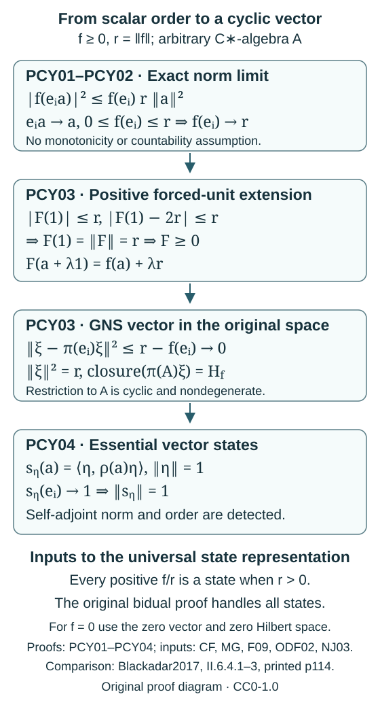

# Positive functionals and essential cyclic vectors

Let \(A\) be any complex C∗-algebra. A positive functional takes nonnegative real values on positive elements. Its boundedness, even when continuity is not initially assumed, is proved in [MG05](scalar-gns-and-matrix-cstar-norms.md#mg05). We write \(r=\|f\|\). Inner products are linear in the second variable.

The scalar calculus, order, Hilbert representation and forced unitization are proved in [CF1–10](../../OA-FLOW/OA-FLOW-CF.html). [MG01–MG03](scalar-gns-and-matrix-cstar-norms.md#mg01) gives scalar positive extensions, the unital GNS construction and arbitrary-cardinality faithful representations. [F09](../src/infinite-tensor-products.md#f09) constructs a positive contractive two-sided approximate identity \((e_i)\), with no monotonicity or countability requirement. [ODF02](operator-density-foundations.md#odf02) proves its strong convergence to the projection onto a representation's essential space.

We prove the norm limit needed for the nonunital cyclic vector, then the extension and essential-space assertions. The zero functional and zero algebra are included. For a nonzero algebra, the resulting states also norm self-adjoint elements and detect their order. These are the scalar inputs to the [universal state representation and bidual construction](../../foundations-of-von-neumann-algebras/the-universal-enveloping-von-neumann-algebra-of-a-c-star-algebra-and-w-star-algebras.html#constructing-the-bidual-before-using-it).

The diagram displays the actual scalar inequalities and the squared Hilbert-distance bound; its arrows refer to PCY01–PCY04 below.

## PCY01. Scalar Cauchy–Schwarz without a unit

Scalar calculus decomposes a self-adjoint element into its positive and negative parts. Thus \(f\) is real on self-adjoint elements and \(f(a^*)=\overline{f(a)}\). For \(a,b\in A\) and \(t\in\mathbb C\), positivity gives

\[
0\le f(a^*a)+2\operatorname{Re}(t f(a^*b))+|t|^2 f(b^*b).
\]

If \(f(b^*b)>0\), take \(t=-\overline{f(a^*b)}/f(b^*b)\). If \(f(b^*b)=0\), an arbitrary phase and an arbitrarily large magnitude of \(t\) force \(f(a^*b)=0\). In both cases

\[
|f(a^*b)|^2\le f(a^*a)f(b^*b).
\]

Every element and product here is in \(A\); no adjoined identity or representation is used in this estimate.

## PCY02. Every positive contractive approximate identity detects the norm

Let \((e_i)\) be any positive contractive two-sided approximate identity. Its existence is supplied by F09. The claim is

\[
f(e_i)\longrightarrow r.
\]

If \(r=0\), all values are zero. Suppose \(r>0\). Since \(0\le e_i^2\le e_i\), PCY01 applied to \(e_i,a\), and boundedness of \(f\), give

\[
|f(e_i a)|^2\le f(e_i^2)f(a^*a)
\le f(e_i)r\|a\|^2.
\]

For each fixed \(a\), \(e_i a\to a\) in norm, so \(f(e_i a)\to f(a)\). For every nonzero \(a\), consequently

\[
\liminf_i f(e_i)\ge\frac{|f(a)|^2}{r\|a\|^2}.
\]

Taking the supremum over nonzero \(a\) makes the right side approach \(r\). On the other hand, \(0\le f(e_i)\le r\) for all \(i\). These two bounds prove the limit for the original net, without choosing a subnet or supposing it increasing. Applied to \((e_i^2)\), the same reasoning also gives \(f(e_i^2)\to r\): indeed \(e_i^2 a-a=e_i(e_i a-a)+(e_i a-a)\to0\), and the right-sided estimate is identical.

## PCY03. Positive extension and the essential cyclic vector

Use the forced unitization \(C=A^\dagger\), which is nonzero and unital even for \(A=0\). Norm-preserving complex Hahn–Banach gives an extension \(F\) of \(f\) with \(\|F\|=r\). Put \(z=F(1)\). Scalar calculus gives \(\|1-2e_i\|\le1\), hence

\[
|z|\le r,\qquad |z-2f(e_i)|\le r.
\]

PCY02 implies \(|z-2r|\le r\). For \(r>0\), the two closed discs centred at \(0,2r\), of radius \(r\), meet only at \(r\): the triangle inequality \(2r\le|z|+|2r-z|\le2r\) has equality, so both vectors lie on the same real segment. Therefore \(F(1)=r\). For \(r=0\), \(F=0\) gives the same conclusion. The complete [norm-at-the-unit positivity proof NJ03](normal-jordan-from-scalar-norm-attainment.md#nj03) makes \(F\) positive.

Uniqueness is also immediate: every element of \(C\) is \(a+\lambda1\), so a norm-preserving extension must be

\[
F(a+\lambda1)=f(a)+\lambda r.
\]

For \(r>0\), apply MG02 to the state \(F/r\), and multiply its cyclic unit vector by \(\sqrt r\). This gives a unital representation \(\pi:C\to B(H_f)\) and vector \(\xi_f\) with

\[
F(c)=\langle\xi_f,\pi(c)\xi_f\rangle,\qquad
\|\xi_f\|^2=r.
\]

For \(r=0\), use \(H_f=0\) and the zero vector and representation. In either case

\[
\|\xi_f-\pi(e_i)\xi_f\|^2
=r-2f(e_i)+f(e_i^2)
\le r-f(e_i)\longrightarrow0.
\]

Thus \(\xi_f\) belongs to the closure of \(\pi(A)\xi_f\). Since it is cyclic for \(C\), every vector lies in that same closure: the span of \(\pi(A)\xi_f\) is invariant under \(\pi(A)\) and scalars, and now contains \(\xi_f\). The restriction \(\pi|_A\) is therefore cyclic and nondegenerate. This works also when \(A\) already has a unit; no ambient identity is silently substituted for its represented intrinsic unit.

If another nondegenerate cyclic representation \((\rho,K,\eta)\) gives \(f\), ODF02 and PCY02 imply \(\|\eta\|^2=\lim_i\langle\eta,\rho(e_i)\eta\rangle=r\). The map \(\pi(a)\xi_f\mapsto\rho(a)\eta\) preserves inner products, because each is \(f(a^*b)\). It is well defined on the dense cyclic span and extends to an onto isometry, hence a unitary intertwining the representations. Thus the cyclic construction has its full uniqueness statement. Normalizing any nonzero \(f\) to \(f/r\) gives the same representation with vector \(\xi_f/\sqrt r\).

## PCY04. States norm the self-adjoint part and detect order

Assume \(A\ne0\). Start with the faithful isometric representation of \(A\) constructed in MG03. Restrict it to its essential space \(K\). ODF02 shows that every represented element vanishes on \(K^\perp\), so this restriction \(\rho\) remains faithful and isometric, and is nondegenerate.

For each unit vector \(\eta\in K\), the positive functional

\[
s_\eta(a)=\langle\eta,\rho(a)\eta\rangle
\]

has norm at most one. ODF02 gives \(\rho(e_i)\eta\to\eta\), so \(s_\eta(e_i)\to1\) and its norm is one. It is a state of \(A\). No nonunital state-compactness assertion is involved.

For \(h=h^*\), let \(c=\sup_{\|\eta\|=1}|s_\eta(h)|\). The quadratic-form criterion for Hilbert positivity gives \(-cI_K\le\rho(h)\le cI_K\). Continuous scalar calculus then gives \(\|\rho(h)\|\le c\); the reverse bound follows from the operator norm. Isometry therefore yields

\[
\|h\|=\sup_{s\text{ a state of }A}|s(h)|.
\]

If every state is nonnegative on \(h\), every vector quadratic form of \(\rho(h)\) is nonnegative, so \(\rho(h)\ge0\). A faithful representation reflects order by the full negative-part argument in MG03, so \(h\ge0\). Conversely positive \(h\) has nonnegative state values by definition. The zero algebra has no states and only the zero element, and is treated separately rather than by assigning a supremum to an empty state set.

## Free comparison and terms

Blackadar's [author-hosted 2017 edition](https://www.bruceblackadar.com/Mathematics/Cycr.pdf#page=122), II.6.4.1–3, printed page 114 (native PDF page 122), describes the positive-functional GNS representation and the nonunital cyclic vector. PCY01–PCY03 writes the entire approximate-identity norm estimate and essential-space argument used in that construction. PCY04 supplies the state norming fact used in the complete [four-positive-part and bidual proof](../../foundations-of-von-neumann-algebras/the-universal-enveloping-von-neumann-algebra-of-a-c-star-algebra-and-w-star-algebras.html#oa-fnd-wa-01). The comparison does not import an unproved Jordan decomposition or a general bidual map theorem.

This exposition and diagram are original course contributions by GPT-6.1 Sol (OpenAI), Ultra, under CC0-1.0. The linked human edition retains its own terms. Free reading and method attribution do not grant permission to redistribute its PDF or prose.
