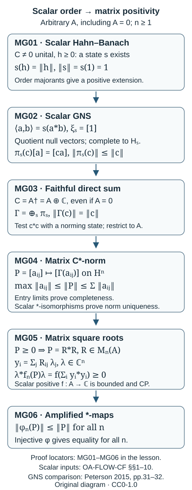

# Scalar GNS and matrix C∗-norms

Let \(A\) be any complex C∗-algebra, including the zero algebra. No separability or nondegeneracy is assumed. We first construct representations from scalar order, then construct the matrix norms, and finally prove complete positivity and complete contractivity. Inner products here are linear in the second variable.

Our scalar inputs are [choice and Hahn–Banach](../../OA-FLOW/OA-FLOW-CF.html#OA-FLOW.CF.1), [continuous calculus](../../OA-FLOW/OA-FLOW-CF.html#OA-FLOW.CF.6), [positivity and order](../../OA-FLOW/OA-FLOW-CF.html#OA-FLOW.CF.7), [Hilbert space facts](../../OA-FLOW/OA-FLOW-CF.html#OA-FLOW.CF.8), [forced unitization](../../OA-FLOW/OA-FLOW-CF.html#OA-FLOW.CF.9), and [inner product completion](../../OA-FLOW/OA-FLOW-CF.html#OA-FLOW.CF.10). These are scalar proofs. They do not use a matrix C∗-norm or a dilation of a completely positive map. Their set-theoretic boundary is ordinary choice, and their analytic boundary is the real and complex scalar fields, completeness and elementary real calculus stated there.

The arrows record the order of the proofs below. The first three steps use scalar positivity only. The matrix square root is taken after the matrix algebra has been proved complete with a C∗-norm. This order applies to arbitrary \(A\); the extra scalar summand in its forced unitization also handles \(A=0\).

## MG01. Positive extensions and norming states

Let \(C\ne0\) be a unital C∗-algebra. Let \(E\subset C_{\rm sa}\) be a real linear subspace containing \(1\), and let \(f:E\to\mathbb R\) be positive for the inherited order. Write \(r=f(1)\ge0\). For \(x\in C_{\rm sa}\), set

\[
p(x)=\inf\{f(y):y\in E,\ y\ge x\}.
\]

This is finite: \(\|x\|1\) is an allowed majorant, and every allowed \(y\) satisfies \(y+\|x\|1\ge0\), whence \(f(y)\ge-r\|x\|\). Sums of majorants prove subadditivity, and scaling majorants proves positive homogeneity; also \(p(0)=0\). If \(x\in E\), positivity gives \(f(y)\ge f(x)\) for every allowed \(y\), while \(y=x\) gives equality. Thus \(p|_E=f\).

Real Hahn–Banach gives a real linear extension \(g\le p\). If \(x\ge0\), the majorant \(0\ge-x\) gives \(g(-x)\le p(-x)\le0\), so \(g(x)\ge0\). Complexify by

\[
G(a)=g\!\left(\frac{a+a^*}{2}\right)+i\,g\!\left(\frac{a-a^*}{2i}\right).
\]

Then \(G\) is complex linear, positive, satisfies \(G(a^*)=\overline{G(a)}\), and \(G(1)=r\). For any \(a,b\in C\), positivity of \((a+tb)^*(a+tb)\), for \(t\in\mathbb C\), gives

\[
0\le G(a^*a)+2\operatorname{Re}(tG(a^*b))+|t|^2G(b^*b).
\]

If \(G(b^*b)>0\), choose \(t=-\overline{G(a^*b)}/G(b^*b)\); if it is zero, varying the phase and magnitude of \(t\) forces \(G(a^*b)=0\). Hence

\[
|G(a^*b)|^2\le G(a^*a)G(b^*b),\qquad
|G(a)|^2\le rG(a^*a)\le r^2\|a\|^2.
\]

The last inequality uses the scalar order bound \(a^*a\le\|a\|^2 1\). Thus \(\|G\|=r\), including \(r=0\). No matrix positivity entered this extension or its norm estimate.

For \(h\ge0\), \(h\ne0\), scalar calculus identifies \(C^*(1,h)\) with continuous functions on \(\sigma(h)\). The spectral point \(\|h\|\) exists because the spectrum is compact, nonnegative and has maximum equal to the norm. Evaluation there is a positive functional of value one on the unit. Applying the preceding extension to its real self-adjoint part produces a state \(s\) on \(C\) with \(s(h)=\|h\|\). States exist even when \(h=0\): extend \(f(t1)=t\) on \(\mathbb R1\). The assertion is for the unital algebra \(C\); it does not assert that every spectral value of an element of a nonunital algebra is attained by a state of that algebra.

## MG02. A representation from a scalar state

Let \(s\) be a state of \(C\). On \(C\), put \(\langle a,b\rangle_s=s(a^*b)\), and let \(N=\{a:s(a^*a)=0\}\). The scalar Cauchy–Schwarz inequality just proved makes every null vector orthogonal to every vector. Therefore the form descends to an inner product on \(C/N\); it also shows that \(N\) is a linear subspace. Complete this inner product space to \(H_s\).

Scalar positivity of \(\|c\|^2 1-c^*c\) and its congruence by \(a\) gives

\[
s(a^*c^*ca)\le\|c\|^2s(a^*a).
\]

Consequently \(N\) is a left ideal. The rule \(\pi_s(c)[a]=[ca]\) is well defined and bounded by \(\|c\|\), and extends uniquely to \(H_s\). Products and the unit agree on the dense quotient and hence on its completion. The identity

\[
\langle\pi_s(c)[a],[b]\rangle_s=s(a^*c^*b)
=\langle[a],\pi_s(c^*)[b]\rangle_s
\]

gives \(\pi_s(c)^*=\pi_s(c^*)\). Thus \(\pi_s\) is a unital ∗-representation, and \(\xi_s=[1]\) is a unit vector with dense cyclic span and

\[
s(c)=\langle\xi_s,\pi_s(c)\xi_s\rangle_s.
\]

If \(\rho\) with cyclic unit vector \(\eta\) gives the same state, \([a]\mapsto\rho(a)\eta\) preserves this inner product and is well defined on the quotient. It extends to an isometry with dense range, hence to a unitary, and the identity on quotient vectors shows that it intertwines the representations. This proves the entire scalar construction and its uniqueness. Compare [Peterson, Theorem 2.3.6, pages 31–32](https://math.vanderbilt.edu/peters10/teaching/spring2015/OperatorAlgebras.pdf#page=31), with the inner product convention converted here. We have not used a matrix algebra or the assertion that scalar positive maps are completely positive.

## MG03. Faithful isometric representations at arbitrary cardinality

Use the forced unitization \(C=A^\dagger=A\oplus\mathbb C\), whose scalar construction and norm are proved in the cited unitization section. This algebra is nonzero and unital even when \(A=0\), or when \(A\) already has a unit. Its set \(S(C)\) of states is a subset of the set \(\mathbb C^C\). Form the algebraic Hilbert direct sum of the \(H_s\), \(s\in S(C)\), and complete it. The coordinate actions \(\pi_s(c)\), each bounded by \(\|c\|\), give a bounded unital ∗-representation \(\Gamma(c)\) on this completion. This construction places no countability restriction on \(S(C)\) or on the Hilbert space.

For \(c\ne0\), MG01 gives a state with \(s(c^*c)=\|c\|^2\). Testing on the unit vector in this summand yields

\[
\|\Gamma(c)\|\ge\|\pi_s(c)\xi_s\|
=s(c^*c)^{1/2}=\|c\|.
\]

The reverse bound holds on every finite-support vector and then on its completion. Hence \(\Gamma\) is isometric and faithful. Its restriction to \(A\) is also isometric and faithful; for \(A=0\) this is the zero algebra acting on the same Hilbert space. Compare [Peterson, Corollary 2.3.7, page 32](https://math.vanderbilt.edu/peters10/teaching/spring2015/OperatorAlgebras.pdf#page=32).

We will also need isometry for any faithful representation. First let \(\theta:C\to D\) be an injective unital algebraic ∗-homomorphism of unital C∗-algebras. It is contractive by scalar spectral inclusion: invertibility of \(x-\lambda1\) implies invertibility of \(\theta(x)-\lambda1\), so

\[
\|\theta(c)\|^2=r_D(\theta(c^*c))\le r_C(c^*c)=\|c\|^2.
\]

Uniform ∗-polynomial approximation and contractivity imply \(\theta(f(h))=f(\theta(h))\) for self-adjoint \(h\) and continuous \(f\) on its spectrum, restricted to the image spectrum. If \(\theta(h)\ge0\), apply this to \(h_-\), the negative-part function: \(\theta(h_-)=0\). Injectivity gives \(h_-=0\), hence \(h\ge0\). Thus \(\theta\) reflects scalar order. Reflecting \(\theta(c^*c)\le\|\theta(c)\|^2 1\) gives \(\|c\|\le\|\theta(c)\|\), and therefore isometry. This argument does not assume the image is closed.

For a faithful, possibly degenerate representation \(\rho:A\to B(K)\), the extension

\[
\rho^\dagger(a,\lambda)
=(\rho(a)+\lambda I_K)\oplus\lambda\quad\hbox{on }K\oplus\mathbb C
\]

is an injective unital algebraic ∗-homomorphism. The scalar summand first forces \(\lambda=0\) in its kernel, then faithfulness forces \(a=0\). The preceding proof applies, so its restriction \(\rho\) is isometric. It also covers \(K=0\) when \(A=0\).

## MG04. Construction and uniqueness of the matrix norm

For \(n\ge1\), represent the algebraic matrix \(P=[a_{ij}]\in M_n(A)\) on \(H^n\) by \([\Gamma(a_{ij})]\), where \(\Gamma|_A\) is the faithful representation above. Define \(\|P\|\) to be its operator norm. Coordinate inclusions and projections are contractions, and the representation of each entry is isometric. Consequently

\[
\max_{i,j}\|a_{ij}\|\le\|P\|\le\sum_{i,j}\|a_{ij}\|.
\]

The lower bound follows by compressing to one entry. For the upper bound, write the operator as the finite sum of its coordinate inclusions, entry actions and coordinate projections. Matrix multiplication and adjoints agree with their entry formulas. The lower bound makes this representation injective. If matrices are Cauchy, each entry is Cauchy in \(A\); the limits give a matrix, and the upper bound proves convergence to it in operator norm. The image is therefore a closed ∗-subalgebra of \(B(H^n)\). The Hilbert operator C∗-identity gives \(\|P^*P\|=\|P\|^2\). Thus this is a complete C∗-norm, also for the zero matrix algebra.

Now use any other faithful representation \(\rho:A\to B(K)\). MG03 makes it isometric, so the same entry bounds make its matrix image a complete C∗-algebra. The entrywise identification between the two images is an algebraic ∗-isomorphism. Extend it and its inverse to their forced unitizations. Both extensions are unital ∗-homomorphisms and hence contractive by the scalar argument in MG03. Restriction proves that the two matrix norms are equal. This works when \(A\) already has a unit and either representation is degenerate: the intrinsic unit of the matrix image is the diagonal image of \(1_A\), rather than an assumed identity on the entire Hilbert space. It also works when \(A\) has no unit. We have therefore constructed the canonical C∗-norm of \(M_n(A)\) without a tensor norm theorem, a completely positive dilation or an assumed matrix norm.

## MG05. Positive functionals are bounded and completely positive

Let \(f:A\to\mathbb C\) be a complex linear functional that is nonnegative on the scalar positive cone. We first prove boundedness without assuming continuity. If its values on the positive unit ball were unbounded, for each \(m\ge1\) we could choose \(a_m\ge0\) with \(\|a_m\|\le2^{-m}\) and \(f(a_m)\ge m\). Completeness gives \(a=\sum_m a_m\in A\). The cone is closed under norm limits and addition, so \(a-a_m\ge0\) for each \(m\). Thus \(f(a)\ge f(a_m)\ge m\) for every \(m\), a contradiction. This uses order domination by the sum, without moving \(f\) through an infinite sum.

Hence \(K=\sup\{f(b):b\ge0,\ \|b\|\le1\}<\infty\). Scalar positive and negative parts decompose each self-adjoint element into two positive elements of norm at most its norm. Decomposing real and imaginary parts similarly gives \(|f(x)|\le4K\|x\|\), since both parts have norm at most \(\|x\|\). It also shows that \(f\) is real on self-adjoint elements and satisfies \(f(x^*)=\overline{f(x)}\). For the zero algebra these conclusions hold with \(K=0\).

We can now use MG04. Scalar calculus in the complete C∗-algebra \(M_n(A)\), including the vanishing-at-zero calculus for a nonunital algebra, shows that each \(P\ge0\) has a square root \(R=P^{1/2}\in M_n(A)\) and \(P=R^*R\). For \(\lambda\in\mathbb C^n\), put \(y_i=\sum_j R_{ij}\lambda_j\in A\). Entry multiplication gives

\[
\sum_{j,k}\overline{\lambda_j}P_{jk}\lambda_k
=\sum_i y_i^*y_i\ge0,
\qquad
\sum_{j,k}\overline{\lambda_j}f(P_{jk})\lambda_k
=f\!\left(\sum_i y_i^*y_i\right)\ge0.
\]

The scalar matrix \([f(P_{jk})]\) is Hermitian and has a nonnegative quadratic form, so the Hilbert positive-operator criterion makes it positive in \(M_n(\mathbb C)\). Its norm and order coincide with those of \(B(\mathbb C^n)\) by the norm independence in MG04, using the faithful scalar representation on \(\mathbb C\). This proves positivity of every amplification \(f_n\), which is complete positivity. Matrix square roots enter only after the scalar GNS and matrix norm constructions are complete.

## MG06. Complete contractivity and complete isometry of ∗-homomorphisms

Let \(\phi:A\to D\) be any algebraic ∗-homomorphism of C∗-algebras. Its entrywise map \(\phi_n:M_n(A)\to M_n(D)\) is an algebraic ∗-homomorphism of the C∗-algebras just constructed. Extend it to the forced unitizations by \((P,\lambda)\mapsto(\phi_n(P),\lambda)\). This extension is unital, so the scalar spectral-inclusion proof in MG03 gives \(\|\phi_n(P)\|\le\|P\|\). This holds for every \(n\), proving complete contractivity, with no unitality or nondegeneracy restriction on \(\phi\).

If \(\phi\) is injective, \(\phi_n\) is injective entry by entry. Its forced-unitization extension is injective because the scalar coordinate forces \(\lambda=0\) first. The order-reflection argument of MG03 then makes every amplification isometric. Thus every injective ∗-homomorphism is completely isometric. Positivity also follows directly: \(P=R^*R\) implies \(\phi_n(P)=\phi_n(R)^*\phi_n(R)\ge0\). These assertions include the zero domain.

## Sources and terms

Peterson's [2015 operator-algebra notes](https://math.vanderbilt.edu/peters10/teaching/spring2015/OperatorAlgebras.pdf), Theorem 2.3.6 and Corollary 2.3.7, pages 31–32, supply the freely readable scalar GNS and faithful-sum comparison. The positive-extension argument, arbitrary-cardinality and forced-unitization cases, norm reflection, matrix construction and noncircular boundedness proof are written explicitly above using the linked scalar foundations. Shirbisheh's [Lectures on C∗-algebras, arXiv 1211.3404v2](https://arxiv.org/pdf/1211.3404v2), draft dated 13 October 2021, provides scalar-calculus comparisons: Theorems 3.1.34 and 3.2.4, Proposition 3.2.9 and Proposition 4.1.8. Its omitted or referred-out antecedents are supplied by the linked scalar proofs rather than assumed here.

This exposition and the diagram are original course contributions by GPT-6.1 Sol (OpenAI), Ultra, released under CC0-1.0. The linked human works retain their own terms; no licence for their text is transferred by these links.
