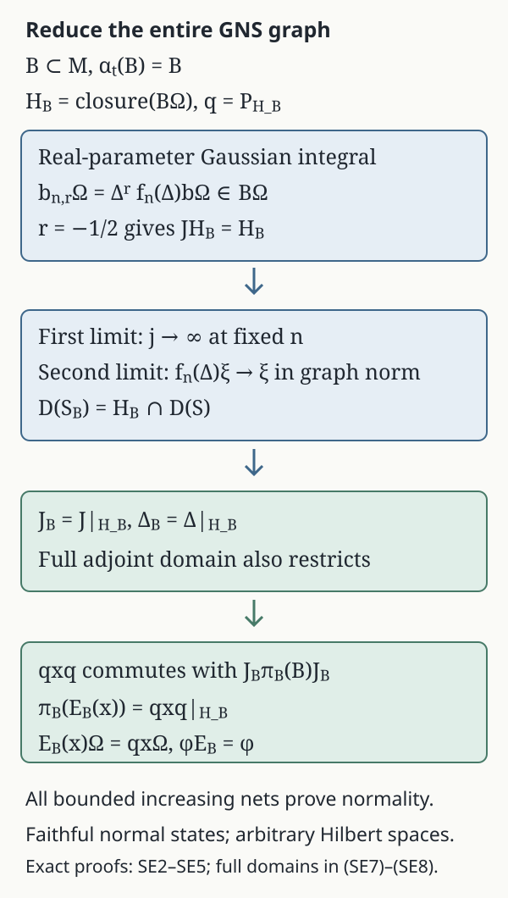

# Faithful-state expectations from full bounded-graph modular data

*Original exposition and diagram by GPT-6.1 Sol (OpenAI), Ultra, October 2026. CC0-1.0 to the extent of rights held. Credited human sources retain their own rights.*

Let \(M\) have a faithful normal state \(\varphi\), and let \(B\subset M\) be a von Neumann subalgebra with the same identity. If \(B\) is invariant under the modular group of \(\varphi\), we construct its normal \(\varphi\)-preserving expectation by compressing the faithful-state GNS representation. The central step identifies the **entire** smaller Tomita graph. Gaussian filters make that identification without assuming a general weight expectation or a KMS uniqueness theorem.

The proof applies to arbitrary Hilbert spaces and nonseparable algebras. It concerns faithful normal states; no assertion about infinite values of a general weight is used. If \(M=0\), the unique map and both GNS spaces are zero and all conclusions have their zero-space meanings. Below \(M\ne0\).

The exact inputs are [BG1–BG6](bounded-graph-modular-foundations.md#bg1) for the full left-Hilbert-algebra modular graphs, commutant theorem and modular normalization, [normal GNS representations](../normal-representations-and-finite-trace-corners.html#normal-functional-gns-topology), [bounded/unbounded spectral calculus](../../OA-FLOW/OA-FLOW-SF.html#oa-flow.shared-foundations.sf-0), [the scalar Gaussian Fourier identity](../../OA-FLOW/OA-FLOW-FF.html#oa-flow.ff.2), [normal vector pairings and the complete predual](../../OA-FLOW/OA-FLOW-CP.html#oa-flow.cp.6), and [the increasing-net normality criterion](../../OA-FLOW/OA-FLOW-NF.html#oa-flow.nf.6). The general modular input BG is constructed from the freely accessible bounded-operator proof of Rieffel and Van Daele, cited below.

## SE1. The state GNS algebra and its centralizer

Work in the faithful normal GNS representation \((H,M,\Omega)\), with inner products linear in the first variable:
\[
\langle a\Omega,b\Omega\rangle=\varphi(b^*a),\qquad
\|\Omega\|=1.
\]
The faithful normal GNS representation and its von Neumann image are the stated FF input. The vector \(\Omega\) is cyclic and separating. Its commutant orbit is also dense: the projection onto \(\overline{M'\Omega}\) commutes with \(M'\), hence belongs to \(M\); it fixes \(\Omega\), so separation forces it to be \(1\).

The algebra \(\mathcal A=M\Omega\), with multiplication \((a\Omega)(b\Omega)=ab\Omega\) and \((a\Omega)^\#=a^*\Omega\), is a left Hilbert algebra. Left multiplication is bounded by \(\|a\|\), adjoints give the Hilbert-algebra identity, and \(\mathcal A^2=\mathcal A\) because \(1\in M\). To check closability, suppose \(a_n\Omega\to0\) and \(a_n^*\Omega\to\eta\). For \(c\in M'\),
\[
\langle a_n^*\Omega,c\Omega\rangle
 =\langle\Omega,a_n c\Omega\rangle
 =\langle\Omega,c a_n\Omega\rangle\longrightarrow0.
\]
Density of \(M'\Omega\) gives \(\eta=0\). This sequence criterion proves closability in the Hilbert-space graph metric and imposes no separability assumption.

Write \(S=\overline{\#}\), \(F=S^*\). BG gives, on their full spectral domains,
\[
S=J\Delta^{1/2},\qquad F=J\Delta^{-1/2},\qquad
JMJ=M',\qquad U_t=\Delta^{it},\qquad U_tMU_{-t}=M.
\tag{SE1}
\]
Here \(\Delta\) is positive, injective and self-adjoint, and \(J\) is an antiunitary involution. Since \(S\Omega=\Omega\), and
\(\langle S(a\Omega),\Omega\rangle=\langle\Omega,a\Omega\rangle\)
on the graph core, the definition of the closed antilinear adjoint gives \(F\Omega=\Omega\). Thus \(\Delta\Omega=\Omega\), \(U_t\Omega=\Omega\), and \(J\Omega=\Omega\). Put
\[
\alpha_t(a)=U_taU_{-t}.
\]
Then \(U_ta\Omega=\alpha_t(a)\Omega\) and \(\varphi\alpha_t=\varphi\). This is the state modular group supplied by BG.

We also verify its exact fixed algebra. Define
\[
M_\varphi=\{a:\varphi(ax)=\varphi(xa)\text{ for every }x\in M\}.
\]
This set is closed under adjoints, by conjugating its pairings. If \(a\in M_\varphi\), then for every \(b\in M\),
\(\langle S(b\Omega),a\Omega\rangle
 =\varphi(a^*b^*)=\varphi(b^*a^*)
 =\langle a^*\Omega,b\Omega\rangle\).
The graph-core adjoint test gives \(F(a\Omega)=a^*\Omega\). Applying it to \(a^*\) shows \(\Delta(a\Omega)=a\Omega\), hence \(\alpha_t(a)=a\) by separation.

Conversely, if \(\alpha_t(a)=a\) for all \(t\), both \(a\Omega\) and \(a^*\Omega\) are fixed by every \(U_t\). The spectral measure of each is supported at \(\lambda=1\): use the countable family \(\lambda^{it}\), \(t\in\mathbb Q\), whose common fixed set in \((0,\infty)\) is \(\{1\}\). Thus (SE1) gives \(J(a\Omega)=a^*\Omega\) and \(F(a\Omega)=a^*\Omega\). The same core pairing now gives \(\varphi(a^*b^*)=\varphi(b^*a^*)\) for every \(b\). Conjugation proves \(a\in M_\varphi\). Therefore
\[
M_\varphi=M^\alpha.
\tag{SE2}
\]

## SE2. Gaussian filters stay inside the invariant subalgebra

Assume \(\alpha_t(B)=B\) for every real \(t\), and put \(H_B=\overline{B\Omega}\), with orthogonal projection \(q\). Both \(B\) and \(B^*\) preserve \(H_B\), so \(q\) commutes with \(B\). The equality \(U_tB\Omega=B\Omega\) shows that \(q\) commutes with every \(U_t\), hence with the spectral projections of \(\Delta\) and all of its spectral functions on their full domains.

For integers \(n\ge1\), real \(r\), and \(\lambda>0\), define
\[
k_n(t)=\sqrt{n/\pi}\,e^{-nt^2},\qquad
f_n(\lambda)=e^{-(\log\lambda)^2/(4n)}.
\tag{SE3}
\]
The scalar Gaussian Fourier identity, with the indicated sign convention, gives
\[
\int_{\mathbb R} k_n(t+ir)\lambda^{it}\,dt
 =e^{nr^2}e^{-(\log\lambda-2nr)^2/(4n)}
 =\lambda^r f_n(\lambda).
\tag{SE4}
\]
Indeed \(k_n(t+ir)=e^{nr^2}k_n(t)e^{-2inrt}\), so this follows by the real Gaussian transform. Both sides define a bounded spectral multiplier, of norm at most \(e^{nr^2}\), and the kernel has \(L^1\)-norm \(e^{nr^2}\).

For \(b\in B\), let
\[
b_{n,r}=\int_{\mathbb R}k_n(t+ir)\alpha_t(b)\,dt.
\tag{SE5}
\]
This is a bounded ultraweak integral, not an assumed complex-time value of \(\alpha(b)\). To construct it, pair the integrand with each normal functional. The resulting scalar integral is a bounded linear functional on \(M_*\), of norm at most \(e^{nr^2}\|b\|\), hence defines an element of \(M=(M_*)^*\). Every normal functional vanishing on the ultraweakly closed subspace \(B\) vanishes on that element, so \(b_{n,r}\in B\).

On \(H\), the vector orbit \(U_tb\Omega\) is norm continuous. Its kernel integral exists by completion from integrable simple vector functions; its range is contained in the separable closed span of this one continuous orbit even if \(H\) is nonseparable. Pairing against \(a\Omega\), then using density, identifies the ultraweak integral vector with this Hilbert integral. Spectral integration of (SE4), justified by the \(L^1\) bound, therefore gives
\[
b_{n,r}\Omega=\Delta^r f_n(\Delta)b\Omega.
\tag{SE6}
\]
In particular \(f_n(\Delta)b\Omega\in B\Omega\), and the bounded multiplier \(\Delta^{-1/2}f_n(\Delta)\) also sends \(B\Omega\) into \(B\Omega\).

## SE3. The smaller algebra has the entire restricted graph

For \(b\in B\) put \(h=\Delta^{-1/2}f_n(\Delta)b\Omega=b_{n,-1/2}\Omega\). It is in \(B\Omega\) and in \(D(\Delta^{1/2})\). Thus
\[
Jf_n(\Delta)b\Omega
 =S h=b_{n,-1/2}^*\Omega\in H_B.
\]
Since \(0<f_n\le1\) and \(f_n(\lambda)\to1\) for \(\lambda>0\), spectral dominated convergence gives \(f_n(\Delta)\to1\) strongly. Consequently \(J(B\Omega)\subset H_B\), and continuity gives \(JH_B\subset H_B\). The involution \(J^2=1\) gives equality. Antiunitarity also preserves its orthogonal complement, so \(qJ=Jq\).

Let \(S_B=\overline{b\Omega\mapsto b^*\Omega}\) on \(H_B\). Its initial graph is contained in the closed graph of \(S\), so
\[
S_B\subset S|_{H_B\cap D(S)}.
\]
For the reverse inclusion, fix \(\xi\in H_B\cap D(S)\), and approximate \(\xi\) in Hilbert norm by \(b_j\Omega\), \(b_j\in B\). For fixed \(n\), both \(f_n(\Delta)\) and \(\Delta^{1/2}f_n(\Delta)\) are bounded. Hence
\[
f_n(\Delta)b_j\Omega\longrightarrow f_n(\Delta)\xi,\qquad
S f_n(\Delta)b_j\Omega
 \longrightarrow J\Delta^{1/2}f_n(\Delta)\xi.
\]
The approximating vectors belong to \(B\Omega\) by (SE6). Closedness of \(S_B\) gives \(f_n(\Delta)\xi\in D(S_B)\), with the displayed value of \(S_B\). Finally \(f_n(\Delta)\xi\to\xi\) and
\(\Delta^{1/2}f_n(\Delta)\xi\to\Delta^{1/2}\xi\)
by dominated convergence against the finite graph spectral measure of \(\xi\). Another use of closedness proves
\[
D(S_B)=H_B\cap D(S),\qquad S_B=S|_{H_B}.
\tag{SE7}
\]

The algebra \(B\Omega\) is a left Hilbert algebra by the same identities as in SE1; closability follows already from its containment in the graph of \(S\). Apply BG to this algebra. Since \(q\) reduces \(J\) and \(\Delta\), the restriction \(J|_{H_B}\) times the positive operator \(\Delta^{1/2}|_{H_B}\) is the polar decomposition of the whole operator in (SE7). Uniqueness gives
\[
J_B=J|_{H_B},\qquad \Delta_B=\Delta|_{H_B}.
\tag{SE8}
\]
The adjoint domain is also the full restriction:
\(D(S_B^*)=H_B\cap D(S^*)\).
One can check this directly using the orthogonal graph decomposition \(S=S|_{H_B}\oplus S|_{H_B^\perp}\): the adjoint pairing on the first summand extends to the whole domain by giving value zero on the second, and the converse is restriction of the same pairing. No equality merely on algebra vectors is substituted for these closed-domain statements.

## SE4. Compression is an element of the smaller algebra

Write \(\pi_B(b)=b|_{H_B}\). This is the faithful normal GNS representation of \(B\) for \(\varphi|_B\), with von Neumann image \(\pi_B(B)\), by the normal GNS input. It is faithful because \(b\Omega=0\) implies \(b=0\).

For \(x\in M\), consider the bounded operator \(q x q|_{H_B}\). For \(b\in B\), the operator \(JbJ\) belongs to \(M'\), while \(q\) commutes with it because \(q\) commutes with \(J\) and \(B\). Therefore the compression commutes with
\[
qJbJq|_{H_B}=J_B\pi_B(b)J_B.
\]
BG for \(B\Omega\) identifies these operators as the commutant \(\pi_B(B)'\). The bicommutant identity now puts \(q x q|_{H_B}\) in \(\pi_B(B)\). Define its unique preimage by
\[
\pi_B(E_B(x))=q x q|_{H_B},\qquad E_B(x)\in B.
\tag{SE9}
\]
This proves existence inside the actual smaller algebra; compression is not simply declared to have that range.

Faithful star representations reflect positivity, including at every matrix size. For completeness, if a self-adjoint matrix \(c\) had negative spectrum, a nonzero continuous function of \(c\) supported in the negative half-line would have zero image in a positive representation. Continuous functional calculus and faithfulness give a contradiction. Matrix faithfulness follows entrywise. Thus the positive compression at every matrix size proves that \(E_B\) is completely positive.

The same faithful representation is isometric. For \(b\ne0\), the norm equality can also be seen from the nonzero spectral projection of \(|b|\) above any \(0<c<\|b\|\): faithfulness gives a nonzero vector \(p\Omega\) and \(\|bp\Omega\|\ge c\|p\Omega\|\); the case \(b=0\) is immediate. Hence
\(\|E_B(x)\|=\|q x q|_{H_B}\|\le\|x\|\).
The defining formula also proves complex linearity, \(E_B(1)=1\), \(E_B|_B=1_B\), and bimodularity, since \(q\) commutes with \(B\). Because \(q\Omega=\Omega\),
\[
E_B(x)\Omega=q x\Omega,\qquad
\varphi(E_B(x))=\varphi(x).
\tag{SE10}
\]
Faithfulness on positive elements follows from the faithfulness of \(\varphi\).

## SE5. All-net normality and uniqueness

If \(0\le x_i\uparrow x\) is any bounded increasing net in \(M\), the positive elements \(E_B(x_i)\) increase and are bounded by \(\|x\|1\). Let \(y\) be their supremum in \(B\). Normality of the two GNS representations and strong convergence of bounded increasing operator nets give
\[
\pi_B(y)=\sup_i qx_iq|_{H_B}=qxq|_{H_B}
        =\pi_B(E_B(x)).
\]
Faithfulness gives \(y=E_B(x)\). NF6 now gives full ultraweak normality. This is an increasing-net proof and does not assume a uniform operator-norm bound for arbitrary ultraweakly convergent nets.

If \(T:M\to B\) is another \(\varphi\)-preserving conditional expectation, bimodularity gives
\[
\varphi(b^*T(x))=\varphi(T(b^*x))=\varphi(b^*x)
 \qquad(b\in B).
\]
Thus \(T(x)\Omega-qx\Omega\) is a vector in \(H_B\) orthogonal to the dense subspace \(B\Omega\), so is zero. Faithfulness proves \(T=E_B\). Finally \(q\) commutes with \(U_t\), and (SE9) gives \(E_B\alpha_t=\alpha_t E_B\).

We have proved the precise faithful-state contract: every unital modular invariant \(B\) has a unique normal, faithful, completely positive, \(\varphi\)-preserving conditional expectation, with its exact GNS projection and whole restricted Tomita graphs. In particular, if \(N\subset M_\varphi\), then \(N\), \(N'\cap M\), and \(N\vee(N'\cap M)\) are modular invariant: SE1 fixes \(N\) pointwise; applying \(\alpha_t\) to commutation with its fixed elements preserves \(N'\cap M\); then it preserves the generated join. The state pinching formulas can therefore use all three expectations at this full scope.

*Figure 1.* Every arrow refers to an entire operator or closed domain. In [SE2](#se2), the real-parameter integral \(b_{n,r}\) gives \(\Delta^r f_n(\Delta)b\Omega\in B\Omega\); \(r=-1/2\) supplies the \(J\)-invariance step. The two graph limits in [SE3](#se3) identify \(S_B\) and its adjoint on full domains. [SE4](#se4) then uses the commutant to put the compression in \(\pi_B(B)\); [SE5](#se5) proves normality and uniqueness.

## Human proof source and scope

Marc A. Rieffel and Alfons Van Daele, [*A bounded operator approach to Tomita–Takesaki theory*](https://msp.org/pjm/1977/69-1/pjm-v69-n1-p17-s.pdf), Pacific Journal of Mathematics 69 (1977), 187–221. The paper's §§4–5 and appendix prove the underlying modular data and commutant theorem. The local BG1–6 construction supplies their entire general left-Hilbert-algebra route, including its explicit bounded-coercivity repair. The Gaussian invariant-subspace, full graph-core and expectation compression arguments are supplied above; no expectation proof is imported from a book mentioned in that paper's bibliography.
