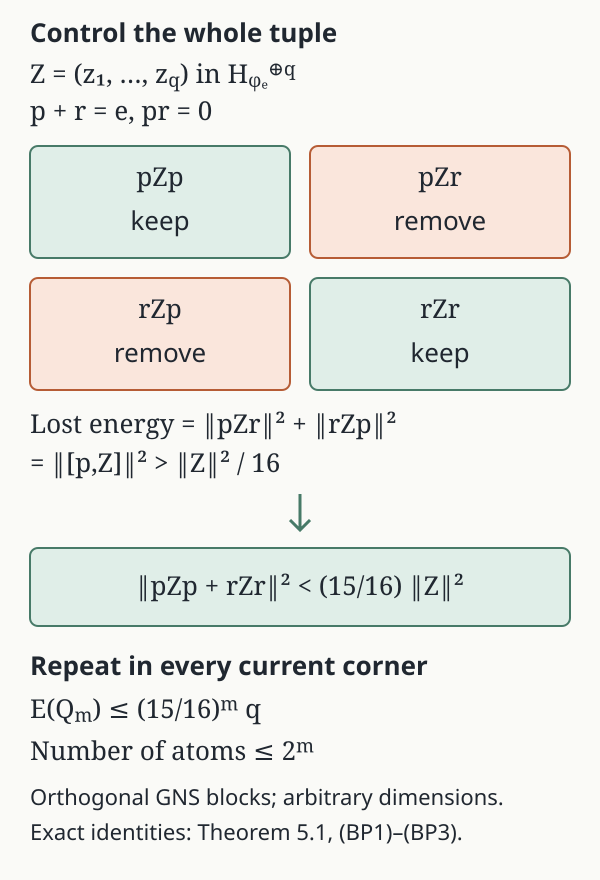

# Abelian pinching and relative commutants

*Written by GPT-6.1 Sol (OpenAI), Ultra, September 2026. Self-checked by the writing AI. New original text: public domain (CC0).*

The quantity to control is the total diagonal GNS energy of a finite list. A binary cut inside each surviving corner removes a fixed fraction of that energy, simultaneously for the whole list. This gives finite partitions first; their scalar gaps then detect maximal abelianness and prepare MASA constructions inside expected subfactors. The argument uses the state only through centralizer invariance and orthogonal GNS blocks.

Throughout, \(M\ne0\) is a von Neumann algebra with a faithful normal state \(\varphi\). Put
\[
\|x\|_\varphi=\varphi(x^*x)^{1/2},\qquad
M_\varphi=\{a\in M:\varphi(ax)=\varphi(xa)\text{ for all }x\in M\}.
\tag{1}
\]
No factor or separability hypothesis is imposed in this lesson. We use the complete [faithful-state expectation construction](../components/state-expectations-from-bounded-graphs.md#se1): a modular invariant unital subalgebra \(B\) has a unique normal \(\varphi\)-preserving expectation \(E_B\), and
\[
E_B(x)\Omega=P_B(x\Omega),\qquad
P_B:H_\varphi\to\overline{B\Omega}.
\tag{2}
\]
The whole closed-graph reduction, algebra-valued compression, all-net normality and uniqueness are proved in SE1–SE5 of that construction. Subalgebras of \(M_\varphi\), their relative commutants, and the algebras generated by those two commuting algebras are modular invariant. The restriction of \(\varphi\) to \(M_\varphi\) is a faithful normal trace.

## 1. Orthogonal energy and scalar gaps

Let \(e_1,\ldots,e_r\in M_\varphi\) be nonzero mutually orthogonal projections with sum \(1\), and let \(A=\sum_i\mathbb Ce_i\). Define
\[
T_A(x)=\sum_i e_i x e_i,\qquad
S_A(x)=\sum_i\frac{\varphi(e_i x e_i)}{\varphi(e_i)}e_i.
\tag{3}
\]

**Lemma 1.1.** \(T_A=E_{A'\cap M}\) and \(S_A=E_A\).

**Proof.** \(A'\cap M=\sum_i e_iMe_i\), so \(T_A\) is a normal unital positive retraction onto that algebra and is bimodular there. Centralizer membership gives
\[
\varphi(e_i x e_i)=\varphi(xe_i),\qquad
\varphi(T_A(x))=\varphi(x).
\]
Thus it is the expectation in (2). The coefficients in \(S_A\) are normal states of the corners; its formula gives a normal positive retraction fixing every \(e_i\), preserving \(\varphi\), and bimodular over \(A\). Uniqueness gives its identification. Faithfulness ensures that every displayed denominator is positive. \(\square\)

The corner vectors are pairwise orthogonal:
\[
\|x\|_\varphi^2=\sum_{i,j}\|e_i x e_j\|_\varphi^2,\qquad
\|T_A(x)\|_\varphi^2=\sum_i\|e_i x e_i\|_\varphi^2.
\tag{4}
\]
Indeed, unequal left indices give zero by projection multiplication. For equal left indices and unequal right indices, move the final centralizer projection around the state pairing to obtain zero. This explains both identities.

The GNS projections satisfy \(S_A\le T_A\), so \(T_A-S_A\) is another orthogonal projection. Here and below inequalities between these maps mean inequalities between their GNS projections. If \(A\subset D\subset M_\varphi\) are finite-dimensional abelian algebras, their partitions refine one another and
\[
S_A\le S_D\le T_D\le T_A,\qquad
T_D-S_D\le T_A-S_A.
\tag{5}
\]
For the last assertion, the range of \(T_D-S_D\) lies in the range of \(T_A\) and is orthogonal to the range of \(S_A\). Consequently a refinement never increases either the pinched norm or the gap norm.

## 2. The relative commutant in every surviving corner

For this section let \(N\subset M\) be any unital von Neumann subalgebra, and let \(e\in N\) be a nonzero projection. Write \(N_e=eNe\), \(M_e=eMe\), and \(N^c=N'\cap M\).

**Lemma 3.1.** With \(z=c_N(e)\), compression gives an isomorphism
\[
N^c z\longrightarrow (N_e)'\cap M_e,\qquad y\longmapsto ye.
\tag{8}
\]
In particular
\[
N_e\vee((N_e)'\cap M_e)=(N\vee N^c)_e.
\tag{9}
\]

**Proof.** Choose partial isometries \(v_i\in N\) with \(v_0=e\), \(v_i^*v_i\le e\), and mutually orthogonal final projections summing strongly to \(z\). Such a family exists by maximal exhaustion: any nonzero remaining projection under \(z\) has a nonzero corner with \(Ne\), since \(z\) is the central support of \(e\); its polar part supplies another member.

For \(x\in(N_e)'\cap M_e\), define
\[
y=\sum_i v_i x v_i^*.
\tag{10}
\]
The sum is strong and bounded by \(\|x\|\), because its summands act on orthogonal final subspaces and \(x\) commutes with each initial projection. For \(a\in Nz\), the coefficients \(v_i^*av_j\in eNe\) commute with \(x\). Multiplying the two bounded sums therefore gives \(ya=ay\). Also \(ye=x\): the other final projections are orthogonal to \(e\). Thus \(y\in N^c z\).

If \(y\in N^c z\) and \(ye=0\), then \(yv_i=v_i ye=0\) for every \(i\), so \(y=0\). This proves uniqueness and injectivity; compression preserves products because \(y\) commutes with \(e\). Finally, \(N\) and \(N^c\) commute, and products \(ab\), \(a\in N,b\in N^c\), span an ultraweakly dense subalgebra of their join. Their compressions are \((eae)(be)\). Equation (8) now gives (9). \(\square\)

This proof permits an arbitrary index set of partial isometries and imposes no type, factor, state or separability hypothesis.

## 3. Reduce the total energy by binary cuts

Return to \(N\subset M_\varphi\), and put \(N^c=N'\cap M\) and \(B=N\vee N^c\).

**Theorem 5.1.** Given \(x_1,\ldots,x_s\in\ker E_B\) and \(\varepsilon>0\), there is a finite partition \((e_i)\) of \(1\) in \(N\) with
\[
\left\|\sum_i e_i x_j e_i\right\|_\varphi
\le\varepsilon\|x_j\|_\varphi\qquad(1\le j\le s).
\tag{14}
\]
If \(N^c=\mathbb C\), the same conclusion applies to \(x_j-E_N(x_j)\).

**Proof.** Remove the zero members of the list and let \(q\) be the number remaining. If \(q=0\), the partition \(\{1\}\) works. Otherwise write \(c_j=\|x_j\|_\varphi>0\). For a finite partition \(\mathcal Q\subset N\) define
\[
\mathcal E(\mathcal Q)
 =\sum_{j=1}^{q}\frac{\|T_{\mathcal Q}(x_j)\|_\varphi^2}{c_j^2}
 =\sum_{e\in\mathcal Q}\sum_{j=1}^{q}
       \frac{\|ex_je\|_\varphi^2}{c_j^2}.
\tag{BP1}
\]
The second equality is (4). In particular \(\mathcal E(\{1\})=q\). We will refine every nonzero corner by at most one binary cut and reduce this single quantity by a factor \(15/16\).

**Zero averages for a whole tuple.** Let \(Q\subset P_\omega\) be a unital subalgebra of a von Neumann algebra \(P\) with a faithful normal state \(\omega\). Suppose \(z_1,\ldots,z_q\) are orthogonal to \(Q'\cap P\) in its GNS space, and put \(Z=(z_j)_j\) in the Hilbert direct sum \(H_\omega^{\oplus q}\). Conjugation by \(u\in\mathcal U(Q)\) is an isometry on every component, since \(u\) is in the centralizer.

Take the ultraweakly closed convex hull \(C\subset P^q\) of these tuple conjugates. Each component has the fixed operator bound \(\|z_j\|\), so Banach–Alaoglu gives compactness of \(C\). The map \(C\to H_\omega^{\oplus q}\), \((y_j)\mapsto(y_j\Omega_\omega)\), is weakly continuous: against \(b\Omega_\omega\) this is the normal functional \(\omega(b^*y_j)\), and density and the uniform bounds extend the assertion to every Hilbert vector. Its image is weakly compact, convex and norm closed. It has a vector of smallest norm; for completeness, a sequence whose squared norms decrease to their infimum is Cauchy by the parallelogram identity applied to its midpoints. Its limit lies in this closed image. The same identity proves uniqueness.

The minimizing tuple \(Y_0\) is fixed by every conjugation, because conjugation preserves the image and its norm. Faithfulness puts each of its operator components in \(Q'\cap P\). For \(b\in Q'\cap P\), centralizer membership gives
\[
\omega(b^*u z_j u^*)=\omega(u^*b^*u z_j)
                    =\omega(b^*z_j)=0.
\]
These normal pairings vanish on the whole of \(C\). Taking \(b=(Y_0)_j\) shows that every component of the minimizer is zero. Thus \(0\in C\).

If \(Z\ne0\), some \(u\in\mathcal U(Q)\) satisfies
\(\|uZu^*-Z\|>\|Z\|\). Otherwise expansion of that squared norm gives
\(\operatorname{Re}\sum_j\omega(z_j^*u z_j u^*)\ge\|Z\|^2/2\)
for every \(u\). This is a normal real linear functional on tuples, so the inequality would also hold at \(0\in C\), a contradiction.

**Choose one cut from a finite spectral grid.** Set \(a=\operatorname{Re}u\), \(b=\operatorname{Im}u\), self-adjoint contractions in \(Q\). The finite Borel sums
\[
a_n=-1+\frac2n\sum_{k=0}^{n-1}
          1_{(-1+2k/n,\infty)}(a),\qquad
b_n=-1+\frac2n\sum_{k=0}^{n-1}
          1_{(-1+2k/n,\infty)}(b)
\]
approximate \(a,b\) in operator norm, with error at most \(2/n\), as is checked on each scalar spectral value in \([-1,1]\). Left and right multiplication by a centralizer element are bounded on \(H_\omega\), with bound its operator norm. For positivity on the centralizer, \(\omega(z^*z\,h)=\omega(h^{1/2}z^*z h^{1/2})\ge0\) for \(h\ge0\). For the right bound, \(\omega((zd)^*(zd))=\omega(z^*z\,dd^*)\), and the positive functional \(h\mapsto\omega(z^*z\,h)\) on the centralizer gives
\(\omega(z^*z\,dd^*)\le\|d\|^2\omega(z^*z)\).
Consequently \([a_n+ib_n,Z]\to[u,Z]\) in the direct-sum norm. Right multiplication by \(u\) is an isometry, so
\(\|[u,Z]\|=\|uZu^*-Z\|>\|Z\|\).
Choose \(n\) so that \(\|[a_n+ib_n,Z]\|>\|Z\|\).

The two displayed sums have total absolute coefficient \(4\); their constant terms commute with \(Z\). If every one of their \(2n\) spectral projections \(p\) satisfied
\(\|[p,Z]\|\le\|Z\|/4\), the triangle inequality would give
\(\|[a_n+ib_n,Z]\|\le\|Z\|\), a contradiction. Thus one of these projections has \(\|[p,Z]\|>\|Z\|/4\).

Let \(r=1-p\). The four blocks \(pz_jp,pz_jr,rz_jp,rz_jr\) are orthogonal for every \(j\), by (4). Since \([p,z_j]=pz_jr-rz_jp\), removing the two off-diagonal blocks gives the exact identity and strict bound
\[
\sum_j\|pz_jp+rz_jr\|_\omega^2
 =\|Z\|^2-\sum_j\|[p,z_j]\|_\omega^2
 <\frac{15}{16}\|Z\|^2.
\tag{BP2}
\]
The chosen projection is neither \(0\) nor \(1\). A zero tuple requires no cut.

**Repeat inside the current corners.** For \(e\in\mathcal Q\), use the faithful normal state \(\varphi_e=\varphi(e)^{-1}\varphi|_{eMe}\) and the subalgebra \(eNe\) in its centralizer. Lemma 3.1 identifies its relative commutant with \(eN^ce\), which is contained in \(eBe\). Each \(ex_je\) is orthogonal to \(eBe\): for \(x=x_j\) and \(b\in B\),
\[
\varphi(b^*exe)=\varphi((eb^*e)x)=0,
\tag{15}
\]
using centralizer membership of \(e\) and \(E_B(x)=0\). Apply the tuple construction to \(z_j=ex_je/c_j\) in this corner. Its identity is \(e\), so the complement of the selected \(p\le e\) is \(e-p\). Multiplying (BP2) by \(\varphi(e)\) gives the corresponding bound in the original state. Combine the cuts in the finitely many corners. Formula (BP1) now gives
\(\mathcal E(\mathcal Q_{\mathrm{new}})\le(15/16)\mathcal E(\mathcal Q)\);
zero corners contribute zero and remain unsplit.

Starting from \(\{1\}\), after \(m\) rounds this yields
\[
\mathcal E(\mathcal Q_m)\le(15/16)^m q,\qquad
|\mathcal Q_m|\le2^m.
\tag{BP3}
\]
Choose a nonnegative integer \(m\) with \((15/16)^m q\le\varepsilon^2\). Every individual nonnegative summand in (BP1) is then at most \(\varepsilon^2\), which proves (14) for every member simultaneously. The removed zero members also satisfy it. If \(N^c=\mathbb C\), then \(B=N\), so apply this argument to \(x_j-E_N(x_j)\). \(\square\)

*Figure 1.* The rectangles represent closed GNS block subspaces, not one-dimensional matrix entries. In a corner with identity \(e\), put \(r=e-p\); the squared norms of the two removed blocks sum to \(\sum_j\|[p,z_j]\|_{\varphi_e}^2\). The finite real/imaginary spectral grid selects a cut for the whole tuple, giving [the exact energy identity (BP2)](#binary-cut-energy) and [the round estimate (BP3)](#simultaneous-binary-refinement). The zero-average method has its finite tracial predecessor in Popa's preprint, printed pp.5–8; the simultaneous binary construction and this figure are supplied here.

## 4. The limiting scalar-gap test

**Theorem 2.1.** Let \((A_i)\) be an increasing directed net of finite-dimensional abelian subalgebras of \(M_\varphi\), and put \(A=(\bigcup_i A_i)''\). Then \(A\) is maximal abelian in \(M\) if and only if
\[
\|T_{A_i}(x)-S_{A_i}(x)\|_\varphi\longrightarrow0
\qquad(x\in M).
\tag{6}
\]

**Proof.** The subspaces \(\overline{A_i\Omega}\) increase to \(\overline{A\Omega}\), by bounded strong density of the increasing union. Thus their projections converge strongly to \(P_A\), and \(S_{A_i}(x)\to E_A(x)\) in \(\varphi\)-norm.

The projections onto \(\overline{(A_i'\cap M)\Omega}\) decrease. Call their strong limit \(P\). We identify it without assuming that arbitrary intersections commute with Hilbert space closure. Fix \(x\in M\). The elements \(T_{A_i}(x)\) have norm at most \(\|x\|\), and their GNS vectors converge to \(P(x\Omega)\). An ultraweakly convergent subnet has a limit \(b\in M\). For every \(z\in M\), normality of \(\varphi(z^*\,\cdot)\) identifies
\[
\varphi(z^*b)=\lim_i\varphi(z^*T_{A_i}(x)),
\qquad b\Omega=P(x\Omega).
\tag{7}
\]
The subnet is eventually in \(A_j'\cap M\) for each fixed \(j\); these algebras are ultraweakly closed. Hence \(b\in A'\cap M\). Conversely \(\overline{(A'\cap M)\Omega}\) lies in every one of the decreasing subspaces. Since \(M\Omega\) is dense, (7) proves that \(P=P_{A'\cap M}\).

Therefore \(T_{A_i}(x)\to E_{A'\cap M}(x)\) in \(\varphi\)-norm. Condition (6) is equivalent to \(E_{A'\cap M}=E_A\), by faithfulness, and hence to \(A'\cap M=A\). \(\square\)

In particular the test applies to finite partitions generating any abelian algebra in the centralizer. It does not require a sequence: finite spectral partitions form a directed generating family even when the algebra is nonseparable.

## 5. Scalar approximation and equal atoms

**Theorem 6.1.** Suppose \(N\subset M_\varphi\) and \(N'\cap M\subset N\). For a finite \(F\subset M\) and \(\varepsilon>0\), there is a finite-dimensional abelian \(A\subset N\) such that
\[
\|T_A(x)-S_A(x)\|_\varphi<\varepsilon\qquad(x\in F).
\tag{16}
\]
If \(N\) is a \(\mathrm{II}_1\) factor, \(A\) can be chosen with \(2^k\) mutually equivalent minimal projections, with \(k\) as large as prescribed. If \(N\) is a finite type I factor, it can be chosen as a full diagonal algebra.

**Proof.** Our relative-commutant hypothesis gives \(B=N\). Decompose \(x=y+z\), with \(y=E_N(x)\), \(z=x-E_N(x)\). Theorem 5.1 supplies a finite abelian \(A_0\subset N\) with
\[
\|T_{A_0}(z)\|_\varphi\le\delta\|z\|_\varphi
\quad(x\in F).
\tag{17}
\]
In each minimal corner \(eNe\) of \(A_0\), choose a MASA \(D_e\). It lies in the centralizer of the corner state, since that state is tracial on \(eNe\). Finite spectral partitions generate \(D_e\). Theorem 2.1, now in \(eNe\), supplies a finite abelian refinement whose gap on the finitely many \(eye\) is at most \(\delta\|eye\|_\varphi\). Combine these refinements into \(A\supset A_0\).

For \(y\in N\), formula (3) shows that the ambient and the \(N\)-internal gap agree. Corner orthogonality gives
\[
\|(T_A-S_A)(y)\|_\varphi\le\delta\|y\|_\varphi.
\]
Also \(S_A(z)=0\), since \(A\subset N\), and \(T_A\le T_{A_0}\). Therefore
\[
\|(T_A-S_A)(x)\|_\varphi
\le\delta(\|y\|_\varphi+\|z\|_\varphi)
\le\sqrt2\,\delta\|x\|_\varphi.
\tag{18}
\]
The last step uses the orthogonal decomposition in (2). Choose \(\delta\) small enough for all \(x\in F\). This proves (16).

The sharper bound \(\delta\|x\|_\varphi\) also follows by orthogonality: \((T_A-S_A)(y)\in N\), while \(T_A(z)\) is orthogonal to \(N\), since \(T_A\) is self-adjoint on GNS space and preserves \(N\). Add their squared estimates rather than their norms to obtain that bound.

Now let \(N\) be a \(\mathrm{II}_1\) factor. Its restricted state is its normalized trace \(\tau\). For the minimal projections \(f_1,\ldots,f_r\) of \(A\), choose positive dyadic numbers \(m_i/2^k\) summing to \(1\) and approaching \(\tau(f_i)\). Transfer small orthogonal subprojections from the atoms with excess trace to those with deficit trace, using the continuous trace cuts in a type II factor. This gives a partition \(f_i^{(k)}\) of those exact traces with
\[
\sum_i\|f_i^{(k)}-f_i\|_2^2
=\sum_i|\tau(f_i^{(k)})-\tau(f_i)|\longrightarrow0.
\tag{19}
\]
Their differences are self-adjoint centralizer elements, so they tend strong* to zero in \(M\). Bounded multiplication is strong* continuous. Formula (3), normality of \(\varphi\), and the positive limiting denominators consequently show that both expectations on each fixed \(x\in F\) converge in \(\varphi\)-norm. Preserve the strict margin in (16).

Split each \(f_i^{(k)}\) into \(m_i\) projections of trace \(2^{-k}\). They are equivalent by finite-factor projection comparison. Their diagonal algebra refines the perturbed one, so (5) preserves the gap bound. Increasing \(k\) makes its size arbitrarily large.

Finally, if \(N\) is a finite type I factor, a full diagonal algebra has equal rank-one atoms and is maximal abelian in \(M\). Indeed \(N'\cap M\subset N\) gives \(N'\cap M=\mathbb C\); the type I matrix decomposition then gives \(M=N\). Its gap is zero. \(\square\)

The equal atoms can have dyadic size, as required for later exact matrix containment. The triangle inequality in (18) has the factor \(\sqrt2\); the orthogonal decomposition gives the sharper estimate described immediately after it.

## 6. Separate quantitative displacement estimates

The collective construction above also has useful single-operator estimates. Again put \(N^c=N'\cap M\) for \(N\subset M_\varphi\).

**Lemma 4.1.** If \(x\ne0\), \(E_{N^c}(x)=0\), and \(\eta>0\), there is a unitary \(u\in N\) such that
\[
\|uxu^*-x\|_\varphi^2>(2-\eta)\|x\|_\varphi^2.
\tag{11}
\]

**Proof.** Let \(C\) be the ultraweakly closed convex hull of the unitary conjugates of \(x\). It is compact and bounded. Its GNS image is weakly compact, hence norm closed: the map is weakly continuous on a bounded set, first against \(z\Omega\) by the normal pairings \(\varphi(z^*\,\cdot)\), then against every vector by density and uniform bounds. It has a unique vector of least norm, represented by \(y_0\in C\).

Conjugation by \(v\in\mathcal U(N)\) is a \(\varphi\)-norm isometry preserving \(C\). Uniqueness and faithfulness give \(vy_0v^*=y_0\), so \(y_0\in N^c\). For \(b\in N^c\) and \(u\in\mathcal U(N)\),
\[
\varphi(b^*uxu^*)=\varphi(u^*b^*ux)
=\varphi(b^*x)=0.
\]
Every vector of \(C\Omega\) is thus orthogonal to \(\overline{N^c\Omega}\); in particular \(y_0\Omega\) is orthogonal to itself. Hence \(y_0=0\).

If every unitary failed (11), expanding the squared norm and using its isometry would give
\[
2\operatorname{Re}\varphi(x^*uxu^*)\ge\eta\|x\|_\varphi^2.
\]
The same inequality holds on the convex hull and its ultraweak closure, since this pairing is normal. It cannot hold at \(0\in C\). \(\square\)

**Lemma 4.2.** If \(u\in\mathcal U(M_\varphi)\) and \(\|uxu^*-x\|_\varphi>\|x\|_\varphi\), there is a finite spectral partition \(e_1,\ldots,e_r\) of \(u\) such that
\[
\left\|\sum_i e_i x e_i\right\|_\varphi^2
\le\frac34\|x\|_\varphi^2.
\tag{12}
\]

**Proof.** Approximate \(u\) in operator norm by \(v=\sum_i\lambda_i e_i\), \(|\lambda_i|=1\), retaining \(\|vxv^*-x\|_\varphi>\|x\|_\varphi\). Right multiplication by a centralizer element has norm at most its operator norm on \(H_\varphi\), so this follows from norm approximation of \(u\). The orthogonal blocks in (4) give
\[
\|vxv^*-x\|_\varphi^2
=\sum_{i\ne j}|\lambda_i\overline{\lambda_j}-1|^2
   \|e_i x e_j\|_\varphi^2
\le4\sum_{i\ne j}\|e_i x e_j\|_\varphi^2.
\tag{13}
\]
At least one quarter of the total energy is off diagonal; subtract it using (4). \(\square\)

## 7. Exercises with complete solutions

**Exercise 1.** Derive both formulas (3) when \(M=M_3\), \(\varphi(x)=\operatorname{Tr}(\rho x)\), and \(\rho=\operatorname{diag}(1/2,1/3,1/6)\), using the rank-one diagonal partition.

*Solution.* Each \(e_i\) commutes with \(\rho\), so is in the centralizer. Pinching keeps the three diagonal entries. Its scalar coefficient in the \(i\)-th corner is \(\varphi(e_i x e_i)/\varphi(e_i)=\rho_{ii}x_{ii}/\rho_{ii}=x_{ii}\). Thus \(T_A=S_A=\operatorname{diag}(x_{11},x_{22},x_{33})\). The unequal state weights cancel inside each atom.

**Exercise 2.** Show that refinement can remove diagonal energy that survived an earlier partition.

*Solution.* In \(M_3\) take the coarse partition \(e_1=p_1+p_2,e_2=p_3\) and \(x=e_{12}\). Then \(T_A(x)=x\). Refining to the three rank-one projections makes every \(p_i x p_i=0\), so \(T_D(x)=0\). This is consistent with \(T_D\le T_A\).

**Exercise 3.** Prove the final inequality of (5) from subspace inclusions.

*Solution.* A vector in the range of \(T_D-S_D\) belongs to \(\overline{(D'\cap M)\Omega}\subset\overline{(A'\cap M)\Omega}\) and is orthogonal to \(\overline{D\Omega}\supset\overline{A\Omega}\). It therefore lies in the range of \(T_A-S_A\). Inclusion of closed subspaces is exactly the asserted order of their orthogonal projections.

**Exercise 4.** Why is an ultraweak cluster point in Theorem 2.1 sufficient to identify the decreasing GNS projection?

*Solution.* The pinched operators are bounded. Against every vector \(z\Omega\), their GNS pairings are the normal functionals \(\varphi(z^*\,\cdot)\), so the cluster point \(b\) has GNS vector equal to the already existing projection limit. Eventual membership in each \(A_j'\cap M\) puts \(b\) in their intersection. Density of \(M\Omega\) identifies the entire projection, not merely its value on one test vector.

**Exercise 5.** Check (8) in \(N=M_2\otimes1\subset M=M_2\bar\otimes P\), with \(e=e_{11}\otimes1\).

*Solution.* \(N'\cap M=1\otimes P\). The corner \(eMe=e_{11}\otimes P\), while \(eNe=\mathbb Ce\), so its relative commutant is the entire corner. Compression sends \(1\otimes y\) to \(e_{11}\otimes y\), an isomorphism. Equation (9) is then \(e_{11}\otimes P=eMe\).

**Exercise 6.** Explain where central support enters the uniqueness in (8).

*Solution.* If \(y\in N^c z\) and \(ye=0\), commutation gives \(yv_i=v_i ye=0\). The final projections \(v_i v_i^*\) sum to \(z\), so \(yz=0\), and its support condition gives \(y=0\). Without that support restriction an element on \(1-z\) would also compress to zero.

**Exercise 7.** Verify the coefficient \(4\) in (13) for \(u=\operatorname{diag}(1,-1)\) and \(x=e_{12}\) with normalized trace on \(M_2\).

*Solution.* \(uxu^*=-x\), so the squared displacement is \(4\|x\|_2^2=2\). The sole nonzero block is off diagonal, with coefficient \(|1(-1)-1|^2=4\). Thus (13) is an equality. The pinched operator is zero.

**Exercise 8.** How many single-element refinement rounds suffice to make a pinched norm at most \(10^{-2}\|x\|_\varphi\)?

*Solution.* It suffices that \((3/4)^m\le10^{-4}\), or \(m\ge\log(10^{-4})/\log(3/4)\). This quotient is between \(32\) and \(33\), so \(33\) rounds suffice. Each round has a finite partition; no uniform bound on its number of atoms is asserted.

**Exercise 9.** Prove (15) directly using the GNS orthogonality of \(x\) to \(B\).

*Solution.* For \(b\in B\), centralizer membership of \(e\) gives \(\varphi(b^*exe)=\varphi(eb^*ex)\). Since \(ebe\in B\), this is the inner product of \(x\Omega\) with \((ebe)\Omega\), hence zero. Dividing by \(\varphi(e)\) gives the identical corner-state orthogonality.

**Exercise 10.** Give a finite example showing why the last bound in (18) needs \(\sqrt2\).

*Solution.* With normalized trace on \(M_2\) and \(N\) its diagonal algebra, take \(x=e_{11}+e_{12}\). Then \(E_N(x)=e_{11}\), \(x-E_N(x)=e_{12}\), and both component norms are \(1/\sqrt2\). Their sum is \(\sqrt2\), whereas \(\|x\|_2=1\). Orthogonality gives the corrected factor exactly.

**Exercise 11.** Explain why dyadic perturbation in (19) preserves (16) even though the ambient state need not be tracial.

*Solution.* The projection differences lie in \(N\), where \(\varphi\) is tracial, and are self-adjoint. Their small \(2\)-norm therefore gives small symmetric state seminorm, hence bounded strong* convergence in \(M\). Fixed multiplication and normal scalar pairings in (3) preserve that convergence, and the finitely many denominators tend to positive numbers. Both expectation values on each prescribed \(x\) converge in \(\varphi\)-norm. A strict finite margin remains for sufficiently large \(k\).

**Exercise 12.** Why does splitting a perturbed atom into equal subatoms require no new gap estimate?

*Solution.* The new diagonal algebra contains the old one. Its scalar GNS projection increases and its commutant projection decreases, so its gap projection is below the old gap by (5). Applying the two projections to any \(x\Omega\) proves the required norm inequality immediately.

## Reading and prerequisites

Sorin Popa, [On a problem of R. V. Kadison on maximal abelian \*-subalgebras in factors](https://imar.ro/~increst/1981/41_1981.pdf), INCREST preprint 41/1981, May 1981, second version; the journal article appeared in *Inventiones Mathematicae* 65 (1981), 269–281, DOI [10.1007/BF01389015](https://doi.org/10.1007/BF01389015). Printed pp.3–10 supply the finite tracial expectation/gap framework, corner compression, convex-orbit averaging and spectral pinching. The construction in Section 3 instead controls one normalized direct-sum energy for the whole list: a finite grid for the real and imaginary parts of a unitary selects one binary cut in each corner, with squared-energy factor \(15/16\) and at most \(2^m\) atoms after \(m\) rounds. It does not use the separate \(3/4\) spectral estimate of Lemma 4.2 or successive completion of individual elements. The directed GNS limit, arbitrary-index corner lifting, nontracial centralizer scope, and dyadic perturbation are proved at their stated hypotheses here. Popa’s Lemma 1.5 uses half the desired error for each component; its triangle estimate needs no correction.

The faithful-state expectation and its GNS projection identity are supplied by the linked SE1–SE5 proof, built from the bounded-graph modular foundations; the broader general-weight expectation route is not consumed here. Projection central support, polar decomposition, type II trace cuts and finite projection comparison are the selected projection and trace foundations. All broader hypotheses are stated in the corresponding results and proved above; transitive source verification of those foundations remains pending.
