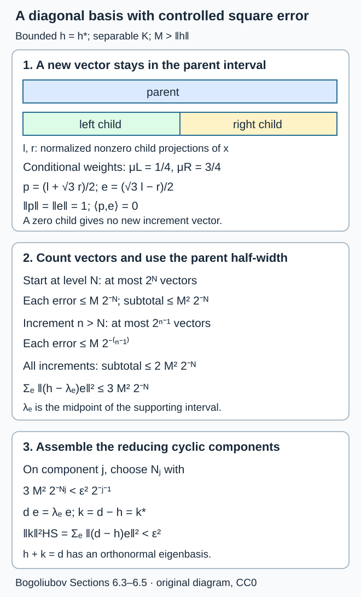

# Bogoliubov automorphisms and the Hilbert–Schmidt criterion

*Written by GPT-6.1 Sol (OpenAI), Ultra, September 2026; analytic proof route reconstructed and self-checked at Ultra, October 2026. New original text: public domain (CC0).*

A unitary change of one-particle coordinates acts on the CAR algebra. In its tracial representation this action extends normally to the hyperfinite factor. We prove that the resulting automorphism is inner exactly when the one-particle unitary differs from the identity by a Hilbert–Schmidt operator. The diagonal case is an infinite tensor product calculation. A controlled diagonal perturbation supplies the general case.

The concrete CAR, its half-state trace and its completed pointed matrix product are supplied by Fermions, Fock space and quasi-free factors, Sections 10 and 15–16. The diagonal step uses the proved product-innerness theorem. Section 6 below supplies the whole analytic passage to arbitrary unitaries: the Hilbert–Schmidt ideal, compact diagonalization, interval projections, a bounded logarithm, and a dyadic diagonal perturbation with an explicit square-sum bound. It also constructs the unitary groups and the resolvent criterion needed for the possibly unbounded statement in Lemma 3.1. Its continuous calculus is the complete local ITP F03–F04, F06 and F08 argument and its scalar proofs; the underlying Hilbert estimates are ITP Sections 10.1–10.2. Normal continuity is proved directly on square-summable vector coefficients. This route uses neither a factor uniqueness theorem nor a trace-density theorem.

Throughout, \(K\) is a separable infinite-dimensional complex Hilbert space, \(A=\operatorname{CAR}(K)\), and
\[
\tau=\omega_{1/2},\qquad
R=\pi_\tau(A)'',\qquad H_\tau=L^2(R,\tau).
\]
The preceding CAR lesson proves that \(R\) is an AFD factor of type \(\mathrm{II}_1\). We identify \(A\) with its faithful represented image. Write \(\|x\|_{2,\tau}=\tau(x^*x)^{1/2}\); the one-particle Hilbert–Schmidt norm is written \(\|\cdot\|_{\mathrm{HS}}\).

Our annihilator \(a(f)\) is conjugate-linear in \(f\). Thus
\[
\alpha_u(a(f))=a(uf),\qquad
\alpha_u\alpha_v=\alpha_{uv}. \tag{1}
\]
In particular an eigenvalue \(e^{is}\) multiplies the annihilator by \(e^{-is}\). The one-mode implementers below reflect this convention. Changing to a linear creation generator changes that sign and the placement of the occupation projections together; the trace criterion is unchanged.

## 1. Normal extension and continuity

Every tracial state on \(A\) restricts to the normalized trace on each finite-mode full matrix algebra. Their union is norm dense, so \(\tau\) is the unique tracial state. Hence \(\tau\alpha_u=\tau\).

**Theorem 1.1.** Each \(\alpha_u\) has a canonical normal extension to \(R\), still denoted by \(\alpha_u\). The map
\[
\mathcal U(K)\longrightarrow\operatorname{Aut}(R),\qquad u\longmapsto\alpha_u
\tag{2}
\]
is an injective continuous homomorphism, for the strong operator topology on \(\mathcal U(K)\) and the point-predual norm topology on \(\operatorname{Aut}(R)\).

**Proof.** On the dense tracial GNS subspace put
\[
W_u(x\Omega)=\alpha_u(x)\Omega,\qquad x\in A.
\tag{3}
\]
Trace preservation gives \(\|W_u(x\Omega)\|=\|x\Omega\|\), and \(W_{u^{-1}}\) gives its inverse. Thus \(W_u\) is unitary. On \(A\), \(W_u xW_u^*=\alpha_u(x)\), so conjugation maps \(R=A''\) onto itself and gives a normal extension. Two normal extensions agreeing on an ultraweakly dense algebra agree everywhere. Formula (3) also gives the homomorphism law.

If \(u_j\to u\) strongly, the CAR norm identity gives
\[
\|\alpha_{u_j}(a(f))-\alpha_u(a(f))\|=\|(u_j-u)f\|\longrightarrow0.
\]
Finite product telescoping and norm density give convergence on every \(x\in A\). Consequently \(W_{u_j}\to W_u\) strongly. Also \(u_j^*\to u^*\) strongly, since
\(\|(u_j^*-u^*)f\|=\|f-u_j u^*f\|\).

Here is the entire normal-functional argument, without a trace density. On the concrete \(R\subset B(H_\tau)\), a normal functional is the restriction of
\[
\psi(x)=\sum_{n=1}^\infty\langle \xi_n,x\eta_n\rangle,\qquad
\sum_n\|\xi_n\|^2<\infty,\quad\sum_n\|\eta_n\|^2<\infty.
\tag{4}
\]
The exact coefficient topology and its continuous dual are explained in Section 6.7. Conjugation by \(W_{u_j}\) pulls this functional back to the same series with \(\xi_n,\eta_n\) replaced by \(W_{u_j}^*\xi_n,W_{u_j}^*\eta_n\). Strong convergence of these adjoints follows from the already proved convergence for \(u_j^{-1}\). It implies convergence on each square-summable list in its square-sum norm: first retain finitely many vectors, and then bound each omitted difference by twice the vector's norm. Cauchy–Schwarz bounds the functional-norm difference by
\[
\big\|((W_{u_j}^*-W_u^*)\xi_n)_n\big\|_{\ell^2}\,
 \|(\eta_n)_n\|_{\ell^2}
+\|(\xi_n)_n\|_{\ell^2}\,
 \big\|((W_{u_j}^*-W_u^*)\eta_n)_n\big\|_{\ell^2}.
\]
This tends to zero and proves convergence in the specified point-predual norm topology. The finite-list and tail argument works for nets as well as sequences.

Finally, if \(\alpha_u=\operatorname{id}\), then \(a(uf-f)=0\). The identity \(\|a(g)\|=\|g\|\) makes \(uf=f\) for every \(f\), so \(u=1\). \(\square\)

Spatial implementation by \(W_u\) is always available. Innerness asks the stronger question whether an implementer belongs to \(R\).

## 2. Eigenvectors and tensor coordinates

Suppose \(uf_j=e^{is_j}f_j\) for an orthonormal basis \((f_j)\). Put
\[
a_j=a(f_j),\qquad n_j=a_j^*a_j,\qquad Z_j=1-2n_j,\qquad
b_j=Z_1\cdots Z_{j-1}a_j.
\tag{5}
\]
The CAR lesson proves that the matrix algebras \(N_j\) generated by \(b_j\) commute, generate \(R\), and identify it with the tracial product \(\bar\bigotimes_j(M_2,\operatorname{tr}_2)\). Their matrix units have
\(e_{11}^{(j)}=1-n_j\), \(e_{22}^{(j)}=n_j\), and \(e_{12}^{(j)}=b_j\).

Since \(\alpha_u(n_j)=n_j\), every parity factor in (5) is fixed. Hence
\[
\alpha_u(b_j)=e^{-is_j}b_j.
\]
Define the even one-mode unitary
\[
w_j=e^{-is_j/2}(1-n_j)+e^{is_j/2}n_j.
\tag{6}
\]
Matrix-unit multiplication gives
\[
w_jb_jw_j^*=e^{-is_j}b_j,\qquad
\tau(w_j)=\cos(s_j/2).
\tag{7}
\]
The diagonal projections and the adjoint generator transform as required. Thus \(N_j\) is invariant, its restriction is \(\operatorname{Ad}w_j\), and
\[
\alpha_u=\bigotimes_{j=1}^\infty\operatorname{Ad}w_j.
\tag{8}
\]
The identity first holds on every finite tensor prefix and then holds normally on \(R\).

**Theorem 2.1.** Under the eigenbasis assumption,
\[
\alpha_u\text{ is inner}
\quad\Longleftrightarrow\quad
\sum_j\bigl(1-|\cos(s_j/2)|\bigr)<\infty
\quad\Longleftrightarrow\quad
u-1\in\mathcal L^2(K).
\tag{9}
\]

**Proof.** Equations (7)–(8) and the already proved product-innerness theorem give the first equivalence, including finitely many zero overlaps. Put \(t_j=|\cos(s_j/2)|\). Then
\[
|e^{is_j}-1|^2
=4\sin^2(s_j/2)=4(1-t_j)(1+t_j),
\]
so
\[
4(1-t_j)\le |e^{is_j}-1|^2\le8(1-t_j).
\tag{10}
\]
Summing and using the basis definition of Hilbert–Schmidt class proves the second equivalence. \(\square\)

For sufficiency one can also see the implementer: adjust the scalar phase of each \(w_j\) so that its trace is nonnegative. The partial products converge strongly, together with their adjoints, by the product theorem's tail estimate. Their limit is a unitary in \(R\). Finitely many vanishing traces affect a finite prefix only.

## 3. Perturbing self-adjoint generators

We first justify the analytic estimate used to pass from an arbitrary unitary to a diagonal one. Section 6 proves its Hilbert–Schmidt facts and its unbounded-operator inputs.

**Lemma 3.1.** Let \(h\) be any self-adjoint operator on \(K\), possibly unbounded, and let \(k=k^*\in\mathcal L^2(K)\). On \(\operatorname{Dom}h\), \(h+k\) is self-adjoint. For every real \(t\),
\[
e^{-ith}e^{it(h+k)}-1
=i\int_0^t e^{-ish}k e^{is(h+k)}\,ds
\in\mathcal L^2(K),
\tag{11}
\]
where the integral converges in Hilbert–Schmidt norm. Moreover
\[
\|e^{-ith}e^{it(h+k)}-1\|_{\mathrm{HS}}
\le |t|\,\|k\|_{\mathrm{HS}}.
\tag{12}
\]

**Proof.** Hilbert–Schmidt operators are bounded. For sufficiently large \(r>0\),
\[
h+k\mp ir
=\bigl(1+k(h\mp ir)^{-1}\bigr)(h\mp ir)
\]
has a bounded inverse, since \(\|k(h\mp ir)^{-1}\|\le\|k\|/r<1\). Bounded addition preserves closedness on \(\operatorname{Dom}h\), and the sum is symmetric. Surjectivity at both imaginary points is the self-adjoint resolvent criterion proved in Section 6.6, so \(h+k\) is self-adjoint on that domain.

The groups constructed in Section 6.6 preserve their generator domains and have the stated strong derivatives there. Thus the unitary group of \(h+k\) preserves \(\operatorname{Dom}(h+k)=\operatorname{Dom}h\). For \(\xi\) in this common domain the strong product derivative is legitimate and equals
\[
\frac{d}{ds}\bigl(e^{-ish}e^{is(h+k)}\xi\bigr)
=i e^{-ish}k e^{is(h+k)}\xi.
\tag{13}
\]
Indeed the two terms containing \(h\), evaluated on \(e^{is(h+k)}\xi\), cancel. Integrating gives (11) on the dense common domain.

The needed graph continuity is explicit:
\(h e^{is(h+k)}\xi=e^{is(h+k)}(h+k)\xi-k e^{is(h+k)}\xi\)
is continuous in \(s\). Thus the domain differentiation uses a graph-continuous vector path, not an operator-norm derivative of the unbounded generator's group.

For a finite-rank middle operator, the integrand in (11) is Hilbert–Schmidt norm continuous: write it as a finite sum of rank-one operators and use strong continuity of both unitary groups and their adjoints. Approximate a general \(k\) in Hilbert–Schmidt norm by finite-rank operators, keeping both unitary groups fixed and replacing only their middle factor. The ideal bound and unitarity make that approximation uniform in \(s\). The integrand is therefore Hilbert–Schmidt norm continuous, with norm \(\|k\|_{\mathrm{HS}}\). Its Banach-space integral has norm at most \(|t|\|k\|_{\mathrm{HS}}\), and is a bounded operator. Density extends the integrated domain identity to all of \(K\). This proves (11)–(12), with the usual reversed orientation for \(t<0\). \(\square\)

**Lemma 3.2.** If \(v\) is unitary and \(v-1\) is compact, then \(v\) has an orthonormal basis of eigenvectors.

**Proof.** The compact operator \(T=v-1\) is normal, because both \(T^*T\) and \(TT^*\) equal \(2-v-v^*\). Its real and imaginary parts are commuting compact self-adjoint operators. Decompose by the compact self-adjoint diagonalization proved in Section 6.2 for \(\operatorname{Re}T\). Every nonzero eigenspace is finite dimensional and is preserved by \(\operatorname{Im}T\), so diagonalize the latter on each. On \(\ker\operatorname{Re}T\), diagonalize its compact self-adjoint restriction \(\operatorname{Im}T\), including a basis of the joint kernel. The resulting orthonormal basis diagonalizes both parts, hence \(T\) and \(v\). \(\square\)

**Lemma 3.3.** For every unitary \(u\) on \(K\) and every \(\varepsilon>0\), there is a unitary \(v\) with
\[
v-1\in\mathcal L^2(K),\qquad
\|v-1\|_{\mathrm{HS}}<\varepsilon,
\]
such that \(w=uv\) has an orthonormal basis of eigenvectors.

**Proof.** Section 6.4 constructs a self-adjoint logarithm \(h\), with \(\|h\|\le\pi\), such that \(u=e^{ih}\), from continuous functions of its real part and the positive and negative subspaces of its imaginary part. Section 6.5 proves the required bounded Weyl–von Neumann statement at separable Hilbert-space generality: it supplies a self-adjoint \(k\in\mathcal L^2(K)\), with \(\|k\|_{\mathrm{HS}}<\varepsilon\), for which \(h+k\) has an orthonormal eigenbasis. Set
\[
v=e^{-ih}e^{i(h+k)},\qquad w=uv=e^{i(h+k)}.
\tag{14}
\]
These operators are unitary. Lemma 3.1 at \(t=1\) gives the required Hilbert–Schmidt estimate, and \(w\) is diagonal on the eigenbasis of \(h+k\). \(\square\)

Separability enters through this diagonal perturbation input. The argument does not assert the same diagonal perturbation theorem on an arbitrary nonseparable space.

## 4. The general innerness theorem

**Theorem 4.1.** For every unitary \(u\) on the separable infinite-dimensional space \(K\),
\[
\boxed{\ \alpha_u\text{ is inner on }R
\quad\Longleftrightarrow\quad u-1\in\mathcal L^2(K).\ }
\tag{15}
\]

**Proof.** Choose \(v,w\) as in Lemma 3.3. Since \(v-1\) is Hilbert–Schmidt, it is compact. Lemma 3.2 makes \(v\) diagonalizable, so Theorem 2.1 proves that \(\alpha_v\) is inner. As \(\alpha_w=\alpha_u\alpha_v\), membership in the subgroup of inner automorphisms gives
\[
\alpha_u\text{ inner}\quad\Longleftrightarrow\quad
\alpha_w\text{ inner}.
\tag{16}
\]
The eigenbasis of \(w\) and Theorem 2.1 identify the right side with \(w-1\in\mathcal L^2(K)\). Finally
\[
w-1=(u-1)+u(v-1),\qquad
u-1=(w-1)-u(v-1).
\tag{17}
\]
The Hilbert–Schmidt class is a linear two-sided ideal, so these identities make \(w-1\) Hilbert–Schmidt exactly when \(u-1\) is. This proves both implications without assuming the desired result for the original arbitrary \(u\). \(\square\)

**Example 4.2.** A nontrivial scalar gauge \(u=e^{is}1\), \(s\notin2\pi\mathbb Z\), produces an outer automorphism of \(R\): \(u-1\) has the same nonzero norm on infinitely many orthonormal vectors and is not Hilbert–Schmidt. Every finite-mode restriction is nevertheless inner by (6). Conversely every unitary equal to the identity off a finite-dimensional subspace gives an inner automorphism.

## 5. Exercises with complete solutions

**Exercise 1.** Show directly that trace preservation in Section 1 follows from finite-mode matrix traces even if \(u\) does not preserve a chosen increasing sequence of finite-mode algebras.

*Solution.* Fix a finite-dimensional \(E\subset K\), and set \(d=\dim E\). Matching the fields sends \(\operatorname{CAR}(E)\) onto \(\operatorname{CAR}(uE)\); the inverse matches them using \(u^*\). Both are full matrices of size \(2^d\).

The normalized trace can be recovered from matrix-unit multiplication alone. A tracial state \(t\) vanishes on \(e_{ab}\) for \(a\ne b\), since \(e_{aa}e_{ab}=e_{ab}\) but \(e_{ab}e_{aa}=0\). Also
\[
t(e_{aa})=t(e_{ab}e_{ba})=t(e_{ba}e_{ab})=t(e_{bb}).
\]
Their sum is \(t(1)=1\), so each diagonal value is \(2^{-d}\). Consequently the pullback of the trace on \(\operatorname{CAR}(uE)\) is the trace on \(\operatorname{CAR}(E)\), and \(\tau(\alpha_u(x))=\tau(x)\) for every \(x\) in that algebra.

Every CAR polynomial lies in some finite \(E\). For \(x\in A\), choose such a polynomial \(x_0\) with \(\|x-x_0\|<\varepsilon\). The automorphism is isometric and the state has norm one, giving
\[
|\tau(\alpha_u(x))-\tau(x)|\le2\varepsilon.
\]
Letting \(\varepsilon\to0\) proves trace preservation on \(A\). This uses the directed collection of all finite subspaces, including \(uE\); a fixed exhaustion need not be invariant.

**Exercise 2.** Verify the one-mode phase in (7), including its action on the occupation projection.

*Solution.* Write \(q=1-n\). The one-mode relations give \(qb=b\), \(nb=0\), \(bq=0\), and \(bn=b\). For \(w=e^{-is/2}q+e^{is/2}n\),
\[
wb=e^{-is/2}b,\qquad bw^*=e^{-is/2}b,
\qquad wbw^*=e^{-is}b.
\]
Taking adjoints gives \(wb^*w^*=e^{is}b^*\). Orthogonality of \(q,n\) proves \(w^*w=ww^*=q+n=1\), and \(w\) commutes with each projection, so \(wnw^*=n\) and \(wqw^*=q\). The tracial one-mode values are \(\tau(q)=\tau(n)=1/2\); hence
\[
\tau(w)=\tfrac12(e^{-is/2}+e^{is/2})=\cos(s/2).
\]
The annihilator convention is essential: \(a(e^{is}f)=e^{-is}a(f)\), exactly the phase just computed.

**Exercise 3.** Explain why diagonalizing a one-particle unitary does not make the raw one-mode CAR algebras commute, and why the tensor calculation still works.

*Solution.* A coordinate change preserves the CAR. For \(i\ne j\), \(a_i a_j=-a_j a_i\), and this product is nonzero: it removes two occupied modes from their common finite occupation vector. Thus the raw one-mode algebras still do not commute.

Let \(S_j=Z_1\cdots Z_{j-1}\), so \(b_j=S_j a_j\). For \(i<j\), the string \(S_j\) contains \(Z_i\), which anticommutes with \(a_i\), while the other string factors commute with it. The earlier string commutes with \(a_j\). Therefore
\[
b_i b_j=-S_iS_j a_i a_j=S_iS_j a_j a_i=b_j b_i.
\]
Replacing either field by its adjoint gives the same two canceling signs. These are the commuting full matrix legs \(N_j\).

Furthermore \(b_j^*b_j=n_j\). A diagonal \(\alpha_u\) fixes \(n_j\), hence \(Z_j\) and every \(S_j\), and sends \(b_j\) to \(e^{-is_j}b_j\). Exercise 2 supplies the even implementer \(w_j\) on each \(N_j\). The resulting product calculation applies to these commuting legs and their normal closure \(R\), with overlaps \(\cos(s_j/2)\); it does not assert commutation of the raw fields.

**Exercise 4.** Let \(u f_j=e^{i/j}f_j\). Is \(\alpha_u\) inner? Is \(u-1\) trace class?

*Solution.* Put \(T=u-1\). Its diagonal entries are \(d_j=e^{i/j}-1\). Integrating the scalar derivative of \(e^{it}\) gives \(|e^{ix}-1|\le|x|\), and hence
\[
\|T\|_{\mathrm{HS}}^2=\sum_j|d_j|^2\le\sum_jj^{-2}<\infty.
\]
For example, the block \(2^n\le j<2^{n+1}\) contributes at most \(2^{-n}\), so the last sum is at most \(2\).

Innerness also has a concrete limit here. Take the \(w_j\) of (6), whose traces \(r_j=\cos(1/(2j))\) are positive, and let \(W_m=\prod_{j\le m}w_j\). For \(n>m\),
\[
\|(W_n-W_m)\Omega\|^2
=2\Bigl(1-\prod_{m<j\le n}r_j\Bigr)
\le2\sum_{j>m}(1-r_j)
\le\tfrac14\sum_{j>m}j^{-2}.
\]
The same estimate on every finite-support vector and for adjoints gives strong* convergence to a unitary \(W\in R\). Its conjugation on each finite leg is eventually \(\alpha_u\), so \(W\) implements the normal automorphism.

For trace class, \(T^*T\) is diagonal with entries \(|d_j|^2\), so its positive square root has eigenvalues
\[
|d_j|=2\sin(1/(2j))\ge \frac{2}{\pi j}.
\]
The inequality follows from the chord bound \(\sin t\ge2t/\pi\) on \([0,\pi/2]\). The harmonic sum diverges: every block \(2^n\le j<2^{n+1}\) contributes at least \(1/2\). Thus these singular values are not summable and \(T\) is not trace class.

**Exercise 5.** Repeat Exercise 4 with \(u f_j=e^{i/\sqrt j}f_j\). Show that compactness alone cannot replace Hilbert–Schmidt class.

*Solution.* Here the diagonal entries are \(d_j=e^{i/\sqrt j}-1\). If \(P_m\) projects onto the first \(m\) basis vectors, then \(TP_m\) is finite rank and
\[
\|T-TP_m\|=\sup_{j>m}|d_j|\le(m+1)^{-1/2}\longrightarrow0.
\]
Thus \(T=u-1\) is compact. The same scalar chord estimate as above gives
\[
|d_j|=2\sin(1/(2\sqrt j))\ge\frac{2}{\pi\sqrt j},
\qquad |d_j|^2\ge\frac{4}{\pi^2j}.
\]
Its Hilbert–Schmidt square sum diverges. Its singular-value sum diverges as well, so the answer to the trace-class question repeated from Exercise 4 is also negative.

To see the obstruction in tensor coordinates, set \(r_j=\cos(1/(2\sqrt j))\). Since \(|d_j|^2=4(1-r_j)(1+r_j)\le8(1-r_j)\), the overlap defects have divergent sum. If a unitary \(U\in R\) implemented the product action, the expectation argument of Theorem 7.2 in the tensor-product lesson would give
\[
E_m(U)=a_m\prod_{j\le m}w_j,\qquad |a_m|\to1,\qquad
a_m=a_n\prod_{m<j\le n}r_j.
\]
Choosing \(m\) with \(|a_m|>0\) would bound every subsequent defect sum by \(-\log|a_m|\), a contradiction. Hence \(\alpha_u\) is outer. The explicit norm approximation above shows why compactness does not suffice.

**Exercise 6.** Can an inner diagonal Bogoliubov automorphism have a one-mode implementer of trace zero? Can it have infinitely many such modes?

*Solution.* The overlap vanishes exactly when \(\cos(s_j/2)=0\), that is, when \(e^{is_j}=-1\). Suppose first that this occurs on a finite set \(F\), and the remaining eigenvalues are \(1\). Then
\[
\|u-1\|_{\mathrm{HS}}^2=4|F|,
\qquad W=\prod_{j\in F}(-iZ_j)
\]
is an even finite CAR unitary implementing the required sign changes. For a single such mode, \(u-1\) has rank one. Thus one trace-zero mode, or any finite number, is compatible with innerness.

If there are infinitely many such modes, each contributes \(4\) to that square sum and \(1\) to the overlap-defect sum in (9). The diagonal necessity criterion rules out innerness.

A finite zero-overlap prefix also causes no problem when the later modulus defects are summable. Past that prefix, replace each \(w_j\) by a scalar multiple with trace \(r_j=|\cos(s_j/2)|>0\); scalar multiplication leaves its conjugation unchanged. For these normalized partial products, the squared difference on a local vector is \(2\|\xi\|^2(1-\prod_{\text{tail}}r_j)\); multiplying by the fixed prefix leaves this norm unchanged. The adjoint estimate is identical. Thus tail convergence can produce a unitary even though the trace of the whole prefix is zero.

**Exercise 7.** Prove the continuity of the Hilbert–Schmidt integrand in (11) for a rank-one operator, without operator-norm continuity of an unbounded generator's unitary group.

*Solution.* Allow arbitrary \(\xi,\eta\in K\), with no generator-domain assumption, and put \(\theta_{\xi,\eta}z=\xi\langle\eta,z\rangle\). For the fixed groups \(U(s)=e^{-ish}\), \(V(s)=e^{is(h+k)}\), unitarity and the adjoint identity give
\[
U(s)\theta_{\xi,\eta}V(s)
=\theta_{U(s)\xi,V(s)^*\eta}.
\]
Parseval gives \(\|\theta_{\xi,\eta}\|_{\mathrm{HS}}=\|\xi\|\|\eta\|\). Subtract the expressions at \(s,t\), adding and subtracting \(\theta_{U(t)\xi,V(s)^*\eta}\), to obtain
\[
\begin{aligned}
&\|U(s)\theta_{\xi,\eta}V(s)-U(t)\theta_{\xi,\eta}V(t)\|_{\mathrm{HS}}\\
&\quad\le\|\eta\|\,\|(U(s)-U(t))\xi\|
+\|\xi\|\,\|(V(s)^*-V(t)^*)\eta\|.
\end{aligned}
\]
Both terms vanish as \(s\to t\) by strong continuity; \(V(s)^*=e^{-is(h+k)}\) is the negative-time group. This proves Hilbert–Schmidt norm continuity even for unbounded \(h\). Only the two individual vector orbits are estimated; no operator-norm continuity of either group is used. Finite sums and uniform Hilbert–Schmidt approximation extend the argument to the middle factors in (11).

**Exercise 8.** For commuting bounded self-adjoint \(h,k\), simplify (11) and check its sign.

*Solution.* Since bounded \(h,k\) commute, their exponential series can be multiplied and regrouped, giving
\[
e^{is(h+k)}=e^{ish}e^{isk},\qquad
e^{-ish}k e^{is(h+k)}=k e^{isk}.
\]
Thus the left side of (11) is \(e^{itk}-1\), and its right side is
\[
i\int_0^t k e^{isk}\,ds=e^{itk}-1,
\]
because the norm derivative of \(e^{isk}\) is \(ik e^{isk}\). This also holds for \(t<0\), with the oriented integral \(\int_0^t=-\int_t^0\). The first-order term \(itk\) checks the positive sign. When \(k\) is Hilbert–Schmidt, as in Lemma 3.1, unitary invariance of that norm gives the bound \(|t|\|k\|_{\mathrm{HS}}\); the bounded-operator identity itself does not require this extra assumption. The same bound follows without an integral after diagonalizing the compact self-adjoint \(k\): if its eigenvalues, including zeros, are \(\mu_j\), then
\[
\|e^{itk}-1\|_{\mathrm{HS}}^2
=\sum_j|e^{it\mu_j}-1|^2
\le t^2\sum_j\mu_j^2=t^2\|k\|_{\mathrm{HS}}^2.
\]

**Exercise 9.** In the proof of Theorem 4.1, explain why the fact that \(v-1\) is Hilbert–Schmidt proves innerness of \(\alpha_v\) without circular reasoning.

*Solution.* The argument first reduces \(v\) to the already proved diagonal case. Section 6.1 approximates \(v-1\) in operator norm by finite-rank operators, so it is compact. It is also normal:
\[
(v-1)^*(v-1)=(v-1)(v-1)^*=2-v-v^*.
\]
Its commuting compact self-adjoint real and imaginary parts can be diagonalized together as in Section 6.2. Nonzero eigenspaces of the real part are finite-dimensional; diagonalize the imaginary part there and on the real part's kernel, retaining a basis of the joint kernel. This gives an eigenbasis for \(v\), including its \(1\)-eigenspace.

Write its eigenvalues as \(e^{it_j}\). Basis independence of the Hilbert–Schmidt norm gives
\[
\sum_j|e^{it_j}-1|^2=\|v-1\|_{\mathrm{HS}}^2<\infty,
\qquad
\sum_j(1-|\cos(t_j/2)|)\le\tfrac14\|v-1\|_{\mathrm{HS}}^2.
\]
Theorem 2.1, whose proof uses the product implementer and expectation-tail calculation, therefore proves \(\alpha_v\) inner. This argument uses only Lemma 3.2 and the diagonal theorem established before Theorem 4.1. It never applies the desired arbitrary-unitary equivalence to \(v\). Only now use \(w=uv\) and \(\alpha_w=\alpha_u\alpha_v\): composition and inversion of inner automorphisms remain inner, so (16) transfers the question from \(u\) to the diagonal \(w\).

**Exercise 10.** Show that \(\mathcal U_2(K)=\{u\in\mathcal U(K):u-1\in\mathcal L^2(K)\}\) is a subgroup. Show that it is normal in \(\mathcal U(K)\).

*Solution.* The identity belongs to \(\mathcal U_2(K)\). For two members \(u,v\),
\[
uv-1=(u-1)+u(v-1),\qquad
\|uv-1\|_{\mathrm{HS}}\le\|u-1\|_{\mathrm{HS}}+\|v-1\|_{\mathrm{HS}}.
\]
The two-sided ideal and linearity proved in Section 6.1 put this difference in the Hilbert–Schmidt class. For inverses,
\[
u^{-1}-1=-u^*(u-1),\qquad
\|u^{-1}-1\|_{\mathrm{HS}}=\|u-1\|_{\mathrm{HS}}.
\]
Thus the set is a subgroup. Finally, for any unitary \(w\), without any Hilbert–Schmidt assumption on \(w-1\),
\[
wuw^*-1=w(u-1)w^*,\qquad
\|wuw^*-1\|_{\mathrm{HS}}=\|u-1\|_{\mathrm{HS}}.
\]
Conjugation preserves membership, which is precisely normality of this subgroup in \(\mathcal U(K)\). The proved equivalence (15) also gives the exact identification
\[
\mathcal U_2(K)=\{u:\alpha_u\in\operatorname{Int}(R)\},
\]
the preimage of the inner subgroup under (2).

**Exercise 11.** Let \(u f_j=e^{is_j}f_j\), and let \(u_m\) agree with \(u\) on \(f_1,\ldots,f_m\) and with the identity on the remaining basis vectors. Prove that inner automorphisms \(\alpha_{u_m}\) can converge to an outer \(\alpha_u\).

*Solution.* For \(f=\sum_j c_jf_j\), the truncation has
\[
\|(u_m-u)f\|^2
=\sum_{j>m}|1-e^{is_j}|^2|c_j|^2
\le4\sum_{j>m}|c_j|^2\longrightarrow0.
\]
The same estimate applies to adjoints. Moreover \(u_m-1\) has finite rank. A finite implementer is \(W_m=\prod_{j\le m}w_j\) in the corresponding finite CAR algebra; its evenness fixes all later fields.

The convergence on one-particle vectors implies convergence in norm on every CAR generator. Telescoping a polynomial and using norm density then proves point-norm convergence \(\alpha_{u_m}(x)\to\alpha_u(x)\) on \(A\). For the extensions to \(R\), let \(V_m,V\) be their trace-preserving GNS unitaries from (3). They converge strongly together with their adjoints. If \(\psi(x)=\sum_l\langle\xi_l,x\eta_l\rangle\) is any normal coefficient series, the pullback difference has norm at most
\[
\|((V_m^*-V^*)\xi_l)_l\|_{\ell^2}\|(\eta_l)_l\|_{\ell^2}
+\|(\xi_l)_l\|_{\ell^2}\|((V_m^*-V^*)\eta_l)_l\|_{\ell^2}.
\]
Finite-list convergence followed by a uniformly bounded square-summable tail proves that this tends to zero. Hence convergence also holds in the point-predual norm topology of Theorem 1.1.

If \(\sum_j|e^{is_j}-1|^2=\infty\), the limit is outer. Taking \(s_j=1/\sqrt j\) gives the compact example of Exercise 5; taking \(s_j=\pi\) gives the constant gauge \(u=-1\), for which \(u-1=-2\,1\) is not Hilbert–Schmidt. In each case the approximating automorphisms are inner and the limit is outer.

The full density assertion for \(\operatorname{Int}(R)\) can also be verified from these local tools. Given any normal automorphism \(\beta\) of \(R\), the normal trace \(\tau\beta\) restricts on each finite matrix algebra \(A_n\) to its unique normalized trace. Ultraweak density therefore gives \(\tau\beta=\tau\). If \((e_{ij})_{1\le i,j\le2^n}\) are its matrix units, \(e_{11}\) and \(\beta(e_{11})\) have equal trace. Projection comparison in the finite factor, with faithfulness killing any equal-trace remainder, supplies \(v^*v=e_{11}\), \(vv^*=\beta(e_{11})\). Define
\[
Z_n=\sum_{i=1}^{2^n}\beta(e_{i1})v e_{1i}.
\]
Matrix-unit multiplication gives \(Z_n^*Z_n=Z_nZ_n^*=1\) and \(Z_ne_{ij}Z_n^*=\beta(e_{ij})\). Thus \(\gamma_n=\operatorname{Ad}Z_n\) agrees with \(\beta\) on \(A_n\). For every \(x\in R\),
\[
\|\gamma_n(x)-\beta(x)\|_{2,\tau}
\le2\|x-E_n(x)\|_{2,\tau}\longrightarrow0.
\]
Here both automorphisms preserve \(\tau\), and the finite expectations recover every GNS vector. Their trace-preserving GNS unitaries consequently converge strongly, together with their adjoints, to that of \(\beta\). The same square-summable coefficient estimate above proves point-predual norm convergence. Hence \(\operatorname{Int}(R)\) is dense in \(\operatorname{Aut}(R)\), while the outer example proves it is proper.

**Exercise 12.** A unitary \(u\) is the identity off a \(d\)-dimensional reducing subspace \(E\). Locate an implementer of \(\alpha_u\) inside the finite CAR algebra and verify that it commutes with all tail annihilators.

*Solution.* Choose an orthonormal eigenbasis \(f_1,\ldots,f_d\) for the finite unitary \(u|_E\), with eigenvalues \(e^{is_j}\), and put \(n_j=a(f_j)^*a(f_j)\). The unitary
\[
W=\prod_{j=1}^d
\bigl(e^{-is_j/2}(1-n_j)+e^{is_j/2}n_j\bigr)
\]
belongs to \(\operatorname{CAR}(E)\). Each factor is even, and the factors commute because the occupation projections commute. For \(i\ne j\), \(n_i\) commutes with \(a(f_j)\) by two CAR sign changes. Exercise 2 therefore gives \(Wa(f_j)W^*=e^{-is_j}a(f_j)=a(uf_j)\).

For \(g\in E^\perp\), the CAR gives
\[
n_j a(g)=a(f_j)^*a(f_j)a(g)
=-a(f_j)^*a(g)a(f_j)=a(g)n_j.
\]
Thus every factor of \(W\), and \(W\) itself, commutes with every tail annihilator and its adjoint. Its conjugation fixes \(a(g)=a(ug)\). Splitting an arbitrary \(f\) into \(E\) and \(E^\perp\) proves the desired action on all generators and hence on the completed algebra and its normal closure. For \(d=0\), the empty product is \(1\).

## 6. Complete analytic support for the proof route

These supporting arguments do not add numbered results to the original six statements. They prove the exact analytic inputs used there. We work with complete complex Hilbert spaces, bounded adjoints, and the continuous calculus proved in ITP F03–F04, F06 and F08, whose scalar completeness, polynomial approximation, exponential series and Banach-valued integral proofs are in [Elementary calculus for infinite products](elementary-calculus-for-infinite-products.md). These are local proof providers, rather than a citation to a projection-valued spectral theorem. The Hilbert-space completion, orthogonal projection, Riesz and adjoint arguments are the full ITP Sections 10.1–10.2 constructions.

### 6.1. The Hilbert–Schmidt space and its whole ideal estimate

A countable orthonormal basis of a separable Hilbert space is obtained by applying Gram–Schmidt to a countable dense sequence and discarding zero residuals. Each original vector belongs to the span of the residuals through its stage. The completed span is therefore the whole space. Orthogonal finite partial sums give Pythagoras; their distance to a vector tends to zero by this density. This proves Parseval. Bessel's inequality is the same finite Pythagoras estimate without totality. The assertions also cover finite-dimensional and zero subspaces.

For a bounded \(T\), define
\[
\|T\|_{\mathrm{HS}}^2=\sum_j\|Te_j\|^2
\]
on an orthonormal basis \((e_j)\). Nonnegative double sums can be interchanged: both iterated sums are the supremum of all finite rectangle sums. Thus Parseval on a second basis \((f_l)\) gives
\[
\sum_j\|Te_j\|^2
=\sum_{j,l}|\langle f_l,Te_j\rangle|^2
=\sum_l\|T^*f_l\|^2.                                      \tag{A1}
\]
Keep the second basis fixed and change the first; this proves basis independence. It also proves \(\|T^*\|_{\mathrm{HS}}=\|T\|_{\mathrm{HS}}\), allowing either side to be infinite.

For a finite sum \(x=\sum_j c_je_j\), Cauchy–Schwarz gives
\[
\|Tx\|\le\Big(\sum_j|c_j|^2\Big)^{1/2}
            \Big(\sum_j\|Te_j\|^2\Big)^{1/2}.
\]
Density proves \(\|T\|\le\|T\|_{\mathrm{HS}}\). Conversely any square-summable matrix \((t_{lj})\) defines an operator on finite coordinate vectors with exactly this bound; it extends boundedly to the Hilbert completion and has the prescribed columns. Consequently the Hilbert–Schmidt space is the complete Hilbert space of these matrices, with its square-sum inner product. Its norm triangle inequality and its linearity are the Hilbert-space ones, with no spectral or singular-value premise.

For \(S,T\) Hilbert–Schmidt or bounded as appropriate,
\[
\|BT\|_{\mathrm{HS}}\le\|B\|\,\|T\|_{\mathrm{HS}},
\qquad
\|TB\|_{\mathrm{HS}}
=\|B^*T^*\|_{\mathrm{HS}}
\le\|B\|\,\|T\|_{\mathrm{HS}}.                             \tag{A2}
\]
This proves the linear two-sided ideal property. If \(B,C\) are unitary, apply the bounds both to \(BTC\) and to \(B^*(BTC)C^*\); hence
\[
\|BTC\|_{\mathrm{HS}}=\|T\|_{\mathrm{HS}}.                  \tag{A3}
\]
Writing \(P_m\) for the first \(m\) basis vectors,
\[
\|T-TP_m\|_{\mathrm{HS}}^2=\sum_{j>m}\|Te_j\|^2\longrightarrow0.
\]
Thus finite-rank operators are dense in this norm and every Hilbert–Schmidt operator is compact. To justify that last word explicitly, a finite-rank operator maps the unit ball into a bounded finite-dimensional set, which has finite nets of every positive radius by coordinate compactness. A norm limit of such operators has the same finite-net property, by approximation in operator norm. Any sequence in its image then has a Cauchy subsequence, by successive finite-net extraction; Hilbert completeness gives its limit. This is compactness.

Conversely, let \(T\) be any compact bounded operator. Its unit-ball image has a finite \(\delta\)-net for every \(\delta>0\): otherwise successive choices at pairwise distance at least \(\delta\) would give a sequence with no convergent subsequence, contrary to compactness. Take net points \(y_1,\ldots,y_m\) and the orthogonal projection \(P\) onto their finite-dimensional span. Since that projection gives the nearest vector in its range,
\[
\|(1-P)Tx\|\le\delta\quad(\|x\|\le1),\qquad
\|T-PT\|\le\delta.
\]
Thus every compact operator is a norm limit of finite-rank operators. Adjoint isometry gives \(T^*=\lim(PT)^*\) in norm, and \((PT)^*=T^*P\) has finite-dimensional range. The first direction above makes \(T^*\) compact. Finite sums and scalar multiples are compact by adding their finite-rank approximations. This proves, in particular, compactness of both real and imaginary parts for the arbitrary compact \(T=v-1\) in Lemma 3.2; it does not assume that \(T\) is Hilbert–Schmidt.

For the rank-one operator
\(\theta_{\xi,\eta}z=\xi\langle\eta,z\rangle\), Parseval gives
\[
\|\theta_{\xi,\eta}\|_{\mathrm{HS}}=\|\xi\|\,\|\eta\|.       \tag{A4}
\]
These are all ideal, compactness, rank-one and completeness facts used in Lemmas 3.1–3.3 and in Exercises 7–10.

### 6.2. Compact self-adjoint diagonalization, including the zero eigenspace

A finite-dimensional self-adjoint operator is diagonalizable by an orthonormal basis. Here is the needed elementary proof. Its quadratic form is real and attains its maximum on the unit sphere, by finite-dimensional coordinate compactness. At a maximizing unit vector \(x\), varying the normalized vector \(x+tz\), for \(z\perp x\), first with real \(t\) and then with purely imaginary \(t\), makes both components of \(\langle z,Tx\rangle\) zero. Thus \(Tx\) is a real scalar multiple of \(x\). Its orthogonal complement is invariant, and induction supplies the remaining eigenvectors. In this basis the operator norm is the largest absolute eigenvalue, and the largest absolute value of its quadratic form is that same number.

For any bounded self-adjoint \(T\), put
\(m=\sup_{\|x\|=1}|\langle x,Tx\rangle|\).
The easy bound is \(m\le\|T\|\). For a unit \(x\), compress to the at most two-dimensional space spanned by \(x,Tx\). The compressed self-adjoint operator sends \(x\) to \(Tx\), so its norm is at least \(\|Tx\|\). The finite result makes its norm a quadratic-form value, hence at most \(m\). Taking the supremum over \(x\) gives \(m=\|T\|\).

Now assume \(T\ne0\) is compact and self-adjoint; let \(M=\|T\|\). Choose unit \(x_j\) whose quadratic-form absolute values tend to \(M\), and pass to one of the two signs. With \(\lambda=M\) or \(-M\) according to that sign,
\[
\|(T-\lambda)x_j\|^2
=\|Tx_j\|^2-2\lambda\langle x_j,Tx_j\rangle+\lambda^2
\le2M\bigl(M-\operatorname{sgn}(\lambda)
                  \langle x_j,Tx_j\rangle\bigr)\longrightarrow0.
\]
Compactness supplies a convergent subsequence of \(Tx_j\); since \(\lambda\ne0\), the displayed estimate makes the corresponding \(x_j\) converge to a unit eigenvector with eigenvalue \(\lambda\).

Restrict to its orthogonal complement and repeat while the restriction is nonzero. Each restriction remains self-adjoint and compact. The selected eigenvectors \(e_j\) are orthonormal, and each selected \(|\lambda_j|\) is the norm of the remaining restriction before that step. If infinitely many are selected, \(\lambda_j\to0\): otherwise the orthogonal vectors \(Te_j=\lambda_je_j\) would have an infinite subsequence separated by a fixed positive distance, contradicting compactness. Hence the restriction norms tend to zero. Every vector orthogonal to all the selected \(e_j\) is killed by \(T\). If the procedure stops finitely, the same assertion holds by its stopping condition. A nonzero eigenspace is finite dimensional, since an infinite orthonormal sequence in it would give the same contradiction. Adding a basis of the kernel therefore gives the full orthonormal diagonalization, with every nonzero eigenvalue included.

For a compact normal \(T\), its real and imaginary parts are compact self-adjoint and commute. The preceding decomposition of its real part has finite-dimensional nonzero eigenspaces invariant under the imaginary part; diagonalize on each. Its kernel is also reducing, and the compact self-adjoint diagonalization of the imaginary part on that kernel completes the basis. This proves the precise normal-compact input in Lemma 3.2.

### 6.3. Interval projections from continuous positive parts

We construct only the projections the approximation needs. This avoids assuming a full Borel calculus or a measure representation. The continuous calculus gives positive roots and
\(T_+=\max(T,0)\), \(T_-=\max(-T,0)\), with
\(T=T_+-T_-\) and \(T_+T_-=0\).
For concrete self-adjoint operators the spectral and quadratic-form meanings of positivity agree. A nonnegative continuous function is the square of its continuous nonnegative root, so its evaluation is \(b^*b\) and has nonnegative quadratic form. Conversely, if a self-adjoint \(S\) has nonnegative quadratic form, then \(S+r\) has a bounded inverse for every \(r>0\): Cauchy–Schwarz gives
\(\|(S+r)x\|\ge r\|x\|\), its range is closed, and its orthogonal complement is \(\ker(S+r)=0\). The real-spectrum assertion from ITP F04 therefore excludes every negative spectral value. These arguments also justify transferring order bounds to norm bounds through the continuous calculus.

For a positive bounded \(B\), the positive contractions
\[
r_\delta=B(B+\delta)^{-1}\quad(\delta>0)
\]
converge strongly to the projection onto \(\overline{\operatorname{Ran}B}\). They kill \(\ker B\), and on a vector \(By\),
\[
\|(1-r_\delta)By\|
=\|\delta B(B+\delta)^{-1}y\|\le\delta\|y\|.
\]
Uniform boundedness by one extends convergence from this dense range to its closure. Since
\((\operatorname{Ran}B)^\perp=\ker B\), these two spaces exhaust the Hilbert space. This proves the assertion and also shows that the support projection is a strong limit of continuous functions of \(B\).

For bounded self-adjoint \(h\), let
\[
E_a=\text{orthogonal projection onto }\ker(h-a)_+ .
\]
It commutes with \(h\), with every continuous function of \(h\), and with every operator commuting with \(h\); use the just proved strong-limit formula for \(1-E_a\). If \(a\le b\), the continuous scalar inequality
\((t-b)_+\le(t-a)_+\) gives
\(\ker(h-a)_+\subset\ker(h-b)_+\).
Thus \(E_a\le E_b\). On \(E_aK\), \(h\le a\); on \((1-E_a)K\), \((h-a)_-=0\), because the latter vanishes on the range of \((h-a)_+\). Hence \(h\ge a\) there. It follows that
\[
Q_{a,b}=E_b-E_a,\qquad
a\,Q_{a,b}\le hQ_{a,b}\le b\,Q_{a,b}\quad(a<b),             \tag{A5}
\]
and, for the midpoint \(c=(a+b)/2\),
\[
\|(h-c)Q_{a,b}\|\le(b-a)/2.                               \tag{A6}
\]
These projections include the right endpoint and exclude the left in the kernel convention; possible eigenvalues at partition boundaries cause no omission.

Choose \(M>\|h\|\). Then \(E_{-M}=0,E_M=1\). Dividing \([-M,M]\) into \(2^n\) equal intervals gives orthogonal reducing projections \(Q_{n,l}\) summing to one, refining the preceding partition. The midpoint step operators
\[
h_n=\sum_{l=1}^{2^n}c_{n,l}Q_{n,l}
\]
satisfy \(\|h-h_n\|\le M2^{-n}\), by the orthogonal sum and (A6). In particular every polynomial \(p(h)\) is the norm limit of the step operators
\(\sum_l p(c_{n,l})Q_{n,l}\): apply the finite product telescoping estimate to \(h^r-h_n^r\), for each monomial. Every \(Q_{n,l}\) is a strong limit of continuous functions of \(h\), and those functions are norm limits of polynomials by ITP F06.

### 6.4. A bounded logarithm for every unitary

Write
\[
A=(u+u^*)/2,\qquad B=(u-u^*)/(2i).
\]
They are commuting self-adjoint contractions and \(A^2+B^2=1\). Let \(P_+,P_-\) be the support projections of \(B_+,B_-\), respectively, and \(Q=1-P_+-P_-\), the projection onto \(\ker B\). All these projections commute with \(A,B\). Put \(J=P_+-P_-\), so \(B=J|B|\).

For precision, the scalar cosine is strictly decreasing from \(1\) to \(-1\) on \([0,\pi]\). The exponential-series and quadrant proof in CAR Section 17.1 gives \(\cos'=-\sin\), positive sine on \((0,\pi)\), and the endpoint values. The mean-value and intermediate-value arguments there give the strict decrease and its entire range. Its inverse \(\arccos:[-1,1]\to[0,\pi]\) is continuous: around an interior inverse value, the values at two nearby parameters strictly bracket the original value; one-sided versions apply at the endpoints. This proves continuity directly. The same quadrant identity gives
\(\sin(\arccos t)=\sqrt{1-t^2}\).

The continuous calculus therefore supplies
\[
C=\arccos(A),\qquad 0\le C\le\pi,\qquad
\cos C=A,\quad \sin C=(1-A^2)^{1/2}=|B|.
\]
The last equality also follows from uniqueness of the positive square root. For completeness, if commuting positive roots \(X,Y\) have the same square, then
\((X-Y)(X+Y)=0\); the product identity kills \(\operatorname{Ran}(X+Y)\), and both roots kill its orthogonal complement
\(\ker(X+Y)=\ker X\cap\ker Y\). Hence \(X=Y\).
Any other positive root of a given positive operator commutes with that operator and thus with its root constructed by continuous calculus, so this proves uniqueness as used here.

On \(QK\), \(A^2=1\), and
\[
Q_-=\tfrac12(1-A)Q
\]
is its \(-1\) projection. Define
\[
h=JC+\pi Q_- .                                            \tag{A7}
\]
The mutually orthogonal spaces \(P_+K,P_-K,Q_-K,(Q-Q_-)K\) reduce it. It equals \(C,-C,\pi,0\) on them, respectively; hence it is self-adjoint and \(\|h\|\le\pi\). The exponential series on these spaces gives \(e^{ih}=A+iB=u\). This constructs the whole logarithm, including the \(-1\) eigenspace and spectra crossing that point, without a continuous argument function on the entire circle.

### 6.5. A complete dyadic Hilbert–Schmidt diagonal perturbation

We prove the exact bounded statement used in Lemma 3.3. Let \(h=h^*\) on separable \(K\), fix \(M>\|h\|\), and take the interval projections of Section 6.3.

First decompose \(K\) into countably many orthogonal reducing cyclic subspaces. Given a countable dense sequence, take the closed span of the powers \(h^m x\) of its first nonzero vector. Self-adjointness makes its orthogonal complement invariant too. At each subsequent step use the residual of the next dense vector orthogonal to the already chosen subspaces, omitting a zero residual. The new powers remain in that reducing complement. Every dense-sequence vector then lies in the closure of the chosen subspaces, so their completed orthogonal sum is \(K\). On each nonzero component choose its cyclic unit vector \(x\).

Inside such a component put
\[
F_n=\operatorname{span}\{Q_{n,l}x:1\le l\le2^n\}.
\]
These are nested finite-dimensional spaces, of dimension at most \(2^n\). Their union is dense in the component. Indeed the strong-limit polynomial description of \(Q_{n,l}\) puts each \(Q_{n,l}x\) in the cyclic space, while the polynomial step approximation in Section 6.3 puts every \(p(h)x\) in the closure of the \(F_n\). Thus neither inclusion of the completed space is merely assumed.

Fix a starting level \(N\). The nonzero normalized vectors \(Q_{N,l}x\) are an orthonormal basis of \(F_N\), each supported in an interval of width \(2M2^{-N}\). For \(n>N\), decompose
\(F_n\ominus F_{n-1}\) by the parent projections \(Q_{n-1,l}\). In each parent, the refined space has dimension at most two and the old space dimension one if that parent vector is nonzero; if it is zero both children are zero. Thus each nonzero parent adds at most one orthonormal vector. There are at most \(2^{n-1}\) such added vectors, each supported in a parent interval of width \(2M2^{-(n-1)}\). Finite Gram–Schmidt inside each of these at most two-dimensional spaces supplies them, including the case of one zero child.

Assign each basis vector the real midpoint \(\lambda_e\) of its supporting interval. The orthonormal union of the starting basis and these increments is a basis of the entire cyclic component. By (A6),
\[
\sum_e\|(h-\lambda_e)e\|^2
\le 2^N M^2 4^{-N}
  +\sum_{n>N}2^{n-1}M^2 4^{-(n-1)}
=3M^2\,2^{-N}.                                            \tag{A8}
\]
There is no bound depending on the dimension of the full component.

Enumerate the nonzero cyclic components by \(j\). Given \(\varepsilon>0\), choose integers \(N_j\ge0\) with
\[
3M^2\,2^{-N_j}<\varepsilon^2\,2^{-j-1}.
\]
For finitely many components use the same bounds over their finite index set. Combining the component bases gives an orthonormal basis of \(K\). Define the diagonal bounded self-adjoint operator \(d e=\lambda_e e\); its diagonal entries lie in \([-M,M]\), so its extension to all of \(K\) is bounded and self-adjoint by the coordinate norm and adjoint identities. Equations (A1) and (A8) give
\[
k=d-h=k^*,\qquad
\|k\|_{\mathrm{HS}}^2
=\sum_e\|(d-h)e\|^2
\le\sum_j3M^2\,2^{-N_j}<\varepsilon^2.
\]
Consequently \(h+k=d\) has a full orthonormal eigenbasis and the perturbation has the required arbitrarily small Hilbert–Schmidt norm. The zero space and the zero operator are also covered, with \(k=0\) if desired. This proves the bounded Weyl–von Neumann input in full. No unbounded diagonal perturbation theorem, measure disintegration, direct-integral multiplicity theorem, or trace-class perturbation assertion enters it.

*The construction in Section 6.5.* The example normalizes the two child projections within one parent band, with conditional squared norms \(1/4\) and \(3/4\). The vector \(e\) is orthogonal to the old normalized parent vector \(p\). Its spectral support remains in the **parent** band, so the error uses that band's half-width. The initial level and every later increment have separate counts; their sum is \(3M^2 2^{-N}\). The final choice of \(N_j\) distributes an arbitrary prescribed squared Hilbert–Schmidt tolerance over all reducing cyclic components. This is the local proof's dyadic construction; the human-source factor and Fock comparisons are described in the References. The exact coordinates and error bounds are reproduced by [the figure source](../assets/render_car_finite_mode.py).

### 6.6. Self-adjoint resolvents and the entire unbounded unitary group

We retain the full unbounded scope of Lemma 3.1. A densely defined operator's adjoint is defined by the bounded pairing on its domain. Its graph is closed: pass to limits in that pairing against every domain vector. Thus a self-adjoint operator is closed. If \(h=h^*\), then for \(r>0\) and \(x\in\operatorname{Dom}h\),
\[
\|(h\pm ir)x\|^2=\|hx\|^2+r^2\|x\|^2.                    \tag{A9}
\]
It follows that the range is closed, by the closed graph of \(h\), and that the inverse on the range has norm at most \(1/r\). The range's orthogonal complement is
\(\ker(h\mp ir)=0\), so that range is all of \(K\). This proves the resolvent bound used in Lemma 3.1.

Conversely let \(S\) be densely defined, closed and symmetric and suppose \(S\pm ir\) are both onto. If \(y\in\operatorname{Dom}S^*\), solve
\[
(S-ir)x=(S^*-ir)y,\qquad x\in\operatorname{Dom}S.
\]
Then \(y-x\in\ker(S^*-ir)=\operatorname{Ran}(S+ir)^\perp=0\). Hence \(\operatorname{Dom}S^*=\operatorname{Dom}S\) and \(S=S^*\). This is the full criterion applied to the bounded perturbation. Bounded addition preserves closedness directly: if \(x_j\to x\) and \((h+k)x_j\to y\), then \(hx_j\to y-kx\), so \(x\in\operatorname{Dom}h\) and \((h+k)x=y\).

We next construct the unitary group, rather than assuming the self-adjoint spectral theorem. Put
\[
R_\pm=(h\pm i)^{-1},\qquad
c=1-2iR_+=(h-i)(h+i)^{-1}.
\]
The pairing definition gives \(R_+^*=R_-\). Applying both inverses to domain vectors proves the resolvent identity
\(R_+-R_-=-2iR_+R_-\), with their commutation; equivalently multiply the identities
\((h+i)R_+=1\), \((h-i)R_-=1\) on the common domain. Hence
\[
c^*=1+2iR_-,\qquad cc^*=c^*c=1.
\]
Moreover \(\ker(1-c)=0\) and
\(\operatorname{Ran}(1-c)=\operatorname{Dom}h\), because \(1-c=2iR_+\).

Let \(D=|1-c|=(2-c-c^*)^{1/2}\), constructed by the continuous calculus of the self-adjoint real part of \(c\). It has zero kernel. Let \(P_n\) be the support projection of \((D-1/n)_+\). These increasing projections commute with \(c,c^*\) and their resolvents. They tend strongly to one: on their complement \(0\le D\le1/n\), so
\(\|(1-P_n)Dy\|\le\|y\|/n\); the range of \(D\) is dense and the projections are contractions. On \(P_nK\), \(D\ge1/n\). Thus \(1-c\), restricted to this reducing subspace, is bounded below by \(1/n\), has closed range, and is onto that subspace. The density of its range follows from the zero kernel of its adjoint there, since the adjoint has the same absolute value \(D\). Its bounded inverse gives
\[
H_n=i(1+c)(1-c)^{-1}\quad\hbox{on }P_nK.                  \tag{A10}
\]
Every vector in \(P_nK\) belongs to \(\operatorname{Ran}(1-c)=\operatorname{Dom}h\); substituting the resolvent identities in (A10) gives \(H_nx=hx\). This bounded symmetric operator on all of \(P_nK\) is self-adjoint. The \(P_n\) reduce \(h\) on its domain: commute them through \(R_+\), whose range is that domain. The restrictions \(H_n\) consequently agree on overlapping subspaces.

The exponential series constructs the norm-continuous unitary \(e^{itH_n}\) on \(P_nK\). Extend it by the identity on \((1-P_n)K\), and call this \(U_n(t)\). For \(n\ge m\) it agrees with \(U_m(t)\) on \(P_mK\), so
\[
\|(U_n(t)-U_m(t))x\|\le2\|(1-P_m)x\|                       \tag{A11}
\]
for every \(t\). Hilbert completeness supplies a strong limit \(U(t)\), uniformly in \(t\) on every fixed vector. The same estimate applies to the adjoints \(U_n(-t)\). Strong limits of bounded products give
\(U(t)^*U(t)=U(t)U(t)^*=1\) and
\(U(t+s)=U(t)U(s)\).
Approximating \(x\) by \(P_mx\), and then using the bounded exponential on that subspace, proves strong continuity in \(t\).

For \(x\in\operatorname{Dom}h\),
\[
P_nx\to x,\qquad hP_nx=P_nhx\to hx.
\]
On each bounded subspace,
\(hU_n(t)P_nx=U_n(t)P_nhx\).
Closedness of \(h\) and (A11) therefore give
\[
U(t)x\in\operatorname{Dom}h,\qquad hU(t)x=U(t)hx.           \tag{A12}
\]
Applying this with \(-t\) proves equality of the domain and its image. The bounded exponential identity on \(P_nK\) is
\[
U_n(t)P_nx-P_nx=i\int_0^t U_n(s)P_nhx\,ds.
\]
The integrands converge uniformly on every compact \(s\)-interval to \(U(s)hx\), by (A11) and the convergence of \(P_nhx\). Continuous Hilbert-valued integration therefore yields
\[
U(t)x-x=i\int_0^t U(s)hx\,ds,\qquad
\frac{d}{dt}U(t)x=iU(t)hx.                                \tag{A13}
\]
The integrals and their fundamental theorem are the tagged-sum constructions of [Elementary calculus, R03–R04](elementary-calculus-for-infinite-products.md#r03). A different strongly continuous unitary group with this domain derivative would have \(V(-t)U(t)x\) constant for every domain vector, by (A12), the product difference quotient, and the fundamental theorem; density makes the groups identical. Thus \(U(t)\) is precisely \(e^{ith}\), with all properties used in Lemma 3.1 established.

Finally Section 6.1 makes the Hilbert–Schmidt space complete. Its continuous integrand in (11) consequently has the same tagged-sum integral and norm bound. For rank-one middle factors, (A4) and strong continuity prove that continuity exactly as in Exercise 7; finite-rank approximation and (A2) make the extension uniform. The domain argument of Lemma 3.1 is therefore valid for every self-adjoint \(h\), including unbounded \(h\), without differentiating its group in operator norm.

### 6.7. The exact normal-functional boundary and the three different criteria

The concrete ultraweak topology is the topology of the coefficients
\(\sum_n\langle\xi_n,x\eta_n\rangle\) with both lists square summable. ITP Section 10.6 constructs the complete countable amplification and proves absolute convergence of those coefficients. A linear functional continuous for this topology is a finite linear combination of them. Indeed continuity bounds it on a neighborhood specified by finitely many such coefficients; rescaling forces it to vanish on their common kernel. It factors through the finite-dimensional image of the coordinate map to \(\mathbb C^m\); extending a basis of that image expresses it as a linear combination of the coordinates. Concatenating finitely many lists, absorbing the scalar coefficients into their second legs, gives one coefficient series again.

There is also a full local Banach predual identification, rather than a definition silently replacing the predual in Theorem 1.1. CAR Section 19.1 completes \(\overline H\otimes H\) in the projective norm, proves its dual is \(B(H)\) by Riesz, and represents every element by a projectively summable series. Reciprocal scalar rescaling turns that series into two square-summable lists. Quotienting by the closed subspace of coefficients vanishing on \(R\) yields a Banach space with dual exactly \(R\): a commutator coefficient detects any operator outside \(R=R''\). Hahn–Banach, proved there, identifies its quotient norm with the functional norm on \(R\). Thus its image is the whole concrete \(R_*\), is norm complete, and consists exactly of the series used in (4). Theorem 1.1 proves convergence for every member of this actual predual. No \(L^1\) identification, normal trace density, or truncation of an unbounded density is required.

The innerness assertion of Theorem 4.1 is specifically membership of an implementer in the tracial von Neumann factor \(R\). Innerness on the norm-complete CAR algebra \(A\) requires an implementer in \(A\) and has the trace-class criterion for complex-linear one-particle unitaries. Fock implementability instead permits an implementer in \(B(\mathcal F)\); the selfdual formulation tests the Hilbert–Schmidt off-diagonal \((1-P)VP\) relative to its Fock basis projection \(P\). In the ordinary vacuum Fock representation every complex-linear \(u\) has its exterior second quantization: it acts by \(u^{\otimes n}\) on the \(n\)-particle antisymmetric space and by the identity on the vacuum. The completed orthogonal sum is unitary and conjugates the creation and annihilation operators correctly. It need not belong to \(R\) or to \(A\). The CAR-algebra and general selfdual Fock equivalences are comparison statements from Araki, not additional theorems established here; the numbered statements and every exercise use only the factor criterion proved above.

## References

A. L. Carey, [*Inner automorphisms of hyperfinite factors and Bogoliubov transformations*](https://numdam.org/item/AIHPA_1984__40_2_141_0.pdf), *Ann. I. H. P., Physique théorique* 40(2) (1984), 141–149. The definition of \(G_2\), Theorem 1.1/Corollary 1.2 and the parity converse give the factor comparison. For complex-linear unitaries, finite real \(\pm1\) eigenspaces have even dimension and the negative odd branch is excluded; the real Hilbert–Schmidt norm squared is twice the complex norm squared. Use the body, whose signs differ from the abstracts. Carey's proof invokes Araki's Fock criterion and CAR trace-class implementation, plus Ruijsenaars' vacuum phase and determinant formulas. Those are dependencies of that broader source proof, not foundations imported into the local proof above.

Huzihiro Araki, [*On Quasifree States of CAR and Bogoliubov Automorphisms*](https://ems.press/content/serial-article-files/41673?nt=1), *Publ. RIMS* 6 (printed header 1970/71), 385–442; [EMS article 2511](https://ems.press/journals/prims/articles/2511), DOI 10.2977/PRIMS/1195193913, indexes 1970, no.3. Lemma 4.2, pp.389–390, and Corollary 6.2, p.401, give the state-preserving GNS comparison. Theorem 5 and its complete proof, pp.421–424, concern innerness in the CAR algebra and use trace class. Theorem 7, p.432, concerns Fock implementation and tests an off-diagonal Hilbert–Schmidt operator; its converse prints “trace class” where that hypothesis should remain Hilbert–Schmidt. The proof still invokes the earlier representation-equivalence theorem, whose full chain is not admitted here. The separate criteria are recorded in Section 6.7.

The local analytic construction uses Hilbert completion, the concrete CAR and product-innerness arguments, continuous scalar calculus and the projective coefficient predual. These exact inputs are linked in Sections 1–6. The broader source proofs of Fock implementation, vacuum determinant phases and trace-class implementation have additional prerequisites; those comparison criteria are kept separate from the tracial-factor argument.
