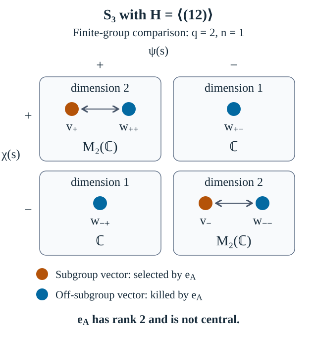

# Double cosets and intrinsic MASA multiplicity

*Written by GPT-6.1 Sol (OpenAI), Ultra. Course exposition: CC0-1.0 to the extent of rights held. Earlier programme and human-source notices retain their own terms.*

A subgroup acts on the trace Hilbert space from the left and from the right. For an infinite malnormal abelian subgroup, the subgroup space is a central summand, and the regular product orbits on its complement give a type I multiplicity. For a finite subgroup, diagonal character fibers instead mix one subgroup coordinate with the off-subgroup coordinates. The complete comparison separates a reducing subspace from a central summand and explains the role of the infinite-subgroup hypothesis.

We use the [group trace and subgroup criterion](group-masas-and-singular-affine-examples.md) and its [regular-group operator foundations](regular-group-operator-foundations.md). G00 proves the regular commutants; H03–H04 supply separable predual and the type \(\mathrm{II}_1\) conclusion. T03 proves uniqueness of the normal normalized trace for an ICC group algebra. T04 proves trace preservation for an abstract isomorphism of the group factors, using positive-supremum preservation and the bounded trace-square continuity proved in T04c; T05–T06 prove the intrinsic finite or countably infinite size of the particular matrix blocks below. These give the precise trace and multiplicity inputs without a general projection-comparison or type-classification argument.

The freely readable comparison is [Sinclair–Smith, *The Pukánszky invariant for masas in group von Neumann factors*](https://people.tamu.edu/~rrsmith/papers/pukanszky.pdf), §2, manuscript p. 4, for the intrinsic complement invariant; Theorem 3.2, pp. 8–10, for double-coset intertwiners; and Theorem 4.1 with its proof, p. 11, for the stabilizer multiplicity calculation. Under (1), every off-subgroup stabilizer is trivial, so all nontrivial double cosets belong to a single class and the Pukánszky invariant is the singleton \(\{n\}\). The explicit regular-product model and full matrix commutant are proved below. [Anantharaman–Popa, *An introduction to II1 factors*](https://idpoisson.fr/anantharaman/publications/IIun.pdf), Theorem 1.3.6, Proposition 4.1.3 and Lemma 12.1.9, supply freely readable proofs of regular commutation, factor-trace uniqueness and the central subgroup projection.

The [finite-subgroup comparison](#finite-subgroup-fibers) computes the entire left/right commutant when the subgroup is finite, including the zero-complement and countably infinite cases. Its finite character decomposition is obtained from explicit polynomial projections. Figure 1 displays the actual six-dimensional example with the order-two subgroup of the symmetric group on three letters.

## 1. The left/right algebra and its canonical projection

Let \(G\) be a countable discrete ICC group and \(H\subset G\) an **infinite** abelian subgroup such that
\[
h g k^{-1}=g,\quad g\notin H,\ h,k\in H
\quad\Longrightarrow\quad h=k=e.
\tag{1}
\]
Put \(M=L(G)\), \(A=L(H)\). Condition (1) makes the \(H\)-conjugacy orbit of every \(g\notin H\) a free \(H\)-orbit, hence infinite. The subgroup criterion makes \(A\) a MASA in the separable \(\mathrm{II}_1\) factor \(M\).

On \(\ell^2(G)=L^2(M,\tau)\), use
\[
J\xi(t)=\overline{\xi(t^{-1})},\qquad
J\lambda_hJ=\rho_h,\qquad
\mathcal B=A\vee JAJ=(\lambda(H)\cup\rho(H))'',
\qquad \mathcal C=\mathcal B'.
\tag{2}
\]
The conjugation \(J\) is antilinear. Since \(H\) is abelian and left and right translations commute, \(\mathcal B\) is abelian. Let \(e_A\) denote the orthogonal projection onto \(\ell^2(H)=L^2(A)\).

**Lemma 1.1.** The projection \(e_A\) belongs to \(\mathcal B\), and is therefore central in \(\mathcal C\).

**Proof.** Enumerate \(H\) as \((h_j)\), put \(U_j=\lambda_{h_j}\rho_{h_j}\), and form the norm-convergent positive sum
\[
S=\sum_{j\ge1}2^{-j}(U_j-1)^*(U_j-1)\in\mathcal B.
\tag{3}
\]
Its kernel consists exactly of the vectors fixed by all \(U_j\): the quadratic form is the sum of the nonnegative numbers \(2^{-j}\|(U_j-1)\xi\|^2\). These unitaries act by \(H\)-conjugation on basis vectors. All elements of \(H\) are fixed; every orbit outside \(H\) is infinite by (1). A square-summable coefficient function constant on an infinite orbit vanishes there. Thus \(\ker S=\ell^2(H)\).

For each positive integer \(m\), the inverse \((1+mS)^{-1}\) belongs to \(\mathcal B\) and has norm at most \(1\), by [H02](regular-group-operator-foundations.md#h02). Those inverses converge strongly to the projection onto \(\ker S\): they fix that kernel, while \((1+mS)^{-1}S=(1-(1+mS)^{-1})/m\) tends to zero in norm, and \(\overline{\operatorname{ran}S}=(\ker S)^\perp\). Strong closedness of \(\mathcal B\) therefore puts this projection, \(e_A\), in \(\mathcal B\). Every element of \(\mathcal C=\mathcal B'\) commutes with it. Since \(\mathcal B\) is abelian, \(e_A\) also belongs to \(\mathcal C\), proving centrality. \(\square\)

The role of infinitude is precise. If \(H\) is finite, conjugacy orbits outside \(H\) can support nonzero constant square-summable vectors. For example, with \(G=\mathbb F_2\), \(H=\{e\}\), condition (1) holds, but \(A=\mathbb C\) is not a MASA, \(\mathcal B=\mathbb C1\), and \(\mathcal C=B(\ell^2(G))\). The nonzero projection onto \(\delta_e\) is not central in \(\mathcal C\). Thus the nonzero abelian central summand associated with \(L^2(A)\) cannot be inferred from malnormality alone. The infinite-subgroup hypothesis supplies the missing separation in the exercise's intended MASA setting.

## 2. Every nontrivial double coset is a regular product orbit

Let \(\Gamma=H\backslash G/H\), \(\Gamma_0=\Gamma\setminus\{H\}\), and select a representative \(g_\gamma\) for each \(\gamma\in\Gamma_0\). The disjoint basis decomposition is
\[
\ell^2(G)=\ell^2(H)\oplus
\bigoplus_{\gamma\in\Gamma_0}\ell^2(Hg_\gamma H).
\tag{4}
\]
Every summand reduces both \(\lambda(H)\) and \(\rho(H)\): left and right subgroup multiplication preserve each double coset, as do their inverses.

**Lemma 2.1.** The map
\[
W_\gamma:\ell^2(H)\otimes\ell^2(H)\longrightarrow\ell^2(Hg_\gamma H),
\qquad W_\gamma(\delta_a\otimes\delta_b)=\delta_{a g_\gamma b}
\tag{5}
\]
is unitary, and intertwines the pair representation with
\[
\lambda_h\rho_k\ \longleftrightarrow\
\lambda_H(h)\otimes\rho_H(k).
\tag{6}
\]

**Proof.** The underlying map \((a,b)\mapsto ag_\gamma b\) is onto. If \(ag_\gamma b=a'g_\gamma b'\), then
\((a'^{-1}a)g_\gamma(bb'^{-1})=g_\gamma\). Condition (1) forces both subgroup factors to be the identity, hence \(a=a'\), \(b=b'\). The bijection of orthonormal bases proves unitarity. Finally,
\[
\lambda_h\rho_k\delta_{ag_\gamma b}
=\delta_{ha g_\gamma b k^{-1}},
\tag{7}
\]
which is the image under (5) of \(\lambda_H(h)\delta_a\otimes\rho_H(k)\delta_b\). \(\square\)

Write \(\mathcal H_H=\ell^2(H)\), \(\mathcal K=\ell^2(\Gamma_0)\). Combining the maps (5) identifies the off-subgroup space with
\[
(1-e_A)\ell^2(G)\cong
(\mathcal H_H\otimes\mathcal H_H)\otimes\mathcal K,
\tag{8}
\]
and the pair representation there is the identical copy (6) on every multiplicity coordinate.

## 3. Computing the commutant, including inter-copy operators

Let \(A_H=\lambda_H(H)''\) on \(\mathcal H_H\). The direct [regular-group commutant proof, G00](regular-group-operator-foundations.md#g00), applied to \(H\), gives
\[
A_H'=\rho_H(H)''=A_H,
\tag{9}
\]
where the last equality uses \(\rho_H(h)=\lambda_H(h^{-1})\) for abelian \(H\). Thus \(A_H\) is maximal abelian in its regular Hilbert-space representation. Restricting \(A\) to \(\ell^2(H)\) identifies it faithfully and normally with \(A_H\): its trace vector is separating, so the restriction has zero kernel.

On \(\mathcal H_H\otimes\mathcal H_H\), put
\[
D=A_H\,\bar\otimes\,A_H.
\tag{10}
\]
Here the spatial von Neumann tensor product means the bicommutant generated by its coordinate algebraic tensor operators, so it is strongly closed by H01. The unitaries in (6) generate \(D\). To verify that their bicommutant contains the full coordinate algebras, write an operator commuting with \(\lambda_H(H)\otimes1\) in matrix entries over the second coordinate. Every entry commutes with \(\lambda_H(H)\), hence with \(A_H=\lambda_H(H)''\). Thus \(A_H\otimes1\) belongs to the indicated bicommutant; the other coordinate follows in the same way. The reverse inclusion holds because the generating unitaries already belong to the spatial tensor product. This algebra is itself maximal abelian: the representation is the regular representation of the abelian group \(H\times H\), with inversion in the second group coordinate. The same trace commutation argument proves \(D'=D\).

Let \(n=|\Gamma_0|\), a positive integer or countable infinity. Lemma 1.1 separates the two blocks centrally, so no intertwiner in \(\mathcal C\) connects \(\ell^2(H)\) with its orthogonal complement. On the first block its commutant is \(A_H\). On the second, its represented algebra is \(D\otimes1_{\mathcal K}\).

**Theorem 3.1.** With the hypotheses of Section 1,
\[
\mathcal C\cong A_H\ \oplus\
\bigl(D\,\bar\otimes\,B(\mathcal K)\bigr).
\tag{11}
\]
The second summand is homogeneous of type \(\mathrm I_n\).

**Proof.** Only the second-block commutant remains to compute. Write an operator on \((\mathcal H_H\otimes\mathcal H_H)\otimes\mathcal K\) in matrix entries \(T_{\gamma\eta}\). It commutes with every \(d\otimes1\), \(d\in D\), exactly when every entry commutes with \(D\), hence belongs to \(D\).

Conversely, operators of \(D\bar\otimes B(\mathcal K)\) commute with \(D\otimes1\). If a bounded matrix has every entry in \(D\), each finite-coordinate compression belongs to \(D\otimes M_m\). These compressions converge strongly to the operator, so it belongs to the spatial von Neumann tensor product. This proves (11), including all operators that interchange equivalent copies.

Commutation with every constant multiplicity matrix unit forces a central operator to have zero off-diagonal entries and one identical diagonal entry \(d\in D\). Conversely \(d\otimes1\) is central because \(D\) is abelian. Thus the center is \(D\otimes1\), in the finite and countably infinite cases alike. The diagonal rank-one projections in \(B(\mathcal K)\) give mutually equivalent abelian projections \(1_D\otimes e_{\gamma\gamma}\): each corner is \(D\). Their central support is the second summand's identity, since a central projection \(z\otimes1\) dominating one of them has \(z=1\). Their matrix units identify that summand as matrices of size \(n\) over the abelian center \(D\), or countably infinite matrices if \(n=\infty\). This is precisely homogeneous type \(\mathrm I_n\). \(\square\)

The individual double-coset projections are generally not central in \(\mathcal C\). All nontrivial double-coset representations are equivalent, so their commutant contains off-diagonal matrix units. The central separation is between the subgroup block and the entire multiplicity block.

The decomposition proof also works for arbitrary discrete \(G\), infinite abelian \(H\) satisfying (1), and an arbitrary double-coset index set. In Lemma 1.1 one may choose a countably infinite subgroup \(H_0\subset H\): select countably many distinct elements of \(H\) and take the subgroup they generate; the finite words in these generators and their inverses form a countable set. Then its conjugation action is still free outside \(H\), and its fixed vectors are exactly \(\ell^2(H)\). Finite-coordinate compressions in Theorem 3.1 then form a net rather than a sequence. Formula (11) remains valid with \(\mathcal K=\ell^2(\Gamma_0)\); countability is used here only for the countable multiplicity and separable-factor formulation of the source exercise.

## Finite subgroups: the complete comparison

Here the assumptions are different: let \(G\) be any discrete group and let \(H\subset G\) be a **finite** abelian subgroup of order \(q\), still satisfying (1). Write
\[
 \Gamma_0=H\backslash G/H\setminus\{H\},\qquad
 \mathcal K=\ell^2(\Gamma_0).
\]
Let \(\widehat H\) denote the homomorphisms \(H\to\mathbb T\). The following calculation will also prove directly that there are exactly \(q\) such characters. With the same left/right algebra \(\mathcal B\) and commutant \(\mathcal C\) as in (2), one has
\[
\begin{aligned}
 \mathcal C\cong&
 \bigoplus_{\chi\in\widehat H}
             B(\mathbb C\oplus\mathcal K)\\
 &\quad\oplus
 \bigoplus_{\substack{\chi,\psi\in\widehat H\\\chi\ne\psi}}
             B(\mathcal K).
\end{aligned}
\tag{DF1}
\]
The canonical projection \(e_A\) is the projection onto the \(\mathbb C\) coordinate in every diagonal-character block \((\chi,\chi)\), and is zero on the off-diagonal blocks. In particular it is central exactly when \(G=H\).

**Proof.** We begin with an elementary finite character construction. If a unitary \(V\) has \(V^m=1\), put \(\zeta=\exp(2\pi i/m)\) and
\[
 P_k=\frac1m\sum_{j=0}^{m-1}\zeta^{-kj}V^j
       \qquad(0\le k<m).
\tag{DF2}
\]
Reindexing \(j\) by \(-j\) modulo \(m\) gives \(P_k^*=P_k\). In the product \(P_kP_l\), collect terms with \(i+j=r\); the inner sum \(\sum_i\zeta^{(l-k)i}\) is \(m\) when \(k=l\) and zero otherwise. Thus \(P_kP_l=\delta_{kl}P_k\). The same finite geometric sum gives \(\sum_kP_k=1\), and shifting the exponent of \(V\) gives \(VP_k=\zeta^kP_k\). These are explicit orthogonal spectral projections; no character-duality theorem is needed.

Apply this to the finite-order commuting translations \(\lambda_H(h)\), for all \(h\in H\), on \(\ell^2(H)\). Products of their commuting projections decompose that \(q\)-dimensional space into common eigenspaces. On any nonzero common eigenspace, the eigenvalues form a character \(\chi\): the identities \(\lambda_H(hk)=\lambda_H(h)\lambda_H(k)\) and \(\lambda_H(e)=1\) prove multiplicativity and normalization, and unitarity gives unit modulus.

Each common eigenspace has dimension one. Indeed, if \(\lambda_H(h)\xi=\chi(h)\xi\), comparison of the coefficient at \(h\) gives
\(\xi(e)=\chi(h)\xi(h)\). Hence every coefficient is determined by \(\xi(e)\), and a nonzero vector has the form
\[
 \xi_\chi=q^{-1/2}\sum_{h\in H}
                   \overline{\chi(h)}\,\delta_h
\tag{DF3}
\]
up to a scalar. Conversely (DF3) is a common unit eigenvector for every character \(\chi\), by direct translation. The orthogonal decomposition therefore gives exactly \(q\) distinct characters, and these \(q\) vectors are an orthonormal basis.

For each \(\gamma\in\Gamma_0\), the map
\[
 (a,b)\longmapsto ag_\gamma b
\]
is a bijection \(H\times H\to Hg_\gamma H\). Surjectivity is the definition of the double coset. If two such products agree, then
\((a'^{-1}a)g_\gamma(bb'^{-1})=g_\gamma\), and (1) forces both outer factors to be the identity. This proof uses no infinitude assumption. It gives the regular-product basis (5) also in the finite case.

On each off-subgroup copy, \(\xi_\chi\otimes\xi_\psi\) is an eigenvector for \(\lambda_h\rho_k\) with eigenvalue
\[
 \chi(h)\psi(k)^{-1}.
\tag{DF4}
\]
On the subgroup space \(\ell^2(H)\), the vector \(\xi_\chi\) has eigenvalue \(\chi(h)\chi(k)^{-1}\), because left and right translations there are \(\lambda_H(h)\) and \(\lambda_H(k^{-1})\). Thus the subgroup contributes one extra coordinate precisely for the pairs \((\chi,\chi)\).

Let \(\mathcal H_{\chi,\psi}\) be the whole common eigenspace of the pair family on \(\ell^2(G)\). The disjoint double-coset bases give
\[
 \mathcal H_{\chi,\psi}\cong
 \begin{cases}
   \mathbb C\oplus\mathcal K,&\chi=\psi,\\
   \mathcal K,&\chi\ne\psi.
 \end{cases}
\tag{DF5}
\]
Different pairs give different eigenvalue functions: set \(k=e\) and then \(h=e\) in (DF4). Applying the polynomial projections (DF2) to the finite-order left and right translations on \(\ell^2(G)\) puts every projection onto \(\mathcal H_{\chi,\psi}\) in \(\mathcal B\). Conversely the finitely many pair projections sum to one, and every generating translation is its scalar eigenvalue on each of them. Hence \(\mathcal B\) is exactly the algebra of independent scalars on these nonzero common eigenspaces. This scalar-block algebra is strongly closed: a unit vector in each of the finitely many nonzero fibers detects its scalar coordinate under strong convergence, and the limit has those same scalar actions on the whole fibers. It contains every generating translation, while each of its finitely many block projections is a polynomial in those translations. The generated von Neumann algebra is therefore exactly this scalar-block algebra.

An operator commuting with \(\mathcal B\) must preserve each of those eigenspaces. Within a single eigenspace every generator is scalar, so every bounded operator on it commutes with the pair family. This proves the full direct sum (DF1), including all operators mixing equivalent subgroup and off-subgroup coordinates in a diagonal-character block.

The description of \(e_A\) now follows from its definition as the projection onto \(\ell^2(H)\). If \(\mathcal K\ne0\), take a unit vector \(\eta\in\mathcal K\) and, within any one diagonal block, interchange its subgroup basis vector with \(\eta\). This bounded interchange belongs to \(\mathcal C\) but fails to commute with \(e_A\). Thus \(e_A\) is not central. If \(\mathcal K=0\), there are no elements outside \(H\), so \(G=H\) and \(e_A=1\), which is central. \(\square\)

Formula (DF1) includes the zero-complement convention \(B(0)=0\). If \(|\Gamma_0|=n\) is a finite positive integer, its \(q\) diagonal blocks are \(M_{n+1}(\mathbb C)\), while its \(q(q-1)\) off-diagonal blocks are \(M_n(\mathbb C)\). If \(G\) is countably infinite, every double coset has at most \(q^2\) elements, so \(\Gamma_0\) is countably infinite. Each block is then \(B(\ell^2(\mathbb N))\): for a diagonal block, send the extra subgroup vector to the first basis vector and shift the \(\mathcal K\) basis by one.

When \(G\ne H\), a finite \(H\) does not give a MASA. The conjugacy orbit of any element outside \(H\) is finite, and its finite orbit sum is a commuting bounded operator outside \(L(H)\), exactly as in the subgroup-orbit criterion. The finite calculation is therefore a comparison of left/right subgroup algebras, rather than an assertion of a MASA invariant in that setting.

*Figure 1.* Take \(G=S_3\), \(s=(12)\) and \(H=\{e,s\}\). Only the elements of \(H\) preserve the unordered pair \(\{1,2\}\), so \(H\) is malnormal. For \(g=(13)\), the four distinct elements \(g,sg,gs,sgs\) form the unique double coset outside \(H\); thus \(q=2\) and \(n=1\). The row and column signs are \(\chi(s)\) and \(\psi(s)\) in (DF4). The subgroup vectors \(v_\pm=\xi_\pm\) occupy the diagonal fibers; \(w_{\chi,\psi}=W_g(\xi_\chi\otimes\xi_\psi)\) denotes the off-subgroup vector in each fiber. Therefore \(\mathcal C\cong M_2(\mathbb C)\oplus M_2(\mathbb C)\oplus\mathbb C\oplus\mathbb C\), and \(e_A\) has rank two but is not central. The arrows show intertwiners inside the diagonal-character fibers. This finite-group example is separate from the ICC, infinite-subgroup MASA hypotheses of the four numbered results.

The following intrinsic-MASA section returns to the infinite-subgroup, ICC hypotheses of Section 1.

## 4. Why the multiplicity is intrinsic to the MASA

For a MASA in a finite factor, define intrinsically
\[
\mathcal C_A=(A\vee JAJ)',\qquad
\mathcal C_A^0=(1-e_A)\mathcal C_A(1-e_A),
\tag{12}
\]
in its canonical trace representation. The distinguished projection \(e_A\) comes from \(L^2(A)\), not from a chosen group presentation. For the present group MASAs it is central, and Theorem 3.1 says that \(\mathcal C_A^0\) is homogeneous of type \(\mathrm I_n\).

**Theorem 4.1.** If an isomorphism between finite factors carries one of these group MASAs onto another, their numbers \(n\) are equal.

**Proof.** Let \(\theta:M\to N\) carry \(A\) onto \(A_1\). The abstract \(*\)-isomorphism \(\theta\) preserves increasing positive suprema. Therefore \(\tau_N\theta\) is a normalized order-normal trace on the ICC group algebra \(M\). [T04](regular-group-operator-foundations.md#t04) proves its equality with \(\tau_M\): T04c supplies continuity along the bounded trace-square-convergent conjugation averages of T03. Thus \(\tau_N\theta=\tau_M\), under the stated abstract-isomorphism hypothesis. Hence
\[
U_\theta(x\Omega_M)=\theta(x)\Omega_N
\tag{13}
\]
extends to a unitary of the trace Hilbert spaces. It intertwines left multiplication, takes \(\overline{A\Omega_M}\) onto \(\overline{A_1\Omega_N}\), and satisfies
\[
U_\theta J_M=J_NU_\theta,
\tag{14}
\]
because both sides send \(x\Omega_M\) to \(\theta(x)^*\Omega_N\). It therefore carries \(e_A\) to \(e_{A_1}\) and unitarily conjugates the two algebras in (12). The two complementary blocks have the explicit matrix models \(D\bar\otimes B(\ell^2(n))\) and \(D_1\bar\otimes B(\ell^2(m))\). [T05–T06](regular-group-operator-foundations.md#t05) prove their sizes intrinsic: a finite block has exactly its matrix size in any orthogonal full-support abelian projection decomposition of the unit, while a countably infinite block has a proper shift isometry and a finite block has none. The induced isomorphism therefore forces \(n=m\). \(\square\)

This distinguishes MASAs as embedded pairs \((M,A)\). It does not prove that their ambient factors are nonisomorphic. It also distinguishes the \(n=1\) case correctly: even when both summands of (11) are abelian, the canonical projection \(e_A\) still singles out the complement in (12).

## 5. Exercises with complete solutions

**Exercise 1.** Verify the identity \(J\lambda_hJ=\rho_h\), including an arbitrary complex coefficient.

*Solution.* On \(c\delta_t\), the first \(J\) gives \(\overline c\delta_{t^{-1}}\), left translation gives \(\overline c\delta_{ht^{-1}}\), and the second \(J\) gives \(c\delta_{th^{-1}}\). Thus the composite is linear and equals \(\rho_h\). Omitting either complex conjugation would make \(J\) fail to be the trace conjugation.

**Exercise 2.** Show why reducing each summand in (4) does not itself imply that their projections are central in \(\mathcal C\).

*Solution.* A reducing projection commutes with \(\mathcal B\), so it belongs to \(\mathcal C\). Centrality additionally requires commutation with every element of \(\mathcal C\). Two equivalent nontrivial orbit representations have an intertwiner between them, which belongs to \(\mathcal C\) and fails to commute with their separate projections. Lemma 1.1 proves the stronger fact \(e_A\in\mathcal B\), which gives centrality for the subgroup projection.

**Exercise 3.** Prove directly that the kernel of (3) is the common fixed-vector space.

*Solution.* If \(S\xi=0\), positivity gives \(0=\langle\xi,S\xi\rangle=\sum_j2^{-j}\|(U_j-1)\xi\|^2\). Every summand is nonnegative, so every term vanishes. Conversely a common fixed vector is killed by every summand and hence by the norm-convergent sum. A vector with zero positive quadratic form belongs to the kernel, since \(\langle\xi,S\xi\rangle=\|S^{1/2}\xi\|^2\).

**Exercise 4.** For \(H=\{e\}\subset\mathbb F_2\), compute \(\mathcal B\), \(\mathcal C\) and the centrality of \(e_A\).

*Solution.* Both subgroup representations are the identity, so \(\mathcal B=\mathbb C1\) and \(\mathcal C=B(\ell^2(\mathbb F_2))\). The projection \(e_A\) has rank one, onto \(\delta_e\). An operator carrying \(\delta_e\) to \(\delta_a\), for a free generator \(a\), does not commute with it. Thus it is not central. This is why malnormality with a finite subgroup is insufficient for the intended nonzero central abelian summand.

**Exercise 5.** Derive the injectivity of the basis map (5), and identify exactly where malnormality enters.

*Solution.* Equality \(ag_\gamma b=a'g_\gamma b'\) gives \((a'^{-1}a)g_\gamma(bb'^{-1})=g_\gamma\). Both outer factors belong to \(H\), and \(g_\gamma\notin H\). Apply (1), with \(h=a'^{-1}a\) and \(k^{-1}=bb'^{-1}\), to obtain \(a=a'\), \(b=b'\). Without this conclusion the map would quotient a nontrivial stabilizer and need not be a regular product representation.

**Exercise 6.** Why does (6) generate \(A_H\bar\otimes A_H\), even though it uses the right regular representation in its second coordinate?

*Solution.* Set \(k=e\) to obtain \(\lambda_H(h)\otimes1\), and set \(h=e\) to obtain \(1\otimes\rho_H(k)\). For abelian \(H\), \(\rho_H(k)=\lambda_H(k^{-1})\), so the two generated coordinate algebras are both \(A_H\). Their joint von Neumann algebra is the spatial tensor product in (10).

**Exercise 7.** In the \(n=2\) case, exhibit an operator in \(\mathcal C\) that interchanges the two nontrivial double-coset copies.

*Solution.* Under (8), take \(1_D\otimes(e_{12}+e_{21})\) on the second block and zero on the subgroup block. It commutes with \(D\otimes1\), so belongs to \(\mathcal C\). It swaps the two multiplicity coordinates and does not commute with the projection \(1_D\otimes e_{11}\). The latter projection is therefore not central.

**Exercise 8.** Prove the strong convergence of finite-coordinate compressions used in Theorem 3.1.

*Solution.* Let \(P_F\) project onto the coordinates of a finite subset \(F\subset\Gamma_0\). These projections tend strongly to \(1\) along inclusion. For a bounded operator \(T\),
\(P_FTP_F\xi-T\xi=P_FT(P_F\xi-\xi)+(P_F-1)T\xi\), whose norm tends to zero. Thus the finite matrices recover every bounded operator with entries in \(D\). This works as a net for an uncountable index set as well.

**Exercise 9.** What happens to the invariant when there are exactly two total double cosets?

*Solution.* There is one nontrivial double coset, so \(n=1\) and \(\mathcal C_A^0\cong D\) is abelian, of type \(\mathrm I_1\). The full algebra is \(A_H\oplus D\), also abelian. The canonical subgroup projection \(e_A\) is nevertheless preserved under pair isomorphisms, so the complement still has a well-defined multiplicity \(1\); it cannot be confused with an absent complement or an arbitrary abelian summand.

**Exercise 10.** Explain why the unitary (13) preserves the right action and not just the left action.

*Solution.* The trace conjugation sends \(x\Omega\) to \(x^*\Omega\), and (14) follows on a dense set. Right multiplication by \(a\) is \(J a^*J\) when \(a\) denotes left multiplication. Therefore intertwining the left action and \(J\) also intertwines the right action. Since \(\theta(A)=A_1\), the whole left/right generated algebra and its commutant are conjugated, along with \(e_A\).

## References

Lajos Pukánszky, [*On Maximal Abelian Subrings of Factors of Type II₁*](https://www.cambridge.org/core/services/aop-cambridge-core/content/view/9B7B38999C7306E6047079CB68C937B6/S0008414X00009949a.pdf/on-maximal-abelian-subrings-of-factors-of-type-ii.pdf), *Canadian Journal of Mathematics* 12 (1960), 289–296. Lemma 1, p. 290, transports factor isomorphisms to the trace completion and both multiplication actions; Lemma 4, pp. 293–295, identifies the off-subgroup double-coset spaces with equivalent regular product representations and separates the subgroup trace-space projection.

Allan M. Sinclair and Roger R. Smith, [*The Pukánszky invariant for masas in group von Neumann factors*](https://people.tamu.edu/~rrsmith/papers/pukanszky.pdf), author-hosted manuscript of the 2005 *Illinois Journal of Mathematics* article, 49, 325–343. §2, manuscript p. 4, defines the complement invariant and proves centrality of the MASA trace-space projection; Theorem 3.2 and its proof, pp. 8–10, describe double-coset intertwiners; Theorem 4.1 and its proof, p. 11, turn equal stabilizers into homogeneous type I multiplicity. The present malnormal case has trivial stabilizers throughout and gives the singleton invariant \(\{n\}\).

Claire Anantharaman and Sorin Popa, [*An introduction to II1 factors*](https://idpoisson.fr/anantharaman/publications/IIun.pdf), author-hosted draft. Theorem 1.3.6 and its supporting Lemma 1.3.4 and Proposition 1.3.5, printed pp. 7–8 (PDF pp. 13–14), prove regular commutation, applied here to \(H\) and \(H\times H\). Proposition 4.1.3 with Lemma 4.1.1 and Corollary 4.1.2, printed pp. 59–60 (PDF pp. 65–66), proves uniqueness of the factor trace. Lemma 12.1.9, printed pp. 195–196 (PDF pp. 201–202), proves that the MASA trace-space projection belongs to the left/right generated algebra; Lemma 1.1 above gives a complete fixed-vector proof in the present group setting.

## Bounded actions and the size of the complement

In the countable ICC setting of Section 1, the complement is nonzero. If \(H=G\), then \(G\) would be an infinite abelian group. Every conjugacy class would be a singleton, contrary to ICC. Thus \(G\setminus H\ne\varnothing\), and \(\Gamma_0\) is nonempty. A quotient of a countable set is at most countable, so its cardinal \(n\) is precisely a positive integer or countable infinity. In the arbitrary-discrete extension after Theorem 3.1, the case \(G=H\) is allowed: then \(e_A=1\), \(\mathcal K=0\) and the second block in (11) is zero. It makes no assertion about a positive multiplicity parameter in that case.

The positive sum in (3) lies in the actual operator algebra. Each \(U_j\) is a unitary in \(\mathcal B\), so \(\|(U_j-1)^*(U_j-1)\|\le4\). Its weighted series is therefore norm Cauchy. The bicommutant \(\mathcal B\) is norm closed, and its positive cone is norm closed by the quadratic-form definition, so its limit belongs to \(\mathcal B_+\). Passing to quadratic forms in the norm-convergent partial sums gives the exact common-kernel identity. The inverse construction in [H02](regular-group-operator-foundations.md#h02) then proves that the associated fixed-space projection lies in \(\mathcal B\), rather than merely in its commutant. The same construction uses an infinite countable subgroup \(H_0\) for the arbitrary-discrete extension. Its action remains free on every orbit outside \(H\); its infinitude, not the countability of the whole group, kills the constant square-summable coefficients there.

The actions used in Theorem 4.1 extend to the completed trace spaces with explicit bounds. For \(a,x\in M\), positivity, the C*-norm bound and traciality give
\[
\|ax\|_2^2=\tau(x^*a^*ax)\le\|a\|^2\tau(x^*x),
\qquad
\|xa\|_2^2=\tau(x^*x\,aa^*)\le\|a\|^2\tau(x^*x).
\]
For the right-hand inequality one can apply positivity to
\(\tau((x^*x)^{1/2}(\|a\|^2 1-aa^*)(x^*x)^{1/2})\); cyclicity gives the displayed difference. Hence left and right multiplication are bounded on the dense trace vectors and extend uniquely. The conjugation \(J(x\Omega)=x^*\Omega\) is an isometry because \(\tau(xx^*)=\tau(x^*x)\); it is antilinear, has square one and extends onto the whole Hilbert space. Directly on those vectors,
\[
J L_{a^*}J(x\Omega)=xa\Omega=R_a(x\Omega).
\]
Thus the left/right relation used in (14) is an equality of bounded operators, with no assumption about operator-norm convergence of Fourier sums.

For the abstract isomorphism, [T04](regular-group-operator-foundations.md#t04) first proves trace preservation using the complete [T04a–T04c](regular-group-operator-foundations.md#t04a) polar, projection-join and order-normal continuity arguments. This precedes the Hilbert-space construction. For all dense trace vectors,
\[
\langle\theta(x)\Omega_N,\theta(y)\Omega_N\rangle
=\tau_N(\theta(x)^*\theta(y))
=\tau_M(x^*y).
\]
The isometry (13) therefore extends, and surjectivity of \(\theta\) makes its range dense and hence the extension unitary. On the same dense set it intertwines every bounded left action, every bounded right action and \(J\). It takes the closed subspace generated by \(A\Omega_M\) onto that generated by \(\theta(A)\Omega_N\), so it conjugates their orthogonal projections. Unitary conjugation preserves commutants directly: \(T\) commutes with a family exactly when \(UTU^*\) commutes with its conjugate family. Applying this twice transports the generated algebra, its full commutant and the distinguished complementary corner. No separate assertion of ultraweak continuity for \(\theta\) is needed for this construction.

For finite multiplicity, the character argument in [T05a and CS01–CS06](regular-group-operator-foundations.md#t05a) includes closed maximal ideals, the complete normalized Banach quotient, its scalar-quotient proof from nonempty spectrum, adjoint preservation and norm detection. These supply the separating characters used in [T05](regular-group-operator-foundations.md#t05). Their matrix evaluations are applied only to finite matrices and finite sums. In particular a full-central-support abelian projection has rank one at every character, including nonnormal ones: the polynomial central projection constructed there excludes rank zero. A decomposition of \(1\) into \(k\) such orthogonal projections therefore forces \(k=n\). The countably infinite case is distinguished by the actual proper shift in [T06](regular-group-operator-foundations.md#t06), not by applying a character to an infinite sum. When \(n=1\), the complementary algebra is abelian, but the canonical projection \(e_A\) still specifies that entire complement and its multiplicity.
