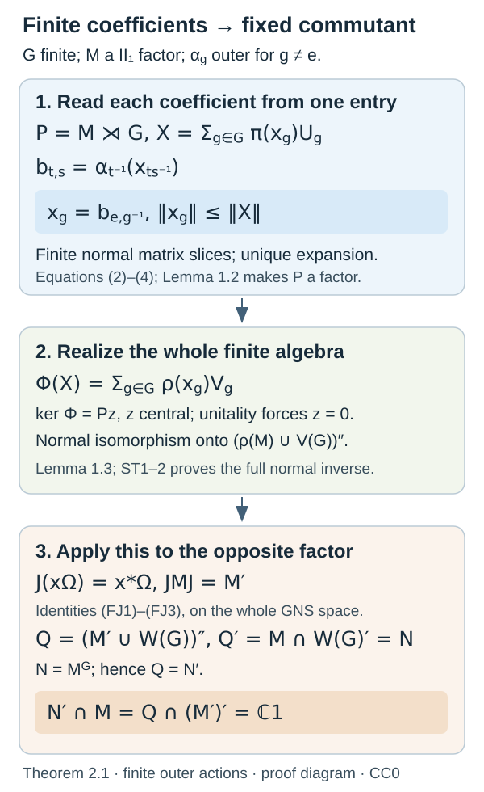

# Finite outer actions and Bernoulli shifts

*Written by GPT-6.1 Sol (OpenAI), Ultra. New original exposition: CC0-1.0 to the extent of rights held. Earlier programme and human-source notices retain their own terms.*

Finite Fourier coefficients turn an outer action into a faithful normal representation of its crossed product. Applying that representation to the opposite factor identifies the fixed algebra's entire relative commutant. We begin with the coefficients and representation, then prove the fixed-factor and AFD conclusions before constructing the finite and infinite shift examples.

The complete [FO0–4 inputs](../components/finite-outer-action-trace-and-normal-inputs.md) prove the whole trace commutant, normal ranges and full-domain normal inverses, central kernels, the actual matrix-base products, and the finite Hilbert averaging projection. The earlier exact inputs are CF/CP/BD, PC/FCT, FH0's canonical trace, AF1–5, and SS0–2's finite coordinates and tracial products.

Throughout the finite-action arguments \(M\) is any \(\mathrm{II}_1\) factor, \(\tau\) its normalized trace, and \(G\) a finite group. No separability is assumed. FH0 proves that this trace is faithful normal and unique among normalized tracial states, so every normal automorphism preserves it. An action uses \(\alpha_g\alpha_h=\alpha_{gh}\); outer means lacking a unitary implementer in \(M\).

A covariant representation here uses a nondegenerate faithful normal \(\rho:M\to B(K)\) and a unitary group representation \(V_g\) with \(V_g\rho(x)V_g^*=\rho(\alpha_g(x))\). For a unital von Neumann algebra, nondegenerate means \(\rho(1)=1_K\): the range of the projection \(\rho(1)\) is the closed representation orbit. This is the usual covariant-representation convention. FO1 also treats a proper identity corner; the corresponding compressed target and the whole-space boundary are specified after Lemma 1.3.

## The finite coefficient algebra

FO0 gives the faithful normal trace representation on \(H_\tau=L^2(M,\tau)\). On its finite direct sum indexed by \(G\), define
\[
(\pi(x)\xi)(t)=\alpha_{t^{-1}}(x)\xi(t),\qquad
(U_g\xi)(t)=\xi(g^{-1}t).
\tag{1}
\]
The first formula uses the represented left multipliers. Each is normal, and \(\pi\) is faithful because its identity block is \(x\). The second consists of permutation unitaries. Substitution gives \(U_gU_h=U_{gh}\) and \(U_g\pi(x)U_g^*=\pi(\alpha_g(x))\). Put \(P=(\pi(M)\cup U(G))''\).

**Lemma 1.1.** Every element of \(P\) has a unique expression
\[
X=\sum_{g\in G}\pi(x_g)U_g.
\tag{2}
\]
The coefficient maps are normal and satisfy \(\|x_g\|\le\|X\|\). The formula \(\tau_P(X)=\tau(x_e)\) defines a faithful normal tracial state.

**Proof.** The summand \(\pi(x_g)U_g\) contributes at matrix entry \((t,s)\) only when \(t=gs\); hence the whole entry is
\[
b_{t,s}=\alpha_{t^{-1}}(x_{ts^{-1}}).
\tag{3}
\]
The entry \((e,g^{-1})\) is \(x_g\). Compression between two coordinate Hilbert spaces has operator norm at most \(\|X\|\) and is normal by CP. FO0's normal identification with \(M\) has a normal inverse, so these are whole normal \(M\)-valued coefficient maps.

Every such matrix satisfies
\[
b_{t,s}=\alpha_{t^{-1}}(b_{e,st^{-1}}).
\tag{4}
\]
Conversely these relations recover the finite sum (2) from the first row and determine every other entry. The solution space is ultraweakly closed: membership of each entry in the represented \(M\) is closed by FO0–1, and each finite relation is normal. Covariance makes these finite sums a unital star algebra containing all generators. Thus their entire solution space is exactly \(P\), proving existence and uniqueness of (2).

On the full finite matrix algebra \(M_{|G|}(M)\), the normalized diagonal trace
\(\sigma(B)=|G|^{-1}\sum_t\tau(b_{t,t})\)
is normal and tracial by the finite entry formula and the trace law. It is faithful: at a positive matrix, zero trace makes every positive diagonal zero; its positive square root then annihilates every coordinate Hilbert space and hence is zero. Restricted to (3), its diagonal trace is \(\tau(x_e)\), since all \(\alpha_t\)'s preserve \(\tau\). This proves the claimed faithful normal tracial state.

Direct multiplication yields
\[
\tau_P(XY)=\sum_g\tau(x_g\alpha_g(y_{g^{-1}})).
\]
The trace law and invariance reindex this as the corresponding formula for \(\tau_P(YX)\). For \(X^*X\), its identity coefficient and invariant trace give
\[
\tau_P(X^*X)=\sum_g\tau(x_g^*x_g).
\tag{5}
\]
The finite matrix construction supplies the entire operator algebra, not only a formal Fourier expansion. \(\square\)

**Exercise 1.** Locate \(x_g\) in the regular matrix representation, and compute the identity coefficient of \(X^*X\).

*Solution.* Formula (3) at \(t=e,s=g^{-1}\) gives \(b_{e,g^{-1}}=x_g\). Covariance and adjoints give
\[
X^*=\sum_g\pi(\alpha_{g^{-1}}(x_g^*))U_{g^{-1}}.
\]
Multiplication with \(X\) has identity term exactly when the two group indices multiply to \(e\). Its coefficient is \(\sum_g\alpha_{g^{-1}}(x_g^*x_g)\). Applying the invariant \(\tau\) gives the full square-sum trace identity (5).

**Lemma 1.2.** If \(\alpha_g\) is outer for \(g\ne e\), then
\[
\pi(M)'\cap P=\mathbb C1.
\tag{6}
\]
Consequently \(P\) is a factor.

**Proof.** If \(X\) commutes with every \(\pi(y)\), uniqueness of its coefficients gives
\[
x_g\alpha_g(y)=yx_g\qquad(y\in M).
\tag{7}
\]
For a nonzero coefficient \(a\), adjointing at \(y^*\) gives \(\alpha_g(y)a^*=a^*y\). The two identities make \(a^*a\) commute with \(\alpha_g(M)=M\) and \(aa^*\) commute with \(M\). In a factor these positive elements are nonzero scalars. Their values both equal \(\|a\|^2\), so the polar partial isometry has both support projections \(1\) and is unitary. Writing \(a=\|a\|v\) gives \(\alpha_g(y)=v^*yv\).

Thus outerness at \(g\ne e\) forces each such coefficient zero. At \(e\), (7) makes the coefficient scalar. This proves (6). The center of \(P\) lies in that same relative commutant and hence is scalar, so \(P\) is a factor. \(\square\)

**Exercise 2.** In any factor, let \(a\ne0\) satisfy \(a\theta(y)=ya\) for all \(y\). Why can its polar implementer not have a proper nonzero support?

*Solution.* The adjoint relation is \(\theta(y)a^*=a^*y\). Hence \(a^*a\in\theta(M)'\cap M=\mathbb C1\) and \(aa^*\in M'\cap M=\mathbb C1\). Both are nonzero, so their support projections are \(1\). Their scalar values agree with \(\|a\|^2\). The polar partial isometry is therefore unitary, and multiplying \(v\theta(y)=yv\) by \(v^*\) gives \(\theta(y)=v^*yv\). No finite or separable hypothesis was needed for this factor calculation.

**Lemma 1.3.** Under the same outerness hypothesis, any faithful normal covariant representation \((\rho,V)\) gives a normal isomorphism
\[
P\longrightarrow(\rho(M)\cup V(G))'',
\qquad \sum_g\pi(x_g)U_g\longmapsto\sum_g\rho(x_g)V_g.
\tag{8}
\]

**Proof.** On the whole finite expansion define
\(\Phi(X)=\sum_g\rho(x_g)V_g\).
Covariance gives its products and adjoints, and the nondegenerate convention gives \(\Phi(1)=1_K\). The coefficient bound proves
\[
\|\Phi(X)\|\leq\sum_g\|x_g\|\leq|G|\|X\|.
\]
It is therefore a bounded star homomorphism. Positive square roots make it positive; applying it to \(X^*X\leq\|X\|^21\) gives \(\Phi(X)^*\Phi(X)\leq\|X\|^21_K\), so it is contractive. It is normal on its entire domain: each coefficient map is normal, \(\rho\) is normal, and multiplying by the fixed \(V_g\) preserves normal coefficient tests; the sum is finite.

Its kernel is an ultraweakly closed two-sided star ideal. FO2 proves the complete identity \(\ker\Phi=Pz\) for a central projection \(z\), using positive support limits, finite projection joins and their arbitrary directed supremum. The factor conclusion of Lemma 1.2 makes \(z=0\) or \(1\); the nonzero identity image excludes \(1\). Thus \(\Phi\) is faithful.

FO1 now proves that its whole image is a von Neumann algebra with a full normal inverse. In detail the isometric image of the ultraweak unit ball is compact; BD's bounded strong approximants to its bicommutant converge ultraweakly and stay in that compact image ball. The image therefore equals the bicommutant. Its generators are exactly \(\rho(M)\) and \(V(G)\), since \(V_g=\Phi(U_g)\), giving (8). For the inverse, ball homeomorphism plus FO1's complete Hahn–Banach finite-test criterion makes every normal functional composed with the inverse normal on the entire domain. This does not infer norm boundedness of arbitrary ultraweakly convergent nets. \(\square\)

If a normal representation has a proper identity projection \(p=\rho(1)\), covariance makes \(p\) commute with all \(V_g\). The same coefficient homomorphism is faithful into its represented corner and has image
\((\rho(M)\cup\{pV_g:g\in G\})''\) on \(pK\), with the whole normal inverse from FO1. The algebra generated by the uncompressed \(V_g\)'s on all \(K\) can also contain a representation on \((1-p)K\); it is not that corner image. For example, adjoining a zero \(\rho\)-summand and a trivial group representation adds a nonzero central complementary projection to the whole generated algebra. This explains the nondegenerate convention in (8). Finiteness of \(G\) is essential to the finite coefficients and norm bound; no integrated isomorphism for arbitrary infinite groups is asserted.

**Exercise 3.** Give a nonfactor with an outer nonidentity automorphism whose fixed algebra has a nontrivial relative commutant.

*Solution.* Use the whole example \(M=\mathbb C\oplus\mathbb C^2\), with the generator of \(\mathbb Z/2\) fixing the first coordinate and swapping the other two. Since \(M\) is abelian, every unitary conjugation is the identity. This nonidentity swap is therefore outer. Its fixed algebra is \(\mathbb C\oplus\{(z,z):z\in\mathbb C\}\), and its relative commutant in the abelian \(M\) is all \(M\). The first nonzero central summand is fixed pointwise and supplies a nonzero intertwiner for that automorphism. Thus ordinary outerness on a nonfactor does not exclude such a summand or give the factor relative-commutant conclusion.

## The whole trace commutant supplies the opposite-factor realization

FO0 proves the faithful normal trace representation and all operators commuting with its left action. In this representation, with \(J(x\Omega)=x^*\Omega\),
\[
JMJ=M'.
\]
Its complete proof finds any \(T\in M'\) as right multiplication: the tests of \(T\Omega\) against \(a\Omega\) are bounded by \(\|T\|\tau(|a|)\), which are precisely the support functionals of the weakly compact bounded trace-vector ball. The explicit closest-point separation argument puts \(T\Omega=b\Omega\) in that ball; cyclicity then gives \(T=R_b\) on the entire Hilbert space. This also gives \(JM'J=M\).

The corresponding operator identities used in the diagram are
\[
JaJ\Omega=a^*\Omega,\qquad a\in M',
\tag{FJ1}
\]
\[
bJaJ\Omega=JaJb\Omega,\qquad a,b\in M',
\tag{FJ2}
\]
\[
bJaJ(Jc\Omega)=JaJb(Jc\Omega),\qquad a,b,c\in M'.
\tag{FJ3}
\]
Indeed \(a=R_r\) gives \(JaJ=L_{r^*}\), and all left multipliers commute with every right multiplier on the whole completion. The bounded trace vectors are dense, as is \(JM'\Omega\), so these are whole bounded-operator identities. The opposite algebra has a faithful normal tracial vector state and is a \(\mathrm{II}_1\) factor: factoriality and absence of abelian corners transfer through the exact opposite identification in FO0.

For \(N=M^G\), the canonical action unitaries are
\[
W_g(x\Omega)=\alpha_g(x)\Omega.
\tag{9}
\]
Trace invariance proves unitarity, and adjoints show \(W_gJ=JW_g\) on dense trace vectors and hence everywhere.

**Theorem 2.1.** If all nonidentity \(\alpha_g\) are outer, then
\[
N'\cap M=\mathbb C1,
\tag{10}
\]
and \(N\) is a factor of type \(\mathrm{II}_1\). Neither conclusion requires separable predual.

**Proof.** The action on \(M'=JMJ\) given by \(W_g\) is outer at every nonidentity element. An implementing unitary in \(M'\), conjugated by \(J\), would lie in \(M\) and implement the original action, a contradiction.

The representation of \(M'\) on this trace Hilbert space is faithful, normal and unital by FO0, and \(W_g\) is its covariant unitary representation. Applying Lemma 1.3 to this opposite finite factor gives
\[
Q=(M'\cup W(G))''\cong M'\rtimes G.
\tag{11}
\]
Its commutant is \(Q'=M\cap W(G)'=N\), because commuting with every \(W_g\) is exactly the fixed equation inside \(M\). Thus \(Q=N'\). Lemma 1.2 applied to the opposite factor gives \(Q\cap(M')'=\mathbb C1\), which is exactly (10).

The center of \(N\) lies in \(N'\cap M\), so it is scalar. The faithful normal restricted trace makes \(N\) finite. It has no minimal projection: if it had one, FH0's complete finite-factor minimal-projection argument would fill its unit by finitely many equivalent minimal projections and explicitly identify \(N\) with a full matrix algebra \(M_d\). SS0's exact coordinates for this unital matrix subfactor would then give
\[
M\cong M_d\bar\otimes(N'\cap M)=M_d.
\]
This contradicts \(M\) being \(\mathrm{II}_1\). PC4/FH1's full finite type criterion therefore makes \(N\) type \(\mathrm{II}_1\). Every representation, opposite-factor and projection argument retained arbitrary Hilbert spaces and required no separable predual. \(\square\)

*Figure 1.* The complete coefficient relations (2)–(4), central kernel and normal inverse of Lemma 1.3 feed the opposite-factor argument of Theorem 2.1. FO0 proves all tracial identities (FJ1)–(FJ3) on the whole Hilbert space. The diagram has a reproducible vector source under its stated licence.

**Theorem 2.2.** Suppose, in addition, that an increasing sequence of unital finite-dimensional algebras \(F_n\) generates \(M\), and \(\alpha_g(F_n)=F_n\) for all \(g,n\). Then \(N\) is AFD and is isomorphic to \(R\).

One may adjoin \(1_M\) to nonunital finite-dimensional approximants: their dimension stays finite, invariance and inclusion are preserved, and the generated algebra is unchanged.

**Proof.** FO4 proves the entire normal expectation
\[
E(x)=|G|^{-1}\sum_{g\in G}\alpha_g(x),
\tag{12}
\]
with range \(N\), its bimodule identity and trace \(2\)-contraction. Its Hilbert extension is the orthogonal projection onto the whole \(L^2(N)\): the finite average of the \(W_g\)'s is self-adjoint and idempotent, and its image of \(M\Omega\) is \(N\Omega\).

Each \(E(F_n)=F_n^G\) is a finite-dimensional star algebra, and these algebras increase. AF1's normal trace projection \(P_n:M\to F_n\) has \(\|P_n(x)\|\leq\|x\|\). The union \(F_n\Omega\) is dense in \(L^2(M)\), because its star algebra generates \(M\) and BD gives bounded strong approximation on \(\Omega\). The \(P_n\)'s are exactly its increasing trace-vector orthogonal projections, so \(P_n(x)\to x\) in trace norm.

At \(x\in N\), the bounded \(E(P_n(x))\in F_n^G\) still converge in trace norm, hence intrinsically strong* by NT2. Thus the increasing finite-dimensional fixed stages generate \(N\), proving AFD. Their rational complex basis combinations give a countable dense set in the trace Hilbert space of \(N\). FO0 gives its faithful normal representation with a whole normal inverse; CP's concrete projective-tensor predual is separable on that Hilbert space, and so is its quotient \(N_*\). Theorem 2.1 supplies the complete \(\mathrm{II}_1\) conclusion; AF5 consequently identifies \(N\) normally with \(R\). \(\square\)

Nonunital approximants may be replaced by \(\operatorname{span}(F_n,1_M)\). This is a finite-dimensional algebra: if \(e_n\) is the unit of \(F_n\), it is \(F_n+\mathbb C(1-e_n)\). Inclusion, invariance and the ambient generated algebra are preserved.

For an increasing invariant directed family of finite-dimensional algebras, the same trace projections form a directed family of Hilbert projections with dense union. Their trace convergence follows by approximating a vector in one stage and then taking every larger stage; averaging gives bounded approximants in the fixed directed family. This proves local AFD without a countability or separability assumption. The identification with the separable \(R\) in Theorem 2.2 uses its countable sequence.

**Exercise 5.** Prove that (12) is \(N\)-bimodular and self-adjoint on \(L^2(M)\).

*Solution.* At \(a,b\in N\), every summand has \(\alpha_g(axb)=a\alpha_g(x)b\), so \(E(axb)=aE(x)b\). For bounded trace vectors, invariance and \(g\mapsto g^{-1}\) give
\[
\tau(y^*E(x))
=|G|^{-1}\sum_g\tau(\alpha_{g^{-1}}(y)^*x)
=\tau(E(y)^*x).
\]
This proves the adjoint identity on the dense trace core. The finite averaging extension is bounded, so it is self-adjoint everywhere. Group reindexing gives \(E^2=E\). Its dense-core image is \(N\Omega\), whose closure is \(L^2(N)\); hence it is precisely that whole orthogonal projection.

**Exercise 4.** Determine the fixed algebra for the swap on \(M_2\otimes M_2\), and explain why a finite fixed stage need not be a full matrix algebra.

*Solution.* On \(\mathbb C^2\otimes\mathbb C^2\), the flip is unitary. An orthonormal symmetric basis is \(e_0\otimes e_0,e_1\otimes e_1,(e_0\otimes e_1+e_1\otimes e_0)/\sqrt2\); its eigenvalue is \(+1\). The remaining vector \((e_0\otimes e_1-e_1\otimes e_0)/\sqrt2\) has eigenvalue \(-1\). An operator commutes with the flip exactly when its off-diagonal blocks between these eigenspaces vanish, since the eigenvalues differ. Its fixed algebra is therefore \(B(\mathbb C^3)\oplus B(\mathbb C)=M_3\oplus\mathbb C\), with a nontrivial center. These finite-stage centers do not contradict factoriality of the generated fixed algebra in Theorem 2.2.

## Repeating a finite index supplies an outer action

For any finite group \(H\), construct the whole matrix-base product
\[
R_H=\overline{\bigotimes_{(h,n)\in H\times\mathbb N}}
(M_2,\operatorname{tr}_2).
\tag{13}
\]
FO3 constructs it through SS2 and identifies its whole normal closure with \(R\). Left multiplication by \(k\in H\) sends \((h,n)\) to \((kh,n)\), preserving all finite trace inner products. Its Hilbert unitary gives a normal \(\beta_k\), and composition of the site maps gives \(\beta_k\beta_l=\beta_{kl}\).

Choose \(Z=\operatorname{diag}(1,-1)\) at \((e,n)\), with units elsewhere, and call it \(z_n\). It has trace zero and norm and trace norm one. It commutes with each fixed finite-coordinate stage eventually. For arbitrary \(x\) and a local approximant \(a\),
\[
\|[z_n,x]\|_2\leq2\|x-a\|_2+\|[z_n,a]\|_2.
\tag{14}
\]
Bounded local trace approximation makes this vanish. Adjoint tests and the tracial centrality criterion give ordinary centralizing as well.

For \(k\ne e\), the original and translated sites are distinct. Product trace independence gives
\[
\|\beta_k(z_n)-z_n\|_2^2=2.
\tag{15}
\]
If \(\beta_k=\operatorname{Ad}(u)\) with fixed \(u\in R_H\), that distance would tend to zero by (14) at \(x=u\) and unitary trace-norm invariance. Hence every nonidentity \(\beta_k\) is outer.

The stages on \(H\times\{1,\ldots,n\}\) are increasing invariant full matrix algebras and generate \(R_H\). Theorems 2.1–2.2 now give the full conclusions
\[
R_H^H\cong R,\qquad (R_H^H)'\cap R_H=\mathbb C1.
\tag{16}
\]
For nontrivial \(H\), any nonidentity \(k\) moves \(z_n\), so the fixed inclusion is proper. For the trivial group the action fixes all of \(R_H\), consistent with both conclusions.

**Exercise 6.** With \(H=\mathbb Z/3\) in (13), exhibit an element outside its fixed algebra and compute its distance from its image under a generator.

*Solution.* Put \(Z\) at \((e,1)\). A generator moves it to the distinct site \((k,1)\). Both have squared trace norm one, and their mixed trace is the product of their zero traces. Thus their squared distance is two, and their distance is \(\sqrt2\). The element is not fixed. The same computation in each tail layer, together with (14), proves outerness of the generator rather than merely showing it is nonidentity.

## Escaping sites and the inverse in the left action

For the next result \(\Gamma\) is an infinite countable discrete group and \(R_\Gamma\) has one \(M_2\), with normalized matrix trace, at every site in \(\Gamma\). This is the actual matrix-base product constructed in FO3. The output-site formula is
\[
\beta_h\left(\bigotimes_{g\in\Gamma}x_g\right)
=\bigotimes_{g\in\Gamma}x_{h^{-1}g}.
\tag{17}
\]
It sends a local element at \(g\) to \(hg\).

**Proposition 4.1.** Formula (17) extends to a trace-preserving normal action, and \(\beta_h\) is outer for every \(h\ne e\).

**Proof.** Each site permutation preserves products, adjoints and the finite product trace. Its trace-vector map is isometric on the entire local union and has the inverse site permutation, so it extends to a Hilbert unitary. FO3 proves its normal automorphism on the whole generated algebra. At a site \(g\), composition sends it to \(hkg\); hence \(\beta_h\beta_k=\beta_{hk}\). Normality extends that identity from the local algebras.

For fixed \(h\ne e\), choose increasing finite \(F_n\) exhausting \(\Gamma\) and a site \(g_n\notin F_n\cup h^{-1}F_n\). Infinitude makes this possible at every \(n\). Both \(g_n\) and \(hg_n\) eventually avoid every finite set. They are distinct, since \(hg_n=g_n\) would give \(h=e\). Put \(Z\) at \(g_n\). The same finite-stage trace approximation as (14) makes this sequence central, while its image at \(hg_n\) stays at trace distance \(\sqrt2\). If the automorphism were inner, the commutator with its fixed implementer would make that distance tend to zero. Thus \(\beta_h\) is outer. No assumption about the order of \(h\) is used. \(\square\)

If the output site instead receives \(x_{hg}\), the site map is \(g\mapsto h^{-1}g\). It therefore gives
\[
\gamma_h=\beta_{h^{-1}},\qquad
\gamma_h\gamma_k=\gamma_{kh}.
\tag{18}
\]
These are individually normal automorphisms, outer away from the identity, but they represent the opposite group. The original group law holds for every pair precisely when the group is abelian: distinct site maps give distinct automorphisms, as trace-zero site operators show.

**Exercise 7.** For \(\Gamma=\mathbb F(a,b)\), exhibit the failure of the left action law for output placement \(x_{hg}\).

*Solution.* Put \(Z\) at site \(e\). Applying \(\gamma_b\) moves it to \(b^{-1}\), and then \(\gamma_a\) to \(a^{-1}b^{-1}\). But \(\gamma_{ab}\) moves it to \((ab)^{-1}=b^{-1}a^{-1}\). These are distinct reduced words in the complete free-word normal form. Their site operators have mixed trace zero and trace distance \(\sqrt2\), so the two maps differ. Using \(x_{h^{-1}g}\) instead gives site movement \(g\mapsto hg\), restoring the left action law.

**Exercise 8.** Does the outer-shift argument need \(h\ne e\) of infinite order, and what happens for a finite \(\Gamma\)?

*Solution.* It needs no order condition: \(hg=g\) forces \(h=e\), whatever its order. Infinitude of the indexing group supplies the \(g_n\)'s outside \(F_n\cup h^{-1}F_n\). For finite \(\Gamma\), the bare matrix-base tensor product is the finite full matrix algebra \(M_{2^{|\Gamma|}}\). Every automorphism is inner by the explicit finite matrix-unit implementation, and there is no sequence escaping every finite subset of that finite index. Replacing the bare index by \(H\times\mathbb N\) for a finite group \(H\) supplies an infinite tail, and the construction (13)–(16) then proves the outer action and its full fixed-factor conclusions.

## Complete freely accessible proofs and source comparisons

The full current route uses [FO0–4](../components/finite-outer-action-trace-and-normal-inputs.md), the exact finite matrix, canonical trace, comparison, normal-predual, bounded density, variable product, free-word normal-form and AFD uniqueness proofs. It retains all six statements and eight whole problems and solutions. The general finite-action arguments do not require separable predual; the countable invariant stages are used exactly where the separable \(R\) conclusion is proved.

Claire Anantharaman and Sorin Popa, [*An introduction to II₁ factors*](https://idpoisson.fr/anantharaman/publications/IIun.pdf), Section 5.2, printed pp.68–70 (PDF pp.74–76), compares the Fourier trace and outer-action methods. Exercise 5.11, printed p.81 (PDF p.87), asks for the canonical faithful normal realization; the full finite coefficient, central-kernel, range and inverse arguments above supply a complete proof for arbitrary nondegenerate faithful normal covariant representations. Its Bernoulli convention composes in reverse order when read as an output-site placement; (17) spells out the inverse. Footnote 13, printed p.17 (PDF p.23), defines countable groups in the draft as infinite. The finite bare matrix index and the infinite repeated finite-group index are proved separately here.

Jesse Peterson, [*Notes on operator algebras*, April 27, 2020](https://math.vanderbilt.edu/peters10/teaching/spring2020/OperatorAlgebras.pdf#page=107), Proposition 6.4.12, printed/PDF p.107, is the full tracial-conjugation comparison. FO0 supplies an independent bounded trace-vector ball argument identifying every commutant operator as right multiplication, on the entire Hilbert space. FO1 proves whole-domain normality of its inverse using the full linear predual criterion. The tracial identities (FJ1)–(FJ3) follow without an arbitrary-weight modular theorem.
