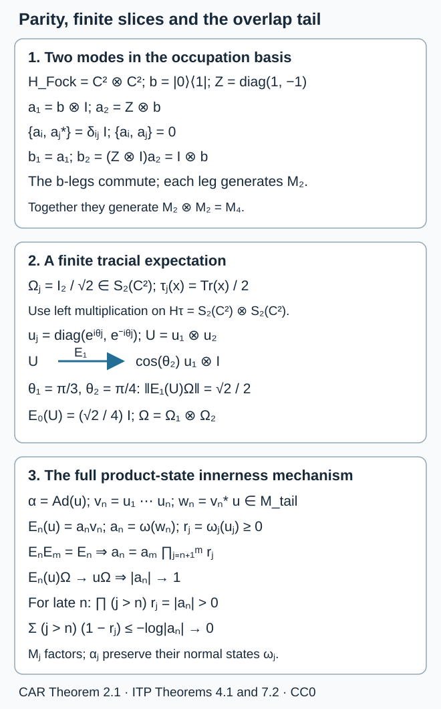

# Infinite tensor products and their reference states

*Written by GPT-6.1 Sol (OpenAI), Ultra, September–October 2026. Public domain (CC0).*

Finite tensor products combine algebras. An infinite tensor product also needs a rule for embedding each finite part into the next. Units supply that rule for C\*-algebras. Unit vectors supply it for Hilbert spaces. Normal reference states then determine the von Neumann algebra obtained in the product state's GNS representation.

We assume finite minimal C\*-tensor products, GNS representations, Kaplansky density in the strong* topology, concrete preduals and the spectral theorem. The full finite von Neumann commutation theorem and normal slice maps used in Sections 2, 4 and 5 are proved in Spatial tensor commutants and arbitrary product-state supports, Sections 1–6. Its whole spectral-band graph construction and normal amplification/corner transfer retain arbitrary Hilbert spaces and arbitrary representations. Its Sections 7–8 give arbitrary-index product-state supports and the different central GNS kernel, including nonfaithful states. Section 16 below spells out the applications and the full general product modular graph. The inductive-limit construction can also be compared with [AF-algebras](https://kokunoyumeto.github.io/open-math-courses-public/courses/foundations-of-von-neumann-algebras/af-algebras.html), Section 4.

The universal normal-limit comparison in Proposition 2.1 uses the canonical C\*-bidual, its predual \(A^*\), the unique normal extension of a \*-homomorphism into a von Neumann algebra, and the surjectivity of that extension onto the represented algebra. These are exactly Sections 3–8 of OA-MOD's *Every bounded functional becomes normal in one representation*, already used in [Nuclear biduals and extensions](nuclear-biduals-and-extensions.md). It also uses the C\*-quotient norm and the trace-class description of a concrete von Neumann predual.

For the modular part we use the closed Tomita involution \(S=J\Delta^{1/2}\), \(JMJ=M'\), and modular implementation from *The modular fundamental theorem*. Normality of a normal state's GNS representation is WG-007 in *General weights: finite domains, GNS spaces, and normal representations*. The final criterion uses exactly the separable-predual theorem of *Pointwise inner flows and continuous implementers*: a continuous real action whose individual automorphisms are inner has a continuous implementing unitary group. It also uses TI-06 in *Trace densities and noncommutative integration* and CZ-05, 08 and 11 in *Fixed elements and changes of density*. These are modular and flow prerequisites, not proofs supplied by this lesson.

Inner products are linear in the second variable. All index sets and Hilbert spaces in Sections 2–6 may be arbitrary. Sections 7–8 concern sequences; Section 8 additionally assumes separable preduals. Further reading is listed at the end.

## Begin with a finite observation

An infinite product can be studied through three questions: which reference sector is being used, what its finite-coordinate observations retain, and whether the local data determine a global operator or unitary. The first calculation shows why recovery and multiplication are different questions.

Take two copies of \(\mathbb C^2\), use \(e_1\) as the second reference vector, and let \(V\eta=\eta\otimes e_1\). For the unit vector
\[
b=(e_1\otimes e_1+e_2\otimes e_2)/\sqrt2,
\]
write \(P_b\) for its rank-one projection. Then \(V^*b=e_1/\sqrt2\), so the finite observation is
\[
(V^*P_bV)\otimes1=\tfrac12P_{e_1}\otimes1.
\]
This is positive and its square is half itself. Thus a projection need not remain a projection under a reference-vector observation. The original operator is recovered by allowing the retained coordinates to grow, as Theorem 4.1 proves; multiplicativity of each observation is not required. Exercise 5 develops this calculation in full.

The route through the constructions is:

- Choose the [reference sector](#2-units-and-reference-vectors), then construct its [finite observations](#4-recovering-an-operator-from-its-finite-parts) and test the [state, factor and trace](#5-commutants-factors-and-traces).
- Track [phase as well as overlap](#3-when-partial-tensor-vectors-converge) before assembling [local implementing unitaries](#7-which-product-automorphisms-are-inner).
- Read the [modular flow](#6-the-full-product-modular-operator) and the [semifiniteness test](#8-a-semifiniteness-criterion-with-its-countability-hypothesis) from the chosen states and their support corners.
- Use the separate [stage-map construction](#1-completing-an-inductive-sequence) to handle algebraic identifications, loss of norm and kernels. It proves the completion and universal property used for the abstract product algebra.

The Hilbert-space reference sector and the universal normal limit answer different questions. The binary-state example in Proposition 2.1 makes that distinction explicit. The final stage-map construction also explains why an algebraic germ can survive while its limiting norm vanishes.

## 2. Choose a reference sector

Let \((A_i)_{i\in I}\) be nonzero unital C\*-algebras. For finite \(F\subset I\) put
\[
A_F=\bigotimes_{i\in F,\min}A_i,\qquad A_\varnothing=\mathbb C.
\]
For \(F\subset G\), insert units in \(G\setminus F\). The [complete minimal-norm construction](../abstract-tensor-and-universal-bidual-foundations.html#mtn-theorem) proves faithful-representation independence at arbitrary Hilbert cardinality. Its [unit-padding proof](../abstract-tensor-and-universal-bidual-foundations.html#mtn-padding) makes these connecting maps isometric: in faithful representations the extra units act as identity operators on nonzero Hilbert spaces. The normed union and its completion define
\[
\bigotimes_{i\in I,\min}A_i. \tag{2}
\]
Finite sets, ordered by inclusion, form a directed set. Permuting the indices gives a canonical isomorphism. [Regrouping into arbitrary disjoint blocks](../abstract-tensor-and-universal-bidual-foundations.html#mtn-blocks) gives the same algebra. The proof first establishes finite regrouping and injectivity of minimal tensor maps, then proves that local tensors have dense image in every block product and in the directed completion.

For nonunital algebras the formula \(x\mapsto x\otimes1\) requires a unit outside the given algebra. Thus (2) is not a construction from the nonunital algebras alone. Extra choices can define other constructions; the missing unit-padding map must not be silently supplied.

Now let \(H_i\ne0\) be Hilbert spaces with specified unit vectors \(\xi_i\). The maps
\[
H_F\longrightarrow H_G,\qquad
\eta\longmapsto\eta\otimes\bigotimes_{i\in G\setminus F}\xi_i,
\quad H_F=\bigotimes_{i\in F}H_i,
\]
are isometries. Complete their algebraic union to obtain the **pointed, or incomplete, tensor product**
\[
H=\bigotimes_{i\in I}(H_i,\xi_i),\qquad
\Omega=\bigotimes_{i\in I}\xi_i. \tag{3}
\]
The terminology “incomplete” specifies one reference sector; it does not mean that \(H\) is uncompleted. Every vector is approximable by vectors differing from the reference vectors in only finitely many coordinates.

For \(F\subset I\), finite or infinite, grouping finite-support vectors gives a unitary
\[
H\cong
\bigotimes_{i\in F}(H_i,\xi_i)
\otimes
\bigotimes_{i\notin F}(H_i,\xi_i). \tag{4}
\]
Indeed it preserves inner products of elementary finite-support vectors, and its range contains a dense set of elementary vectors in the right side.

If \(M_i\subseteq B(H_i)\) are von Neumann algebras, let \(M_F\) be the finite spatial product acting in the \(F\)-coordinates. Define
\[
M=\left(\bigcup_{F\subset I\ {\rm finite}}M_F\right)''. \tag{5}
\]
Each finite representation is faithful and normal. No cyclicity of \(\xi_i\) is needed for this concrete definition.

There is also an abstract construction from normal states \(\omega_i\) on \(M_i\). Their finite product states are normal and consistent under unit padding. They give a state \(\omega\) on (2). In its GNS representation put
\[
\bigotimes_{i\in I}(M_i,\omega_i)=\pi_\omega\left(\bigotimes_{i\in I,\min}M_i\right)''. \tag{6}
\]
Use each state's GNS triple \((\pi_i,H_i,\xi_i)\). The elementary map
\[
\bigotimes_{i\in F}\pi_i(x_i)\xi_i
\longmapsto
\pi_\omega\left(\bigotimes_{i\in F}x_i\right)\Omega
\]
preserves inner products, by the product-state formula, and both sides have dense span. It therefore identifies (6) with (5), with \(M_i\) replaced by \(\pi_i(M_i)\).

Normality of \(\pi_i\) is essential here. Its kernel is a central ideal, so a nonzero normal state on a factor gives a faithful GNS representation even when the state itself is not faithful. For a nonfactor this can fail: evaluation at the first coordinate of \(\mathbb C^2\) has one-dimensional GNS image and kills the second summand. Consequently (6) for general algebras preserves their state-supported central quotients, not automatically every original summand.

### Elementary support for the universal normal limit

#### The normal multiplicative extension

The [universal bidual construction](../abstract-tensor-and-universal-bidual-foundations.html#abf-four-positive-parts) starts with scalar states and proves that every bounded functional is a coefficient of one state GNS representation. The direct sum \(\pi_U\) of all state representations is faithful and nondegenerate. If \(M_U=\pi_U(A)''\), restriction
\[
 R:(M_U)_*\longrightarrow A^*,\qquad R(\rho)=\rho\circ\pi_U,
\]
is an onto isometry: the full bounded-density proof supplies norm equality, and the four-positive-part coefficient construction supplies surjectivity for every functional. The correctly directed adjoint
\[
 U=R^*:A^{**}\longrightarrow M_U
\]
is an onto isometry with globally weak-star continuous inverse \((R^{-1})^*\). Transporting multiplication and involution through \(U\) gives the bidual its von Neumann algebra structure and original predual \(A^*\). Its product is separately weak-star continuous, and \(j_A(A)\) is weak-star dense. The complete scalar, coefficient, density and corner arguments are proved in that reader.

For a unital *-homomorphism \(\pi:A\to N\subseteq B(K)\), normal functionals restrict to the bounded map
\[
 S:B(K)_*\longrightarrow A^*,\qquad S(\rho)=\rho\circ\pi.
\]
Its adjoint \(T=S^*:A^{**}\to B(K)\) is weak-star-to-ultraweak continuous and satisfies \(Tj_A=\pi\). For \(a\in A\), approximate \(Y\) by \(j_A(b_i)\), using separate continuity:
\[
 T(j_A(a)Y)=\lim_i\pi(ab_i)=\pi(a)T(Y).
\]
Then approximate \(X\) by \(j_A(a_i)\), keeping \(Y\) fixed:
\[
 T(XY)=\lim_i\pi(a_i)T(Y)=T(X)T(Y).
\]
One limit gives \(T(X^*)=T(X)^*\); since \(\pi\) is unital, \(T(1)=1_N\). Density puts its range in \(L=\pi(A)''\subseteq N\), and gives uniqueness of the normal extension. No joint ultraweak continuity of multiplication was used.

The [complete normal-extension and image proof](../abstract-tensor-and-universal-bidual-foundations.html#abf-normal-extension) shows that \(T\) maps the bidual unit ball onto \(B_L\): its image is ultraweakly compact and closed, and actual images of contractions in \(A\) are ultraweakly dense in \(B_L\). Thus \(T\) is onto the generated algebra \(L\). A compatible family need not generate a specified larger \(N\); onto-ness is asserted only for \(L\). The [central-quotient proof](../abstract-tensor-and-universal-bidual-foundations.html#abf-central-quotient) identifies \(\ker T=(1-z)A^{**}\) for a central projection \(z\), and proves the restriction \(zA^{**}\to L\) and its inverse normal by an onto isometric preadjoint. That proof also treats possibly degenerate representations and distinguishes the supported ultraweak closure from a complementary scalar corner in the ambient bicommutant.

For Proposition 2.1, Theorem 1.1 extends the compatible family of unital local maps to \(\pi:A\to N\), and this construction supplies its unique normal unital extension. The particular reference-state representation instead chooses the normal quotient onto its generated algebra.

#### Binary states and separability

The binary states in Proposition 2.1 can be constructed on the finite matrix union before any infinite-product representation is chosen. Label an orthonormal basis of \(\mathbb C^2\) by \(e_0,e_1\). For \(s\in\{0,1\}^{\mathbb N}\), let
\[
\xi_{s,n}=e_{s_1}\otimes\cdots\otimes e_{s_n},
\qquad
\psi_{s,n}(x)=\langle\xi_{s,n},x\xi_{s,n}\rangle
\quad(x\in A_n).
\]
These are states and satisfy \(\psi_{s,n+1}(x\otimes1)=\psi_{s,n}(x)\). The isometric unit-padding inclusions therefore define a single positive linear functional \(\psi_s\) on \(\bigcup_nA_n\), with
\[
|\psi_s(x)|\leq\|x\|,
\qquad \psi_s(1)=1.
\]
It extends uniquely to a bounded linear functional on \(A\). To verify positivity of the extension, take \(b\in A_+\) and local elements \(c_k\) converging in norm to \(b^{1/2}\). Then \(c_k^*c_k\to b\), and
\[
\psi_s(b)=\lim_k\psi_s(c_k^*c_k)\geq0.
\]
The extension has norm one because its norm is at most one and its value at the unit is one. It is therefore a state. This construction uses finite matrix vector states and norm completion, with no infinite normal-product theorem.

Let \(e_j\) now denote the projection onto the basis vector labelled \(1\) in coordinate \(j\), padded by units elsewhere. Then \(\psi_s(e_j)=s_j\). If \(s_j\ne t_j\), the selfadjoint unitary \(2e_j-1\) has opposite values under the two states. Thus
\[
2=|(\psi_s-\psi_t)(2e_j-1)|
\leq\|\psi_s-\psi_t\|
\leq\|\psi_s\|+\|\psi_t\|=2.
\]
There are uncountably many binary sequences: for any proposed enumeration \(s^{(1)},s^{(2)},\ldots\), the sequence \(t_j=1-s^{(j)}_j\) is absent from it. A separable metric space cannot contain an uncountable family of points at pairwise distance two. Indeed, its open balls of radius \(1/2\) about those points are disjoint, and a countable dense set must meet every ball. Selecting the first dense-set point in each ball would inject that family into a countable set. Applying this to the norm metric on \(A^*\) proves the nonseparability asserted for the canonical predual of \(A^{**}\).

For the reference-product conclusion, let \((H_j,\pi_j,\xi_j)\) be the GNS triples of the chosen matrix states. Each \(H_j\) is the quotient of the four-dimensional vector space \(M_2\) by its GNS null space, so \(\dim H_j\leq4\); completion does not enlarge a finite-dimensional space. Also \(\|\xi_j\|=1\). Choose an orthonormal basis of \(H_j\) beginning with \(\xi_j\). In the pointed product, tensors which use these basis vectors and use \(\xi_j\) in all but finitely many coordinates form a countable family: the finite subsets of \(\mathbb N\) are countable, and each fixed finite subset permits only finitely many basis choices. Their linear span is dense by the definition of the pointed product. Finite linear combinations with coefficients in \(\mathbb Q+i\mathbb Q\) form a countable dense subset. The product Hilbert space \(H\) is therefore separable, for every choice of reference states, including nonfaithful ones.

The concrete-predual separability step can be proved directly from vector coefficients. Let \(D\) be a countable dense subset of \(H\), for example the finite rational complex combinations of the countable local orthonormal tensor family above. For vectors \(\eta,\xi\), write
\[
 F_{\eta,\xi}(T)=\langle\eta,T\xi\rangle\quad(T\in B(H)).
\]
The complete coefficient-predual construction completes the finite coefficient space in the infimum-of-representations norm
\[
 \|F\|_{\mathcal C}
 =\inf\left\{\sum_j\|\eta_j\|\|\xi_j\|:
                  F=\sum_jF_{\eta_j,\xi_j}\right\},
\]
where each displayed representation is finite. Its completion \(\mathcal C(H)\) has dual \(B(H)\), by the full bounded sesquilinear-form and Hilbert representation proof. The estimate
\[
 \|F_{\eta,\xi}-F_{\eta',\xi'}\|_{\mathcal C}
 \leq\|\eta-\eta'\|\|\xi\|
       +\|\eta'\|\|\xi-\xi'\|
\]
puts every finite coefficient sum in the norm closure of the countable family of finite sums whose vectors lie in \(D\). Complex coefficients can be absorbed into a vector before it is approximated. Thus \(\mathcal C(H)\) is separable. For any concrete von Neumann algebra \(M\subseteq B(H)\), that construction and its complete annihilator argument identify
\[
 M_*=\mathcal C(H)/M_\perp,
 \qquad
 M_\perp=\{F\in\mathcal C(H):F(x)=0\text{ for all }x\in M\}.
\]
The image of a countable dense subset is dense in this quotient, so \(M_*\) is separable. This proves the required concrete predual conclusion on the whole algebra from its actual coefficient construction.

**Proposition 2.1.** Let \(A=\bigotimes_{j=1}^\infty M_2\), with local algebras \(A_n=M_{2^n}\). In the category of von Neumann algebras and normal unital \*-homomorphisms, their universal inductive limit is \(A^{**}\). Its predual is nonseparable. Every reference-state product representation of these countably many matrix algebras, however, generates a von Neumann algebra with separable predual.

**Proof.** Each canonical inclusion \(A_n\to A^{**}\) is normal, since \(A_n\) is finite-dimensional. A compatible family of normal unital maps \(A_n\to N\) first extends, by Theorem 1.1, to a unital \*-homomorphism \(A\to N\). The canonical bidual extension theorem gives a unique normal unital extension \(A^{**}\to N\). Uniqueness follows from the ultraweak density of \(A\) in \(A^{**}\). This is the claimed universal property.

For each binary sequence \(s=(s_j)\in\{0,1\}^{\mathbb N}\), take the product of the one-mode vector states at the basis vectors labelled \(s_j\), obtaining a state \(\psi_s\) on \(A\). Positivity and existence are the product GNS construction above. Write \(e_j\) for the occupation projection in coordinate \(j\). If \(s\ne t\), choose \(j\) with \(s_j\ne t_j\). The selfadjoint unitary \(2e_j-1\) has opposite state values, so
\[
\|\psi_s-\psi_t\|=2. \tag{6a}
\]
The upper bound is the triangle inequality for two states, and the unitary proves the lower bound. Thus \(A^*\), the canonical predual of \(A^{**}\), contains an uncountable set with pairwise distance two. A separable metric space cannot contain such a set: balls of radius less than one about its elements are disjoint and must each contain a different point of a countable dense set. Hence this predual is nonseparable.

For any one-mode normal reference states, their GNS spaces have dimension at most four. The countable pointed tensor product therefore has a countable dense set of local vectors and is separable. A von Neumann algebra represented on this space has predual a quotient of its separable coefficient completion, as proved above, hence separable. It consequently cannot be the universal algebra \(A^{**}\) above. The normal extension of the GNS representation is onto this generated algebra, by the full normal-extension image proof above. Specifying reference states therefore chooses a normal quotient of the universal bidual, with its particular GNS realization; it does not merely rename the universal normal inductive limit. \(\square\)

## 4. Recover an operator from finite observations

For a finite \(F\subset I\), use (4) and define
\[
V_F:H_F\to H,\qquad V_F\eta=\eta\otimes\Omega_{I\setminus F},
\quad P_F=V_FV_F^*.
\]
The projections \(P_F\) increase strongly to one. Define a normal ucp map on all of \(B(H)\) by
\[
E_F(x)=\left(V_F^*xV_F\right)\otimes1_{H_{I\setminus F}}. \tag{10}
\]
Compression is completely positive and normal; amplification is a normal \*-homomorphism. Thus (10) is a normal conditional expectation onto \(B(H_F)\otimes1\), with its evident bimodule identity. It preserves the vector state of \(\Omega\).

**Theorem 4.1.** For \(x\in B(H)\),
\[
E_F(x)\longrightarrow x\quad\hbox{strong*}, \tag{11}
\]
and for every \(\rho\in B(H)_*\),
\[
\|\rho\circ E_F-\rho\|\longrightarrow0. \tag{12}
\]
Moreover \(E_F(M)=M_F\), so its restriction is a normal \(\omega\)-preserving expectation onto the finite local algebra.

**Proof.** If \(\eta\in P_KH\) and \(F\supset K\), then
\[
E_F(x)\eta=P_Fx\eta.
\]
This converges to \(x\eta\). The union of the \(P_KH\) is dense, and \(\|E_F(x)\|\le\|x\|\), so convergence holds on all vectors. Apply the same argument to \(x^*\), since \(E_F(x)^*=E_F(x^*)\), to get (11).

For vectors \(\eta,\zeta\in P_KH\), and \(F\supset K\),
\[
\langle\zeta,E_F(x)\eta\rangle=\langle\zeta,x\eta\rangle
\]
for every \(x\). Hence the corresponding vector functional is exactly fixed by the preadjoint of \(E_F\). Approximate arbitrary vectors by finite-support vectors and use
\[
\|\omega_{\zeta,\eta}-\omega_{\zeta',\eta'}\|
\le \|\zeta-\zeta'\|\|\eta\|+\|\zeta'\|\|\eta-\eta'\|.
\]
Finite sums of vector functionals are norm dense in the trace-class predual of \(B(H)\), including on a nonseparable Hilbert space. The preadjoints are contractions, so (12) follows.

On a local elementary operator, (10) keeps the \(F\)-coordinates and evaluates the others against their reference vectors. Its image is in \(M_F\). The local algebra is ultraweakly dense in \(M\), \(E_F\) is normal, and \(M_F\) is ultraweakly closed, so \(E_F(M)\subseteq M_F\). It fixes \(M_F\), proving equality. \(\square\)

The same predual statement holds on \(M\): extend a normal functional to a normal functional on \(B(H)\) and restrict (12). These expectations have finite-dimensional range only when the corresponding \(H_F\), or the restricted algebra \(M_F\), is finite-dimensional. A finite set of infinite-dimensional factors does not give a finite-dimensional model.

## 5. Test the factor and its reference state

Let
\[
N=\left(\bigcup_{F\subset I\ {\rm finite}}\bigotimes_{i\in F}M_i'\right)''
\]
on the same pointed tensor product.

**Theorem 5.1.** One has \(M'=N\). If every \(M_i\) is a factor, \(M\) is a factor.

**Proof.** All local \(M_i'\) commute with all local \(M_j\), so \(N\subseteq M'\). If \(x\in M'\), bimodularity of \(E_F\) implies that \(E_F(x)\) commutes with \(M_F\). On \(H_F\), the finite commutation theorem gives
\[
M_F'=\bigotimes_{i\in F}M_i'.
\]
Thus \(E_F(x)\in N\). Equation (11) and strong closedness of \(N\) imply \(x\in N\).

For the factor assertion, first verify the finite product's center by slices. If \(P,Q\) are factors and \(z\in\mathcal Z(P\bar\otimes Q)\), every second-leg normal slice of \(z\) belongs to \(P\) and commutes with \(P\), hence is scalar. Choose a normal state \(\chi\) on \(P\), and put \(q=(\chi\otimes\operatorname{id})(z)\in Q\). The second-leg slices of \(z-1\otimes q\) all vanish: a scalar slice \(c1\) has value \(c\) under \(\chi\). Vector slices separate operators, so \(z=1\otimes q\). Commutation with \(1\otimes Q\) makes \(q\) scalar. Induction proves \(\mathcal Z(M_F)=\mathbb C1\) for every finite \(F\), with no dimension or countability restriction on its legs.

Now take \(z\in\mathcal Z(M)\). By Theorem 4.1, \(E_F(z)\in M_F\). Bimodularity gives, for \(a\in M_F\),
\[
aE_F(z)=E_F(az)=E_F(za)=E_F(z)a.
\]
Thus \(E_F(z)=c_F1\). Applying the preserved vector state gives \(c_F=\langle\Omega,z\Omega\rangle\), independent of \(F\); this step does not require that vector state to be faithful. The strong* convergence in (11) therefore gives
\[
z=\langle\Omega,z\Omega\rangle1.
\]
Hence \(M\) is a factor. This central-element proof uses the actual local expectations and finite spatial slices; it applies equally to arbitrary index sets and noncyclic reference vectors. \(\square\)

**Proposition 5.2.** In the state GNS model, if every \(\omega_i\) is faithful, the product state is faithful and normal on \(M\).

**Proof.** Normality follows from its vector realization. Each \(\xi_i\) is cyclic for \(M_i\) and separating for it, hence cyclic for \(M_i'\). Finite products of these cyclic subspaces are dense in \(H\). Theorem 5.1 therefore makes \(\Omega\) cyclic for \(M'\), and hence separating for \(M\). A vector state is faithful exactly when its vector is separating. \(\square\)

For \(F\subset I\), the grouping (4) also groups the von Neumann algebras:
\[
M\cong M_F\bar\otimes M_{I\setminus F}. \tag{13}
\]
Both sides are generated by the same local operators. If the algebras are factors, the relative commutant is
\[
M_F'\cap M=M_{I\setminus F}. \tag{14}
\]
To verify (14), slice an operator in (13) against normal functionals on the second leg. Commutation with \(M_F\) makes every first-leg slice scalar. Fix a normal state \(\chi\) on \(M_F\); the operator then equals \(1\otimes(\chi\otimes\operatorname{id})(x)\), since the slices of their difference all vanish. Normal slices separate operators, as follows from their vector coefficients. This proves (14).

**Corollary 5.3.** An infinite product of finite factors in their normalized trace GNS representations is a finite factor with its product trace. If infinitely many component factors are nontrivial, it is of type \(\mathrm{II}_1\).

**Proof.** The preceding results give a factor and a faithful normal state \(\tau\). On every finite local algebra that state is tracial. For \(x,y\in M\), the uniformly bounded nets \(E_F(x)\) and \(E_F(y)\) converge strong*. Their products therefore converge strongly to \(xy\) and \(yx\), respectively. Evaluating their vector-state traces gives
\[
\tau(xy)=\lim_F\tau(E_F(x)E_F(y))
=\lim_F\tau(E_F(y)E_F(x))=\tau(yx).
\]
Faithfulness of this trace implies finiteness: if \(v^*v=1\), then \(\tau(1-vv^*)=0\), so \(vv^*=1\).

To prove the type conclusion, fix a positive integer \(m\), select \(m\) nontrivial components and call their index set \(F\). In each choose a nonscalar \(a_i\), and put
\[
b_i=\frac{a_i-\tau_i(a_i)1}
{\tau_i((a_i-\tau_i(a_i)1)^*(a_i-\tau_i(a_i)1))^{1/2}}.
\]
The denominator is positive: otherwise faithfulness would make \(a_i=\tau_i(a_i)1\). Thus \(\tau_i(b_i)=0\) and \(\tau_i(b_i^*b_i)=1\). For each \(S\subseteq F\), let \(w_S\) have entry \(b_i\) at \(i\in S\) and identity in the other coordinates. The product trace gives
\[
\langle w_S\Omega,w_T\Omega\rangle=\tau(w_S^*w_T)=\delta_{S,T}.
\]
For distinct subsets, a coordinate in their symmetric difference contributes \(\tau_i(b_i)\) or its conjugate, both zero; for equal subsets every factor is one. Consequently \(M\) contains \(2^m\) linearly independent operators, for every \(m\), and is infinite-dimensional.

Suppose it had a minimal projection. The complete arbitrary-factor matrix-unit construction in [Constant CAR states, Sections 8.1–8.9](constant-car-states-and-the-periodic-core.md#8-projection-comparison-and-the-finite-factor-alternative) would give \(M\cong B(\ell^2(J))\), for an initially arbitrary index set \(J\), with equivalent nonzero minimal diagonal projections \((e_j)_{j\in J}\) whose strong sum is one. Traciality gives the same number \(a=\tau(e_j)>0\) on each. Every finite \(K\subseteq J\) then satisfies \(|K|a\le\tau(1)=1\). Choosing an integer larger than \(1/a\) shows that \(J\) is finite. This would make \(M\) a finite matrix algebra, contradicting the preceding dimension estimate. Thus it has no minimal projection. A factor with a faithful normal normalized trace and no minimal projection is type \(\mathrm{II}_1\), by the type definition. This uses no general factor-type decomposition. No separability conclusion is implied for uncountable \(I\). \(\square\)

## 3. Follow phase as well as overlap

Consider a sequence of unit vectors \(\eta_n\in H_n\), and the unit vectors in (3)
\[
z_n=\eta_1\otimes\cdots\otimes\eta_n\otimes\xi_{n+1}\otimes\xi_{n+2}\otimes\cdots.
\]
Set \(c_n=\langle\xi_n,\eta_n\rangle\). With our inner-product convention,
\[
\langle z_n,z_m\rangle=\prod_{j=n+1}^m c_j
\quad(m>n),\qquad
\|z_m-z_n\|^2=2\left(1-\operatorname{Re}\prod_{j=n+1}^m c_j\right). \tag{7}
\]

**Theorem 3.1.** The vectors \(z_n\) converge if and only if
\[
\sup_{m>n\ge N}\left|1-\prod_{j=n+1}^m c_j\right|\longrightarrow0. \tag{8}
\]
Equivalently, there are only finitely many zero \(c_j\), and on a tail where they are nonzero,
\[
\sum_j(1-|c_j|)<\infty
\quad\hbox{and}\quad
\prod_{j=N_0}^n\frac{c_j}{|c_j|}
\ \hbox{converges in }\mathbb T. \tag{9}
\]

**Proof.** For \(|w|\le1\),
\[
|1-w|^2\le2(1-\operatorname{Re}w),\qquad
1-\operatorname{Re}w\le|1-w|.
\]
Thus (7) gives exactly (8). This is a Cauchy criterion in the complete Hilbert space; the limit has norm one.

Condition (8) excludes zeros sufficiently far out. Write \(c_j=r_jd_j\), \(0<r_j\le1\), \(|d_j|=1\), on that tail. For a sufficiently late \(N_0\), all products \(\prod_{j=N_0}^m r_j\) are bounded below by, say, \(1/2\). Since \(1-r\le-\log r\), their lower bound implies \(\sum_{j\ge N_0}(1-r_j)<\infty\). Conversely this sum implies that the tail modulus products tend uniformly to one: the elementary bound
\[
0\le1-\prod_{j=n+1}^m r_j\le\sum_{j=n+1}^m(1-r_j)
\]
suffices. With these modulus tails tending to one, (8) is equivalent to the phase tails \(\prod_{j=n+1}^m d_j\) tending uniformly to one. Since they are ratios of unit-modulus prefix products, this is precisely convergence of those prefixes in \(\mathbb T\). \(\square\)

Absolute summability of \(1-c_j\) is a useful sufficient condition: telescoping products gives
\[
\left|1-\prod_{j=n+1}^m c_j\right|
\le\sum_{j=n+1}^m|1-c_j|.
\]
It is not necessary. Take
\[
\eta_n=e^{\,i(-1)^n/n}\xi_n.
\]
Then \(z_n=e^{i\sum_{j=1}^n(-1)^j/j}\Omega\) converges, whereas
\[
|1-c_n|=2\sin(1/(2n))\ge \frac{2}{\pi n},
\]
so \(\sum_n|1-c_n|=\infty\). The phases converge conditionally. The exact criterion (8) avoids identifying conditional phase convergence with absolute convergence. This distinguishes ordered phase convergence from an absolute strong-sector condition.

If vectors \(\eta_n\) are not normalized but their norm products \(P_n=\prod_{j=1}^n\|\eta_j\|\) tend to a finite \(L>0\), none is zero. Put \(\zeta_j=\eta_j/\|\eta_j\|\). The partial tensors are \(P_n\) times the unit partial tensors. Hence convergence, with nonzero limit, is equivalent to (8) for \(\langle\xi_j,\zeta_j\rangle\). If \(P_n\to0\), the partial tensors converge to zero regardless of their directions.

## 7. Assemble local implementing unitaries

Now let \((M_n)\) be a sequence of factors, let \(\omega_n\) be normal states, and let \(\alpha_n\) preserve \(\omega_n\). Use the state GNS product \(M\). The algebraic product automorphism preserves \(\omega\), so
\[
W(x\Omega)=\alpha(x)\Omega
\]
on the local algebra extends to a unitary. Conjugation by \(W\) gives a normal automorphism of \(M\), denoted by \(\alpha=\bigotimes_n\alpha_n\).

We first record a finite-leg fact.

### Vector slices and unitary normalization

The slice required by Lemma 7.1 can be constructed directly from vector coefficients. Work with concrete von Neumann algebras \(P\subseteq B(H)\) and \(Q\subseteq B(K)\), and their spatial product on \(H\otimes K\). Section 10 supplies all Hilbert and concrete operator foundations used here. For abstract algebras with prescribed preduals, faithful normal realizations and the corresponding topology identification are separate inputs; mere faithful C\*-representations do not assert that identification. For \(\zeta\in K\), define the bounded map
\[
R_\zeta:H\longrightarrow H\otimes K,
\qquad R_\zeta h=h\otimes\zeta.
\]
It has norm \(\|\zeta\|\). For \(\eta,\zeta\in K\), put
\[
a_{\eta,\zeta}=R_\eta^*uR_\zeta\in B(H).
\]
With the inner product linear in its second variable,
\[
\langle h,a_{\eta,\zeta}k\rangle
=\langle h\otimes\eta,u(k\otimes\zeta)\rangle.
\]
If all these compressions were zero, all coefficients of \(u\) between elementary tensors would vanish. Finite sums of elementary tensors are dense in \(H\otimes K\); boundedness then makes every coefficient of \(u\) zero. This contradicts its being unitary. Choose \(\eta,\zeta\) for which \(a=a_{\eta,\zeta}\ne0\).

For \(b\in P'\), every elementary tensor in \(P\odot Q\) commutes with \(b\otimes1\). The commutation relation is weak-operator closed, so \(u\) commutes with \(b\otimes1\). Since
\[
R_\zeta b=(b\otimes1)R_\zeta,
\qquad bR_\eta^*=R_\eta^*(b\otimes1),
\]
we obtain \(ba=ab\). Thus \(a\in(P')'=P\). On an elementary tensor \(x\otimes q\), this compression is
\[
R_\eta^*(x\otimes q)R_\zeta
=\langle\eta,q\zeta\rangle x.
\]
The bounded vector functional \(q\mapsto\langle\eta,q\zeta\rangle\) is normal on \(Q\); this is exactly the corresponding second-leg vector slice. No expansion of an arbitrary normal functional is needed.

The implementing relation and the identities for \(R_\zeta\) give, for every \(x\in P\),
\[
ax=R_\eta^*u(x\otimes1)R_\zeta
=R_\eta^*(\beta(x)\otimes1)uR_\zeta
=\beta(x)a.
\]
Apply this to \(x^*\) and take adjoints to get \(xa^*=a^*\beta(x)\). Hence
\[
a^*ax=a^*\beta(x)a=xa^*a,
\qquad
aa^*\beta(x)=axa^*=\beta(x)aa^*.
\]
Both products belong to \(P\). Because \(P\) is a factor and \(\beta(P)=P\), there are nonnegative scalars \(c,d\) with \(a^*a=c1\) and \(aa^*=d1\). The C\*-identity gives
\[
c=\|a^*a\|=\|a\|^2=\|aa^*\|=d>0.
\]
Consequently \(v=a/\|a\|\) satisfies \(v^*v=vv^*=1\), and \(vxv^*=\beta(x)\). This supplies the slice and the scalar normalization used in the original proof. The construction uses no factoriality assumption on \(Q\); the stated lemma retains its original hypotheses.

**Lemma 7.1.** If \(P,Q\) are factors and \(\beta\otimes\gamma\) is inner on \(P\bar\otimes Q\), then \(\beta\) is inner on \(P\).

**Proof.** Represent \(P\bar\otimes Q\) on \(H\otimes K\), and let its unitary \(u\) implement \(\beta\otimes\gamma\). For \(\zeta\in K\), write \(R_\zeta h=h\otimes\zeta\). Some
\[
a=R_\eta^*uR_\zeta
\]
is nonzero: if all these compressions vanished, every matrix coefficient of \(u\) between elementary tensors would vanish, and density would imply \(u=0\). Each local tensor commutes with \(P'\otimes1\), and the commutation relation is weak-operator closed. Thus \(u\) commutes with it. Moving \(b\in P'\) through the two maps \(R\) shows \(ba=ab\), so \(a\in(P')'=P\).

The implementing relation gives, for every \(x\in P\),
\[
ax=R_\eta^*u(x\otimes1)R_\zeta
=R_\eta^*(\beta(x)\otimes1)uR_\zeta=\beta(x)a.
\]
Apply this to \(x^*\) and take adjoints. It follows that \(a^*a\) commutes with \(P\), while \(aa^*\) commutes with \(\beta(P)=P\). Both belong to the factor \(P\), hence are scalars. The C*-identity gives
\[
a^*a=\|a\|^2 1=aa^*,\qquad \|a\|>0.
\]
Therefore \(a/\|a\|\) is a unitary in \(P\) implementing \(\beta\). These are concrete vector compressions with the inner-product convention fixed above; their full boundedness and tensor foundations are in Section 10. \(\square\)

**Theorem 7.2.** The product automorphism \(\alpha\) is inner if and only if each \(\alpha_n=\operatorname{Ad}u_n\) for some unitary \(u_n\in M_n\), and
\[
\sum_{n=1}^\infty\left(1-|\omega_n(u_n)|\right)<\infty. \tag{17}
\]
For a factor the value in (17) is independent of the choice of implementer.

**Proof.** Two implementers differ by a scalar unitary because their quotient commutes with the factor. Adjust phases so that \(r_n=\omega_n(u_n)\ge0\).

Suppose \(\alpha=\operatorname{Ad}u\). Lemma 7.1 and (13) give an implementer for each component. Put
\[
v_n=u_1\cdots u_n,\qquad w_n=v_n^*u.
\]
The unitary \(w_n\) commutes with the first \(n\) factors, hence lies in the tail algebra by (14). Write \(E_n=E_{\{1,\ldots,n\}}\). The local expectation has the following tower identity, proved by compressing successive finite parts against the same reference vectors:
\[
E_nE_m=E_n\qquad(m\ge n).
\]
Equivalently, on a local elementary tensor both sides retain its first \(n\) coordinates and evaluate every later coordinate in its reference state; normality extends this equality to \(M\). Since the tail expectation is scalar on its tail leg,
\[
E_n(u)=a_n v_n,\qquad a_n=\omega(w_n).
\]
Theorem 4.1 gives \(E_n(u)\Omega=P_nu\Omega\to u\Omega\). As both \(u\) and \(v_n\) are unitary,
\[
|a_n|=\|E_n(u)\Omega\|\longrightarrow1.
\]
For \(m>n\), apply the tower identity to \(E_m(u)=a_m v_m\). Product-state evaluation of the intervening local unitaries gives
\[
a_n=a_m\prod_{j=n+1}^m r_j.
\]
Choose \(n\) so late that \(|a_n|>0\). Then every \(r_j\), \(j>n\), is positive, and every \(a_m\), \(m\ge n\), is nonzero. Since \(|a_m|\le1\),
\[
\sum_{j=n+1}^m(1-r_j)
\le-\log\prod_{j=n+1}^m r_j
=-\log|a_n|+\log|a_m|
\le-\log|a_n|.
\]
This bounds every partial sum, proving (17). In fact, letting \(m\to\infty\) gives the exact infinite-tail product \(\prod_{j>n}r_j=|a_n|\). Thus the expectation's recovery of the implementing vector measures its remaining overlap loss. The argument covers \(\omega(u)=0\) and uses no faithfulness of the component or product state.

Conversely assume (17), with the same nonnegative phase choices. If \(x\) is supported in the first \(k\) factors and \(n>m\ge k\), then
\[
\|(v_n-v_m)x\Omega\|^2
=2\|x\Omega\|^2\left(1-\prod_{j=m+1}^n r_j\right)
\le2\|x\Omega\|^2\sum_{j>m}(1-r_j). \tag{19}
\]
The same estimate holds for \(v_n^*\), since the tail reference overlaps have the same real values. The local vectors are dense and the operator norms equal one. Thus both sequences converge strongly, to \(v\) and \(v^*\). Bounded strong convergence of products gives \(v^*v=vv^*=1\), so \(v\in M\) is unitary. On every local element conjugation by \(v_n\) is eventually \(\alpha\); taking the limit and then normal extension gives \(\alpha=\operatorname{Ad}v\). \(\square\)

The same necessary overlap bound can also be witnessed by a local test element. Choose \(a\) supported in the first \(m\) coordinates with \(\omega(ua)\ne0\); such an element exists because local vectors are dense and \(u^*\Omega\ne0\). For \(n>m\), splitting \(u=v_nw_n\) gives
\[
0<|\omega(ua)|
=|\omega(v_n a)|\,|\omega(w_n)|
\le\|a\|\prod_{k=m+1}^n r_k. \tag{18}
\]
This is an alternative lower-bound witness. The proof above obtains the necessary summability from the expectation tower and \(|a_n|\to1\) directly.

The phase adjustment makes the sufficient vector criterion real and nonnegative. Hence this argument does not need the false absolute-complex-overlap necessity discussed in Section 3.

The first panel computes the parity correction in [CAR Theorem 2.1](car-fock-and-quasifree-states.md#theorem-2-1). The middle panel uses left multiplication on the Hilbert–Schmidt GNS spaces, with reference vector \(I_2/\sqrt2\), to compute the exact finite expectation. In the final panel, \(\prod_{j>n}r_j\) and \(\sum_{j>n}(1-r_j)\) are the infinite tail product and sum from the proof of Theorem 7.2. The finite-support Hilbert construction is developed in von Neumann, Definition 4.1.1 and Lemmas 4.1.2–4.1.4, pp.35–38; the expectation and overlap argument is proved above.

## 6. Read the modular flow from the state

Assume faithful normal reference states, and use their GNS representations. Let \((S_i,J_i,\Delta_i)\) be their Tomita data. In particular,
\[
J_i\xi_i=\xi_i,\qquad \Delta_i^{it}\xi_i=\xi_i.
\]
On finite-support vectors define the antiunitary \(J\) coordinatewise, and define
\[
U_t=\bigotimes_{i\in I}\Delta_i^{it}. \tag{15}
\]
The latter means application of \(\Delta_i^{it}\) in the finitely many varying coordinates. It is isometric, has inverse \(U_{-t}\), and extends to \(H\). Continuity on finite-support vectors and the unitary bound give strong continuity on all \(H\). The group law holds on a dense subspace and hence everywhere.

Write \(U_t=e^{itL}\) by Stone's theorem and \(D=e^L\). This is a positive nonsingular selfadjoint operator, not necessarily bounded. Each \(P_F\) reduces \(U_t\), so it reduces \(D\) and its powers. On \(P_FH\), the operator \(D^{1/2}\) is the finite product modular half power.

We justify that last statement and the infinite graph domain explicitly. In a finite product of two faithful-state GNS spaces, let
\[
D_F=\Delta_1\otimes\Delta_2,\qquad J_F=J_1\otimes J_2.
\]
Use the spectral projections \(1_{[1/n,n]}(\Delta_i)\). Their products increase strongly to one and give convergence in the graph norm of \(D_F^{1/2}\) on its domain. On each bounded spectral rectangle, algebraic product vectors are graph dense because the half power is bounded there. The individual spaces \(M_i\xi_i\) are graph cores for \(\Delta_i^{1/2}\), since \(J_i\) is isometric and \(S_i\) is the closure of its initial Tomita involution. Approximate each factor of a product vector in these graph norms. The identities for norms of elementary tensors show convergence also for the product half power. It follows that
\[
(M_1\xi_1)\odot(M_2\xi_2)
\]
is a graph core for \(J_FD_F^{1/2}\). On it this operator sends \(x_1\xi_1\otimes x_2\xi_2\) to \(x_1^*\xi_1\otimes x_2^*\xi_2\). Strong* Kaplansky approximation from \(M_1\odot M_2\) shows that the same algebraic core is graph dense in the initial involution on \((M_1\bar\otimes M_2)(\xi_1\otimes\xi_2)\). Thus its closure is the full finite Tomita operator. Polar uniqueness identifies the stated \(J_F,D_F\). Induction proves the finite assertion for any \(F\).

**Theorem 6.1.** The full Tomita data of \((M,\Omega)\) are \(S=JD^{1/2}\), \(J\) and \(\Delta=D\). In particular
\[
\sigma_t^\omega\left(\bigotimes_{i\in F}x_i\right)
=\bigotimes_{i\in F}\sigma_t^{\omega_i}(x_i). \tag{16}
\]

**Proof.** Let \(\mathcal C=\bigcup_F M_F\Omega\). For \(x\in M\), (10) gives
\[
E_F(x)\Omega=P_Fx\Omega,\qquad
E_F(x)^*\Omega=P_Fx^*\Omega.
\]
Both sides converge to the corresponding full vectors. Thus \(\mathcal C\) is graph dense in the initial Tomita involution on \(M\Omega\); its closure is the full \(S\).

It is also a graph core for \(JD^{1/2}\). If \(\eta\in D(D^{1/2})\), then
\[
P_F\eta\to\eta,\qquad
D^{1/2}P_F\eta=P_FD^{1/2}\eta\to D^{1/2}\eta.
\]
For fixed \(F\), the finite result just proved makes \(M_F\Omega\) graph dense in the half-power domain on \(P_FH\). Combining these two approximations proves the core assertion. On \(\mathcal C\), the two operators coincide by the finite calculation. Their closed graphs therefore coincide. Polar uniqueness gives the full modular data, and modular implementation by \(D^{it}=U_t\) gives (16). \(\square\)

The strong density of a local operator algebra by itself would not identify an unbounded modular operator's domain. The graph approximations above establish that identification.

## 8. Test semifiniteness on the support corner

A normal state can have a proper support even in its faithful factor representation. We first identify its full support corner, retain the separable-predual hypothesis there, and construct the traces needed to return from that corner to the original factor. The general semifiniteness proofs supply the countability, trace-density, trace-transfer and continuous-implementation arguments used below. In the density formula, products with an unbounded density mean the actual trace-integrable pairing constructed there.

**Theorem 8.1.** Let \(M_n\) be nonzero factors with separable preduals, and let \(\omega_n\) be normal states. The product \(M=\bigotimes_n(M_n,\omega_n)\) is semifinite if and only if every \(M_n\) is semifinite and, on choosing any NSF trace \(\tau_n\) and density
\[
\omega_n(x)=\tau_n(h_nx),
\]
one has
\[
\sum_{n=1}^\infty\left(1-|\omega_n(h_n^{it})|\right)<\infty
\qquad\hbox{for every }t\in\mathbb R. \tag{21}
\]
Here \(h_n^{it}\) is a unitary on \(s(h_n)\), and is defined to be zero on its orthogonal complement when evaluated in the displayed state.

**Proof.** Put \(p_n=s(\omega_n)\), and use the normal GNS representation of each state. This representation is faithful: its kernel is the central ideal complementary to the central carrier of \(p_n\), and a nonzero state on a factor has central carrier one. The state itself need not be faithful. By the full support-corner construction,
\[
e=s_M(\omega)=\operatorname*{s-lim}_{N\to\infty}
(p_1\otimes\cdots\otimes p_N\otimes1),\qquad e\Omega=\Omega\ne0,
\]
and the actual compression on its full range is the normal isomorphism
\[
 eMe\cong\bigotimes_n(p_nM_np_n,\omega_n|_{p_nM_np_n}). \tag{22}
\]
Normal compression of the ultraweakly dense local union proves the onto algebra equality. The restricted states are faithful, the corners are nonzero factors, and their preduals are separable. The countability construction also makes the whole corner product predual separable: countably many bounded ultraweak tests give total GNS vectors, countably many finite excitations give a separable pointed Hilbert completion, and the coefficient completion and its concrete-predual quotient stay separable.

The matrix-trace transport proves that any specified nonzero corner of a factor has an NSF trace exactly when the factor does. It restricts traces in one direction. In the other, a maximal family of partial isometries identifies the factor with a corner of an arbitrary matrix amplification of the given corner; its positive diagonal sum constructs an NSF trace and transports it back. Thus this equivalence applies to every \(p_nM_np_n\) and to \(eMe\). No type-classification inference is needed for the existence of these traces.

We next establish the precise modular test. For a von Neumann algebra \(P\) with separable predual and faithful normal state \(\varphi\), an NSF trace \(\tau\) has a unique positive trace-integrable state density \(h\), with support one. The whole trace-density and perturbation argument gives
\[
 \varphi(x)=\tau(hx),\qquad
 \sigma_t^\varphi(x)=h^{it}xh^{-it}.
\]
Hence every modular time map is inner. Conversely, if every time map is inner, the continuous-implementation construction gives a strongly continuous internal unitary group \(U_t\). Its affiliated Stone generator defines a nonsingular positive \(k\) with \(U_t=k^{it}\). Since this group commutes with itself, \(k\) is affiliated with the centralizer. The full inverse-density construction gives the faithful normal semifinite weight \(\tau=\varphi_{k^{-1}}\), with
\[
 \sigma_t^\tau
 =\operatorname{Ad}(k^{-it})\circ\sigma_t^\varphi
 =\operatorname{id}. \tag{20}
\]
The whole finite-star KMS and lower-semicontinuity argument then proves \(\tau(x^*x)=\tau(xx^*)\) on the entire positive cone, including infinite values. Thus \(\tau\) is an NSF trace. We have proved the test at exactly the stated separable-predual scope.

Apply it to the faithful states in (22). Their product modular flow is the product of their component modular flows, by Theorem 6.1 and the complete graph in Section 16.3. For each fixed real \(t\), Theorem 7.2 detects innerness of that product flow by component innerness and its exact overlap series.

Suppose first that \(M\) is semifinite. The corner \(eMe\) is semifinite, so its modular time maps are inner. Theorem 7.2 makes every component modular time map inner. The component modular test, using each separable corner predual, supplies NSF traces on all the component corners. Matrix-trace transport then supplies NSF traces on the original \(M_n\). Choose any such traces \(\tau_n\). Their densities have support \(p_n\); restriction to \(p_nM_np_n\) keeps the same density and the same state evaluation of \(h_n^{it}\). These powers implement the corner modular time maps. Two implementers on a factor differ by a scalar unitary, so their state-evaluation moduli coincide. The necessary direction of Theorem 7.2 gives (21) for this \(t\). Since \(t\) was arbitrary, it gives (21) for every real time.

Conversely, suppose that every \(M_n\) is semifinite and (21) holds for every real \(t\). Restrict the chosen traces to the support corners; they remain faithful, normal and semifinite even if \(\tau_n(p_n)=\infty\). Their unchanged densities implement the component corner modular flows. The sufficient direction of Theorem 7.2 makes each time map on \(eMe\) inner. Its separable predual permits the continuous-implementation construction, and (20) constructs an NSF trace there. Matrix-trace transport extends an NSF trace to \(M\). Both implications hold for the original arbitrary normal states. \(\square\)

The general factor-trace uniqueness proof compares rational diagonal projections, finds a common finite cut for two arbitrary NSF traces, and passes through normal finite sandwiches. It proves that every NSF trace on a nonzero factor is a positive scalar multiple of any other. If \(\tau_n\) is replaced by \(a_n\tau_n\), uniqueness of the density gives \(a_n^{-1}h_n\). Separate spectral calculus on \(p_nH_n\) therefore gives
\[
 \omega_n((a_n^{-1}h_n)^{it})
 =a_n^{-it}\omega_n(h_n^{it}).
\]
Both powers are zero off \(p_n\) when evaluated in the state. Their moduli agree, so the defect series is intrinsic to the states. The argument tests each real time separately; it asserts no uniformity in time. The arbitrary-index commutant theorem supplies no replacement for the sequence and separable-predual hypotheses of this criterion.

## 1. Construct the algebra from its stage maps

The norm of a stage element can decrease as it moves through the system. We first impose the algebraic stage relations, quotient by elements of limiting norm zero, and complete. [F01–F10](#f01) establish the C*-norm and quotient facts used below. [F11](#f11) constructs the limit for arbitrary directed indices; [F12](#f12) gives its maps and kernels; [F14](#f14) proves the extension condition for general normed systems.

Let \(A_n\) be C\*-algebras and let \(\phi_n:A_n\to A_{n+1}\) be \*-homomorphisms. They need not be injective or unital. Write
\[
\phi_{m,n}=\phi_{m-1}\cdots\phi_n\quad(m>n),\qquad \phi_{n,n}=\operatorname{id}.
\]
The algebraic direct limit identifies \(a\in A_n\) and \(b\in A_k\) when their images agree at some common later stage. Sums, products and adjoints are computed at a common stage. This is a \*-algebra \(A_{\mathrm{alg}}\), but it need not have a faithful C\*-norm.

**Theorem 1.1.** There is a C\*-algebra \(A\) with compatible maps \(\iota_n:A_n\to A\), dense union of their ranges, and
\[
\|\iota_n(a)\|=\lim_{m\to\infty}\|\phi_{m,n}(a)\|. \tag{1}
\]
Every compatible family of \*-homomorphisms \(\psi_n:A_n\to B\) extends uniquely to a \*-homomorphism \(A\to B\). If all connecting maps are injective, all \(\iota_n\) are isometric.

**Proof.** Start with the algebraic direct sum \(V=\bigoplus_n A_n\), and denote the inclusion of its \(n\)-th summand by \(\delta_n\). Let \(R\) be the linear span of
\[
\delta_n(a)-\delta_m(\phi_{m,n}(a)),\qquad m\ge n.
\]
Set \(E=V/R\) and write \(e_n(a)=\delta_n(a)+R\). Every element of \(E\) is \(e_n(a)\) for some \(n\): a vector in the direct sum has only finitely many nonzero components, which can all be moved to one later stage and added there.

Moreover,
\[
e_n(a)=e_k(b)
\quad\Longleftrightarrow\quad
\phi_{m,n}(a)=\phi_{m,k}(b)\text{ for some }m\ge n,k.
\]
The reverse implication follows from the defining relations. For the forward implication, express \(\delta_n(a)-\delta_k(b)\) as a finite linear combination of generators of \(R\), and choose \(m\) beyond every index appearing in that expression. The linear map that sends each participating summand \(A_j\) to \(A_m\) by \(\phi_{m,j}\) annihilates every participating relation. Applying it gives the required equality. Thus \(E\) is precisely the algebraic limit described above. Products and adjoints may be computed in any common later stage; the displayed criterion proves that they are well defined.

By automatic contractivity [F05](#f05), the numbers \(\|\phi_{m,n}(a)\|\) decrease as \(m\) increases. Define
\[
p(e_n(a))=\inf_{m\ge n}\|\phi_{m,n}(a)\|.
\]
This is independent of the representative, because representatives of the same class agree after some stage, and discarding finitely many initial terms leaves the infimum of a decreasing sequence unchanged. At a common stage, the norm inequalities and the C\*-identity give, on passage to the limit,
\[
p(x+y)\le p(x)+p(y),\qquad p(\lambda x)=|\lambda|p(x),
\qquad p(xy)\le p(x)p(y),
\]
\[
p(x^*)=p(x),\qquad p(x^*x)=p(x)^2.
\]
The scalar passages to products and squares are proved in [FI02](#fi02). Consequently \(N=\{x\in E:p(x)=0\}\) is a two-sided \*-ideal, and \(\|x+N\|=p(x)\) is a C\*-norm on \(E/N\). Complete this normed \*-algebra by [F01](#f01), obtaining a C\*-algebra \(A\). The composites \(\iota_n:A_n\to E/N\to A\) are compatible, their ranges have dense union, and their norms are exactly (1). Neither eventual equality nor the quotient by \(N\) presupposes that a connecting map is injective.

For compatible \*-homomorphisms \(\psi_n:A_n\to B\), the linear map \(V\to B\) obtained by adding the \(\psi_n\) on the finitely many components annihilates \(R\). It therefore defines \(S:E\to B\). Compatibility and F05 imply, for every \(m\ge n\),
\[
\|S(e_n(a))\|=\|\psi_m(\phi_{m,n}(a))\|
\le\|\phi_{m,n}(a)\|.
\]
Taking the infimum gives \(\|S(x)\|\le p(x)\). This proves both that \(S\) kills \(N\) and that the descended map extends to the completion. It preserves products and adjoints because these operations are continuous and it preserves them on the dense subalgebra \(E/N\). The extension is unique: every \*-homomorphism between C\*-algebras is continuous by F05, and its values on the dense union are prescribed.

If the connecting maps are injective, [F07](#f07) makes their composites isometric. The infimum defining \(p(e_n(a))\) then equals \(\|a\|\), so each \(\iota_n\) is isometric. The construction and estimates also cover the zero algebra, zero stages and zero targets, and use no unit. [F11](#f11) gives the same construction for an arbitrary nonempty directed index set. \(\square\)

This construction works even when the algebraic limit has nonclosed kernels. For example, let \(A_n=C_0([n,\infty))\), with restriction as connecting map. The algebraic limit consists of germs at infinity. The germ of \(e^{-t}\) is nonzero, but every germ has \(p=0\), because
\[
\sup_{t\ge m}|a(t)|\longrightarrow0.
\]
The C\*-limit is therefore zero. Any \*-representation of the algebraic limit is zero: its restriction to each \(A_n\) is contractive, so the same estimate forces every represented germ to vanish. A closed eventual kernel, the source's “properness” condition, allows completion without this additional null quotient. It is not necessary for existence of the C\*-limit.

[FI04](#fi04) proves the stage and restriction-map assertions and the nonzero exponential germ. [F12](#f12) gives the arbitrary directed and cofinal kernel formulas.

**Proposition 1.2.** Compatible maps \(\theta_n:A_n\to B_n\) induce a map of limits. If every \(\theta_n\) is an isomorphism, that map is an isomorphism.

**Proof.** Apply Theorem 1.1 to the maps into the second limit. In the isomorphism case, the inverse maps are also compatible and give the inverse on a dense union. \(\square\)

[F12](#f12) gives the complete compatibility and inverse calculations on arbitrary directed indices.

**Lemma 1.3.** Put
\[
K_{n,m}=\ker\phi_{m,n},\qquad
K_n=\bigcup_{m\ge n}K_{n,m}.
\]
For \(a\in A_n\), the limiting seminorm satisfies
\[
p([a])=\operatorname{dist}(a,K_n). \tag{1a}
\]
If \(K_n\) is closed for all sufficiently large \(n\), this seminorm is a norm on the algebraic direct limit.

**Proof.** A C\*-homomorphism induces an isometric injection of its quotient by the kernel into its target. Therefore
\[
\|\phi_{m,n}(a)\|=\operatorname{dist}(a,K_{n,m}).
\]
The kernels increase with \(m\). Taking the infimum of these distances gives the distance to their union, proving (1a). For a sufficiently late stage with closed \(K_n\), zero distance means \(a\in K_n\). Some later image of \(a\) is then zero, so \([a]=0\) in the algebraic limit. Every algebraic class has a representative at such a late stage. Hence \(p\) is faithful on the whole algebraic limit. The completion in Theorem 1.1 then needs no further null quotient. This is precisely what the source's properness hypothesis supplies. If \(K_n\) is not closed, an element of \(\overline{K_n}\setminus K_n\) instead gives a nonzero algebraic class of seminorm zero. \(\square\)

[F10](#f10) proves the kernel-distance identity, [F12](#f12) proves cofinal closedness suffices, and [F15](#f15) proves the following AF consequence.

An **AF-algebra** here means a C\*-limit of a sequence of finite-dimensional C\*-algebras. Equivalently it has an increasing sequence of finite-dimensional subalgebras with norm-dense union: the images in Theorem 1.1 are finite-dimensional and hence closed. Such an algebra is separable, by taking rational complex combinations of bases at each stage. Approximation by a directed family on an arbitrary index set is a different countability convention and should be stated separately.

## 9. Problems with complete solutions

**Exercise 1.** Let \(A_n=\mathbb C^3\), with \(\phi_n(a,b,c)=(a,c,c)\) at every stage. Determine the C\*-limit and its canonical maps.

*Solution.* Write \(q(a,b,c)=(a,c)\) and \(r(a,c)=(a,c,c)\). Then \(qr=\operatorname{id}_{\mathbb C^2}\), \(rq=\phi_n\), and \(\phi_n^2=\phi_n\). Once an element has moved one stage, every later image is therefore the same pair of surviving coordinates. Formula (1) gives
\[
\|\iota_n(a,b,c)\|=\max(|a|,|c|).
\]
The maps \(q:A_n\to\mathbb C^2\) are compatible, so they give a map of the limit onto \(\mathbb C^2\). Conversely \(r\), followed by any canonical stage map, is independent of that stage and gives its inverse: the identities \(qr=1\) and \(rq=\phi_n\) verify both compositions on the dense stage union. Consequently the C*-limit is \(\mathbb C^2\), with \(\iota_n(a,b,c)=(a,c)\) for every \(n\). Each eventual kernel is the closed subspace \(\{(0,b,0):b\in\mathbb C\}\); only the middle coordinate is lost.

**Exercise 2.** Suppose unital connecting maps are replaced by \(\phi_n'=\operatorname{Ad}u_{n+1}\circ\phi_n\). Construct an isomorphism of the two limits.

*Solution.* Denote the old and new canonical maps by \(\iota_n,\iota_n'\). Define unitaries at the stages recursively:
\[
v_1=1,\qquad v_{n+1}=u_{n+1}\phi_n(v_n).
\]
Unitality makes \(\phi_n(v_n)\) unitary. For \(\theta_n=\operatorname{Ad}v_n\), direct multiplication gives
\[
\phi_n'\theta_n(a)
=u_{n+1}\phi_n(v_n)\phi_n(a)\phi_n(v_n)^*u_{n+1}^*
=\theta_{n+1}\phi_n(a).
\]
Thus there is a compatible limit map
\[
\Theta(\iota_n(a))=\iota_n'(v_nav_n^*).
\]
The inverse stage maps \(\theta_n^{-1}=\operatorname{Ad}v_n^*\) satisfy \(\phi_n\theta_n^{-1}=\theta_{n+1}^{-1}\phi_n'\), so they give a limit map in the opposite direction. The two composites fix every canonical stage image, and hence every element by norm density. This constructs the required isomorphism even when the connecting maps have kernels; no conjugating unitary in an already chosen infinite representation is needed. The construction makes no convergence assertion for the individual stage unitaries \(v_n\).

**Exercise 3.** On the pointed product of \(H_n=\mathbb C^2\) with \(\xi_n=(1,0)\), put \(\eta_n=(\cos(1/n),\sin(1/n))\). Determine whether the partial tensors converge. Repeat with angle \(1/\sqrt n\).

*Solution.* If the angle at site \(j\) is \(a_j\), then \(c_j=\langle\xi_j,\eta_j\rangle=\cos a_j\). Here \(0<a_j\le1\), so all these overlaps are strictly positive and there is no phase condition to check. We can use a quantitative bound rather than an asymptotic comparison:
\[
\frac{x^2}{4}\le1-\cos x\le\frac{x^2}{2}\qquad(0\le x\le1).
\]
Indeed \(|\cos t|\le1\) and \(\sin t=\int_0^t\cos s\,ds\) first give \(\sin t\le t\), hence \(\cos t\ge1-t^2/2\ge1/2\) on this interval. Integrating \(t/2\le\sin t\le t\) proves the bound.

We also recover the precise bound involving \(\pi\). Let \(q=\pi/2\) be the first positive zero of cosine, whose scalar construction is given in [CAR Section 17.1](../car-fock-and-quasifree-states.html#17-1-the-elementary-scalar-period-including-the-meaning-of-2-pi). On \([0,q]\), sine increases from zero to one and has decreasing derivative \(\cos t\). The mean value theorem applied to \([0,t]\) and \([t,q]\) gives
\[
\frac{\sin t}{t}\ge\frac{1-\sin t}{q-t},
\qquad \sin t\ge\frac{2t}{\pi}.
\]
The endpoint values follow by continuity. Also \(q>1\), since the preceding bound makes \(\cos x\ge1/2\) on \([0,1]\). Thus, for \(0\le x\le1\),
\[
1-\cos x=2\sin^2(x/2)\ge\frac{2x^2}{\pi^2}.
\]

For \(a_j=1/j\), (7) and \(1-\prod r_j\le\sum(1-r_j)\) give, for \(m>n\ge1\),
\[
\|z_m-z_n\|^2
\le\sum_{j=n+1}^m j^{-2}
\le\sum_{j=n+1}^\infty\frac1{j(j-1)}=\frac1n.
\]
Thus the partial tensors converge in the completed pointed product, to a unit vector. In particular \(1-\cos(1/j)\le1/(2j^2)\). For \(a_j=1/\sqrt j\), the exact identity and bound are
\[
1-\cos(1/\sqrt j)=2\sin^2(1/(2\sqrt j))\ge\frac{2}{\pi^2j}.
\]
The defects also satisfy the stronger elementary lower bound \(1/(4j)\), whose sum diverges. More explicitly,
\[
\prod_{j=n+1}^m\cos(1/\sqrt j)
\le\exp\!\left(-\frac14\sum_{j=n+1}^m\frac1j\right).
\]
For each \(n\) one can choose \(m\) so that this is at most \(1/2\); then (7) gives \(\|z_m-z_n\|^2\ge1\). The second sequence is not Cauchy and does not converge.

**Exercise 4.** Let every \(H_n=\mathbb C\), \(\xi_n=1\), and \(\eta_n=e^{i/n}\). The modulus defects vanish. Do the partial tensors converge?

*Solution.* The pointed Hilbert space is one-dimensional, and the partial tensor is
\[
z_N=\exp\!\left(i\sum_{j=1}^N\frac1j\right)\Omega.
\]
Thus \(c_j=e^{i/j}\) has \(|c_j|=1\), and \(\sum_j(1-|c_j|)=0\), but convergence still requires its ordered phase products to be Cauchy. To test this, fix \(n\) and choose the first \(m>n\) for which
\[
\pi\le\sum_{j=n+1}^m\frac1j<\pi+\frac1{n+1}.
\]
Such \(m\) exists because harmonic tails diverge; the upper bound follows from minimality and the size of the final increment. Consequently
\[
\|z_m-z_n\|^2
=2\left(1-\cos\sum_{j=n+1}^m\frac1j\right)\longrightarrow4
\quad(n\to\infty).
\]
There are arbitrarily late pairs at almost maximal distance. We can also exhibit the two limiting phases. Write \(H_N=\sum_{j=1}^N1/j\), and let \(N_k\) and \(L_k\) be its first indices crossing \(2\pi k\) and \(2\pi k+\pi\), respectively. Their overshoots satisfy
\[
0\le H_{N_k}-2\pi k<1/N_k,\qquad
0\le H_{L_k}-(2\pi k+\pi)<1/L_k.
\]
Both indices tend to infinity, so \(z_{N_k}\to\Omega\) and \(z_{L_k}\to-\Omega\). Thus the partial tensors do not converge. Vanishing modulus defects alone do not control the phase condition in (9).

**Exercise 5.** Take \(H_1=H_2=\mathbb C^2\), with the reference vector \(e_1\) in the second leg. Compute \(E_{\{1\}}\) of the rank-one projection onto
\(b=(e_1\otimes e_1+e_2\otimes e_2)/\sqrt2\).

*Solution.* Let \(V\eta=\eta\otimes e_1\), and write \(P_b\zeta=b\langle b,\zeta\rangle\). Since \(V^*b=e_1/\sqrt2\),
\[
V^*P_bV=\tfrac12 P_{e_1},\qquad
E_{\{1\}}(P_b)=\tfrac12 P_{e_1}\otimes1_{\mathbb C^2}.
\]
In the ordered basis \(e_1\otimes e_1,e_1\otimes e_2,e_2\otimes e_1,e_2\otimes e_2\), this is \(\operatorname{diag}(1/2,1/2,0,0)\). It is positive and has norm \(1/2\). Its square is half itself, so it is not a projection:
\[
E_{\{1\}}(P_b^2)=E_{\{1\}}(P_b)\ne E_{\{1\}}(P_b)^2.
\]
The expectation fixes its range algebra, and therefore preserves products of elements in that range; this computation shows why arbitrary ambient products need not be preserved. The calculation uses the reference-vector compression in (10): it retains precisely the component of \(b\) whose second coordinate is \(e_1\).

**Exercise 6.** Let \(I\) be uncountable and take \(M_i=M_2\) with normalized traces. Prove that the product factor's GNS Hilbert space and its predual are nonseparable.

*Solution.* Use the trace GNS vector \(\Omega_i=I_2/\sqrt2\) at each site, and set \(Z=\operatorname{diag}(1,-1)\). Let \(Z_i\) act at coordinate \(i\). The product trace gives
\[
\|Z_i\Omega\|^2=\tau(Z_i^2)=1,\qquad
\langle Z_i\Omega,Z_j\Omega\rangle
=\tau(Z_iZ_j)=\tau_i(Z)\tau_j(Z)=0\quad(i\ne j).
\]
Thus the GNS space contains an uncountable orthonormal family. Its members are pairwise at distance \(\sqrt2\); disjoint small balls about them cannot all meet one countable dense set. The Hilbert space is nonseparable.

For the predual, define
\[
f_i(x)=\tau(Z_ix)=\langle Z_i\Omega,x\Omega\rangle.
\]
These are normal vector-coefficient functionals. Cauchy–Schwarz gives \(|f_i(x)|\le\|x\|\), while \(f_i(Z_i)=\tau(Z_i^2)=1\), so \(\|f_i\|=1\). For \(j\ne i\), the product trace gives \(f_j(Z_i)=0\), and hence
\[
\|f_i-f_j\|\ge |(f_i-f_j)(Z_i)|=1.
\]
The separated-ball argument now proves that the predual is nonseparable. By Corollary 5.3 the product is nevertheless a finite factor: its faithful normalized product trace and factorality hold for this uncountable index set. Neither property forces separability.

**Exercise 7.** In a countable product of \(M_2\)'s with normalized trace, let \(\alpha_n\) be implemented by
\[
u_n=\operatorname{diag}(e^{i\theta_n},e^{-i\theta_n}),
\qquad 0\le\theta_n\le1.
\]
Give an exact summability test for the product automorphism to be inner, and apply it to \(\theta_n=1/n\) and \(\theta_n=1/\sqrt n\).

*Solution.* The normalized trace evaluates the specified implementer as
\[
\tau_n(u_n)=\tfrac12(e^{i\theta_n}+e^{-i\theta_n})=\cos\theta_n>0.
\]
Consequently the exact condition is
\[
\sum_n(1-\cos\theta_n)<\infty
\quad\Longleftrightarrow\quad
\sum_n\theta_n^2<\infty.
\]
The precise estimates from Exercise 3 are
\[
\frac{2}{\pi^2}\theta^2\le1-\cos\theta\le\frac12\theta^2
\qquad(0\le\theta\le1),
\]
and prove the equivalence.

One can verify innerness directly in this matrix product. Put \(v_N=u_1\otimes\cdots\otimes u_N\). If the displayed sum converges, then for a local \(x\), and \(N>M\) beyond its support,
\[
\|(v_N-v_M)x\Omega\|^2
=2\|x\Omega\|^2\left(1-\prod_{j=M+1}^N\cos\theta_j\right)
\le2\|x\Omega\|^2\sum_{j>M}(1-\cos\theta_j).
\]
The same estimate holds for adjoints. Density and the unitary bounds give a strong* limit \(v\in M\); taking limits in \(v_N^*v_N=v_Nv_N^*=1\) makes \(v\) unitary. Its conjugation agrees with the product automorphism on every local element and hence on \(M\).

Conversely, an implementing unitary \(u\in M\) satisfies \(E_N(u)=\lambda_Nv_N\): bimodularity makes \(v_N^*E_N(u)\) commute with the full matrix algebra \(A_N\). Moreover \(|\lambda_N|=\|E_N(u)\Omega\|\to1\), and the expectation tower gives
\[
\lambda_N=\lambda_L\prod_{j=N+1}^L\cos\theta_j\quad(L>N).
\]
For a late \(N\) with \(|\lambda_N|>0\), this bounds all tail defect sums by \(-\log|\lambda_N|\), using \(1-r\le-\log r\). Thus convergence is also necessary. For \(\theta_n=1/n\), the square sum converges and the automorphism is inner; for \(\theta_n=1/\sqrt n\), it is the harmonic sum and the automorphism is outer, although every component \(\operatorname{Ad}u_n\) is inner.

**Exercise 8.** Let \(M_n=M_2\) and
\(\omega_n(x)=\operatorname{Tr}(\operatorname{diag}(p_n,1-p_n)x)\), where \(0<p_n<1\). Express the summand of (21) using \(p_n\) and \(t\).

*Solution.* With the ordinary matrix trace, the density is \(h_n=\operatorname{diag}(p_n,1-p_n)\). Both entries are positive, so
\[
\omega_n(h_n^{it})
=p_n\,p_n^{it}+(1-p_n)(1-p_n)^{it}.
\]
The required summand is therefore
\[
1-\left|p_n^{\,1+it}+(1-p_n)^{\,1+it}\right|.
\]
For a completely real form, set \(q=p_n\) and \(\vartheta=t\log(q/(1-q))\). Expanding the modulus square gives
\[
\left|q^{1+it}+(1-q)^{1+it}\right|^2
=1-2q(1-q)(1-\cos\vartheta).
\]
Using \(1-\cos\vartheta=2\sin^2(\vartheta/2)\), this is exactly
\[
1-4p_n(1-p_n)\sin^2\!\left(\frac t2\log\frac{p_n}{1-p_n}\right).
\]
Thus the summand is one minus the square root of this expression. It vanishes exactly when the two density phases agree; at \(q=1/2\) it vanishes for every \(t\). If the normalized trace is used instead, the density is \(2h_n\), which multiplies the displayed state value by \(2^{it}\); its modulus, and hence the summand, is unchanged.

For a constant \(p\ne1/2\), take \(t=\pi/\log(p/(1-p))\). The summand becomes
\[
1-\sqrt{1-4p(1-p)}=1-|2p-1|=2\min(p,1-p)>0
\]
at every coordinate, so its sum diverges. The type conclusion can also be obtained directly, without using the general criterion (21): the completed matrix-product identification in [CAR Section 15](../car-fock-and-quasifree-states.html#15-reducing-blocks-finite-densities-and-completed-product-states) identifies this state with CAR occupation parameter \(1-p\), since its density there is \(\operatorname{diag}(1-(1-p),1-p)\). The finite-corner argument of [CAR Section 20](../car-fock-and-quasifree-states.html#20-constant-faithful-car-states-have-no-nonzero-finite-projection-away-from-half) excludes every nonzero finite projection when \(1-p\ne1/2\). Hence this infinite factor is type III and is not semifinite. This calculation and argument do not determine a finer type III parameter.

**Exercise 9.** Suppose \(\omega_n\) is a pure vector state on \(B(K_n)\), with \(K_n\ne0\) arbitrary. Identify the product von Neumann algebra and reconcile it with (21) in the separable case.

*Solution.* Choose the unit vector \(\xi_n\) defining \(\omega_n\). The one-leg GNS map \([x]\mapsto x\xi_n\) is isometric because its squared norm is \(\omega_n(x^*x)\), and is onto \(K_n\): the rank-one operator \(z\mapsto\eta\langle\xi_n,z\rangle\) sends \(\xi_n\) to any \(\eta\in K_n\). The GNS representation under this map is the identity representation of \(B(K_n)\), hence faithful and normal. When \(\dim K_n>1\), its vector state is still nonfaithful. Thus the product GNS space is
\[
H=\bigotimes_n(K_n,\xi_n),
\]
with the local full-operator actions.

These actions generate \(B(H)\). For a finite \(F\), elementary tensor rank-one operators lie in the local algebra and span rank-one operators on a dense tensor-vector space; their norm limits give all rank-one operators on \(H_F\). Hence their commutant on \(H_F\) is scalar. If \(x\) commutes with all local actions, bimodularity makes \(E_F(x)\in B(H_F)\otimes1\) commute with that finite full-operator action, so \(E_F(x)=c_F1\). State preservation makes \(c_F=\langle\Omega,x\Omega\rangle\) independent of \(F\). Since \(E_F(x)\to x\) strongly, \(x\) is scalar. Taking the commutant again proves \(M=B(H)\), a type I, semifinite factor, without requiring any \(K_n\) to be separable.

In the separable setting of (21), use the usual operator trace and density \(h_n=P_{\xi_n}\). Its imaginary power is the identity on its one-dimensional support and zero on the complement, exactly as specified in that formula. Therefore \(\omega_n(h_n^{it})=1\) and every summand is zero. This agrees with \(M=B(H)\); it does not require the pure reference state to be faithful on the full operator algebra.

**Exercise 10.** Why can the conditional expectations \(E_F\) have a fixed state without that state being faithful? Give a finite example and state the correct faithfulness condition for the product GNS model.

*Solution.* In (10), \(V_F\Omega_F=\Omega\), so compression followed by amplification gives
\[
\langle\Omega,E_F(x)\Omega\rangle
=\langle\Omega_F,V_F^*xV_F\Omega_F\rangle
=\langle\Omega,x\Omega\rangle.
\]
This equality uses the reference vector, not faithfulness. For instance, on \(B(\mathbb C^2)\), with \(\Omega=e_1\), the scalar expectation \(E_\varnothing(x)=\langle e_1,xe_1\rangle1\) fixes the vector state but kills the nonzero projection \(P_{e_2}\).

The exact condition in the product GNS representation is that every \(\xi_i\) be separating for the represented component \(\pi_i(M_i)\). Necessity follows by padding a nonzero component operator \(a_i\) with \(a_i\xi_i=0\): it is still nonzero and kills \(\Omega\). For sufficiency, separation makes \(\xi_i\) cyclic for the component commutant: the projection onto \(\overline{\pi_i(M_i)'\xi_i}\) belongs to \(\pi_i(M_i)\), fixes \(\xi_i\), and must be one. Finite products of these commutant orbits are dense in the pointed Hilbert space. Every product operator commutes with them, so an operator killing \(\Omega\) kills a dense set and is zero. Thus \(\Omega\) is separating, equivalently its vector state is faithful.

For normal states on factors, the component GNS representations are faithful, and this condition is exactly faithfulness of every \(\omega_i\). For general algebras it concerns their represented, state-supported central quotients: evaluation at the first coordinate of \(\mathbb C^2\) is not faithful on \(\mathbb C^2\), but its one-dimensional GNS image carries a faithful state. Faithfulness of a GNS representation and faithfulness of its reference state are distinct assertions. Normality alone does not settle the separating-vector condition: the finite vector state above is normal and nonfaithful.

**Exercise 11.** Derive (1a), and apply it to the germ example in Section 1. Why does the class of \(e^{-t}\) survive algebraically but disappear in the C\*-limit?

*Solution.* Fix a stage \(n\). For \(m\ge n\), the induced map
\[
A_n/\ker\phi_{m,n}\longrightarrow A_m,\qquad
a+\ker\phi_{m,n}\longmapsto\phi_{m,n}(a)
\]
is an injective C*-homomorphism. The quotient-norm and isometry proofs F10 and F07 therefore give
\[
\|\phi_{m,n}(a)\|=\operatorname{dist}(a,K_{n,m}).
\]
The kernels \(K_{n,m}\) increase with \(m\). Taking the infimum is the same as allowing every element of their union, so
\[
p([a])=\inf_{m\ge n}\operatorname{dist}(a,K_{n,m})
=\operatorname{dist}\!\left(a,\bigcup_{m\ge n}K_{n,m}\right)
=\operatorname{dist}(a,K_n),
\]
which is (1a). No nearest point or attainment of an infimum is required.

For the restriction system \(C_0([n,\infty))\), \(K_n\) consists of functions identically zero beyond some finite point. It is dense: the continuous cutoff \(\chi_R\), equal to one up to \(R\), linear down to zero on \([R,R+1]\), and zero afterward, satisfies
\[
\chi_Rf\in K_n,\qquad
\|f-\chi_Rf\|_\infty\le\sup_{t\ge R}|f(t)|\longrightarrow0.
\]
But \(e^{-t}\notin K_n\), since it is strictly positive at every point of every tail. Thus the dense eventual kernel \(K_n\) is not closed, and its algebraic germ is nonzero. Its later norms are exactly
\[
\|e^{-t}|_{[m,\infty)}\|_\infty=e^{-m}\longrightarrow0,
\]
so (1a) makes its limiting seminorm zero. In fact the same tail estimate makes \(p=0\) for every germ, and the completed C*-limit is the zero algebra. Algebraic equality requires eventual exact vanishing; the additional null quotient also removes arbitrarily small tails. When eventual kernels are closed at all sufficiently late stages, (1a) shows that every zero-seminorm element represented there actually belongs to \(K_n\), and so becomes exactly zero at a later stage. Passing any earlier element to such a stage gives the same conclusion. Closed eventual kernels therefore remove this additional algebraic-versus-norm defect.

**Exercise 12.** Why are all the binary product states in Proposition 2.1 normal on \(A^{**}\), but they cannot all extend normally to one reference-state product algebra?

*Solution.* Construct a binary state \(\psi_s\), for \(s\in\{0,1\}^{\mathbb N}\), from its finite vectors \(e_{s_1}\otimes\cdots\otimes e_{s_N}\). Their vector functionals agree under unit padding and have norm one, so they extend to a state on \(A=\bigotimes_nM_2\). Such a state is an element of \(A^*\). In the canonical bidual with predual \(A^*\), its extension is
\[
\widetilde\psi_s(X)=X(\psi_s)\qquad(X\in A^{**}).
\]
It is weak* continuous by this defining evaluation, and is the normal positive state extension furnished by the bidual construction. Thus all binary states are normal there; this is one reason the universal normal algebra is larger than a single reference-state realization.

A normal extension to one reference-product algebra \(M\), if it exists, is unique: the local image of \(A\) is ultraweakly dense, and normal functionals agreeing there agree on all of \(M\). Restriction to \(A\) is contractive on functionals. Suppose all binary states had such extensions. If \(s\ne t\), choose a differing coordinate \(j\), and let \(e_j\) be its occupation projection. The local selfadjoint unitary \(2e_j-1\) has opposite values, so the extensions satisfy
\[
\|\widetilde\psi_s-\widetilde\psi_t\|
\ge|(\widetilde\psi_s-\widetilde\psi_t)(2e_j-1)|=2.
\]
The reverse bound is two because both are states. They would form an uncountable family at pairwise distance two in \(M_*\). But each one-mode GNS space has dimension at most four; a countable finite-support basis makes the reference-product Hilbert space separable. Its trace-class space is separable, and its quotient \(M_*\) is separable, by the concrete-predual calculation in Section 2. A separable normed space cannot contain that separated family. Hence the binary states cannot all extend normally to one reference product, although they all extend normally to \(A^{**}\). Consequently a normal state extension to the universal bidual need not factor through the chosen normal quotient \(A^{**}\to M\): factoring all of them would give precisely the impossible family of normal extensions just considered.

## 10. Hilbert and operator foundations for the finite-leg vector slice

The following argument supplies the direct foundations of the vector-compression proof preceding Lemma 7.1 in *Infinite tensor products and their reference states*. It works for arbitrary, possibly nonseparable complex Hilbert spaces and arbitrary concrete factors. It constructs the Hilbert tensor product, bounded mixed compressions, their concrete ultraweak normality, and the unital bicommutant step. It then gives the complete nonzero-intertwiner and scalar unitary normalization argument.

The foundation boundary is ZFC, real and complex scalar completeness, elementary algebra, and the definition of a Hilbert space as a complete complex inner-product space. A concrete von Neumann algebra means a unital selfadjoint subalgebra of \(B(H)\) closed in the weak operator topology. Its center is \(P\cap P'\); a factor is nonzero and has center \(\mathbb C1\). The concrete ultraweak topology is defined through countable Hilbert-space amplification below. Thus no trace-class duality, spectral theorem, abstract predual identification, normal representation existence theorem, general tensor commutation theorem, modular theorem, or infinite-product theorem is an input. If the word “factor” instead starts from an abstract algebra with a prescribed predual, this proof applies after faithful **normal** concrete realizations have been supplied; mere faithfulness does not supply that separate topology identification.

Throughout, the inner product is conjugate linear in its first argument and linear in its second. The Hilbert and concrete operator arguments below state the separate normal-realization inputs needed for abstract algebras.

### 10.1. Inner-product estimates and orthogonal projection

For vectors \(h,k\) with \(h\ne0\), expand the nonnegative quantity

\[
\left\|k-\frac{\langle h,k\rangle}{\|h\|^2}h\right\|^2
=\|k\|^2-\frac{|\langle h,k\rangle|^2}{\|h\|^2}.
\]

This proves \(|\langle h,k\rangle|\le\|h\|\|k\|\); the zero-vector case is immediate. Expansion also gives the parallelogram identity

\[
\|h+k\|^2+\|h-k\|^2=2\|h\|^2+2\|k\|^2,
\]

and Cauchy-Schwarz applied to the cross term gives the triangle inequality. In particular, inner products are continuous in each variable.

Let \(M\) be a closed linear subspace of a Hilbert space \(H\), let \(x\in H\), and put \(d=\inf_{m\in M}\|x-m\|\). Choose \(m_n\in M\) with \(\|x-m_n\|^2\to d^2\). The parallelogram identity and \((m_n+m_j)/2\in M\) give

\[
\begin{aligned}
\|m_n-m_j\|^2
&=2\|x-m_n\|^2+2\|x-m_j\|^2
  -4\left\|x-\frac{m_n+m_j}{2}\right\|^2\\
&\le2\|x-m_n\|^2+2\|x-m_j\|^2-4d^2\longrightarrow0.
\end{aligned}
\]

Completeness and closedness give \(m_n\to m\in M\), and \(\|x-m\|=d\). Write \(r=x-m\). For \(w\in M\), minimality gives \(\|r-tw\|^2\ge\|r\|^2\) for every complex \(t\). Expanding and first taking real \(t\), then purely imaginary \(t\), shows that both the real and imaginary parts of \(\langle r,w\rangle\) vanish. Thus \(r\in M^\perp\).

The space \(M^\perp\) is closed, being the intersection of the kernels of the continuous maps \(y\mapsto\langle w,y\rangle\), \(w\in M\). Also \(M\cap M^\perp=\{0\}\). We have proved the unique orthogonal decomposition \(x=m+r\). Define \(p_Mx=m\). Uniqueness makes \(p_M\) linear, and Pythagoras gives \(\|p_Mx\|\le\|x\|\). The decomposition shows \(p_M^2=p_M\) and

\[
\langle x,p_My\rangle=\langle p_Mx,p_My\rangle
                         =\langle p_Mx,y\rangle.
\]

Thus it is the bounded orthogonal projection onto \(M\), of norm at most one. Its norm is one if \(M\ne\{0\}\), while \(p_{\{0\}}=0\). No nonzero-subspace qualification is suppressed.

If a bounded operator \(a\) and its adjoint both preserve \(M\), then \(a\) preserves \(M^\perp\): for \(y\in M^\perp\) and \(m\in M\), \(\langle m,ay\rangle=\langle a^*m,y\rangle=0\). Applying \(a\) to the two parts of the decomposition therefore gives \(ap_M=p_Ma\).

### 10.2. Riesz representation, adjoints and the operator C*-identity

Let \(f:H\to\mathbb C\) be a bounded linear functional. For \(f=0\), the representing vector is zero. Otherwise choose \(y\) with \(f(y)=1\), let \(M=\ker f\), and set \(z=y-p_My\). Then \(z\perp M\) and \(f(z)=1\), so \(z\ne0\). Since \(h-f(h)z\in M\),

\[
\langle z,h\rangle=f(h)\|z\|^2,
\qquad
f(h)=\left\langle\frac{z}{\|z\|^2},h\right\rangle.
\]

For a representing vector \(r\), Cauchy-Schwarz gives \(\|f\|\le\|r\|\), and evaluation at \(r/\|r\|\) gives equality when \(r\ne0\). If two vectors represent the same functional, evaluating their difference against itself proves equality. This proves the Hilbert Riesz theorem, with the anti-linear dependence of the representing vector on the functional.

For a bounded linear map \(T:H\to L\) and \(y\in L\), apply this result to \(h\mapsto\langle y,Th\rangle\). Its unique representing vector is denoted by \(T^*y\), so

\[
\langle T^*y,h\rangle=\langle y,Th\rangle,
\quad\text{equivalently}\quad
\langle h,T^*y\rangle=\langle Th,y\rangle.
\]

Uniqueness and the inner-product scalar rules show that \(T^*\) is linear. The functional estimate gives \(\|T^*y\|\le\|T\|\|y\|\), hence \(T^*\) is bounded. For composable maps,

\[
\langle(ST)^*y,h\rangle
=\langle y,STh\rangle
=\langle S^*y,Th\rangle
=\langle T^*S^*y,h\rangle,
\]

so \((ST)^*=T^*S^*\). The same defining coefficient identity gives \((S+T)^*=S^*+T^*\) and \((\lambda T)^*=\overline\lambda T^*\). Conjugating the adjoint identity gives \(T^{**}=T\), and consequently \(\|T^*\|=\|T\|\), since each of \(T,T^*\) bounds the norm of the other's adjoint.

The operator norm obeys \(\|ST\|\le\|S\|\|T\|\). Moreover,

\[
\|Th\|^2=\langle h,T^*Th\rangle
\le\|T^*T\|\|h\|^2,
\qquad
\|T^*T\|\le\|T^*\|\|T\|=\|T\|^2.
\]

Taking the supremum over vectors of norm at most one proves

\[
\boxed{\ \|T^*T\|=\|T\|^2=\|TT^*\|\ }.
\]

This also works between different Hilbert spaces. For completeness of \(B(H)\), an operator-norm Cauchy sequence \((T_n)\) has a pointwise limit \(Th=\lim_nT_nh\). The uniform bound on \(\|T_n\|\) makes \(T\) bounded and linear. Passing to the pointwise limit in \(\|(T_n-T_j)h\|\le\varepsilon\|h\|\) gives \(\|T_n-T\|\le\varepsilon\) for all sufficiently large \(n\). Thus \(B(H)\), with this adjoint and norm, has exactly the concrete C*-algebra properties used later. The identity has norm one when \(H\ne\{0\}\).

### 10.3. The Hilbert tensor product and elementary-vector totality

Start with the free complex vector space on formal symbols \((h,k)\in H\times K\), and quotient by the relations making \((h,k)\mapsto h\otimes k\) bilinear. This is the algebraic tensor space \(H\odot K\); every element is a finite sum of elementary tensors. Put

\[
\left\langle\sum_i h_i\otimes k_i,
                    \sum_j h'_j\otimes k'_j\right\rangle
=\sum_{i,j}\langle h_i,h'_j\rangle\langle k_i,k'_j\rangle.
\]

Each bilinearity relation in either tensor variable is respected by the displayed form, conjugate linearly in its first full argument and linearly in its second. The form is therefore well defined on the quotient and conjugate symmetric.

To check positive definiteness, take \(v=\sum_i h_i\otimes k_i\). A finite Gram-Schmidt procedure on the span of its finitely many \(h_i\) produces an orthonormal basis \(e_1,\ldots,e_m\): successively subtract the components along the vectors already obtained, discard zero residuals, and divide each remaining residual by its norm. Thus

\[
v=\sum_{r=1}^m e_r\otimes\ell_r,
\qquad
\ell_r=\sum_i\langle e_r,h_i\rangle k_i,
\qquad
\langle v,v\rangle=\sum_{r=1}^m\|\ell_r\|^2.
\]

The coefficient \(\ell_r\) can also be recovered by the linear map induced by \((h,k)\mapsto\langle e_r,h\rangle k\), so this description respects all tensor relations. If the last sum is zero, every \(\ell_r\) is zero and \(v=0\) in the algebraic tensor space. The form is an inner product.

Complete this normed space by Cauchy sequences: identify two Cauchy sequences when their difference tends to zero, and define their inner product as the limit of the termwise inner products. Cauchy-Schwarz makes that limit well defined and independent of representatives. Constant sequences embed \(H\odot K\) isometrically. Every Cauchy-sequence class is a limit of its constant-sequence terms, so their image is dense.

This completion is complete. Indeed, for a Cauchy sequence \((x_j)\) of classes, choose \(v_j\in H\odot K\) with \(\|v_j-x_j\|<2^{-j}\). The triangle inequality makes \((v_j)\) Cauchy; its class is the limit of \((x_j)\). Denote the resulting Hilbert space by \(H\otimes K\). Finite sums of elementary tensors are total by this construction, and

\[
\|h\otimes k\|=\|h\|\|k\|.
\]

All basis choices above concern finite spans. No countable or global orthonormal basis of \(H\) or \(K\) has been assumed.

### 10.4. Tensor operators and bounded mixed compressions

For \(A\in B(H)\), define \((A\otimes1)(h\otimes k)=Ah\otimes k\) first on the algebraic tensor space. Write a finite tensor as \(v=\sum_r h_r\otimes f_r\), with the finitely many \(f_r\) orthonormal in \(K\). Then

\[
\|(A\otimes1)v\|^2=\sum_r\|Ah_r\|^2
\le\|A\|^2\sum_r\|h_r\|^2=\|A\|^2\|v\|^2.
\]

Similarly, expanding over a finite orthonormal span in \(H\) proves \(\|1\otimes B\|\le\|B\|\) for \(B\in B(K)\). Boundedness gives unique extensions to the completion. The two operators commute on elementary tensors, hence everywhere by density. Their product is denoted \(A\otimes B\), and \(\|A\otimes B\|\le\|A\|\|B\|\). When both Hilbert spaces are nonzero, unit elementary vectors and the operator-norm supremum also give equality. Coefficients between elementary tensors give

\[
(A\otimes B)^*=A^*\otimes B^*.
\]

The multiplication rules follow first on elementary tensors and then on all vectors by boundedness. In particular, finite sums of \(x\otimes q\), with \(x\in P\) and \(q\in Q\), form a unital selfadjoint operator algebra.

For \(\rho\in K\), define \(R_\rho:H\to H\otimes K\) by \(R_\rho h=h\otimes\rho\). Then

\[
\|R_\rho h\|=\|\rho\|\|h\|,
\qquad
R_\rho^*(h\otimes k)=\langle\rho,k\rangle h.
\]

The first formula proves boundedness; its operator norm is \(\|\rho\|\) for nonzero \(H\), and is zero if \(H=\{0\}\). The second follows from the defining adjoint coefficient identity. For \(T\in B(H\otimes K)\), the mixed compression

\[
S_{\eta,\zeta}(T)=R_\eta^*TR_\zeta
\]

is a bounded operator on \(H\), with

\[
\|S_{\eta,\zeta}(T)\|\le\|\eta\|\|\zeta\|\|T\|,
\qquad
\langle h,S_{\eta,\zeta}(T)k\rangle
=\langle h\otimes\eta,T(k\otimes\zeta)\rangle.
\]

For every \(b\in B(H)\), evaluation on elementary vectors gives

\[
R_\zeta b=(b\otimes1)R_\zeta,
\qquad
bR_\eta^*=R_\eta^*(b\otimes1).
\]

These identities extend by boundedness. On an elementary operator tensor they give

\[
S_{\eta,\zeta}(x\otimes q)
=\langle\eta,q\zeta\rangle x.
\]

If every mixed compression of \(T\) is zero, its coefficients between every pair of elementary tensors are zero. Sesquilinearity gives the same for finite sums; density and boundedness give the same for every pair of vectors. Taking the first vector to be \(Tw\) proves \(Tw=0\) for every \(w\), so \(T=0\). Thus these particular vector slices already separate all operators.

### 10.5. The unital bicommutant theorem by finite-vector amplification

The weak operator topology on \(B(H)\) is generated by the coefficients \(T\mapsto\langle h,Tk\rangle\), and the strong operator topology by the quantities \(\|Tk\|\). Strong convergence implies weak operator convergence by Cauchy-Schwarz. For a fixed \(a\), both \(T\mapsto Ta\) and \(T\mapsto aT\) are weak operator continuous, since

\[
\langle h,Tak\rangle=\langle h,T(ak)\rangle,
\qquad
\langle h,aTk\rangle=\langle a^*h,Tk\rangle.
\]

Let \(\mathcal A\subseteq B(H)\) be a unital selfadjoint algebra. Its commutant \(\mathcal A'\) is an algebra containing the identity. If \(b\) commutes with every \(a\in\mathcal A\), taking adjoints of its relations with \(a^*\) proves the same for \(b^*\). It is weak operator closed, as the intersection, over \(a\in\mathcal A\) and \(h,k\in H\), of the zero sets of

\[
T\longmapsto\langle h,(Ta-aT)k\rangle.
\]

The same conclusions apply to \(\mathcal A''\), and \(\mathcal A\subseteq\mathcal A''\).

Fix \(\xi\in H\) and let \(M_\xi\) be the norm closure of \(\{a\xi:a\in\mathcal A\}\). It is a closed linear subspace. Every \(a\in\mathcal A\), and also \(a^*\), preserves it: multiplication preserves the orbit and boundedness preserves its closure. By Section 10.1, its projection \(p\) commutes with all of \(\mathcal A\), so \(p\in\mathcal A'\). If \(x\in\mathcal A''\), then \(xp=px\). Unitality gives \(\xi\in M_\xi\), hence

\[
x\xi=xp\xi=px\xi\in M_\xi.
\]

Therefore, for any \(\varepsilon>0\), some \(a\in\mathcal A\) satisfies \(\|(x-a)\xi\|<\varepsilon\).

To approximate several vectors simultaneously, take \(H^{\oplus n}\), with the finite sum inner product, and set \(D(a)=\operatorname{diag}(a,\ldots,a)\). This is a unital selfadjoint algebra \(D(\mathcal A)\). Every bounded operator \(C\) on this finite sum has entries \(C_{ij}:H\to H\), obtained by coordinate inclusions and projections, and acts by the finite matrix formula. It commutes with all \(D(a)\) precisely when

\[
C_{ij}a=aC_{ij}\quad\text{for every }a\in\mathcal A,
\quad\text{that is,}\quad C_{ij}\in\mathcal A'.
\]

For \(x\in\mathcal A''\), each such entry commutes with \(x\). Thus \(D(x)\) commutes with every \(C\in D(\mathcal A)'\), proving \(D(x)\in D(\mathcal A)''\). Apply the one-vector argument on the finite sum to \((\xi_1,\ldots,\xi_n)\). Some \(a\in\mathcal A\) has

\[
\sum_{j=1}^n\|(x-a)\xi_j\|^2<\varepsilon^2.
\]

Every basic strong-operator neighborhood of \(x\) therefore meets \(\mathcal A\). Since \(\mathcal A''\) is weak operator closed,

\[
\mathcal A''\subseteq\overline{\mathcal A}^{\mathrm{SOT}}
\subseteq\overline{\mathcal A}^{\mathrm{WOT}}
\subseteq\mathcal A''.
\]

All three sets are equal. In particular, a concrete von Neumann algebra \(P\) satisfies \(P=P''\). The proof holds for arbitrary \(H\); only finite lists of vectors are used. Its unitality hypothesis is essential and is retained throughout.

For concrete \(P\subseteq B(H)\) and \(Q\subseteq B(K)\), define their spatial product here as

\[
P\bar\otimes Q=(P\odot Q)''
=\overline{P\odot Q}^{\mathrm{WOT}}.
\]

This invokes only the theorem just proved for the finite-sum operator algebra from Section 10.4. It does not assert a general tensor commutant formula.

### 10.6. The concrete ultraweak boundary without trace or spectral theory

For any Hilbert space \(L\), let \(\ell^2(\mathbb N,L)\) be the square-summable sequences in \(L\). Their inner product is the sum of the coordinate inner products. This series is absolutely convergent by scalar Cauchy-Schwarz, and defines a Hilbert norm.

To verify completeness without a measure-theoretic convergence theorem, let \((v^{(j)})\) be Cauchy in this norm. Every coordinate has a limit \(v_n\in L\). A bound \(\|v^{(j)}\|\le C\) gives, for every finite initial segment,

\[
\sum_{n=1}^N\|v_n\|^2
=\lim_j\sum_{n=1}^N\|v_n^{(j)}\|^2\le C^2.
\]

Taking the supremum over \(N\) proves \(v\in\ell^2(\mathbb N,L)\). Given \(\varepsilon>0\), choose \(j_0\) with \(\|v^{(j)}-v^{(k)}\|\le\varepsilon\) for \(j,k\ge j_0\). Fix \(j\ge j_0\), pass to the coordinate limit in each finite partial sum, and then take their supremum. This gives \(\|v^{(j)}-v\|\le\varepsilon\), proving completeness. Finite-support sequences are dense by the vanishing square-sum tails.

Let \((e_n)\) be the usual coordinate vectors of scalar \(\ell^2(\mathbb N)\). The map

\[
\sum_n h_n\otimes e_n\longmapsto(h_n)_n
\]

on finite sums is isometric by the tensor inner-product formula. Its domain is dense in \(L\otimes\ell^2(\mathbb N)\): approximate the scalar second leg of any elementary tensor by its finite coordinate truncations and use \(\|h\otimes k\|=\|h\|\|k\|\). Its range is dense in the complete direct sum, so extension is a unitary identification. Under it, \(T\otimes1\) acts by \((h_n)\mapsto(Th_n)\).

The concrete ultraweak, or sigma-weak operator, topology on \(B(L)\) is the pullback of the weak operator topology on \(B(L\otimes\ell^2(\mathbb N))\) along \(T\mapsto T\otimes1\). By the identification just constructed, its defining linear functionals are exactly

\[
F_{\boldsymbol h,\boldsymbol k}(T)
=\sum_{n=1}^\infty\langle h_n,Tk_n\rangle,
\qquad
\sum_n\|h_n\|^2<\infty,\quad\sum_n\|k_n\|^2<\infty.
\]

The series is absolutely convergent, with bound

\[
|F_{\boldsymbol h,\boldsymbol k}(T)|
\le\|T\|
\left(\sum_n\|h_n\|^2\right)^{1/2}
\left(\sum_n\|k_n\|^2\right)^{1/2}.
\]

Thus its seminorms are well defined. One-term sequences give every ordinary vector coefficient, so this topology separates operators and is finer than WOT. A concrete von Neumann algebra carries the relative topology. “Normal” below means continuous for these concrete ultraweak topologies. No equivalence with an abstract predual or an order-theoretic formulation is being used as an unproved step.

### 10.7. Normality and range of the restricted vector slice

For \(S=S_{\eta,\zeta}\) and a defining ultraweak functional on \(B(H)\), the coefficient identity gives

\[
\begin{aligned}
F_{\boldsymbol h,\boldsymbol k}(S(T))
&=\sum_n\langle h_n,R_\eta^*TR_\zeta k_n\rangle\\
&=\sum_n\langle R_\eta h_n,TR_\zeta k_n\rangle.
\end{aligned}
\]

The transformed vector sequences are square summable, since

\[
\sum_n\|R_\eta h_n\|^2=\|\eta\|^2\sum_n\|h_n\|^2,
\qquad
\sum_n\|R_\zeta k_n\|^2=\|\zeta\|^2\sum_n\|k_n\|^2.
\]

The pullback is therefore one of the defining ultraweak functionals on \(B(H\otimes K)\). Pullbacks of all target seminorms are continuous, proving that \(S:B(H\otimes K)\to B(H)\) is ultraweak continuous. This proves continuity for all nets; no norm bound on a converging net or interchange of limits is required.

Let \(M=P\bar\otimes Q\) as in Section 10.5. For \(b\in P'\), the operator \(b\otimes1\) commutes with every elementary tensor from \(P\odot Q\), hence with every finite sum. Either the weak-operator closed commutation relation from Section 10.5 or the definition \(M=(P\odot Q)''\) shows that it commutes with every \(T\in M\). Consequently,

\[
\begin{aligned}
bS(T)
&=R_\eta^*(b\otimes1)TR_\zeta\\
&=R_\eta^*T(b\otimes1)R_\zeta
=S(T)b.
\end{aligned}
\]

Thus \(S(T)\in P''=P\). Restriction of the domain and restriction of the codomain to this known range preserve the continuity just proved, so \(S:M\to P\) is normal.

The second-leg vector functional

\[
f_{\eta,\zeta}(q)=\langle\eta,q\zeta\rangle\quad(q\in Q)
\]

has norm at most \(\|\eta\|\|\zeta\|\), and is ultraweak continuous by the one-term defining functional on \(B(K)\), restricted to \(Q\). Section 10.4 proves \(S(x\otimes q)=f_{\eta,\zeta}(q)x\). This is the explicitly constructed normal second-leg vector slice used in Lemma 7.1. Its module identities follow from the identities for \(R_\rho\). No expansion of every normal functional or density-based uniqueness theorem for arbitrary slice extensions is required.

### 10.8. The exact intertwiner and scalar unitary normalization

Let \(P\subseteq B(H)\) be a nonzero concrete factor, let \(Q\subseteq B(K)\) be a nonzero concrete von Neumann algebra, and let \(\beta:P\to P\) be an onto *-automorphism. Suppose a unitary \(u\in P\bar\otimes Q\) obeys

\[
u(x\otimes1)=(\beta(x)\otimes1)u\qquad(x\in P).
\]

The Hilbert spaces are nonzero, so \(H\otimes K\ne\{0\}\) by the elementary tensor norm formula, and \(u\ne0\). Separation in Section 10.4 provides \(\eta,\zeta\in K\) with

\[
a=R_\eta^*uR_\zeta\ne0.
\]

Section 10.7 gives \(a\in P\). Using the implementing relation and the identities for \(R_\rho\),

\[
ax=R_\eta^*u(x\otimes1)R_\zeta
   =R_\eta^*(\beta(x)\otimes1)uR_\zeta
   =\beta(x)a.
\]

Apply this relation to \(x^*\), use \(\beta(x^*)=\beta(x)^*\), and take adjoints. The result is \(xa^*=a^*\beta(x)\). Hence

\[
a^*ax=a^*\beta(x)a=xa^*a,
\qquad
aa^*\beta(x)=axa^*=\beta(x)aa^*.
\]

Both products lie in \(P\). The first belongs to \(P\cap P'\); the second does as well because \(\beta(P)=P\). Factoriality gives \(a^*a=c1\) and \(aa^*=d1\). For any nonzero vector \(h\),

\[
c\|h\|^2=\langle h,a^*ah\rangle=\|ah\|^2,
\]

so \(c\) is a nonnegative real scalar, and the analogous calculation gives the same for \(d\). The concrete operator C*-identity from Section 10.2 now proves

\[
c=\|a^*a\|=\|a\|^2=\|aa^*\|=d>0.
\]

Therefore \(v=a/\|a\|\) lies in \(P\), satisfies \(v^*v=vv^*=1\), and obeys \(vxv^*=\beta(x)\). Thus \(\beta\) is inner.

In the original lemma, \(Q\) is also a factor and \(u\) implements \(\beta\otimes\gamma\). Its relation at \(x\otimes1\) is exactly the displayed hypothesis, since an onto automorphism preserves the identity. The argument uses neither factoriality of \(Q\) nor any additional condition on \(\gamma\). This observation does not alter the original lemma's statement. Surjectivity of \(\beta\) remains essential to the stated center argument for \(aa^*\).

At these fixed concrete realizations, the innerness conclusion itself is algebraic: it uses the bounded tensor coefficients, the range-in-\(P\) commutation and bicommutant argument, the factor center, the onto automorphism and the operator norm identity. The ultraweak calculation verifies the normal-vector-slice wording in the preserved proof. Neither an abstract predual equivalence nor a theorem about topology-independent normal realizations enters this algebraic conclusion.

### 10.9. Scope of the finite-leg argument

Sections 10.1–10.8 prove the Hilbert tensor completion and totality, mixed compression bounds, restricted vector-functional normality, the unital bicommutant identity, the operator C*-identity, and the factor-center and onto-automorphism calculations used in Lemma 7.1. They use the stated scalar, Hilbert and concrete operator-algebra definitions. Abstract predual equivalence, normal realization, general tensor commutation, trace and modular theorems require the prerequisites stated for their respective results.

## 11. Modular action of the faithful identical two-level product

This supplies the faithful countable identical two-level instance of Theorem 6.1 used by [*Constant CAR states and the periodic core*, formula (3) and Theorem 3.2](constant-car-states-and-the-periodic-core.md#theorem-3-2). The general statement and original proof of Theorem 6.1 are retained. The hypotheses are invertible \(\rho=\operatorname{diag}(1-p,p)\), \(0<p<1\), and countably many identical matrix legs.

The foundation boundary is ZFC, real and complex scalar completeness, elementary finite matrix algebra, Hilbert-space and densely defined operator definitions, and the complete concrete proofs in Sections 10.1–10.6. These supply Cauchy–Schwarz, projections, Hilbert Riesz and bounded adjoints, tensor completion/operators, the unital bicommutant theorem, countable Hilbert sums and concrete ultraweak topology. Every further diagonal, domain, graph and expectation argument is supplied below. An abstract predual or existence theorem for a faithful normal representation is not an input.

Inner products are conjugate linear in the first variable and linear in the second. Here normality means continuity for the concrete ultraweak topology of Section 10.6. A graph core means a subspace whose graph is dense in the full graph in the product Hilbert norm.

### 11.1. Scalar powers and the local Hilbert–Schmidt model

For \(\lambda>0\) and real \(s,t\), use
\[
\lambda^s=\exp(s\log\lambda),\qquad
\lambda^{it}=\exp(it\log\lambda),
\]
as constructed in [Exponential, logarithm and scalar powers](elementary-calculus-for-infinite-products.md#scalar-exponential). That proof establishes uniform absolute convergence of the complex exponential series on bounded discs, its addition and conjugation laws and its derivative. The real exponential is a continuous strictly increasing bijection onto \((0,\infty)\), with continuous inverse \(\log\). It proves, in particular,
\[
\lambda^s>0,\quad \lambda^{s+u}=\lambda^s\lambda^u,
\quad (\lambda^s)^u=\lambda^{su},\quad
|\lambda^{it}|=1,\quad
\lambda^{i(t+u)}=\lambda^{it}\lambda^{iu},\quad
(\lambda^{-1})^{it}=\lambda^{-it}.
\]
The imaginary powers are continuous in \(t\), and the positive half power is the unique positive scalar square root. These scalar facts justify the eigenvalue powers below.

Fix

\[
0<p<1,\qquad a=1-p,\quad b=p,\quad
\rho=\begin{pmatrix}a&0\\0&b\end{pmatrix},\qquad r=a/b>0.
\]

Let \(H_0=M_2(\mathbb C)\) with \(\langle u,v\rangle=\operatorname{Tr}(u^*v)\). This is the four-dimensional complete Hilbert space of matrix entries. Its reference vector is \(\Omega_0=\rho^{1/2}\), of norm one. Left and right multiplication are \(L_xu=xu\) and \(R_yu=uy\). Their adjoints are \(L_{x^*}\) and \(R_{y^*}\); for the latter, use the finite entry identity \(\operatorname{Tr}(CD)=\operatorname{Tr}(DC)\). They commute. Their boundedness follows, for example, by applying the finite matrix norm bound to the columns for left multiplication and to the rows for right multiplication.

Both maps \(x\mapsto L_x\Omega_0=x\rho^{1/2}\) and \(y\mapsto R_y\Omega_0=\rho^{1/2}y\) are bijections of \(M_2\) onto \(H_0\), since \(a,b>0\). The four vectors

\[
e_0=\begin{pmatrix}\sqrt a&0\\0&\sqrt b\end{pmatrix},\quad
e_1=\begin{pmatrix}\sqrt b&0\\0&-\sqrt a\end{pmatrix},\quad
e_+=E_{12},\quad e_-=E_{21}
\]

are an orthonormal basis. The first two are orthogonal unit vectors spanning the diagonal matrices, and the last two span their orthogonal complement.

Define \(J_0u=u^*\). It is a conjugate-linear isometry, satisfies \(J_0^2=1\), fixes \(e_0,e_1\), and interchanges \(e_+,e_-\). The positive diagonal operator

\[
\delta_0u=\rho u\rho^{-1}
\]

has eigenvalues \(1,1,r,r^{-1}\) on the displayed basis. Its positive half power is explicitly \(\delta_0^{1/2}u=\rho^{1/2}u\rho^{-1/2}\). Consequently

\[
J_0\delta_0^{1/2}(x\Omega_0)=x^*\Omega_0. \tag{MM1}
\]

For all real \(t\), its imaginary power is the finite matrix formula \(\delta_0^{it}u=\rho^{it}u\rho^{-it}\), with scalar diagonal powers as defined above.

### 11.2. The pointed countable product and its complete basis

For \(n\ge1\), form the finite Hilbert products \(H_n=H_0^{\otimes n}\), and embed \(H_n\) isometrically into \(H_{n+1}\) by \(\eta\mapsto\eta\otimes\Omega_0\). Here \(H_0\) continues to denote the single-coordinate Hilbert–Schmidt space from Section 11.1. Let \(\mathcal C\) be their increasing algebraic union and let \(H\) be its Hilbert completion. The common reference vector is \(\Omega=\Omega_0\otimes\Omega_0\otimes\cdots\). This definition includes finite-support density. The Cauchy-sequence completion argument in ITP Section 10.3 applies unchanged to this inner-product union.

Let \(K\) be the set of functions \(\kappa:\mathbb N\to\{0,1,+,-\}\) that are zero except at finitely many coordinates. It is countable: it is the union, over \(n\), of the finite sets of functions supported in \(\{1,\ldots,n\}\). Write

\[
\xi_\kappa=\bigotimes_{j\ge1}e_{\kappa(j)},
\qquad \mathcal K_n=\{\kappa:\operatorname{supp}\kappa\subseteq\{1,\ldots,n\}\}.
\]

The tensor inner-product formula gives \(\langle\xi_\kappa,\xi_\eta\rangle=\mathbf1_{\kappa=\eta}\). For fixed \(n\), the \(4^n\) vectors with \(\kappa\in\mathcal K_n\) form an orthonormal basis of the embedded \(H_n\): tensor expansion in the four local basis vectors spans the finite tensor space. Thus the span of all \(\xi_\kappa\) is exactly \(\mathcal C\), dense in \(H\).

For precision, \(\ell^2(K)\) denotes the square-summable scalar coefficient families on this countable set. It is complete and its finite-support families are dense by ITP Section 10.6, after any enumeration of \(K\). The coefficient map from finite combinations of \(\xi_\kappa\) is an isometry onto the finite-support families. Extension to completions gives an isometry \(H\to\ell^2(K)\). Its range is closed, because an isometry from a complete space has complete, hence closed, range; it contains a dense subspace, so it is onto. In particular, every vector has a unique expansion

\[
\eta=\sum_{\kappa\in K}c_\kappa\xi_\kappa,
\quad c_\kappa=\langle\xi_\kappa,\eta\rangle,
\quad \|\eta\|^2=\sum_\kappa|c_\kappa|^2.
\]

Let \(P_n\) be the orthogonal projection retaining the coefficients in \(\mathcal K_n\). Its range is the embedded \(H_n\); \(P_n\to1\) strongly, because these finite sets increase to \(K\) and the square-sum tails vanish.

The same construction on coordinates \(j>n\) gives \(H_{>n}\) and \(\Omega_{>n}\). The basis identification \(\xi_\kappa\mapsto\xi_{\kappa|_{\{1,\ldots,n\}}}\otimes\xi_{\kappa|_{\{n+1,\ldots\}}}\) extends to a unitary

\[
H=H_n\otimes H_{>n}. \tag{MM2}
\]

Indeed, it preserves inner products and its range contains the products of the two complete bases, whose finite span is dense by finite tensor expansion and ITP Section 10.3. This proves the needed grouping without a general infinite tensor regrouping theorem.

### 11.3. The concrete algebra and faithful product vector

The finite Hilbert–Schmidt identification \(H_n=M_{2^n}(\mathbb C)\) sends a product of matrix units to the corresponding matrix unit. It preserves the Hilbert–Schmidt inner product, and \(\Omega_n=\rho_n^{1/2}\), where \(\rho_n=\rho^{\otimes n}\). Define \(A_n\subseteq B(H)\) as left multiplication by \(M_{2^n}\) on the first leg of (MM2), tensored with the identity on the tail. The embeddings are \(x\mapsto x\otimes1_2\), so \(\mathcal A=\bigcup_nA_n\) is a unital selfadjoint algebra. Put

\[
M=\overline{\mathcal A}^{\mathrm{WOT}}=\mathcal A''.
\]

The equality and the fact that \(M\) is a concrete von Neumann algebra follow from the complete unital bicommutant proof in ITP Section 10.5. Let \(\mathcal R\) be the analogous union of local right multiplication algebras and \(N_{\mathrm r}=\overline{\mathcal R}^{\mathrm{WOT}}\). This right multiplication algebra is distinct notation from the CAR lesson's fixed algebra \(N=M^\sigma\).

Since \(\rho_n\) is invertible, \(A_n\Omega=H_n=P_nH\). The same is true for the local right orbit. Thus \(\mathcal A\Omega=\mathcal C\) is dense, and \(\mathcal R\Omega\) is dense. Every right local operator commutes with \(\mathcal A\), hence with \(M\), since left and right multiplication by any fixed bounded operator are WOT continuous. If \(x\in M\) and \(x\Omega=0\), then \(xR\Omega=Rx\Omega=0\) for every \(R\in\mathcal R\); boundedness and density imply \(x=0\). Therefore \(\Omega\) is cyclic and separating for \(M\).

Define \(\phi(x)=\langle\Omega,x\Omega\rangle\). This is a normal vector state at the concrete boundary: it is one of the one-term ultraweak functionals in ITP Section 10.6. It is faithful, since \(\phi(x^*x)=\|x\Omega\|^2=0\) implies \(x=0\). The equivalent positive-operator formulation needs no square-root theorem: for a bounded positive \(q\), the form \(\langle u,qv\rangle\) obeys Cauchy–Schwarz by expanding the nonnegative quadratic form \(\langle u+tv,q(u+tv)\rangle\) and minimizing over complex \(t\) (if one diagonal value vanishes, taking arbitrarily small real and imaginary \(t\) gives the same conclusion). Hence \(\langle\Omega,q\Omega\rangle=0\) forces every \(\langle h,q\Omega\rangle=0\), so \(q\Omega=0\) and separatingness gives \(q=0\).

On a local elementary product the state is

\[
\phi(L_{x_1}\cdots L_{x_n})
=\prod_{j=1}^n\operatorname{Tr}(\rho x_j).
\]

Thus this is exactly the pointed Hilbert–Schmidt product-state model. The algebraic GNS map \([x]\mapsto x\Omega\) is an isometry for the inner product \(\phi(x^*y)\), and its range is dense. Its extension identifies that GNS completion with the constructed \(H\). No abstract normal realization or GNS normality theorem has been used.

### 11.4. Positive diagonal operators, exact adjoints and graph cores

For \(\kappa\in K\), let \(m(\kappa)\) be the number of \(+\) entries minus the number of \(-\) entries and set \(\lambda_\kappa=r^{m(\kappa)}>0\). For any real \(s\), define the densely defined diagonal operator

\[
\begin{aligned}
D_s\!\left(\sum_\kappa c_\kappa\xi_\kappa\right)
&=\sum_\kappa \lambda_\kappa^s c_\kappa\xi_\kappa,\\
\operatorname{Dom}(D_s)
&=\left\{\eta:\sum_\kappa\lambda_\kappa^{2s}|c_\kappa|^2<\infty\right\}.
\end{aligned} \tag{MM3}
\]

The domain contains \(\mathcal C\). It is closed: if \(\eta_j\to\eta\) and \(D_s\eta_j\to\zeta\), continuity of each coordinate functional gives \(\zeta_\kappa=\lambda_\kappa^s c_\kappa\). The square sum of these coordinates is \(\|\zeta\|^2<\infty\), so \(\eta\) is in the displayed domain and \(D_s\eta=\zeta\).

For a densely defined linear \(T\), its adjoint domain consists of the \(\zeta\) for which \(\eta\mapsto\langle\zeta,T\eta\rangle\) is bounded on \(\operatorname{Dom}(T)\) in the Hilbert norm; its unique extension and Hilbert Riesz give \(T^*\zeta\) with \(\langle T^*\zeta,\eta\rangle=\langle\zeta,T\eta\rangle\). This extension exists by taking limits on a dense domain under the bounded-functional estimate. The adjoint is closed: if \(\zeta_j\to\zeta\) and \(T^*\zeta_j\to w\), passage to the limit in that identity for each \(\eta\in\operatorname{Dom}(T)\) gives \(\langle w,\eta\rangle=\langle\zeta,T\eta\rangle\), which supplies the required bound and adjoint vector for \(\zeta\). In particular, selfadjoint operators are closed. Testing the identity on every \(\xi_\kappa\) shows that any vector in \(\operatorname{Dom}(D_s^*)\) must have adjoint coordinates \(\lambda_\kappa^s\zeta_\kappa\), so it is in \(\operatorname{Dom}(D_s)\). Conversely, for that weighted square-summable family, Cauchy–Schwarz proves the adjoint identity first on finite sums and then on the full domain by coefficient truncation. Thus \(D_s^*=D_s\), including equality of domains. It is positive because

\[
\langle\eta,D_s\eta\rangle
=\sum_\kappa\lambda_\kappa^s|c_\kappa|^2\ge0;
\]

the series converges absolutely by Cauchy–Schwarz between the unweighted and weighted coefficient families. It is injective and has dense range, because every basis vector is in its range.

Each \(P_n\) preserves the domain and commutes with \(D_s\) there. For \(\eta\in\operatorname{Dom}(D_s)\), square-sum tails give

\[
P_n\eta\to\eta,\qquad
D_sP_n\eta=P_nD_s\eta\to D_s\eta. \tag{MM4}
\]

Thus \(\mathcal C\) is a graph core for every \(D_s\).

Put \(\Delta=D_1\) and \(A=D_{1/2}\). Directly from (MM3), \(A^2=\Delta\) as operators: the product domain requires both \(\sum\lambda_\kappa|c_\kappa|^2<\infty\) and \(\sum\lambda_\kappa^2|c_\kappa|^2<\infty\), and the latter together with \(\eta\in H\) implies the former by \(\lambda\le1+\lambda^2\). The positive square root is unique here without a general spectral theorem. If a positive selfadjoint \(T\) satisfies \(T^2=\Delta\), then every \(\xi_\kappa\) lies in \(\operatorname{Dom}(T^2)\). Write \(\mu=\sqrt{\lambda_\kappa}\) and \(w=(T-\mu)\xi_\kappa\). It belongs to \(\operatorname{Dom}(T)\) and satisfies \(Tw=-\mu w\). Positivity gives \(0\le\langle w,Tw\rangle=-\mu\|w\|^2\), so \(w=0\). Therefore \(T=A\) on \(\mathcal C\). Closedness of \(T\) and (MM4) give \(A\subseteq T\). Adjoint inclusion reverses operator inclusion directly from its defining identity, so selfadjointness gives \(T=T^*\subseteq A^*=A\). Hence \(T=A\).

The notation for imaginary powers is also explicit. For a Borel subset \(B\) of \((0,\infty)\), let \(E(B)\) retain the coordinates with \(\lambda_\kappa\in B\). These are orthogonal projections, their products represent intersections, and for disjoint \(B_j\), \(E(\bigcup_jB_j)\eta=\sum_jE(B_j)\eta\) in norm by the square-sum formula. For any scalar function \(f\) on these eigenvalues, its diagonal operator has coordinates \(f(\lambda_\kappa)c_\kappa\) on the corresponding weighted square-sum domain. In particular define

\[
U_t=\Delta^{it},\qquad
U_t\xi_\kappa=\lambda_\kappa^{it}\xi_\kappa. \tag{MM5}
\]

The scalar calculation in Section 11.1 makes \(U_t\) unitary with inverse \(U_{-t}\), gives the group law, and fixes \(\Omega=\xi_0\). It is strongly continuous: on a finite combination this is scalar continuity, and for any vector the remaining tail is bounded by \(2\|(1-P_n)\eta\|\), uniformly in \(t\). This is the complete discrete functional calculus needed here; neither Stone's theorem nor the general spectral theorem is being imported.

### 11.5. The conjugation and its closed antilinear operator

Let \(\bar\kappa\) exchange the \(+\) and \(-\) entries and leave \(0,1\) fixed. Then \(\lambda_{\bar\kappa}=\lambda_\kappa^{-1}\). Define

\[
J\!\left(\sum_\kappa c_\kappa\xi_\kappa\right)
=\sum_\kappa\overline{c_\kappa}\xi_{\bar\kappa}.
\]

The square-sum formula proves that \(J\) is an antiunitary, \(J^2=1\), \(J\Omega=\Omega\), and \(JP_n=P_nJ\). Coefficients and the weighted domain in (MM3) prove \(J\Delta J=\Delta^{-1}=D_{-1}\), including domains.

Define the conjugate-linear operator \(S=JA\) with \(\operatorname{Dom}(S)=\operatorname{Dom}(A)\). It is closed because \(J\) is an isometry and \(A\) is closed. Its coefficient formula is

\[
S\eta=\sum_\kappa\sqrt{\lambda_\kappa}\,\overline{c_\kappa}\xi_{\bar\kappa}. \tag{MM6}
\]

For \(\eta\in\operatorname{Dom}(S)\), the half-power square sum of \(S\eta\) is \(\sum_\kappa|c_\kappa|^2\), by reciprocal eigenvalues. Hence \(S\eta\in\operatorname{Dom}(S)\), and (MM6) gives \(S^2\eta=\eta\). Equation (MM4) and the isometry of \(J\) make \(\mathcal C\) a graph core for \(S\).

For a densely defined antilinear operator, define its antilinear adjoint by

\[
\langle S^*\zeta,\eta\rangle=\langle S\eta,\zeta\rangle
\quad(\eta\in\operatorname{Dom}(S));
\]

the domain is where the right-hand side is bounded in \(\eta\). It is linear in \(\eta\), so the same extension and Riesz argument applies. Testing on \(\xi_\kappa\), and then using Cauchy–Schwarz for the converse, gives

\[
S^*=JD_{-1/2}=AJ,\qquad
\operatorname{Dom}(S^*)
=\left\{\zeta:\sum_\kappa\lambda_\kappa^{-1}|\zeta_\kappa|^2<\infty\right\}. \tag{MM7}
\]

For clarity, its coefficient at \(\kappa\) is \(\sqrt{\lambda_\kappa}\,\overline{\zeta_{\bar\kappa}}\), and its value on \(\xi_\kappa\) is \(\lambda_\kappa^{-1/2}\xi_{\bar\kappa}\). The product \(S^*S\) has value \(\lambda_\kappa c_\kappa\) at \(\kappa\). Its product domain requires the half-power square sum of \(\eta\) and the adjoint-domain square sum of \(S\eta\); these are respectively \(\sum\lambda_\kappa|c_\kappa|^2\) and \(\sum\lambda_\kappa^2|c_\kappa|^2\). The inequality already used in Section 11.4 proves

\[
S^*S=\Delta \quad\text{with exactly the domain in (MM3) for }s=1. \tag{MM8}
\]

Moreover \(J\) is precisely the isometric factor of the polar expression \(S=J(S^*S)^{1/2}\): by Section 11.4 the positive square root is \(A\), its range is dense, and \(J(A\eta)=S\eta\) determines this isometry on that dense range. There is no appeal to a general unbounded polar-decomposition theorem.

### 11.6. Finite-leg expectations with bounded strong* approximation

Under (MM2), put \(V_n:H_n\to H\), \(V_n\eta=\eta\otimes\Omega_{>n}\). It is an isometry, \(P_n=V_nV_n^*\), and define on all of \(B(H)\)

\[
\widehat E_n(x)=(V_n^*xV_n)\otimes1_{H_{>n}}. \tag{MM9}
\]

ITP Section 10.4 gives \(\|\widehat E_n(x)\|\le\|x\|\) and \(\widehat E_n(x)^*=\widehat E_n(x^*)\). It fixes \(B(H_n)\otimes1\), is unital, idempotent, and is bimodular over that algebra: the identities \(V_nb=(b\otimes1)V_n\) and \(bV_n^*=V_n^*(b\otimes1)\) prove this directly.

For the precise continuity used to restrict its range, choose a finite orthonormal basis \(f_1,\ldots,f_d\) of \(H_n\), \(d=4^n\), and its operator matrix units \(F_{uv}\). Then

\[
\widehat E_n(x)=\sum_{u,v=1}^d
\langle V_nf_u,xV_nf_v\rangle(F_{uv}\otimes1). \tag{MM10}
\]

Every output vector coefficient is a finite linear combination of input vector coefficients. Thus this map is WOT continuous on **all** of \(B(H)\); no assertion about WOT limits of unbounded nets under an infinite-dimensional amplification is needed. It is also normal for the concrete ultraweak topology: evaluation of any \(F_{\boldsymbol h,\boldsymbol k}\) on the right side is a finite linear combination of the input coefficients, with constants \(\sum_j\langle h_j,(F_{uv}\otimes1)k_j\rangle\), absolutely convergent by ITP Section 10.6. Compression and amplification preserve positivity at every finite matrix level. For amplification, expand a finite tensor vector in an orthonormal finite tail span and sum the nonnegative first-leg quadratic forms; then pass to the tensor completion. The same argument on a finite Hilbert direct sum proves complete positivity. Thus (MM9) is a normal unital completely positive concrete conditional expectation.

On a local left matrix product, the compression evaluates the tail factors against their reference vectors and leaves a first-leg left multiplication. Therefore \(\widehat E_n(\mathcal A)\subseteq A_n\). The algebra \(A_n\) is WOT closed. To see this in full detail, in \(B(H_n)\) the operators commuting with all right multiplications are exactly the left multiplications, since \(T(uy)=T(u)y\) gives \(T(u)=T(1)u\). Their commutation equations are WOT closed by fixed bounded multiplication continuity. If a net \(T_i\in A_n\) converges WOT to \(T\) in \(B(H)\), its compressions converge to \(V_n^*TV_n\) in \(B(H_n)\), so the latter is a left multiplication. The finite expansion (MM10) then gives \(\widehat E_n(T_i)\to\widehat E_n(T)\) WOT. But \(\widehat E_n(T_i)=T_i\); uniqueness of vector coefficient limits gives \(T=\widehat E_n(T)\in A_n\). WOT continuity now yields \(\widehat E_n(M)\subseteq A_n\). It fixes \(A_n\), so the restricted map \(E_n:M\to A_n\) is onto. It preserves \(\phi\), since \(V_n\Omega_n=\Omega\) and the tail reference vector has norm one.

For \(\eta\in P_kH\) and \(n\ge k\), write \(\eta=V_n\eta_n\). Equation (MM9) gives the **exact** identity

\[
\widehat E_n(x)\eta=P_nx\eta. \tag{MM11}
\]

It tends to \(x\eta\). For an arbitrary vector \(\zeta\), approximate by \(\eta\in\mathcal C\); the remaining error is at most \(2\|x\|\|\zeta-\eta\|\). Consequently \(\widehat E_n(x)\to x\) strongly for every \(x\in B(H)\). Applying the same argument to \(x^*\) proves strong* convergence. In particular, for \(x\in M\),

\[
E_n(x)\Omega=P_nx\Omega\to x\Omega,
\qquad E_n(x)^*\Omega=P_nx^*\Omega\to x^*\Omega. \tag{MM12}
\]

This is the full exact compression input needed for the graph argument. It does not use a predual norm-density theorem, Kaplansky density, or a normal functional extension theorem.

### 11.7. Equality with the full Tomita closure

For \(z\in A_n\), identify its first leg with left multiplication by a matrix, also denoted \(z\). The local basis in Section 11.1 and its finite tensor basis show that on \(P_nH=M_{2^n}\otimes\Omega_{>n}\), the operator \(A\) is

\[
u\otimes\Omega_{>n}\longmapsto
\rho_n^{1/2}u\rho_n^{-1/2}\otimes\Omega_{>n},
\]

and \(J\) is matrix adjoint on that leg. Apply this to \(z\Omega=z\rho_n^{1/2}\otimes\Omega_{>n}\). The result is

\[
S(z\Omega)=z^*\Omega. \tag{MM13}
\]

Here \(A_n\Omega=P_nH\), so the union of these vectors is the entire graph core \(\mathcal C\), not merely a smaller algebraic set.

Since \(\Omega\) is separating, the initial antilinear Tomita involution

\[
S_0:M\Omega\to H,\qquad S_0(x\Omega)=x^*\Omega
\]

is well defined. Let \(x\in M\) and set \(x_n=E_n(x)\in A_n\). By (MM12), \(x_n\Omega\to x\Omega\) and \(x_n^*\Omega\to x^*\Omega\). By (MM13), these are points in the graph of the closed \(S\). Closedness gives \(x\Omega\in\operatorname{Dom}(S)\) and \(S(x\Omega)=x^*\Omega\); hence \(S_0\subseteq S\). This proves closability rather than assuming it.

Conversely, \(S_0\) contains \(S|_{\mathcal C}\), whose graph is dense in the graph of \(S\) by Section 11.5. Therefore its graph closure contains the graph of \(S\). The previous inclusion and closedness give the reverse containment. We have proved

\[
\boxed{\ \overline{S_0}=S=J\Delta^{1/2},\qquad S^*S=\Delta.\ } \tag{MM14}
\]

Thus \(\Delta\) and \(J\) are the modular operator and modular conjugation defined by this state's Tomita closure, with every domain and core established in this concrete model.

### 11.8. Coordinate action and its modular identification

On \(P_nH\), the explicit diagonal imaginary powers in Section 11.4 give

\[
U_t(u\otimes\Omega_{>n})
=\rho_n^{it}u\rho_n^{-it}\otimes\Omega_{>n}.
\]

More generally (MM2) splits \(U_t\) as the finite first-leg operator \(u\mapsto\rho_n^{it}u\rho_n^{-it}\) tensored with the analogous tail unitary: on each tensor basis vector, the eigenvalue is the product of the first-leg and tail eigenvalues, and the scalar phase multiplication rule proves the identity. It holds everywhere by boundedness and density. Consequently, for a local matrix \(z\),

\[
U_tL_zU_{-t}=L_{\rho_n^{it}z\rho_n^{-it}}.
\]

Unitary conjugation is WOT continuous and maps \(\mathcal A\) onto itself; its inverse has the same property. Hence \(U_tMU_{-t}=M\). It is normal at the concrete boundary, since

\[
F_{\boldsymbol h,\boldsymbol k}(U_txU_{-t})
=F_{U_{-t}\boldsymbol h,U_{-t}\boldsymbol k}(x),
\]

and unitary application preserves the square sums. The maps \(x\mapsto U_txU_{-t}\) are *-automorphisms, form a group, preserve \(\phi\) because \(U_t\Omega=\Omega\), and are pointwise strongly continuous. The last assertion follows by bounding

\[
\|U_txU_{-t}\eta-U_sxU_{-s}\eta\|
\le\|x\|\|(U_{-t}-U_{-s})\eta\|
+\|(U_t-U_s)xU_{-s}\eta\|.
\]

The expectations are equivariant for this action. If \(U_t^{(n)}u=\rho_n^{it}u\rho_n^{-it}\), the tail unitary fixes \(\Omega_{>n}\), so \(U_tV_n=V_nU_t^{(n)}\). Taking adjoints and substituting in (MM9) gives \(\widehat E_n(U_txU_{-t})=U_t\widehat E_n(x)U_{-t}\) for every \(x\in B(H)\).

By (MM14), these unitaries are precisely \(\Delta^{it}\) of the closed Tomita operator. Their action therefore is the product state's modular action, with preservation of \(M\) proved directly in this special case. In particular,

\[
\boxed{\quad
\sigma_t^\phi\left(\bigotimes_{j\in F}x_j\right)
=\bigotimes_{j\in F}\rho^{it}x_j\rho^{-it},
\quad F\subset\mathbb N\text{ finite},\ t\in\mathbb R.
\quad} \tag{MM15}
\]

For the local matrix units, \(\sigma_t^\phi(E_{12}^{(j)})=r^{it}E_{12}^{(j)}\) and \(\sigma_t^\phi(E_{21}^{(j)})=r^{-it}E_{21}^{(j)}\), while the diagonal units are fixed. This verifies the ratio and signs in the CAR coordinate formula. The identification also holds at \(p=1/2\), when \(r=1\), \(\Delta=1\), and the modular action is the identity; no trace or factor-type inference is made here. The excluded values \(p=0,1\) lack the invertibility used in Section 11.1, Section 11.3 and Section 11.7 and are not covered.

### 11.9. The special commutant identity, if the conjugation is used

This optional consequence is proved only for the constructed countable matrix product. On the finite Hilbert–Schmidt legs, matrix adjoint gives \(JL_zJ=R_{z^*}\). The WOT homeomorphism \(x\mapsto JxJ\) therefore gives \(JMJ=N_{\mathrm r}\): its vector coefficients are complex conjugates of coefficients of \(x\) with the two vectors transformed by \(J\), so it and its inverse are WOT continuous. Also \(N_{\mathrm r}\subseteq M'\), by local commutation and WOT closedness.

If \(y\in M'\), the bimodule property in Section 11.6 gives \(\widehat E_n(y)a=a\widehat E_n(y)\) for every \(a\in A_n\). Within \(B(H_n)\), the commutant of all left multiplications is exactly the right multiplications: \(T(xu)=xT(u)\) implies \(T(u)=uT(1)\). Thus \(\widehat E_n(y)\in\mathcal R\subset N_{\mathrm r}\). Their strong convergence to \(y\), proved for all of \(B(H)\) in Section 11.6, and WOT closedness give \(y\in N_{\mathrm r}\). Hence

\[
JMJ=N_{\mathrm r}=M'.
\]

This proves the required identity directly if it is included in the phrase “modular conjugation.” It is not an admission of a general infinite tensor commutant theorem.

### 11.10. Scope of the matrix calculation

The finite-support eigenbasis determines the closed diagonal operator and half power with their full weighted square-sum domains. The conjugation gives the closed antilinear operator and finite-support graph core. The finite-leg expectations approximate both coordinates of each initial Tomita graph point. These steps identify the full closure and give formulas (MM14)–(MM15) for countably many identical matrix legs with invertible \(\rho=\operatorname{diag}(1-p,p)\), \(0<p<1\), in the pointed Hilbert–Schmidt completion. Section 11.9 gives the conjugation/commutant identity in this setting.

The general Theorem 6.1 still requires its stated spectral, Tomita and normality prerequisites. The matrix calculation supplies no general type-III invariant, semifiniteness criterion, weight perturbation, KMS uniqueness or modular-centralizer theorem. In particular it does not identify \(M^\sigma\) with the trace-commutation centralizer \(\{x:\phi(xy)=\phi(yx)\text{ for every }y\in M\}\) for an arbitrary normal state.

## 12. The type-II1 conclusion for arbitrary trace products

Corollary 5.3 proves the type-II1 conclusion: orthogonal occupation choices in arbitrarily large finite sets prove infinite dimension; the arbitrary-factor matrix-unit theorem shows that a minimal projection, in the presence of the given faithful normalized trace, would force finite dimension. Every step is made for the original arbitrary index set and arbitrary nontrivial finite-factor legs. The exact projection and matrix-unit proof is [Constant CAR states, Sections 8.1–8.9](constant-car-states-and-the-periodic-core.md#8-projection-comparison-and-the-finite-factor-alternative). The conclusion uses the factor-type definition, with no general type-decomposition theorem and no separability inference.

## 13. Elementary calculus

[Elementary calculus for infinite products](elementary-calculus-for-infinite-products.md) proves scalar completeness and roots, compactness, complex polynomial approximation, the exponential and logarithm, continuous Banach-valued integration, rectangle cancellation, the spectrum, polynomial spectral mapping and the spectral-radius formula. Its setting is ZFC, the ordered complete real field, finite arithmetic and the definitions of the stated normed objects.

## 14. Scalar and directed interface consequences

The following arguments give the scalar and directed estimates used in the C*-construction.

### FI01. Scalar square-root continuity and the cutoff functions

[Scalar Lemma B](elementary-calculus-for-infinite-products.md#scalar-b) proves existence, uniqueness and order preservation of nonnegative square roots. For \(s\ge t\ge0\), set \(u=\sqrt s\), \(v=\sqrt t\). Then
\[
(u-v)^2\le (u-v)(u+v)=s-t.
\]
Consequently \(|\sqrt s-\sqrt t|\le\sqrt{|s-t|}\) in either order. Given \(\varepsilon>0\), \(|s-t|<\varepsilon^2\) makes the difference less than \(\varepsilon\). Thus the scalar square-root function is continuous, including at zero, as required by F08's restricted functional calculus. This is a scalar inequality, and asserts no order monotonicity of operator square roots. [Scalar Lemma B](elementary-calculus-for-infinite-products.md#scalar-b) also proves continuity of absolute value. The identities
\(\max(s,t)=(s+t+|s-t|)/2\) and \(\min(s,t)=(s+t-|s-t|)/2\) prove continuity of all scalar positive parts and cutoffs in F07–F09. Reciprocals of nonzero scalar denominators are continuous by [scalar completeness and arithmetic](elementary-calculus-for-infinite-products.md#scalar-c).

### FI02. Real limits on arbitrary directed tails

Let \(I\ne\varnothing\) be a directed partially ordered set. If a real net \(u_i\) decreases and is bounded below, \(a=-\sup_i(-u_i)=\inf_i u_i\) exists by the least-upper-bound setting of [Scalar Lemma A](elementary-calculus-for-infinite-products.md#scalar-a). For each \(\varepsilon>0\) there is \(i_0\) with \(u_{i_0}<a+\varepsilon\), and all \(i\ge i_0\) satisfy \(a\le u_i<a+\varepsilon\). This proves convergence with the directed-tail definition, without a sequence or countable cofinal subset. Every tail is cofinal: for an arbitrary stage and a chosen starting stage, directedness supplies a common upper stage. Thus passing to a tail leaves the infimum unchanged for decreasing nets. A cofinal subset likewise retains this infimum.

For nets converging to finite scalars, the addition, product, conjugation and modulus inequalities in [scalar completeness and arithmetic](elementary-calculus-for-infinite-products.md#scalar-c) apply on a common upper tail. For example, eventually \(|u_i|\le |a|+1\), and
\[
|u_iv_i-ab|\le (|a|+1)|v_i-b|+|b||u_i-a|.
\]
Choosing one common upper bound of the finitely many required thresholds proves product convergence; no global bound on the earlier part of the net is required. Sums and squares follow the same epsilon argument. This justifies the product and C*-identity passages in F11 and the limits in F09–F10.

For an eventually bounded nonnegative net, define its tail upper limit by
\(U=\inf_j\sup_{i\ge j}u_i\), restricting to an upper tail on which the net is bounded. A finite \(U\) implies an eventually finite bound, and for each \(\varepsilon>0\) an upper tail has \(u_i\le U+\varepsilon\). Applying this to two nets on a common upper tail gives
\(\limsup_i(u_i+v_i)\le U+V\) and
\(\limsup_i u_iv_i\le UV\).
Adding a net tending to zero leaves the finite tail upper limit unchanged, by both triangle inequalities. These are exactly the upper-limit steps in F14, including the case \(U=0\). Families supported off one upper tail vanish on directed tails even when that support is infinite.

### FI03. The generic Neumann lemma before the unitization spectral argument

In a unital complete normed algebra with submultiplicative norm, let \(\|y\|=q<1\). For \(n\ge1\), \(\|y^n\|\le q^n\). [geometric convergence](elementary-calculus-for-infinite-products.md#r01)'s geometric-tail bound makes the finite partial sums \(\sum_{n=0}^Ny^n\) Cauchy. Completeness gives a limit \(s\), and continuity of multiplication, or F01's bilinear estimate, gives
\[
(1-y)s=s(1-y)=\lim_N(1-y^{N+1})=1.
\]
The case \(q=0\) has \(y=0\) and \(s=1\). Thus \(1-y\) is invertible. This argument only needs scalar geometric convergence and algebra completeness. It may be used after F02 proves the nonunital left-regular norm complete, before F03's spectral assertions. F02's scalar-coordinate bound therefore introduces no circular dependence on the complete F03 theorem. Inversion continuity follows locally by applying this formula to \(c^{-1}h\), with \(\|c^{-1}h\|<1\), and the same geometric bound makes the inverse approach \(c^{-1}\) as \(h\to0\).

### FI04. The exponential germ and the zero completed limit

For a real \(n\), let \(C_0([n,\infty))\) consist of the continuous complex functions \(f\) for which, for every \(\varepsilon>0\), there is \(T\ge n\) such that \(|f(t)|<\varepsilon\) whenever \(t\ge T\). Each such function is bounded. Choose \(T\) for \(\varepsilon=1\); on \([n,T]\) boundedness follows from [the compact-interval continuity theorem](elementary-calculus-for-infinite-products.md#2-compact-sets-and-continuous-functions), and beyond \(T\) it follows from the vanishing condition. Equip this space with \(\|f\|_\infty=\sup_{t\ge n}|f(t)|\).

It is complete. If \((f_j)\) is norm-Cauchy, then for each \(t\) the complex values \(f_j(t)\) are Cauchy, so [complex completeness](elementary-calculus-for-infinite-products.md#1-limits-and-scalar-cutoffs) gives a limit \(f(t)\). Given \(\varepsilon>0\), a Cauchy threshold bounds \(|f_j(t)-f_k(t)|\) by \(\varepsilon\) for all \(t\) and all late \(j,k\). Taking the pointwise limit in \(k\) gives the same uniform bound against \(f\), so \(f_j\to f\) uniformly. To prove continuity at \(t_0\), choose \(j\) with \(\|f-f_j\|_\infty<\varepsilon/3\), then a neighbourhood where \(|f_j(t)-f_j(t_0)|<\varepsilon/3\); the triangle inequality gives \(|f(t)-f(t_0)|<\varepsilon\). To prove vanishing at infinity, choose \(j\) within \(\varepsilon/2\) of \(f\), then a tail on which \(|f_j|<\varepsilon/2\). Thus the limit belongs to the same space.

Pointwise sum, product and conjugation preserve continuity. Sums and conjugates preserve vanishing by their scalar estimates. For a product, choose a tail on which \(|f(t)|<\varepsilon/(\|g\|_\infty+1)\); then \(|f(t)g(t)|<\varepsilon\). The product norm is submultiplicative. With \(f^*(t)=\overline{f(t)}\),
\[
\|f^*f\|_\infty=\sup_{t\ge n}|f(t)|^2=\|f\|_\infty^2.
\]
For the last equality, the inequality at most is immediate; values of \(|f|\) arbitrarily close to its supremum give the reverse inequality on passing to their squares. Hence these stages are C\*-algebras. Restriction from \([n,\infty)\) to \([m,\infty)\), for \(m\ge n\), is a contractive \*-homomorphism. It is surjective: extend a function on \([m,\infty)\) with its constant value at \(m\) on \([n,m]\). Agreement at \(m\) proves continuity, and the tail remains unchanged.

Take the sequence indexed by integers \(n\ge1\). The [proved scalar exponential](elementary-calculus-for-infinite-products.md#scalar-exponential) is continuous and satisfies
\[
e^{-t}>0,\qquad e^{-t}=(e^t)^{-1},\qquad
0<e^{-t}\le(1+t)^{-1}\quad(t\ge0).
\]
Thus \(f(t)=e^{-t}\) belongs to every stage. It never becomes identically zero on any tail. In the algebraic limit, where equality to zero means vanishing identically on some later tail, its class is therefore nonzero.

For any \(f\in C_0([n,\infty))\), its defining vanishing condition gives
\[
\|f|_{[m,\infty)}\|_\infty=\sup_{t\ge m}|f(t)|\longrightarrow0
\quad(m\to\infty).
\]
Theorem 1.1 therefore makes the C\*-limit the zero algebra. For the specific exponential, strict increase of the real exponential makes \(e^{-t}\) decreasing, and the tail contains its initial point \(m\). Consequently the exact norm is
\[
\|e^{-t}|_{[m,\infty)}\|_\infty=e^{-m}\longrightarrow0.
\]
This retains both parts of the example: the exponential germ survives algebraically and disappears after the limiting-seminorm quotient.

The eventual kernel at stage \(n\) consists exactly of functions identically zero on some tail. It is dense. For \(R\ge n\), define the continuous cutoff
\[
\chi_R(t)=
\begin{cases}
1,&n\le t\le R,\\
R+1-t,&R\le t\le R+1,\\
0,&t\ge R+1.
\end{cases}
\]
The endpoint values agree, \(0\le\chi_R\le1\), and \(\chi_Rf\) is in that kernel. Moreover
\[
\|f-\chi_Rf\|_\infty\le\sup_{t\ge R}|f(t)|\longrightarrow0.
\]
The kernel is not closed because it approximates the exponential, which is not eventually zero. These cutoffs prove the density assertion used in Exercise 11. Finally, for any compatible \*-homomorphisms \(\psi_n\) into a C\*-algebra, [automatic contractivity](#f05) gives
\[
\|\psi_n(f)\|
=\|\psi_m(f|_{[m,\infty)})\|
\le\sup_{t\ge m}|f(t)|\longrightarrow0.
\]
Every map in the family is zero. In particular every \*-representation of the algebraic limit on a Hilbert space is zero, since restricting it to the stages gives such a compatible family.

## 15. C*-norms, quotients and arbitrary directed limits

F01–F10 prove the norm, functional-calculus, order, ideal and quotient facts needed in Section 1. The scalar and contour arguments are in [Elementary calculus for infinite products](elementary-calculus-for-infinite-products.md). F11–F12 give the arbitrary directed limit and its kernels; F14 treats general normed systems. F13 gives an optional faithful isometric nondegenerate representation, including the zero case. It provides no von Neumann topology, tensor norm, bidual or modular theorem.

### F01. Norming functionals, completion and quotients of normed spaces

**Hahn–Banach in the needed form.** A real linear functional \(g\) on a subspace \(M\) with \(g(x)\le p(x)\), for a sublinear function \(p\), extends across a vector \(v\notin M\). Choose the value \(c=g(v)\) in the interval
\[
\sup_{x\in M}\{g(x)-p(x-v)\}\ \le c\ \le\inf_{y\in M}\{p(y+v)-g(y)\}.
\]
The interval is nonempty because \(g(x)+g(y)=g(x+y)\le p(x+y)\le p(x-v)+p(y+v)\). The two inequalities give domination for \(x+tv\) when \(t<0\) and \(t>0\), by positive homogeneity; \(t=0\) is already known. Zorn's lemma applied to dominated extensions gives an extension to the whole space. For a bounded complex functional \(f\), apply this to \(\operatorname{Re}f\) and \(p(x)=\|f\|\|x\|\) on the underlying real space. If \(g\) is the resulting real extension, then \(F(x)=g(x)-ig(ix)\) is complex linear and extends \(f\). Choosing a scalar of modulus one that makes \(F(x)\) real and nonnegative gives \(|F(x)|\le\|f\|\|x\|\). In particular, a functional on the complex line spanned by \(x\ne0\), taking \(x\) to \(\|x\|\), extends with norm one. Thus
\[
\|x\|=\sup_{\|F\|\le1}|F(x)|.
\]

**Completion.** For a normed space \(V\), identify Cauchy sequences \((v_n)\) and \((w_n)\) when \(\|v_n-w_n\|\to0\). Termwise addition and scalar multiplication are well defined; \(\|[(v_n)]\|=\lim_n\|v_n\|\) is a norm. Constant sequences embed \(V\) isometrically and densely: the distance from the class of \((v_n)\) to the constant \(v_N\) tends to zero as \(N\to\infty\). For completeness, given a Cauchy sequence of classes \(z_n\), choose \(v_n\in V\) with \(\|z_n-v_n\|<1/n\). Then \(v_n\) is Cauchy and its class is the limit of \(z_n\). Any bounded linear map into a complete space extends by \(T[(v_n)]=\lim T v_n\); the bound and uniqueness follow from the dense embedding. A bounded bilinear multiplication satisfying \(\|xy\|\le\|x\|\|y\|\) extends termwise, since Cauchy sequences are bounded and
\(\|x_ny_n-x_my_m\|\le\|x_n\|\|y_n-y_m\|+\|x_n-x_m\|\|y_m\|\).
An isometric involution extends termwise. Algebraic identities and the C*-identity pass to limits. Consequently the completion of a normed *-algebra satisfying the C*-identity is a C*-algebra.

For a closed subspace \(W\) of a Banach space \(V\), \(\|v+W\|=\inf_{w\in W}\|v+w\|\) is a norm. Its triangle inequality follows by adding approximate minimizers; its null space is \(W\) by closedness. To prove completeness, take a Cauchy sequence of cosets, choose a subsequence \(q_k\) with \(\|q_{k+1}-q_k\|<2^{-k}\), and lift each difference to \(d_k\in V\) of norm less than \(2^{1-k}\). For one lift \(v_1\) of \(q_1\), the series \(v_1+\sum_k d_k\) converges and its coset is the subsequence limit. The full Cauchy sequence has the same limit. For an algebra ideal, choose \(u=a+j\), \(v=b+k\) with norms within \(\varepsilon\) of their quotient norms. Then \(uv-ab=ak+jb+jk\) belongs to the ideal, so \(\|ab+W\|\le\|u\|\|v\|\). Letting \(\varepsilon\downarrow0\) proves submultiplicativity. If \(W=W^*\) and the involution is isometric, the quotient involution is isometric.

For an inner-product space, Cauchy–Schwarz follows by expanding \(\langle x-ty,x-ty\rangle\ge0\) and minimizing over complex \(t\), with the zero-norm case obtained by varying \(t\). Its inner product extends to its norm completion, because the Cauchy–Schwarz bound controls differences of pairings. This gives the Hilbert completion without a representation assumption.

### F02. A C*-unitization for every algebra, including the zero algebra

The C*-identity first makes the involution isometric: \(\|a\|^2\le\|a^*\|\|a\|\) implies \(\|a\|\le\|a^*\|\) when \(a\ne0\), and applying it to \(a^*\) gives equality. Form the algebra \(A^+=A\oplus\mathbb C\) with
\[
(a,\lambda)(b,\mu)=(ab+\lambda b+\mu a,\lambda\mu),\qquad
(a,\lambda)^*=(a^*,\bar\lambda),\qquad 1=(0,1).
\]
For \(A\ne0\), put \(p(u)=\sup_{\|b\|\le1,b\in A}\|ub\|\). Left multiplication makes \(p\) submultiplicative; it is at most \(\|a\|+|\lambda|\) for \(u=(a,\lambda)\). For \(a\in A\), the reverse inequality \(p(a)\ge\|a\|\) follows by using \(b=a^*/\|a\|\), since \(\|aa^*\|=\|a\|^2\). Also
\[
\|ub\|^2=\|b^*u^*ub\|\le\|b\|\|u^*ub\|\le p(u^*u)\|b\|^2,
\]
so \(p(u)^2\le p(u^*u)\le p(u^*)p(u)\). Applying the resulting inequality to \(u\) and \(u^*\), including zero cases, gives \(p(u)=p(u^*)\) and \(p(u^*u)=p(u)^2\).

If \(A\) has no identity, \(p(u)=0\) forces \(u=0\). Indeed, for a nonzero scalar coordinate it would say that \(e=-a/\lambda\in A\) is a left identity. Then \(e^*\) is a right identity, and \(ee^*=e^*=e\), so \(e\) is a two-sided identity, a contradiction. If the scalar is zero, \(p(a)=\|a\|\). The copy of \(A\) is complete for \(p\), hence closed even before the whole space has been proved complete. Therefore \(d=\operatorname{dist}_p(1,A)>0\), and \(|\lambda|d\le p(a+\lambda1)\); this bounds both coordinates by \(p\). The reverse bound was given above, so \(p\) is equivalent to the complete sum norm and is complete. Also \(p(1)=1\).

In this nonunital case, \(|\lambda|\le p(a+\lambda1)\): if the strict reverse inequality held, the Neumann series would make \(\lambda1-(a+\lambda1)=-a\) invertible in \(A^+\), although it lies in the proper ideal \(A\), which cannot contain an invertible element. The Neumann argument is the convergent geometric series, detailed in F03, and uses only the completeness just proved.

If \(A\) already has an identity, use instead
\(N(a,\lambda)=\max(\|a+\lambda1_A\|,|\lambda|)\).
The map \((a,\lambda)\mapsto(a+\lambda1_A,\lambda)\) identifies this with the complete C*-direct product \(A\oplus\mathbb C\). If \(A=0\), take \(A^+=\mathbb C\). Thus in every case the forced unitization is a nonzero unital C*-algebra, contains \(A\) isometrically as a closed ideal, and has scalar quotient \(q(a,\lambda)=\lambda\). Every algebraic *-homomorphism \(\phi:A\to B\) extends algebraically to the unital *-homomorphism \(\phi^+(a,\lambda)=(\phi(a),\lambda)\); no prior continuity is needed. For an arbitrary algebra \(A\), spectrum is taken in this forced unitization and contains zero. When a specific nonzero unital ambient algebra \(C\) is specified, \(\sigma_C\) and the unqualified spectrum within that argument mean spectrum in \(C\), using its own identity. If \(A\) is nonzero unital, the forced-unitization isomorphism just given shows that the forced spectrum of \(a\) is its spectrum in \(A\) union \(\{0\}\), so both spectral radii agree.

### F03. Banach-algebra spectrum and the spectral radius

Let \(C\ne0\) be a unital complex Banach algebra with \(\|1\|=1\), and let \(x\in C\). Define
\[
\sigma_C(x)=\{z\in\mathbb C:z1-x\text{ has no two-sided inverse in }C\}.
\]
Then \(\sigma_C(x)\) is a nonempty compact subset of \(\{z:|z|\le\|x\|\}\). Every complex polynomial \(p\), including a constant polynomial, satisfies
\[
\sigma_C(p(x))=p(\sigma_C(x)).
\]
Moreover,
\[
r_C(x):=\max_{z\in\sigma_C(x)}|z|
=\lim_{n\to\infty}\|x^n\|^{1/n}.
\]
The assertions apply to every \(x\), including \(x=0\) and spectral radius zero. For a C*-algebra without an identity, or the zero C*-algebra, [F02](#f02) supplies the nonzero normalized forced unitization in which to apply the theorem.

**Inversion and the resolvent.** If \(q=\|y\|<1\), the finite geometric identity and its scalar tail bound make \(\sum_{j=0}^N y^j\) Cauchy. Completeness gives a limit \(s\). Multiplication of the finite sums by \(1-y\) on either side gives \(1-y^{N+1}\), which converges to \(1\). Hence
\[
(1-y)^{-1}=\sum_{j=0}^{\infty}y^j,
\qquad \|(1-y)^{-1}\|\le(1-q)^{-1}.
\]
The scalar tails and the passage to the inverse are proved in [Elementary calculus for infinite products, R08](elementary-calculus-for-infinite-products.md#r08).

For invertible \(u\), if \(\|u^{-1}\|\|v\|<1\), then
\[
(u+v)^{-1}=(1+u^{-1}v)^{-1}u^{-1},
\qquad
\|(u+v)^{-1}-u^{-1}\|
\le\frac{\|u^{-1}\|^2\|v\|}{1-\|u^{-1}\|\|v\|}.
\]
Thus the invertible set is open and inversion is norm continuous. Write \(R_x(z)=(z1-x)^{-1}\) on the resolvent set. For sufficiently small complex \(h\),
\[
R_x(z+h)=R_x(z)-hR_x(z)^2+
\sum_{j=2}^{\infty}(-h)^jR_x(z)^{j+1}.
\]
After division by \(h\), the last sum has norm at most
\[
\frac{|h|\|R_x(z)\|^3}{1-|h|\|R_x(z)\|},
\]
which tends to zero. Consequently \(R_x'(z)=-R_x(z)^2\), and this derivative is norm continuous. Finite powers of \(z\) times the resolvent also have continuous complex derivatives, by the proved finite product rule in R08 and its preceding calculus. Bounded complex linear functionals preserve these derivatives. For \(|z|>\|x\|\), the same geometric argument gives
\[
R_x(z)=\sum_{j=0}^{\infty}x^jz^{-j-1},
\qquad \|R_x(z)\|\le(|z|-\|x\|)^{-1}.
\]
It follows that the spectrum is closed and bounded.

**Nonemptiness.** R08 constructs the needed continuous Banach-valued segment integrals and uses rectangle cancellation to prove nonemptiness directly. Here is its application. Let \(\Gamma_S\) be the positively oriented square of half-side \(S\) centred at zero, and put
\[
\gamma=8i\int_0^1\frac{dt}{1+t^2}.
\]
The explicitly computed square integrals in the elementary calculus give
\[
\int_{\Gamma_S}z^k\,dz=
\begin{cases}\gamma,&k=-1,\\0,&k\in\mathbb Z,\ k\ne-1,\end{cases}
\qquad |\gamma|\ge4.
\]
If the spectrum were empty, the resolvent would have a continuous complex derivative everywhere, so its integral over the whole square would be zero by rectangle cancellation. Choose \(S>\|x\|\). The displayed resolvent series converges uniformly on \(\Gamma_S\); termwise integration leaves exactly its \(j=0\) term, giving \(\gamma1\ne0\). This contradiction proves nonemptiness. Closed bounded subsets of \(\mathbb C=\mathbb R^2\) are compact by [Scalar Lemma D](elementary-calculus-for-infinite-products.md#scalar-d), so the modulus attains its maximum on the spectrum.

**Polynomial spectral mapping.** [Polynomial roots from rectangles, R09](elementary-calculus-for-infinite-products.md#r09) proves that every nonconstant complex polynomial has a root. Its proof applies rectangle cancellation to \(g(z)/(z-w)\) on a square annulus: the small-square limit is \(\gamma g(w)\), while a globally complex differentiable \(g\) with continuous derivative and tending to zero at infinity makes the large-square integral tend to zero. Applying this to \(g=1/p\) contradicts the absence of a root. Finite polynomial division and induction then factor each nonconstant polynomial into its leading coefficient and linear factors.

If commuting elements \(a,b\) have invertible product with inverse \(d\), then \(a,b\) commute with \(d\). Thus \(bd\) is a left and right inverse of \(a\), and \(ad\) is a left and right inverse of \(b\). Conversely a product of invertible elements is invertible. Apply this finite-factor assertion to the factorization of \(p(z)-\lambda\), evaluated at \(x\). Its value is invertible precisely when all its factors \(x-z_j1\) are invertible. Failure of invertibility therefore means exactly that \(\lambda=p(z_j)\) for some \(z_j\in\sigma_C(x)\). This proves spectral mapping for a nonconstant polynomial. For \(p(z)=a\), the spectrum of \(a1\) is \(\{a\}\), and nonemptiness gives \(p(\sigma_C(x))=\{a\}\). These arguments, including the zero polynomial, are proved in [R10](elementary-calculus-for-infinite-products.md#r10).

**The norm spectral-radius limit.** Write \(r=r_C(x)\). Spectral mapping for \(z^n\) and the spectral norm bound imply
\[
r^n\le\|x^n\|\qquad(n\ge1).
\]
For any \(R>r\), [The enclosing contour construction, R11](elementary-calculus-for-infinite-products.md#r11) supplies a finite oriented edge list \(\Gamma\) entirely in the resolvent set, with \(|z|<R\) on every edge. Specifically, choose \(r<a<R\) and a grid spacing \(h>0\) with \(\sqrt2h<R-a\); select the closed grid squares meeting \(\{|z|\le a\}\), and cancel their shared edges. Each exposed edge lies outside that disk and inside \(\{|z|<R\}\). A larger square of half-side exceeding \(\|x\|\) encloses these cells. Rectangle cancellation on the unselected cells equates its resolvent integral with the one on \(\Gamma\); no integral on an edge through the spectrum is required. Uniform integration of the Neumann series on the larger square, with all its integer powers covered by the square calculation, yields
\[
\gamma x^n=\int_{\Gamma}z^nR_x(z)\,dz\qquad(n\ge0).
\]
Let \(L\) be the total length of the finite edge list and \(M\) a common bound for the continuous resolvent norm on its edges. The segment-integral estimates give
\[
\|x^n\|\le |\gamma|^{-1}LMR^n\le K_RR^n,
\qquad K_R=\max(1,|\gamma|^{-1}LM).
\]
For each fixed \(R\), all these constants are independent of \(n\). In particular the same bound holds for \(|F(x^n)|\) whenever \(F\) is a bounded complex functional of norm at most one; the norm itself is already bounded by the direct Banach-valued integral.

Order preservation of nonnegative roots and the zero-root convention give
\[
r\le\|x^n\|^{1/n}\le K_R^{1/n}R.
\]
By [Scalar Lemma H](elementary-calculus-for-infinite-products.md#scalar-h), \(K_R^{1/n}\to1\). Given \(\varepsilon>0\), take \(R=r+\varepsilon/2>0\); the upper bound is eventually less than \(r+\varepsilon\). This proves the limit, including \(r=0\), exactly as established in [R12](elementary-calculus-for-infinite-products.md#r12). \(\square\)

### F04. Normal norms and real self-adjoint spectra

Work first in a nonzero unital C*-algebra \(C\), using its spectrum and identity. For an arbitrary nonunital or zero \(A\), apply this argument in \(A^+\). For \(h=h^*\), repeated use of the C*-identity gives \(\|h^{2^k}\|=\|h\|^{2^k}\). F03 along this subsequence implies \(r(h)=\|h\|\). If \(x\) is normal, \(x^*x\) is self-adjoint and \((x^*x)^n=(x^n)^*x^n\), whence
\[
\|x\|^2=\|x^*x\|=r(x^*x)
=\lim_n\|x^n\|^{2/n}=r(x)^2.
\]
Thus every normal element has norm equal to its spectral radius, and in particular \(\|a\|^2=r(a^*a)\).

The spectrum of \(h=h^*\) is real. If \(\lambda=\alpha+i\beta\in\sigma(h)\), spectral translation puts \(i(\beta+t)\) in the spectrum of the normal \(h-\alpha1+it1\) for every real \(t\). Therefore
\[
(\beta+t)^2\le\|h-\alpha1+it1\|^2
=\|(h-\alpha1)^2+t^21\|\le\|h-\alpha1\|^2+t^2.
\]
Letting \(t\to+\infty\) and \(t\to-\infty\) forces \(\beta=0\). The spectrum of a self-adjoint element lies in \([-\|h\|,\|h\|]\) and contains a point of modulus \(\|h\|\).

**Spectral permanence in the form needed here.** If \(D\subseteq C\) is a closed C*-subalgebra with the same identity, spectra computed in \(D\) and \(C\) agree. The spectral inclusion \(\sigma_C(y)\subseteq\sigma_D(y)\) follows algebraically by mapping an inverse in \(D\) to \(C\). If \(h=h^*\in D\) is invertible in \(C\), then \(h-it1\) is invertible in \(D\) for each nonzero real \(t\), since its spectrum in \(D\) is real. These inverses converge in \(C\) to \(h^{-1}\); closedness puts the limit in \(D\). For a general \(y\in D\) invertible in \(C\), apply this to \(y^*y\) and \(yy^*\); their inverses in \(D\) produce a left and a right inverse of \(y\), which agree. Apply the same argument to \(y-\lambda1\).

### F05. Automatic contractivity, without unital or injective hypotheses

Let \(\phi:A\to B\) be an algebraic complex linear multiplicative *-preserving map between C*-algebras. Its forced extension from F02 is a unital homomorphism, so it sends inverses to inverses, giving
\(\sigma_{B^+}(\phi(a))\subseteq\sigma_{A^+}(a)\).
Using F04 with \(a^*a\),
\[
\|\phi(a)\|^2=\|\phi(a^*a)\|=r_{B^+}(\phi(a^*a))
\le r_{A^+}(a^*a)=\|a\|^2.
\]
Thus every such map is contractive, including zero maps and maps between nonunital algebras. Its kernel is a closed two-sided *-ideal by continuity and the algebraic identities. No faithful representation or quotient norm was used in this proof.

### F06. Continuous functions of one self-adjoint element

Let \(C\ne0\) be a unital C*-algebra, \(h=h^*\in C\), and \(K=\sigma_C(h)\). By [F03](#f03) and [F04](#f04), \(K\) is a nonempty compact subset of \([-\|h\|,\|h\|]\). There is a unique unital isometric *-isomorphism
\[
C(K)\longrightarrow C^*(1,h),\qquad f\longmapsto f(h),
\]
which takes the identity function \(t\mapsto t\) to \(h\). Here \(C(K)\) consists of all continuous complex-valued functions on \(K\), with supremum norm, and \(C^*(1,h)\) is the closed unital *-subalgebra of \(C\) generated by \(h\). For every \(f\in C(K)\),
\[
\|f(h)\|=\max_{t\in K}|f(t)|,
\qquad \sigma_C(f(h))=f(K).
\]
If \(f\) is real-valued and \(g\) is continuous and complex-valued on the compact real set \(f(K)\), then
\[
g(f(h))=(g\circ f)(h).
\]

**Polynomial evaluation.** A complex polynomial \(p(h)\) commutes with its adjoint, since its adjoint is the polynomial in \(h\) obtained by conjugating the coefficients. It is therefore normal. Polynomial spectral mapping from F03 and the normal norm identity in F04 give
\[
\|p(h)\|=\max_{t\in K}|p(t)|.
\]
If two polynomials agree on \(K\), this equality applied to their difference proves that their evaluations at \(h\) agree. Thus evaluation is a well-defined isometry on the restrictions of complex polynomials to \(K\). It preserves sums, products, the constant one, and conjugation, because \(h=h^*\) and \(K\subset\mathbb R\).

**Density and completeness.** [Scalar Theorem G](elementary-calculus-for-infinite-products.md#scalar-g) proves that complex polynomials are uniformly dense on every nonempty compact subset of the real line. Its proof includes the arbitrary closed-set extension in [Scalar Lemma E](elementary-calculus-for-infinite-products.md#scalar-e), and computes the Bernstein moments by finite coordinate sums in [Scalar Lemma F](elementary-calculus-for-infinite-products.md#scalar-f). Thus it applies to every function in \(C(K)\), with no additional regularity or shape assumption on \(K\). A singleton is included by constant polynomials.

To verify completeness, let \((f_n)\) be Cauchy in supremum norm. For each \(t\in K\), complex completeness from [Scalar Lemma C](elementary-calculus-for-infinite-products.md#scalar-c) gives a pointwise limit \(f(t)\). Given \(\varepsilon>0\), choose \(N\) such that \(|f_n(t)-f_m(t)|<\varepsilon\) for every \(t\in K\) and every \(m,n\ge N\). Passing \(m\) to infinity gives \(|f_n(t)-f(t)|\le\varepsilon\) uniformly in \(t\), hence \(f_n\to f\) uniformly. The limit is continuous: at any point choose one continuous \(f_N\) uniformly within \(\varepsilon/3\) of \(f\), and use its continuity to bound the middle term in
\[
|f(t)-f(s)|\le|f(t)-f_N(t)|+|f_N(t)-f_N(s)|+|f_N(s)-f(s)|.
\]
Continuous functions are bounded and attain their maximum modulus by [Scalar Lemma D](elementary-calculus-for-infinite-products.md#scalar-d). Pointwise multiplication and conjugation satisfy the algebra identities,
\[
\|fg\|_\infty\le\|f\|_\infty\|g\|_\infty,
\qquad \|\bar f f\|_\infty=\|f\|_\infty^2,
\]
so \(C(K)\) is a unital C*-algebra.

**Extension of evaluation.** For \(f\in C(K)\), choose polynomials \(p_n\) uniformly converging to \(f\). The isometric polynomial identity makes \(p_n(h)\) Cauchy in \(C\); define \(f(h)\) as its norm limit. If \(q_n\) is another approximating sequence, then
\[
\|p_n(h)-q_n(h)\|\le\|p_n-f\|_\infty+\|q_n-f\|_\infty\longrightarrow0,
\]
so the definition is independent of that choice. Passing to limits in the polynomial norm identity gives \(\|f(h)\|=\|f\|_\infty\). Multiplication passes to limits because uniformly convergent approximants are bounded and the product difference is bounded by the sum of the two factor errors times those bounds. Conjugation passes to limits by its isometry. The resulting map is consequently unital, complex linear, multiplicative and *-preserving.

Its range is closed: a convergent sequence \(f_n(h)\) has Cauchy preimages by isometry, so completeness of \(C(K)\) supplies a limit whose evaluation is the proposed range limit. Each \(f(h)\) is a limit of polynomial evaluations, and the range contains all those evaluations. It is therefore exactly \(C^*(1,h)\). Any other unital isometric *-isomorphism taking the identity function to \(h\) agrees on polynomials and hence, by continuity and density, on \(C(K)\).

**Spectral mapping and composition.** For \(\lambda\notin f(K)\), the function \(t\mapsto(f(t)-\lambda)^{-1}\) is continuous on \(K\), by the reciprocal continuity in Scalar Lemma C, and is an inverse of \(f-\lambda\) in \(C(K)\). If \(\lambda=f(t_0)\) at a point of \(K\), the equation \((f-\lambda)g=1\) cannot hold there, so an inverse does not exist. Thus the spectrum of \(f\) in \(C(K)\) is exactly \(f(K)\). The isomorphism transfers this equality to \(C^*(1,h)\), and F04's spectral permanence for a closed C*-subalgebra with the same identity transfers it to \(C\).

A real-valued \(f\) gives \(f(h)^*=f(h)\), so its spectrum \(f(K)\) is again a compact real set. Approximate \(g\) there by complex polynomials \(q_n\) using Scalar Theorem G. Multiplicativity already proved gives
\[
q_n(f(h))=(q_n\circ f)(h).
\]
Uniform convergence on \(f(K)\) makes the left side converge to \(g(f(h))\); it makes \(q_n\circ f\) converge uniformly on \(K\), so the right side converges to \((g\circ f)(h)\). This proves composition. In particular continuous real cutoffs and square roots use the continuity proved in [Scalar Lemma B](elementary-calculus-for-infinite-products.md#scalar-b).

**The restriction to an arbitrary algebra.** Let \(A\) be any C*-algebra, including a nonunital algebra or the zero algebra, and take \(h\in A\) with \(h=h^*\). Evaluate in the forced unitization \(A^+\) of F02. Its spectrum \(K\) contains zero, since the scalar quotient sends \(h\) to zero and sends inverses to inverses. If \(f\in C(K)\) satisfies \(f(0)=0\), choose approximating polynomials \(p_n\), and put \(q_n(t)=p_n(t)-p_n(0)\). Then
\[
\|q_n-f\|_\infty\le2\|p_n-f\|_\infty\longrightarrow0.
\]
Each \(q_n(h)\) belongs to \(A\), because its constant term is zero. The copy of \(A\) is a closed ideal in \(A^+\), so \(f(h)\in A\). This argument also applies when \(A\) already has an identity and the forced unitization adjoins a further one. When \(A=0\), the spectrum is \(\{0\}\), and the zero-at-zero restriction gives the zero element.

**Compatibility with homomorphisms.** Let \(\phi:A\to B\) be an algebraic complex linear multiplicative *-preserving map. Its forced extension \(\phi^+:A^+\to B^+\) is unital by F02 and contractive by [F05](#f05). If \(f\) is any continuous complex-valued function on a compact real interval containing the spectra of \(h\) and \(\phi(h)\), approximate it uniformly on that interval by polynomials \(p_n\). The exact identities
\[
\phi^+(p_n(h))=p_n(\phi(h))
\]
pass to norm limits by contractivity. Hence, in the forced unitizations,
\[
\phi^+(f(h))=f(\phi(h)).
\]
If \(f(0)=0\), both evaluated elements belong to their respective original algebras by the preceding restriction argument, and \(\phi^+\) restricts to \(\phi\). Therefore
\[
\phi(f(h))=f(\phi(h)).
\]
No injectivity, surjectivity, identity in the original algebras, or continuity assumed in advance is needed. \(\square\)

### F07. Injective maps are isometric; complete images are closed

Let \(\phi:A\to B\) be injective. Suppose \(\|\phi(a)\|<\|a\|\), and put \(h=a^*a\), \(c=\|h\|>d=\|\phi(h)\|\). On \([-c,c]\), take \(f(t)=\max(|t|-d,0)\). It vanishes at zero. F04 gives a spectral point of \(h\) of modulus \(c\), so F06 gives \(\|f(h)\|=c-d>0\). But the spectrum of \(\phi(h)\) lies in \([-d,d]\), so \(\phi(f(h))=f(\phi(h))=0\), contradicting injectivity. Together with F05 this proves \(\|\phi(a)\|=\|a\|\) for every \(a\). An isometric image of a complete space is closed: a convergent sequence in the image has Cauchy preimages, whose limit maps to the proposed limit. This applies to zero and nonunital algebras without alteration.

### F08. Positivity and the order estimates used for ideal norms

Call \(h\in A_h\) positive if its spectrum in \(A^+\) is nonnegative. For \(t\ge\|h\|\), F04 and polynomial spectral mapping give
\[
h\ge0\quad\Longleftrightarrow\quad\|t1-h\|\le t.
\]
This includes \(t=0\), when \(h=0\). The equivalence shows that the cone is closed (use a common upper bound \(t\) along a convergent sequence), closed under sums (use the triangle inequality with \(t=\|h\|+\|k\|\)), and closed under nonnegative scalars. It is pointed: both \(h\) and \(-h\) positive imply \(\sigma(h)=\{0\}\), so \(h=0\). Self-adjoint squares are positive by polynomial spectral mapping. F06 gives a positive square root of each positive \(h\), and positive and negative parts \(h_+=\max(h,0)\), \(h_-=\max(-h,0)\) with \(h=h_+-h_-\) and \(h_+h_-=0\). These functions vanish at zero, so these elements lie in \(A\).

We must prove, rather than assume, \(a^*a\ge0\). Put \(h=a^*a\), \(v=h_-^{1/2}\) and \(w=av\). Then \(w^*w=vhv=-v^4\). Write \(w=k+il\) with \(k,l\) self-adjoint. Direct expansion gives \(ww^*+w^*w=2k^2+2l^2\), hence \(ww^*=v^4+2k^2+2l^2\ge0\). For arbitrary \(x,y\) in a unital algebra, \(1-xy\) is invertible exactly when \(1-yx\) is: if \(r=(1-xy)^{-1}\), then \(1+yrx\) is the inverse of \(1-yx\), as multiplication verifies. Rescaling shows
\(\sigma(w^*w)\setminus\{0\}=\sigma(ww^*)\setminus\{0\}\).
Thus \(w^*w=-v^4\) is also positive. Both \(v^4\) and \(-v^4\) are positive, so \(v^4=0\); its spectral radius or successive C*-identities imply \(v=0\). Therefore \(h_-=0\) and \(a^*a\ge0\).

If \(h\ge0\) and \(b\in A^+\), then \(b^*hb=(h^{1/2}b)^*(h^{1/2}b)\ge0\). A positive \(h\) satisfies \(0\le h\le\|h\|1\) by spectral mapping. If \(0\le h\le k\), then \(h\le\|k\|1\); spectra of \(h\) are contained in \([0,\|k\|]\), since both \(h\) and \(\|k\|1-h\) are positive. Consequently \(\|h\|\le\|k\|\). These are the order and norm inequalities used below. They have not been obtained from a Hilbert representation or an operator-monotone-powers theorem.

### F09. A two-sided contractive approximate identity inside any closed ideal

Let \(J\) be a closed two-sided complex algebra ideal of \(A\), initially not assumed self-adjoint. Direct the pairs \((F,n)\), where \(F\subset J\) is finite and \(n\ge1\), by inclusion in the first coordinate and the usual order in the second. This is a directed set, with no countability assumption on \(J\). Put
\[
h_F=\sum_{x\in F}(x^*x+xx^*)\in J,\qquad
\delta=1/n,\qquad e_{F,n}=h_F(h_F+\delta1)^{-1}\in J.
\]
The membership assertions use only the two-sided ideal property, since \(x\in J\); every ideal of \(A\) is an ideal of \(A^+\). F08 shows \(h_F\ge0\); F06 shows \(0\le e_{F,n}\le1\). For \(x\in F\), \(x^*x\le h_F\) and \(xx^*\le h_F\). Conjugating these inequalities by \(1-e_{F,n}\), using F08 and the C*-identity, gives
\[
\|(1-e_{F,n})x\|^2,\ \|x(1-e_{F,n})\|^2
\le\|(1-e_{F,n})h_F(1-e_{F,n})\|
\le\sup_{t\ge0}\frac{t\delta^2}{(t+\delta)^2}\le\delta/4.
\]
The last inequality is \(4t\delta\le(t+\delta)^2\). Once the finite set contains a given \(x\in J\), all later pairs satisfy this bound. Hence this net is a two-sided approximate identity for \(J\). No monotonicity in \((F,n)\) is claimed or needed. For \(x\in J\), \(x^*e_{F,n}\in J\), and
\(\|x^*-x^*e_{F,n}\|=\|x-e_{F,n}x\|\to0\).
Closedness yields \(x^*\in J\). Thus every closed two-sided ideal is self-adjoint. The zero ideal is covered by the constant zero net. Neither a one-sided nor a nonclosed ideal is asserted to be self-adjoint.

### F10. The C*-quotient norm and the exact kernel-distance formula

Let \(J\) be as in F09. F01 and F09 make \(A/J\) a complete normed *-algebra with isometric involution. For the net in F09,
\[
\|a+J\|=\lim_e\|a(1-e)\|.
\]
Indeed \(ae\in J\) gives the lower bound by the quotient norm; for every \(j\in J\),
\(\|a(1-e)\|\le\|a+j\|+\|j(1-e)\|\),
because \(\|1-e\|\le1\). Taking upper limits and then the infimum over \(j\) proves the limit and equality. For any \(j\in J\), \((1-e)j(1-e)\to0\), so
\[
\|a+J\|^2=\lim_e\|(1-e)a^*a(1-e)\|
\le\|a^*a+j\|.
\]
After taking the infimum, submultiplicativity and the isometric involution give the reverse inequality. Thus \(\|a+J\|^2=\|(a+J)^*(a+J)\|\), and \(A/J\) is a C*-algebra, including when \(J=A\).

For any *-homomorphism \(\phi:A\to B\), F05 gives a closed kernel \(J\), and the induced injective map \(\bar\phi:A/J\to B\) is isometric by F07. Therefore
\[
\boxed{\|\phi(a)\|=\operatorname{dist}(a,\ker\phi)}.
\]
Its image is closed by F07. This is the full input to Lemma 1.3; the equality is not justified by contractivity alone. If \(\phi\) is surjective, each \(b\in B\) has for every \(\varepsilon>0\) a lift \(a\) with \(\|a\|<\|b\|+\varepsilon\), by the definition of the infimum. No assertion that this infimum is attained is used. In particular every contraction \(b\) is a norm limit of images of contractions \(a/(1+\varepsilon)\). This approximate unit-ball statement is all that follows without a separate exact lifting argument.

### F11. The algebraic colimit and its C*-norm

Let \(I\) be a nonempty directed partially ordered set. For \(i\le j\), let \(\phi_{ji}:A_i\to A_j\) be \*-homomorphisms of C\*-algebras, with
\[
\phi_{ii}=\mathrm{id}_{A_i},\qquad
\phi_{kj}\phi_{ji}=\phi_{ki}\quad(i\le j\le k).
\]
The algebras and maps may be nonunital, and maps may have kernels. We shall first impose the algebraic relations, then construct the norm, and finally complete.

Put \(V=\bigoplus_{i\in I}A_i\), as a complex vector space, with summand maps \(\delta_i\). Form the subspace
\[
R=\operatorname{span}\{\delta_i(a)-\delta_j(\phi_{ji}(a)):
                         a\in A_i,\ i\le j\},
\qquad E=V/R.
\]
Write \(e_i(a)=\delta_i(a)+R\). A vector in \(V\) is a finite sum of summand vectors. Choose an upper bound \(k\) for their indices, use the relations to move them to \(A_k\), and add. Hence every element of \(E\) has the form \(e_k(c)\).

The following criterion describes all equalities in \(E\):
\[
e_i(a)=e_j(b)
\quad\Longleftrightarrow\quad
\exists k\ge i,j:\ \phi_{ki}(a)=\phi_{kj}(b). \tag{F11.1}
\]
If the equality on the right holds, the relations immediately give the equality on the left. Conversely, membership of \(\delta_i(a)-\delta_j(b)\) in \(R\) is witnessed by a finite sum of the displayed generators. Choose an upper bound \(k\) for \(i,j\) and every index occurring in that sum. On the finite sum of participating summands, apply the linear map \(\delta_h(c)\mapsto\phi_{kh}(c)\). Coherence makes its value on each participating relation zero; its value on \(\delta_i(a)-\delta_j(b)\) is therefore zero. This proves (F11.1).

Define
\[
e_i(a)e_j(b)=e_k(\phi_{ki}(a)\phi_{kj}(b))\quad(k\ge i,j),
\qquad e_i(a)^*=e_i(a^*).
\]
To check independence of \(k\), move two proposed upper bounds to a common upper bound and use multiplicativity. To change either representative, also include the witnesses from (F11.1) when choosing that upper bound. The resulting factors agree there. The adjoint calculation uses \*-preservation in the same equality criterion. Addition was already defined by the vector-space quotient and agrees with addition at a common stage. Every algebra identity involves finitely many representatives and can therefore be checked inside one \(A_k\). Thus \(E\) is a \*-algebra and each \(e_i\) a \*-homomorphism. Criterion (F11.1) identifies this presentation with the algebraic limit by eventual equality.

By [F05](#f05), the net
\(u_j=\|\phi_{ji}(a)\|\), indexed by \(j\ge i\), is decreasing. Its infimum \(r\) is its directed limit: for \(\varepsilon>0\), some \(j_0\ge i\) satisfies \(u_{j_0}<r+\varepsilon\), and then \(r\le u_j<r+\varepsilon\) whenever \(j\ge j_0\). Set
\[
p(e_i(a))=\inf_{j\ge i}\|\phi_{ji}(a)\|. \tag{F11.2}
\]
An upper tail is cofinal in \(I\): any index and the tail's initial index have a common upper bound. Consequently the infimum of a decreasing net is unchanged on any upper tail. If two representatives are equal in \(E\), (F11.1) makes their propagated elements equal on one such tail. This proves that (F11.2) is well defined.

For \(x=e_i(a)\) and \(y=e_j(b)\), choose \(k\ge i,j\) and compare their images at every \(h\ge k\). The stage triangle and product inequalities yield, by [FI02](#fi02),
\[
p(x+y)\le p(x)+p(y),\qquad p(xy)\le p(x)p(y).
\]
Homogeneity follows directly from the stage norm. The isometric stage involutions and stage C\*-identities similarly give
\[
p(x^*)=p(x),\qquad p(x^*x)=p(x)^2. \tag{F11.3}
\]
Only the tails used in these calculations need be bounded; in fact the propagated norms here are bounded by the norms at \(k\). No supremum over all indices, enumeration of \(I\), or choice of a first index is involved.

The set \(N=\{x\in E:p(x)=0\}\) is a linear subspace by the seminorm inequalities, a two-sided ideal by the product inequality, and invariant under adjoints by (F11.3). The rule \(\|x+N\|=p(x)\) is well defined: if \(p(x-y)=0\), the triangle inequality gives \(p(x)=p(y)\). Its null space is zero, and (F11.3) makes it a C\*-norm. By [F01](#f01), the norm completion
\[
L=\overline{E/N}
\]
has a continuous multiplication and involution and is a C\*-algebra. Explicitly, products of Cauchy sequences are Cauchy because such sequences are bounded and
\[
\|x_ny_n-x_my_m\|
\le\|x_n\|\,\|y_n-y_m\|+\|x_n-x_m\|\,\|y_m\|.
\]
The C\*-identity passes to their limits.

Let \(\iota_i:A_i\to L\) be the composite of \(e_i\), the null quotient and the completion embedding. The relations imply \(\iota_j\phi_{ji}=\iota_i\), and
\[
\|\iota_i(a)\|=p(e_i(a))
=\lim_{j\ge i}\|\phi_{ji}(a)\|. \tag{F11.4}
\]
The union of the ranges is a subalgebra: a finite collection of range elements can be placed in a common later range. It is dense because every element of \(E/N\) comes from one stage. For a sequence the ranges are increasing; for general \(I\), directedness gives the common later range without requiring containment between incomparable stages.

Let \(B\) be any C\*-algebra and let \(\psi_i:A_i\to B\) be compatible \*-homomorphisms. Their linear sum on \(V\) annihilates \(R\), so defines \(S:E\to B\). At a common stage the homomorphism identities show that \(S\) preserves multiplication and adjoint. For every \(j\ge i\), compatibility and F05 give
\[
\|S(e_i(a))\|=\|\psi_j(\phi_{ji}(a))\|
\le\|\phi_{ji}(a)\|,
\]
and taking the infimum proves \(\|S(x)\|\le p(x)\). Therefore \(S\) annihilates \(N\) and extends to a contraction \(\Psi:L\to B\). If \(x_n\to x\) and \(y_n\to y\) from \(E/N\), their boundedness gives \(x_ny_n\to xy\); the same estimate in \(B\) proves \(\Psi(xy)=\Psi(x)\Psi(y)\). The isometric involutions give \(\Psi(x^*)=\Psi(x)^*\). Thus \(\Psi\) is the required \*-homomorphism.

Any other such homomorphism is continuous by F05 and agrees on the dense stage union, so equals \(\Psi\). Applying this property to two proposed limits gives maps in both directions whose composites are identities on the stage union and hence everywhere. This is the canonical uniqueness of the limit. If all \(\phi_{ji}\) are injective, [F07](#f07) makes them isometric, and (F11.4) makes each \(\iota_i\) isometric. Zero stages, a zero limit and a zero target require no modification. Eventual equality in \(E\) and zero seminorm in \(E/N\) remain two separate conditions, as [F12](#f12) quantifies.

### F12. Maps of limits, cofinal indices and eventual kernels

For systems \((A_i,\phi_{ji})\) and \((B_i,\eta_{ji})\) on the same directed set, suppose \(\theta_i:A_i\to B_i\) are \*-homomorphisms with
\[
\eta_{ji}\theta_i=\theta_j\phi_{ji}\quad(i\le j).
\]
Write \(\iota_i:A_i\to L_A\) and \(\kappa_i:B_i\to L_B\) for the limit maps from [F11](#f11). The maps \(\kappa_i\theta_i\) are compatible, so its universal property gives exactly one \*-homomorphism
\[
\Theta:L_A\to L_B,\qquad \Theta\iota_i=\kappa_i\theta_i. \tag{F12.1}
\]
Identity families induce identities. If \(\zeta_i:B_i\to C_i\) is another compatible family, the induced map of \((\zeta_i\theta_i)\) and the composite of the induced maps agree on every \(\iota_i(A_i)\); density makes them equal. In particular this construction respects composition. If each \(\theta_i\) is invertible, the compatibility identity gives
\(\theta_j^{-1}\eta_{ji}=\phi_{ji}\theta_i^{-1}\). The inverse family therefore induces the inverse of \(\Theta\). This proves Proposition 1.2.

If each \(\theta_i\) is injective, [F07](#f07) and compatibility give
\[
\|\eta_{ji}(\theta_i(a))\|
=\|\theta_j(\phi_{ji}(a))\|
=\|\phi_{ji}(a)\|.
\]
Taking directed limits shows that \(\Theta\) preserves the norm on the stage union. For \(x\in L_A\), approximate it by stage elements and pass to the limit of their norms; \(\Theta\) is consequently isometric on \(L_A\). If instead each \(\theta_i\) is surjective, (F12.1) puts every \(\kappa_i(B_i)\) in the range of \(\Theta\). This range is dense. It is also closed: [F10](#f10) and F07 identify any C\*-homomorphism's range isometrically with the complete quotient by its kernel. Hence \(\Theta\) is surjective.

The same universal property handles different index sets. Let \(f:I\to J\) be order preserving, and let
\(\theta_i:A_i\to B_{f(i)}\) satisfy
\[
\eta_{f(j),f(i)}\theta_i=\theta_j\phi_{ji}
\quad(i\le j).
\]
Then \(\kappa_{f(i)}\theta_i\) is compatible and defines a unique map of limits by the formula \(\Theta\iota_i=\kappa_{f(i)}\theta_i\). The assertion needs no cofinality assumption. For norm or range conclusions, cofinality supplies the relevant additional information. If \(f(I)\) is cofinal in \(J\), the image of each tail \(\{j:j\ge i\}\) is cofinal above \(f(i)\): for \(h\ge f(i)\), choose \(i_0\) with \(f(i_0)\ge h\), then an upper bound of \(i,i_0\). If all \(\theta_i\) are injective, taking the infima along these cofinal images in the preceding norm calculation proves that \(\Theta\) is isometric. If all \(\theta_i\) are surjective, any target-stage element can be moved to some \(B_{f(i)}\), lifted through \(\theta_i\), and placed in the range of \(\Theta\). The range is dense and closed, so \(\Theta\) is surjective. Without cofinality an injective family need not induce an injection: the system \(\mathbb C\to\{0\}\) on \(J=\{0<1\}\), and the identity from the single stage \(\mathbb C\) to \(B_0\), induce the zero map to the zero limit.

In particular, let \(f:J\to I\) be order preserving and cofinal, and reindex \((A_i,\phi_{ki})\) by \(f\). The natural map from its limit to \(L_A\) is an isometric isomorphism by the injective and surjective conclusions just proved, with \(\theta_j=\mathrm{id}_{A_{f(j)}}\). On algebraic limits it is already bijective. Surjectivity follows by moving any representative to \(A_{f(j)}\). For injectivity, an equality of two reindexed representatives witnessed at \(k\in I\) can be moved to \(f(j_3)\), where \(j_3\) is above their two indices and an index whose image is above \(k\). Cofinality also gives equality of their limiting seminorms. A cofinal directed subset with its inclusion is a special case. No countable cofinal subset is required.

We next calculate exactly what the norm quotient removes. For fixed \(i\), set
\[
K_{ij}=\ker\phi_{ji}\quad(j\ge i),\qquad
K_i=\bigcup_{j\ge i}K_{ij}.
\]
For \(j,k\ge i\), a common upper bound \(h\) gives \(K_{ij},K_{ik}\subseteq K_{ih}\). Thus \(K_i\) is a two-sided \*-ideal, possibly nonclosed. The kernel-distance identity in F10 gives
\[
p(e_i(a))=\inf_{j\ge i}\operatorname{dist}(a,K_{ij})
=\inf_{b\in K_i}\|a-b\|
=\operatorname{dist}(a,K_i). \tag{F12.2}
\]
There is no assertion that the infimum is attained. Criterion (F11.1) gives \(\ker e_i=K_i\), while (F12.2) gives
\[
\ker\iota_i=\overline{K_i}. \tag{F12.3}
\]
These equalities distinguish a representative which eventually becomes zero from a representative whose later norms merely tend to zero.

Suppose \(K_j\) is closed for \(j\) in a cofinal subset \(C\subseteq I\). Given \(x=e_i(a)\) with \(p(x)=0\), choose \(j\in C\) above \(i\). The same class is \(e_j(\phi_{ji}(a))\); (F12.2) places its representative in \(\overline{K_j}=K_j\). At some later stage it is zero, so \(x=0\) in \(E\). Thus \(p\) is faithful on the algebraic limit. Conversely, if \(p\) is faithful, an element of \(\overline{K_i}\) has zero seminorm and hence zero algebraic class, placing it in \(K_i\). Every \(K_i\) is then closed. Faithfulness is therefore equivalent to closedness of all the eventual kernels; cofinal closedness suffices and forces that full condition. For a sequence, the hypothesis that all sufficiently late \(K_n\) are closed is exactly the case used in Lemma 1.3. If some \(K_i\) is not closed, any \(a\in\overline{K_i}\setminus K_i\) instead gives a nonzero algebraic class of seminorm zero.

If every connecting map \(\phi_{ji}\) is surjective, each individual \(\iota_i\) is surjective. Indeed, move \(\iota_j(b)\) to a common stage \(k\ge i,j\); lift \(\phi_{kj}(b)\) through \(\phi_{ki}\). This puts every stage range inside \(\iota_i(A_i)\). The latter is closed by F10 and F07 and contains a dense union, so equals \(L_A\). There is no need for an initial index or for a linearly ordered index set.

For the tail restriction system following Theorem 1.1, vanishing at infinity gives \(p(e_n(f))=0\) for every stage function. Its completion is consequently zero even though some algebraic germs are nonzero; [FI04](#fi04) verifies all stage and scalar details of that example. The estimate \(\|\psi_i(a)\|\le p(e_i(a))\) in F11 forces every compatible C\*-target family to vanish on this system. This conclusion requires no representation construction.

### F13. Optional representation route, with its Hilbert ingredients included

This section closes the actual faithful-representation and faithful-isometry construction rather than quoting Gelfand–Naimark. It is extra to the three Section 1 proofs.

In a nonzero unital C*-algebra \(C\), a bounded complex functional \(F\) with \(F(1)=\|F\|=1\) is positive. For \(h=h^*\) and real \(t\),
\[
|1+itF(h)|^2\le\|1+ith\|^2
=\|1+t^2h^2\|\le1+t^2\|h\|^2.
\]
Expanding the left side and letting \(t\) tend to zero with each sign shows that \(F(h)\) is real. For \(0\le h\le1\), F06–F08 give \(\|1-h\|\le1\), hence \(|1-F(h)|\le1\), so \(F(h)\ge0\). Scaling proves positivity on all positive elements. If \(a\ne0\) in \(C\), the positive element \(h=a^*a\) has \(\|h\|\in\sigma(h)\). Evaluation at this spectral point is a norm-one functional taking the identity to one on the subalgebra \(C^*(1,h)\), by F06. F01 extends it norm-preservingly to \(C\), and the just proved criterion makes the extension a state \(\omega\) with \(\omega(a^*a)=\|a\|^2\). For a nonunital \(A\), perform this construction in \(A^+\), with \(a\in A\); restriction is positive, has norm at most one, and detects the same norm. No nonzero state is asserted to detect the element zero.

Here a state on a unital algebra means a complex linear functional \(\omega\) positive on positive elements and normalized by \(\omega(1)=1\). It is real on self-adjoint elements, because F08 expresses each such element as a difference of two positive elements. For a state \(\omega\) on a unital \(C\), define \(\langle x,y\rangle_\omega=\omega(x^*y)\), with inner products linear in the second variable, as in the target lesson. The Cartesian decomposition now gives \(\omega(z^*)=\overline{\omega(z)}\), so the form is conjugate symmetric; positivity follows from F08. Expanding \(\omega((x-ty)^*(x-ty))\ge0\) gives Cauchy–Schwarz as in F01, including the zero case. Taking \(y=1\) and using \(x^*x\le\|x\|^21\) gives \(|\omega(x)|^2\le\omega(x^*x)\le\|x\|^2\). Thus these normalized positive functionals are bounded of norm one, since they take the value one at the norm-one identity. Set \(N_\omega=\{x:\omega(x^*x)=0\}\). Cauchy–Schwarz shows that its vectors pair to zero with all vectors, so it is a linear subspace and the form is positive definite on \(C/N_\omega\). The order inequality \(a^*a\le\|a\|^21\) gives
\[
\omega(x^*a^*ax)\le\|a\|^2\omega(x^*x),
\]
by F08 conjugation and positivity of \(\omega\). Thus \(N_\omega\) is a left ideal. On the Hilbert completion \(H_\omega\) from F01, left multiplication defines \(\pi_\omega(a)[x]=[ax]\), extends boundedly with norm at most \(\|a\|\), and is multiplicative and linear. The identity
\(\langle[ax],[y]\rangle=\omega(x^*a^*y)=\langle[x],[a^*y]\rangle\)
shows that the adjoint is \(\pi_\omega(a^*)\). The unit vector \(\Omega_\omega=[1]\) is cyclic and 
\(\omega(a)=\langle\Omega_\omega,\pi_\omega(a)\Omega_\omega\rangle\).
If another cyclic triple gives the same functional, \([x]\mapsto\pi(x)\Omega\) preserves every pairing and has dense image, so F01 extends it to a unitary; on the dense vectors it intertwines all left multiplications, and it is unique. This proves the representation and its required uniqueness without a nonunital cyclic-vector shortcut.

For clarity, \(B(H)\) itself is a C*-algebra using elementary Hilbert arguments. A closed subspace has an orthogonal projection: a minimizing sequence for the distance of \(x\) to the subspace is Cauchy by the parallelogram identity, its limit minimizes, and varying it by real and imaginary multiples of any subspace vector makes the error orthogonal. For a nonzero bounded linear functional \(f\), let \(M=\ker f\). Choose \(u\) with \(f(u)\ne0\), subtract its orthogonal projection onto \(M\), and divide the nonzero error by its value under \(f\); this gives \(z\in M^\perp\) with \(f(z)=1\). It spans \(M^\perp\), since \(x-f(x)z\in M\). Hence \(f(x)=\langle z,x\rangle/\|z\|^2\). This is Riesz representation; the zero case is immediate. Apply it to \(x\mapsto\langle y,Tx\rangle\) for each \(y\) to obtain \(T^*\), with \(\|T^*\|=\|T\|\) from the dual norm formula \(\|v\|=\sup_{\|y\|\le1}|\langle v,y\rangle|\). Completeness of the operator norm follows by taking pointwise limits of a norm-Cauchy sequence, with its uniform bound proving convergence in operator norm. Finally
\(\|T\|^2=\sup_{\|x\|\le1}\langle x,T^*Tx\rangle\le\|T^*T\|\le\|T\|^2\).
Thus the representation above really lands in a complete C*-algebra.

The collection of states is a set, as a subset of the set of all functions \(C\to\mathbb C\). Its arbitrary Hilbert direct sum consists of families \(\xi=(\xi_\omega)\) with finite supremum of the sums \(\sum_{\omega\in F}\|\xi_\omega\|^2\) over finite \(F\). The set of nonzero coordinates is countable: for each integer \(n\), only finitely many coordinates have squared norm at least \(1/n\). The inner product is the limit of finite partial sums; Cauchy–Schwarz bounds its tails. This sum is complete: a Cauchy sequence converges in every coordinate, its limiting finite sums obey the uniform bound, and the bound on the finite sums of every difference proves convergence in the sum norm. Finite-coordinate vectors are dense by the definition of that norm. Since \(\|\pi_\omega(a)\|\le\|a\|\), the coordinatewise direct sum \(\pi=\bigoplus_\omega\pi_\omega\) is a bounded *-representation with this bound. A state chosen above gives
\(\|\pi(a)\|\ge\|\pi_\omega(a)\Omega_\omega\|=\|a\|\),
so \(\pi\) is isometric and faithful. Its image is closed by completeness.

For a nonunital \(A\), construct this faithful representation of \(A^+\) and restrict it to \(A\). If a nondegenerate faithful representation is wanted, take \(H_0=\overline{\pi(A)H}\). This is reducing because \(A=A^*\). If \(\xi\perp H_0\), then \(\langle\eta,\pi(a)\xi\rangle=\langle\pi(a^*)\eta,\xi\rangle=0\) for all \(\eta\), so every \(\pi(a)\) kills \(H_0^\perp\); restriction to \(H_0\) preserves its norm and faithfulness. It is nondegenerate: the net from F09 for \(J=A\) satisfies \(\pi(e)\pi(a)\xi\to\pi(a)\xi\), and contractivity extends this convergence to every vector of \(H_0\). The zero algebra may be represented on the zero Hilbert space. No separability assumption is used anywhere in this construction.

### F14. Norm control for normed systems and an optional quotient model

The C\*-argument has two special features: connecting maps decrease norms, and any compatible C\*-target map has the bound required to pass to the completion. For general normed systems these features must be replaced by precise hypotheses.

Let \((X_i,T_{ji})\) be a system of normed spaces on a nonempty directed set \(I\), with bounded linear connecting maps and the same identity and coherence relations as in [F11](#f11). For normed algebras require the connecting maps to be algebra homomorphisms and the stage norms to be submultiplicative. Completeness and units at the stages are not required. Suppose
\[
M_i:=\inf_{k\ge i}\sup_{j\ge k}\|T_{ji}\|<\infty
\quad\text{for every }i. \tag{F14.1}
\]
This is the finite tail upper limit of the connecting-map norms. Some earlier upper-tail suprema may be infinite; the infimum in (F14.1) guarantees an eventual finite bound.

Form the algebraic colimit \(E_X\) by taking the direct sum of the \(X_i\) and quotienting by the span of \(\delta_i(a)-\delta_j(T_{ji}a)\). Write its stage maps as \(e_i\). The finite-relation argument of F11 proves
\[
e_i(a)=e_j(b)\quad\Longleftrightarrow\quad
T_{ki}a=T_{kj}b\text{ at some }k\ge i,j.
\]
In the algebra case this also defines multiplication at a common stage. Put
\[
q(e_i(a))=\inf_{k\ge i}\sup_{j\ge k}\|T_{ji}a\|. \tag{F14.2}
\]
The value is finite and at most \(M_i\|a\|\): for every \(\varepsilon>0\) a tail has \(\|T_{ji}\|\le M_i+\varepsilon\), and then take the infimum and let \(\varepsilon\) tend to zero. The value is unchanged when a representative is moved forward, or replaced by an eventually equal one, because upper tails are cofinal and the propagated elements agree on one such tail.

To prove the triangle inequality, choose one stage representing \(x,y\). For \(\varepsilon>0\), choose thresholds beyond which the two propagated norms are at most \(q(x)+\varepsilon\) and \(q(y)+\varepsilon\), respectively. A common upper threshold gives
\(q(x+y)\le q(x)+q(y)+2\varepsilon\); let \(\varepsilon\) decrease to zero. Homogeneity is immediate. In the algebra case, the same common tail and the stage product estimate give
\[
q(xy)\le(q(x)+\varepsilon)(q(y)+\varepsilon),
\]
so \(q(xy)\le q(x)q(y)\). Consequently the null set of \(q\) is a subspace, and an ideal in the algebra case. Quotient by it, with norm \(q\), and complete using [F01](#f01). This produces a Banach space, or a Banach algebra, \(L_X\), whose stage images have dense union and satisfy
\[
\|\iota_i(a)\|=q(e_i(a)),\qquad \|\iota_i\|\le M_i.
\]
There is no general decreasing-norm assertion here.

Let \(Y\) be a Banach space or Banach algebra of the corresponding kind, and let \(S_i:X_i\to Y\) be compatible bounded maps. They induce an algebraic map \(S:E_X\to Y\). There is a bounded extension \(\overline S:L_X\to Y\) precisely when one constant \(K<\infty\), independent of both \(i\) and \(a\), satisfies
\[
\|S_i(a)\|\le Kq(e_i(a))\qquad(i\in I, a\in X_i). \tag{F14.3}
\]
Necessity follows by restricting the extension and taking \(K=\|\overline S\|\). For sufficiency, (F14.3) first shows that \(S\) annihilates the null space, then bounds the descended map by \(K\). F01 extends it uniquely to the completion. Multiplicativity, when relevant, passes to limits of bounded approximating sequences by the product estimate. In fact the norm of the extension is the infimum of the constants in (F14.3), since the stage union is dense.

A finite tail upper limit \(M=\limsup_{i\in I}\|S_i\|\) is sufficient for (F14.3). Given \(\varepsilon>0\), \(\|S_j\|\le M+\varepsilon\) on some upper tail. For fixed \(i,a\), compatibility gives on that tail above \(i\)
\[
\|S_i(a)\|=\|S_j(T_{ji}a)\|
\le(M+\varepsilon)\|T_{ji}a\|.
\]
Take the upper supremum on each further tail, then the infimum of these suprema. This yields \(\|S_i(a)\|\le(M+\varepsilon)q(e_i(a))\); letting \(\varepsilon\) tend to zero proves (F14.3) with \(K=M\). It is not necessary that this tail upper limit be finite. For example, as normed spaces take \(X_n=\mathbb C\) with norm \(w_n|a|\), where \(w_{2m}=1\) and \(w_{2m-1}=1/(2m)\), and take identity connecting maps. Then \(M_n=1/w_n<\infty\) and \(q(e_n(a))=|a|\). The compatible identity maps to the usual \(\mathbb C\) satisfy (F14.3) with \(K=1\), whereas their operator norms \(1/w_n\) have infinite tail upper limit.

If all connecting maps and all target maps are contractions, the propagated norms decrease and (F14.2) becomes their infimum; the compatible extension is contractive. In the category with contractive maps this is the usual universal property, and two objects having it have mutually inverse contractive maps by agreement on every stage. More generally, whenever two proposed limits in a fixed category satisfy its universal property, that property gives maps in both directions; their composites agree with the identities on the dense stage unions, and hence everywhere. This proves the uniqueness assertion in that category without claiming extension for an arbitrary unbounded compatible family.

The global bound cannot be omitted. For normed spaces \(X_n=\mathbb C\) with \(T_{n+1,n}(a)=a/2\), every connecting composite is a nonzero scalar multiple and the algebraic stage maps are injective, while \(q(e_n(a))=0\) for every \(a\). The compatible maps \(S_n(a)=2^na\) into \(\mathbb C\) do not vanish on this null space, so do not descend. These connecting maps are linear maps of normed spaces; they are not homomorphisms of the usual complex algebra, since \(T(1\cdot1)=1/2\) and \(T(1)T(1)=1/4\).

For completeness we give a separate quotient-norm calculation that provides an optional model of the limits already constructed. Let \((Y_i)_{i\in I}\) be any family of Banach spaces and set
\[
\mathcal P=\{y=(y_i):\sup_i\|y_i\|<\infty\},\qquad
\mathcal Z=\{y\in\mathcal P:\|y_i\|\to0\text{ on directed tails}\}.
\]
The supremum norm makes \(\mathcal P\) complete. Indeed, a Cauchy sequence in that norm has a limit in each \(Y_i\), and the same uniform error bound passes to all these limits. Directedness and the norm triangle inequality make \(\mathcal Z\) a subspace. If \(z^{(n)}\in\mathcal Z\) converge uniformly to \(z\), approximate \(z\) within \(\varepsilon/2\) by one \(z^{(n)}\), then use its \(\varepsilon/2\) tail bound; this proves \(z\in\mathcal Z\). Thus F01 makes \(\mathcal P/\mathcal Z\) a Banach space.

For \(y\in\mathcal P\), define
\(r(y)=\inf_k\sup_{i\ge k}\|y_i\|\). Every representative of its coset has supremum norm at least \(r(y)\): if \(z\in\mathcal Z\), then on a sufficiently late tail \(\|y_i\|\le\|y_i+z_i\|+\varepsilon\), so \(r(y)\le\|y+z\|_\infty+\varepsilon\). Conversely, for each \(k\), replace \(y\) by the family equal to \(y_i\) when \(i\ge k\) and zero otherwise. Its difference from \(y\) is zero on that tail and belongs to \(\mathcal Z\); its supremum norm is \(\sup_{i\ge k}\|y_i\|\). The two estimates prove
\[
\|y+\mathcal Z\|=\inf_k\sup_{i\ge k}\|y_i\|. \tag{F14.4}
\]
The complement of an upper tail can be infinite. Thus directed-tail vanishing differs in general from the usual \(c_0(I)\) condition of finite positive superlevel sets. For example, on the directed set of finite subsets of an infinite set \(D\), ordered by inclusion, fix \(d\in D\). The scalar family equal to one on subsets not containing \(d\), and zero on subsets containing \(d\), is zero on the upper tail starting at \(\{d\}\), but has an infinite superlevel set. It belongs to \(\mathcal Z\) and not to \(c_0(I)\).

If the \(Y_i\) are Banach algebras, coordinate multiplication is submultiplicative on \(\mathcal P\), and multiplication by a uniformly bounded family preserves tail convergence to zero on either side. Thus \(\mathcal Z\) is a closed ideal and the quotient is a Banach algebra. If the \(Y_i\) are C\*-algebras, the coordinate involution is isometric and
\(\|y^*y\|_\infty=\|y\|_\infty^2\); \(\mathcal Z\) is invariant under it. In that case F10 makes \(\mathcal P/\mathcal Z\) a C\*-algebra, with the same norm (F14.4).

Apply this lemma to the completions \(\widehat X_i\) of the normed stages in (F14.1). By F01 the maps \(T_{ji}\) extend to bounded maps between completions. Coherence persists by density, as does multiplicativity in the algebra case. For \(a\in X_i\), choose \(k\ge i\) so that \(\|T_{ji}\|\le M_i+1\) whenever \(j\ge k\), and form a bounded family equal to \(T_{ji}a\) on that tail and zero elsewhere. Its coset in \(\mathcal P/\mathcal Z\) is independent of \(k\): any two choices agree above a common upper bound. Representatives related by an algebraic stage relation likewise give the same coset. Addition and, in the algebra case, multiplication can be checked on a common tail for the finitely many representatives. This defines a linear map from \(E_X\), multiplicative when applicable. Formula (F14.4) says that its norm on \(x\) is exactly \(q(x)\). It therefore annihilates precisely the null space and embeds its norm quotient isometrically in \(\mathcal P/\mathcal Z\). Completing gives an isometric identification of \(L_X\) with the closure of the union of these stage images. The identification is an algebra isomorphism in the algebra case.

For the C\*-system of F11, no completion of a stage is needed and contractivity permits the upper tail to start at \(i\) itself. The identification is then a \*-isomorphism. This proves the optional bounded-family model and its exact norm after the limit has already been constructed from algebraic relations. The closure of the stage union is the limit; the whole quotient need not be generated by those stage images.

### F15. The limited AF consequence of the selected provider

For a sequence of finite-dimensional C*-algebras, the stage images in the completed limit are finite-dimensional *-subalgebras, are closed, and form an increasing dense union by F11. A finite-dimensional subspace of a normed space is closed: choosing a basis, its unit sphere in the coordinate Euclidean norm is compact, and the continuous norm has a positive minimum on that sphere; therefore coordinate Cauchy sequences converge whenever their linear combinations converge. Conversely, a C*-algebra that is the closure of an increasing sequence of finite-dimensional *-subalgebras is the limit of their inclusion system by F11's universal extension argument. Each finite-dimensional complex stage has a countable dense set of rational real and imaginary coordinates, so the union of those sets is countable and dense; the limit is separable. This is the sequential AF equivalence and its separability consequence. It does not say that an arbitrary directed union of finite-dimensional algebras is separable, nor that every AF or UHF classification theorem has been established.

## 16. Spatial foundations, state support and the complete general modular graph

### 16.1. The exact general finite and infinite support inputs

The spatial proof component proves \((P\bar\otimes Q)'=P'\bar\otimes Q'\) in the given arbitrary represented Hilbert spaces. It first proves a complete tensor involution graph from bounded spectral rectangles, then transfers its Hilbert-algebra commutation theorem through normal representation amplifications and corners. Normal slices, finite center identities and faithful finite products are its Sections 5–6. These supply the finite inputs in the proof of Theorem 5.1; Section 10's bounded vector slices already supply the precise slice used in Lemma 7.1.

For arbitrary reference vectors, write \(q_i=s_{M_i}(\omega_{\xi_i})\), \(z_i=z_{M_i}(q_i)\). The component's Sections 7–8 prove on the actual pointed product space
\[
s_M(\omega_\Omega)=\operatorname*{s-lim}_{F\subset I\ \mathrm{finite}}\prod_{i\in F}q_i,
\qquad z_M(s_M(\omega_\Omega))=\operatorname*{s-lim}_{F\subset I\ \mathrm{finite}}\prod_{i\in F}z_i.
\]
Its normal GNS kernel is \(M(1-z_M(s_M(\omega_\Omega)))\). The first limit is the state support, possibly noncentral; the second is its central carrier. In a factor the latter is one even for a nonfaithful nonzero state. Thus a faithful GNS representation does not assert a faithful reference state. If each \(q_i=1\), the first limit is one and gives exactly the faithful-product assertion used in Proposition 5.2 and Section 6. No countability enters these limits.

### 16.2. Concrete preduals and the separability step

CP-01–06 in the retained foundation reader construct the concrete predual from the projective completion of finite vector coefficients, prove its dual is exactly \(B(H)\), and prove the quotient by a concrete algebra's annihilator with the intrinsic functional norm. Every member is a square-summable vector-coefficient series, and finite coefficients are norm dense. This supplies Theorem 4.1's finite-coefficient norm approximation and the predual quotient assertions in Section 2.

In particular no compact-operator spectral theorem is needed for the separability assertion there. If \(H\) is separable, choose a countable dense set \(D\). Finite rational complex combinations of coefficients from \(D\times D\) form a countable dense set in the coefficient completion: use
\[
\|\omega_{h,k}-\omega_{h',k'}\|
\le\|h-h'\|\|k\|+\|h'\|\|k-k'\|
\]
and finite-coefficient density. The predual of \(M\subset B(H)\) is its quotient and is therefore separable. This proves the assertion made through \(S_1(H)\) in Section 2 directly at its concrete scope. It does not assert separability for an arbitrary pointed product with an uncountable index set.

### 16.3. The arbitrary-index positive modular operator without an implementation-existence shortcut

Assume exactly the faithful normal states of Theorem 6.1, in their specified GNS spaces. The full single-algebra Tomita graph and modular implementation are the GW/WR/BG/BW proofs in the retained foundation reader. The finite tensor graph and its polar conjugation are Section 3 of the spatial component. They apply beyond finite matrices. In each leg \(\Delta_i^{it}\xi_i=\xi_i\), so the spectral powers reduce \(H_i=\mathbb C\xi_i\oplus H_i^0\). Expanding each finite tensor over these two summands gives an onto orthogonal Hilbert decomposition
\[
H=\bigoplus_{G\subset I\ \mathrm{finite}}H_G^0,
\qquad H_G^0=\bigotimes_{i\in G}H_i^0,
\qquad H_\varnothing^0=\mathbb C\Omega.
\]
The finite expansions preserve product inner products and their ranges are total in the pointed completion. Each individual vector has countably many nonzero coordinates: for each positive integer \(n\), only finitely many coordinates have norm at least \(1/n\), by square summability.

Let \(C_G\) be the finite positive half-modulus constructed by the bounded spectral bands in the spatial component; put \(D_G=C_G^2\), and \(D_\varnothing=1\). For finitely many legs repeat its rectangle exhaustion with the tensor of all leg projections and all bounded leg half-moduli. The same direct-sum proof gives exact domain, self-adjointness and graph cores. Reciprocal symmetric bands prove the tensor polar conjugation. Also the imaginary powers are the products of the leg powers. Here is the complete bounded-calculus bridge, without a joint spectral measure. On a nonzero bounded rectangle let its \(k\) leg operators \(A_j=\Delta_j\) have spectrum in \([\alpha,\beta]\), \(0<\alpha\le\beta<\infty\). Separate finite spectral partitions of mesh \(\varepsilon\) give step operators \(A_{j,\varepsilon}\) with \(\|A_{j,\varepsilon}-A_j\|\le\varepsilon\) and the same spectral bounds. Tensor these with identities, and put \(B=\prod_jA_j=C_G^2\), \(B_\varepsilon=\prod_jA_{j,\varepsilon}\). The positive bounded tensor half-modulus proves positivity; its commuting positive inverse has norm at most \(\alpha^{-k}\). Thus the bounded self-adjoint calculus and the telescoping product identity give
\[
\alpha^k1\le B_\varepsilon,B\le\beta^k1,
\qquad \|B_\varepsilon-B\|\le k\beta^{k-1}\varepsilon.
\]
For \(f(s)=s^{it}\) on \([\alpha^k,\beta^k]\), the uniform polynomial approximation already proved in the scalar and continuous-calculus foundations gives polynomials \(p(z)=\sum_{m=0}^Na_mz^m\). With \(L=\max(1,\beta^k)\), telescoping powers and the norm bound for each fixed operator's calculus give
\[
\begin{aligned}
\|p(B_\varepsilon)-p(B)\|
&\le\sum_{m=1}^N |a_m|mL^{m-1}\|B_\varepsilon-B\|,\\
\|f(B_\varepsilon)-f(B)\|
&\le2\|f-p\|_\infty+\|p(B_\varepsilon)-p(B)\|\longrightarrow0.
\end{aligned}
\]
In the limit first fix a uniformly approximating polynomial, then shrink \(\varepsilon\). The same argument on \([\alpha,\beta]\) gives \(A_{j,\varepsilon}^{it}\to A_j^{it}\) in norm. The finite tensor products of the separate cell projections are mutually orthogonal and sum to the rectangle identity. On each such cell the scalar identity \((\prod_js_j)^{it}=\prod_js_j^{it}\) proves \(B_\varepsilon^{it}=\prod_jA_{j,\varepsilon}^{it}\); the displayed norm limits prove \(B^{it}=\prod_jA_j^{it}\). The rectangles increase strongly to one, and these imaginary powers have norm one, so the identity extends to the entire finite tensor space. Zero rectangles are vacuous, and the empty product is the identity.

Define
\[
\begin{aligned}
\operatorname{Dom}D&=\{\eta=(\eta_G):\eta_G\in\operatorname{Dom}D_G,
\ \sum_G\|D_G\eta_G\|^2<\infty\},\\
D\eta&=(D_G\eta_G)_G.
\end{aligned}
\]
Testing against single-coordinate domain vectors proves that the adjoint has exactly this domain and these coordinates. Conversely the square-sum condition gives its full adjoint pairing by Cauchy–Schwarz. Hence \(D\) is positive self-adjoint and injective. Its half-power and imaginary powers are the direct sums of \(D_G^{1/2}\) and \(D_G^{it}\): the same domain test and the separate spectral calculus prove these assertions. The displayed finite spectral identity gives \(D^{it}=U_t\), the coordinatewise modular unitary in Section 6, first on finite-coordinate vectors and then everywhere by its bound one.

The pointed finite-head projection \(P_F\) retains exactly the summands \(G\subset F\). For every \(\eta\in\operatorname{Dom}D^{1/2}\), finite truncation of the two square sums gives
\[
P_F\eta\to\eta,\qquad D^{1/2}P_F\eta\to D^{1/2}\eta.
\]
The finite tensor graph core already proved above then makes the local \(M_F\Omega\) vectors a core for the whole product graph. Finally Theorem 4.1 gives \(E_F(x)\Omega\to x\Omega\) and \(E_F(x)^*\Omega\to x^*\Omega\) for every \(x\in M\). Thus local algebra vectors approximate both coordinates of every initial Tomita graph point; closing gives exactly \(S=JD^{1/2}\), the full graph asserted in Theorem 6.1. This supplies a direct positive-operator construction at arbitrary index and Hilbert-space cardinality, with no restriction to the identical two-level calculation of Section 11.

## References and continuation

J. von Neumann, [*On infinite direct products*](https://numdam.org/item/CM_1939__6__1_0.pdf), *Compositio Mathematica* 6 (1939), 1–77, Definition 4.1.1, Lemmas 4.1.2–4.1.4 and Theorem V, pp.35–38, develops the pointed finite-support basis. Theorem X, pp.62–63, treats full operator-algebra legs.

Huzihiro Araki and E. J. Woods, [*A Classification of Factors*](https://ems.press/content/serial-article-files/41616?nt=1), Section 2, pp.55–60, develops countable ITPFI reference-vector comparisons. The norm-sum equivalence printed in (2.6), p.55, is false: unit vectors separated by angle \(1/n\) have summable overlap defects but nonsummable norm differences. Section 3 here keeps the conditional-phase requirement for ordered partial tensors. The scanned header gives volume 3 (1968); the publisher catalogue gives volume 4 (1968).

Yoshiomi Nakagami, [*Infinite Tensor Products of Operators*](https://ems.press/content/serial-article-files/41774?nt=1), *Publ. RIMS* 10 (1974), 111–145, Lemma 4.2, Corollary 4.1 and Lemma 6.1, studies product modular operators. The note on p.145 removes component separability by reference to another paper.

Moritz Weber, Xin Li and Christian Voigt, [*C*-algebras and dynamics*, ISem24 lecture notes](https://www.math.uni-sb.de/ag/speicher/weber/ISem24/ISem24LectureNotes.pdf), February 20, 2021, Sections 2, 3 and 8.1, develops C*-norms, ideals, quotients and sequential inductive limits. Matthew Daws, [*Inductive limits of Banach algebras*](https://github.com/MatthewDaws/Mathematics/blob/a2d54776c75fc99f12d8e317e3e3c3fd34c813f9/Inductive-Limits/main.tex), Sections 2–3, treats arbitrary directed normed systems and compatible-map norm control.

Jesse Peterson, [*Notes on operator algebras*](https://math.vanderbilt.edu/peters10/teaching/spring2020/OperatorAlgebras.pdf), April 27, 2020, Sections 3.4–3.5 and 6.3, develops concrete operator topologies, the unital bicommutant theorem and the bidual method. Jacob Shapiro, [*Functional Analysis*, MAT520 lecture notes](https://web.math.princeton.edu/~shapiro/PDFs/teaching/MAT520_fall_2025/MAT520_Lecture_Notes.pdf), Theorems 7.6–7.7, 7.10, 7.13 and Claim 7.14, treats the Hilbert-space estimates and adjoints. Connes, [*Periodic automorphisms of the hyperfinite factor of type II1*](https://alainconnes.org/wp-content/uploads/szego.pdf), Lemma 3.4, p.50, gives a finite-matrix coefficient method.

The CAR applications are developed in [Fermions, Fock and quasi-free factors](car-fock-and-quasifree-states.md) and [Constant CAR states and the periodic core](constant-car-states-and-the-periodic-core.md).
