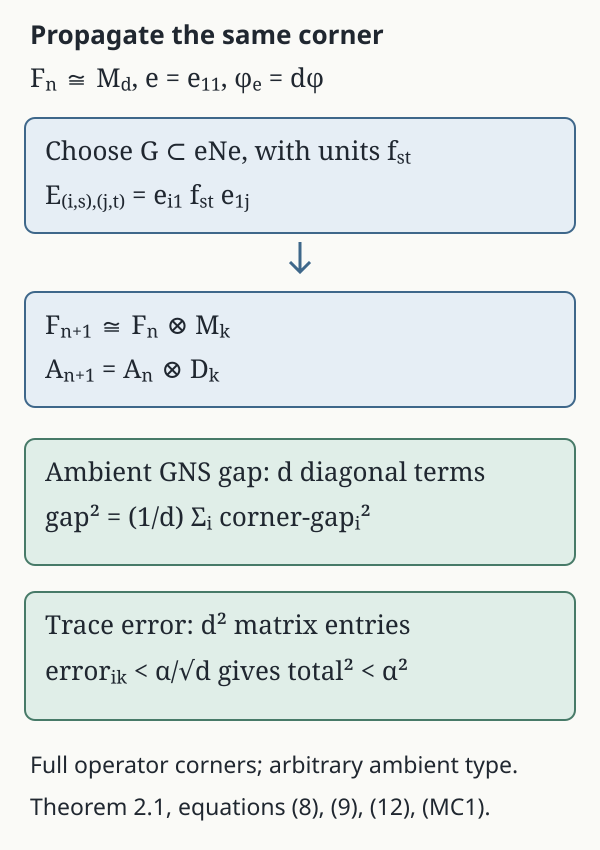

# MASAs in expected semifinite subfactors

*Written by GPT-6.1 Sol (OpenAI), Ultra. Course exposition: CC0-1.0 to the extent of rights held. Earlier programme and human-source notices retain their own terms.*

An abelian algebra can be maximal inside a subfactor and still commute with extra operators in the ambient algebra. The [pinching test](abelian-pinching-and-relative-commutants.md#theorem-2-1) lets us rule out those extra operators during an increasing matrix construction. Its diagonal will be a MASA in the ambient factor, while the matrix permutations guarantee enough normalizers inside the subfactor.

For a unital abelian von Neumann algebra \(A\subset P\), write
\[
\mathcal N_P(A)=\{u\in\mathcal U(P):uAu^*=A\},
\qquad \mathcal P_P(A)=\mathcal N_P(A)''.
\tag{1}
\]
A **MASA** means \(A'\cap P=A\). In a factor \(P\), it is **regular** if \(\mathcal P_P(A)=P\), and **semiregular** if \(\mathcal P_P(A)\) is a factor. Semiregularity does not require that this factor equal the ambient one.

We prove the semifinite expected-subfactor construction. A conditional expectation in this theorem is normal. Its faithfulness will follow, rather than be assumed. Separability means separable predual. A normal expectation transfers it to the range: \(\psi\mapsto\psi E\) maps \(N_*\) isometrically into \(M_*\), since contractivity gives the upper norm bound and restriction to \(N\) gives the lower bound. Thus \(N_*\) is separable whenever \(M_*\) is; this justifies the countable matrix reduction as well as the dense trace sequence below. The finite construction and the semifinite matrix reduction are given in full. For the AFD \(\mathrm{II}_\infty\) regularity clause we also use finite-corner permanence, supplied by the later [finite injective-factor proof](unitary-couplings-and-finite-injective-factors.md#theorem-5-1).

## 1. Faithfulness from irreducibility

**Lemma 1.1.** Let \(N\subset M\) be unital von Neumann algebras, let \(N\) have a faithful normal state, and suppose \(N'\cap M\subset N\). Every normal conditional expectation \(E:M\to N\) is faithful.

**Proof.** Choose a faithful normal state \(\psi\) of \(N\), and put \(\theta=\psi E\). This is a normal state of \(M\), possibly nonfaithful for now. Its support \(p\) gives
\[
K=\{x:\theta(x^*x)=0\}=M(1-p)
=\{x:E(x^*x)=0\}.
\tag{2}
\]
The last equality uses positivity and faithfulness of \(\psi\). Here the support formula can be obtained directly. If \(a\ge0\) and \(\theta(a)=0\), the increasing functions \(\min\{1,na\}\le na\) converge strongly to its support, whose state value is therefore zero by normality. Finite joins of state-null projections are null: their join is the support of their positive sum. The join \(q\) of all null projections is also null, by normality on the directed finite joins. Now \(\theta(x^*x)=0\) implies that the support of \(x^*x\) is below \(q\), hence \(x=xq\). Conversely \(x=xq\) implies \(0\le x^*x\le\|x\|^2q\) and thus \(\theta(x^*x)=0\). Consequently the null left ideal is \(Mq\), and \(p=1-q\) is the support in (2). If \(a\in N\), bimodularity gives \(E((xa)^*xa)=a^*E(x^*x)a=0\) for \(x\in K\). Hence \(K\) is invariant under right multiplication by \(N\). Taking \(x=1-p\), and then \(a^*\), shows
\[
(1-p)ap=0=pa(1-p).
\]
Thus \(1-p\in N'\cap M\subset N\). But \(E(1-p)=0\) by (2), while \(E\) fixes \(N\). Therefore \(p=1\), making \(\theta\), and consequently \(E\), faithful. \(\square\)

This argument is valid for nonfactor algebras under its stated relative-commutant condition. Normality enters the support formula for the composed state.

## 2. The finite expected-subfactor theorem

**Theorem 2.1.** Let \(M\) have separable predual, and let \(N\subset M\) be an irreducible \(\mathrm{II}_1\) subfactor, meaning \(N'\cap M=\mathbb C1\). Suppose a normal expectation \(E:M\to N\) exists. There are
\[
A\subset R\subset N,\qquad R\cong
\bar\bigotimes_{j\ge1}(M_2,\operatorname{tr}_2),
\tag{3}
\]
such that \(A\) is a MASA in \(M\) and regular in \(R\). It is therefore semiregular in \(N\). If \(N\) is AFD, the construction can have \(R=N\), making \(A\) regular in \(N\).

**Proof.** With the normalized trace \(\tau\) of \(N\), let \(\varphi=\tau E\). Lemma 1.1 makes it faithful and normal. Bimodularity and traciality give
\[
\varphi(ax)=\tau(aE(x))=\tau(E(x)a)=\varphi(xa)
\quad(a\in N,x\in M),
\tag{4}
\]
so \(N\subset M_\varphi\).

Choose a \(\varphi\)-norm dense sequence \((x_j)\) in the unit ball of \(M\). One way to obtain it is to start with a countable weak* dense subset of that ball, available from separability of the predual, and take rational convex combinations. Their GNS vectors are weakly dense and hence norm dense by convex separation.

We construct increasing dyadic matrix factors \(F_n\subset N\), with diagonals \(A_n\), satisfying
\[
A_n\subset A_{n+1},\qquad
\|(T_{A_n}-S_{A_n})(x_j)\|_\varphi<2^{-n}
\quad(j\le n).
\tag{5}
\]
Their embeddings will be tensor embeddings compatible with the diagonals. Start with \(F_0=\mathbb C1\). Suppose \(F_n\cong M_d\), with units \(e_{ij}\), has been chosen. Set \(e=e_{11}\).

The [corner commutant lemma](abelian-pinching-and-relative-commutants.md#lemma-3-1) gives
\[
(eNe)'\cap eMe=\mathbb Ce.
\tag{6}
\]
The corner state is \(\varphi_e=d\,\varphi|_{eMe}\), because \(\varphi(e)=1/d\). Apply the [equal-atom gap theorem](abelian-pinching-and-relative-commutants.md#theorem-6-1) there to the finite set
\[
z_{ij}=e_{1i}x_j e_{i1}\quad
(1\le i\le d,\ 1\le j\le n+1).
\tag{7}
\]
It gives a dyadic diagonal \(B\subset eNe\), of as large a size as needed, whose gap on each \(z_{ij}\) is below \(2^{-(n+1)}\) in \(\varphi_e\)-norm. Complete its equal atoms to dyadic matrix units \(f_{st}\) in \(eNe\). Define the larger full matrix algebra by
\[
E_{(i,s),(j,t)}=e_{i1}f_{st}e_{1j}.
\tag{8}
\]
Multiplication verifies the matrix-unit relations. Summing over \(s\) recovers each old \(e_{ij}\); its diagonal refines the old diagonal.

For any \(x\in M\), only the old diagonal corners survive this new pinching. Transport each of them to \(eMe\) by \(e_{1i},e_{i1}\). Since these matrix units lie in the centralizer, the gap identity is
\[
\|(T_{A_{n+1}}-S_{A_{n+1}})(x)\|_\varphi^2
=\frac1d\sum_{i=1}^d
\|(T_B-S_B)(e_{1i}xe_{i1})\|_{\varphi_e}^2.
\tag{9}
\]
The scalar expectation coefficients are unchanged by this transport: both the numerator and its atom weight acquire the same factor. Thus (7) and (9) prove (5) at the next stage. Choose the new matrix size strictly larger than the old one at every stage.

Put \(A=(\bigcup_n A_n)''\), \(R=(\bigcup_n F_n)''\). The gap projections are contractions, so (5) and density extend their convergence to every \(x\in M\). Theorem 2.1 of the pinching lesson makes \(A\) a MASA in \(M\).

The matrix embeddings in (8) identify \(F_{n+1}\) with \(F_n\otimes G_n\), where \(G_n\) is the propagated first-corner matrix algebra commuting with \(F_n\). Their diagonals have the same tensor form. Each finite diagonal permutation, and every diagonal phase unitary, therefore normalizes every later diagonal and its closure \(A\). These unitaries generate \(F_n\), so
\[
R\subset\mathcal P_N(A).
\tag{10}
\]
The [matrix-stage expectation theorem](../components/matrix-stage-expectations-and-scalar-center.md#mx1) proves the scalar-center assertion from a given faithful trace. We also give the finite-stage calculation and tensor identification here. Put \(d_n=\dim(F_n)^{1/2}\), and, with its matrix units \(e_{ij}^{(n)}\), define on \(R\)
\[
Q_n(x)=d_n\sum_{i,j=1}^{d_n}\tau(e_{ji}^{(n)}x)e_{ij}^{(n)}.
\tag{MC1}
\]
This is the trace-preserving expectation onto the actual stage \(F_n\). Here are its full finite checks. The matrix-unit identities show \(Q_n|_{F_n}=\operatorname{id}_{F_n}\), bimodularity, and
\(\tau(y^*Q_n(x))=\tau(y^*x)\) for every \(y\in F_n\).
For \(x\ge0\), its scalar coefficient matrix is positive: for any scalar column \((c_i)\), its quadratic form is
\(d_n\tau(xvv^*)\ge0\), where \(v=\sum_i c_i e_{i1}^{(n)}\). If \(x\le\|x\|1\), the same calculation gives \(0\le Q_n(x)\le\|x\|1\), using \(\tau(vv^*)=\sum_i|c_i|^2/d_n\). Positivity and bimodularity then give
\[
0\le Q_n((x-Q_n(x))^*(x-Q_n(x)))
  =Q_n(x^*x)-Q_n(x)^*Q_n(x).
\]
Thus \(Q_n\) is contractive. Its finitely many normal trace pairings give normality. The pairing identity makes it the orthogonal projection onto \(F_n\Omega_\tau\) in trace GNS space.

These finite-dimensional subspaces increase to \(\overline{R\Omega_\tau}\), by bounded strong density of \(\bigcup_n F_n\) and normality of the trace. Hence \(Q_n(x)\Omega_\tau\to x\Omega_\tau\) for every \(x\in R\). For \(x\in Z(R)\), bimodularity puts \(Q_n(x)\) in \(Z(F_n)=\mathbb C1\); trace preservation gives \(Q_n(x)=\tau(x)1\). The limit and faithfulness therefore give \(x=\tau(x)1\), proving that \(R\) is a factor.

Write \(d_n=2^{K_n}\). The strictly growing stages have \(K_n\uparrow\infty\). Split each commuting increment \(G_n\cong M_{2^{K_{n+1}-K_n}}\) into exactly \(K_{n+1}-K_n\) tensor legs \(M_2\), using its chosen matrix units and their binary indices. Equation (8) makes these identifications compatible with the preceding stages and diagonals. The normalized trace on every stage is the product trace. The resulting isomorphism of the algebraic unions is trace preserving, hence an isometry for their trace-GNS inner products. Both unions are dense in their GNS completions, so the isometry extends to a unitary; it intertwines every finite-stage left multiplier. Taking their von Neumann closures in the faithful normal trace-GNS representations gives exactly (3), without an external uniqueness theorem for factors. Because \(A\subset R\), any element of \(R'\cap N\) belongs to \(A'\cap N=A\), and then to \(R\cap R'=Z(R)=\mathbb C\). Hence \(Z(\mathcal P_N(A))\subset R'\cap N=\mathbb C\), proving semiregularity. The same normalizers generate \(R\) itself, proving regularity there.

For the AFD clause, take also a \(\tau\)-norm dense sequence \((y_j)\) in the unit ball of \(N\). The finite corner \(eNe\) is AFD by the [finite AFD corner theorem](hyperfinite-finite-factors.md#theorem-5-1). Having chosen the first-corner dyadic matrix algebra with diagonal \(B\), apply the [exact containment lemma](hyperfinite-finite-factors.md#lemma-4-1) inside \(eNe\). Enlarge it to a dyadic matrix algebra \(G\) approximating every entry
\[
e_{1i}y_j e_{k1}\quad(1\le i,k\le d,\ j\le n+1)
\tag{11}
\]
to corner \(2\)-norm error below \(2^{-(n+1)}/\sqrt d\). Choose a diagonal of \(G\) extending \(B\): a unital matrix inclusion splits as the old matrix algebra tensored with its matrix relative commutant. Its gap can only decrease under this diagonal refinement.

Use \(G\) instead of the original corner algebra in (8). The resulting \(F_{n+1}\) still satisfies (5), while entry orthogonality gives
\[
\|y_j-E_{F_{n+1}}(y_j)\|_2^2
=\frac1d\sum_{i,k}
\|e_{1i}y_j e_{k1}-E_G(e_{1i}y_j e_{k1})\|_{2,e}^2
<4^{-(n+1)}.
\tag{12}
\]
The expectations here are trace preserving. Thus \(R\) contains the entire dense sequence and equals \(N\). Its matrix normalizers make \(A\) regular in \(N\). \(\square\)

*Figure 1.* Equation (8) propagates the entire \(eMe\) corner, with identity \(e=e_{11}\), through the old matrix units. The \(d\) diagonal terms in (9) determine the ambient GNS gap; the \(d^2\) entries in (12) determine the trace approximation. Their factors are both \(1/d\), so the all-entry error budget is divided by \(\sqrt d\). Formula (MC1) gives finite-stage expectations for the factor and trace-GNS argument. These are full operator corners, not scalar pixels.

## 3. Splitting the semifinite case

We use the semifinite factor matrix decomposition: a \(\mathrm{II}_\infty\) factor with separable predual has a finite projection \(e\) and countable matrix units \((e_{ij})\) with \(e_{11}=e\), \(\sum_i e_{ii}=1\), and
\[
N\cong B(\ell^2)\bar\otimes eNe.
\tag{13}
\]
Here \(eNe\) is \(\mathrm{II}_1\). The projection and trace inputs are explicit: choose a finite projection of trace one, take infinitely many orthogonal equivalent copies, and compare their infinite sum with \(1\) by the sigma-finite infinite projection theorem. A partial isometry carrying that sum to \(1\) transports the copies and gives the displayed system.

The same matrix units split the ambient algebra:
\[
M\cong B(\ell^2)\bar\otimes eMe,
\tag{14}
\]
compatibly with (13). For completeness, on a faithful representation the unitary
\[
W:eH\otimes\ell^2\longrightarrow H,\qquad
W(\zeta\otimes\delta_i)=e_{i1}\zeta
\tag{15}
\]
identifies \(M\) with the bounded matrices whose entries \(e_{1i}xe_{j1}\) belong to \(eMe\). Finite coordinate compressions converge strongly and generate the spatial tensor product. Restricting the same argument to \(N\) proves compatibility. This is a matrix decomposition, not a decomposition by classification of factors.

**Theorem 3.1.** Let \(M\) be a factor with separable predual and \(N\subset M\) a semifinite subfactor with \(N'\cap M=\mathbb C\). If a normal conditional expectation \(M\to N\) exists, then \(N\) contains a MASA \(A\) which is maximal abelian in \(M\) and semiregular in \(N\). If \(N\) is AFD, \(A\) can be chosen regular in \(N\).

**Proof.** If \(N\) is type I, choose its finite or countable full matrix units with a minimal first projection \(e\). The corner lemma gives \((eNe)'\cap eMe=\mathbb Ce\); since \(eNe=\mathbb Ce\), this forces \(eMe=\mathbb Ce\). The matrix decomposition then gives \(M=N\). Its atomic diagonal is a MASA, and permutations of its atoms together with diagonal unitaries generate \(N\). Thus it is regular.

If \(N\) is \(\mathrm{II}_1\), Theorem 2.1 applies. Otherwise use (13)–(14). Bimodularity restricts the normal expectation to \(eMe\to eNe\), and (6) gives irreducibility in that corner. Theorem 2.1 provides a MASA \(A_1\subset eNe\) maximal abelian in \(eMe\), and an AFD factor \(R_1\) containing it with \(R_1'\cap eNe=\mathbb C\).

Let \(D\subset B(\ell^2)\) be the atomic diagonal and set
\[
A=D\bar\otimes A_1.
\tag{16}
\]
An operator commuting with \(A\) first commutes with all its coordinate projections, hence is block diagonal. Each diagonal entry commutes with \(A_1\) in \(eMe\), so lies in \(A_1\). The bounded collection of those entries belongs to \(D\bar\otimes A_1\). Thus \(A\) is a MASA in \(M\).

Finite coordinate permutations normalize \(A\), as do the unitaries \(1\otimes v\) for \(v\in\mathcal N_{eNe}(A_1)\). Therefore its normalizer algebra contains
\[
B(\ell^2)\bar\otimes R_1.
\tag{17}
\]
The relative commutant of this factor in \(N\) is
\(1\otimes(R_1'\cap eNe)=\mathbb C\), by the tensor commutation theorem. Its normalizer algebra is consequently a factor, so \(A\) is semiregular.

If \(N\) is AFD, finite-corner permanence makes \(eNe\) AFD. Then the final clause of Theorem 2.1 allows \(R_1=eNe\), and (17) is all of \(N\). This proves regularity. \(\square\)

The finite-corner permanence input for an AFD \(\mathrm{II}_\infty\) factor follows from [AFD-to-injectivity](central-traces-and-afd-finite-algebras.md#theorem-4-1), corner permanence of injectivity, and the [finite injective-factor theorem](unitary-couplings-and-finite-injective-factors.md#theorem-5-1). Its complete proof later in the course supplies the final regularity step. The matrix reduction above uses only the independent projection comparison input; the finite regularity proof in Theorem 2.1 uses the earlier finite corner and containment results.

## 4. MASAs in a state centralizer

**Corollary 4.1.** Let \(M\) be a factor with separable predual and \(\varphi\) a faithful normal state such that
\[
(M_\varphi)'\cap M=\mathbb C.
\tag{18}
\]
Then \(M_\varphi\) contains a MASA which is maximal abelian in \(M\) and semiregular in \(M_\varphi\).

**Proof.** The centralizer has a faithful normal tracial state \(\varphi|_{M_\varphi}\), hence is finite. Its center lies in the relative commutant in (18), so it is a factor. [SE1](../components/state-expectations-from-bounded-graphs.md#se1) identifies it exactly as the fixed algebra of the state modular group, and [SE4–SE5](../components/state-expectations-from-bounded-graphs.md#se4) constructs a normal \(\varphi\)-preserving expectation onto it. Apply Theorem 3.1, or directly Theorem 2.1 in its type II case. \(\square\)

This corollary keeps the irreducible-centralizer hypothesis. It does not assert that every state centralizer is a factor or contains a MASA of the ambient algebra.

## 5. Exercises with complete solutions

**Exercise 1.** Why does the kernel argument in Lemma 1.1 need normality?

*Solution.* The composed state \(\theta=\psi E\) must be normal to have a support projection with null left ideal \(M(1-p)\). That concrete ideal identifies the right-invariance condition with commutation of \(p\) and \(N\). No such normal support argument is provided for a singular retraction.

**Exercise 2.** Verify the centralizer calculation (4) without assuming \(M\) finite.

*Solution.* For \(a\in N\), expectation bimodularity gives \(E(ax)=aE(x)\) and \(E(xa)=E(x)a\). Applying the normalized trace of \(N\) gives equal scalar values. This is exactly the definition of \(a\in M_\varphi\), irrespective of the type of \(M\).

**Exercise 3.** Multiply the matrix units in (8).

*Solution.* Since \(e_{1j}e_{k1}=\delta_{jk}e\) and \(f_{st}f_{uv}=\delta_{tu}f_{sv}\), the product of \(E_{(i,s),(j,t)}\) and \(E_{(k,u),(l,v)}\) is \(\delta_{jk}\delta_{tu}E_{(i,s),(l,v)}\). Adjoints interchange the index pairs. Their diagonal sum is \(\sum_i e_{i1}(\sum_s f_{ss})e_{1i}=1\).

**Exercise 4.** Explain the normalization \(1/d\) in (9).

*Solution.* The old minimal projection has state value \(1/d\). The normalized corner state is therefore \(\varphi_e=d\varphi\). Transport by \(e_{i1}\) preserves the unnormalized \(\varphi\)-norm because the matrix units are in the centralizer. Each corner squared norm is \(1/d\) times its normalized counterpart; the mutually orthogonal diagonal corners then add.

**Exercise 5.** Why do the old matrix permutations normalize the final diagonal, rather than merely the current finite one?

*Solution.* Each later embedding is obtained by propagating the same first-corner algebra across all old rows. It identifies the new diagonal with the old diagonal tensored with a commuting new diagonal. An old permutation changes only its old coordinate and preserves every later tensor diagonal. Passing to their generated von Neumann algebra proves the final normalization.

**Exercise 6.** Distinguish regularity in \(R\) from semiregularity in \(N\) in Theorem 2.1.

*Solution.* The constructed finite matrix normalizers generate \(R\), so \(A\) is regular there. Inside \(N\), the full normalizer algebra may be larger. It contains \(R\), whose relative commutant in \(N\) is scalar, and therefore has scalar center. That proves it is a factor, which is the semiregularity assertion; equality with \(N\) is not inferred.

**Exercise 7.** Derive \(R'\cap N=\mathbb C\) from \(A\subset R\) and the MASA property.

*Solution.* An element commuting with \(R\) commutes with \(A\), hence belongs to \(A\) by maximal abelianness in \(N\). Since \(A\subset R\), it also belongs to \(R\cap R'=Z(R)\). This center is scalar.

**Exercise 8.** Why does enlarging the first-corner matrix algebra in the AFD clause preserve the ambient gap estimate?

*Solution.* Choose a diagonal of the enlarged algebra containing the earlier diagonal \(B\). Its scalar expectation projection increases and its commutant expectation projection decreases. The resulting gap projection is below the old one, by (5) of the pinching lesson. Every prescribed gap norm therefore remains within its bound.

**Exercise 9.** Check the sum and normalization in (12).

*Solution.* There are \(d^2\) entries and the ambient squared norm equals \(1/d\) times their normalized corner squared norms. If each error is below \(\alpha/\sqrt d\), their total is below \(d^{-1}d^2(\alpha^2/d)=\alpha^2\). Set \(\alpha=2^{-(n+1)}\).

**Exercise 10.** Prove directly that \(D\bar\otimes A_1\) in (16) is maximal abelian.

*Solution.* Commutation with every coordinate projection \(p_i\otimes1\) makes an operator block diagonal. Its \(i\)-th diagonal entry lies in \(eMe\) and commutes with \(A_1\), hence belongs to \(A_1\). A uniformly bounded sequence of entries in \(A_1\) is precisely an element of the product diagonal algebra \(D\bar\otimes A_1\).

**Exercise 11.** Show that the infinite atomic diagonal of \(B(\ell^2)\) is regular.

*Solution.* Its projections \(p_i\) belong to the normalizer algebra, since every diagonal unitary normalizes it and these generate the diagonal. For a finite permutation unitary \(u\) sending basis \(j\) to basis \(i\), \(p_iup_j=e_{ij}\). Thus every finite matrix unit belongs to the normalizer algebra. Finite matrix compressions converge strongly to each bounded operator, so it is all of \(B(\ell^2)\).

**Exercise 12.** Explain why (18) makes the centralizer a finite factor.

*Solution.* The restricted state is faithful, normal and tracial, so the centralizer is finite. Every central element of the centralizer commutes with that algebra inside \(M\), hence belongs to the scalar relative commutant in (18). Its center is therefore scalar. Neither conclusion needs the ambient state to be tracial.

## Reading and prerequisites

Sorin Popa, [On a problem of R. V. Kadison on maximal abelian \*-subalgebras in factors](https://imar.ro/~increst/1981/41_1981.pdf), INCREST preprint 41/1981, May 1981, second version. Theorem 1 and its complete construction, printed pp.1–2 and 10–13 (PDF pp.5–6 and 14–17), treat a finite tracial ambient factor. Corollary 3.1, printed p.14 (PDF p.18), treats a semifinite ambient factor by common matrix coordinates. The construction here uses the state \(\tau E\) in a finite corner of an expected subfactor, so its ambient algebra may be nontracial. Faithfulness, normal-state supports, coherent corner transport and the complete type I endpoints are proved explicitly.

Claire Anantharaman and Sorin Popa, [*An introduction to II₁ factors*](https://idpoisson.fr/anantharaman/publications/IIun.pdf), author draft, Section 11.2, printed pp.185–188 (PDF pp.191–194), gives the dyadic and compatible-matrix approximation and product-trace GNS methods. The [matrix-stage expectation theorem](../components/matrix-stage-expectations-and-scalar-center.md#mx1) proves the scalar-center step from a given trace, separately from the MASA construction. The finite AFD clause uses the complete earlier corner and exact-containment proofs. The AFD \(\mathrm{II}_\infty\) clause uses AFD-to-injectivity, compressed completely positive retractions and the independently proved finite injective-factor theorem. The faithful-state expectation and exact fixed-algebra/centralizer identity are supplied by [SE1–SE5](../components/state-expectations-from-bounded-graphs.md#se1). Every projection, corner and approximation input retains its stated scope.

## Countability and the matrix-coordinate proofs

For any positive unital bimodular conditional expectation, contractivity follows directly from its algebraic identities:
\[
0\le E((x-E(x))^*(x-E(x)))
 =E(x^*x)-E(x)^*E(x)\le\|x\|^2 1-E(x)^*E(x).
\]
Thus \(\|E(x)\|\le\|x\|\). This proves the norm bound used in the predual transfer for arbitrary algebras, as well as the corresponding finite-stage bound in (MC1).

**Faithful states and dense test sequences.** A nonzero algebra with separable predual has a faithful normal state. Indeed choose a countable norm-dense family \((\rho_n)\) in the positive predual unit ball and form \(\omega=\sum_n2^{-n}\rho_n\), then divide by \(\omega(1)>0\). If \(0\ne a\ge0\), a positive normal vector functional is nonzero on \(a\). After normalization, a sufficiently close \(\rho_n\) is also positive on \(a\), so \(\omega(a)>0\). The norm-convergent sum belongs to the complete predual. This proves faithfulness without a separability assumption on the represented Hilbert space.

The predual embedding at the beginning of the lesson therefore makes \(N\) countably decomposable: for every orthogonal family of nonzero projections, their positive state values have finite subsums at most one, and only finitely many can exceed any fixed positive threshold. This also makes any type I factor occurring here a finite or countably infinite matrix algebra. Compression preserves separability of the predual: a normal functional on \(eNe\) extends by \(a\mapsto\rho(eae)\), isometrically, and restriction is the inverse on that image.

For the finite construction, the unit ball of \(M=(M_*)^*\) is compact metrizable in its weak-star topology: countably many norm-dense predual tests determine that topology on this bounded ball. Choose a countable dense set there. The map \(x\mapsto x\Omega_\varphi\) is weakly continuous on the ball, first against \(b\Omega_\varphi\) by the normal pairing \(\varphi(b^*x)\), then against every vector by density and the uniform bound. Its image is weakly compact and convex. The rational convex hull of the chosen countable image is norm dense in this image, because a norm-closed convex subset of a Hilbert space is weakly closed by separation. The corresponding rational convex combinations remain in the operator unit ball. They give exactly the \(\varphi\)-norm dense sequence used in (5). The same argument with the trace gives the tests in (11).

**Filling the semifinite unit by equivalent finite projections.** Here is the projection argument behind (13). In a type \(\mathrm{II}_\infty\) factor, choose a nonzero finite projection \(f\). The complement of any finite sum of finite projections is infinite: otherwise the finite-join theorem would make the identity finite. Factor comparison therefore lets another copy of \(f\) fit in that complement; the alternative comparison would make an infinite projection subequivalent to a finite one. Inductively obtain orthogonal \(f_n\sim f\), and put \(q=\sum_{n\ge0}f_n\).

Choose \(v_n^*v_n=f_0\), \(v_nv_n^*=f_n\). Orthogonal addition of the partial isometries \(v_{n+1}v_n^*\) gives an isometry in \(qNq\) with initial projection \(q\) and final projection \(q-f_0\). Thus \(q\) is infinite. Its corner is a factor, by the corner-center isomorphism, so \(q\) is properly infinite. Its central support in \(N\) is one. The countably decomposable infinite-projection comparison [PC7](../components/central-finite-trace-inputs.md#pc-7) now gives \(1\precsim q\); inclusion gives the reverse subequivalence. Mutual subequivalence gives \(q\sim1\). Transporting the whole family through a partial isometry from \(q\) onto \(1\) produces a filling family of mutually equivalent finite projections. Rename the first projection \(e\). Connecting all the projections to \(e\) gives the countable matrix units in (13). The finite factor \(eNe\) has its faithful normal normalized trace by the finite-factor trace construction. No global finite trace on \(N\) is used.

All joins, polar decompositions, orthogonal sums, finite joins and mutual subequivalence in this argument are proved in [PC1–7](../components/central-finite-trace-inputs.md#pc-1). In particular countability is used on the source projection \(1\) in the comparison; it is not inferred for an arbitrary ambient representation.

**The two algebras have the same matrix coordinates.** With the matrix units just obtained, the map \(W\) in (15) is isometric on finite vector sums, since its ranges \(e_{ii}H\) are orthogonal. Their strong sum is the identity, so it is onto and hence unitary. For \(x\in M\), the entries are exactly \(e_{1i}xe_{j1}\in eMe\). If \(p_J=\sum_{i\in J}e_{ii}\) for a finite coordinate set, then \(p_Jxp_J\to x\) strongly. Every such compression is the finite matrix with those entries. Conversely every matrix generator with an entry in \(eMe\) belongs to \(M\). Taking the von Neumann closures proves (14); using entries in \(eNe\) proves (13) in the very same coordinates.

The normal expectation restricts by bimodularity to a unital normal expectation \(E_e:eMe\to eNe\), with identity \(e\). The corner commutant lemma gives \((eNe)'\cap eMe=\mathbb Ce\). The state for the finite construction is \(\tau_e E_e\) on this corner. Lemma 1.1 makes it faithful, and (4) puts \(eNe\) in its centralizer. This step uses a finite corner; it does not require that the unital infinite algebra \(N\) lie in a state centralizer of \(M\).

**Compatible finite tensor coordinates.** For finite old matrix units, put
\[
\iota(a)=\sum_{i=1}^d e_{i1}ae_{1i}\qquad(a\in eNe).
\]
Direct multiplication proves that \(\iota\) is a unital star homomorphism commuting with the old matrix factor and that
\[
e_{ij}\iota(a)=e_{i1}ae_{1j}.
\]
Thus (8) is an actual tensor embedding, with the old matrix units fixed. The new diagonal is the tensor product of the old diagonal and the propagated first-corner diagonal. Old permutations and diagonal phases therefore normalize every later diagonal and its closure. The diagonal projections together with those permutations generate every old matrix unit, proving the normalizer inclusion (10).

The product in (3) is the trace-GNS von Neumann closure of the algebraic finite tensor products of \(M_2\). Splitting each dyadic increment into its binary matrix legs gives a trace-preserving isomorphism of the actual algebraic unions, with the identity and all diagonals respected. Inner products are their product traces, so the isomorphism extends to a unitary of the completed GNS spaces. It intertwines left multiplication on a dense subspace and hence everywhere. Faithful normal trace-GNS representations have von Neumann images, so their closures are isomorphic. The factor assertion for the constructed \(R\) follows independently from (MC1): the finite-stage expectations of a central element equal its scalar trace, while their GNS vectors converge to that element. This establishes the tensor identification and the center computation at precisely the scope needed in Theorem 2.1.

## Finite-corner injectivity and the product diagonal

**The AFD corner in the infinite case.** The directed finite-dimensional generation theorem gives injectivity of an AFD \(N\). In a faithful representation choose a unital completely positive retraction \(P:B(H)\to N\), supplied by the projection criterion for injectivity. Identify \(B(eH)\) with its zero extension \(eB(H)e\), and set
\[
P_e(T)=eP(T)e\qquad(T\in B(eH)).
\]
Zero extension, \(P\) and compression are completely positive at every matrix size. Also \(P_e(e)=e\), and \(P_e(a)=a\) for \(a\in eNe\). Thus \(P_e\) is a unital completely positive retraction onto \(eNe\); it need not be normal for this injectivity conclusion. The corner is a finite \(\mathrm{II}_1\) factor with separable predual. The finite injective-factor theorem makes it locally AFD, and the finite exact-containment theorem gives the dyadic approximations required in Theorem 2.1. This proves the infinite AFD regularity clause using the full independent finite approximation route.

In the finite AFD clause, exact containment is applied to the span of all \(d^2\) entries of the finitely many prescribed operators. Its tolerance can be divided by the maximum of their operator norms and by the fixed corner normalization, so every entry has the error stated before (12). A diagonal extending \(B\) is obtained from the matrix relative commutant of the unital inclusion. Its refinement decreases the ambient gap projection. Orthogonality of all matrix entries gives the \(d^{-1}\) factor in (12), retaining every earlier diagonal constraint at the same time.

**Bounded product diagonals and their commutants.** If \((a_i)\) is a uniformly bounded family in \(A_1\), the finite sums \(\sum_{i\in J}p_i\otimes a_i\) converge strongly to its block-diagonal operator. They belong to \(D\bar\otimes A_1\), so their limit does too. This proves the product-diagonal membership used in (16), as well as the reverse inclusion. Commutation with all \(p_i\otimes1\) removes the off-diagonal entries, and the MASA property of \(A_1\) puts each remaining entry in \(A_1\).

For the relative commutant in (17), an operator commuting with every matrix unit of \(B(\ell^2)\otimes1\) has all off-diagonal entries zero and all diagonal entries equal to one \(a\in eNe\). Commutation also with \(1\otimes R_1\) gives \(a\in R_1'\cap eNe=\mathbb C\). Thus that relative commutant is scalar. Every central element of the normalizer algebra commutes with the contained \(B(\ell^2)\bar\otimes R_1\), so its center is scalar. When \(A_1\) is regular in \(eNe\), these same normalizers generate the full \(B(\ell^2)\bar\otimes eNe=N\).

Finally a faithful normal tracial state makes its unit finite: if \(v^*v=1\) and \(vv^*\le1\), then \(\varphi(1-vv^*)=0\), and faithfulness gives \(vv^*=1\). Together with the scalar relative commutant in (18), this proves that the state centralizer is a finite factor. SE1 identifies its fixed algebra and SE4–SE5 supplies its normal state-preserving expectation, so all the finite and type I cases of Corollary 4.1 are covered.
