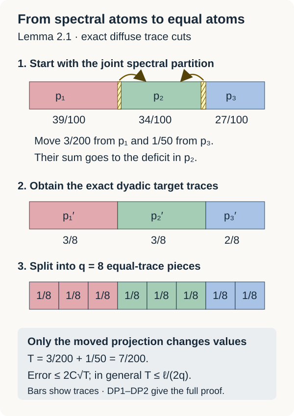

# Semiregular MASAs and scalar pinching

*Written by GPT-6.1 Sol (OpenAI), Ultra. Course exposition: CC0-1.0 to the extent of rights held. Earlier programme and human-source notices retain their own terms.*

A semiregular MASA has enough normalizers to match any two of its projections of equal trace. Compatible matches build finite matrix algebras whose diagonals approximate the entire MASA. Their closure is an irreducible AFD subfactor. A coupled finite Fourier basis makes each chosen matrix stage scalar on a conjugate MASA; finite partitions in that MASA give scalar pinching for an ambient finite list.

We use the [relative pinching preparation](abelian-pinching-and-relative-commutants.md), and the [expected-subfactor construction](masas-in-expected-semifinite-subfactors.md). [Finite trace expectations](../components/invariant-state-trace-hilbert-inputs.md#finite-trace-expectation), TL3, constructs the normal, ucp, bimodular expectation onto every unital subalgebra and identifies it with the trace-GNS orthogonal projection. TL4 proves the intersection assertion for decreasing trace spaces by bounded operator clusters. These are finite tracial arguments. Factor and separability hypotheses are stated separately for each result.

Let \(N\) be a \(\mathrm{II}_1\) factor, \(\tau\) its normalized trace, and \(A\subset N\) a semiregular MASA. Put
\[
G=\mathcal N_N(A),\qquad P=G''.
\tag{1}
\]
By definition \(P\) is a factor, and \(A\subset P\) is a MASA. In this section separability is unnecessary.

A **partial normalizer** is a partial isometry \(v\in P\) with initial and final projections in \(A\) and
\[
vAv^*\subset A,\qquad v^*Av\subset A.
\tag{2}
\]

Products of partial normalizers are partial normalizers. For \(v,w\), their intermediate support projections \(v^*v\) and \(ww^*\) lie in \(A\), so they commute. Thus \(w^*(v^*v)w\) and \(v(ww^*)v^*\) are projections in \(A\), the initial and final supports of \(vw\). The inclusions follow by applying \(wAw^*\subset A\) and then \(vAv^*\subset A\), and likewise for the adjoints.

## Equal atoms with a controlled trace transfer

A MASA in a \(\mathrm{II}_1\) factor is diffuse. If \(e\) were an atom of \(A\), then \(Ae=\mathbb Ce\). Every \(x\in eNe\) would commute with \(Ae\), and it annihilates \(A(1-e)\) on both sides. Thus it would commute with all of \(A\), belong to \(A\) by maximal abelianness, and hence lie in \(\mathbb Ce\). This would make \(e\) minimal in \(N\), contradicting type II.

For later use, a diffuse abelian finite algebra has projections of any prescribed trace between zero and the trace of its identity. To see this, partially order the projections of trace at most \(t\) by inclusion. Normality gives an upper bound to every chain. A maximal member whose trace is less than \(t\) could be enlarged by a sufficiently small nonzero projection in its complement. Such small projections exist by repeatedly splitting a nonzero projection and choosing a piece of at most half its trace. This contradiction proves exact trace \(t\).

**Lemma 2.1.** In a diffuse abelian finite algebra \(B\), a finite set can be approximated arbitrarily well in normalized \(2\)-norm by a diagonal algebra generated by \(2^k\) equal-trace atoms. Its size can be made arbitrarily large.

**Proof.** Normalize the finite normal trace \(\tau\) defining the \(2\)-norm to one. It suffices to work on its support \(s\). Indeed, the join \(z\) of all trace-zero projections has trace zero: every finite join has trace zero in this abelian algebra, and normality applies to their increasing net. On \(s=1-z\), the trace is faithful and \(Bs\) is still diffuse. A partition of \(s\) into equal positive-trace pieces extends to a partition of \(1\) by adding \(z\) to one piece; extend each simple function with that piece's coefficient on \(z\). This changes no \(2\)-norm error. We now work in \(Bs\), writing its identity as \(1\).

Choose a joint finite spectral partition \(p_1,\ldots,p_\ell\), omitting zero members, and simple functions \(s_j=\sum_i c_{ji}p_i\) with \(\|x_j-s_j\|\le\eta\). This can be done for every \(\eta>0\): partition the bounded spectra of the real and imaginary parts of all the \(x_j\)'s into sufficiently short intervals and intersect their commuting spectral projections. Put \(t_i=\tau(p_i)>0\), so \(\sum_i t_i=1\).

For \(q=2^k\) so large that \(qt_i\ge1\) for all \(i\), start with \(\lfloor qt_i\rfloor\). The remaining integer
\[
r=q-\sum_i\lfloor qt_i\rfloor,\qquad 0\le r<\ell,
\]
is filled by adding one to \(r\) distinct entries. The resulting positive integers \(m_i\) sum to \(q\), and \(|m_i/q-t_i|\le1/q\).

For each excess atom cut \(c_i\le p_i\) of trace \((t_i-m_i/q)_+\), using the exact diffuse trace cuts. Their sum \(c\) has trace
\[
T=\sum_i(t_i-m_i/q)_+
 =\frac12\sum_i|t_i-m_i/q|\le\frac{\ell}{2q}.
\tag{DP1}
\]
Cut this same \(c\) successively into mutually orthogonal \(d_i\)'s of traces \((m_i/q-t_i)_+\), assigned to the deficit atoms. The equality of the total excess and deficit makes the last remainder have precisely the last required trace. Set \(c_i=0\) at nonexcess atoms and \(d_i=0\) at nondeficit atoms. Then
\[
p_i'=p_i-c_i+d_i
\]
are orthogonal projections summing to one, with \(\tau(p_i')=m_i/q\).

Outside \(c\), the simple functions \(s_j\) and \(s_j'=\sum_i c_{ji}p_i'\) agree. On \(c\), both have operator norm at most \(C_j=\max_i|c_{ji}|\). Thus
\[
\|x_j-s_j'\|_2
\le\eta+2C_j\sqrt T
\le\eta+2C_j\sqrt{\ell/(2q)}.
\tag{DP2}
\]
Here \(C_j\le\|x_j\|+\eta\), so choosing \(\eta\) first and then arbitrarily large \(k\) makes every error as small as requested. Finally split \(p_i'\) into exactly \(m_i\) subprojections of trace \(1/q\), again by the exact trace-cut argument. All \(q\) pieces together generate a diagonal algebra containing every \(s_j'\). \(\square\)

*Figure 1.* In Lemma 2.1, take traces \(39/100,34/100,27/100\) and target multiplicities \((3,3,2)\) at \(q=8\). Transfer \(3/200\) from the first atom and \(1/50\) from the third to the second. The moved projection has trace \(T=7/200\). Equations (DP1)–(DP2) give the general error bound; the bars depict projection traces in an abelian algebra, without requiring an interval representation.

## Matching the chosen atoms inside the normalizer factor

**Lemma 1.1.** For \(p,q\in\operatorname{Proj}(A)\),
\[
\tau(p)=\tau(q)
\quad\Longleftrightarrow\quad
upu^*=q\text{ for some }u\in G.
\tag{3}
\]
More generally equal-trace projections have a partial normalizer with precisely those initial and final projections.

**Proof.** Trace preservation gives necessity. For existence, first note that if \(p,q\ne0\), some \(u\in G\) has \(qup\ne0\). Indeed
\[
r=\bigvee_{u\in G}upu^*
\]
is a nonzero projection of \(A\), invariant under \(G\), hence central in \(P\). Factorality gives \(r=1\). If all \(qup\) were zero, \(q\) would be orthogonal to \(r\).

For such a \(u\), \(qup\) is already a partial isometry: its initial projection is \(p\wedge u^*qu\), and its final projection is \(q\wedge upu^*\). Both are nonzero projections of \(A\); this uses its abelianness. It is a partial normalizer.

Take a maximal family of these partial normalizers with mutually orthogonal initial projections under \(p\) and mutually orthogonal final projections under \(q\). A finite trace makes this family countable after removing zero members. Their strong sum \(v\) is a partial isometry satisfying (2): the off-diagonal terms in \(vav^*\) vanish because the initial supports are orthogonal projections in \(A\), and similarly for \(v^*av\).

The unmatched remainders have equal trace. If either were nonzero, both would be, and the preceding argument would supply another match. Maximality rules this out. Thus \(v^*v=p\), \(vv^*=q\).

Match \(1-p\) with \(1-q\) as well, obtaining \(w\). Then \(u=v+w\) is unitary and normalizes \(A\), since its two domain and range partitions belong to \(A\). It gives (3). \(\square\)

**Lemma 1.2.** If \(0\ne e\in A\), then \(Ae\) is a regular MASA in the factor \(ePe\).

**Proof.** If \(x\in ePe\) commutes with \(Ae\), it also commutes with \(A(1-e)\), which it annihilates on both sides. It therefore commutes with \(A\), belongs to \(A\) by maximal abelianness in \(P\), and lies in \(Ae\). This proves corner maximal abelianness directly. The compressed operators \(eue\), \(u\in G\), span an ultraweakly dense subspace of \(ePe\), because \(G\) is a group generating \(P\). Each \(v=eue\) is a partial normalizer of \(Ae\). Its initial and final supports have equal trace. Apply the matching proof of Lemma 1.1 to their complements inside \(e\); the resulting partial normalizer lies in \(ePe\). Adding it to \(v\) gives a unitary normalizer \(u_e\) of \(Ae\), and \(v=u_e(v^*v)\).

Thus every \(eue\) lies in the algebra generated by the unitary normalizers of \(Ae\) and its projections. The latter projections already belong to that algebra, since the unitaries of \(Ae\) normalize it. Their ultraweak span gives all of \(ePe\). \(\square\)

## Propagating one diagonal through all old matrix rows

**Theorem 2.2.** If \(N\) has separable predual and \(A\subset N\) is a semiregular MASA, there is an AFD \(\mathrm{II}_1\) subfactor
\[
A\subset R\subset P\subset N,\qquad
R'\cap N=\mathbb C.
\tag{4}
\]
The constructed \(A\) is regular in \(R\).

**Proof.** The normal expectation \(E_A:N\to A\) makes \(\psi\mapsto\psi E_A\) an isometric embedding \(A_*\to N_*\): contractivity gives one inequality, and restriction back to \(A\) gives the other. Thus \(A_*\) is separable. The bounded-ball weak* density and rational convex-combination argument in [Theorem 5.1](hyperfinite-finite-factors.md#theorem-5-1) gives a \(2\)-norm dense sequence \((a_j)\) in the unit ball of \(A\); that argument uses only the faithful finite trace and separable predual. We construct increasing dyadic matrix factors \(F_n\subset P\), with diagonal \(A_n\subset A\), such that their matrix units are partial normalizers of \(A\) and
\[
\operatorname{dist}_2(a_j,A_n)<2^{-n}\quad(j\le n).
\tag{5}
\]
Start with \(F_0=\mathbb C1\). Suppose \(F_n\cong M_d\), with units \(e_{ij}\), is chosen. Put \(e=e_{11}\). Every \(a\in A\) is diagonal with respect to the old partition, and the partial normalizer property puts
\[
b_{ij}=e_{1i}a_j e_{i1}\in Ae
\quad(1\le i\le d,\ j\le n+1).
\tag{6}
\]
Choose equal dyadic atoms \(f_1,\ldots,f_s\) in \(Ae\) whose diagonal \(B\) approximates this finite list in normalized corner \(2\)-norm below \(2^{-(n+1)}\), by Lemma 2.1.

Lemma 1.1 matches \(f_1\) with each \(f_t\) by a partial normalizer \(v_t\in ePe\); take \(v_1=f_1\). Then \(f_{st}=v_s v_t^*\) are full matrix units with the chosen diagonal and retain the partial normalizer property. Propagate them across the old rows:
\[
E_{(i,s),(j,t)}=e_{i1}f_{st}e_{1j}.
\tag{7}
\]
Products of partial normalizers retain (2). These units generate a dyadic factor \(F_{n+1}\) containing \(F_n\), with diagonal \(A_{n+1}\subset A\). Reconstruct each \(a_j\) by its diagonal entries (6), using their simple-function approximants in \(B\). Their errors are orthogonal, and the ambient squared \(2\)-norm is \(1/d\) times the sum of the normalized corner squared norms. This proves (5) at the next stage. Choose \(s\ge2\).

Let \(R=(\bigcup_n F_n)''\). Apply the explicit finite-stage projections from [the matrix-stage expectation theorem](../components/matrix-stage-expectations-and-scalar-center.md#mx1) to these actual \(F_n\)'s and the faithful trace restricted from \(N\). The formula \(Q_n(x)=d_n\sum_{i,j}\tau(e_{ji}^{(n)}x)e_{ij}^{(n)}\), \(d_n=2^{K_n}\), is the normal trace-preserving projection onto \(F_n\), with its full positivity, bimodularity, contractivity and GNS checks given there. Its GNS projections increase to the identity on \(\overline{R\Omega_\tau}\). For \(x\in Z(R)\), bimodularity gives \(Q_n(x)=\tau(x)1\); their limit and faithfulness make \(x=\tau(x)1\). Thus \(R\) is a factor directly.

The relative commutant of \(F_n\) in \(F_{n+1}\) is the unital diagonal copy of the chosen first-corner factor: \(f\mapsto\sum_i e_{i1}fe_{1i}\). Matrix multiplication in (7) identifies \(F_{n+1}\) with \(F_n\otimes M_{2^{K_{n+1}-K_n}}\), so this copy is precisely the relative commutant and has identity \(1\), although the original corner has identity \(e\). Split its binary matrix indices into exactly \(K_{n+1}-K_n\) commuting \(M_2\) legs. These identifications are compatible with every previous stage. The algebraic union has the product trace, so its trace-preserving isomorphism with the dyadic tensor union extends to a GNS unitary intertwining all local left multipliers. Their von Neumann closures give \(R\cong R_{\mathrm{hyperfinite}}\). The matrix sizes grow without bound, so this finite factor is of type \(\mathrm{II}_1\). In the reconstruction for (5), use the trace expectation \(E_B(b_{ij})\) for each entry; its nearest-point property preserves the error bound and its contractivity bounds the reconstructed operator by \(\|a_j\|\). Equation (5) therefore puts \(A\subset R\), since bounded \(2\)-norm convergence is strong convergence on the finite trace representation and \(R\) is closed.

Every finite permutation of the matrix diagonal is a sum of the partial normalizers in (7); it is therefore a unitary normalizer of the whole \(A\). Together with diagonal phases these permutations generate each \(F_n\), hence \(R\). Thus \(A\) is regular in \(R\).

Finally, if \(x\in R'\cap N\), it commutes with \(A\), so \(x\in A\subset R\). Factorality of \(R\) gives \(x\in Z(R)=\mathbb C\), proving (4). \(\square\)

The diagonals in this construction are chosen in the current first corner and then transported to the other rows. This is the compatibility needed for induction. An arbitrary list of previously chosen Bernoulli coordinate projections need not remain in the commutant of earlier matrix units; no such membership is assumed here.

## Scalar pinching through a coupled Fourier diagonal

**Theorem 3.1.** Let \(M\) be a \(\mathrm{II}_1\) factor with separable predual, let \(\tau\) be its normalized trace, and let \(N\subset M\) be a unital subfactor with \(N'\cap M=\mathbb C\). For a finite \(F\subset M\) and \(\varepsilon>0\), there is a finite partition \(e_1,\ldots,e_r\) of \(1\) in \(N\) such that
\[
\left(\sum_{x\in F}
\left\|\sum_{i=1}^r e_i x e_i-\tau(x)1\right\|_2^2
\right)^{1/2}<\varepsilon.
\tag{8}
\]
Neither \(N\) nor \(M\) is assumed AFD.

**Proof.** All expectations below are the normal trace-preserving expectations constructed in [TL3](../components/invariant-state-trace-hilbert-inputs.md#finite-trace-expectation). A type I subfactor \(N\) would have matrix coordinates \(M\cong N\mathbin{\overline\otimes}(N'\cap M)\). Irreducibility would give \(M=N\), contrary to type II. Thus \(N\) is \(\mathrm{II}_1\). Its predual is separable: \(\psi\mapsto\psi E_N\) embeds \(N_*\) isometrically in \(M_*\).

Apply the expected-subfactor construction to obtain a MASA \(A\) of \(M\) contained in \(N\) and semiregular there. Theorem 2.2 supplies an irreducible dyadic AFD subfactor \(R\subset N\) containing \(A\), with \(A\) regular in \(R\). Use its actual increasing full matrix stages \(F_n\cong M_{d_n}\), \(d_n=2^{K_n}\), and diagonals \(A_n\subset A\). Their matrix units partially normalize all of \(A\), their union generates \(R\), and the union of the \(A_n\)'s generates \(A\).

We first construct a conjugate \(B\) of \(A\) whose expectation makes a prescribed matrix stage exactly scalar. Fix \(F_n\cong M_d\), with \(d\ge2\). Choose a later stage \(F_m\) with \(K_m\ge2K_n\). The compatible binary matrix legs from Theorem 2.2 give
\[
 F_m=F_n\otimes G\otimes H,\qquad
 G\cong M_d,\qquad H\cong M_h,
 \qquad
 A_m=D_d\otimes D_d\otimes D_h,
\tag{9}
\]
where \(D_r\) is the ordinary matrix diagonal and \(h=d_m/d^2\) is a positive integer. These identifications follow from the chosen first-corner propagation: the new first-corner diagonal is transported through every old row, so both the matrix tensor identification and its diagonal agree with the earlier stages. Split the later relative matrix factor into its first \(K_n\) binary legs and its remaining legs to obtain \(G\) and \(H\).

In the standard representation of \(F_n\otimes G\), index both bases by \(\mathbb Z/d\mathbb Z\), put \(\zeta=\exp(2\pi i/d)\), and set
\[
 \xi_{ab}=\frac1{\sqrt d}\sum_{j=0}^{d-1}
                 \zeta^{aj}\,e_j\otimes e_{j+b}
 \qquad(a,b\in\mathbb Z/d\mathbb Z).
\]
These \(d^2\) vectors form an orthonormal basis. The inner product vanishes when the second indices \(b\) differ; when they agree it is \(d^{-1}\sum_j\zeta^{(a'-a)j}=\delta_{aa'}\). Let \(U\in F_n\otimes G\subset F_m\) send the standard tensor basis to this basis, and let it act as the identity on \(H\). For every \(x\in F_n\),
\[
 \langle\xi_{ab},(x\otimes1)\xi_{ab}\rangle
       =\frac1d\sum_j\langle e_j,xe_j\rangle
       =\tau(x).
\]
Indeed the inner products of \(e_{j+b}\) and \(e_{k+b}\) remove all terms with \(j\ne k\). This identity holds for every matrix \(x\), including its off-diagonal entries.

On \(F_m\), the expectation \(E_A\) is exactly its matrix diagonal expectation onto \(A_m\). To check this, it fixes each diagonal matrix unit, while bimodularity by the distinct diagonal projections makes its value on every off-diagonal unit zero. Therefore the preceding basis calculation, also for each diagonal index of \(H\), gives
\[
 E_A(U^*xU)=\tau(x)1\qquad(x\in F_n).
\]
Put \(B=UAU^*\). It remains a MASA in \(M\), and it lies in \(R\). Conjugating the trace expectation identifies \(E_B(x)=U E_A(U^*xU)U^*\), as can also be checked from its trace pairings with every element of \(B\). Consequently
\[
 E_B(x)=\tau(x)1\qquad(x\in F_n).
\tag{10}
\]

We now choose the stage for the given finite list. The projections \(E_{F_n}\) on trace GNS space increase to \(E_R\), by the bounded-density argument of MX1. Thus \(y_x=E_{F_n}(x)\) can be chosen, for one sufficiently large \(n\), so that
\[
 \left(\sum_{x\in F}\|E_R(x)-y_x\|_2^2\right)^{1/2}
       <\varepsilon/2.
\]
Construct \(B\) for this stage. Since \(B\subset R\), the nested orthogonal projection identity gives \(E_B E_R=E_B\). Equation (10), trace preservation and contractivity then show
\[
 \left(\sum_{x\in F}\|E_B(x)-\tau(x)1\|_2^2\right)^{1/2}
       <\varepsilon/2.
\tag{11}
\]
In particular the part orthogonal to \(R\) has zero \(B\)-expectation; no separate refinement is required to control it.

Finally use the finite diagonal algebras \(C_k=UA_kU^*\subset B\). They increase and generate \(B\). Write their minimal projections as \(e_1^{(k)},\ldots,e_{r_k}^{(k)}\). Their pinching maps
\[
 T_k(x)=\sum_i e_i^{(k)}x e_i^{(k)}
\]
are the trace expectations onto \(C_k'\cap M\). The range assertion follows by checking commutation with each diagonal projection, and the trace pairing with an element of that commutant identifies the expectation. These commutants decrease to \(B'\cap M=B\).

Here is the full bounded limit argument. Their Hilbert projections decrease to the projection onto the intersection of their closed ranges. This follows from
\(\|p_k\xi-p_l\xi\|^2=\|p_k\xi\|^2-\|p_l\xi\|^2\) for \(l\ge k\), which makes each projected vector Cauchy and identifies its limit in every range. For bounded \(x\), the operators \(T_k(x)\) have norm at most \(\|x\|\). An ultraweak cluster point belongs to every \(C_k'\cap M\), hence to \(B\). Its normal GNS pairings identify its vector with the projection limit. Pairing also with each element of \(B\) makes that cluster point \(E_B(x)\). It follows that
\[
 \|T_k(x)-E_B(x)\|_2\longrightarrow0.
\tag{12}
\]
Choose one \(k\) so that the square sum of these errors over the finite set has square root below \(\varepsilon/2\). The triangle inequality in the Hilbert direct sum, together with (11), gives
\[
 \left(\sum_{x\in F}\|T_k(x)-\tau(x)1\|_2^2\right)^{1/2}
       <\varepsilon.
\tag{13}
\]
The selected partition belongs to \(B\subset R\subset N\), as required. An empty list or a list consisting of scalars already admits the partition \(\{1\}\). \(\square\)

The finite coupled basis makes a whole matrix stage scalar at once. A single partition limit in its conjugate MASA then treats the ambient finite list. Only the actual compatible matrix stages and the trace expectation calculus enter this construction.

## 4. Exercises with complete solutions

**Exercise 1.** Prove that the orbit join \(r\) in Lemma 1.1 belongs to \(Z(P)\).

*Solution.* Every orbit projection belongs to the abelian algebra \(A\), so their join belongs to \(A\subset P\). A normalizer permutes the orbit and fixes the join, hence \(r\) commutes with every normalizer. Those unitaries generate \(P\), so \(r\in P'\cap P=Z(P)\).

**Exercise 2.** Compute the initial and final projections of \(qup\).

*Solution.* Since \(p\) and \(u^*qu\) are projections of the same abelian algebra, their product is their meet. Thus \((qup)^*(qup)=p u^*qu p=p\wedge u^*qu\). The reverse product is \(q u p u^*q=q\wedge upu^*\). These products are projections, making \(qup\) a partial isometry.

**Exercise 3.** Why does a finite trace make the nonzero members of the matching family countable?

*Solution.* Their nonzero initial supports have positive traces and are mutually orthogonal under \(p\). For each integer \(k\), only finitely many can have trace at least \(1/k\). Every positive trace is at least \(1/k\) for some \(k\), so the family is a countable union of finite sets.

**Exercise 4.** Show that the strong sum of orthogonal partial normalizers still satisfies (2).

*Solution.* If \(v_i^*v_i=p_i\) are orthogonal in \(A\), then for \(a\in A\) the cross term \(v_i a v_j^*=v_i p_i a p_jv_j^*=0\) when \(i\ne j\). Thus \(vav^*\) is the bounded strong sum of elements \(v_i a v_i^*\in A\), and lies in \(A\). Orthogonal final supports give the reverse inclusion in (2) by the same argument.

**Exercise 5.** Explain why a MASA of a type II finite factor cannot have an atom.

*Solution.* If \(e\) were an atom, \(Ae=\mathbb Ce\). The corner relative commutant identity gives \((Ae)'\cap eNe=Ae\). But a scalar corner algebra commutes with all of \(eNe\), so \(eNe=\mathbb Ce\). That makes \(e\) a minimal projection of \(N\), contrary to type II.

**Exercise 6.** Why are the entries in (6) in \(Ae\)?

*Solution.* The matrix unit \(e_{1i}\) is a partial normalizer of \(A\), so \(e_{1i}a_j e_{i1}\in A\). Its left and right support are below \(e_{11}=e\). Hence it belongs to \(Ae\). This is stronger than membership in the ambient corner algebra.

**Exercise 7.** Check that a finite matrix permutation built from partial normalizers normalizes all of \(A\).

*Solution.* For \(u=\sum_i e_{\sigma(i),i}\), its initial supports partition \(1\) in \(A\). In \(uau^*\), the mixed terms vanish because \(a\) commutes with those supports. Each diagonal term belongs to \(A\) by the partial normalizer property, so \(uAu^*\subset A\). Apply the same argument to \(u^*\) to obtain equality.

**Exercise 8.** Why can the next diagonal not be chosen as an arbitrary previously fixed binary coordinate?

*Solution.* It must lie in the current first corner, and its propagated copies must commute with the old matrix algebra in the specified tensor embedding. Old normalizing unitaries can act nontrivially on any previously fixed unused coordinate. Choosing the partition after pulling the finite approximation targets into the current corner, as in (6), supplies the needed compatibility.

**Exercise 9.** Let \(R_n\) be decreasing unital subalgebras of a finite tracial algebra \(M\), with \(\bigcap_nR_n=\mathbb C1\). Identify the limit of their trace-GNS projections.

*Solution.* For bounded \(x\), the operators \(E_{R_n}(x)\) stay bounded. Their GNS projections decrease, so their vectors converge by the decreasing-projection norm identity used in (12). An ultraweak cluster point belongs to every \(R_n\), hence is scalar. Trace preservation identifies it as \(\tau(x)1\), and normal GNS pairings identify its vector with that limit. Density of bounded GNS vectors gives the scalar projection on all of \(L^2(M,\tau)\).

**Exercise 10.** Suppose \(R_n\subset R_0\subset M\) are finite tracial factors, \(R_n'\cap R_0=\mathbb C\), and \(y_x=E_{R_0}(x)\). Explain why pinching the finite list \(y_x-E_{R_n}(x)\) using the known irreducibility must be performed inside \(R_0\).

*Solution.* The displayed relative commutant is computed in \(R_0\). The list belongs to \(R_0\), and nested trace expectations give \(E_{R_n}(y_x-E_{R_n}(x))=0\). Thus it lies in the kernel required by simultaneous relative pinching in that ambient algebra. The stated hypotheses do not assert \(R_n'\cap M=\mathbb C\); that commutant may be larger. An application in \(M\) would therefore need a separate premise. This is a scope test for relative pinching; Theorem 3.1 uses the coupled-basis route.

**Exercise 11.** Let a finite partition \(e\) refine a finite partition \(f\) in a finite tracial algebra. Prove that a square-sum bound on \(T_f(y_x)-\tau(x)1\) is preserved by \(T_e\).

*Solution.* Every fine projection lies under one coarse projection, so \(T_eT_f=T_e\). Pinching is the trace-GNS orthogonal projection onto the corresponding block diagonal algebra, and it fixes \(1\). Hence
\[
\|T_e(y_x)-\tau(x)1\|_2
\le \|T_f(y_x)-\tau(x)1\|_2.
\]
Squaring and summing over the finite list proves preservation of its square-sum bound.

**Exercise 12.** Convert a normalized error in a corner \(f_jMf_j\) to an ambient error, and explain how orthogonal corner errors are added.

*Solution.* The normalized corner trace is \(\tau(f_j)^{-1}\tau\). An error of squared normalized norm \(c_j^2\) has squared ambient norm \(\tau(f_j)c_j^2\). Orthogonal diagonal corners have zero cross pairings, so the ambient squared norm of their sum is \(\sum_j\tau(f_j)c_j^2\). Apply this identity to each input and then sum over the finite list. The estimate depends on the original ambient square-sum norms, rather than on the number of refined pieces.

## Reading and prerequisites

Claire Anantharaman and Sorin Popa, [*An introduction to II₁ factors*](https://idpoisson.fr/anantharaman/publications/IIun.pdf), author draft. Lemma 12.1.2, printed p.192 (PDF p.198), proves extension of partial normalizers by a maximal orthogonal family. Lemmas 1.1–1.2 above give the complete orbit-join matching argument in the normalizer factor and its corner, without separability. Lemma 2.1 supplies exact diffuse trace cuts and dyadic movements. Proposition 12.1.3 and Corollary 12.1.4, printed p.193 (PDF p.199), describe the finite-partition MASA limit. The complete bounded trace-expectation argument is written in Theorem 3.1.

Sorin Popa, [On a problem of R. V. Kadison on maximal abelian \*-subalgebras in factors](https://imar.ro/~increst/1981/41_1981.pdf), INCREST preprint 41/1981, May 1981, second version. Theorem 1 and its compatible matrix construction, printed pp.10–13 (PDF pp.14–17), build a particular regular MASA in an irreducible AFD subfactor. Theorem 2.2 here instead starts with a given semiregular MASA and transports its chosen first-corner partitions by its own partial normalizers.

The scalar-pinching construction uses the standard finite Fourier basis on two equal matrix factors. Its full orthogonality and compression calculations appear above: every matrix in the first factor has constant diagonal in that coupled basis. Conjugating the ambient MASA by this finite unitary and passing to one of its finite partitions gives the stated approximation. Finite trace expectations and bounded decreasing-range limits are supplied by [TL3–TL4](../components/invariant-state-trace-hilbert-inputs.md#finite-trace-expectation); [MX1](../components/matrix-stage-expectations-and-scalar-center.md#mx1) supplies the finite-stage projection limit and scalar center. The last four exercises retain the decreasing-expectation, relative-commutant, refinement and normalized-corner estimates as independent applications of the same trace calculus.

