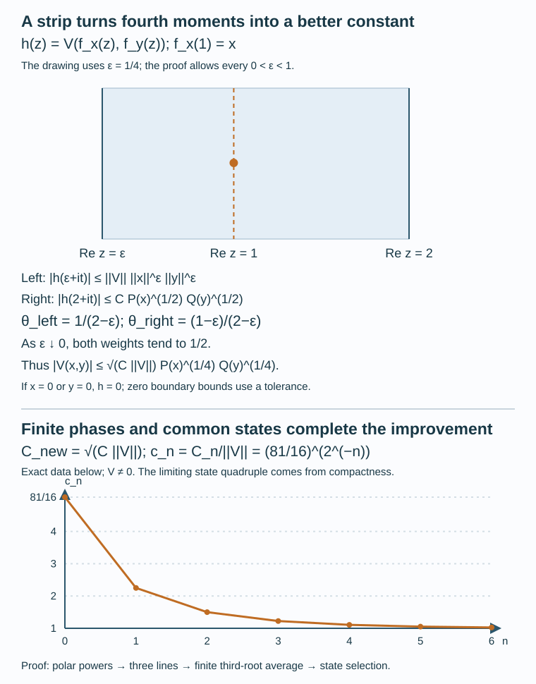

# The sharp noncommutative bilinear inequality

*AI-generated exposition by OpenAI GPT models. CC0-1.0 to the extent of rights held.*

A finite domination coefficient is a starting budget. The [preceding lesson](tensor-completion-injectivity-and-state-domination.md) produces such a budget for every bounded bilinear form. Here a curve through each input compares two vertical boundaries, and an exact finite phase average converts that comparison into a smaller budget. The operation is
\[
C\longmapsto\sqrt{C\|V\|}.
\]
Its repeated application reaches coefficient one. A final compactness argument chooses four states that work simultaneously for every input.

We first construct the boundary curves and the scalar strip estimate, then explain how finite phases and affine state tests join them. Adjoining units and testing orthogonal isometries finish the arbitrary-algebra theorem and its optimality. No separability, nuclearity or trace assumption enters. Scalar order, continuous calculus, norm integrals and forced unitization are proved in [CF1–10](../../OA-FLOW/OA-FLOW-CF.html); the preceding lesson proves norm-preserving functional extension and arbitrary dual-ball compactness.

## 1. The coefficient to be reached

**Theorem 1.1.** Let \(A,B\) be nonzero C*-algebras and \(V:A\times B\to\mathbb C\) bounded and bilinear. There are states \(\varphi_1,\varphi_2\) on \(A\) and \(\psi_1,\psi_2\) on \(B\) such that
\[
|V(x,y)|\le\|V\|
\big[\varphi_1(x^*x)+\varphi_2(xx^*)\big]^{1/2}
\big[\psi_1(y^*y)+\psi_2(yy^*)\big]^{1/2}.
\tag{1}
\]
For a zero algebra the form is zero and the numerical inequality is vacuous; there is no state of norm one on the zero algebra.

For a finite family write
\[
R(x)=\Big\|\sum_jx_j^*x_j\Big\|+\Big\|\sum_jx_jx_j^*\Big\|.
\tag{2}
\]
The four states will be recovered from inequalities for these family costs. The main task is therefore to improve a finite family coefficient. The preceding lesson provides the initial value \(C_0=(81/16)\|V\|\).

## 2. Boundary curves built in the original algebra

**Lemma 3.1.** If \(x=u|x|\) is its polar decomposition in \(A^{**}\), then
\[
f_x(z)=u|x|^z,\qquad \operatorname{Re}z>0,
\tag{7}
\]
is an \(A\)-valued norm-holomorphic function, where the power is zero on the kernel. For \(s=\operatorname{Re}z>0\),
\[
f_x(z)^*f_x(z)=(x^*x)^s,
\quad f_x(z)f_x(z)^*=(xx^*)^s,
\quad \|f_x(z)\|=\|x\|^s.
\tag{8}
\]

The canonical meaning of \(A^{**}\) is supplied by the [all-state representation and predual construction](../../foundations-of-von-neumann-algebras/the-universal-enveloping-von-neumann-algebra-of-a-c-star-algebra-and-w-star-algebras.html#constructing-the-bidual-before-using-it). The [support and polar-decomposition construction](constant-car-states-and-the-periodic-core.md#8-3-supports-and-polar-decomposition-inside-m), applied in that represented von Neumann algebra, identifies the notation in (7). We construct the curve and prove (8) inside \(A\) before making that identification.

Scalar powers here have the following elementary meaning. The series
\(\exp z=\sum_{m\ge0}z^m/m!\) and its derivative converge uniformly on bounded disks: after \(m>2|z|\), successive absolute terms have ratio at most \(1/2\). The absolutely convergent Cauchy product and the binomial formula give
\(\exp(z+w)=\exp z\,\exp w\). Conjugation commutes with the series, so
\(|\exp z|^2=\exp(2\operatorname{Re}z)\).
For real \(r\), \(\exp r=\exp(r/2)^2>0\), since its inverse is \(\exp(-r)\). Its derivative is itself, so it is strictly increasing; \(\exp r\ge1+r\) for \(r\ge0\) and the inverse identity show its limits are infinity and zero at the two ends of the real line. Given \(t>0\), real completeness and continuity at
\(\sup\{r:\exp r\le t\}\) give a unique real \(\log t\).
The inverse is continuous, because values of \(\exp(r\pm\eta)\) bracket \(\exp r\) for every \(\eta>0\).
We define \(t^z=\exp(z\log t)\); then \(|t^z|=t^{\operatorname{Re}z}\).
These identities also justify every scalar exponential used in the strip argument.

**Proof.** If \(x=0\), all the assertions hold for the zero curve. Otherwise put \(R=\|x\|\) and \(b=|x|=(x^*x)^{1/2}\). All continuous functions of \(b\) are evaluated in the forced unitization when necessary. For \(\delta>0\), let \(\rho_\delta\) be zero on \([0,\delta]\), linear from zero to one on \([\delta,2\delta]\), and one thereafter. For \(g\in C([0,R])\) with \(g(0)=0\), the continuous function
\[
k_{\delta,g}(t)=
\begin{cases}\rho_\delta(t)g(t)/t,&t>0,\\0,&t=0\end{cases}
\]
vanishes near zero. The elements \(xk_{\delta,g}(b)\) lie in \(A\). The C*-identity gives
\[
\|xk(b)\|^2=\|b^2|k|^2(b)\|
=\max_{t\in\sigma(b)}|tk(t)|^2.
\]
Thus their differences are bounded by
\(\|(\rho_\delta-\rho_\eta)g\|_\infty\), which tends to zero as \(\delta,\eta\downarrow0\). Define their norm limit to be \(E_x(g)\). This is a linear map into \(A\), of norm at most one, with
\(\|E_x(g)\|=\max_{t\in\sigma(b)}|g(t)|\). The equality follows by taking limits in the preceding norm identity.

For \(g_z(t)=t^z\) on \(t>0\), \(g_z(0)=0\), set \(f_x(z)=E_x(g_z)\). The associated approximants are
\[
a_\delta(z)=x[\rho_\delta(t)t^{z-1}](b)\in A.
\tag{P1}
\]
For \(\operatorname{Re}z\ge\varepsilon>0\) and \(2\delta\le1\),
\[
\|f_x(z)-a_\delta(z)\|
\le\sup_{0\le t\le2\delta}(1-\rho_\delta(t))t^{\operatorname{Re}z}
\le(2\delta)^\varepsilon.
\tag{P2}
\]
In particular \(f_x(1)=x\).

Here is a direct norm-series proof of holomorphy. Fix \(z_0\) with \(a=\operatorname{Re}z_0>0\). For each \(m\ge0\), the function
\[
c_m(t)=t^{z_0}\frac{(\log t)^m}{m!}\quad(t>0),\qquad c_m(0)=0
\]
is continuous: exponential decay \(e^{-av}\) dominates every polynomial in \(v=-\log t\). Choose \(0<r<d<a\), and put \(L=\max(0,\log R)\), \(H=\max(1,R^a)\). For \(0<t\le1\), the exponential series gives
\[
t^a\frac{|\log t|^m}{m!}
=e^{-av}\frac{v^m}{m!}\le d^{-m},
\]
because \((dv)^m/m!\le e^{dv}\). On \(1\le t\le R\), the same quantity is at most \(HL^m/m!\). Consequently
\[
\sum_{m\ge0}\|c_m\|_\infty r^m
\le\frac1{1-r/d}+He^{rL}<\infty.
\]
The scalar exponential identity and this uniform bound prove, for \(|w|\le r\),
\[
g_{z_0+w}=\sum_{m\ge0}c_mw^m,\qquad
f_x(z_0+w)=\sum_{m\ge0}E_x(c_m)w^m.
\]
This is a norm-convergent power series on every smaller disk in \(|w|<a\). Its derivative series converges uniformly there as well: choose \(r<d<a\) and sum \(m r^{m-1}d^{-m}\) and \(H m r^{m-1}L^m/m!\). To justify differentiation, integrate the uniformly convergent derivative series along a line segment; the norm fundamental theorem in CF1 passes the polynomial identities to the limit. Dividing the resulting integral by the complex increment and passing to zero gives the derivative. Thus \(f_x\) is norm-holomorphic without a Cauchy-integral formula.

The two products can also be computed in \(A\). The first is the limit of
\[
a_\delta(z)^*a_\delta(z)
=[\rho_\delta(t)^2t^{2s}](b),\qquad s=\operatorname{Re}z,
\]
and hence equals \(b^{2s}\). For the other product use
\(x p(x^*x)=p(xx^*)x\), first for polynomials and then for uniformly approximated continuous functions. If \(k(t)=\rho_\delta(t)t^{z-1}\), this gives
\[
x|k|^2(b)x^*
=[t\,|k(\sqrt t)|^2](xx^*)
=[\rho_\delta(\sqrt t)^2t^s](xx^*).
\]
Its norm limit is \((xx^*)^s\). The C*-identity now gives \(\|f_x(z)\|=R^s\), proving (8).

Finally, in a polar decomposition \(x=ub\), the approximant (P1) is \(u\rho_\delta(b)b^z\). Its limit is \(ub^z\), since \(\|u\|\le1\) and (P2) applies. This proves the stated bidual identity (7). More generally \(E_x(g)=ug(b)\) for every continuous \(g\) vanishing at zero. The construction uses only the polar partial isometry and its initial support; its existence in the canonical bidual is the separate represented polar-decomposition input. \(\square\)

## 3. A scalar maximum bound and the strip estimate

Only locally convergent power series are needed for the scalar functions below. Their sums are continuous and complex differentiable by the same smaller-disk derivative estimate used above. Products are again locally convergent series: absolute convergence bounds the double sum, and regrouping by total degree gives its coefficients. A bounded bilinear form applied to two norm-convergent series has this property as well. Hence \(V(f_x(z),f_y(z))\), and its products with scalar exponentials, belong to this class.

For the circle averages, use the scalar normalization proved in
[the preceding lesson's disk and quarter-phase construction](tensor-completion-injectivity-and-state-domination.md#8-4-disk-area-and-the-quarter-phase).
It gives \(e^{i\pi/2}=i\); the exponential addition law therefore gives
\(e^{2\pi i}=1\). For a nonzero integer \(k\), the primitive
\(e^{ikt}/(ik)\) shows that its integral over \([0,2\pi]\) is zero.
The constant function has average one on that interval.

We prove the required maximum-modulus statement. Suppose
\(h(z_0+w)=\sum_{m\ge0}\gamma_mw^m\) on a disk. On a smaller circle of radius \(r\), uniform absolute convergence permits multiplication and termwise Riemann integration. The elementary averages of \(e^{i(m-n)t}\) are zero for \(m\ne n\) and one for \(m=n\). It follows that
\[
\frac1{2\pi}\int_0^{2\pi}|h(z_0+re^{it})|^2\,dt
=\sum_{m\ge0}|\gamma_m|^2r^{2m}.
\]
If \(|h|\) has a local maximum at \(z_0\), the left side is at most
\(|\gamma_0|^2\). Every other term is nonnegative, so \(\gamma_m=0\) for \(m\ge1\); \(h\) is constant near \(z_0\).

Now let \(h\) be continuous on a closed rectangle and locally represented by power series in its interior. Its modulus attains a maximum by compactness of the rectangle, proved in CF1. If the maximum exceeded every boundary value, it would occur inside. The set of interior points attaining that maximum is relatively closed and, by the circle argument, relatively open. It is the whole interior. To see this explicitly, parameterize a segment from a point in that set to any other interior point. The parameters belonging to the set form a relatively open and closed subset of \([0,1]\) containing zero. The supremum of the parameters up to which the entire initial interval is included belongs to the set by closedness; if it were less than one, openness would extend that interval past the supremum. Thus the segment is entirely included. Thus the modulus is constant throughout the interior, and continuity gives that same value on the boundary, a contradiction. The modulus on the rectangle is therefore bounded by its boundary maximum. This proves precisely the maximum bound we shall use.

Let \(a<b\), and let \(h\) be bounded and continuous on
\(a\le\operatorname{Re}z\le b\), locally represented by power series in the interior. Suppose its two vertical boundaries have bounds \(M_a,M_b>0\). Use real logarithms to form
\[
D(z)=h(z)\exp\!\left(
-\frac{b-z}{b-a}\log M_a-\frac{z-a}{b-a}\log M_b\right).
\]
It is bounded, say by \(K\), on the strip, and has modulus at most one on both vertical boundaries. For \(\delta>0\), put
\(G_\delta(z)=D(z)e^{\delta(z-a)^2}\) and \(L=b-a\).
Writing \(z=s+it\) gives
\[
|e^{\delta(z-a)^2}|=e^{\delta((s-a)^2-t^2)}.
\]
On either vertical side of a rectangle with horizontal sides at \(\pm T\), the modulus of \(G_\delta\) is at most \(e^{\delta L^2}\). On the horizontal sides it is at most \(K e^{\delta L^2-\delta T^2}\). Choose \(T\) large enough that \(K e^{-\delta T^2}\le1\), and large enough to contain the point being tested. The rectangle maximum bound gives
\[
|D(s+it)|\le e^{\delta[L^2-(s-a)^2+t^2]}.
\]
For a fixed point let \(\delta\downarrow0\). This yields \(|D|\le1\), and in particular
\[
|h(s)|\le M_a^{(b-s)/(b-a)}M_b^{(s-a)/(b-a)},
\quad a\le s\le b.
\tag{9}
\]
The same bound holds at \(s+it\). If a boundary bound is zero, first replace both bounds by \(M_a+\eta,M_b+\eta\), \(\eta>0\), and pass to their limit. Boundary points retain their given bound directly. Neither the rectangle argument nor the strip argument uses a Cauchy-cycle theorem.

## 4. What the finite phases preserve

Let \(\omega=e^{2\pi i/3}\). The same quarter-phase construction gives
\(\omega^3=1\). Moreover \(e^{i\pi/6}=a+ib\) with \(a,b>0\),
so \(\omega=i e^{i\pi/6}=-b+ia\ne1\). On the finite product
\(\{1,\omega,\omega^2\}^n\), give every point weight \(3^{-n}\), and let \(\zeta_j\) be its \(j\)-th coordinate. The geometric sum shows
\(\mathbb E\zeta_j^k=0\) for \(k=-2,-1,1,2\), and
\(\mathbb E\zeta_j^0=1\). Coordinates are independent because finite product sums factor. For \(X=\sum_j\zeta_jx_j\) we need the following estimate.

**Lemma 2.1.** For arbitrary, possibly noncommuting \(x_j\),
\[
\|\mathbb E(X^*X)^2\|+\|\mathbb E(XX^*)^2\|\le R(x)^2.
\tag{5}
\]

**Proof.** Write \(S=\sum_jx_j^*x_j\), \(T=\sum_jx_jx_j^*\).
A monomial in \((X^*X)^2\) has scalar coefficient
\(\overline{\zeta_i}\zeta_j\overline{\zeta_k}\zeta_l\).
Each coordinate exponent lies between \(-2\) and \(2\), so its expectation is one precisely when the multisets \(\{i,k\}\) and \(\{j,l\}\) agree. This happens in the two patterns \(i=j,k=l\) and \(i=l,j=k\), whose intersection is \(i=j=k=l\). Keeping the operator factors in their original order gives
\[
\mathbb E(X^*X)^2
=S^2+\sum_ix_i^*T x_i-\sum_i(x_i^*x_i)^2
\le S^2+\|T\|S.
\tag{6}
\]
The subtraction removes the extra copy of each all-equal term. Positivity of the omitted squares, \(T\le\|T\|1\), and order under congruence justify the inequality. Applying the same calculation to adjoints gives
\(\mathbb E(XX^*)^2\le T^2+\|S\|T\). The expectations are positive. Monotonicity of the positive norm therefore bounds their norms by
\(\|S\|^2+\|T\|\|S\|\) and
\(\|T\|^2+\|S\|\|T\|\), respectively. Their sum is \(R(x)^2\). \(\square\)

The same phases also select the diagonal of a bilinear form. Set
\(Y=\sum_j\overline{\zeta_j}y_j\). Since
\(\mathbb E\zeta_i\overline{\zeta_j}=\delta_{ij}\),
\[
\sum_jV(x_j,y_j)=\mathbb E V(X,Y).
\tag{12}
\]
Conjugation in \(Y\) is essential for this bilinear identity. Fourth moments of \(Y\) have the same estimate because conjugation permutes the three roots.

## 5. Turning every family test into four fixed states

Here the state tests concern the nonzero algebras of Theorem 1.1. For unital algebras, a positive element \(p\) has a state attaining \(\|p\|\): evaluation at its largest spectral value on \(C^*(1,p)\) extends with unchanged norm and value one at the unit. Such an extension is positive. To check the last assertion, if \(\|f\|=f(1)=1\), the first-order expansion of \(f(e^{ith})\) for self-adjoint \(h\), and its modulus bound for both signs of \(t\), force \(f(h)\) to be real. For \(0\le h\le1\), \(|1-f(h)|\le\|1-h\|\le1\) then gives \(f(h)\ge0\); scaling handles every positive element. This uses the functional extension and scalar calculus already proved in the preceding lesson and CF1–10.

The state set is a nonempty weak-star compact convex set. Indeed it is the intersection of the compact dual unit ball with the closed conditions of positivity and value one at the unit. The full arbitrary dual-ball construction is in [Sections 9.1–9.5 of the preceding lesson](tensor-completion-injectivity-and-state-domination.md#9-weak-star-compactness-for-arbitrary-normed-spaces).

**Lemma 1.2.** For unital \(A,B\), the existence of the four states in (1), with a constant \(C\) in place of \(\|V\|\), is equivalent to
\[
\Big|\sum_jV(x_j,y_j)\Big|\le C R(x)^{1/2}R(y)^{1/2}
\tag{3}
\]
for every pair of finite families.

**Proof.** For a negative \(C\), both formulations fail on \(x=y=1\); assume \(C\ge0\). From four-state domination, sum the absolute values and use scalar Cauchy–Schwarz. State evaluation of each positive square sum is at most its norm, which proves (3).

For the reverse implication let
\(Q=S(A)^2\times S(B)^2\), and abbreviate
\[
s(x)=\varphi_1(x^*x)+\varphi_2(xx^*),\qquad
t(y)=\psi_1(y^*y)+\psi_2(yy^*).
\]
For every pair impose the affine condition
\[
\tfrac C2[s(x)+t(y)]-\operatorname{Re}V(x,y)\ge0.
\tag{4}
\]
For any finite nonnegative combination of these tests, multiply both inputs of its \(j\)-th term by the square root of its coefficient. Choose four states independently norming the resulting four square sums. The sum of the tests at that quadruple is at least
\[
\frac C2[R(x)+R(y)]-C\sqrt{R(x)R(y)}\ge0.
\]
Here (3) controls the real bilinear sum.

For completeness, this weighted-test fact supplies a simultaneous quadruple. The image of any finite list of tests is a compact convex set \(K\subset\mathbb R^m\). If it misses the positive orthant, choose \(y_0\in K\) minimizing \(\|y_-\|^2\), put \(z_0=(y_0)_+\) and \(w=(y_0)_-\ne0\). The closest-point inequality along the segment from \(y_0\) to \(y\in K\) gives
\((y_0-z_0)\cdot(y-y_0)\ge0\). Consequently
\[
w\ge0,\qquad w\cdot y\le w\cdot y_0=-\|w\|^2<0
\quad(y\in K).
\]
Those coefficients form a strictly negative weighted test, contrary to the preceding bound. Every finite set of the closed conditions (4) therefore has a common solution; compactness gives one quadruple solving all of them.

For that quadruple, replacing \(x\) by \(-x\) bounds the absolute real part by \(C(s(x)+t(y))/2\). Reciprocal positive rescaling gives
\[
|\operatorname{Re}V(x,y)|
\le\tfrac C2[\lambda^2s(x)+\lambda^{-2}t(y)].
\]
When both values are positive, \(\lambda^4=t(y)/s(x)\) minimizes the right side at \(C\sqrt{s(x)t(y)}\). When one value is zero, the appropriate limit \(\lambda\downarrow0\) or \(\lambda\uparrow\infty\) gives zero. If both vanish, every rescaling gives zero. Finally choose a scalar phase of \(x\) that makes \(V(x,y)\) real and nonnegative; it changes neither quadratic value. This proves the desired modulus inequality. If \(C=0\), (3) for one-term families makes \(V=0\), and any quadruple works. \(\square\)

The diagram displays \(K=\{(-2+t,1-2t):0\le t\le1\}\). Its closest pair is
\(y_0=(-6/5,-3/5)\), \(z_0=(0,0)\), and its nonnegative weights are \(w=(6/5,3/5)\). Thus \(w\cdot y=-9/5=-\|w\|^2\) throughout \(K\), while \(w\cdot z\ge0\) on the orthant. This is the finite separation step in the proof above and in (S1) of the preceding lesson.

## 6. One improvement, then its limit

Assume first that \(A,B\) are unital and \(V\ne0\). Suppose a quadruple supplies a finite constant \(C>0\). For this particular quadruple put
\[
P(x)=\varphi_1((x^*x)^2)+\varphi_2((xx^*)^2),\qquad
Q(y)=\psi_1((y^*y)^2)+\psi_2((yy^*)^2).
\]
The function \(h(z)=V(f_x(z),f_y(z))\) has local scalar power series, by the boundary-curve construction and bounded bilinearity. On any strip
\(0<\varepsilon\le\operatorname{Re}z\le2\) it is bounded, and (8) gives
\[
|h(2+it)|\le C P(x)^{1/2}Q(y)^{1/2},\qquad
|h(\varepsilon+it)|\le\|V\|\|x\|^\varepsilon\|y\|^\varepsilon.
\tag{10}
\]
Apply (9) at real coordinate \(1\). The left and right boundary exponents are
\(1/(2-\varepsilon)\) and \((1-\varepsilon)/(2-\varepsilon)\).
For nonzero \(x,y\), decrease \(\varepsilon\) to zero; their norm powers tend to one. Since \(f_x(1)=x\), this proves
\[
|V(x,y)|\le\sqrt{C\|V\|}\,P(x)^{1/4}Q(y)^{1/4}.
\tag{11}
\]
A zero variable makes both sides zero. Vanishing boundary bounds are handled by the positive-tolerance form of the strip estimate.

Use (11) for the finite random inputs \(X,Y\) of Section 4. Two scalar Cauchy–Schwarz estimates on a probability space give
\[
\mathbb E[P(X)^{1/4}Q(Y)^{1/4}]
\le(\mathbb E P(X))^{1/4}(\mathbb E Q(Y))^{1/4}.
\]
Indeed the first gives the product of
\((\mathbb E P(X)^{1/2})^{1/2}\) and
\((\mathbb E Q(Y)^{1/2})^{1/2}\); the second bounds each inner expectation by the square root of its full expectation. Lemma 2.1 and positivity of the four norm-one states imply
\(\mathbb E P(X)\le R(x)^2\) and
\(\mathbb E Q(Y)\le R(y)^2\). Together with (12), this yields
\[
\left|\sum_jV(x_j,y_j)\right|
\le\sqrt{C\|V\|}\,[\mathbb E P(X)]^{1/4}[\mathbb E Q(Y)]^{1/4}
\le\sqrt{C\|V\|}\,R(x)^{1/2}R(y)^{1/2}.
\tag{13}
\]
Lemma 1.2 supplies four states for the improved constant. This completes one full operation \(C\mapsto\sqrt{C\|V\|}\).

The initial constant from the preceding lesson and induction give
\[
C_n=\|V\|\left(\frac{81}{16}\right)^{2^{-n}}
\longrightarrow\|V\|.
\tag{I1}
\]

For the current state quadruple,
\(P(x)=\varphi_1((x^*x)^2)+\varphi_2((xx^*)^2)\) and
\(Q(y)=\psi_1((y^*y)^2)+\psi_2((yy^*)^2)\).
The strip is \(\varepsilon\le\operatorname{Re}z\le2\); at \(1\), its left and right weights are \(1/(2-\varepsilon)\) and
\((1-\varepsilon)/(2-\varepsilon)\). The drawing takes
\(\varepsilon=1/4\), giving \(4/7\) and \(3/7\); the proof sends both weights to \(1/2\). For \(V\ne0\), the lower graph plots the exact values
\(c_n=C_n/\|V\|=(81/16)^{2^{-n}}\), \(0\le n\le6\).
Equations (10)–(13) prove the improvement, and (I1) proves the limit. The [reproducible figure source](../assets/render_sharp_interpolation.py) defines the coordinates and plotted values.

Choose a quadruple for each \(C_n\). The compact product of the four state spaces has a convergent subnet. A subnet is eventually in each tail of the original sequence, so its constants still tend to \(\|V\|\). For each fixed \(x,y\), evaluation of the four states and the scalar square roots is continuous. The limiting quadruple consequently satisfies (1) at that pair. The quadruple was selected once, so it works for all pairs. This proves the unital theorem. For \(V=0\), any states of the nonzero algebras suffice.

The attained-infimum argument gives a second description of the same endpoint. An admissible \(C\) must satisfy \(\|V\|\le2C\), since each bracket on unit-ball inputs is at most two. For \(V\ne0\), the infimum \(c\) of admissible constants is finite and at least \(\|V\|/2>0\). Taking quadruples with constants tending to \(c\) and a compact subnet produces a quadruple at \(c\). One improvement gives \(c\le\sqrt{c\|V\|}\); division by \(\sqrt c\) proves \(c\le\|V\|\). The iteration above only needs compactness at its final limit, not an attained starting infimum.

## 7. Adjoining units with the same form norm

Let \(A^\dagger,B^\dagger\) be the forced C*-unitizations proved in CF9. We construct a bilinear extension on these two algebras with norm exactly \(\|V\|\).

For each finite \(F\subset A\) and \(\delta>0\), put
\[
H_F=\sum_{a\in F}(a^*a+aa^*),\qquad
e_{F,\delta}=H_F(H_F+\delta1)^{-1}.
\]
Continuous calculus gives \(e_{F,\delta}\in A\) and
\(0\le e_{F,\delta}\le1\); the scalar function vanishes at zero. For \(a\in F\), order under congruence and the two C*-norm identities give
\[
\begin{aligned}
\|a-ae_{F,\delta}\|^2
&\le\|(1-e_{F,\delta})H_F(1-e_{F,\delta})\|,\\
\|a-e_{F,\delta}a\|^2
&\le\|(1-e_{F,\delta})H_F(1-e_{F,\delta})\|
\le\sup_{t\ge0}\frac{\delta^2t}{(t+\delta)^2}
=\frac{\delta}{4}.
\end{aligned}
\]
The first bound uses \(a^*a\le H_F\); the second uses
\(aa^*\le H_F\) and \(\|z\|^2=\|zz^*\|\).
The scalar supremum is attained at \(t=\delta\), as
\((t+\delta)^2\ge4t\delta\). Direct the pairs by increasing \(F\) and decreasing \(\delta\). Their positive contractions then approximate every element on both sides. There is no monotonicity assertion for this net. Construct the corresponding contractions \(f\in B\).

For \(s\in A^\dagger,t\in B^\dagger\), define
\[
W_{e,f}(s,t)=V(se,tf).
\]
Since the original algebras are ideals, the two inputs belong to \(A,B\). Their norms are at most \(\|s\|,\|t\|\); hence
\(\|W_{e,f}\|\le\|V\|\). On \(A\times B\) their values tend to \(V\), since \(ae\to a\), \(bf\to b\), and bounded bilinearity controls the difference.

To take one limit on all unitized inputs, use the projective completion
\(Z=A^\dagger\widehat\otimes_\pi B^\dagger\).
A bounded bilinear form \(W\) defines a linear functional by
\(\ell_W(\sum_js_j\otimes t_j)=\sum_jW(s_j,t_j)\).
The algebraic tensor's universal property makes this well-defined, and taking the infimum of projective costs gives
\(|\ell_W(z)|\le\|W\|\|z\|_\pi\).
It extends uniquely to the completion. Conversely, evaluation on elementary tensors with unit-ball factors shows
\(\|W\|\le\|\ell_W\|\), since their projective norm is at most one. Thus \(\|\ell_W\|=\|W\|\).

The functionals \(\ell_{W_{e,f}}\) lie in the weak-star compact dual ball of radius \(\|V\|\), whose full proof is in the preceding lesson. Take a convergent subnet with limit \(\ell\), and set
\(\widetilde V(s,t)=\ell(s\otimes t)\). It is bilinear and has norm at most \(\|V\|\). On original inputs its restriction is \(V\), because the subnet is cofinal and the values of the original net already converge there. Isometric inclusion of \(A,B\) in their forced unitizations then gives the opposite norm bound:
\[
\|\widetilde V\|=\|V\|.
\]
For \(V=0\) the zero extension suffices.

Apply the unital theorem to \(\widetilde V\). Restrict each of its four states to its original algebra. A restriction is positive and has norm at most one. If its norm is \(r>0\), dividing by \(r\) makes a state and increases every positive quadratic value. If the restriction is zero, replace it by any state of that nonzero algebra, which also increases these values. Such a state exists directly: choose \(0\ne h=a^*a\in A\), norm \(h\) by a state of \(A^\dagger\), and restrict; the value \(\|h\|\) forces the restricted norm to be one. The same argument applies in \(B\). The resulting four states satisfy (1) with coefficient \(\|V\|\). This proves the nonunital case of Theorem 1.1.

### The Banach-bidual norm identity

There is a second norm-preserving extension that is useful independently of the unitization construction. Define \(T:A\to B^*\) by
\((Tx)(y)=V(x,y)\), and define its Banach adjoint
\(T^*:B^{**}\to A^*\) by \((T^*G)(x)=G(Tx)\). Then
\[
\overline V(F,G)=F(T^*G),\quad F\in A^{**},\ G\in B^{**},
\qquad \|\overline V\|=\|V\|.
\tag{14}
\]
Indeed \(\|T\|=\|V\|\) by its definition, and
\(|F(T^*G)|\le\|V\|\|F\|\|G\|\).
For the evaluation embeddings \(J_A,J_B\),
\(\overline V(J_Ax,J_By)=V(x,y)\). The embeddings are isometric by the norming-functional proof, so restriction gives the reverse norm inequality. This proves (14) for the Banach biduals, before any product or polar decomposition is considered.

Under the canonical bidual identification specified in Section 2, the maps
\(\kappa_A(a+\lambda1)=J_Aa+\lambda1_{A^{**}}\) and \(\kappa_B\) are unital *-homomorphisms: their products expand by the forced-unitization formula and by the transported product extending the original one. They are contractive by the C*-homomorphism norm proof in CF6. Therefore
\(\overline V(\kappa_A(s),\kappa_B(t))\) is another unitized extension with norm at most \(\|V\|\); its original restriction forces equality. Exercise 9 checks both descriptions. Formula (14) does not assert separate normality in both variables.

## 8. Why coefficient one is the endpoint

Put \(q(x)=(x^*x+xx^*)/2\) and let
\(\varphi=(\varphi_1+\varphi_2)/2\),
\(\psi=(\psi_1+\psi_2)/2\).
The two extra positive terms in \(4\varphi(q(x))\) show that the first bracket of (1) is at most that value; the second bracket has the corresponding bound. Thus
\[
|V(x,y)|\le4\|V\|\varphi(q(x))^{1/2}\psi(q(y))^{1/2}.
\tag{15}
\]
This symmetric corollary is useful, but optimality concerns the four-state coefficient in (1).

For a concrete obstruction to a smaller coefficient, work on
\(B(\ell^2(\mathbb N))\), choose any state \(\omega\), and put
\(V(x,y)=\omega(xy)\). The product norm gives \(\|V\|\le1\), and \(V(1,1)=1\) gives equality. For each positive integer \(n\), define
\[
u_je_k=e_{n(k-1)+j}\qquad(1\le j\le n,\ k\ge1).
\]
The maps extend from the standard orthonormal basis to isometries; their ranges are pairwise orthogonal and exhaust the basis. Hence
\(u_j^*u_j=1\) and \(\sum_ju_ju_j^*=1\).

Test a proposed coefficient \(C\|V\|\) on \(x_j=u_j^*\), \(y_j=u_j\).
Every bilinear value equals \(\omega(1)=1\).
The four square sums, in the order used in (1), are
\(1,n1,n1,1\). Consequently each sum of state brackets equals \(n+1\). Summing the proposed pointwise estimates and using scalar Cauchy–Schwarz yields
\[
n\le C(n+1).
\]
This is available for every \(n\), so \(C\ge n/(n+1)\) for all \(n\), and \(C\ge1\). Thus the coefficient reached by the improvement operation is the best universal one.

## 9. Exercises through the four mechanisms

### State selection and the endpoint

**Exercise 1.** Given finite families in unital \(A,B\), choose normers for their four positive square sums. Explain why the converse of Lemma 1.2 needs those four choices, and why averaging within an algebra too early can lose the family cost \(R\). Test a common normer on \(x=e_{12}\in M_2\).

*Solution.* Write
\[
S_x=\sum_jx_j^*x_j,\quad T_x=\sum_jx_jx_j^*,\qquad
S_y=\sum_jy_j^*y_j,\quad T_y=\sum_jy_jy_j^*.
\]
Each positive element has a state attaining its norm by the scalar detector construction in Section 5. Assign its four independent normers to
\(\varphi_1,\varphi_2,\psi_1,\psi_2\), in that order. Then the sums of the two family brackets are exactly
\[
\varphi_1(S_x)+\varphi_2(T_x)=R(x),\qquad
\psi_1(S_y)+\psi_2(T_y)=R(y).
\]
The finite weighted affine test consequently has the maximum needed in the converse proof.

Within \(M_2\), \(x=e_{12}\) gives \(S_x=e_{22}\) and
\(T_x=e_{11}\). Both have norm one, but a state taking value one on both would take value two on \(e_{11}+e_{22}=1\), whereas a state has value one there. Thus a common normer can fail in either algebra. Replacing the two separate normers by their mean before evaluating the two sums need not give the sum of their norms. Four choices preserve the exact two equalities above.

**Exercise 8.** For the improvement operation on nonzero unital algebras, treat \(V=0\) and \(V\ne0\) separately. In the latter case prove \(C\ge\|V\|/2\) for every admissible coefficient, attain its infimum by compactness, and justify the division in the best-constant argument. Explain how iteration reaches the same endpoint.

*Solution.* If \(V=0\), every input has bilinear value zero, and any quadruple of states works. The nonzero algebras have states by the unit-value extension construction, so none needs to be manufactured by dividing a zero quantity.

Suppose \(\|V\|>0\). For \(\|x\|,\|y\|\le1\), each positive quadratic evaluation in (1) is at most one. The two bracket sums are at most two, giving
\(|V(x,y)|\le2C\). Supremizing proves \(C\ge\|V\|/2>0\).
The preceding lesson provides a finite admissible coefficient; hence their infimum \(c\) is finite and positive. Choose admissible \(C_k\downarrow c\) and quadruples for them. A compact subnet of the quadruples converges; its coefficients still tend to \(c\), and each fixed-input inequality passes to the limit. The limiting quadruple realizes \(c\).

Section 6 applies one improvement to this quadruple, so
\(c\le\sqrt{c\|V\|}\). Since \(\sqrt c>0\), division gives
\(\sqrt c\le\sqrt{\|V\|}\), and therefore \(c\le\|V\|\).
Alternatively \(C_{k+1}=\sqrt{C_k\|V\|}\) starting at
\((81/16)\|V\|\) has the explicit limit in (I1). A compact subnet then realizes that limit. This alternative does not require an attained infimum before beginning the iteration.

**Exercise 10.** For each positive integer \(n\), use the orthogonal isometries on \(\ell^2(\mathbb N)\) and \(V(x,y)=\omega(xy)\), with any state \(\omega\), to test a proposed universal coefficient \(C\). Compute the four square sums at \((u_j^*,u_j)\), derive \(n\le C(n+1)\), and determine the resulting lower bound.

*Solution.* The isometries obey \(u_j^*u_j=1\), and their orthogonal range projections \(p_j=u_ju_j^*\) sum to one. Therefore, for \(x_j=u_j^*\), \(y_j=u_j\),
\[
\sum_jx_j^*x_j=1,\quad\sum_jx_jx_j^*=n1,\qquad
\sum_jy_j^*y_j=n1,\quad\sum_jy_jy_j^*=1.
\]
Both sums of state brackets equal \(n+1\), regardless of the four states. The product bound gives \(\|V\|\le1\); \(V(1,1)=1\) gives \(\|V\|=1\). Each tested value is
\(V(u_j^*,u_j)=\omega(u_j^*u_j)=1\).
Summing the proposed pointwise inequality and applying scalar Cauchy–Schwarz now gives
\[
n=\sum_j|V(u_j^*,u_j)|
\le C\sqrt{(n+1)(n+1)}=C(n+1).
\]
The construction of Section 8 is available for every \(n\), so
\(C\ge n/(n+1)\) for every positive integer \(n\), and passage to the limit forces \(C\ge1\).

### Boundary curves and cutoffs

**Exercise 4.** Let \(x=u|x|\) in the canonical bidual of an arbitrary C*-algebra \(A\). For \(0<\operatorname{Re}z<1\), prove \(u|x|^z\in A\) by the closed ideal generated by \(t\) on \([0,\|x\|]\). Prove also \(ug(|x|)\in A\) for every continuous \(g\) vanishing at zero, and explain the difficulty with the uncut multiplier \(t^{z-1}\).

*Solution.* For \(s=\operatorname{Re}z>0\), the scalar function
\(g_z(t)=t^z\), \(g_z(0)=0\), is continuous, because its modulus is \(t^s\). When \(s<1\), \(t^{z-1}\) is unbounded near zero, so it cannot serve directly as a continuous-calculus multiplier.

For any continuous \(g\) with \(g(0)=0\), use
\[
k_{\delta,g}(t)=\rho_\delta(t)g(t)/t\quad(t>0),\qquad
k_{\delta,g}(0)=0.
\]
It is continuous and zero near zero. The functions
\(t k_{\delta,g}(t)=\rho_\delta(t)g(t)\) converge uniformly to \(g(t)\): the error is bounded by
\(\sup_{0\le t\le2\delta}|g(t)|\to0\).
Thus every such \(g\) belongs to the closed ideal generated by the coordinate function \(t\); conversely every member of that ideal vanishes at zero by evaluation there.

The polar identity gives
\(u\rho_\delta(|x|)g(|x|)=xk_{\delta,g}(|x|)\in A\).
Its norm distance from \(ug(|x|)\) is at most the preceding scalar error, since \(\|u\|\le1\). Norm closure of the isometric copy of \(A\) in its bidual proves the claim. Applying it to \(g_z\) proves the requested case \(0<s<1\), and indeed every \(s>0\). For \(x=0\) the elements are zero.

**Exercise 5.** Let \(K\subset\{\operatorname{Re}z>0\}\) be compact and \(\operatorname{Re}z\ge\varepsilon>0\) on \(K\). For each integer \(n\ge1\), compare the bidual projection cutoff removing \(0\le t<1/n\) with the continuous \(A\)-valued cutoff \(\rho_{1/(2n)}\). Prove their uniform errors are at most \(n^{-\varepsilon}\), and justify holomorphy of the resulting locally uniform polar-power limit.

*Solution.* Put \(b=|x|\) and \(c=1/n\le1\). Here the projection cutoff can be constructed from continuous calculus alone in the represented canonical bidual \(M\). Define
\(r_k(t)=\min(1,k(c-t)_+)\).
The positive contractions \(r_k(b)\) increase. They have a strong limit \(q\): for \(j\ge k\), the positive contraction
\(d=r_j(b)-r_k(b)\) satisfies \(d^2\le d\), so
\[
\|(r_j(b)-r_k(b))\xi\|^2
\le\langle(r_j(b)-r_k(b))\xi,\xi\rangle.
\]
The right side tends to zero by scalar monotone convergence of the bounded quadratic values. Thus the vectors are Cauchy for every \(\xi\), define a bounded strong limit, and strong closedness puts it in \(M\). It is self-adjoint and positive by its quadratic values.

For fixed \(k\) and \(j\ge k\), continuous calculus gives
\[
\|r_k(b)(1-r_j(b))\|
\le\sup_{v\ge0}\min(1,kv)(1-\min(1,jv))
\le\frac{k}{4j}.
\]
On the nonzero part of the latter expression \(0\le v\le1/j\), its maximum is bounded by \(kv(1-jv)\le k/(4j)\).
Taking \(j\to\infty\) gives \(r_k(b)q=r_k(b)\). Then taking \(k\to\infty\) strongly gives \(q^2=q\). Thus \(q\) is the projection for \(0\le t<c\), and \(p_n=1-q\) is the retained cutoff. On the kernel of \(b\), \(q\) acts as one.

For \(z\in K\), the product \(r_k(b)b^z\) has norm at most
\(c^{\operatorname{Re}z}\le c^\varepsilon\), because \(r_k\) is zero for \(t\ge c\). Strong passage to \(q b^z\) preserves this upper bound on every vector and hence in operator norm. Multiplication by the polar partial isometry is contractive, so
\[
\|u b^z-u p_n b^z\|\le n^{-\varepsilon}.
\]
This is the projection-cutoff estimate; \(p_n\) need not belong to \(A\).

For the continuous approximant
\(a_n(z)=x[\rho_{1/(2n)}(t)t^{z-1}](b)\in A\),
the error is supported on \(0\le t\le1/n\). Consequently
\[
\|u b^z-a_n(z)\|
\le\sup_{0\le t\le1/n}(1-\rho_{1/(2n)}(t))t^{\operatorname{Re}z}
\le n^{-\varepsilon}.
\]
Each \(a_n\) is entire: the logarithm is bounded on the support of its cutoff, so the exponential series and its derivative converge uniformly on every bounded parameter disk. These approximants converge locally uniformly in norm to \(f_x\). The coefficient estimate in Section 2 constructs the limit's own norm-convergent local series
\(\sum_m E_x(c_m)(z-z_0)^m\), with a uniformly convergent derivative series on smaller disks. It therefore proves the holomorphy of this locally uniform limit directly. The projection cutoff, the continuous original-algebra cutoff and the limit's local series have distinct roles.

**Exercise 6.** At real coordinate \(1\) in the strip \([\varepsilon,2]\), \(0<\varepsilon<1\), calculate the two weights applied to the actual boundary estimates (10). Take \(\varepsilon\downarrow0\), including zero input and zero boundary cases, and recover (11).

*Solution.* The weights sum to one and interpolate between their values at the two boundaries. Solving for them at \(1\) gives
\[
\theta_L=\frac1{2-\varepsilon},\qquad
\theta_R=\frac{1-\varepsilon}{2-\varepsilon}.
\]
The scalar strip proof therefore yields
\[
|h(1)|\le
[\|V\|\|x\|^\varepsilon\|y\|^\varepsilon]^{\theta_L}
[C P(x)^{1/2}Q(y)^{1/2}]^{\theta_R}.
\]
Both weights tend to \(1/2\); for nonzero inputs the norm factors tend to one. The right boundary already has powers \(P^{1/2}Q^{1/2}\), so their limiting powers are \(P^{1/4}Q^{1/4}\), while the constants become \(\sqrt{C\|V\|}\). Since \(h(1)=V(x,y)\), this is (11). A zero variable gives zero by bilinearity. A zero boundary estimate is first replaced by a positive tolerance, the proved strip bound is applied, and the tolerance is then decreased to zero.

### Exact finite phase bookkeeping

**Exercise 2.** Expand \((X^*X)^2\) without commuting its coefficients. Identify the two surviving pairings of indices and their intersection, and obtain the exact all-equal subtraction in (6). Check the formula for a single coefficient.

*Solution.* The term indexed by \(i,j,k,l\) is
\(\overline{\zeta_i}\zeta_j\overline{\zeta_k}\zeta_l
x_i^*x_jx_k^*x_l\).
Its expectation survives exactly when \(\{i,k\}=\{j,l\}\) as multisets. The pattern \(i=j,k=l\) sums to
\((\sum_i x_i^*x_i)^2=S^2\).
The pattern \(i=l,j=k\), in the displayed multiplication order, sums to \(\sum_i x_i^*T x_i\).
Their intersection forces all four indices to be equal and contributes \(\sum_i(x_i^*x_i)^2\). Inclusion–exclusion gives
\[
\mathbb E(X^*X)^2
=S^2+\sum_i x_i^*T x_i-\sum_i(x_i^*x_i)^2.
\]
Every valid pattern outside the intersection was counted once, and each intersection term is now counted once. For one coefficient the first two terms are both \((x^*x)^2\), so subtracting the third leaves exactly the required single copy.

**Exercise 3.** Replace continuous independent phases in the fourth-moment calculation by a finite distribution. Show that independent uniform third roots give the same surviving monomials, count the sample points, and decide whether roots of other orders or real signs work. State what this calculation establishes about interpolation.

*Solution.* For \(\omega^3=1\), \(\omega\ne1\), the average over its three roots is
\[
\mathbb E\zeta^k=(1+\omega^k+\omega^{2k})/3
=0\quad(k=-2,-1,1,2),\qquad \mathbb E\zeta^0=1.
\]
A fourth-moment monomial has only exponents from \(-2\) to \(2\) in each coordinate. The product average factors into the coordinate averages and is nonzero exactly when every exponent is zero. Continuous uniform phases have the same criterion by the elementary integral of integer powers around the circle. Thus the pairings and exact fourth moments coincide.

The independent three-root product has exactly \(3^n\) equally weighted points. It is an exact formula, not an approximation by sampled phases. Uniform roots of any order \(m\ge3\) also have zero average for those four nonzero exponents and give the same result. Signs have nonzero second-power average and retain extra monomials. The finite distribution establishes the moment and diagonal-extraction identities; the strip estimate still needs its separate analytic proof.

**Exercise 7.** For bilinear \(V\), compare \(Y=\sum_j\overline{\zeta_j}y_j\) with \(Y=\sum_j\zeta_jy_j\). Calculate every diagonal and off-diagonal average coefficient and explain which choice gives (12).

*Solution.* With conjugated phases, expansion and finite summation give
\[
\mathbb E V(X,Y)
=\sum_{i,j}\mathbb E[\zeta_i\overline{\zeta_j}]\,V(x_i,y_j).
\]
The diagonal coefficient is \(\mathbb E|\zeta_i|^2=1\).
For \(i\ne j\), independence and the zero means give coefficient zero. Every diagonal term is therefore retained and (12) follows.

For the same phases in both inputs, the coefficient is
\(\mathbb E[\zeta_i\zeta_j]\).
It vanishes off the diagonal by independence and on the diagonal by \(\mathbb E\zeta_i^2=0\). That choice makes the entire average zero, even when the intended sum of diagonal bilinear values is nonzero. Conjugation is determined by the bilinear convention.

### Unitization and the two bidual variables

**Exercise 9.** Prove the exact norm identity (14), including its value on the canonical copies of \(A,B\). Verify that composition with the contractive canonical unitization maps preserves that norm. Independently construct a norm-preserving unitized extension from two-sided positive approximate identities and compactness of the projective-tensor dual ball.

*Solution.* The definition of \(T\) gives
\[
\|T\|=\sup_{\|x\|,\|y\|\le1}|(Tx)(y)|=\|V\|.
\]
For \(F\in A^{**},G\in B^{**}\), the dual norm estimates yield
\[
|F(T^*G)|\le\|F\|\|T^*G\|
\le\|V\|\|F\|\|G\|.
\]
Evaluation embeddings are isometric by norming functionals, and
\[
(T^*J_By)(x)=(J_By)(Tx)=V(x,y),\qquad
\overline V(J_Ax,J_By)=V(x,y).
\]
The upper norm bound and this restriction prove
\(\|\overline V\|=\|V\|\). Under the canonical C*-bidual construction, the maps
\(a+\lambda1\mapsto J_Aa+\lambda1_{A^{**}}\) are unital *-homomorphisms, hence contractive by CF6. Composition cannot increase the upper bound, while its restriction still gives \(V\), so this particular unitized form also has norm exactly \(\|V\|\). These calculations do not assert separate normality in both variables.

For the direct construction, use the finite-set contractions
\[
e=H_F(H_F+\delta1)^{-1},\qquad
H_F=\sum_{a\in F}(a^*a+aa^*).
\]
They belong to \(A\), are positive with norm at most one, and for \(a\in F\)
\[
\|a-ae\|^2,\ \|a-ea\|^2
\le\|(1-e)H_F(1-e)\|
\le\sup_{t\ge0}\frac{\delta^2t}{(t+\delta)^2}
=\delta/4.
\]
The two inequalities use \(a^*a\) and \(aa^*\), respectively; the C*-identity can be applied to \(z^*z\) or \(zz^*\). Increasing the finite set and decreasing \(\delta\) gives approximation on both sides for every element. The corresponding contractions \(f\) do the same in \(B\).

The unitized forms \(W_{e,f}(s,t)=V(se,tf)\) have norm at most \(\|V\|\) and converge to \(V\) on original inputs. Each defines a functional on
\(A^\dagger\widehat\otimes_\pi B^\dagger\) with the same norm: bound its value on every finite decomposition by the projective cost, extend by completeness, and use elementary tensors for the reverse inequality. The preceding lesson's compact dual-ball proof supplies a convergent subnet of these functionals. Its limit gives one bounded bilinear form on both unitizations, with upper norm bound \(\|V\|\), whose original restriction is \(V\). That restriction forces the lower bound. Thus this construction also preserves the norm, including when \(V=0\), and supplies the extension used in the main nonunital proof.

## References

Gilles Pisier, [*Grothendieck's Theorem, past and present*, expanded UNCUT author version, 21 August 2013](https://webusers.imj-prg.fr/~gilles.pisier/grothendieck.UNCUT.pdf), Theorem 7.1 and (7.1)–(7.3), printed p.25 (PDF p.27), gives the four-state and finite-family formulations and their normalizations. The sharp theorem there is attributed to Haagerup. Section 11, printed pp.35–36 (PDF pp.37–38), proves the finite CAR optimality construction for the maximum-of-two-norms normalization. The orthogonal-isometry test in Section 8 here proves optimality for the four-state coefficient directly.

Gilles Pisier, [*Grothendieck inequality, random matrices and quantum expanders*, Kyoto lectures recorded by Kei Hasegawa, March 2015](https://www.math.kyoto-u.ac.jp/sites/default/files/2023-04/Pisier_lecturenote.pdf), §5, pp.9–10, presents the phase fourth-moment and three-lines improvement used in Sections 4 and 6. Remark 5.3 credits these steps to Pisier's 1978 work and the finiteness ingredient to Haagerup. The lecture's subsequent finiteness step is an outline; here the finite starting bound comes from the preceding two lessons, and Sections 2–3 and 7 supply the norm-series, scalar strip and nonunital arguments.

The [random-lift lesson](symmetric-tensor-norms-and-rademacher-truncation.md) and the [completion and state-domination lesson](tensor-completion-injectivity-and-state-domination.md) provide the finite starting constant and full affine compactness argument. The scalar and C*-foundations are [CF1–10](../../OA-FLOW/OA-FLOW-CF.html). The canonical bidual notation uses the [universal all-state/predual construction](../../foundations-of-von-neumann-algebras/the-universal-enveloping-von-neumann-algebra-of-a-c-star-algebra-and-w-star-algebras.html#constructing-the-bidual-before-using-it) followed by the [concrete support and polar-decomposition proof](constant-car-states-and-the-periodic-core.md#8-3-supports-and-polar-decomposition-inside-m). The strip, norm-series and direct unitization arguments are given in full above.
